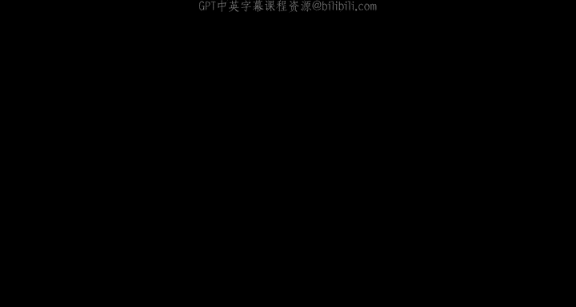
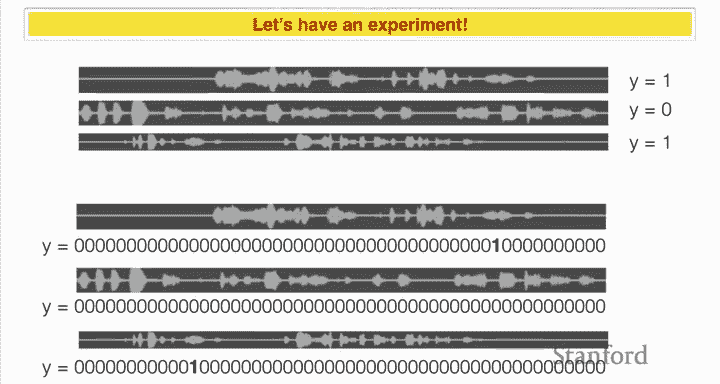
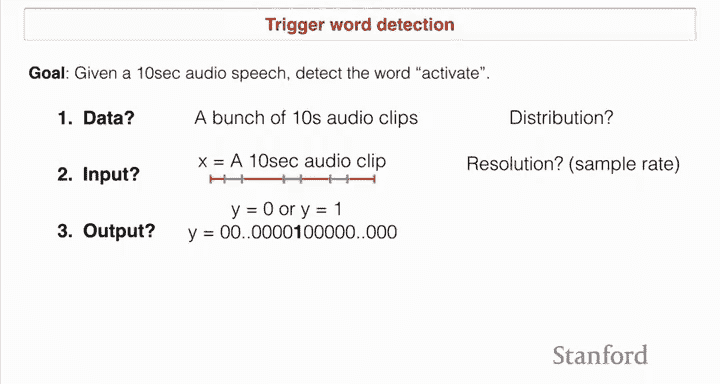
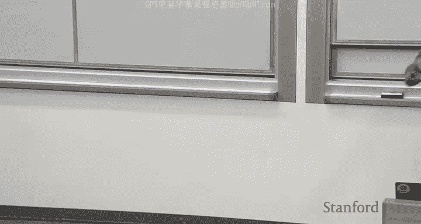

# 吴恩达@斯坦福大学《深度学习｜Stanford CS230： Deep Learning ｜ Autumn 2018》中英字幕（豆包翻译 - P2：[02]Lecture 2 - Deep Learning Intuition.zh_en - GPT中英字幕课程资源 - BV19y421z7jz

Hello， everyone。 Welcome to the second lecture for CS S 230。 So as I， as I said earlier。

 you can go on menti dot com from your smartphones or your computers and enter this code 84，57，0，9。

 We will use this tool for interactive questions during the lecture， and we will also use it to。

 to track attendance。 I'll add it at the end of the lecture。 But if you have time to do it now。😊。

Let's start the lecture。Well you guys are doing that。Okay， so。

Today's lecture is going to be about deep learning intuition。

 and the goal is to give you a systematic way to think about projects。

 everything related to deep learning， It includes how to collect your data， how to label your data。

 how to choose an architecture， but also how to design a proper loss function to optimize So all these decisions or decisions you're going to have to do during your projects。

 and we'll try to give you here an overview of these systematic way of thinking for different projects。

😊，It's going to be high level more than other lectures。

 but we hope it gives you a good start for your project。

 We'll start with a 10 minutecap on what you've seen in the two first in the first week about neural networks。

😊，So as you know， you can think of machine learning。

 deep learning in general as modeling a function that takes an input that can be an image， a speech。

A natural language or。A CSD file， give it to a box and get an output that can be classification。

Is it a cat zero， is there a cat on this image， output 1 or is there no cat on this image， output0？

And I think a good way to remember what is the model is to define it as architecture plus parameters。

Architecture is the design that you choose。 So logistic regression is the first one you've seen。

 You will see shallow neural networks， deep neural networks。

 Then you will see convolution neural networks and record neural networks。

 So these are all types of architectures， and you can choose to make them deeper or shallower。

 Paras are the core parts。 They are the numbers that make your function。

 take these cat as input and convert it to an output。 So these are millions of numbers。

 And the goal of machine learning， deep learning is to find all these numbers。

 So we're all trying hard to find numbers。 Basically， millions of numbers in matrices。😊。

If you give these cat and you forward propagate it。

 So we propagate it through the model to get an output。

You will have to compare this output to the ground truth。

The function used to do so is called the loss function。

 You've seen an example of a loss function this week。 That is the logistic loss function。

 We will see more loss functions later on。😊，Computing the gradient of this loss function is going to tell you how much should I move my parameters in order to update in in order to make the loss go down。

 So in order to make this function， recognize cats better than before。You do that many。

 many times until you find the right parameters。To plug in your architecture。

 you can then give your cats and get an output。What is very interesting and learning is that many things can change。

 You can change the input。 We talked about natural language， speech。

 structure and structure data in general。 You can change the output。

 It can be a classification algorithm。 It can be a multiclass algorithm。 I can ask you。

 give me the breed of the cat。 Instead of asking you， give me just the cat。

 which makes the problem more complicated。 It can also be a regression problem。 I。

 I give you the cat。 And I ask you， give me the age of the cat。 which is much more complicated again。

😊，Does that make sense？Okay， another thing that can change is the architecture。

 We talked about it earlier。 And finally， the loss function。

 I think the loss function is something that that people struggle with to understand what loss function to。

 to choose for a specific project。 And we're going to put a huge emphaies on that today。Okay。

And of course， in the architecture， you can change the activation functions in this optimization loop。

 you can choose a specific optimizers。 we're going to see in about three weeks all the optimizers that can be at。

 sastic gradient and descent， batch gradient and descent， RMS prop and momentum。And finally。

 all the hyperparmeter， what is the learning rate of this loop。

 What is the batch that I'm using for my optimization， We're going to see all that together。

 but there's a bunch of things that can change in this scheme。😊，Any questions on that in general？

So far， so good。O。So let's take the first architecture that we've seen together， logistic regression。

As you know， an image in computer science can be represented by a 3D matrix。

 Each matrix represents a certain color， RGB， red， green， blue。

We can take all these numbers from these 3D metrics and put it in a vector。

 We flatten it in order to give it to our logistic regression。 We we propagate it， we multiply by W。

 which is our parameter and B， which is our bias。 Give it to a soid function。

 get an output if the network is trained properly。 we should get a number that is more than 0。

5 here to tell us that there is a cat in this image。So this is the basic skill。Now。

 my question for you is。If I want to do the same thing。

 but I want to have a classifier that can classify several animals。 So on the image。

 there could be a giraffe。 There could be an elephant or there could be a cat。

How would you modify this architecture？Yes。一。あが。Yes， exactly。 So that's a good point。

 We could add several units。 So several neurons， one for each animal。

 And we will call it multi logistic regression。 So it could be something like that。

So we have a fully connection here before we were all， all the inputs were connected to this neuron。

 And now we added two neurons。 and each neuron is going to be responsible for one animal。

 How do we know which neuron is responsible for which animal。

Is the network going to figure it out on its own or do we have to help it？嗯。Exactly。

The label is important。 So what is going to tell your model， this neuron should focus on cat。

 this should focus on elephant。 This neuron should focus on giraffe is the way you label your data。

So how should we label this data now if we were to do this specific task？Any ideas？这个完窗的。

One hot vector， okay， so one hot vector means a vector with all zeros and 11。Any other ideas。嗯。One，2。

 three， so I assume you say that each integer would correspond to a certain animal。Okay。

 any other ideas？Moify the loss function。 Moifying the loss function mean you want to put more weight on one animal。

 So you modify the loss function。What exactly。It was more like the one hot codingd。

 I I see with the one hotco。 So I agree with the one hot codingd。

 I think theres a downside to the one hot onco。 What is the downside of the one hot codingd。My。Yeah。

 so you're saying that the data， don' if we have a lot of animals， the data。

 the labels only contain 0 and  one1。 So there's a huge imbalance。

 I don't think that's an issue because these neurons are independent from each other right now， so。

Yeah， it it， it could run into initially if you have a really a lot of animals。 That's true。

 But there is another problem with it。The problem is that， do you think if you want。

 if you want hot encode your labels， you would be able to detect an image with a giraffe and an elephant on the image。

You will not be able to do so。You need a multihos encoding。 So in this case。

 if there is a cat on the image， I would use a one hot。 I would say 0，1，0 as my label。

 But if I have a dog and a cat on the image， I would say 1，1，0。Okay。

 the one hot encoding works very well when you have the constraint of having only one animal per image。

And in this case， you would not use an activation function called sigmoid。 You would use another one。

Which is。没问题。Soft Max。The softm function we're going to see together。 and for those of you took2 to9。

 you probably heard of it。Okay， so what I wanted to explain here is the way you choose your labeling is very important。

 And it's a decision you should make prior to start the project。Okay， in terms of notation in the。

 in this class， we're going to use the following。A square bracket 1 would denote all the activations of the first layer。

 So the square bracket would would denote the layer， and the lower script would denote the。

 the index of the neuron in the layer。 Okay， and， of course。

 you can stack these neuron on top of each other to make the the network more complex。😊。

Depending on the task， you're solving。Okay。Now， the concept I wanted to introduce in this recap was the concept of encoding。

 You probably， some of you have probably seen this image before。

If you have a network that is not too shallow。You would notice that what the first neurons see。

Are very precise representation of the data。 So there are pixel level representation of the data。

 X 3， I is probably one of the three channels of the 3D matrix。 Just one number。

 So what this neuron sees。Is going to be a pixel level representation of the image。Okay。

What these neurons is， the second layer， the one in the hidden layer is going to see the representation outputted by all the neurons in the first layer。

These are going to be more high level， more complex because the first neurons will see pixels。

 They're going to output a little more detailed information。 Like I found a edge here。

 I found a edge there and so on。 Give it to the second layer。

 The second layer is going to see more complex information。

 and is going to give it to the third layer， which is going to assemble some high level complex features that could be eyes。

 nose， mouth， depending on what network you've been training。😊。

So this is an extraction of what's happening in each layer when the network was trained on face recognition。

 Yes， does it this only apply the networks because the con edge not necessarily。Yeah， yeah。

 So I sified here。 I give you a fully connected network， But that's true。

 These type of visuals are more observed in convolutional neural networks because these have filters。

 But this happens also in this type of network。 It's just harder to visualize。😊，Okay。

 so this is what we call an encoding。 It means if I extract the information from this layer。

 So all the numbers that are coming out of these edges， I extract them。

 I will have a complex representation of my input data。

 If I extract the numbers that are at the end of the first layer。

 I will have a lower level representation of my data。 that might be edges。Okay。

 we're going to use this encoding throughout this lecture。Any questions on that？Okay。

So let's build intuition on concrete applications。 We're going to start with a short warm up with the day and night classification and then quickly move to face verification and face recognition。

 And after that， we'll do some art generation and finish with a trigger word detection。

 If we have time， we， we'll talk about how to ship a model。

 which is shipping architecture plus parameters。😊，Okay。We didn't emphasize， as I said。

 on the architecture that lost the training strategy to help you make decisions during your project。

So let's start with the first game。We're given an image。

 and we have to build a network that tells us if the image is taken during the day。Label 0。

 or was taken at night。Label 1。So first question is， what data set do we need to collect。水嗯。这觉得。Okay。

Okay， label DG is captured during the day and during the night。I agree。 So probably， oh， yeah。

 let me ask the question。 How many images。That was the wrong activity。How many images。Like。

 how do you get this number。Can someone give me an estimate of how many images you need in order to solve this problem？

And explain how you get these history。全部点全。So you're saying a number similar to a number of parameters you have in the network。

So I think it's better to think of it the other way around。 The network comes after。 So right now。

 you don't know what network you will use。 So you cannot decide the number of data points based on your parameters later on。

 based on how your network is flexible， you can add more data。 And that's probably what you meant。

 But at first， you wantna get， you want to get a number。 Yeah。

 more images than pixels within an image。 more images than pixels within an image。诶。

I don't think that has anything to do with the pixels anymore you can have a very simple task。

You have only images that are red and green and you want to classify red and green。

The image can be giant。 You can have a lot of pixels。

 It's not going to change the number of data points you need。気持ちいいさズ。Okay。

 so you're talking about computation resources。 So the more images we have。

 probably the more computation resources we will need。 So what do you mean， Yeah。

 there's something like that。 I think in general， you wna try to gauge the complexity of the task。

So let's say we did a problem that was cat recognition。Detective， there is a cat on an image or not。

In this problem， we remember that with 10000 images， we managed to train a pretty good classifier。

 How do you compare this problem to the cat problem。You think it's easier or harder。Easier， yeah。

 I agree。 That's probably easier。So in terms of complexity。

 this task looks less complex than the cat recognition task。 So you will probably need less data。

 That's a rule of thumb。The second rule of thumb and why I get to this image is。

 what do we exactly want to do， Do we want to classify pictures that were taken outside。

 which seems even easier， or do we want also the network to classify complicated pictures。 What。

 what do I mean by complicated pictures。唔使。Inside your house。

 So let's say on a picture you have a window on the right side。

 a human will be able to say it's the day because I see the window。

 but for the network it's going to take much longer to learn that much longer than for pictures taken outside what else。

 What are other complicated pictures。Like dawn or Twilight or Ed。

Don't twilight Sunrise sunset in general。 It's complicated because you have to define it and you have to teach your network。

 what does that mean， Is it night or day。Okay， so depending on what task you want to solve。

 it's going to tell you if you need more data or less data。 I think for this task。

 if you take outside pictures，10000 images is going to be enough。

But if you want the network to detect indoor as well， you probably need 100000 images or something。

 And this is based on comparing with projects you did in the past。

 So it's gonna come with experience。Now， as you know， when you have a data set。

 you need to split it between train validation and test sets。

 Some of you have heard that we're going to see it together even more。

 You need to train your network on a specific set and test it on another one。

 How do you think you should split these 10000 images。嗯。50，50 between train and tests。8020。

 I think we， we would go more towards 8020， because the test set is made for analysis to analyze if your network is doing well on real word data or not。

 I think 2000 images is enough to get that sense， probably。

 And you w to put complicated examples in this dataset set as well。 So I would go towards 8020。

 And the bigger the data set， the more I would put in the train set。 So if I have 1 million images。

 I would put even more like 98% maybe in the train set and 2% to test my model。Okay。

Now I wrote bias here， what do I mean by bias？Have a correct balance of class。Yes。

 you need the correct balance between classes。 You don't want to give。

9000 dark images and 1000 day images。 You want to balance between these two to teach your network to recognize both class。

Okay， what should be the input of your network。The pixel image。 Yeah。

 so this is an example of a P image。 It's the Louvre Museum during the day。Harder question。

 what should be the resolution of this image。And why do we care。Okay， that's great。 So she said。

 just to repeat to for CBDD students as well， as low as you can。😊，In order to achieve good results。

 why do we want low resolution is because in terms of computation is going to be better。Remember。

 if I have a 32 by 32 image， how many pixels there are， If it's color， I have 32 times 32 times 3。

If I have 400 by 400， I have 400 by 400 by 3。 It's a lot more。

So I want to minimize the resolution in order to still be able to achieve good performance。

So what does it mean to still achieve good performance？How do I get this number。

TheSimilar resolution has to。Okay， similar resolution。

 as you expect the algorithm in real life to work on。 Yeah， probably， I agree。 What else。

What other rule of thumb can you use in order to choose this resolution。

the performance of the hum and tall if it's day or high。Yeah。Great idea。

 compared to human performance。So what I do， so there is one way to do it。

 which is the brute force way。 I would say we will train models on different resolutions and then compare their results。

 or you can be smart and use human performance as a comparison。

So I would print this image or several images like this in different resolutions on paper。

 And I would go see humans and say， classify those， classify those and classify those。

 And I would compare human performance on all these three types of resolution。

In order to decide what's the minimum resolution that I can use in order to get perfect human performance。

So， by doing that。I got that 64 by 64 by 3 was enough resolution for a human to detect if an image is taken during the day or during the night。

 And this is a pretty small resolution in imaging。But it seems like a small， like an easy task。

If you have to find a a breed of a cat， you probably need more。

Cause some cats are very look very alike， and you need a high resolution to distinguish them and maybe training for the human as well。

I know only three beers of cats， so I wouldn't be able to do it anyway。

What should be the output of the model。Lebels to y equals 0 for day， y equal 1 for night。 I agree。

 What should be the last activation of the network。The last function， sigmoid。

 we saw that sigmoid takes a number between plusfin minus infinity and plus 50 puts it between 0 and 1 so that we can interpret it as a probability。

What architecture would you use。いいかなって。Fully connected or convolutional。 I think later this quarter。

 you will see that convolutionals perform well in imaging。 So we would directly use a convolutional。

 And I think a shallow network， fully connected or convolutional would do the job pretty well。

 You don't need a deep network because you gauge the complexity of this task。😊。

And what should be the loss function， finally。啲啊。like。没事。Like the lot way。So the log likelihood。

 So it's also called the logistic class。 That's the one you're talking about。

 So the way you get this number and and youll prove it in in C S 2 to 9。

 we're not going to prove it here。 But basically， you interpret your data in a probabilistic way。

 And you take the maximum likelihood estimation of the data。

 which gives you this formula for those of you who did the math behind。 You can ask in office hours。

 T are gonna help you understand it more properly。Okay， and， of course。

 this means that if y equals 0， we want y had the prediction to be close to 0。 If y equal 1。

 we want y had the prediction to be close to one。Okay， so this was the warmer。

Now we're going to delve into phase verification。 Any question on the classification。Yesす。だび急に追して。未家。

不。前几。做翻。あ倒しはい。アて。在啊。こ外。出てで。Like the number of。我要 이。

So your the question is about how you choose the size of the test set versus the train set。

 In general， you would first say how many images do I need or data points in order to be able to understand what my model do in the real world。

This can depend on the task。 Like if I talk about if I， if I tell you about speech recognition。

 you want to figure out if your model is doing well for all accents in the world。

 So your test set might be very big and very distributed。 In this case。

 you might have a few examples that are during the day， few during the night and a few at dawn。

 sunsets sunrise and also indoor。 few of those is going to give you a number。

 So there is no good number。 There is like， you have to gauge it。Okay， one more question。Po function。

Yeah， that's a good question。 So how do you choose the loss function。

 We're going to see in the next in the next slides how to choose loss functions。

 But for this one specifically， you choose this one because it'， it， it's a。

 it's a convex function for classification problem。

 It's easier to optimize than other loss functions。 So there is a proof， but。

 but I will not go over it。If you know the L1 loss that compares Y to Y hat。

 this one is harder to optimize for a classification problem。

 We would use it for regression problems。Okay， so our new game is the school wants to use face certificationification to validate student Is in facilities like the gym。

 So， you know， when you enter the gym， you swipe your I D。😊。

And then I guess the person sees your face on the screen based on this I D and looks at your face in real and compares。

 let's say。So now we want to put a camera and have you swipe。

And the camera is going to compare this image to the image in the database。Does that make sense？

To let you in or not。So what what data set do we need to solve this problem， What should we collect。

Okay， so I'm making between the I D and the image。Yeah。

 so probably schools have databases because when you enter the school， you submit your image。

And youre also given a card， an I D。 So you have this mapping。Okay， what else do need？

 So pictures of every student label with their names。 That's what you said。

 So this is a picture of Be is a picture when he was younger。

 And that's the one he gave to the school when he arrived。😊，What should be the input of our model。

Is it this picture？嗯。ここ。More photos of him。 I'm asking just like the input of the model。Like。

 we probably need more photos of him as well。 But what's。

 what's going to be the image we give to the model。First she say。Exactly。

 the person standing in front of the camera when entering the gym。

 So this is the entrance of the gym。And Vi was trying to enter the gym。水签。Okay。

 what should be the resolution？Those of you who have done projects in imaging。

 what do you think should be the resolution？2，56 by 2，56。Any other ideas more precisely。

I think in general， you will go over 400。 So 400 by 400。 What's the reason。

Why do we need 64 for four day and night and 400 for face verification。冇几你。Different yeah。Yeah。

 there's more details to detect text。 So like distance between the eyes， probably。Size of the nose。

 mouth。General， general features of the face。 These are harder to detect for 64 by 64 image。

And you can test it。 You can go outside and show two pictures of people that look like each other and ask people。

 can you differentiate those two person or not？And you'll see that with less than that。

 sometimes it people are struggling。St。Is color important。 That's a good question。 We。

 we should have talked about it in day and night， actually。

 Is color important because if you remove the color， you basically divide by3 the number of pixels。

 right？ So if we could do it without color， we would do it without color。 In this case。

 color is going to be important because probably you want your camera to work in different settings。

Day and night as well。 So the， the luminosity is different， the brightness。 And also。

 we all have different colors， and we need to all be detected compared to each other。

I might go somewhere in in an island and come back you know， full of colour。 But。

 but I still wanna be able to access the gym。😊，Outputs， what should be the output。Question on。

ReolSo is that a minimum resolution or that like a。

I think if you have in unlimited computational power， you would take more resolution。

 but that's a trade off between computational and resolution。

So output is going to be one if it's U and 0， if it's not U， in which case。

 they would not let you in。Okay， now。The question is。

 what architecture should we use to solve this problem now that we collected the data set。

Of mapping between student Ids and images。It'srry， good question。

How do you know how many images you need to train？有一。YeahHow do you know the question Yeah。

 you how do you know how many images you need to train the network。You don't know。

 You can find an estimate。 It's going to depend on your architecture。 But in general。

 the more complex the task， the more data you will need。

 And we'll see something called error analysis in about four weeks， which is once your network works。

 you're going to give it a lot of examples。 Deect which examples are misclassified by your network。

 and you're going to add more of these in the training set。

 So you're going to boost your dataset set。Okay， talking about the architecture， if I ask you。

 what's the easiest way to compare two images。What would you do， Like these two images。

The database image and the input image。Its sort of hatch。

Some sort of sweat you take the run standardized function on it and then compare。Okay， take an in。

 take this， run it into a specific function， Take this。

 run it into a specific function and compare the two values。 That's correct。 That's a good idea。

 And the more basic one is just computer distance between the pixels。

Just compute the distance between the pixels。 and you get， if it's the same person or not。

 Unfortunately， doesn't work。 And a few reasons are， the background lighting can be different。

And so if I do this， minus this。This pixel， which is， let's say， dark， is going to have a value of 0。

 This pixel， which is white， is going to have a value of 2，55。 The distance is gigantic。

 but it's still the same person。Is the problem。Person can wear makeup， can grow a beard。

 can be younger on a picture。 The I D can be outdated。

 So it doesn't work to just compare these two pictures together。

 We need to find a function that we will apply these， these， these two images to， and will give us。

A more， a better representation of the image。So that's what we're going to do now。

 What we're going to do is that we'll encode information， Use the encoding that we talked about。

Of the picture in the vector。 So we want a vector that would represents。

Teachers like distance between eyes， nose， mouth， color， all all this type of stuff hair in a vector。

So this is a picture of Ve from the I D。 We would run it to a network。

 and we hopefully can find a good encoding of this network。😊。

Then we will run the picture of home at the facility， run it in the deep network， get another vector。

 And hopefully， if we train the network properly， these two vectors should be close to each other。😊。

Let's say we have a threshold that is 0。5。Po4 is the distance between these two。

 It's less than the threshold。 So I would say Bton is the right person。It's you。

Does this scheme make sense。What， what is the 128 factor represent？ What does the 1，28 D vector。

 So the question is， can I say that the third entry correspond to something specific。

 It's complicated to say， But depending on what network you choose and the training process you choose。

 it will give you a different network。 a different vector。

 So that's what we're going to talk about now。The question is。

 how do I know that this vector is good。Like right now， if I take a random network。

 I give my image to it。 It's gonna output a random vector。

 This vector is not gonna contain any useful information。

 I wanna make sure that this information is useful。 And that's how I will。Design my loss function。

Okay， so just to recap， we gather all student faces encoding in a database once we have these。😊。

And given a new picture， we compute the distance between。

 between the new picture and all the vectors in the database。 if we find a match， sorry。

 we compare this vector of the input image with the vector corresponding to the I image。

 If it's small， we consider that it is the same person。Okay。

 now talking about the loss and the training to figure out this。

 this vector corresponds to something meaningful。First。

 we need more data because we need our model to understand， in general。

 the features of the face and a university that has 1000 students is probably not gonna be enough to have1000 image in order to push a model to understand all the features of the face。

 Instead， we will go online find open data sets with millions of pictures of faces and help the model learn from these faces to then use it inside the facility。

 There was a question in the back。 like we did with like the cat elephante， but every student is a。😊。

That's another option。 So the question is， why can the country use the one hot encoding。

 We could be the classifier that has。And output neurons。

 and corresponding to the number of students in the school。And you take an image。

 You run it to the network。 is going to tell you which student it is。

What's the issue with that Every year students enter the school。

 You will have to modify your network every year。Because you have more students and you need a higher output vector。

A larger output vector。 we don't wantanna retrain all the time， our networks。Okay， so what's， what。

 what we really want if， if we want to put it in words is that， oh， there's a mistake here。

 What we really want is if I give you two pictures of the same person。I want a similar encoding。

 I want the vector to be similar。If I give you two pictures of different persons。

I want different encodings。 I want the vector to be very different。

And we're going to rely on these two assumptions and these two thoughts in order to generate our loss function。

By giving it triplets， triplets means three pictures， one that we call anchor。That is the person。

 a person， one that we call positive。 that is the same person as the anchor。

 but a different picture of that person。And the third one that we call negative。

 That is a picture of someone else。And now what we want to do is to minimize the encoding distance between the anchor and the positive and maximize the encoding distance between the anchor of the and the negative。

Does these two talk make sense？So now my question for you is， what should be the loss function。

What should be the last function。 So please go on Menee and enter the code and。

There are three options here， A， B and C。Choose which of these you think should be the right loss function to use for this problem。

You have it on your phone as well。 Like if you。Yeah， it's more on the screen。

 but you can see it on on。It's cut off。Is it better here？我た。You can't see the URL in the back。

 it's too small。8，4，5，7，0，9。Can you see it on your phone。我大。It这。아。Yeah。So by ak of a。

 I mean the encoding vector of the anchor。By N of P。

 I mean the encoding vector of the positive image after you run them to the network。うて。おし。Yeah。Okay。

 30 more seconds。必とれはて。可。O。All right， 20 more seconds。Okay， let's see what we have。O。

So two third of the people think that。That it's the first answer A。 So I I read it for everyone。

 The loss is equal to the L2 distance between the encoding of a and the encoding of B minus the L2 distance between the encoding of a and the encoding of N。

So someone who has answered this， do you want to give an explanation。Yes。

We are trying to minimize the first difference between A and the positive。

And we try to maximize the difference between a and the negative when you subtract。

 so the second part can go as big as possible the law will minimum。And the first will be minimize。

Yes， that's correct。So what you said， I repeated for your SBD students。We want to maximize。

The distance between the encoding of a and the encoding of the negative。

 That's why we have a minus sign here。 because we want the loss to go down and to go down。

 we put a minus sign， and we maximize this term。And on the other hand。

 we want to minimize the other term because it's the positive term。Okay。So I agree。 Good answer。Okay。

 that was the first time you use this tool。 It's gonna be quicker next time。Okay， so we have。

 we have figure out what the loss function should be。 And now think about it。

 now that we designed our loss function， we're able to use an optimization algorithm。

 run an image in the network。😊，So， run， run three images in the network。Like that。Get three outputs。

 encoding of a encoding of key， encoding of n。 Comp the loss。

 take the gradients of the loss and update the parameters in order to minimize the loss。Hopefully。

 after doing that many times， we would get an encoding that represents features of the face because the network will have to figure out who are the same people。

 who are different people。Does that make sense， iss called the triple plate loss。

And I cheated a little bit in the， in the quiz。 I didn't write this alpha。

 The true loss function contains a small alpha。 You know why。Yes。So you don't have negative loss。

Yeah， that's not exactly the role of the alpha in order to not have negative loss。

 what you can do is to use a maximum of the loss n0 and train on the maximum of the loss n0。

But there is another reason why we have this alpha。Yes。

Potentially to have a difference between like false negatives and false positives。

 like which one you。Which one do you prefer based on false negative and false negative。 No。

 it's not about that。 So sometimes you have an N loss function to put a weight on some classes。

 But this is an additional alpha。 It's not a multiplicative alpha。 So it has nothing to do with that。

penize。To penalize large weight， so you're talking about your polarization。If we had。

Weights in this formula next to the alpha， like alpha times the norm of the weights。

 This would be a regularization。 But here， this term doesn't penalize weights。エス関数し。うしなく。

It's not gonna affect the gradient。 It's not gonna affect。 It's not gonna affect the waste。

 But the reason we have it here is because let's say the encoding function is。

 let's say the encoding function is just the function 0。

What we're going to have is that we're going to have encoding of a equals 0 minus-0。 and here。

0 minus-0。And so we will have basically a perfect loss of 0。呃。And we still didn't train our network。

 We just learned the function No。 So this alpha is called the margin。

 and it pushes your network to learn something meaningful in order to， to。

 to stabilize itself on on zeros。😊，Okay。よくいまし。We' taken the greatness with theism adding out that there is something to change with here。

Yeah， so it also has to do with the initializations。

 but because we didn't talk about initialization yet， we only saw zero initialization， I think。

 and Conation together。 another way to avoid the network to stabilize to become stable and zero is to change the initialization scheme。

 And in two weeks， we're going to see different initialization schemes together。

is there any guarantee that the this way that' bringing the metaphor is going to be a robot？

Patients of。So the question is， how do we know that this network is going to be robust to rotations of the image or scaling of the image or translation of the image？

We know it because in the data， we're going to give， let's say your picture and your picture scaled。

 and we're going to tell the network this is the same person。

 so the network will have to learn that the scale doesn't mean it's not the same person。

You have to learn this feature。Okay， one more question。 And then we move on fine。 Yeah。

 so is it starting at zero problem just negative values Yeah， It's a good question。

 Why is it a problem to stay to stabilize at  zero is because。It's common to keep them。

 the loss functions positive。 And in the paper that you can find， it' facenet paper。

 They don't train exactly this loss。 They train the maximum of this loss n 0。Okay。

 so you train and you get the right function。Now， let's make the problem a little more complicated。

What we did so far was face verification。 We're going to do face recognition。 What's the difference。

 The difference is， there is no more I D。So now you just have a camera in the facility。 You enter。

 The camera looks at you， and finds you。How would you design this new network。Yes， in the back。

You've added in an element now of recognition as well。

Because now before you'd start staying in front of it and knew that every picture had a face。

 now it needs to detect the face。Okay， so you're saying maybe we need to add an element to the pipeline that is a detection detection element。

 That's true in general for face recognition。 Let's say you have a picture that is quite big。

 You want to use the first network that identifies the face， like finds it on the picture， Deects it。

 and then crop the face and give it to another network。 That's true。

 That could also be used in verification as well。In run the previous education mobile time go to old place。

Great， so the difference， maybe what you're saying is maybe we can use our verification algorithm that we train。

 but instead of looking one to one comparison， we look at one to n comparison。😊。

So we have the pictures of all the students in the database。

What we can do is run all these database pictures in the model， get a vector that represents them。

Right，We get the vectors。Now， you enter the facility。We get your picture。

 We run it through the model。 We get your vector， and we can compare this vector to all the vectors in the database to identify you。

What's the complexity of this？It's N the number of students you have for every prediction to go over the whole database。

And a common network like model that you can use to do that is can neighbors。So， of course。

 if you have only one picture per students， it's not going to be very precise。

 But if you collect three pictures per student and you run a two nearest neighbors algorithm。

 you would decide that if the two pictures are the same。

 it's likely that this person is the same as the two person on the picture。O。

Now let's make it a little more complicated。You probably saw that on your phone。

 sometimes you take a picture and it recognizes that it's your grandmother or your grandfather or your mother and father。

What's happening behind is that there is some clustering happening。

 It means we have a bunch of images and we want to cluster them together。

So this is also another algorithm that you see in CS 229 and CS229 A， which is Kamin's algorithm。

And this is a clustering algorithm by taking all the vectors that we have in the database。

 We can find， let's say， sorry， you have a， you have a phone。 You have thousands of pictures of。

 let's say， 20 different people。What you want is to cluster all the pictures of the same person separately。

What you will do is that you will encode all the pictures in vectors。

 and then you will run a clustering algorithm like Kmins in order to cluster those into groups。

 These are the vectors that look like each other。 These are the vectors that look like each other。😊。

Okay， and then you can simply give folders to the users with all the pictures of your mom。

 all the pictures of your dad and so on。How to define a K in this case。

 sometimes like it's not obvious how many people are good question， how do you define the K？

So someone has an idea， actually。Sometimestime like different libraries。力渗咗。

You get they were used to。So one one way is to as you said， to try different values。

 train a clustering algorithm and look at a certain velocity you define how small it is。

 There's actually an algorithm called x means that is used x means you might search for that if you want to find to find the K。

 There is also a method called the elbow method that you want to search for as well to defigure out the K。

Okay。And as you said， maybe we need to detect the face first and then crop and give it to the algorithm。

 one more question on face verification and recognition so would you also use the factor that you trained before the？

So can you a bit louder？Do you also need to use that vector that you trained to look at networks？

Do you need to use the vector that you trained。For classification。嗯。Sorry， I do。 I didn't understand。

So， you mean could。Like the。Do， after you the。你个。Oh， so where is the encoding coming from。

 that's what you mean in the network。Okay， good question。

 So you have a deep network and you want to decide where should you take the encoding from。

In this case， the more complex the task， the deeper you would go。 But for face verification。

 what you want。 And you know it as a human， you want to know features like distance between eyes。

 nose and stuff。 And so you have to go deeper。 You need the first layer to figure out the edges。

 Give the edges to the second layer， the second layer to figure out the nose。

 the eyes give it to the third layer。 The third layer to figure out the distances between the eyes。

 The distances between the ears。 So you would go deeper and get the encoding deeper because you know that you want high level features。

Okay。Art generation。G a picture， make it look beautiful。As usual， data。What do we need？

It's a little complicated because we have to define what beautiful is。嗯。

So data some beautiful pictures。I don't know。 Maybe my concept of beautiful is different in。

a certain style。Data into a certain style that you want。 That's a good point。

 So we might say that beautiful means paintings， like paintings are usually beautiful。

 So you w to have a kind of a style。 Yeah， that's true。😊，So let's say we have any data that we。

 we want。What we're going to do and the way we define this problem is let's take an image that we call the content image and here again you have the Louvre Museum and let's take an image that we call the style image。

And this is a painting that we find beautiful。What we want is to generate。An image that looks like。

It's the content of the content image。But painted by the painter of the style image。

So this style image is a Cludemonet， and here we have the Louuvver painted by Claudemonet。

 even if he was dead when this pyramid was created。So that's our goal。

And this is what we would call our generation。 There are other methods， but this is one。

So how do we do that？What architectures do we need。

 And please try to use what we've seen in the past two applications together。What training scheme。

 what application， what architecture。No one wants to try。Yeah。あでですね。Yeah。Yeah。好是。这就。就。

Do you think we give we take some sky images？Give it as input to a network。

And the network outputs yes or no， like one or 0。So do you wantna do want to。

Gen we want to generate an image。啊，这个。This part century。決だに。In the spine。Okay， yeah。

 probably so what you're proposing is we get an image。That is the content image。

And we have a network that is a style style network， which will style this image。

 and we will get the content， but style version of the content。

It'll take in like certain features of that style。Yeah。

 so use certain feature of a style and change this style according to what the network has meant。

 So this is actually done。 This is one method。 That's not the one we will see today。

 But the issue with this method， which is a small issue is that you have to train your network to learn one style。

Network learns one style。 You give the content。 It gives you the content with the specific style of the model。

What we want to do is to have no model that is restricted to a specific style。

I want to be able to give a painting of Picasso and guess this picture， painted by Picasso。😊。

So the difference here is that we're not going to learn parameters of a network like we did for phase verification or for the night classificationification。

We're going to learn an image。So remember， when we talk about back propagation of the gradient to the parameters。

 we're not going to do that。 We're going to back propagate all the way back to the image。

Let's see how it works。 So first， we have to understand what content means and what style means to do that。

 we're going to use encoding。 We're going to， to， to， to use the ideas that we talked about later。

 giving the content image to a network that is very good。

Will allow us to extract some information about the content of this image。

We specifically sew together that earlier layers would detect the edges。

The edges are usually a good representation of the content of the image。

 So I might have a very good network。Give my content image。

 extracttract the information from the first layer。

 This information is going to be the content of the image。Now， the question is。

 how do I get this style？I want to give my style image and find a way to extract the style。

That's what we're going to learn later in this course。 It's a technique called gram matrix。

 and the important thing to remember is that the style is non localized information。😊。

If I show you the， the pictures in the previous slide， sorry。Here。

You see that in the generated picture， although on the style image。

 there was a tree on the left side。 there is no tree on the generated image。

 It means when I extracted the style， I just extracted nonlocized information。

 What's the technique that Clamonia has used to paint。

 I didn't want to extract this tree that was on the style image。Don't want content。Okay。

So we're going to take a network that understands images very well。And they're common online。

 You can find imagenet classification networks online that were trained to recognize more than thousands of objects。

This network。Is going to understand basically anything you give it。 If I give it the Louvre museum。

 it's going to find all the edges very easily。 It's going to figure out that there is it's during the day。

 It's going to figure out there are buildings on the sides and all the features of the image。

Because it was trained for a month on thousands of classes。Let's say we have this network。

 We give our content image to it， and we extract information from the first few layers。

 This information， we call it content C。Content of the content image。Does that make sense？

Now I give the style image， and I will use another method that is called the grain matrix to extract style S style of the style image。

Okay。And now the question is， what should be the loss function。So， let's go on menti。

So same code as usual， just。Open it。If you wanna repeat， you can repeat the code if you want 8，4，5，7。

0，9。And these are the three proposals for the loss function。So a reminder。

 content C means content of the content image。 Style S means style of the style limit。

Style G means style of the generated image。 content G means。Content of the generated image。

Take like a minute。It's too small。Or the code up。8，4，5，7，0，9。So。す？Why。

 so just repeating the question， why do we need to use imagenets Because we。

 we don't really need to classify any image。And it's going to waste time。

 The reason we need imageage Ne is because Iagenet understands our pictures。So if。

 if you give the content image to a network that doesn't understand pictures very well。

 you're not going to get the edges very well。So you want a network that。

You don't care about the classification output。 You just cut the network in the middle。

 extract the layers in the middle。Okay， let's see what the answers are。According to you guys。是合。

you're not training it。So yeah， I repeat， we're not training anything here。

 We're getting a model that exists， and we use this model。

We're going to talk about the training after。Okay， someone who has answered the second question and I will read it out loud。

The loss is the L2 difference between the style of the style image and the generated style。Plus。

 the L2 distance between the generator， the generator's content and the contents content。Yeah。

 you want to maximize。呃。So yeah， we want to minimize both terms here。

So we want the content of the content image to look like the content of the generated image。

 So we want to minimize the L2 distance of these two。

 And the reason we use a plus is because we also want to minimize the difference of styles between the generated and the style image。

So you see， we don't have any terms that says style of the content image。

 minus style of the generated image is minimize。This is the last we want。Okay。アップロ。Okay。

 so just going over the architecture again。So the last function we're going to use will be the one we saw。

And so one thing that I want to emphasize here is we're not training the network。

 There's no parameter that we train。 The parameters are in the imagenet classification network。

 We use them。 We don't train them。 What we will train is the image。

So you get an image and you start with white noise。

You run this image through the classification network。

 but you don't care about the classification of this image。

 Imagenet is going to give a random class to this image， totally random。Instead， you will extract。

Content G and X G。Okay， so from this image， you run it and you extract information from this network using the same techniques that you've used to extract contentency and st S。

So content and stylus， you have it， you have it。You're able to compute the loss function because now you have the four terms of the class function。

You compute the derivatives。 instead of stopping in the network。

 you go all the way back to the pixels of the image and you decide。

 how much should I move the pixels in order to make this loss go down。And you do that many times。

 You do that many times。 And the more you do that， the more this is going to look like the content of the content image and the style of the style image。

Yeah， one question。 So each new example of content style images you need to do a new training like this。

 Yeah， so the downside of this network is although it has the flexibility to work with any style。

 any content， every time you want to generate an image， you have to do this training loop。

 While the other network that you talked about doesn't need that because the model is trained to。

 to convert a content to a style， you just give it good。

You have to train the network on many kinds of monet images or the only which network you talk about this network Yeah so do we need to train this network on monet images。

 usually not this network is trained on millions of images。

 it's basically seen everything you can imagine it。So you only need to give like one art piece to it。

 and then it will be on the back。What do you mean back propagate properly here。

 you're not training the network。You're giving this image。

Computing the back propagation and going back to the image， only updating the image。

 You don't update the network。So then where does the art in？It comes from content Cn style S。

 it comes from the St S。So the last function， the baseline is you have content C and style S because you've chosen a content picture and a style picture。

And now every， at every step， you will find the new content G and St G。Back propagate update。

 give it again。 get the new content G and style G update again and so on。

So the art the art question never touches。 No， the， the art never touches just one time。

 The art image just touches one time the neural network。 You can， you extract style S。

 And then that's all。 You don't use it again。 Okay， let's do one more question Yeah here。

 Why do you start with white noise like either the content or the style。 Good question。

 Why do you start with white nose instead of the content order style。 Actually。

 do you think it's better to start with the content order style。Probably the style。

I think probably the content because the edges at least look like the content is going to to have the network conversege quicker。

 Yeah， that's true。 You don't have to start with white noise。 In general。

 the baseline is start with white noise so that anything can happen If you give it the content to start with is going to have a bias towards the content。

But if you train longer's fine。Okay， one more question and then we can move on ImageNeb doesn't understand what's content and style。

 but INe finds the edges on the image。And so you can give the contents image and extract the few first layers to get information about them。

Because when it was trained on classification， it needed to find the edges。

To find that a dog is a dog， you first need to find the edges of the dog。 So it's trained to do so。

 And for the style， it's complicated to understand the style。

 but the network finds all the features on the image。

 And then we use a post processing technique that is called the gram matrix in order to extract what we call style。

It's basically a cross correlation of all the features of the network。

 We will learn it together later on。Okay， let's move on to the next application because we don't have too much time。

 So this is the 1 I prefer。 given a 10 second audio speech， detect the word activate。 So， you know。

 we talked about trigger word detection。 There are many companies that have this wayward thing where you have a device at home。

 And when you say a certain word， it activates itself。

 So here's the same thing for the word activate。What data do we need？Do we need a lot or no。

Probably a lot because there are many accents。 And one thing that is counterintuitive is that if two humans。

 like， let's say， let's say2， two women speak as a human， you would say these voices are。

 are pretty similar， right， You can detect the word。

What the network sees is a list of numbers that are totally different from one person to another。

 because the frequencies we use in our voices are totally different from each other。

 So the numbers are very different， although as a human， we feel that it's very similar。

So we need a lot of 10 second audio clips。😊，Let's see。What should be the distribution。

 It should contain as many accents as you can， as many female male voices， kid， adults and so on。

What should be the input of the network？It should be a 10 secondnoial clip that we can represent like that。

 The 10 second noial clip is going to contain some positive words in green。😊。

Positive word is activate。And it's also going to contain negative words in pink。Like kitchen。Lion。

 whatever， words that are not activated。And we want only to detect the positive word。

What should be the sample rate？Again， same question you would test on humans。 You would。

 you would also talk to an expert in speech recognition mission to know what's the best sample rate to use for speech processing。

What should be the output？Any ideas。Okay， yeah， any other classification， Yes， no， classification。

 Yes， no， so zero or one。Actually， let's make a test。Let's， let's do it this。

So we have three audio speech here， Sp 1， speech 2， speech 3，3。

I don't know if we have the sound here。 Do we have the sound。Maybe we have it now。Okay， let's right。

好。마 브랜드죠。So this is labeled one。Yeah。Nobody speaks Italian in the the in the room。Second one。

他是个电梯嘛变我本事。Because a focus of community。But then never shopping or whatever federal space。Okay。

 what's the wakeward？Has anybody found what was the trigger word？We need more data We need more。

So you know， what's fun is to， this is the right scheme to label。 Like， it's definitely possible。

 but it seems that even for humans， this labeling scheme is super hard。😊。

We're not able to to find what what's happening。 Like， I don't know。 even if I did this slide。

 I don't even remember。I'm kidding。 Now， let's try something else。Okay。

So now we have a different labeling scheme that tells us also where the way query is happening。

Let's hear it again。Mar죠。to the。Because I find familiar。

But then not shopping or put the federal space。Okay， what's the trigger word， Pomerjo。 Yeah。

 Pomerio means afternoon in Italian。

Okay。So you see what I'm trying to illustrate is compare the human to the computer and you will get what's the right labeling scheme to use。

 And of course， the labeling scheme here is going to be better for the model rather than the first one。

 and we just proved it。呃。The the important thing is to know that the first one would also work。

 We just need a ton of data。 We need a lot more data to make the first labeling scheme work than we need for the second one。

Does that make sense？So yeah， we will use something like that。

But you just have a one where the activation where it starts or would you have one Good question。

 Actually， this is not the best leaving scheme。As you said。

 should the one come before or after the word was said。

What do you guys think。Before。After， yeah， you will see that recurrent neural networks are going basically to look at the data just as humans do。

 like temporal from the beginning to the end。 And in this case。

 you need to hear the word in order to detect it。 So you're going to put the one right after the word was said。

Another issue that we have with this is that there are too many zeroes。 It's highly unbalanced。

 So the network is pushed to always predict zeroes。 So what we do as a hack。

 And there's a lot of hacks like that happening in papers。 if you read them。

 we're going to add several ones after the word was say， I would add 20 ones。

Basically。Okay， so this is our labeling scheme now。What should be the last activation of our network？

Sigmoid function。 Yeah， sigmoid， but sequential。For every time step。

You would use a sigmoid to output 0 or1。Basically， don't worry if you don't understand specifically what networks we're using。

 you're going to learn it in a few weeks。So the architecture should be like a recurrent neural network。

 probably。Convolutional networks might work as well。 We'll see it later on in the course。

 and the loss function should be the same as before。

 but we should make it sequential for every time step， we should use the loss function like that。

And we should sum them over all the time step。Sounds good。So。Another insight on this project。

 I'll take it after is what was critical to the success of this project。

 I think there are two things that are really critical when you， when you build such a project。

The first one is to have a strategic data acquisition pipeline。So let's talk more about that。

 We said that our data should be 10 second audio clips that contain positive and negative words from many different accents。

How would you collect this data？T， thanks。Yesす。It。Yeah so said you pay people to give you 10 seconds of their voice。

 You can convince them。 maybe not pay them。 But yeah， I think you can take your phone。

 go around campus。 And that's actually how we did it。 We took our phones。

 We went around campus and we got some audio recordings。😊。

So one way to do it is that to go and get 10 second audio your recordings from different people with a large distribution of accents。

And then what do you do， you label。Labeled by hand。That's one method。Is it long or short。

 I it quick or not。It's super slow， yeah。じゃあ、どう。Oh， subtitles in movies。 That's a good idea。

 actually， you could like。Based on the licensing of the movie。You could like。

 take an audio from a movie and you get the subtitles and you're looking for activate。

 And every time the subtitle will say activate， you could label your data。 That's super fun。

 That's super good。 actually， You could label automatically using that。😊，Yeah， so that's a good idea。

 I think there is another way to do it that is closer to that。

 which is we're going to collect three databases。The first one is going to be the positive word database。

 The second one is going to be the negative word database。

 The third one is going to be the background noise database。So I take the background，10 seconds。

I insert randomly。From one to three negative words。

 and I insert randomly from one to three positive words。

 making sure it doesn't overlap with a negative word。Okay。What's the main advantage of this method？

Programmatic generation of samples。 Yeah， programmatic generation of samples and automated labeling。

I tell label， I know where I inserted my positive words。But I just add onces where I inserted it。

 I can generate millions of data examples like that just because I found the right strategy to create data。

You see the difference between the two methods。The one where you have to go out and collect data and the one where you just go out。

 collect positive words。Negative words， and then find background noise on YouTube or wherever you have the right license to use。

It's， it's a big difference。 And this can make。Can make a company succeed compared to another company。

 It's very common。Okay， so I would go on campus， take one second audio clipse of positive words。

 put it in the database in green， Take one second audio clipse of negative words of the same people as well。

 Put it in the pink database。And get background noise from anywhere。 I can find it。

 It's very cheap and then create this synthetic data， label it automatically。And you know。

 with' like five positive words， five negative words， five backgrounds。

 you can create a lot of data points。Okay， so this is an important technique that you might want to think about in your projects。

The second thing that is important for the success of such a project is the architecture search and hyperparmeter tuning。

 So all of you， you will have complicated projects where you would be lost regarding the architecture to use at first。

It's a complicated process to find the architecture， but you， you should not give up。

 And the first thing I would say is talk to the experts。

 So let me tell you the story of this project。呃。First， I， I started like。

Looking at the literature and figuring out what network I could use for this project。

 And I ended up using that for， for the beginning part。

 I use a four year transform to extract features from the speech。

 Who's familiar with spectrograms or four year transforms。So for the others。

 think about audio speech as a 1D signal， but every 1D signal can be decomposed in a sum of signs and cosines with a specific frequency and amplitude for each of these。

And so I can convert a 1 D signal into a matrix with basically。With basically。

One axis that is the frequency， one axis that is the time。Going going from0 to 10 seconds。

And I will get the value of all the， the amplitude of this frequency。

 So maybe this one is a strong frequency。 This one is a strong frequency。

 This one is a low one and so on for every time step， This is a spectrogram of an audio speech。

 you're going to learn a little bit more about that。 So after I got the spectrogram。

 which is better than the 1 D signal for the network。😊，I would use an LSTM。

 which is a recurrent neural network and add a sigmoid layer after it to get。

Probabilities between 0 and 1。 I will threshold them。 Everything be more than 05。

 I would consider that it's a1， Everything less， it's a 0。

I tried for a long time fitting this network on the data。 it didn't work。

But one day I was working on campus， and I， I， I， I found a friend that was an expert in speech recognition。

 He's worked a lot on all these problems。 And he exactly knew that this was not going work。

 He could told me。 he， he could have told me。So he told me there are several issues with this network。

Their first one。Is your hyperpar in the Four year transform。 They're wrong。 Go on my Github。

 You will find what hyperpar I used for this Four year transform。

 You will find specifically what sample rate， what window size， what frequencies I used。So。

 that was better。Then he said， one issue is that your record neural network is too big。

 it's super hard to train instead you should reduce it。So I used。

 so he told me to use a convolution to reduce the number of time steps of myio clip。

 You will learn about all these layers later。And also use batch Nor。

 which is a specific type of layer that that makes the training easier。And finally。

 you get your sigmoid layer and you output zeros in once。But because the outputs。

Time steps is smaller than the inputs。 You have to expand it。 So you need an expansion algorithm。

 just a script that expands every 0 in two zeros。 Let's say everyone in two ones and so on。

And now I get to another architecture that I managed to train within a day。

And this was all because I was lucky enough to find the experts。And gets advice from this person。

 So I think you will run into the same problems as I run into during your projects。

 The important thing is spend more time figuring out who's the expert and who can tell you the answer rather than trying the out random things。

 I think this is an important thing to think about。Okay。

 so don't give up and also use error analysis， which we're going to see later。

We have two more minutes。 so I'm not gonna go over this one。 I'm just going to talk about it quickly。

 There's another way to solve wakeward detection。 And the other way is to use the three plate plus algorithm。

 Instead of using anchor positive and negative faces， you can use audio speech of one second。

Anchor is the word activate。Positive is the word activates said differently。

 and negative is another word。 You will train a network to encode， activate。😊。

In a certain vector and then compare the distance between vectors to figure out if activate is present or not。

Okay， we have about two more minutes。 So I'm going to lie in。Mybe。Is that me。

So just to finish with two more slides。Now that you've seen some last function。

 I want to show you another one。 and I want you to tell me what。

Application does this beautiful loss correspond to。

I is one of the most beautiful laes I've seen in my life。ちゃ。

So someone can tell me what's the application， What problem are we trying to solve if we use this last function。

可以 for个可。Speech recognition。 No， it's not the key。Good try。Yes， regression， regression。 That's true。

 It's a regression problem， but it's a specific regression problem。Boing boxes， good bounding boxes。

 object detection。 This is object detection。So I put the paper here， you can check it out。

 but how do you know that it's object detection？Oh， you've done in U4。It's ideature I was expecting。

Okay， so this is the last function of a network called Yolo。

And the reason you can find out these bounding boxes is because if you look at the first term。

 you would see that it's comparing x to through x， predicted x to to through x。

 predicted y to true Y。 This is the center of a bounding box， X， Y。Second term is W and H。

 W and I H stands for width and height of a bounding box。

 and it's trying to minimize the distance between the true bounding box。

And the predicted bounding box。 basically， the third term has an addeded indicator function with objects。

 It's saying if there is an object， you should have a high probability of objectness。

The fourth term is saying that if there is no object。

 you should have a lower probability of objectiveness。😡，And finally， the final term is telling you。

 you have to find the class that is in this box。 Is it a cat， Is it a dog， Is it an elephant。

 Is it whatever。 So this is an object detection， loss function。😊，Actually， do you know why。

 why we have a square root here。嗯。Positivity， no itself for that。

The reason we have a square root is because you want to penalize more errors on small bounding boxes rather than big bounding boxes。

 So if I give you an image of a human like that。And a cats like this。You can have。So this box。

 the one inside is the ground truth， is a very tight box。 This one same。

And the books that are predicted are the predictions。 So these are the predictions。

 and the other ones are the ground truth。What is interesting is that a two pixel error on this cat。😡。

Is much more important than a two pixel error on this human， because the box is smaller。

 So that's why you use a square root to penalize more the errors。On small boxes， then on big boxes。

Okay， and finally， the final slide， Okay， let's go over that。

So just recalling what we have for next week。You have two modules to complete for next Wednesday。

Which are C1 M3 with the following quiz and the following programming assignments。

 C1 M4 with one quiz and true programming assignments。

 you're going to build your first deep neural network。 This is all going to be on the Web。

 it's already on the website and well publish the slides now。

 you have T A project mentorship that is mandatory this week。

 So T A project mentorships are mandatory this week to start the week before the project proposal the week before the project。

 after the project proposal after the project milestone and before the final project submission。Okay。

 and for ATA sections， you're going to do some neural style transfer and art generation。

Filling the AWS form， I don't know if it's been done yet。 We。

 we're going to try to give you some credits for your projects with GPUus。Okay， thanks， guys。

