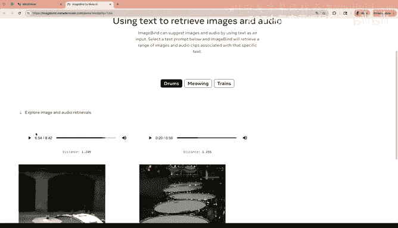

# 吴恩达@斯坦福大学《深度学习｜CS230 Deep Learning 2025》中英字幕 - P2：2_ Supervised, Self-Supervised, & Weakly Supervised Learning - GPT中英字幕课程资源 - BV1J1x4zoEVK

I'm Keon Catton Ferroche and I am a local co creator and collector with Andrew for this class CS to 30。

And I will teach about half of the inperson lectures this quarter outside of Stanford。

 I work in industry， I lead a company called Workera， which uses AI to measure skills。

 and with the history of CS230 students that have started AI startups and companies。

 what I try to do usually is to bring a lot of examples from industry。

 so what you should expect from these in- class lectures。

 is not as much of the academic side of things which we learn anyway in the online videos。

 but also the industry specific input。And。Some of the topics that we cover this year together include decision making in AI projects which we're gonna to see today you know I want you to come out of today's lecture feeling like you had some fun it was interactive and also you have a better way to make decisions in AI projects because you've seen how deep learning researchers engineers and scientists make their decisions solving problems in industry other topics later in the quarter for in classroom time include things like adversarial attacks and defenses we might have some time to cover it today deep reinforce learning which is really hot in the market right now and I think it's very important to know about it and then all the stuff that is very practical like retrieval augmented generation。

 AI agents， multiag system as we go deeper into the class and you get the baggage of neural networks will be able to。

Or even more fun topics。Okay。So today's lecture is going to be structured in three parts， maybe four。

 depending on whether we have time， we'll start with a little recap。

Of the week what you've learned online about neurons and layers and deep neural networks。

 then we get into a set of supervised learning projects including a day and night simple you vanilla classification the trigger word detection which is actually a project you're going to build at the end of the class yourself and then face verification which we'll see also variation of how face verification algorithms work in the third section we'll focus on self-supervised learning and weekly supervised learning don't worry if you don't know these terms we're gonna to learn them together and we talk a lot about embeddings because embeddings are the connective tissue of many AI systems online today and it's important to know about them and finally if we have time we'll also talk about adversarial attacks and defenses with more and more AI systems in the wild knowing how to defend them is very important and knowing。

How to attack them can also teach you how to defend them。 So we cover that as well。Sounds good。

Please interrupt me as we go through the lecture we want this to be very conversational as much as possible。

 so recap of the week is the core way that AI learns from data in a traditional supervised learning setup。

 you can think of it as an input such as this little image of the confused cat and an output in this case a number between0 and1 that represents the chance that there might be a cat on the picture one。

 or there's no cat on the picture zero what the model is and oftentime you'll see me refer to the model as two things there's an architecture which is essentially the blueprint of the model。

 the skeleton and parameters it might be a few parameters it might be billions of parameters like the models that open AI Deep mind and others work on。

😊，嗯。Outside of that， And so when you think about AI models being deployed in the Y。

 like when you think about what's happening with chat GT， you， you can。

 you can really come down to there's two files somewhere on the cloud。

 One that describes the architecture of the model， One that describes the parameters that are part of this architecture。

 And you keep calling that to those two files and you get your inference or your output。

 That's really what's happening behind the scene， much more complicated than that， obviously。

 But those are the two critical components of a neural network architecture and its parameters that are trained。

😊，How does the model learn is through a gradient decentcent optimization。

 meaning I send the picture of the cat through the model and the model at the beginning is not trained。

 So it's probably wrong。 It tells me I think there is no cat。 I think it's zero。

 and then I use something called the lost function to compare the ground truth。

 There is a cat on the picture with the prediction from the model at this point in time。

Those two numbers are far from each other。 That should be a penalty。

 which the loss function describes。 And then in order to give feedback to the parameters。

 we use this gradient descent update。We do that many， many times。

 What it means is that we take our parameters and we tell them， hey。

 you should go a little bit more to the right or a little bit more to the left until that number that is the prediction for the cat is closer to the ground truth。

We do that with batches of data， millions of images of cats and images of anything else。

 And we give that feedback。Repetitiveively to the model until the parameters are calibrated and the model is in fact finding the cat on this picture。

Nothing new here， you've seen it in the videos， any question on that learning setup？No。Okay。

 easy so far。 There's many things that can change in this setup and you'll see in the class。

 First thing is the input。 The input does not have to be an image。 It can be text like when you chat。

 you know， we chat GT， it can be audio， It can be video。 It can be structured data。

 It can be spreadsheets and numbers。 Those will see a variety of examples in the class and how it。😊。

Influs the architecture。The output again doesn't have to be0 and one。

 This is an example of a classification。 You could turn this problem into a regression。 for example。

 if I was asking you what's the age of the cat estimate the age of the cat that would be a regression task。

 not a classification task anymore later in the class we'll also see generative task In fact lecture 4 is going to focus on theffusion models generateative adversarial networks where the output actually is much bigger than the input typically know so you can have a low resolution of the cat as input and the output is a high resolution of the same cat the output is bigger than the inputs which can be counterintuitive to people other things that can change include the architecture you've learned about the vanilla melayer perceptron or the fully connected neural network that's what we're learning right now online together by the end of the class you'll have many architectures that you'll be familiar with from RNNs and。

😊，Convolutional neural networks， transformer models。

 all of these at the end of the day use the basis neural network that you're learning right now。

They're just stacked on top of each other differently。

The loss function is actually a big focus of today's class and of the class in general。

 the loss function which is what gives the feedback to the model you were right or you were wrong and what to do about it is an art designing good loss functions。

 great deep learning researchers are very creative when it comes to designing loss functions and in fact when we'll build the algorithm called Yolo it is called Yolo for you only look once。

 not you only live once， but Yolo has a very difficult to understand at first loss function and theres a reason why the loss function was designed like that so by the end of this class you'll also have a better intuition on how do we design great loss functions。

😊，Other things I'm not going to cover right now， the activation functions in your neural network。

 the optimizer that you use for your gradient descent loop and then the hyperpars that might come in when you train your algorithms Nothing new here this is the basic setup you've also learned this week about neurons the easiest way to think about a neuron is the classic logistic regression algorithm where I'm taking the image on the cat so an image in computer science the way the machine reads it is three channels orGB for the three colors red green blue and we take all these numbers we put them in a vector the vector is then fed into a neuron and the neuron has two components the linear part the W transpose x plus B the w being the weight and B being the bias and then an activation function in this case the sigm weight function which is very handy because it takes any number and it puts it between zero and1 so that the output。

😊，Can look like a probability。Classic setup。And here the probability is 0。73， which is above 0。5。

 which tells me the model thinks there's a cat on the picture because one is a cat， zero is no cat。😊。

So question for you to get started， how would you modify this binary classification that detects cat in an algorithm that would be able to detect multiple animals。

 such as a cat， a dog， and a giraffe？What do you need to change about this。Neural network。Yeah。Okay。

 so you would change the output layer to match to the number of animals you want to detect。 Yeah。

 correct？Anyone wants to add anything else yet？The data that goes in there。

 how would you change the data？Okay， very good。 Yeah。

 you need data from dogs and giraffes and also maybe nature in general。

What else do we need not to forget？Yeah， okay， add one neuron per animal。

 Those neurons will be independent from each other， and each neuron would focus on one animal。 Yeah。

 good point。😊，It's actually what we're gonna do。 So yes， I think your suggestions were the right one。

 We could multiply these output layer to have three neurons instead of one。

 all of them because it's a fully connected neural net。

 see the entire pixels flattened in the vector and then each of them will be focused on an animal。

 The number one mistake that we see in projects is that people add more data。

 but forget to adjust the labels。 So how do the labels need to be adjusted here。

 It's not any more zero and one right。😊，What type of labels do we need。To train this。Yeah。Yeah， okay。

 you know how we call that，Okay， so yeah， yeah。😊，Yeah， vectors。 Yeah。

 I think you're saying the same thing。 But yeah， so here you would。

 you would use a one hot vector or a multi hot。 You know， one hot means we'll have。😊。

You'll have a vector of size 3。 And if there is a cat on the picture， the label is gonna be 0，1。

0 because the second year is gonna be responsible to detect cats。 In fact。

 that would be called the one hot vector。 oftentime you'll have multiple animals on the picture because cats and dogs can appear together。

 Cats and giraffs less so And dogs and giraffs， Ive never seen one in the same picture。 But anyway。

 you'll have a multi hott vector。 if you have a cat and a dog on the picture。

 you'll probably label it as1，10。 And the reason I'm mentioning that it may sound silly。

 but in a lot of projects， people change their data。

 They forget to change their labels and then they wonder why it doesn't work。😊，Okay， cool。

 Now in the class， we use a specific notation with superscript and subscript。

 So when you'll see me refer to something like a11。

 the superscript in square brackets indicates the layer that you aim so you're in the first layer the subscript refers to the index of the neuron okay。

😊，And A is for activation。So a subscript 3， square bracket1 a is the output of the third neuron of the first layer。

Again， if I continue second layer would be written like that and then you'll get your probability。

 the deeper the network is， the more capacity it has， is is the word we use capacity。😊。

What it means is that if you send a million pictures of cats and a million pictures of noncas to a shallow network。

 it might not have the capacity to learn what's in the data。 It's just not flexible enough。

 The deeper the network， the more capacity it has。 So in fact， the network that is super deep。

 Imagine a billion parameters transformer model with 1 million pictures of cat and noncat。

 It will just overfi to those pictures， meaningan it's not gonna to learn what a cat is。

 is's just gonna to learn by heart。 those million pictures because its capacity is way bigger than the data it's fed。

 So it's very important to understand the amount of data you're gonna to feed and the complexity。

 diversity of that data will probably dictate the capacity of the models you need to use。😊，Okay。

 now just to give you a little bit more intuition on what happens inside those neural networks。

 we take these relatively shallow network， but you know call it three layers and we train it on a data set of facial images。

 ignore a task in face data sets。 There's a lot of tasks you could do。

 you could do a face clification。 you could do a face recognition。

 you could do you know face clustering， things like that。 well talk about that later。

 but let's say it's been trained really well on understanding faces。😊。

If you now unpack this network and you sort of query each neuron and look what's going on inside what you notice is that the first layers are gonna be better at encoding low complexity features while the deeper networks are gonna be better at encoding higher complexity features。

 So here's how it goes nothing too complicated for now the neuron in the first layers they're looking at pixels because you're giving in directly the pixels So they're gonna be good at teaching those pixels together and maybe the first neuron will be good at detecting diagonal edge。

 The second neuron will be good at vertical edges and the third one at horizontal edges because they're just looking at pixels and trying to make sense out of them。

 Now you go one layer deeper in the middle of the network Those are not seeing pixels they're seeing the output of the first layer which is already slightly more complex So what you can expect the layers in the middle of the network。

😊，To give you or to activate four is higher level features like an eye or a nose or an ear。

 because it turns out if you have a few edges， you can start detecting circles and so you would see a neuron that is really good at detecting circles。

😊，Ies， the deeper you go in the network， the more you get closer to the task itself。

 which in this case， facial analysis， let's say you would see the last few neurons detect larger features of the face because again。

 they're seeing higher complexity information。😊，Does that make sense？This concept， you know。

 we call it encoding。 We also talk about embeddings。 It's very important because。

When you train neural networks， you want to make sure first that they're understanding what they're doing。

 and that's one way to see it。We'll have an entire lecture on interpreting and visualizing neural networks later this quarter。

 And on top of that， you probably can make use of some of those encodings and embeddings。

 we'll see that later。 But why in the vector space。

 the distances between those concepts are important。

 You can already imagine that for tasks like search， searching in a database。

 having a neural network able to encode information in a very meaningful way can allow you to find concepts that are close to each other。

😊，And associate them with each other and concepts that are far from each other and dissociate them from each other。

Okay， so this was the warm up for today。How much time we spent Okay，15 minutes on the warmup。

 That's good。 So we learned a few new words， model， architecture， parameters。 I didn't talk about it。

 but feature engineering versus feature learning， that's the core a concept in deep learning is feature engineering is what we used to do before deep learning。

 which is you might actually build an algorithm that is good at detecting eyes。

 is just a good at scanning eyes。 You manually build it， you know。

 And then you build another one that is good at detecting mouth， a mouth。

 And then you put them together to feel detect faces。 We don't do that anymore。

 We do end to end learning。 meaning， we let the data speaks for itself and train the model。

 This is called feature learning。 It's automatic。 And that's how the neural network actually learns those features without you needing to tell it eyes are important to detect faces。

 You don't need to do that。😊，Encoding and embedding the real difference is encoding is any any vector representation and an embedding。

 though， sorry it should have been an embedding is when an encoding has meaning。

 meaning the distance between two encodings has has meaning， you know。

 they might be close or far from each other and it tells you something there is a logic to it。😊。

And then we talked about one hot and multi hott vectors。O。So end of the recap now。

 let's go into supervised learning projects and we're going to make decisions together and walk through it。

 The first case study is day and night classification。 So here's my problem for you。😊。

Given an image that I give you。Classify it as whether it's the day or whether it's the night。 Okay。

 Open ended problem。Ignore that。Foundation models exist。

 You don't have access to chat GPT or cloud or whatever。

 The point is to get under the hood and have those discussions because obviously it's a toy example。

 So what do you do Like what data do you want to collect。To solve this problem。Yes。So tell me more。

 check how pixels in the same row are。西方的。What does it tell you that if you look at the row of pixel and the row next to it。

 if they're very different， what does it tell you。Okay。

 so you say if the delta between pixels that are close geographically to each other is high。

 then there's probably colors。 Col changes。 So it's day。 Most likely， is that it？ Okay。

 so that's an example of of feature engineering is like you're， you're going for it in great。

 Like you're going for it and you're trying to understand what's a pattern that tells me that a picture is day or night。

 What else can you do。In the world of neural networks。You know， their ideas。Yeahや。

He did a bunch of pictures like half。Okay， good。 Yeah。 So yeah， I agree。 I said 10000 images。

 but how， how do you even determine how many pictures you need。To get started with this project。ち。嗯。

Feed some data。 So you start with like 10 pictures， and then you continue to go。 Yeah。

 you could do that。 might， you know， take some time。 I think the question is， how easy。

 is it to collect that data， Like， how would how would you collect that data。similar。

Pictures for the。Okay， yeah， we could put our phone out there and record the day and the night and have a stream of pictures and add it to the data set。

 same location， but different lightings， yeah。😊，き mentioned。就是这。If my。すめ。过太了。もて。

WeBuilding something for one location。等待过。よ意なですか。If you were。T to look at like。ミグ？It's like in。

Then you would have to have like。在と生。Because the problem is。我为了告诉你。So like。虚域症。That's a great point。

 So just to repeat for the the people online， you have to define the task first。

 because the task can be easy。 You can， you can be in a park in a very specific location and say。

 just detect if it's day or night or you can have a problem， which is your camera can be anywhere。

 And that makes it more complicated。 And also the amount of data youll need is probably much more for that second problem。

 That's what you said， right， now， actually， that's a great thread。😊。

Tell me about cases where this problem would be really hard to solve。Yeah。Yeah， indoor。

 indoor pictures， actually。Can you， how could you tell if you took a picture of me with the screen here。

 you know what time it was。You couldn't。 You actually can， yeah。There's a clock here。

 So that that's very interesting because， because if that was part of the task。

 then our problem would be hard。 And 10000 images is not gonna cut it to understand time。You know。

 and so it's very important to define the task variable well。

 what else can be hard other than indoor pictures。Also。Also， the clock can be AMOPM。

 but you can probably take additional information， which is how people are dressed。

And think that it might be warmer outside and colder。 you you could。Again。

 it can be very complicated at the end of the day。 But a human would say someone is teaching students are class。

 It's probably not 12 AM。 you know， or so， I mean， like it gets complicated。

 Yeah what what else can be hard。Okay， sunny， cloudy， yeah。Great point。

 If you're in the north of Norway right now or Sweden。

 even the clock can tell you probably it's day or night。😊。

Don and Duka exactly those are great examples actually this is a good semantic one because you need also to define exactly what's the definition of day and night so long story short。

 the problem can seem easy at first it can be very complicated and trust me if you wanted to do this really well even the foundation models today couldn't do it in certain cases。

😊，Okay， let's say we have 10，000 images and you talked about the split of images earlier and I agree with you。

 you want a mix of different situations in order to be able to cover all of them and going back to our discussion on model capacity。

 if it's just a simple problem， you probably need just a small capacity model if you want to add all these edge cases。

 you probably are looking for bigger capacity models and more data。😊，What's the input to our model。

I think someone said it already。 So let's say a picture of， a picture of， you know。

 day or night or whatever。 What's the resolution we're gonna work with。

 How do you determine resolution when you build the data sets and why does it matter。Yes。Yeah。です。

Okay， so you want to choose a resolution that's going to be the same across the board。

 You're going to vectorize everything that's going to fit in the same size matrix。 Yeah。

 why is it important to have。The right resolution， let's say。そです。Okay。

 so you're saying we want homogeneity the data set in terms of resolution。

 I would say that could be a thing， but today you can actually write scripts that downsize high resolution images before it gets in the model and so it would probably solve upsizing it's slightly harder you would need another algorithm but it's okay to have different resolutions。

 but you still want to know what's the target resolution that you're looking for。

Especially you know some of your features。还。つ在している。Exactly。Exactly low resolution。

 We lack in formation， so we might get things wrong。 For example。

 the clock might not appear in the picture if it's too low resolution。

 High resolution means more compute needed。 If you have big pictures。

 it's going to be heavier to train your model and you're gonna to pay more and also your cycles of iterations are going to be longer in an AI project。

 that's why resolution matter a lot。So my question is， what resolution do we go for？

Is there a way to just get to a number really quickly in the next 10 minutes。

 Let's say if we were doing this project。Yeah， who's。催す。Yeah， exactly。 I think that's a great idea。

 You're saying use the human as a proxy。 Yeah， so actually， this is how we did it back in the days。

 we would print pictures in different resolutions and run it through our friends and say。

 can you tell if it's the day or the night。 And it turns out that below a certain resolution they can't anymore。

 It's just like， I don't have the information I need。 And， you know。

 where we ended is somewhere around 64 by 64 by 3。😊，And I stressed the three。

Because later this quarter， we'll see that open AI and deep as well in reinforcement learning。

You know， it turns out for one of the famous algorithm we learned together for reinforcement learning。

 discovered that you can actually remove colors and the model is not impacted。

 but your training is way simpler you know， in this case。

 I think colors matter because of the blue sky because it does have an inherent information about whether it's day or night。

 and it turns out the task if you give it to humans is much harder without colors than it is with colors。

😊，So those type of insights we could get over the next 10 minutes， literally。

 by using humans as a proxy， this is a toy example。

 but I want you to think about that in your AI project。

 you're going be at points where you want to validate a hypothesis and the best proxy you'll have is the human。

😊，Yeah。Okay， what's the output for this model。Yeah， day or night， zero or one。Question。

It's very efficient。Yeah， good question。 So does the size of the image impact the input layer。

 The size of the input layer。 Is that it？ Yeah， it doesn't。 You can make your decisions。 You can。

 you can have three neurons and you send a massive picture inside it。 Oftentime。

 and that's why I often say deep learning is an engineering field。

 You have to try it or you have to know the hacks。 typically the the network。

 if it's you know in a binary classification， you're going from a high dimensional input to a very low dimensional output。

 So by nature， you'd imagine your network is gonna be like this。😊。

Probably meaning you need more edge detection at the beginning and then higher feature and higher feature until at the end detects the face。

 So it's gonna be like that。 We're gonna see examples in week 4 where the output is bigger than the input and your network is probably like this。

 you know， So you'll build intuition during the class to know when you want to downsize your input layer or upsize your input layer。

😊，有。And by the way， these hacks are valuable like why does metata go out and give crazy offers to a few researchers because they know that stuff。

 they know those hacks， literally。😊，Okay。😊，嗯。Okay， so again， someone said it。 The output is 0 or 1。

 The last activation is gonna be a sigmoid。 Yes question。😊，Ofcing yourself。top。

Yeah you can do that you can probably say in the data I don't care of the sizes because I'm scraping data from everywhere I'm collecting data on my phone。

 I'm putting it all in a database， I write a script that down samplesles or upsamples everything to the same resolution and then I send those lower res images in the network because what I care about is the training of my network I want it to be fast and efficient you could do that yeah for sure。

😊，And there are networks where we're going to seem that Yolo is an example of a network where in the later versions of Yolo。

 it does that automatically。 It can take any resolution and it just samples it accordingly。嗯。Okay。

 last activation is going to be sigmoid。 We wanted the output to be between0 and1 and the architecture。

 most likely a shallow network， we don't need too much capacity unless the task is highly complex and a convolution should do the work really well。

 You don't know what a convolution is yet you're gonna to know in a few weeks but those are known to be good for sequences and for images。

😊，And finally， the loss function， what loss function would you use。Oh。Which one。

Sigmoid no sigmoid is the activation。 What's the loss function？Logistic loss， yeah。

 Logistic loss also called binary crocentroppy loss。

 which is the one you've seen in the videos this week。Yeah， yeah。委托金。Like if you have certain。

out sciences。就块点。So repeating the question， how much the amount of hardware and the quality of the hardware you have at your disposal influences those decisions。

 the answer is a lot。But， you know， in fact， I'm assuming you're training it on your laptop。

 right now， which will work。 But you need to make those trade offs。

 And I think that's why those skills matter。 Now， if the task is more complicated。

 you look at the hardware you have available。 You'll make a quick back of the envelope calculation。

 the calculation is really about how fast our iteration cycles can be。

 It's not about necessarily the performance of the model in the end。

 you w to be able to iterate super quickly。 And if your model takes one year to train。

 you're not gonna be able to iterate。 You know， you need to reduce it。 somehow。

 So there are situations that we're going 64。😊，Or to 65 by 65。そで。Yeah， yeah， for sure。Yeah。

 the picture the。Every sail。多括几。What do you mean the。The features。Every single。てる。

So the 64 by 64 by3 is's like literally you look at a picture and you look at one pixel。

 these have three values that describe the color right。

 and then you just flatten it and then those numbers are given to the input layer of your neural network。

Yeah， okay。Let's move on just for the sake of time。 This was just the easy warm up。

 The two things I just want you to remember from that project is we're gonna build a lot of proxy projects and it's important to remember them for your own project。

 So you remember I remember this experiment we did on humans I remember how many images we needed for that project and then that can help you make decisions faster and then the other thing that is worth highlighting is the human experiments。

 We're gonna do a lot of human experiments starting with the next example and those are usually helpful to make quick decisions in your project when you're in the industry So second project trigger word detection。

 let me give some context on this the general problem you're familiar with like Alexa and all these let's say Siri and things like that that you might have in your kitchen listening to you everybody knows So the way these network typically work these models is it's not a single model it's a cascade of models。

😊，For energy and efficiency purposes， so for example。

 if you have a virtual assistant in your kitchen， the first model is activity detection。

 It's just detect text if there is any volume， you know。

 because you don't want to listen with the heavy model at all time。

 It just uses a lot of energy right， you want a very lightweight model that understands when volume is playing and so let's say this network detects volume。

 it calls another network that is focused on the activation word， the trigger word。😊，Alexa， see， hey。

 Siri， Okay， Google， that's usually the second layer。

 And that one is only listening for a specific keyword。 If the keyword comes in。

 it would typically call a better model that's slightly slower。

 that might be heavier and more energy consumption。

 and that might understands your what you're trying to do， you know， and then。😊。

I'm not gonna go into the details， but you have architectures that get very complicated Back in the days。

 Some of these companies were doing one model to set up a timer， one model to buy something online。

 One model was very complicated。 Today， it's slightly simpler and more N2 end。

 But I just want you to know the cascade of models that are being called。

 because these case studies about the second model is about the trigger word。

 So here's my problem for you。 given a 10 second audio speech， detect the word activate。😊。

How would you build that off the shelf like that， starting from zero。What data would you collect？Yep。

おをけ。Youre out。we also want to。Okay。Sa the word and then。不让松他。う。We別。I could Four you transform。Okay。

 yeah， what you describe is a fourier transformer like plus the preprocessing。 You're right。

 So you're saying audio is a bunch of frequencies with， you know， values。

 And we want to first pre processces that then to give it to an algorithm and the length of the sequence matters as well。

 Because if you want to detect the word activate， You know that the length needs to be。

 there's a minimum length， You can't say activate in less than 10 milliseconds， right。

 So the the length matter as well。 Okay， that that's good insight。 What else， What data， How。

 how would you collect that data。😊，Yes。Microphone like with your phone。 Okay。

 like you would go around campus and record people。 How would you， what would you ask them to say。

Okay， you would ask you would record a bunch of people saying the word activates。

 you would ask them anything else。😊，是。Other words， Yeah， say a sentence。 Yeah。

 she turns out you have website that are random generators。 And you just say。

 say this and say this and you record everything。 Yeah， say the word yeah。good one。

 so you're saying you want to find negative words that are close to the positive word。

Just to make sure the model learns that that's a great one， yeah。Actually。

 turns out activity is a really bad word to choose。 The reason Alexa and actually。

 there was a lot of discussions at Amazon back in the days around what would the word be。

 And turns out it's very important what you choose。

 because you wan to choose a word that is not used in common language。

 Otherwise your assistant is always turning on， right。😊，And Alexa is not ideal either。 It's not bad。

 but it's not ideal either。 Okay， so let me just narrow down the problem。

 Let's say we've gone around campus and we've collected a bunch of 10 second audio clips。Okay。U。

Do we need to think about the distribution of the data， Like， why does it matter。

 Like why campus only might be limited， let's say。Yeah。

Okay accents turns out the first version of this model that you know I built with Andrew。

 my German friends could not make it work， none of my German friends would make it work and we had to collect more data from and I had two German roommates at the time so we had to collect more data from them because there's just a certain way that you know people would say words Okay。

 good insight what else other than accents。Yes。这こ。Good point。

 Average age on campus is probably younger than if you actually cross campus and go to Palo Alto。

 and in fact， the frequencies are going to be different that younger people use， That's correct。一。あ十？

How fast some people speak fast， Some people。 and it has to do with the language of origin。

 Some people just speak faster， correct and。Look， look at this， like。

When you hear someone who speaks fast versus someone who speaks slow。

 it doesn't make a big difference to you as a human。

 but if you actually just had access to the numbers and the frequencies。

 it would look completely different。 So the model actually struggles a lot with that problem。嗯。

The ratio of。Yeah， for sure， ratio of male to female。

 anything that would modify your frequencies and on average， yes。

 theres different frequencies or distribution male to female， yeah。我 sport。Background， though。

 it's very important。 Turn out on Stanford campusus， you don't hear the metro。

So it's very likely that your algorithm will not work for people in New York that are taking the subway all the time because of the background noise behind it。

 Yeah， okay， I think we get a sense of like the， again， the complexity of the task ahead of us。

 Let's say the input is a 10 second audio clip。 I'm gonna call X。

 And this audio clip has a few things that are special to it。So one of the things is negative words。

 which are in purple。Positive words， which are in green。 And then the background is in orange。 Okay。

 so this is， for example， someone saying， hi， activate yourself， whatever， you know。

 you see what I mean。 Activate is the positive word。😊，What's the resolution we'd want。Okay。

 I'm not going to ask you this question because we don't have speech expert a speech expert would know it what you can do though without being a speech expert is to go on GiHub and find another speech project and you actually search for the hyperparmeters they're using and if you're using human audio you'll find that the same numbers will work for your project。

😊，Okay。So you do that little search， and you'll find that。

There is just a certain sample rate that works well with human voice。What's the output。0 or1。 Okay。

 let's try something。 So let's say the output is 0，1，0， meaning there is no positive word。

 The word activity is not there。 One， meaning there is a positive word in that10 secondically。

 So we're gonna do a little human experiment。😊，I've selected three。Let me turn the volume on。

 I've selected three audio samples of around 10 seconds， okay。嗯。

I'm not going to tell you what the language is。 Okay。

 because the model doesn't know language when we start training it。 So you're acting like the model。

 That's the experiment。I'm just telling you that the first and the third sample have the word that we're looking for。

 And I'm not telling you what the word is again， because the model doesn't know what the word is at the beginning of training。

 Okay， so now up to you to guess what the word is。And I hope one of you will save us and find the word。

 Okay， let's try。没你有 didn。To楼。Second sample。Wai， let me see if I can put the microphone。Jo to。

Anybody has it or no。No no way。Impossible。Third one。Because if I was a mini。

But then not shopping or whatever the financial。Okay， who has the word。Mio， okay。

 maybe that's not it， but maybe。Yeah， in the back。You're Italian。You speak， okay。Yeah， it's funny。

 Nobody finds it。 Youre really in the first try， but you， you do you， you did find it。 Yeah。

 that's right。 Okay， let's try again。😊，And do it with a different labeling scheme this time。 Okay。

 let's try again。 I'm gonna play it again， but the labeling scheme has changed。O。😊，你嘢。

Sos the first one。You that7 to面。呢个对对。Third one。世かでそ明一。But then elephant shopping。O。What's the word。

Someone who's not Italian speaker。Yeah。I'm not sure people hurt。

 so I want to try someone else yet you've heard it。Okay， not for promodiio。 It's Pomeridio。

 but you're close。 You know， was it easier the second time or the first time。Way more way easier。

 so if it's easier for you， it's easier for the model basically and so what is the question I'm posing here is we could go with the first labeling scheme。

😊，Which is easier for us to label， frankly， right， You don't need to indicate the location of the word。

 But how much more data do you think we need in order for the model to figure it out。

It's probably 1000 x data， right？ And so the question is。

 is the second labeling scheme a thousand times harder for us to label than the first one。

 And the answer is no， So the answer is very clear。

 you would rather have the second labeling scheme and your model is going to learn way faster than the first case。

😊，喂。So that the type of human experiment you can do。 Now we're gonna。

 we're gonna use that labeling scheme。 Yeah， question。すでのリス。Yeah， we'll talk about it。 question。

 Is it manual labeling or not， Yes， right now， it's manual， but I'll explain some tricks we can use。

 yeah。そ个。As you spent。Like， how do you。Yeah， you you how do you pick the trade off between the different labeling strategies and not。

 In fact， you you， you know， today you could have。You could have a pretraining and a posttrain that have different labeling schemes。

 The the question is， for pretraining， you want the model to get really good and you don't want to。

 you want to avoid a cold start problem。 The problem of the cold start is with the first labeling scheme。

 maybe even with1000 data points that that you collect and label manually。

 It's not even going to understand anything。 So you need the second labeling scheme can be a great way to work around the cold start。

 You might need less data， but it will start understanding what you mean。

 And then the rest of the data might be labeled differently。 essentially。😊，Okay。

 let me talk a little bit about the labeling scheme。

 We're actually gonna use a slightly different labeling scheme and the reason is the first the one with one1 and only zeros。

 the risk is you can actually have a model that performs 99。

9% accurate that is all zeros just pretty zero all the time it's very accurate but the thing is there's just one1 to find that it's very hard to find it。

 And so the network is going to lean toward zeros meaning the data is the labels are so skewed towards zero that is going be hard to find any signal in it。

 And so the trick that deep learning researchers use generally is can we actually do a little more balanced between the positive and the negative labels。

😊，Just a pure engineering hack， not much science behind it。

The last activation we're going to use a sigmoid， but because it's a sequential problem。

 we're going to use sigmoid in sequence at every time step。

 there is going to be a sigmoid activation。And then the architecture。

 we're gonna learn it later in the class。 You don't need to worry， this would be likely an R and N。

 You learn later in the class what that means。And then the loss function。

 can someone guess what loss function we would be using？Yes。Yeah， binary crossenttropy。

 but we're gonna use it sequentially， meaningan at every step we're gonna compute thats with the sigmaoid output。

 Yes sorry on the output So just。Correct， you take your， your input 10 second input。

 You look at where the positive word activate is， and you put ones in there。When it plays。

And you force the model to predict， hey， activate has been played。 There is a lot of nuances you see。

 because you actually are gonna build this project with like。

 do we want the ones to start exactly when the words start， Do we want to have a delay。

 There's a lot of technical questions around that。 Yeah， Yeah， the question。😊，準りました。呃，好。

What I mean by steps is audio is a sequence data。 And so it's time step by time step。

 And so what I mean is that at every time step， whatever your sample rate is。

 you're gonna have a prediction at every step。Okay。

So what what is critical to the success of this project is really the labeling strategy。

 Here is how we did it。😊，And。You know， it's a take you just have to know it or not know it。

 It actually takes a long time to figure something like that out。 And so thankfully。

 when I was a grad students， one of my senior senior PhDs helped me with these methods。

 and he was able to guide me and saved me probably month because I would not have figured out myself this probably。

 So here's what we did。 We took three databases， we created three databases。

 One that would have positive words。 So as you were saying earlier。

 we record people for the word activate one that would have negative words。😊，Other words。

 including the activate， but also kitchen and lion and dog and whatever。

 And then we have background noise。Turns out background noise in audio data is almost free。

 There's just a ton of background noise online。 You can go on many platforms online video platforms。

 You can just take the audio。 It will be background noise。 So background noise is free。

 You don't need to go and collect it。 Most likely。 The other two or are harder。 Yeah， question。😊。

Yeah。So I'll tell you we I'll tell you how we do it in a second。 But yes。

 we recorded everything manually。 What we did is we took， we went online。

 we scraped free license in data。 actually， it's a skill to know the licensing models。

 You're gonna learn that in the project mentorship with the Ts。

 What licensing allows you to do what with data， It's good to know forever， You learn it once。

 And then you know， what is C by what is C by NA， What is the MIT license。

 What is the Apache license， etc。 And so we take 10 second audio clips。

 We clipped the background noise。 and we went around campus and we literally recorded people saying activate in other words。

 and we cut it。😊，When they said it。 So the word was contained exactly to the amount that was needed。

 Then we created a Python script that randomly inserts words， randomly non overlapping words。 So。

 for example， this would be created synthetically。 I would have 10 second of background noise。

 I would insert two negative words， and I would insert one positive word。😊，Okay。

The trick is that because the Python script did dots。

 the Python script knows where activate was put so it can label automatically。

And so it turns out that we went around campus。 We used an app even to get help。

 So we hired a couple of people to come with us， Each brought their phone。

 and we went all around campus recording people to say activate in other words。

 And we created those data sets Within three hours， we had millions of data points。😊。

Because think about it， let's say you have a thousand activates across campus。10000 other words。

 In background noise。 Imagine how much data you can create with that When you actually write the Python script。

 you can also add some data augmentation。 You can reduce some frequencies。

 You can augment some frequencies。 You can accelerate it。 You can decelerate it。

 So you can actually create a pretty meaningful data sets for this problem in three hours。😊。

Now I'm talking about training sets。Because you don't want to use that data for test sets for test set。

 you want data to be as real as possible， you're familiar with the concept of training test set right。

 so for the test set we had to manually label data。

 but it was a much smaller set than the training set。Right， so it's much more convenient。 Okay。

 the second important part was architecture search。 I'm not gonna talk about it too much here。

 but there are architectures that just work better for these types of problems。

 And this is an example of an architecture on the right that works way better。 and。😊。

My learning from that project was just go to the expert and ask them what they've tried and try to learn from their mistakes。

 And in fact， I remember Oni Hanun， which was in the first。

 first level at the Gates Comp science buildinging。

 And he knew that this architecture was gonna fail。

 and he knew why because he's done so many speech projects。

 and he just knows what works and what doesn't work。😊，So that's why your TAs are here for。

 actually in your project。So you should give them a call and say， hey。

Is what I'm doing good or give me a pointer for what I might spend my next week doing。Okay。

 so learnings from this section， this case study， data collection strategy is extremely important。

 including the data labeling strategy。Using human experiments matters as well。

 And then referring to expert advice。 That's the type of thing you want to do in a project。Okay。

 do you understand conceptually how a such project is built now at a high level， Okay， good。Yeah。

 question。し。So how often do you need to do an architecture search nowadays less often than before。

 But this class is all about understanding what's going on under the hood。

 So we're going to walk you through that in practice。

It depends on your problem like I give you in the industry。

 you might a you might be building a company that requires the model to be running on the browser and so you have additional constraints that push you to create your own architecture。

 collect your own data， fine tune the model the way you want for many startups out there and companies out there。

 you're gonna start from a foundation model start from a foundation model and then you might actually quantize it or prune it or modify it to meet your needs in terms of latency in terms of memory in terms of hardware capacity and knowing what's going on like we did is important in those cases。

Okay， super。 so we're one hour in。 we are about halfway through the class a little bit ahead。

 and I have a few more case studies to cover with you。Okay。By the end。

 we'll have a full set of proxy projects to work with。 Okay， so this one is cool。

 It's face verification。😊，A school wants to use face verification to validate student Ids in facilities like dining halls。

 gym and pool。So let me explain what it is is like you arrive at the Aiaga gym and instead of just you know normally you would swipe your student ID right and your picture will show up on the screen and there's someone sitting there。

 it's going to compare the picture they're seeing on the screen to the picture they're seeing with their eyes and if it's the same they're going say you can go ahead。

 right？Be slightly different here。You're gonna you're going to be verified by a camera。

 so there's actually a camera ahead and you're walking in and you're swiping your card and we're going compare the picture in the database to the picture that is being taken by the camera to make sure that it's the same person。

😊，回れ。How do you get started？Okay， so everybody who got admitted uploaded pictures， at least one。

 so we have that already in the database， correct， Yeah， what else？😊。

You're saying the camera matters Yeah for sure， the camera matters in fact we talked about resolution。

 do you think the resolution is lower or higher than the day and night project？😊，Probably higher。

 In fact， it's gonna be higher。 And again， I would go back to literally doing a human experiment and showing pictures of twins and asking people if they can differentiate the twins。

 And you'll see that the resolution matters。 actually。 Okay， yeah， you wanted to add something。😊，有是。

Noise， like either。Okay， also data from outside the university。Which features？

Understand the person's human feature， but they're already in the picture， right。

 So the picture would have the feature， or you would add anything on top of that。So you typically。

 you would not actually want to get the feature level。 You would just want to say。

 we need to make sure it's in the data。 If it's in the data， the neural network will learn it。

Like seat。不反儿。Absolutely， same person multiple times because the angle matters， the time matters the。

 you know， etc cetera， yeah。Okay， same thing， okay。Pro so that。Okay。

 so you're saying we might do some preprocessing to crop all the images so that it's centered。

 or at least that the image that we' trained the model with looks like the image that the camera is gonna take because the model will run on the camera。

 Okay， all these are good。 So let's say our data set is picture of every student labeled with their name。

 So this is one of my friends， Bertron， and he has his picture。

 which is this picture from the student I D。 and then the input is， okay。

 he shows up in front of the the building， he's a little bit confused。

 But he showed up and a picture was taken。 the resolution， we talked about it。

 What we use here is 412，412 by3 It's much higher than before。 Okay， as we were expecting。

 because we need small details。 Even eye color is identifiable， right。

 So these things we cannot find without a higher resolution。 In fact， if you actually go through。😊。

Airport security。 And you use some of these fast tracks， which take a picture of you。 Trust me。

 the resolution is gonna be even higher than that。 much higher than that because they're actually getting into the iris at that level。

 right， So what's the output。 The output is 0 or1。 Yeah， it's Btron or it's not Btron。 Okay， were。

 we're good so far。😊，The architecture。LetLet me actually， let me actually ask you。

 how would you do this comparison without neural networks， Let's say a very basic way。

 If you had to start with the first method。Yeah。So you would feature your engineer。 you would say。

 like， for example， you would define 10 features that are good for identifying people and you would have a filter for each of them and you would run it on the picture and say。

 yes， do we have this feature or not， essentially， Okay， yeah， it's a good one。

 even more basic than that would be pixel comparison。 just compare the two pixels。

 What's the problem with doing a pixel comparison。 So the idea is I take the two pictures。

 I compare them， And if they're close enough in pixel wise comparison， then it's the same person。

 if they're far it's not the same person。 What can go wrong。😊，Difference in what lighting。 Yeah。

 actually， what's interesting with the lighting is if you look here。 So in this one。

 you take the top left pixel right here。 Okay， it's bright。 You take the top left pixel on this one。

😊，It's dark， or at least dark green。The difference between these two pixels is massive。

 It's close to 2，55。 yet the pixel doesn't even matter。 So why would you use that。

 It would penalize the comparison without actually mattering at all。 So that's a good point here。

Yeah， absolutely background difference。Translation invari， like imagine the same picture。

 but the person is like three pixelels to the right。

The comparison will be completely different because it's a pixel comparison rather than a semantically meaningful comparison。

 Okay， what are other things that can go wrong。It the center。Distance from the camera， again。

 rotation invariance， translation invariance， scale invariance， all of these matter。

 what are other things that are not geometric modifications？有。Wearing glasses or hat， what else？

Hairty， yeah。The big beard， you know， and in fact， you look here。

 he has much more beard than on the picture。 And he was much younger by the way。

 on the first picture。😊，And oftentime， we look we're younger on our student I than we actually are in person。

 And that may make a difference。 Okay， so these issues we all， we all talked about。

 I think people get it。 Good。 So our solution is to use the concept of encoding。

 remember what we talked about earlier with the face example。

 It turns out a network that has been trained to understand faces should have meaningful information in those layers that you can use as comparison that is more meaningful than a pixelel comparison。

 So this is how it goes。 We have theron picture from the student I D。

 We run it through a deep neural network and we get a vector。😊，What is this vector。

 It's a vector that we grab in the middle of the network somewhere。Remember what I said if the。

 if the， if the vector is taken earlier in the network， we're gonna get lower level features。

 if you go deeper， is's gonna get more facial features。 So you probably go slightly deeper。

 You go much deeper。 actually， for this example。 And then same thing you。

 you run the exact same network on the picture from the camera。 And normally。

 if the network was trained well， those two vectors should be close to each other。😊。

This density is 0。4。 You set a threshold。 You might do a little study to see what's the right threshold。

 And， of course， this threshold is going to determine the number of two positives that you're going get versus false positives versus false negatives。

 You know， the higher the threshold， the more likely you make a mistake。

 the more relaxed you are right So here let's say I set a threshold of 0。5。 hey。

 I'm confident enough that this is Bertraron。😊，And again。

 airport security might have a much higher lower threshold than the dining hall at Stanford。

 obviously。You know。Okay， so this is the general idea behind what we want to do。

 but I still haven't talked to you about how the network is trained。

 The network right now is not trained。 We haven't learned how to train it。 Yeah question。

It did like drink。Picture。Yeah， what's the network We' learning it。 actually。

 We're gonna to see it together。 Yeah， I'll describe it。

 but I don't want to get into the architectural nitygriitty。

 I want to focus on the general training scheme that we're going to use。 And then youre。

 you're actually going to build that at some point in the quarter。😊，Yeah， other question。Yeah。

 what are the hidden features in the 128 dimensional vector， we don't know。

 That's the point of deep learning is you have to create a loss function。

That will modify your parameters in a way that forces it to learn features。

 but I can tell you that dimension number three is for eyes and ambition number six is for ears。

 I can make a study， we'll study it later this quarter and tell you that this neuron is actually good at detecting certain types of features。

 but right now I can tell you unless I do that study。Okay， so question for you， what。

 how would you build a training and a loss function to make that possible to train that network。

 Do you have ideas。It's not an easy question。Try。Where to start。Yes。

So mean square error R between what youre right。 actually， two vectors means squared R because it's。

 you know， yeah， but。保司。So are you saying we would take pairs of pictures？

We will run it through the network。 We will then take the two vectors that we get， and do。

App the loss function， some distance， L 1 distance， L2 distance， and then trace it back and say。

 these were the same people。 You should have been closer。 That's what you mean。 It's a good idea。

Someone else wanted to say something。that's another one cosine similarity that could also be our loss function。

Okay， like what？てうす。そです。Great idea， data augmentation。 So you would you say。

I can take the picture of Berron and probably mirror it， flip it， rotate it， crop it。

 And I would use more data that way。 Yeah， absolutely， that that would help a lot。 actually， Okay。

 so all of these are good ones。 if I summarize your point， though。

 because that's really the key to the designing a good loss function， what we really want。

 is that similar picture of the same person end up with similar vectors。😊。

And picture of different people end up with different vectors if we rephrase it in plain English。

So what we'll do is that we'll build a data set of triplets。

The triplets includes a picture that is the anchor， a picture that is the positive。

 the reason it's called positive is because it's the same person as the anchor and a picture that is called the negative because it's a different person than the anchor and by definition。

 also a different person than the positive。😊，いめポ中。One picture of a person。 Great question。

 If you have one picture of a person， then you can't do that。

We'll actually see another method that would allow us to do it even with one。

 one picture of a person， yeah。You can rotate it。 That's true。 You。

 You could actually do some data augmentation， as he was mentioning and build a data set starting with one picture。

 But this approach will not be the best one。 We'll see another approach right after that would work better yeah。

呃。不是。The model safety。这比是。good question， why do we compare a vector rather than the output of the model。

 right？So what's the output of the model。 We actually haven't talked about the architecture。

 But I'm assuming you're saying it's a binary number in between 0 and 1 because it's a single dimension。

 It cannot hold meaningful information。 So you probably want to have a vector that is big enough where you believe it has enough flexibility to hold information that can allow to us to verify if the same person is on the picture。

Yeah， essentially Okay， I'm gonna move on and， and if there is。

 So what we want is to minimize the encoding distance between the anchor and the positive。

 and we want to maximize the encoding distance between the anchor and the negative。

 So question for you， what I'm gonna ask you is to take 1015 seconds。

 Look at the slide and you're gonna start voting。😊，For A B or C。By the way， in。Is encoding is just。

How I call the the vector that we get out of the network。A is the anchor， n is the negative and P is。

The positive。So a is the anchor picture。N is the negative picture。

 which is different from the anchor， the different person and P is the positive picture。

 which is the same as the anchor。😊，An anchor of a is when you run a through the network。

 you get the vector anchork of a。Okay， let's look at the results。Well。A。47 for a 23，4 B，3，4， C。So。

Someone who said good job first， that is correct。Someone who's selected a wants to tell us why， yeah。

Because。つで。法不队。まずです。表达关系。不是谁有责。Correct， correct。 great。 So actually， the key word here is minimize。

 If I had said， maximize the answer， indeed， as you say， would have been different。

 because here we're looking at minimizing the distance between the anchor and the positive and。

 in fact， minimizing this or maximizing the opposite of it。 That's why the answer is a。😊，O。

 good stuff。Sip going。So going back to the initial setup。We had a cat。

 and we were predicting a binary number here Instead。

 we have three pictures going through the network in parallel。

 So you can imagine it's batch processing。 It's like the three are going in the same network at the same time。

 And then you're getting three vectors。 You're computing the loss function。😊，Okay。

 you're doing this loss function we talked about。 I'm not gonna talk here about the alpha number。

 but you are gonna learn when you build it why the alpha number matters。

Hin is maybe 0 would have been a correct answer if you didn't have the alpha number。

 so it would have。Created instability in the model。 but you do that many， many times。

 you push the parameters to the right or the left。 And because of the way you created your loss function and your data labeling。

 the way you structured your data and the loss function essentially the model is going to learn by itself to create similar encoding for pictures that are of the same person and separate encodings for pictures that are not from the same person。

 and you didn't need to do feature engineering， you didn't need to talk about eyes and ears and whatever because it will figure it out。

 You know that you created the learning environment to allow that to happen。😊，So congratulations。

 you designed your first last function， and we're going to design many more in this course。This。

 by the way is from FNe it's a paper from 2015 from Schteal， and you'll see in the slides I used。

 I always put the reference to the papers in case you want to go back and study the actual paper。

 Many students do it for their project This is a great one。

 great great paper to look a lot of citations as well Let me make it slightly complicated。

 more complicated， we learned face verification and now we want to do face identification。

 How is that different。😊，Identification is a school wants to use to recognize students in facilities。

 So imagine face verification is you swipe your card。

 and then that picture was compared to the picture of the camera。 That's verification。

 The two Are they the same or not。 identificationdent is you have this picture in the database somewhere。

 The person enters immediately， you can identify them。 you know。

 So the difference for for those of you who fly in the US is。😊，When you。

 when you go through global entry。Many people don't even need to put their passport or anything。

 They just watch look at the camera and they move on。 That's identification。 Okay， but actually。

 when you're in Europe， for example， you put your passport in。😊，Then you walk in。

 then it takes a picture。 that's verification。Is he the difference or no， yeah。

The negative or how do you create those three platets， essentially？No， in real time。

 That's a great question。 I didn't talk about it。 So at train time， you， you have databases and you。

 you create the three plates automatically。 like you pick pictures on the same person or you use data augmentation and you add a random picture from someone else。

 You create millions of three plates like that or billions of three plates At test time。

 you only take the picture from the camera。😊，Run it。 You don't use the negative。

 You just take the picture from the camera。 You run it through the network。 The person swipes。

 you take the picture from the swipe， run it through the network。 You do the comparison。

 You let them in or not。 So there's no more negative at test time。In practice。

 it's just a trick to train the model。Okay， so how would you do face identification using what we learned for face verification。

 Is there any small tweak you can make that would make this network work for identification。😊，Yes。😊。

Correct， correct。 What is it called in machine learning？

Its a machine learning algorithm that we can stack on top of what we just did。

He said you can compare。 So because we don't have two pictures anymore。

 We just have one from the camera。 You just compare the vector of the you run this by the network。

 You get the vector， and then you compare it to the database。No， try。

 You have a database of all the student teachers。 You run everything through the network。

 Instead of storing the image， you store the vectors。

And then someone shows up and you're looking in the database。

 Is there any vector that is super close to this one。That's identification。

 What is this algorithm called in machine learning。It's pretty simple algorithm。No。Okay。

 I gonna make it easier。 What if instead of having one picture of a student in the database。

 you have three of each student。You have three vectors for each person。

And then you're trying to find the nearest vectors in the database from the one that the camera takes。

I used the keyword。No。Yeah， key nearest neighbors。 That's a key nearest neighbor algorithm。 It's。

 it's essentially you you want to explain what you， what you meant。😊，Why is it keen your neighbor？

もも安し aboutで。What's the years？야。Yeah， it's K nearest neighbor in for high dimensional vector。

 So here is a simple example of K nearest neighbor for two dimensions。 In practice。

 it's 128 dimensions。 so I can't put it on a slide。 Of course。 But let's say in green。

 you have the query point。 The query point is the camera picture。😊，Okay。And then you。

 you run a nearest neighbor algorithm and you say， are there three vectors in the database that are close to this vector。

 and you can add additional checks。 Are these three vectors from the same person。If they are。

 then it's very likely the person is correct because you just prove that the three closest vectors in the database are from three the same person three times。

 So it's higher likelihood。 You could even do it for 10 years neighbor if you want to be really secure。

 Let's say you go to the airport every time。 And every time they take a picture of you。

 And now they can do a 10 years neighbor on on that search。 Does that make sense。Now。

 it's slightly more complicated。 You want to do face clustering。 So， you know， in your phone。

 sometimes it says it put automatically all the pictures from your mom in one folder and from your dad in another folder。

 right， How does it do it， How could you make a tweakig to again what we created or encoding network。

 How can you use that to create that。😊，K means， yeah， exactly Ka means algorithm。

 which is an unsupervised learning algorithm clustering。 So you have a bunch of pictures。

 You have vectorized all of them with the network you' trained。

 And normally the vectors that are from the same person should be clustered around the same place。

 And that's very simply how big companies do it on your phone。😊，Yes。person's gone。Yeah。

 so if the person is not in the database， then you shouldn't find any vector that is close to the vector you're taking picture of。

 the closest vector might be above your threshold in terms of distance and you wouldn't let that person in。

I think that's where they make。Yeah， for sure。 Yeah， they make you sign up there。

 So it's interesting because companies know that they need to build these these algorithms and then some like the admission process。

 the sign up process might include certain data points。

 And now you're starting to understand how it's used in the background， right。😊，Okay， let's move on。

 Yeah， one question。不你ま。Oh， I good question。 So are you comparing each new picture？

 So I take a picture of my mom with my phone。What's going to happen。

 This picture is going to likely if you're doing clustering is going to be compared to the centroid of my mom。

 So the phone keeps probably a centroid of my mom。 And if it's close enough to the centroid over another centroid。

 it's going to probably put it in that folder， essentially。Yeah。

 one more question and then we move on。怎么啊。Yeah， there is， okay， how many。

 How do you figure out how many centuries you want， There is an algorithm。

 I you'll study it in CS S 229， not in CS S230， but you know。Okay。Okay。

 what we learned here is what an encoder network is we learned about positive anchor。

 negative for the triplet loss。 The loss I showed you is called the triplet loss。😊。

Because of the triplets， and then we learned the different variations of phase verification。

 identification and clustering。😊，Now we're going get to an interesting section。

 which is brand new around selfsupvised learning。 So note that everything we did so far。

 the day and night classification， the trigger word detection and the triplet loss were supervised learning。

😊，We had labels， essentially， day and night is very classic supervised learning。

 You label data with 0 and one， same for trigger word detection， face verification。

 You can can can debate。 It can be different。 But anyway， we， we focused on supervised learning。

 Now we're gonna talk about self supervised learning。 And my question for you is the following。😊。

Labelling is expensive， we know that。So how would you redo what we did？

With a different approach that does not require labels。Meaning， remember even in phase verification。

We sort of had the name of the students in the database with their face。

 and we might have multiple pictures of them。Let's say you don't even have that。

 You just have faces in the white， unlabeled。How would you do things differently？Any idea， yeah。two。

O。Let the neural network find the pictures that are close to each other。

 But how would you train that network。Like， you're starting with a network that doesn't do anything。

 And you give it an image it gives you a random vector at first。So how would you train it yeah？

Do some kind of cluster。Do some clustering offline。 But again。

 my question is the clustering algorithm， How is it trained。

 How do you cluster if you don't have any encoder network。

Because the clustering came after we trained the encoder network。

 The clustering only worked because we had a good encoder network。公你们的。

But you don't know if he's the same person， that's what I'm saying。No。

 because that's the network you're training。 The vectors are not similar because that's。

 that's the network you wna train right now， you， I gave you a network。 It's completely random。

 You give it my picture on Saturday and on Sunday。 The vectors are completely off。

 So how do you start。 Yeah， yeah，Okay， tell me more。Cre wait。もが十。Okay， okay。 Yeah， you're ahead。

 but we'll study that in two weeks actually。 So we'll do our to encoders two weeks from now in class。

😊，Anyone else has an idea， yep。我。Okay， it's actually similar to what he was saying to reconstruct the original image。

 Yeah， that's what we learn。s， you know， there's a lot of methods。 diffusion models work like that。

 Auto encoders will learn about that in two weeks when we focus on generative AI geneative modeling here。

 I want to present also sort of a generative method。

 but it's really interesting because it will be your foreign into selfsupervised learning。

 Here' is the idea。 If we have pictures in the wild。

 going with the methods you had mentioned around data augmentation。

 You can actually force the network to learn from the data itself。😊，So let me give you an example。

 I take you look at the picture of this dog。😊，And you rotate it by 90 degrees。

 It's still the same dog。Right， a human would say it's the same dog。 What are we using in our brain。

 We're using the ability to understand rotation invaris and to understand the semantics of the dog。

 And so technically， if you gave those two images to the network。

You could create a loss function that compares those two pairs and has to have vectors that are close to each other。

Does that make sense？Other thing you could do。 you can do a patch。

 You can literally take an image of a face and put a patch on half of the image。You know。

 and then you， you say， and then you do the same thing on the other image。 You put the other partss。

 the other half。And now you tell the network， these two should have the same vector， pretty much。

So you use your data augmentation stream scheme on massive data sets online to force the network to learn from the data itself。

Okay， no need to forge triple plates per se。 You just take a picture。

 You make a variance of it with noise， with rotation， with cropping， with translation。

 with whatever you want。 And then you put these two in the data set。

 and you said these are two the same person。 It should have the same vector。Does that make sense。

That's why it's called self supervised learning。Because you don't have labels。

 you just create a learning environment that makes the。

 the network learn from the patterns of the data directly itself。Okay。

 so this is an example called Sinclair。 Again， the paper is right there and this shift from supervised triplets Fnet。

 which was a paper from 2015 to self supervised pairs。

 That is why modern models are trained on billions of unlabeled images。😊，O。😊，That's how we create。

 It's much simpler when you think about it。You can literally write a script and scrape。

 and it will label， autola the images and put them in pairs， do variations。

 And then you'll end up with a very powerful， pretrained model。😊，Much seem certain than people think。

It's not that hard， you know， At the end of the day。

 Most of the complexities are gonna come from compute。Right， okay。

 so this method is called contrastive learning。Okay。

 we're going to talk about it a little more in two weeks。嗯。😊。

Selfsupervision is not only an image thing。 It's also used in other modalities。 For example， in text。

 the principle is the same。 you predict what belongs together and you push away what doesn't that's for images。

 And here what what the core of G， Some of you probably have heard of that is a method called next token prediction。

 We're gonna to learn later about tokens in the class。 But today。

 forget about tokens just think the words。 We're trying to look at a sentence and predict the next word。

 Why is this self self-supervised learning because you don't label data。

 You just literally grab data from online and you create a scheme that forces the model to learn from the patterns of the data using self supervised learning。

 but the self comes from the fact that you didn't label it manually yourself。😊。

So let's do a few examples and the reason I want to do the examples is because we want to talk about emergingnt behaviors that stem from the tasks we defined。

Give me the word you're thinking of。 I poured myself a cup of。Some people said tea coffee。

Anybody said anything else？Water， a cup of water。 Health people said what。Yeah。

 so what's the emergent behavior that you can expect the model is going to learn。

Based on just that example。嗯。Yeah， good point， because you know that whatever is here first fits in a cup。

 So it understands that the second reason is pork。 So it's a liquid。

 So just this sentence without even labeling is going to generate emergent behaviors that we've never trained the model  for。

 That's what's interesting about model， modern AI， if you will。

 It's you don't need to define the tasks。 you know，😊，frankly， the same way。

 think about face verification back in the days， we used to do what I showed you where we would create triplets。

 and we would be very specific about these is for face verification。

 You could actually describe all the images online and do the contrastive learning that I showed you next。

 And it will still be good at detecting faces without you having even defined that task in the first place。

 just by doing the contrastive prediction。 Second， first example also， again。

 I was trying to predict， but people usually say different things。

 I think the majority of people think coffee is very cultural。 you go in another country。

 It's got to be tea for sure。 And that forces the model to really think。

 about everyday co occurrencecur pattern like them， you know。😊，Being liquid， being of a certain size。

 occurring together。 So， for example， there's probably a lot of sentences online that says pouring a cup of tea。

 And there's a lot saying pouring a cup of coffee。 because of that。

 the model should understand that these two things are probably close to each other because their context is similar。

 second example。The capital of France is。Yeah。嗯。Bries， okay。

 what's the emergent behavior you can expect the model to learn。to Yeah， learn about facts exactly。

 So this is really predicting the next token forces the model to encode real world facts such as Paris being the capital of France。

 O， sorry。What about the third example， She unlocked her phone using her。多止。Mooddy parts。

I don't know what your phone type of phone you have， but。But， what would you say。faceace。Fsword。

Fingerprints， Yeah， all of them are possible。 So again， the network we learn probably that password。

 fingerprint and face can be used to unlock stuff。😊，Yeah， and in fact here。

 probably fingerprint or face might nowadays be the more common because of how the world has evolved。

 but back in the days it would be password for sure。

 And so these forces a semantic understanding that these things are probably all meant to unlock information。

😊，The next one cart， the cat chased the。Dog or mouth or ball。 And again。

 the model we learn probabilistic reasoning， meaning。Because in the data set。

 it will find variations of this sentence with different， actually conclusion。

 It would say that there's a lot of things that the cat can chase。 Yeah。

 And so that's probabilistic reasoning。 What about the last one， If it's raining， I should bring。

Umbrella。What's the emergent behavior。 It's reasoning and inference is the model we learn to connect conditions。

 So， for example， raining requires you to be protecting yourself from the rain with an umbrella。

 That's reasoning。ok。So long story short， emergent behaviors are unexpected capabilities that arise from simple training objectives at scale without being explicitly taught or labeled。

Later in this class， we're going to have a full lecture on deeper reinforcement learning where we're going to talk about emergent behaviors in robotics。

Or in gaming， where turns out the agent， your training learns to do certain strategies that you didn't expect。

 They would do。 Alphago is a good example。 If you've watched the documentary。Okay。嗯。😊。

Self supervision is not just about text and images。 We've seen the next token prediction for GT。

 and we've also seen constructive learning for images。 My question here is the following。

 What other examples of modalities can you think of。😊。

And tell me the task that you would define audioio so for audioio， what would you do？Audio。

 how would you do a self supervision in audio？Exactly， mask out portion。 So mask out 20 times steps。

 And because you know what the data was， you have a label。 You knew what the truth was。

 You can do a self supervision task。 It work great。 Again。

 the the only limitation is compute and scale。 What other modalities。😊，Maybe so driving。

So self driving is a good example。 It's very multimodral。

 There is a lot of different things happening in self driving。

 we'll talk about it in a future lecture。 What else， What other modalities can you think of。Videos。

 what would you do， video。Take frames out。 You can take some frames out， same principle as audioio。

Biology， some people work in healthcare biology here。Yeah， a couple， well。

 you know about amino acids and protein structure， you can actually mask。😊，Portion of the inputs。

Such as a protein structure or DNA and then complete it。

And it will force the model to understand those patterns。So great stuff in there。

 But the world is very multimodal。 We experience words， images， sounds and actions together。

 How can we connect them when you think about。😊，Multimodality。You want to connect。Texts and images。

 Let's say， what do you need to do those， You actually need labeled data。 You need image captioned。

 So， for example， you have a bunch of picture online of the cat is looking at the camera。

 So there's a picture and there's a label underneath。 just like on Instagram。

 let's say people put captions， right， And the reason you can connect those modalities is because of that data set。

😊，Because you have a lot of that。 Now， this is not typically called supervised learning。

 It will be called weekly supervised learning because you're not actually labeling images with captions。

 You are benefiting from naturally occurring pairings。😊，In the world。

 there is naturally occurring pairings of images and texts。 Okay。

 so now what I want you to do is to find other examples that are not just images captioned。

 but naturally occurring examples of different modalities that appear in the wild together that we could use to connect modalities。

😊，The whole point of connecting modalities is that our vectors now can represent。

Different modalities close to each other in space， okay。So， think about that。Please continue。

 I'm going to read some of the answers， but we keep going。Okay。

 so stock price sequence is is a single modality。 You would， you would look at stock price。

 and you can mask。And then predict。 But you， I think maybe what you mean is you would put additional data points in there as well。

 Let me see if Is something。 audio paired with video。 audioio and video is a great one。

 audioudio video is naturally paired。😊，You know， you take a YouTube video。

 It has the audio and the video。 And so when a dog is barking。😊。

You have the audio of the dog barking and the video of the dog barking。

 and so you can create a pairing between those two modalities。transcriptionranscription。

 So a lot of movies have subtitles。 And so by definition。

 a video stream or stream of images will be naturally connected to text。

 which would also be naturally connected to audio。Music and song title again。 That's a great1。

 Odio and text are connected。Genenotype and phenotype。Good one as well。

Medical imaging with ultrasound。 That's a great one。 Natural occurring。 You Usually。

 if you go with an ultrasound， you'll have the different types of images that occur together naturally。

😊，Gae footage and keyboard action。 again， another great one。 So， you know， price scenario could。

 good one。 The yeah， great， great examples。 facial expression。 So T LDR is。😊。

We have ways to connect modalities。 Oftentimes， some modalities are going to connect very naturally。

 Most things connect to text。So that's what you want to use as your shared space， typicallyy。

 But here is is an example of a paper called image bind。

 And the interesting thing about image bind is it says that most。

 most things connect through a single modality。 So， for example， thermal data connects to imaging。

 I connects to text。 So text is gonna connect through images with thermal data。😊。

And what's the consequence of that， if I may show you a little example is that you can These a demo from a meta called image bindd。

 It's a good one。 You can actually see things occurring together。 So， for example。

 you put a text drums。 And， of course， you can get a node of a drum。😊。

But you can also see what the closest image in the vector space is to that concept。

 So all the spaces are now bound together。 You can also do audio an image。 So you。

 you give it a dog barking。😊。

And a picture， what can you expect， a dog on the beach。That's the multimodal embedding。

 the connecting tissue between those different modalities。

 and that's probably one of the biggest innovation of the last few years。

 connecting those shared spaces。Okay， I'm not gonna cover the food paper。

 but the core insight is that。There are shared spaces。

 There are spaces like text and image that connect to most modalities that can allow us to connect those modalities together。

😊，Okay， we learned a lot of things here， embeddings， self supervised learning， contrastive learning。

 data augmentation， next to production， weekly supervised learning。

 and then the shared embedding stays with the central pivot vote usually being text， okay。😊，呃。

That's all for today。 We're not gonna have time to cover the adversarial example。

 but we're gonna cover it in two weeks together。 You're gonna have more neural network baggage。

