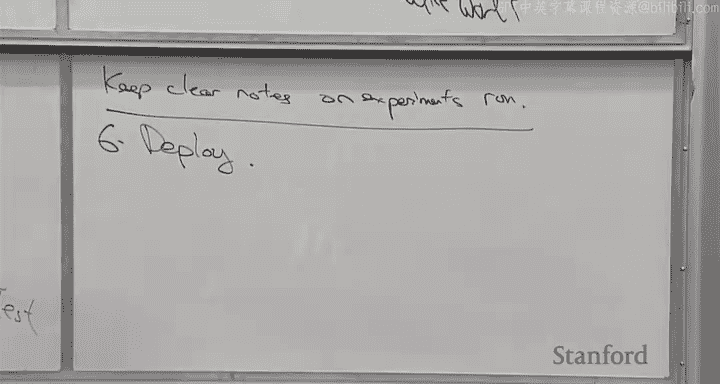
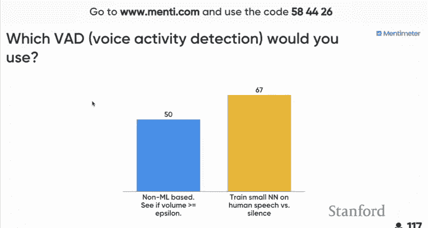

# 吴恩达@斯坦福大学《深度学习｜Stanford CS230： Deep Learning ｜ Autumn 2018》中英字幕（豆包翻译 - P3：[03]Lecture 3 - Full-Cycle Deep Learning Projects.zh_en - GPT中英字幕课程资源 - BV19y421z7jz

All right， here everyone， okay， I guess we're live。As as Arthur was saying。

 please enter your sonnet IDd。We can bring this up again at the end of class today。

We'll just take another like， what，20 seconds and then well， we'll go into the main discussion。

All right。So， on。What I want to discuss with you today is what I'm going to call full cycle deep learning applications。

 right？And so I think this Sunday you'll be submitting your proposals for the class projects you do this quarter and。

In most of the in a lot of what you learn about in machine learning projects。

 you learn how to build machine learning models。 What I want to do today is share you the bigger context of how a machine learning model。

 know， how a neural network you might train fits in the context of a bigger project。

 So what are all the steps， right， just as if you're writing a software product。 You know。

 you take other classes that learn you。That teach you how to build a website， for example。W。

 what is that？嗯。But to build a product requires more than just building a website， right。

 So what are the， what are the other things you need to do to actually do a successful software project。

 In this case， to do a successful machine learning application。嗯。And so。Let see， so so oh yeah。Oh。

 test， test is the audio on test， Could you turn up the audio。No， how's this。 No。

 can't hear me at all。 Hi， oh， I think I'm broadcasting。 I hear myself great。は。Okay。

 you can hear me now。 Great。 Thank you。 alright。Thank you。 All right。

 So what I want to is share with you full cycle machine learning。

 not just how to you learn a lot about how to build deep learning models。

 but how does that fit in a bigger project， right， just as if you taking a close on and building a website。

 you know， then great， you can know how to code of a website that's really valuable。

 But whether all the things you need to do to make a successful website or to build build a project that involves launching a website or a mobile or whatever。

😊，So as you plan for your class project proposals due to Sunday。

 if you're doing an application project that fits in the context of a bigger application also keep some of these steps in mind right so you know these are what I think of as the steps。

Of an M L project or really， maybe， maybe not fast project， but maybe a serious machine learning。

Application， right， and I think It know， Ive built a lot of machine learning products over several years。

 So some of these are also things that I wish I had known like， you know， many years ago。嗯。1。

This was kind of maybe kind of obvious， but。You know。Select a problem。 And let's say。

 for the sake of simplicity。That you use supervised learning。

 right it turns out for the CS 230 class projects， I think more than 50% of the cost projects tend to use supervised learning。

 There are also other projects that use end up using GNs。

 which talk about later this quarter or other things。 But I think， you know。

 let's say use supervised learning to build an interesting application。And and I think for today。

 I'm gonna to use as a running example， building a building a voice activated device， right， So。

 you know， I't know， actually， how， how many of you have like a smart speaker in your home。

 like a voice activated device in your home。😊，Yeah， the in the US， wow。

 not that many of you interesting。 Okay， cool。 Yeah， So I think you know， the the Amazon echo。

 Google Homes， the Apple series or the the in China， my one of my former teams built by do O。

 But let's say for the sake of argument that you want to build。😊，A voice activated device。

 And I'm going to use as a running example。 And so in order to build a voice activated device。

 And and again， I'm not gonna to use any of the commercial brands likelect or okay。

 Google or Ha Siri or I guess in China was a hello Xiao do or Xiao do Neha。

 which means kind of roughly。 hello， little do。 But let's use a more neutral word。

 which is you wanted to build a device that you response to the word activate。

 And youre actually gonna implement this as a problem set later this quarter。

 But so you want to build a yeah。😊，冇啊。Okay， now volume out啊。Let's see。 how that。 Okay。

 is this better。No， yes， no。 This is better。 Okay， cool， thank you。 A little bit ironic。

 How about speech recognition and the volume doesnt higher enough， okay。😊，So let's say you want wow。

 let me know if I've coso gave it。 Thank you。So let's you want to build a voice activated device。

 So the key components， the key machine learning， deep learning component is going to be a learning algorithm that takes us input and audio clip。

And outputs， did they detect。Was sometimes called a trigger word。Now， did I go software game。 Okay。

 this is okay， great， All right， And and outputs Y， you know，01， did you detect the trigger word。

 such as Alexa or okay， Google or Ha Siri or a hello。

 little do or or activate or whatever wake word or trigger word， right。嗯。And so。

Step one is select a problem。And then。In order to train a learning algorithm。

You need to get labeled data if you apply supervised learning。And then， you design。A猫刀。没。

Use background or some of the other algorithms you learn about momentum， atom。

 various optimization algorithms， gradient in decent。To train the model。

And then maybe you test on your test that。And then you deploy it。

 meaning you start selling these smart speakers and， you know， putting them into。

 hopefully into your users' homes。嗯。And then。You have to maintain the system。

 I'll talk about this later as well。 and and this is not chronological。

 but one thing that's often done， but I want to talk about at the end instead is not really step 8 is a QA。

 which is a quality assurance， which is an ongoing process and so let's see。

 so as you so if you want to build a product， if you want to sell a machine learning product。

 these are maybe some of the key steps you need to work on some observations。

 when you train a model training a model is often a very it process。

 every time you train a machine learning model， you find that。

 you know I can almost guarantee whatever you do it will not work at least not the first time And so you find that even though I've written these are a sequence of steps。

 when you train a model you go nope， that neural network architecture didn't work I need to increase the number of hidden units or change their organization or switch their RN or switch a totally different architecture and sometimes。

You train them model and go， nope， that didn't work。 I need to get more data。

 And so this is often a very itative process where you're cycling through。

The several different steps here。 And then I think one distinction that you have not yet learned about in the Cora in the deepbl AI Cora videos is how to split up the data into train depth and tests。

 So I'm going simplify those details for now。 But just as a a foreshadowing， I guess。

What you learn later in the， in the deep AI Cosera videos is how to take a data set you have trained into。

 excuse me， into a training set。Into a set that you actually test cross validate using doing development called a depth set or development set or hold our cross validation set。

 as was a separate test set。 So you learn about this later。

 But I'm just simplifying a little bit for today。Okay。So。呃。So， I think。

The first thing I want to do is ask you a question So we're gonna to talk through many of these steps。

 and it turns out that what a lot of machine learning classess do and do a good job teaching is focusing on maybe these three steps or maybe these four steps right？

 And what I want to do today is spend more time So this is the heart of machine learning。

 How do you build a great model And what I want to do today is spend more time talking about step 1 and 6 and 7 and just a little bit of time talking about the core of this because you kind of need to do these steps as well。

 if you want to build a deep learning product or build a machine learning application。😊。

So let's solve a discussion question。 actually。Curious， if you are selecting a。Project to work on。

 what other the， actually， So I don't， don't answer this yet。

 I'll tell you what the question I'm going to ask is， which is。不。All right。

 what properties make for a good candidate deep learning project。

 don't answer yet right I wantna say a few more things before before I invite you to answer。

 which is that all of you for the last few days， I hope have been thinking about what project you want to do for this cause what I want to do is just discuss some properties of what are good project to work and what maybe not good projects to work and think of this as your chance to give your classmates advice of the things your classmates to think about they're trying to decide this is a project to work and so what I want to do for today is use this voice activated thing as a example and know there's actually one project was working theres one project I thought of working on or decided not to work on there's a voice activated device。

 So it turns out that these voice activated devices echo Google Home and so on they are taking off quite rapidly in the US and。

the world。 it turns out that one of the you know significant pain points of these devices is the need to configure it right to set it up for wifi。

 So I've done a lot of work on speech recognition。 know did a lot of work in Google speech system。

 I let the buy two speech system So I've been published papers on speech recognition and I have I have one of these devices in my home right actually I have an Amazon echo in my living room。

 but even to this day I have configured exactly one light bulb to be hooked up to be controlled by my echo because the setup process not blaming any cofy it's just difficult to hook up you know a wifi enabled light bulb and then to set it up so that your smart speaker or whatever is you say you know smart device turn off the lamp。

 So I have one light bulb in my living room where that I can turn on and off。

 and that's it right even as a speech researcher。😊，So。Maybe say a bad example。

So one one application that I think that I was actually seriously considering working on is to build a embedded device that you can sell to lamp makers so that I don't know where you buy your lamps from。

 but you have a few lamps from my gear or a few lamps from wherever。 but you can buy a desk lamp。

 so that when you buy the desk lamp， there's already a built-in microphone so that without needing to connect this thing to w-fi。

 I was like， hey， here's a $20 desk lamp put them on your desk and you can go home and say desk lamp turn on or desk lamp turn off。

 then I think that will help a lot more users get voice activated devices into their home。

 it's actually not clear to me if you want to turn on a desk lamp Its actually not clear to me that you want to turn to smart speaker and say hey。

 smart speaker， please turn on that lamp over there。

 it maybe if you use one natural to just talk directly to a desk lamp until it to turn on and。

And so so for one where someone friends I we evaluated this。

 we actually thought that this could be a reasonable business to build embedded devices to sell to lamp makers or other device makers so that they can sell their own voice activated devices without needing this complicated wi-fi setup process and so to do this you would need to build a learning algorithm and have it run an embedded device that just inputs an audio clip and outputs you know whenever it detects the wakeword And instead of a wakeword being activate the wakeword would be a lamp turn on or lamp turn off you need two wakeword or trigger words。

 one to turn it on when to turn it off I think just the other thing that I think make this work is to give these device names So if you have five lamps or two lamps you need a way to index and do these different desk lamps。

 let's say you decide for your project to have a little switch here So this lamp could be called John。

うん。Or marry me。Above。Or Alices， like a fourway switch So that depending on where you set this fourway switch。

 you can say， you know， John， right， turn on right or it if you decide to call this lamp， John。

 like it was give us some the name。 So you don't have every lamp by the same name， okay。

So what I'm going to do is use as a motivating example this as a possible project。

 Oh I'm not working on this。 If any of you want to build a startup doing this， go for it。

 this is not I felt my teams and I we had better idea。 So we want to do other things in this。

 but I should don't see anything wrong with this。 I think this actually could be a reasonable thing to pursue as well。

 but I'm not doing it。 So yeah， very welcome to if you want。

So now the question I want to pose to you is when you're brainstorming project ideas。

 you know like this idea， some other idea， what are the things you would want to watch out for。

 what are the properties that you would want to be true in order for you to feel good proposing this as a CS 230 project right so why don't should take a minute and write this down。

 I think yeah if you're asking a friend if a friend is asking you what are the things I should look at to see if something is a good project。

 what would you。

What if you recommend them。 So just write down a few keywords and then we'll see what。People say。

And then， and then I'll tell you what I tend to look out for when I'm selecting projects。

 and I have a list of five points。Why should take like， I don't know， like two minutes to start？Oh。

 sorry， this is non activated。嗯。You're not able to answer enter answers， okay。

Let me test the Internet access。Just checking on， yep， I'm connected the Internet。Aret you any ideas？

Oh， I see。 okay。All right， let me try that。I was working now。 Okay， thank you。Keeps staying。Oh yes。

 thank you。Thanks。So can you take like two minutes to enter。

 and I think I think I configured this to let you enter multiple answers。 Lets take two minutes。

Allright， another one minute。30 seconds。Okay，3，2，1。Well。I in hindsight。

 that wasn't the best visualization。Can people see this？嗯。Well number on。

 trying to see if all right so。Data and novelty， loss of data。 Some of these are really small。

 human doable number of examples， Doable in two months， no office sovereign new industry fields。

Clearjector， practical， useful。OhOh， can be finish in time。呃。あ？He real life problem。

 useful hasn't been done， computationally tractable。Yeah， generalization。I see go， great。帮后们。

Let me make some comments on these I think I this is pretty good I had a list of five bullet points that maybe I just share of you my list of five。

Which is， I think just some things I encourage you to。Pay attention to， you know， this。

 this may or may not be the best criteria， but interest。

 I think interest just I just hopefully you can work on something that you're actually interested in。

And then I think。Right， data availability， which many of you cited is a good criteria one of the ways that Stanford class projects sometimes do not go well is that students spend a month to try to collect data and after a month have not yet found the data and then and then you know。

 and then it。And there's a lot of wasteted time。嗯。One thing that's I would encourage you。

To consider as well is a domain knowledge and I think that if you are a biologist and have unique knowledge into some aspect of biology to which you want to apply machine learning that will actually let you do very interesting project that is actually difficult for others to do and I think more generally as advice for navigating your careers so's interesting because AI machine learning。

 deep learning， there's there's so many people wanting to jump into machine learning and deep learning actually give an example so I sometimes talk to doctors。

 radiology students including like standardford and other universities radiology students that want to learn about machine learning because they hear about deep learning。

 maybe some affecting radiologys jobs and so they want to be part of deep learning and so my career advice to them is usually to not forget everything they learn as a doctor and try to do machine learning1 on one from scratch。

just forget everything they learn as a doctor and just become a CS major， I think that path can work。

 but I think where a radiologist can do the most unique work that allows them to make the most unique contribution is that they use their domain knowledge of healthcare and radiology and do something in machine learning applied to radiology。

Right and so。不好意思。All right， how？How many millennials are there in this class？なで、すね。

What is that me me me， me me thing？んか。Right。This is really wrong。Yeah。

 I think it's because it's a word cloud， so very clouds word frequency， right？😊，The money thing。

 I don't know， I have very mixed feelings about that。All right。

 but I think actually know that some of you are taking deep learning because you work in a different discipline and you want to do something and this hot new exciting thing of machine learning and I think whatever discipline you're in。

 if your domain knowledge about some other area， your education， civil engineering， biology law。

 taking deep learning allows you to do very unique work applying machine learning to your domain。

哦。Let's see， I think that。嗯。I think， well， I call the utility， but several of you mentioned as well。

 something that has a positive impact that actually helps other people and I don't know money could be an aspect of utility。

 but maybe not the most inspiring one。And then， I think。

And I think one of the biggest challenges we face in the industry today is so， frankly。

 there's actually good judgment on feasibility so today。I still see too many leaders。

 sometimes Cs of launch companies that stand on stage and announce the whole world。 know。

 we're gonna to do this machine learning project to do this by this deadline。

 and then 20 minutes later I talk to their engineers and the engineers say no way not happening just run on stage how engineering organizationization is not doing and knows is impossible。

 So I think one of the biggest challenges is actually feasibility in fact。

 I actually know that Cha of Rt about the T office hours and I know that there been a lot of a lot of you have been think about applying endtoend deep learning can you input any X and outputny and do that accurately and sometimes it' possible and sometimes it's not and it still takes relatively deep judgment about what neural networks and cannot do with a certain amount of data that you may or may not be able to acquire in order to do some of these things I think throughout this。

Wer， you gain much deeper judgment， as well on。What is feasible， I guess。It was pretty interesting。

 I once know， I knew a CEO of a very of a large company that once told his team。

He actually gave his team these instructions。 He said， I want to assume that AI can do anything。 And。

 and， and I think that had an interesting effect， I guess yeah。😊，Cool， allright。

 so I think step one was Select a project。 I hope there's a select project try to keep some of those things in mind。

 Step two is get data。😊，はい。And so what I want you to do and I'm gonna pose a second question and then have some of you discuss is let's say that you're actually working on this you know。

 smart voice activated embedded device thing right So let's say that you and your friends want to build a startup to train a deep learning algorithm to detect you know phrases like John turn on or marry turn off or Bob turn off or whatever to sell to device makers so that they can little voice embedded voice detection chip that doesn't require a complicated w-fi setup process so let's want let's say actually want to do this so you need to collect some data in order to start training a learning algorithm so the second question of pose to you is。

To a question in two parts。 but have you answered it all all at the same time， which is in how many。

 how many days， let's say you actually proposes for your CS 230 project this Sunday and then you start work on it。

 know， like on Monday you gonna start work on it today before the proposal。

 But how many days would you spend collecting data and how would you collect data Okay and I think actually。

 how how many of you have participated in engineering scrum， if you know what that means。Okay。

 a few of you。 those of industry。 Okay， Alright， so an engineering estimation。

 when you estimate how long a project takes， one of the common practices is use a fibonacci sequence to estimate how long a project will take。

 right， And so Fibonacci sequence 1，1，2，3。😊，5，8，13。And so on。 And it's roughly powers of two。

 but doesn't grow as fast as powers2。 And Fibonacci numbers are cool。 right， so， so。

 so what I want you to do。😊，Actually， let me just finish have the configuration right。

Whatever would。Speech bubbles。 Okay， yeah， that's good。Alright。

 so what I'd like you to do is in the text answer， I really write two things。 One is write a number。

 How many days do you think you spend on collecting data you and your teammates。

 if you're actually doing this project， And then how， how would you go about collecting the data。😊。

Okay。So why you take like another two minutes。To write in an answer。出からく。Oh， I'm sorry。啊。

你 say we know。Now was still not actually it。Sro， that I'm trying to hit。Oh， interesting。

That is not helpful。All right， that is definitely not helpful。嗯。嗯。Alright， let's do this。

 write down your answer on a piece of paper first and take two in this is that。

 So the two questions are how many days pick a number for a Fibonacci sequence。And oh。

 are you able to use R。 Oh， okay， let's swap out my computer for Rs。 Oh， actually， yeah， oh。

 if R Ts computer is working， I should go ahead。😊，Okay。Oh yeah， I can just present Yeah， yeah。

 let's plug in your laptop show you can just use your laptop。起床啊。That's interesting。

 I wonder if it's a network problem， a web browser problem。啊。I started using Firefox recently。

 in addition to Chrome and Safari， and that was Firefox。 I'll tried with other web browsers later。

もてて。Right right， cool， okay， great， thank you。 thanks Algie。Allright， maybe， yeah。

 maybe people that take another minute from now， just extend the time of bit to。Al right。

 another 10 seconds。なこ。Let's see when show answers， okay。All right， well，365。So。There's，s。

 there's a lot of variance in the answers， right？嗯。I don't know。

 download from online depends on what data you want。 It turns out， well。

 so if you're trying to find data phrases like John Turn on that data doesn't exist online。

 It turns out you're trying to find audio clips that the word activate。

 There are some websites with single words pronouns， but those but not a lot of audio clips。

 actually so the trigger word or the wayword is the word activate there are some websites we can download like maybe 10 audio clips of a few people saying activate。

 but it's quite hard to find。Hundreds of examples of different people saying that word activate。嗯。是。

Five days， it falls in the sky。Allright， so let me suggest let me suggest that you guys discuss with each other in small groups what you think would be the best strategy。

 how many days we find collecting the data and how we is not collect data and try to convince people next to you on that and before I ask you to start discussing。

 I want to leave you one thought， which is how long do you think it will take you to train your first model And so it will take you a day to train your first model or two days do you want to spend X time collecting data and then spend let's say。

 you I don't know， to set a deep learning thing training model it might take a couple days especially if you download open source packages。

 so if the amount of time needed to collect data is X followed by two days to train your first model。

 what do you think X should be the amount of time。 once you guys spend like two minutes to discuss with each other and see if you can the answers there's very large variances once should guys discuss if if the people sitting next to you。

Partners， why you discuss with them how many days you think you should spend collecting data and how you collect the data。

W take two minutes to discuss in the greater。し。当。嬉しい？こてま。い来。や。Yeahは。Yeah。这个。どか。有。家要。な。あ。あ。こあアつです。あね。

Okay。Yeah。て。Yeah。い。

こ。あす。そうですか。で。あ个。とこで。あるいで。Yeah。ありとうござま。All right。て。そ个。好。All right， guys。Wow， all right guys。Hey guys。

Allright， lot of exciting discussion。So actually， how， how many of you。

 how many of the groups wound up on the， on the low end， How many of you， you know。

 convince each other that maybe it should be like three days or less。Oh， just a few of you。 How come。

Some someone， someone say why， why is it， why， why。

Because you want to just see if that algorithm works。

So you need some data to just test the safety if the algorithm is on the even reaching sort of some sort of good benchmark。

Before you then go and collect a massive data set。Go here。

 I guess a little bit of data to test how the an workss before you even go and collect a massively。

And did anyone has had a high end， like a 13 days or more。Very few。 How come anyone， actually。

 anyone， anyone with insights， you want to share the whole class as you。What were you all discussing。

 so excited。やはい。So depending on your domain knowledge， data collection can take a long time。

 especially for this problem， like based on one ni gauge and this in previous class。

 you were thinking like we could use like movie clips and subtitles to generate some audience images for the keywords which want to trigger our existing right。

And that would take time to like mine data from movies。だな。佢哋啲病都。Yeah， yeah， yeah， right。

 So the complicated system to look at subtitle videos right like YouTube videos or captions or something。

 and if there's appropriately like creative commons data you could use Yeah So let me let me tell you my bias。

 I'll just tell you what I would do if I was working on this project one caveat。

 if I haven't done so much work in speech recognition previously but this is my first project。

 I would probably spend one to two days collecting data。Kind of on the short end， right？

 And I think that。You know one the and one of the reasons is that machine learning。

 kind of that circle I grew up there is actually a very iterative process where until you try it。

 you almost never know what's actually going to be hard about the problem and so if I was seeing this project I just so you to do what I would do like again。

 I've actually thought about this project a bunch including you know trying to validate market acceptance and so on。

 which is that I would get a cheap microphone use a builtin laptop microphone or buy a microphone off you know buy a microphone off Amazon or something and go around say go around Stanford campus or go to your friends and have them just say hey。

 do you mind saying into this microphone the word activate or John turn or whatever and collect a bunch of data that way and then and with one or two days you should be able to collect at least hundreds of examples。

UAnd that might be enough of a data set to start training a rudimentary learning algorithm to get going because。

If you have not yet worked on this problem before， it turns out to be very difficult to know what's going to be hard about the problem。

 So it what's going to be hard highly absent to speakers right or is what's gonna to be hard background noise or is what's going to be hard you know confusing turn on with turn off hear John turn and But when you build a new machine learning system is very difficult to know what's hard and what's easy about the problem or what's going to be difficult that Ffi。

 which is the technical turn for if the microphone is very far away So it turns out that if we turn on the microphone or my laptop now。

 for example， the laptop， which is like three meters away from me will be hearing voice directly from my mouth as well as voice bouncing off the walls So there's a lot of reverberation in this room。

 and so that makes me recognition harder。 human here is so good at processing out reverberan sounds。

 reverberations that you almost don't notice it but it actually。

The the learning algorithm will have sometimes has problems with reverberations or echoes。

 bouncing off the hard walls of this room。And so depending on what your learning algorithm has trouble with。

 you will then want to go back to collect very different types of data or explore very different types of algorithms。

 was a problem that sometimes it's because its just the volume is just too soft。 in which case。

 maybe you need to do something else and normalize all your volumes or buy more sense micro or something。

 So it turns out that when building most machine learning applications unless youve experience working on it。

 So I've actually worked on this problem before。 So have a sense it was hard it was easy。

 But they work on the new project for the first time is very difficult to know what how it was easy。

 And so my advice to most teams is rather than。Spending， say。20 days to collect data。

And then two days to collect model， to train a model。

 And it's often by training a model and then seeing whether the examples it gets wrong。

 When do the algorithm fail， that that lets you feedback to either collect more data。

Or redesign a model or try something else。 And if you can shrink the data collection period down to be more comparable to how long you end up taking to train your model。

 then you can start iterating much more rapidly on actually improving your model and so maybe one rule of thumb。

 I actually tend to recommend for most class projects is I don't know maybe if you need to spend a week up to a week to collect data。

 know， maybe that's okay。 but you can get going even more quickly。

 I would even maybe more strongly recommend that。 And there have been so few examples in my life where the first time I trained the learning algorithm。

 it worked like pretty much never happens。 it happened once another year ago and I was so surprised I still remember that one time。

And so so machine learning development is often a very iterative process and by quickly collect data and often data sets are collected through sweat and hard work right and so I would literally you actually I've actually done a long world speech and to get going quickly I would probably just have myself when my team members run around and find people and ask them to speak into microphone and record audio clips that way and then only when you validate that you need a bigger data。

 which you go to more complicated things like set up an Amazon mechanical turk thing to K which I've also done actually also had very large data collected off Amazon mechanical Turk but only in the latest station project。

Understand what you really need。Right。So as you start to work on your class projects。

 maybe maybe keep that in mind。Now。あ。Yes。So one other tip that machine learning research is on average。

 we tend to be terrible at this， but I'll give this advice anyway。

 is when you going through this process， get some data designer model。

 a literature search would be very helpful so see what algorithms others are using for this problem。

 It turns out the literature is actually quite image well there isn't a convergence of like a well standard of standard algorithms for trigger word detection the literature right now。

 people are still making up algorithms。 So if if you do a literature survey you find out to be case but you train initial model and in most machine learning applications。

 you go through this process multiple times。 So one tip that I would recommend you do is keep clear notes。

On the experiments you've run。Because often as you trade a model， you say， oh。

 this model works great on American accent speakers。

 but not on British accent to speakers I was born in the UK。

 So I'm going to use British accents run example， if you're for a different part of the world。

 think of different global accents that send out from the UK I'm just gonna pick on British accents I guess keep clear notes on the experiments run Because what happens in every machine learning project is after a while you have trained 30 models。

 and then you and your teams going oh yeah， we tried that idea two weeks ago， did it work。

 And if you have clear notes from when you actually did that work two weeks ago。

 then you can refer back rather than have to rerun an experiments The other thing that some groups do is have a spreadsheet that keeps track of what's the learning rate you use what's the number of hidden unions。

 what this， was this was this or keep it in in a text document so that which will make it easier to refer back to know some what you tried earlier。

This is one piece of commonly given advice， this is one of those things that every machine learning person knows we should do this。

 but on average we're very bad at doing this that you could， I don't know。

But at the times I managedly keep good notes that actually save it all the time。

 right to try to remember what exactly you tried two weeks ago。お。

So lot of this class will be on this process of how to get data， develop train dev test the。

 design a model， train the model， eventually test the model and iterate。 Okay。

 so a lot of this class is on this。 So I want to jump ahead when you have a good enough model and you want to deploy it。

So step six， guess is deployment。Now，呃呃。This is oh。

One of the reasons I want to step through this example going through a concrete example is I find that when you're learning about machine learning for the first time is often seeing you what my team tend to call wall stories。

 kind of stories of projects that others have built before that often provides the best learning experience。

 I think I have built speech recognition systems， it helped me like a year or two years of something to do it。

 So I'm trying to so rather than know having you spend two years in your life building speech systems if can summarize a wall story to tell you what the process is like I'm hoping that these concrete examples of what building these systems are like in large corporations that that can help you accelerate your learnings without needing to get two years of on the job experience。

 You can just hear the salient points。

Now， if you're deploying a system like this， one of the things。 and this is actually true。

 This is actually a real phenomenon for deploying speech systems is you have the audio clip。

You have a neural network， and then。You know， this will output put zero1。

And the neural networks that work well will tend to be relatively large。

 relatively large model large hidden units， relatively high complexity。

 And if you have some of the smart speakers in your home you recognize that a lot of them are edge devices as opposed to purely cloud computation So we all know what the cloud is and what an edge devices and edge devices。

 a smart speaker that's in your home or the cell phone in your wallet。

 edge devices are the things that are close to the data as opposed to the cloud。

 which is a giant service we have in our data center So because of network latency and and because the privacy a lot of these computations are done on edge devices like a smart speaker in your home or like I guess hey Sur or okay Google can wake up your cell phone and so edge devices have much lower。

Computational budgets and much lower power budgets， limited battery life。

 much less powerful processes than we have in our cloud data centers。And so。

It turns out that serving up a very large neural network is quite difficult， right。

 It's very difficult for， you a low power inexpensive microprocessor sitting in a smart speaker living room to run a very large neural network with a lot of hidden units of a lot of parameters。

And so what is often done。Is to， actually。Do this。Which is。To input an audio clip。

And then have a much simpler algorithm， figure out if you know anyone is even talking。Right。

 because so the smart speaker， you know， in my living room hears silence most of the day right because usually there's just no one at home right there's no voice and then only if it hears。

 you know， someone talking then feed it to the big neural network that you've trained and ramp up use a larger power budget in order to classify。

01， this component goes by many different names in reasonably standard terminology。

 but not totally standard terminology。In the literature。

 I'm going to call this VAD for voice activity detection。系い。

It turns out that voice activity detection is a standard component in many different speech recognition systems。

 If you are using a cell phone， for example， VAD is a component that tries to figure out anyone is even talking because if the things no one is talking。

 then there's no need to encode the audio and try to transmit the audio right could you。啊眼黑了。😊。

And so。So the next question I want to ask you。 And， and I thought this was timely because well。Is。

Couple options， right， option 1。Is to build a non machine learning based VAD system。

 voice activity detection system， which is just， you know， C。Yeah。If the volume of the audio。

 your smart speakers recording is greater than epsilon。 So the silence， just forget it。

And option two is train a small neural network。To reckon on human speech。ここ？Right。And so。

My next question to you is if you're working on this project。

Would you pick option 1 or would you pick option 2。Right， as you as you， as you move toward， oh。

 sorry， and I think a small neural network。 So a small neural network。 or in in some cases。

 I've seen people use a small civil effect machine as well for those of you who know what that is。

 A small model can be run with a low computational budget。

 It's a much simpler problem to detect someone is talking then to recognize the where this said。

 So you can actually do this， you know。With reasonable accuracy with a small neural network。

 But if you're actually working on this project for CS 2 30。Whi would you try for us。So。

 could we come to the next question？Okay， figure out how to do that。 Oh， Yeah， yeah，'s， let's let。

 yeah， we can let them start answering， I guess。 And then while you figure out the projection。Cool。

Or just keep unlocking it periodically。Are people able to vote？你，等 no保歉。Wellow。your short。没事。

I guess you write so much code， you have a shortcut to go to your clothing environment or your laptop。

对。Is that one。爱购。Great， thank you。好。好吧，对 right。People answer quickly。Another like 20 seconds。

 if that's enough time to get the answers。I cool。嗯。That's fascinating。

 there's a lot of disagreement in this cause。People want to say， why， why would you choose option 1。

 Why would you choose option 2， And， and I I I I have a very strong point of view on what I would do。

 right， but I'm curious why。Why option  one and why option 2， Go ahead。

easyas to de。Anyone else， either arguments to option one or option。保是我。啊什么 simple。ます。

Option 2 is not that important。I options who's not that hard you know。Well， I was thinking like。

 you know， option born like if you have a dog in your house and car is probably very activated。

 So when you implement option2， you can probably。Tryd of already like this simplify the problem by putting out no that's not。

 it's a noise， I mean， activates a machine， but the itself。That's why I think option two。 Yeah。

 right If a dog barking， option two would be much better at getting the。 Yeah， so kind of those。

That two of you in option to， there may be noise people have like。没。Musicory。

So what if someone's whisper what if someone's because for option2 maybe you in a very noisic place。

我你个麦。Yeah， a very place option to I think it will pick up the background。Yeah， cool。 yeah。

 right if you're in a noisy place。 Like， you know， I have a friend who's actually listening to the train station。

 And so right， so option one would pick up a lot of train。 which is awesome。

 whichever option you pick has to be running constantly。 So you want something that's very cheap。

 So it seems like option one is better because it would be very cheap in your system。😊，Yeah。

 whether it has to be running constantly so want to be cheap， low power， low concrete。

 So let me just share you some of the pros and cons。啊。

So I think you know there are pros and cons option one and option two。

 which is why there are so many votes for both options。 I personally would choose option1。

 but let me just let's just discuss the pros and cons I think that option one first is just a few lines of code is yes。

 maybe option two is't that complicated， but option one is even simpler。

 and I think that actually maybe I would say if I hadn't worked on this problem before。

 I would choose option1 but since I have experience in speech recognition eventually I know you need option2。

 but that's because because I've worked on this problem before。

 but your first time worked on the speech application problem I would encourage you on average to try to really simple。

 quick and dirty solutions and go ahead and So let's see how long would it take to implement this right I would say like 10 minutes。

5 minutes I don't know。好nawoodton can implement that。I don't know。 like what4 hours one day。

 I don't really know， actually。They're just right one day， and I'm not quite sure。Right， but if。

Option1 can be to in 10 minutes。 Then I would encourage you to do that and go ahead and put the smart speaker in your home or in your potential users homes。

 And only when you find out that the dog barking is a problem or the train on the railway whatever is a problem。

 then go back and invest more in fixing it And in fact。

 it's true that maybe it's annoying if the dog barking keeps on waking up the system。

 But maybe that's okay because if the large neural network then screens out all the dog barking。

 then the overall performance system is actually just fine。

 And and and you now have a much simpler system but but it turns out that the reason you might need to go to option to eventually is because there are some homes in noisy environments know this constant background noise And so that will keep the large neural network running little bit too frequently。

 So so if you have a large engineering budget。 so so some of the smart speaker teams are like hundreds of engineers。

on it。 So you have hundreds of engine work on it， totally。Option 2 will perform better。

 But if you're a strap up startup team is scrappy startup team with three of you working on a class project。

 you know。The evidence that you need that level of complexity is not that high。

 And I would really do that first and， and use that to gather evidence that you really should make the investment to build a more complex system before actually making the investments of。

Das or and eventually， I think this is one day to build your first prototype。 right。

 And then eventually itll be， itll be more complicated。It turns out that the other reason。And。

The other huge advantage of the simple method is the following。嗯。And this is one of the frankly。

 this is one the this is actually one of the big problems and big weaknesses of machine learning algorithms and deep learning algorithms。

 which is what happens is when you build a system and you ship the product。

 the data will change And so I'm going to simplify the example a little bit。 But you know。

 I know Stanford is very cosmopolitan。 Palo Al is very cosmotan。 So you collect data in this region。

 you get access from people all over the world， because because that's Stanford or that's Palo Alto。

 But just to simplify the example a little bit。 let's say that you train。😊，On US accents。Right。

 but you know， for some reason， when you ship a product。

 maybe it sells really well in the UK and you start getting data。Yes。With UK or with British accents。

はい。So one of the biggest problems you face in practical deployment of machine learning systems is that。

The data you train on is not going to be the data you need to perform well on and I'm going to share with you some practical ideas for how to solve this。

 but this is one of those practical realities and practical weaknesses of machine learning that is actually not talked about much in academia because it turns out that the data says we have an academia are not set up well for researchers to study and publish papers on this。

 I think we can set new machine learning benchmarks in the future but this is one of those problems that is actually kind of underappreciated in academic literature but that is a problem facing many。

 many practical deployments of machine learning algorithms。嗯。And， and so more generally。

 the problem is one of data changing。And you might have new classes of users。With new accents。

 or you might train a lot on the maybe you get data from even Stanford users。

 and maybe Stanford is not too noisy。 Or Stanford has certain types of characteristics。

 When you ship it to another city another country。 that's much more noisy， you know。

 different background noise。Right， or you start manufacturing the smart speaker and to lower the cost of the speaker。

 They swap it out。 They swap out the high end microphone that you use from your laptop to collect the data for a lower end microphone。

It's a very common thing done in well done in manufacturing right if you could use a cheaper microphone。

 why not and often to human ears， the sound sounds just fine on a cheaper microphone。

 But if you train your learning algorithm using your I guess well I use a Mac。

 but a Mac is a pretty decent microphones。 if you train the data using audioclyral Mac and then eventually is a different microphone。

 it may not generalize well。 So one of the challenges of machine learning is that you often develop a system on one data and then when you ship a product。

 something about the world changes and your system needs to perform on a very different type of data than what you had trained on。

嗯。And so。And so what will happen is。After you deploy the model。The world may change。

 and you often end up going back to get more data， redesign the model right， And and I guess sorry。

 and this is this is the maintenance of the machine learning model。

 I want to give some other examples， web search。RightThis happens all the time at multiple engines。

 which is you train a neural network or you train a system to give relevant web search results。

 but then something about the world changes for example。

 there's a major particular event some new person is elected president of some foreign country or there's a major scandal or just the internet changes or actually what happens in China is a new words getting invented all the time so does that I've a Google and but the Chinese language is more flu than the English language and so new words get invented all the time and so the language changes and so whatever train just isn't working as law as it used to or maybe a different company suddenly shuts off their entire website to your search index because they don't want you indexing their website and so the Internet changes and whatever you get done doesn't work anymore。

Or。 self drivinging。はい。It turns out you build a cell dragon car in California。

 and then you try to deploy these vehicles in Texas。You know。

 it turns out traffic lights in Texas look very different than traffic lights in California。

 So a model trained on California， Texas so a neural network train to recognize California traffic lights actually doesn't work very well on Texas traffic lights I'm trying to remember which way around this。

 but I think California and Texas has a different distribution of horizontal versus vertical traffic lights。

 for example， It's actually humans don't notice you go oh yeah， red yellow green。

 but the learning algorithm doesn't actually generalize that well。

 if you go to a different locations。 go to a foreign country， again， traffic lights， signage。

 the land marks or change or。I guess well， one example I was working on earlier this week， right。

 manufacturing， right landing AI， working on inspection of parts in factories。

 and so if you are doing visual inspection in a factory。

And the factory starts making a new component。 You know， they were making this model cell phone。

 but cell phones turn over quickly。 And so， but in a few months later。

 they're making a different type of cell phone or something weird happens in the manufacturing process。

 So the lighting changes or new type of defect。 So the world changes。And。So。あ小 marketingで。

What I'd like to do is。Actually revisit the previous question in light of this， the world changes。

Phenomemen， right， which is， let's say you've collected a lot data with American accented speakers。

And then we ship the product to the UK。And then。嗯。And then for some reason。

 you find that you have all these British action speakers right， trying to use your smart speaker。

So between these two algorithms， the non machine learning approach。

 which is just set the threshold of re the neural network。

 which system do you think would be more robust for VADA voice activity detection？All right。

 particular like another， I'll know， 40 seconds。All right。Yeah。

 interesting to people want to comment。Well， more people voted for non M。 just want to explain why。

明对 ahead。What accents they can get the voice。 So this is a。It still be thinking of。All the。

 if we want to detect。The particular world and not just once。呢个。あ概て。right， right。

 So say for the VD voice activity section， if you just measure the volume。

 then it doesn't really depend on on the accident， right， So non Ml might be more robust Anyone else。

All right， so， again showing you my thoughts， so it turns out that。

If you train a small neural network to American accented speech。

 there's a bigger chance that your neural network because it's so clever right that a learn to recognize American speech and have a harder time generalizing to British accented speech make sense And so one of the things that I've seen a lot of teams whereas so one way the nonml think could fail to generalize would be a British speakers are systematically you know louder or softer than American speakers right So know I don't have Americans stereotically are louder or less loud than British but if American and British speakers one country just a louder voices or softer voices。

 then maybe the threshold you said won't generalize well but that seems unlikely I don't see that being realistic thing but but if you're training a neural network a lot of parameters then is more likely that the neural network will pick up on some。

Iiosyncrasy of American accents to decide that someone is even speaking and thus maybe less robust or generalizing into British accent speech and another way to think about this is if you imagine to take it even further example。

 imagine that you're using VD for a totally different language than English where take a different language Chinese or Hindi or Spanish or something。

 whether it sounds are really different if you create a VD system to detect you know English。

 it may not at all work for detecting Spanish or Chinese or French or some other language and so if you think of British accents as somewhere on the spectrum。

 not a foreign language by any means but just more different then I think the non-ml system is more likely to be robust and so one of the lessons that too many that a lot of machine learning teams learn the hard way is if you don't need to use a learning algorithm or something。

And hand code a simple rule like if volume greater than 0。01 do this or that。

 those rules can be more robust and one of the reasons we use learning algorithms is when we can't hand code something right I don't know how to hand code something to detect the cat or detect the car in the road or detect the person So use learning algorithms for those but there's actually hand codeed rule that actually does pretty well you find that it is more robust to shifts in the data and we often generalize better。

OhAnd if any of you take we talk about this about this a little bit than CS 229。

 I think CS229 teeth talked about this as well。 but this particular observation is backed up by very rigorous learning theory and the learning theory is basically that the fewer parameters you have。

 if you still do well in your training set。 if you can model with very few parameters that does well in your training set。

 you're generalize better So there's there's very rigorous machine learning theory that basically says that。

 And in the case of the nonmachine learning approach， there's maybe one parameters。

 which is what's the threshold for epsilon。 and does work well enough your training set。

 then you're also generalizing， even when the data changes is much higher。はい。嗯。Now。The last question。

I want to pose the discussion today is。When， when discussing deployments and and so one of the lessons of deployment is。

 that's just the way the world works。 You， build a machine learning system， deploy it。

 the world will usually change and you often end up collecting data and have it it and maybe improve the model right and fix the model for British speakers or something。

嗯。So we talked about edge deployments。As was cloud deployments？

And so ignoring issues of user privacy and latency， which are super important。

 But for purposes question， let's， let's， let's put aside issues of user privacy and network latency。

 If you need to maintain the model。 Sorry， maintenance means updating the model， right。

 even as the world changes。Oh sorry， I a mis type， which does a cloud or age deployment make maintenance easier。

 if not of， right， you， Why don't you just enter a one word answer and and why。

And so maintenance is when the world changes， something changes。

 so you need to update the learning model to take event， take care of this British accent。

 so which type of deployment makes it easier。Let'm me just take like， yeah。

 another two minutes to enter your answers。Allright， another like 50 seconds。こ cold。

See what people are wrote。Wow， cool， great。 Allright， almost everyone in the same cloud。

Most people are saying cloud。なま好き。Right， cool， great。 And and just to summarize。

 I think there are actually two reasons why most people said it's easier to push updates。

 That's part of it。 I think the other part of it is that if all the data is at the edge。

 if all the data is process， in the user home and then that it comes to cloud。

 then even if you have all these unhappy British accent users， you may not even find out the company。

 you have all these users and the seem to be not using your device maybe because they're un satisfiedatified with it。

 But if the data isn't coming to your service in the cloud， then you may not even find out about it。

 Now there's serious issues about user privacy。 as well as security， right so， so， so please。

 if you have product， please be respectful of that and take take care of that in very thoughtful and respectful web users。

 But if。First， if so this is the cloud。RightIf you have a lot of edge devices and all the data is processed there。

 you won't even know what your users are doing and they're happy， unhappy you just don't know。

 but if some of the data is streamed to your service of the cloud and if the user privacy with really please use good user consent。

 tell people what you're doing with the data but if you take care of that in a visible and sound way if you're able to examine some of the data。

 then you can at least figure out that ge looks like analyzing the data are these people of this this background noise that is giving a back product experience and you can also maybe have the data so you can gather the data from the edge to feed back to your model so lets you detect something's gone wrong it lets you have the data to retrain the model to solve the British accent problem you can retrain the model of British accent to speech and then finally lets you push。

Moveel back， So first， unless you detect what's going on to， it gives you data for training。

And three， it lets you more easily push the model back up。

 push the new model to production to deployment。 Okay And this is also why even if your computation needs to run on the edge。

 if you could， in a way， respectful of user privacy and is transparent about how you use data。

 if you can get even a small sample of data or have a few volunteer users send you some data back to the cloud。

 that will greatly increase your ability to detect if something gone wrong。

 as well maybe give you some data to retrain the model。

 So even if you can only do sort of push updates， right， this will this will help greatly。嗯。Alright。

 so finally， one last comment， I think one last challenge is in a lot of machine learning systems。

 you're not done at deployment。 There's a constant ongoing maintenance process。

 And I think one of the processes AI teams are getting better at as well or set up QA to make sure that we update the model。

 you don't break something。 So I think QA and large companies quality assurance process is test this And I think the way you test machine learning algorithms is different than the way you test traditional software because the performance of machine learning algorithms is often measured statistical is way so it doesn't work and it doesn't work。

 it neither works nor doesn't work。 instead it works， you，95% of the time or something。

 And so a lot of companies are evolving。 the QA process that this type of statistical testing to make sure that even you change the model you do push update is still works95 or 99% of the time or something So putting in place new QA test processes as well。

Alright， hope that was helpful stepping through what the full arc of a machine learning project will look like。

 later this quarter in Co3， as was a later lecture that I present。

 We'll keep talking about machine learning strategy and how to make decisions like this。

 So let's break for today。😊。

