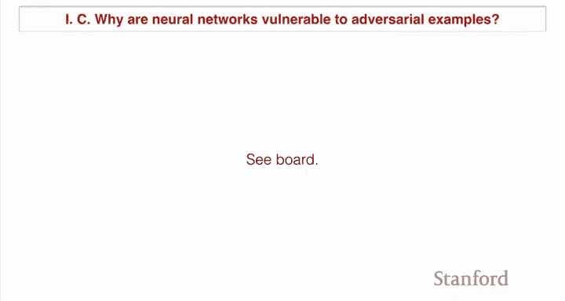
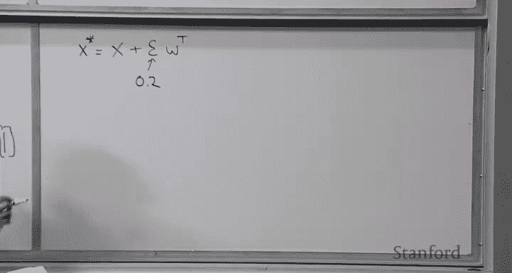
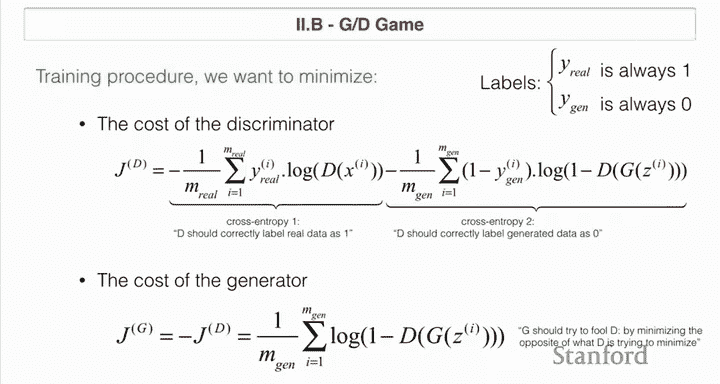
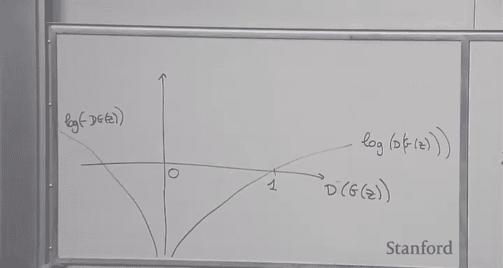
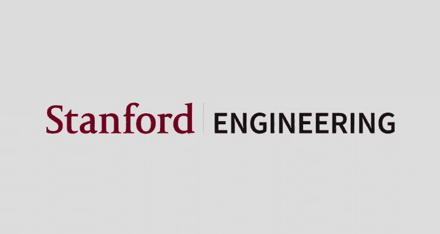

# 吴恩达@斯坦福大学《深度学习｜Stanford CS230： Deep Learning ｜ Autumn 2018》中英字幕（豆包翻译 - P4：[04]Lecture 4 - Adversarial Attacks _ GANs.zh_en - GPT中英字幕课程资源 - BV19y421z7jz

Okay， let's get started， guys。So welcome to lecture number four。

Today we will go over two topics that are not discussed in the Courra videos you've been learning C2M1 and C2M2 if I'm not mistaken so you've learned about what an initialization is how to tune your own networks。

 what tests validation and train sets are today we're going to go a little further you should have the background to understand 80% of this lecture there's going to be 20% that I want you to look back after you've seen the batch norm videos for those of you who haven't seen them。

So we'll split the lecture in two parts。And I put back the attendance code at the。

 at the very end of the lecture。 So don't worry， one topic is attacking neural networks with adversarial examples。

The second one is generative adversarial networks。 And although these two topics have a common word。

 which is adversarial， there are two separate topics。

 You will understand why it's called adversarial in both cases。

 So let's get started with adversarial examples。 And in 2013。

Christian Zga and his team have published a paper called Intriguing Properties of Ne networks。

 What they noticed is that neural networks， neural networks have kind of a blind spot。

 A spot for which several machine learning， including the state of the art ones that you will learn about VG G16。

19 inception networks and residual networks are view to something called adversarial examples。😊。

These areversial examples you arere going to learn what it is。In three parts， first。

 by explaining how these examples in the context of images can attack a network in their blind spot and and make the network classify these images as something totally wrong。

How to defend against these type of examples and why。

Are networks vulnerable to these type of examples。 This is a little bit more theoretical。

 and we're going to go over it on the board。The the papers that are listed on the bottom are the two big papers that that started this field of research。

 so I would advise you to go and read them because we have only one hour and a half to go over two big topics in in deep learning and we will not have the time to go into details of everything。

Okay， so let's set up the goal。 The goal is like， is that given a pretrain network。

 So a network trained on imagenets on 1000 classes， millions of images。

Find an input image that is not an Iguana， so doesn't look like the animal Iguana。

 but will be classified by the network as an Iguana。

We will call this an adversarial example if we manage to find it。Okay， yeah， one question。So 28，48。

89， let me writeite it down on the board so let me。那就。不。Can you guys see。Okay， let's move。

So we have a network pretrained on image。 It's a very good network。

What I want is to fool it by giving it an image that doesn't look like an Iana。

 but isify as an Iguana。 So if I give it a cat image to start with。

The network is obviously going to give me a vector of probabilities that has the maximum probability for cats because it's a good network。

And you can guess what's the output layer of this network is probably a softm。

It's a classification network。 Now， what I want is to find an image X that is going to be classified as an Iguana by the network。

O。Does the setting make sense to everyone？Okay， now， as usual。

This this might remind you of what we've seen together about neural style transfer。

 Remember the the art generation thing where we wanted to generate an image based on the content of a first image and the style of another image。

 And in that problem， the main difference with classic supervised learning。

 was that we fixed the parameters of the network， which was also pretrained。

 And we back propagate the error of the loss all the way back to the input image to update the pixels。

😊，So that it looks like。The content of the content image and the style of the style image。

The first thing we did is that we rephraed the problem。 We， we tried to， to。

 to phrase what exactly we want。 So what， what would you say is a sentence that defines。

Or last function， let's say。Any ideas。Complic。Yeah。An image that provides minimum cost。

An image that provides minimum cost。 Okay， what's the cost you're talking about， cost of it。

 The difference between expected y and not expected lot。Expected Iguana and non expected Iguana。

 what do you mean exactly by that， So we're sort of going back to the training stage。

 we were trying to train it on an image。 we wanted to think the distance an Iguana。Okay。

 so you want this image to minimize a certain loss function。

 and the loss function would be the distance metric between the output you're looking for and the output you want。

Okay， yeah， so I would say we want to find x， the image that that y hat of x。

 which is the result of the forward propagation of x in the network， is equal to y Iguana。

 which is a one hot vector with the one at the position of Iguana。Does that make sense。 So now。

 based on that， we define our loss function。Which is can be a L 2 loss。

 can be an L 1 loss can be a crossantropy。 In practice， this one works better。

 So you see that minimizing this loss function will lead our image X to be outputted as an Iguana by the network。

😊，That makes sense。 And then the process is very similar to neural side transfer。

 where we will optimize the image iteratively。 So we will start with X。We will forward propagate it。

 compute the loss function that we just defined。And remember， we're not training the network， right。

 We just take the， the derivative of the loss function all the way back to the input and update the input using a gradient decent algorithm。

Until we get。Something that's。Is classified as an Iguana。 Yeah， any question on that。

ButThis doesn't necessarily mean that the X that you get。Okay。

So you mentioned that it doesn't guarantee that X is going to look like something。

 The only thing is guaranteeing is that this X will be classified as an Iguana if we train properly。

We will， well talk about that now。 Another question in the back， I thought， Yeah。

 the function the one for logistic regression。Oh， yeah。 it could be binary crocent。

 It could be chantropy。 Yeah， so in this case， not binary crantropy because we have a， a vector of。

 of N classes， but it could have been chanrop。Okay， so yeah， that's true。

 Are we guaranteed that the forge image X， this one is going to look like an Iguana。Who thinks。

It's going to look like a niguana。If you， who thinks it's not going to look like anyone。Okay。

 majority of people。 So can someone tell me why it's not going to look like an Iguana。电。那嘅百く。Okay。

 so you saying the loss function is unconstraint， is very unconstrained。

 So we didn't put any constraint on what the image should look like。 That's true。 Actually。

 the answer to this question is， it depends。 We don't know。 Maybe it looks like an Iguana。

 maybe doesn't。 But in terms of probabilitybilities。

 it's high chance that it doesn't look like an Iguana。 So the reason is here。

 Let's say this is our space of input images。And the interesting thing is that even if as human on a daily basis。

 we deal with images of the real world。 so like。I mean， if you look at a TV that is totally buggy。

 you see pixels， random pixels。 But in other contexts， we usually see real world distribution images。

A network is deterministic。 It means it takes an image。

 Any input image that fits the the first layer would would be would produce an output。 right。

 So this is the whole space of input images that the network can see。嗯。

This is the space of real images。 It's a lot smaller。 Can someone tell me what's the size of the。

 the， the space of possible input images for a network。嗯。Sorry， infinite， it's not infinite。

 It's a lot， but。Okay， yet there is an idea here， someone there， I said the same thing。

 with just number of possible pixel permutations。Yeah， it's true。So more precisely。

 you would start with how many pixel values are there。There are 255，256 pixel values。

 And then what's the size of an image， Let's say 64 by 64 by 3。 And your results would give you 256。

So you fix the first pixel，26，56 possible value。 Then the second one can be anything else。

 Then the third one can be anything else。 And you end up with a very big number。

 So this is a huge number。 And the space of real images is here。 Now。

 if we had to plot the space of of images classified as an Iguana， it would be something like that。😊。

Right， and you see that there is a small overlap between the space of real images and the space of images classified by as an Iguana by the network。

And this is。Where we probably are not， We're probably in the green part that is not overlapping with the red part because we didn't constrain our optimization problem。

Does that make sense。Okay， now we're going to constrain it a little bit more because in practice。

 these type of attacks are not too dangerous because as， as a human。

 we would see that the pictures look like garbage。The dangerous attack is if the picture looks like a cat。

 but the network sees it as an Iguana and humans see it as a cat。Can someone think of。

 of like malicious applications of that。Face recognition。

 show a you could show your picture of your face or push the network to think it's a face of someone else。

What else？Yeah， breaking capchas and breaking like and spot protection。 Yeah， breaking capchas。

 if you know what the output， what output you want。

 you can force the network to think that this capcha this input capcha is the output it's looking for。

Or in general， I would say， like social medias， if someone is malicious and wants to put violent content online。

 there is all these companies have algorithms to check for this violent content。

If people can use adversarial examples that look still violent。

 but are not detected as violent by the algorithms using this methodology。

 they could still publish their violent pictures。Think about cell driving cars。

 a stop sign that looks like a stop sign for everyone。 But when the cell driving car sees it。

 it's not a stop sign。So these are malishious applications of adversarial examples。

 and there are a lot more。Okay， and in fact， the picture we generated previously would look like that。

It's nothing special。 So now let's constrain our problem a little bit more。

 We're going to say we want the picture to look like a cat， but be classified as an Iguana。😊，Okay。

So now same we have our neural network。 If we give it a cat is going to predict that it's a cat。

 what we want is still give it a cat， but predict that it's anig one。😊，Okay。

I I go quickly over that because it's very similar to what we did before。 So I just。

 I just put back what we had on the previous slide。Okay， exactly the same thing。 Now。

 the way we rephrase our problem will be a little different。😊。

Instead of saying we want only y hat of x equals y guana， we have another constraint。

 What's the other constraint。あります。Yeah， the picture X should be close to to the picture of the cat。

 So we want x equal or very close to X cat。And in terms of loss function。

 what it does is that it adds another term。Which is going to decide how x should be close to X catt。

 If we minimize this loss， now， we should have an image that looks like a cat because of the second term。

 And that is predicted as an Iguana because of the first term。Does that make sense。

So we're just building up our loss functions， and I guess you guys are very familiar with this type of thought process now。

Okay， and same process we optimize until we hopefully get a cap。Now， a question is。

What should be the initial image we start with？We didn't talk about that in the previous example。

Yeah， white noise， white noise， white noise。 Yeah， possibly white noise， any other。me a cat a cat。

Yeah， which cats？对。系。I don't know， probably the cat that we put in the last function， right？

Becauseuse it's the， the closest one to what we want to get。 So if we want to have a fast process。

 we'd better start with exactly this cat， which is the one we put in our last function here。😊，Right。

If we put another cat iss going to be a little longer because we have to change the pixel of the other cat to look like this cat。

That's what we told our last function。 If we start with white noise。

 it will take even longer because we have to change the pixels all the way so that it looks real。

 And then it looks like a cat that we define here。 So， yeah。

 the best thing would be probably to start with the picture of the cat。😊。

Does that make sense and then move the pixel so that this term is also minimized。Yeah。

So when you're write that， the loss function seems like you're implicit saying that what a human sees as a cat will just be like minimizing the IMSSE air to the actual cat。

I mean I thought the RMSSC era was actually a really bad way to gauge whether or not a human like saw two images similar Yeah。

 this is empirical the fact that we use that type of loss function。

 but in practice it could have been any distance between x and Xca and any distance between Y hat and Yca and Ygu elsewhere。

😊，Yes。So when you say。very。But yeah， just one specific cat。Exactly can think of a way of。

It complex loss function but it's a bunch of cash。And then it puts like something like a minimum there。

 right， the minimum distance between hold， Can we look at this wide vector。The probability create 6。

5 request probilities that going on。你再到咩。I'm not sure about this second method。

 but just to repeat the point you mentioned is that here we had to choose a cat。

It means the X catt is actually an image of a cat。So what if we don't know what the catch should look like。

 we just want。A random cat to come out and be classified as an niguana。

 We're going to see generative networks after， which can be used to do that type of stuff。

But but for the second part of the question， I'm not sure what the optimization process will look like。

Okay， let's move on。So yeah， it's probably a good idea to start with the cat image that we specified in the loss function。

Okay， and so then we have an image of a cat that originally was classified as 92% cat。

 and we modified a few pixels also。 you can see that this image looks a little blurry。😊。

So by doing this modification， the network will think it's an Iguana。O。

And sometimes this modification can be very slight， and we can even not be able to notice it。

Sounds good。Now let's add something else to this draft。We add a third set。

 which is the space of images that look real to human。So that's interesting because the。

 the space of images that look real to human is actually bigger space than the space of real images。

 An example is this one。😊，This is probably an image that looks real to human。

 but it's not an image that we could see in the daily life because of this slight pixel changes。Okay。

 so these are the space of dangerous adsial examples。 They look real to human。

 but they're not actually real。 They might be used to fool a model。O。Now。

 let's see a video by correcting it all on real world example of adversial examples。

So for those who cannot read。They're taking a camera which classify， which has a classifier。

 and the classifier classifies the first part as the library and the second image that is the same as a prison。

😊，So the second image has slight different pixels， but it's hard to see for a human。 Sam here。

 So the， the， the classifier on the phone。Classifies the first image。As a washer with 52% accuracy。

 confidence， and the second one as a doormat。😊，So yeah。

 this is a small example of what can what can be done。Okay， now let's go。

 We've seen how to generate these adversarial examples。 It's an optimization process。

We will see what are the type of attacks that we can lead and what are defenses against these adversal examples。

So we would usually split the the attacks into two parts， non targeted attacks。And targeted attacks。

So non targetedar attacks mean that we just want to output。

 We just want to find an adversarial example that is going to fool the model。

 While targeted attack is we want to force this adversial example to be output to output a specific class that we chose。

These are two different type of attacks that are widely discussed in the research。

Knowledge of the attacker is something very important。 For those of you who did some crypto。

 you know that we talk about white box attacks， black box attacks。 So one interesting thing is that。

😊，A black box attack。 A white box attack is when you have access to a network。

 So we have our image and pre pretrain network。 We have fully access to。

 to all the parameters and and the the gradients。So it's probably an easier attack。Right， we can。

 we can back propagate all the way back to the image and update the image。Like we did。

 A black box attack is when the model is probably encrypted or something like that so that we don't have access to its parameters。

 activations and architecture。 So the question is， how do we attack in black box attack。

If we cannot back propagate because we don't have access to layers。Any ideas？Yeah。

 numerical gradient。 Yeah， good idea。 So， you know。

 you will tweak the image a little bit and you will see how it changes the loss。😊，Looking at these。

 you can do have an estimate of the numerical gradient。Even if the model is a black box model。

 this assumes that you can query the model， right， You can query it。

What if you cannot even query the model or you can query it one time only。

 It's to send the adversaral example。How would you do that？So this becomes more complicated。

So there is a very complex property of these ads example is that they're highly transferable。

It means。I have a model here that is a animal classifier。Okay。😊，I don't have access to it。

 I cannot even query it。I still want to fool it。What I'm going to do is that I'm going to build my own animal classifier。

 Forge an adversarial example on it。 It's highly likely that it's going to be an adversarial example for the other one as well。

 So this is called transferability。 And it's still a research topic。 Okay。

 We're trying to understand why this happens。😊，And also， how to defend against that。You know。

 maybe a defense against that is to， is to， we're going to sit after。 I'm not gonna now。

 So does that make sense or no， this transferability。

 Probably it's because two animal classifiers look at the same features in images。Right。

 and maybe these pixels that are play we're playing with are changing also the output of the other network。

Let's go over some kind of defenses。So one solution to defend against these adversarial networks is to create a safety net。

A safety net is what is a net that like a firewall， you would put it before your network。

Every image that comes in will be classified as fake， like forged or real by the network。

 And you only take those which are real and not not。Adversarial， does that make sense？So。You。

 you could， you could。 You could say that'， okay， but we can also build an adversarial network that that fools this network。

 right。Just we be it black box or white box。 we can just create an addressd example for this network。

 It's true。 But the issue is that now we have two constraints。

 We have to fool the first one and the second one at the same time。You know。

 maybe if you fool the first one， there is a chance that the second one is going to be fooled。

 We don't know。Okay， it just makes it more complex。 There is no good defense at this point to， to。

 to all type of adversarial examples。 This is an option that people are researching for。

So the paper is here if you want to check it out。Can you guys think of another solution。は、もはい長お願いします。

that then for sale。Which is better one of the functions train on multiple loss functions。

 so different networks。 So you're talking about assembling。

Maybe we can create five networks to do our task。And it's highly unlikely that the aver example is going to fool the file networks the same way。

Right。Any you do ideas。Yes， right generate adversarial examples and train on them exactly generate adversial examples and train on those。

Okay。So you will generate a cat image that is adversarial。

 So some pixels have been changed to Fuller network。 You will label it。As the human sees it。

 So as a cat， because you want the network to still see that as a cat and you will train on those。

The downside of that is that it's very costly。 We've seen that generating adversarial examples is super costly。

😊，And also， we， we don't know if it can generalize to other aversar examples。

 Maybe we're going to overfe to the ones we have。 So it's another optimization problem。Now。

 another solution is to。Train on adversial examples at the same time as we train on。

 on normal examples。 So look at this loss function。This last function。

 the last new is a sum of two last functions。 One is the classic loss function we would use。

 So let's say chenttropy in the case of a classification。

And the second one is the same loss function， but we give it the adversarial version of X。

So what's the complexity of that at every gradient decent step。

For every iteration of our gradient descent， we're going to have to iterate enough to forge an adversarial example at every step。

Right，Because we have X。 What we want to do is forward propagate X to the network to compute the first term。

Generate x adversarial with the optimization process and forward propagate it to calculate the second term and then back propagate over the weights of the network。

This is super costly as well， and it's very similar to what you said is just online。

 just all the time。Okay。So what is interesting is we're going to delve a little more。

 There's another technique called logic pairing。 I just put it here。

 We're not going to talk about it。 There's a paper here。 If you wan to check it。

 It's another way to do adversarial training。 But what I would like to talk about is more from a theoretical perspective。

 Why our neural network vulnerable to adversarial examples。 So let's， let's do some。

 some work on the board。Yeah， one question。

Let be so we you want to course deal。look like so you expect to be a past weeks't just。

You really think I David as a given creator and then has a humanator？

The noing is also a method that seen。 But so the thing is that it's just like in crypto every time you come up with a defense。

 someone will come up with an attack。And it's a race between humans， you know？

So this is the same type of problem。 securitycy problems are over。Okay。

 so let's go over something interesting that is more on the in on the intuition side of adversarial examples。

So let me write down something。So one question we ask ourselves is why do avers example exist。

 What's the reason And Yan Good fellow and and his team have came up with explaining with the the one of the seminal papers of avers examples where they argue that although many people in the past have have attributed these existence of adver examples to high nonline nonlineities of neural networks and overfitting。

 So because we overfit to a specific data set， we actually don't understand what cats are。

 We just understanding what what we've been trained on。

 they argue that it's actually the linear parts of networks。

 that is the cause of the existence of aver examples。 So let's see why And the example I'm gonna。

 I'm gonna to look at is linear regression。So together we've seen logistic regression。

 linearar regression is basically the same thing without the simmoid。 So before the smoid。

 we have Y hat equals W X plus B。So， the forward propagation。

Our network is going to be Y hats equals W X plus B。Okay， and our first example is going to be。

A6 dimensional input。Yeah。Okay， we have a neuron here。

 but the neuron doesn't have any activation because we are in linear regression。 So here。

 what happens is simply w8 plus B。O。And then we get white hats。

And we probably use an L1 or L2 loss because it's a regression problem to train this network。

Now let's look at a first example。And first example were Is。Where we've trained our network。So。

Network has been trained。So， network has been trained。And converged。2。W equals。1，3。-1，2。2，3。

 This is W。 And， you know， like because we defined x to be。A vector of size 6， a column vector。

 The W has to be a row vector of size 6。So the network converts to this value of w and b equals 0。是的。

We're going to look at this input。 We're giving a new input。To the network。

And then the input is going to be 1 minus-1，2，0，3， minus-2。Okay， so I'm going to4 propagate this。

To get y hats equals W X plus B。And this value is going to be 1 times1。-3。-2。Plus0。Plus 6， minus-6。

So I didn't make a mistake。 up， up。2。-3 plus okay。Okay， and so we， we， we basically get。-4。Okay。

 so this is the the， the the first。The first example that was propagate。Now， the question is。How。

To change。X。Into x star。Search。That。Why hat。Changes。Radically。But。X star is close to x。

So this is basically a problem of adversarial examples。

 Can we find an example that is very close to x。But radical radically changes the output of our network。

And we're trying to build intuition on a neural networks。So。

The interesting part is to identify how we should modify X。

And the intuition comes from the derivative。If you take the derivatives。A F hat。With respect to X。

You know that the definition of this term is。Is like， correlated to the impact。On white hat？

Of small changes。Of X。Right， how what's the impact of small changes of x。To on， on the output。

And if you compute it。When do you get。W。Every degrees。What what's the shape of this thing？

Shape of that is the same as shape of X。So should be W transpose。Remember。

 derivative of a scalar with respect to a vector。Is the shape of the vector。Okay。

 now it's interesting to， to see this because if we compute X star。To B， let's say， X。Plus。

 a small perturbation， like。I will call it perturbation value。Yeah， sorry。

And can you see the top one？He said， yes or no。So what if x star equals x plus epsilon time W transpose？

And this epsilon， I will call it value of the perturbation。Now， if we forward propagate x star。

 it means we do Y hat star。Equals W X star。Plus B， but B is 0 at this point。We're going to get Wx。

Plus， epsilon， W。Times w transpose。And w times W transpose is a dot product。Right。

So this is the same as W squared。So what is interesting？It's interesting， because。The。

 the smart part was that this term is always going to be positive。

It means we moved a little bit X because we can make this change little by changing Epsilon to a small value。

But it's going to push Y hat to a larger value for sure。 you know。

 And if I had a minus here instead of a plus， it would push Y hat to a smaller value。And the。

 the interesting thing is now， if we compute X star。To be x。Plus， epsilon times W transpose。

 And we take epsilon to be a small value， like， let's say 02。

You can make the calculation。What we get is。Is this So 1-1，2，0，3-2 plus。0。2 times 1。0。2 times 3。M- 0。

2 plus 0。4 plus 0。4。And plus，0。6。So if you look at that。

 all the positive values have been pushed on the right。You agree。And all the negative values。 sorry。

 sorry， No， that's my one。 No， no no， that's not。 So， let's finish the calculation。

 and I'll give the inside after。1。2。Mineus 0。4。1。8。0。4，3。4 and-1。4。

 So this is our X star that we hope to be adversarial。Okay， let's compute Y hat star。

To see what happens， it's W。X star plus B， which is 0。

 So what we get when we multiply w by x star is。1。2。嗯。1。2。-1。2。us1。8。Plus，0。8。Plus 6。8。And-4。2。

Which I believe。It's going to give us 0。5。Okay， so we see that a very slight change in X star has pushed Y hat。

From -4 to 。5。And so a few things we want to notice here。So insights on this， on this small example。

 the first one。Is that。If w。Is large。Then。X star is not similar to x。the larger the w。

The less x star is likely to be like x。 And specifically， if one entry of the w is very large。X I。

 the pixel corresponding to this entry is going to be very different from X I star。嗯。If w is large。

 x star is going to be different than x。So what we're going to do is that we're going to take sign。

Sign of W instead of taking W。 What's the reason why we do that。

 Because the interesting part is the sign of， of the W。

It means if we play correctly with the sign of the W， we will always push。The X。

This term W X star in the positive side。Because every entry here。

 this smallplication is going to give us a positive number。Right。And the second insight is that。

As X grows。In dimension？The impact。Off。Plus， Epsilon signine of W。Increases。Does that make sense。

So the impact of sign of W on Y hat。Increases。And so what's interesting to notice is that。

We can keep epsilon as small as possible。 It means X and X star will be very similar。

 But as we grow in dimension， we're going to get more term in this， a lot more term。

And the change in why hat is going to grow and grow and grow and grow and grow。

 And so the one reason why adversarial examples exist for images is because the dimension is very high。

64 by 64 by 3。 So we can make Epsilon very small and take the s of w。😊。

We will still get Y hat to be far from the original value that it had。Does it make sense？Yeah。

 do you guys have any questions on that？So epsilon doesn't grow with the dimension。

 but its impact of this term increases with the dimension。Okay。我哋。

We do a few first and then roll up the schedule results kind back。

I assume that when you reduce the size of your space， like it like an。分に大。

I not to it could I think goess watching to it。A neutral encoder that includes what into what。

So you have the input image chat， it puts a particlemic in between basically that gives you a far surface interpretation of your then map it to another cat see distant cat。

Okay， so you try to earn adversarial the cat。I don't know if that has been done。

 I don't think that has been done。 So you're talking about taking a autor Let' take the a example。

 converse it to a normal image of the cat and then give the cat。Maybe yeah， I don't know。

 So it's a topic of research。Okay， let's move on because we don't have too much time。

 So just to conclude what we're going to count as a general way to generate avers examples is this formula。

This is going to be a fast way to generate aver example。

So this method is called the phase fast gradients。Sign。Method。So basically。

 what we're doing is that we can we're linearizing the cost function。In。

 in the proximity of the parameters。And we're saying that what's applied to linear networks here is going to also apply for this general formula for deeper networks。

So we're pushing the pixel images in one direction that is going to impact highly the output。Okay。

 so that's the intuition behind it。 Now you might say that， okay。

 we did this example on the linear network， but neural networks are not linear and they're highly nonlinear。

 In fact， if you look where the research has been going for the past few years。

 We're trying to linearize all the behaviors of these neural networks。 We re， for example。

 or withavier initialization。 All that type of methods， even the sigmoid， when we train on sigmoid。

 we do all we can to put sigoid in the linear regime。Because we want fast training。O。

And one last thing that I'll mention for adversarial examples。Is if I have a network like this？So。

 fully connected。With three dimensional inputs。Up， yeah。And then。One here， and then the output。

What's interesting is computing the chain rule on， on， on， on this neuron。

Well give you that derivative of the loss function。With respect to。

 let's say X is equal to the derivative of the loss function with respect to Z 1，1。

Here time derivative of z1。1。With respect to X， let's say we're going。

 there's actually summation here。But anyway， just let me illustrate the point。What were。

 what we're saying is that what were， what we try to do with neural networks is to have this gradient be high。

Because if this gradient is not high， we're not able to train the parameters of this neuron。Right。

 we need this gradient to be high becauseuse if you w to do the same thing with the， with W 1，1。

 which is the parameter related to this neuron， you would need to go to this train rule。Correct。

 so we need this gradient to be high。 and if this gradient is high。

 The gradient with respect to the input is also going to be high。

Because you use the same gradient innder chain rule。So networks do。

That have high gradients and that are operating in the linear regime are even more vulnerable to adversarial examples because of this observation。

So any question on adversarial examples？Before we move on， I think we don't have time。

 and I would like to go over the Gs with you guys。So let's move on to Gs。

I'll stick around to answer questions on that part。So the general question we're asking now is。

Do neural networks understand the data because we've seen that some。

 some data points look like they would be real， but the neural networks don't understand it。

 So more generally， can we build generated networks that can mimic。

The real world distribution of images， let's say。And this is what we will call generative adversal networks。

 We'll start by motivating it。 and then we look at something called the minimax game between two networks。

 a generator and a discriminator that are going to help each other improve。 And finally。

 we'll see that GNs are hard to train。 We'll see some tips to train them and finally。

 go over some nice results and methods to evaluate Gs。😊，O。

So the motivation behind generative address and networks is to end computers with an understanding of our world。

Okay， so by that， we mean that we want to collect a lot of data。

 use it to train a model that can generate images that look like they're real， even if they're not。

 So a dog that has never existed can be generated by this network。And finally。

 the number of parameters of the model is smaller than the amount of data。

 we already talked about that。 And this is the intuition behind why a generative network can exist is because there is too much data in the world。

 Any images count as a data for a generated network。

 and there are not enough parameters to mimic this data。 You know。

 you have the network needs to understand the salient features of the data set。😊。

Because it doesn't have enough parameter to overfe everything。

So let's talk about probability distributions。 So these are samples from real images that have been taken。

 And if you plot this real data distribution in a 2D map， it would look like something like that。

 I made it up。 But this is the image space similar to what we talked about in adversial networks。

 And this green shape is the space of real world images。Now。

 if you train a generator and generate some images that look like this and these images come from Staaggann from Zhnggiha。

 this distribution， if the generator is not good， is not going to match the real world distribution。

So our goal here is to do something so that the red distribution matches the real world distribution。

 We to train the network so that it， it realizes what we want。So this is our generator。

 and it's what counts。 It's what what we want to train。 ultimately， We want to give it， let's say。

 a random number or a random latent code of 100 dimension scalar numbers。

 And we wanted to output an image。 but， of course， because it's not trained initially is going to output a random image looks like something like that。

 Random pixels。Now， this image doesn't look very good。

 What we want is these images to look like generated images that are very similar to the real world。

 So how are we going to help this generator train。It's not like what we did in classic supervised learning。

 because we don't have， we don't really have。Inputs and labels， You know， there is no label。

 We could maybe give it an image of a cat and ask it to output。Another cat。

 But we want the network to be able to output things that don't exist， things that we've never seen。

Right， so we want the network to understand what a cat is， but not overfit to the cat。 We give it。

So the way we're going to do it is through a small gain between this network called the generator G and another network called the discriminator D。

Let's look at how it works。 We have a database of real images。

And we're going to start with this distribution on the bottom。

 which is the real word data distribution。 It's the distribution of the images in this database。

Now our generator has this distribution initially， it means the pixels that you see here probably follow a distribution that doesn't match the real world。

We'll define a discriminator D， and the goal of the discriminator will be to detect if an image is real or not。

So we're going to give several images to discriminator。 Sometimes we will give it generated images。

 and sometimes we will give it real world images。 What we want is that this discriminator is a binary classifier that outputs。

One， if the image is real and zero， if the image was generated。Okay。

 so let's say we give it x coming from the generated image。

Is going to give us 0 because we want the discriminator to detect that。X was actually G of Z。

If the image came from our database of real images， we want the discriminator to say one。

So it seems like the discriminator would be easy to train， right。

 It's just the binary classification。 We can define a loss function。

 That is the binary cross entropy and。😊，The good thing is we can have as many label as we want。

 Like it's， it's unsupervised， but a little bit supervised。 You know。

 we have this database and we label it all as one。 It's just this image exists。

 Let's label them as one for discriminator。 And everything that comes out of the generator。

 Let's label it as 0 for discriminator。 So basically， data is not costly at all。 in this point。😊。

The way we will train is that we will back propagate the gradient to the discriminator to train the discriminator using a binary crossantropy。

 But what we ultimately want is to train the generator。 That's what we want。 At the end。

 we we're not going to use the discriminator。 We just want to generate images。

 So we're going to direct the gradient to go back to the generator。

And why does this gradient go back to the generator， The reason is that。X is G of z。

It means we can back propagate the gradient all the way back to the input of the discriminator。

But this input depends on the input of the generator if the image was generated。

 so we can also back propagate and direct the gradient to the generator。 Does it make sense。

 There is a direct relation between Z and the loss function in the case where the image was generated。

If the image was real， then the generator couldn't get the gradient because x doesn't depend on Z or on the features and parameters of the generator。

Okay， so we would run an algorithm such as atom simultaneously on two mini batches。

 one for the true data and from form generated data。Does this scheme make sense to everyone。Yeah。

 one question。together So there is many methods of doing your question is about mixing the mini batches。

 usually we would use one mini batch for the real data and one mini batch for the fake data。

 but in practice you can try other things。So there are many methods that are being tried to train Gs properly。

 We're going to delve a little more into the details of that when we will see the loss functions。So。

We hope that the probability distributions will match at the end， and if it matches。

 we're going to just take the generator and generate images。

 normally should be able to generate images that look real that look like they came from this distribution。

Okay。Sounds good。So now let's talk more about the training procedure and try to figure out what the loss functions should be in this case。

What should be the cost of the discriminator。Assuming， assuming we give too many batches。

One for real data， so real images， and one for generated data that come from G。Yes。

 the same basic class function we use for every binary classifier。

 the same basic class function we use from binary class for binary class。 It's true。

 We're going to tweak it a tiny bit， but it's the same idea。 So this is what it can look like。

 We're going to call it JD cost function of the discriminator。 It has two terms。😊。

What does the first term say， What does the second term say。

And you can recognize the binary request on tropy here。

The only difference is that we have a label that is y real and a label that is y generated In practice。

 Y real and y generated are always going to be set to values。 We know that y generated is 0。

 and we know that Y real is one。So we can just remove these two terms because they're both equal to one。

The first term is telling us these should correctly label real data as one。To's across onpyter。

The first term of a binary croscenttropy。The second term is going to tell us this should correctly label generated data 0。

So the difference with classic chocenttropy we've seen is that this summation is the summation over the real mini batch。

And the summation on the second crossenttropy is the summation on generated mini batch。

Doesn it make sense。So we both want the D to correctly identify real data and also correctly identify fake data。

 That's why we have two terms。Now， what about the generator。

 What do you think should be the cost function of the generator。Yes， so just on that plus function。

 if I'm inputing data that's from the generator， I won't run the first half。

Because I don't have a Y real if I have an input coming into the generator。 Yeah， exactly。 Yeah。

 But in your batch， you will have had like a certain number of real example。

 a certain number of generated examples。 The generated examples have no impact on the first cross entropy and same for the real examples on the second cross entropy。

Any other questions？Okay， so coming back to the cross to the， to the cost of the generator。

What should need be。This is tiny bit complicated。Let's move。

 let's move on because we don't have too much time。

 The cost of the generator basically should say that G should try to fool V。

The goal is to for G to generate real samples。 And in order to generate real samples。

 we want a full D。If G managed to fool D and D is very good， it means G is very good。は。

The problem is that it's a game。Because if D is bad and G fools D。

 it doesn't mean that G is good because G， because D is bad。

 It doesn't detect very well the real versus fake examples。

 We want D to go up to to be very good And G to go up at the same time until the equilibrium is reached at a certain point where D will always output one half like random probabilities。

 because it cannot distinguish the samples coming from G versus the real samples。

So this cost function is basically saying for generated images， we want D to classify them as one。

That's what it saying。We want a fool the。O。Yeah， one question。Just a little bit question。

I can kind of see- so if you're implementing this， I can kind of see how you implement would be。

 but how do you implement FuG if you're actually implementing this？第三。

Has there been a module the about trend this， because it's not middle obviously I。So， you know。

 like if you're using， so how to implement that， if you're using a deep learning framework。

You've been building a ground。Right， and at the end of your graph。

 you've been building your cost function D that is very close to a binary cross central B。

What you're going to just do is to define a node that is going to be minus。The cost function of the。

And's going every time you're going to call。The function J of G is going to run the graph that you define for J of D and run an operation。

 an operation。So now you have two different cost on today。

 how can your public ingredients back the same way。你先直接个考试啊。Proroppaate gradients back the same way。

 We're not going to propagate the same way。 We're going to。Turning to a minus sign for the generator。

So， you know you bi propagate on D。And when you back propagate on G， you would flip。

 You would flip the sign。That's all we do， the same thing with the plate in terms of implementation is just another operation。

Okay， now let's look at some something interesting， is that。This log logarithm， Let's look at。

At a graph of the logarithm。So， I'm going to plot。Against the Ais X G。 sorry， D of G of Z。

So what does this mean this axis？Is the output of D when given a generated example， G of Z。

I's going to be between 0 and1。Because it's a probability。

 this is a binary classifier with a sigmoidta output， probably。If we plot logarm of x。So， like。

This type of thing， this would be log of D of G of Z。Does it make sense？Is it like any infection？

If I plot minus that。Minus that。So let me。Let me plot minus logarithm of G of D O Z or。Or let me。

 let me do something else。 Let me plot。Loarm。Of minus d。Of G of Z。This is it。Do you guys agree？

Now what I'm going to do is that I'm going to plot。Another function that is this one。That is。Loarrim。

Of1 minus d of g。好事。Okay。So the question is。Right now。

What we're doing is that we're saying the cost function of the generator is logarithm of1 minus d of g of z。

So it looks like this。Right， it looks like this one。What's the issue with this one？

What do you think is the issue with discussed function？Looking at it like that。goesfinSo。

fin Can you say louder It goes to negative infinity in one。That's what you mean。 Yeah， Yeah。

 And so the consequence of that is that the gradient here is going to be very large。The closer。

 we go to one。But the closer we are to 0， the lower is the gradient。

And is the reverse phenomenon for this log logarm。 The gradient is very high and very high。 I mean。

 in absolute value， very high when we're close to 0， but it's very low when we go close to one。Okay。

So which loss function you think would be better。 A loss function that looks like this one or a loss function that looks like this one。

😊，To train our generator。The broader question is， where are we early in the training。

 Are we close to here or are we close to there。What does it mean to be closed there into one？

You're fooling the network。 It means that D things that generated samples are real。 You're here。

This place is the contrary。 The things that generated samples are fake， it。Correctly。

 finds out that they're fake。Early on， we're generally here。

Because the discriminator is better than the generator。 Gen outputs garbage at the beginning。

 and it's very easy for the discriminator to figure out that it's fake because this garbage looks very different from real world data。

So early on we're here， so which function is the best one to be our cost。Yeah。

 so probably this one is better。So we have to use a mathematical trick to change this into that。

 right。And the mathematical trick is pretty standard。 Right now。

 we're minimizing something that is in log of 1 minus x。We can say that doing so。Is the same as。

Maximizing something that is in log of x。Youre agree。Simple flip。Mean Max flip。

And we can also say that it's the same as minimizing。Something in minus slog of x。Does it make sense。

 So we're going to use this mathematical trick to convert our function that is a saturating cost。

 we would say， into a non saturating cost that is going to look more like this。

Let's see what it looks like。So to sum up。Our cost function currently looks like that。

It's a saturating cost because early on， the gradient are small。 We cannot train G。

We're going to do a flip that I just talked about on the board and convert this into another function that is a non saturating cost。

Okay。Well， actually， yeah。 So the reason it's the blue1 is like that is because I added a minus sign here。

 So I'm flipping this。😊，Okay， and it's the same thing。 It's just the。

 the sign of the gradient that is going to be different。Like that。

The gradient is high at the beginning and low at the end。Does make sense。So we。

 we're going to do use this flip。 And so we have a new training procedure now where J of D didn't change。

 but J of G changed。 We have a minus sign here。 And instead of the log of 1 minus D of G of Z。

 we have the log of G D of G O Z。Does that make sense to everyone。Cool， and actually。

 so this is a fun thing。 If you， if you check this paper， which is really cool， organs created equal。

 It's a large study of many， many different Gs。 It shows what people have tried。

 And you can see that people have tried all types of lu to make Gs trainable。😊。

So it looks it looks complicated here， but actually the MMgan is the first one we saw together is the miniax loss function。

 The second one is the non sataturating one that we just see。 So you see between the first two。

 the only difference is that on the generator， we get the log of 1 minus d of X hat becoming minus log of d of x hat。

😊，Okay。Now， another trick to traingans is to use the fact that。

A non saturating to use the fact that D is usually easier to train than G。But as D improves。

 G can improve。 If D doesn't improve， G cannot improve。 So you can see the the。

The the performance of D as an upper bound to what G can achieve。Because of that。

 we will usually train D more time than we will train G。So we will basically train for noniteration。

 K times D，1 time G， K times D，1 time G and so on。 So that the discriminator becomes better Then the generator can catch up。

Better than can catch up and so on。 that makes sense。

 There's also methods to use like different learning rates for D And G to take this into account。

 to train faster the discriminator。Okay， because we don't have too much time。

 I'm gonna to skip the bathroom weekends。 We're going to sit probably next week together after you guys have seen the bathroom videos。

Okay。食いつく。So just to sum up some some tips to traingans is to modify the cost function。

 We've seen one modification。 there are many more。Keeping D up to date with respect to G。

 So updating D more than you update G using virtual batch norm， which is a very weight of batch norm。

 So it's a different type of batch norm that is used here。 and something called one sided。

LaLabel smoothing that I'm not going to talk about it。Today， because we don't have time。

So let's see some nice results now。 And that's the fun part。嗯。

So some of you have worked with word embeddings， and you。

 you might know that word embeddings are vectors that can encode the meaning of a word。

 and you can compute operation sometimes on this， on these words。 So if you take。

 if you take king minus queen， it should be equal to man minus woman。

Operations like that that happen in the space of encoding。 So here's the same。

 You can use a generator to generate faces。And the paper is listed on the bottom here。

 So you give a code that is a random code， and it will give you an image of a face。

You can give it a second code。 It's going to give you a second image that is different from the first one。

 because the code was different。 You can give it to third one is going to give you a third third phase。

 The fun part is。😊，If you take code 1 minus code2 plus code 3。So basically。

 image of a man with glasses minus image of a man plus image of a woman。

We'll give you an image of a woman with glasses。So。

So this is interesting because it means that linear operation in the latent space of codes have impact directly on the image space。

Okay， let's look at something even better。So you can use Gs for image generation。 Of course。

 these are very nice samples。 You see that sometimes Gs have problem with， with the。I don't know。

 I don't think that's a dog。But these are Staggan plus+ is a very impressive g that has generated。

 that has been state of the art for a long time。O。So let's see something fun。

 something called image to image translation， so。😊，Actually。

 the project winners last quarter in spring was a project dealing with exactly that generating satellite images based on the map image。

So given the map image， generate the satellite image using again。

 So you see that instead of giving a latent code that was 100 dimensional。

 you could give a very detailed code。 The code can be this image。😊。

And you have to find a way to constrain your network in a certain way to push it to output exactly the satellite image that corresponded to this map image。

There are many other results that are fun converting zebras to horses to zebras and zebras to horses and apples to oranges and oranges to apple。

So let's do a case study together。Let's say our goal is to convert horses to zebras on images。

 and vice versa。Can you tell me what data we need， Let's go quickly so that we have some time。

Horses and zebras， Yeah， horseses and zebras。 Do you need pair images， you know， like。

 do you need to have the same image of your horse as a zebra。No。Yeah， so the problem is， okay。

 we could have labeled images， you know， like a horse and it's zebra dopp youngerger in the same position。

😊，And we could train a network to take one and out with the other。 Unfortunately。

 we don't not every horse has a doublepp gangger。 That is a zebra。 So we cannot do that。 So instead。

 we're going to do unpaired， unpaired generative adversal networks。

 It means we have a database of horses and a database of zebras。

 But these are different horses and different zebras。 Therere not one to one。

 There's no one to one mapping between them。 There's no mapping at all。😊。

What architecture do you want to use。Nice。Again。Not a fully guy。Okay。

 so let's see about the architecture and the cost。😊。

I'm going to go very quickly because it's a very fun ga with。It's called cyclegan。

 So the way we're going to work it out is we have a horse called capital H。

We want to generate the zebra version of this horse， right。

 So we give it to a generator that we call G1。 You can call it H2 Z， like horse 2 zebra。

 It should give us this horse H as a zebra。Great。And in fact， if we're training again。

 we need a discriminator， so we will add a discriminator that is going to be a binary classifier to tell us if this image outputted by generator1 is real or not。

So this discriminator is going to take in some images of zebras， probably。Or yeah， zebras or horses。

 And is's going to also take the generated images。And going to。See which one is fake。

 which one is real。On the other hand， we're going to do and device vice vers is very important。

 We need to enforce the fact that this。Horse G1 of H should be the same horse as H。

In order to do that， we're going to create another generator， which is going to。

Take the generated image and generate back the input image。

 And this is where we will be able to enforce the constraint that G2 of G1 of H should be equal to H。

😊，Do you see why this loop is super important。Becauseuse if we don't have this loop。

 we don't have a constraint on the fact that。The horse should be the the zebra should be the horse as a zebra。

 the same horse as H。So we'll do that and we have a second discriminator to decide if this image is real。

This is one step。H2 Z， another state might be Z to H， where we start with the zebra。

 Give it to generator 2， generate the horse version of the zebra。 discriminate。Generate back。

The zebra version of the zebra。In this community。Does that make sense。So， this is the general。

Pattern using cyclegans。And what I'd like to go over is。What loss should we minimize？

In order to enforce the fact that we want the horse to be converted to a zebra that is the same as the horse。

Can someone give me the terms that we need？Someone wants to give it a try。Go for。清明点。です。

You want to make sure that the picture in the end that is of the zebra that you started off with matches the zebra that you started in with or or the horse you started off with matches the horse that you had originally Okay but at the same time you also need to have discriminator to identifying that the image is a real zebra or a real horse because you don't want it to just sort of input in the sample image and an output back to you the sample。

So I think youd want to add the output of the cost function of the discriminator2 to the cost that you get Okay。

 that's correct。 So you're saying we need the classic cost functions that we've seen previously plus another one that is the matching between H and G2 of G1 of H and z and G1 of G2 of Z。

Great， so we'll have all these terms， one term to train D1， which is the classic term we've seen。

Differentiate real images from generated images。G1 as well。 samee。

 We were using the non saturating cost on generating images， same for G2， same for G 2。

 These are classics。 The one we need to add to all of this is the cycle cost。

Which is the distance between this term， G2 of G1 of H and H。And the same thing for zebras。

 Does that make sense。So you have the intuition to build that type of losses。

 We just sum everything and gives us the cost function we're looking for。 Yeah。

 have we use the same D1 as D2。I same。Reogni oh， the same cost function for D1 and D2。 Yeah， So the。

 the you could， but it's not gonna work that well。 I think， so I think there's。

 there's a tiny mistake here is that the Z I here， the small Z I should be small H I。

And the small H on top should be a small Z because the discriminator one is going to receive generated samples that look like zebras because it came out of G1。

So you want the real database to that you give it to to bezebras as well。To force。

 to force the generator one to output things that look like zebras。And vice versa for the second one。

O。And this is my favorite。So you can convert a ramen into a face。And back to a ramen。

Is the most fun application I've found。And's from Naritomi et al and Takoya Taco。

So it's Japanese research lab working hard too。To do face to Ramen。yeah， and actually， in2。

 in 2 to three weeks， you will learn object detection， you know， to detect faces。

 And if you learn that， maybe you can start a project to like detect a face and then replace it by your ramen because。

😊，And also funny， funny work by Na Tommy。Okay， oh， this is super cool。Application as well。

 So let's look at that。Okay， so we have。So this model is a conditional again that was conditioned on learning。

 learning edges and generating cats based on the edges。 So I'm gonna， I'm gonna try to draw a cat。

Okay， sorry， I cannot see。Okay， I'm not a good driver。続きあ。Okay， he's going to download the model。

I hope he's going to work。饿着的。Okay， now I don't think it worked。It's supposed to work。

So you can generate cats basedits on edges and you can do it for different things。

 you can do it for a shoe， so all these models have been trained for that。O。Yes， go for it。

So for this model， would you have this specific？こ。That you want。generate like of buildings， cats。

助スきです。so junior beat。Is it generalizable when you have to train it specifically for the domain。

 you have to train it specifically for the domain。 So like these models are different models that have been trained。

Okay， I'm looking for my presentationvocation。 I list it。The presentation disappeared。Okay。

 another application is super resolution。 You can give a lower resolution image and generate the super resolution version of it。

Using Gs。 And this is pretty cool cause you can get a high resolution image down sample it and use this as the mini max game。

 You know， like you have the high resolution version of the lower version lower resolution image。😊。

Other applications can be privacy preserving。 So some people have been working on， you know。

 in medical， in the medical space， privacy is a huge issue。

 you cannot share data among hospitals among medical teams is common。

 So people have been looking at generating a dataset that looks like a medical dataset。

 If you train a model on these dataset is going to give you the same type of parameters than the other one。

 But this dataset is anonymized。So they can share the anonymized data with each other and train their models on on that without being able to access the information of the patient and who it is。

呃。Manufacturing is important as well。 So guns can generate very specific。呃。

Objects that can replace bones for humans personalized to， to， to the human body。 So same for dental。

 If you lose a teeth， the， the technician can take a picture and decide what the。

 the crown should look like。 The gun can generate it。Another topic is how to evaluate guns， know。

You might say we can just look at the images and see if they look real。

 and it will give us an idea if the gun is working well In practice。

 it's hard because maybe the images you're looking at are overfitting images from the real samples you gave to the。

 to the。To the discriminator。 So how do you check that， It's very complicated。

 So human annotation is a big one where you would。You would build a software， push it on the cloud。

 and people around the world are going to select which images look generated。

 which images look not generated to see if a human can can can compare your G to real world data and how your G performs。

So it would look like that， a web app indicates which image is fake， which image is real。

 can you can do different experiments like you can show very quickly an image。😊。

For a fraction of a second and ask them， was it real or not， or you can give them unlimited time。

 Different experiments can be LED。There is another one that is more scalable because the human anation is very painful。

 you know， every time you train a gun， you want to do that to verify if the gun is working well。

 takes a lot of time。 So instead of using humans， why don't we use a very good network that is good at classification。

 In fact， in fact， the inception network is a tremendous network that does classification we're going to give our image samples to this inception network and see what the network thinks of this image。

😊，Does it think that it's a dog or not， Does it look like a dog for the network or not。

 And we can scale it and make it very quick。 And there's inception score that that we can talk next week about when we'll have time。

It measures the quality of the samples。And also it measures the diversity of the sample。

I'll go over it next week， hopefully。There is another distance that is very popular that has been growingly popular recently called the Fresh air Inception distanceance。

 and Ill advise you to check some of this paper if you're more interested in it for your projects。

So just to end for next Wednesday， we'll have C2 and3 and also the whole C3 modules。

 you'll have three quizzes。 be careful these two quiz C3M1 and C3M2 are longer than normal quizzes。

 They are like wide case studies。😊，So take your time and go over it and you'll have one programming assignment。

 make sure you understand the batch norm videos so that we can go over the virtual batch norm hopefully next week together and hands on section this Friday。

 you will receive your project proposal as soon as possible and meet with your project Ts to go over the proposal and to make decisions regarding the next steps for your project。

I'll stick around in case you have any questions。 Okay， thanks， guys。

