# 吴恩达@斯坦福大学《深度学习｜Stanford CS230： Deep Learning ｜ Autumn 2018》中英字幕（豆包翻译 - P5：-05-Lecture 5 - AI + Healthcare.zh_en - GPT中英字幕课程资源 - BV19y421z7jz

Thanks for being here for lecture 5 of CS230。Today we have the chance to host a guest speaker Praav Rajkar。

 who's a PhD student in computer science advised by Profes Andrewang and Profess Percyiliang。

So praav is。Is working on AI and high impact projects specifically related to healthcare and natural language processing。

😊，And today， he's going to to present an overview of AI for healthcare and he's going to dig into some projects he has led through case studies。

 So don't hesitate to interact。 I think we have a lot to learn from Praav And he's really an industry expert for AI for healthcare。

 And I let you the mic Praav， Thanks for being here， Thanks， Ken。

 thanks for inviting me can you hear me at the back is themic。 Allright， fantastic。 Well。

 really glad to be here。 So I want to cover three things today。

 The first is give you a sort of broad overview of what AI applications and healthcare look like。😊。

The second is bring you three case studies from the lab。

That I'm in as demonstrations of AI and healthcare research。And then finally。

 some ways that you can get involved if you're interested in applying AI to high impact problems in healthcare or if you're from a healthcare background as well。

Let's start with the first。So one way we can decompose the kinds of things AI can do in healthcare is by trying to formulate levels of questions that we can ask。

From data。At the lowest level are what are descriptive questions here。

 we're really trying to get at what happened。Then there are diagnostic questions where we're asking。

 why did it happen， If a patient had chest pains， I took their。X ray。

 what does that chest X ray show if they have palpitations， what is their ECG show。

Then there are predictive problems here I care about asking about the future what's going to happen in the next six months。

And then at the highest level are prescriptive problems here， I'm really trying to ask， okay。

 I know this is the patient， This is the symptoms they're coming in with。

 This is how their trajectory will look like in terms of。

In terms of things that may happen that they're risk off what should I do and this is the real action point and that's I would say the gold mine but to get there requires a lot of data and a lot of steps and we'll talk a little bit more about that。

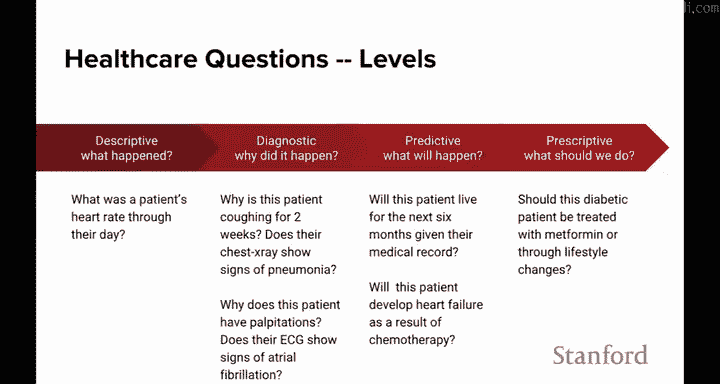

So in CS230， you're all well aware。Of the paradigm shift of， of deep learning。

 And if we look at machine learning in healthcare literature， we see that。

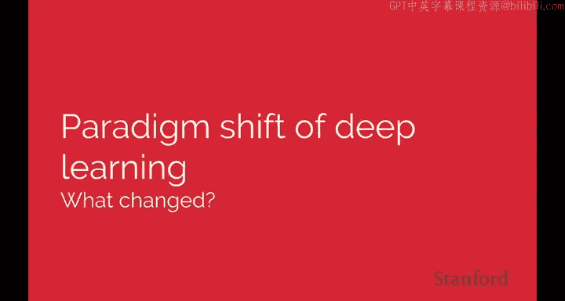

Ha a very similar pattern is that we had this feature extraction engineer who was responsible for。嗯。

Getting from the input to a set of features that a classifier can understand and the deep learning paradigm is to combine feature extraction and the classification into one step by automatically extracting features。

 which is cool。 Here's what I think will be the next paradigm。😊，Shift for AI。In healthcare。

 but also more generally， is we still have a deep learning engineer up here。 That's you。

 That's me that are designing the networks that are making decisions like a convolutional neural network is the best architecture for this problem。

 The specific type of architecture。 There's an R N， CNN and whatever N N you can throw on there， but。

😊，What if we could just replace out？DML engineer as well。

 And I find this quite funny because everyone， you know。

 an AI for healthcare question that I get asked a lot is。

 are we going to replace doctors with all these AI solutions and nobody actually realizes that we might replace machine learning engineers faster than we might replace doctors if this to be the case And a lot of research is developing algorithms that can automatically learn architectures。

 some of which you might go through in this class。😊，Great， so that's a general overview。 Now。

 I want to talk about three case studies in the lab。Of AI being applied to different problems。

 And because healthcare is so broad， I thought I'd focus in on one narrow vertical。

And let us go deep on that。 And that's medical imaging。So I've chosen three problems。

 and one of thems a 1D problem。 The second is a 2D problem and the third is a 3D problem。

 So I thought we could walk through。All the different kinds of data here。

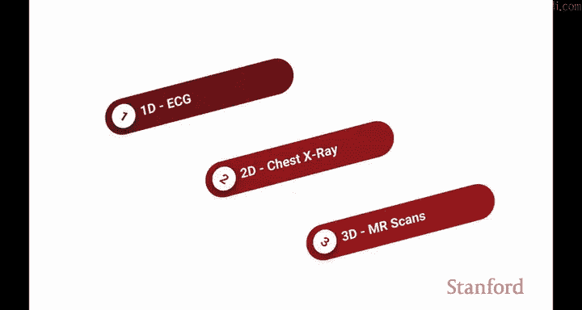

So this is some work that was done early last year in the lab。

Where we showed that we were able to detect arrhythmias at the level of cardiologists。

嗯。So arrhythmias are an important problem， affect millions of people。

 This has especially come to light recently with devices like the Apple Watch。

 which now have a ECG monitoring。And the thing about this is that sometimes you might have symptoms and know that you have arrhythmias。

 but other times you may not have symptoms and still have arrhythmias that can be addressed with。

 with。If if you were to do an ECG。And the ECGs test is basically showing the heart's electrical activity over time。

 The electrodes are attached to the skin， Sa tests。 and it takes over a few minutes。

 And this is what it looks like when you're hooked up to all the different electrodes。😊。

So this test is often done for a few minutes in the hospital。

And the finding is basically that in a few minutes。

 you can't really capture a person's abnormal heart rhythms。

 So let's send them home for 24 to 48 hours with a whole term monitor。

 And let's see what we can find。There are more recent devices such as the Zpatch。

 which let patients be monitored for up to two weeks。It's it's quite convenient。

 You can use it in the shower or while you're sleeping so you really can capture a lot of what。

 what's happening in the hearts。😊，EC G activity。But if we look at the amount of data that's generated in two weeks。

 it's 1。6 million heartbeats。 That's a lot， and。There are very few doctors whod be willing to go through two weeks of ETD reading for each of their patients。

And this really motivates why we need automated interpretation here。

But automated detection comes with its challenges。 One of them is。You know。

 you have in the hospital several electrodes。 And in more recent devices， we have just one。

And the way one can think of several electrodes is sort of the the electrical activity of the heart is 3D。

 And each one of the electrodes is giving a different 2D perspective into the 3D perspective。

 But now that we have only one lead， we only have one of these perspectives available。

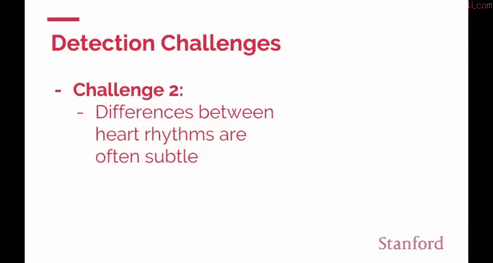

And the second one is that the differences between the heart rhythms are very subtle。

This is what a cardiac cycle looks like。 And when we're looking at。

Aythmias or abnormal heart rhythms， ones going to look at the substructures within the cycle and then the structure between cycles as well。

 And the differences are， are quite subtle。So when we started working on this problem。Oh。

 maybe I should share this story。 So we started working on this problem。 And then it was me， my。

 my collaborator， Ani and， and professorfessor Yng。

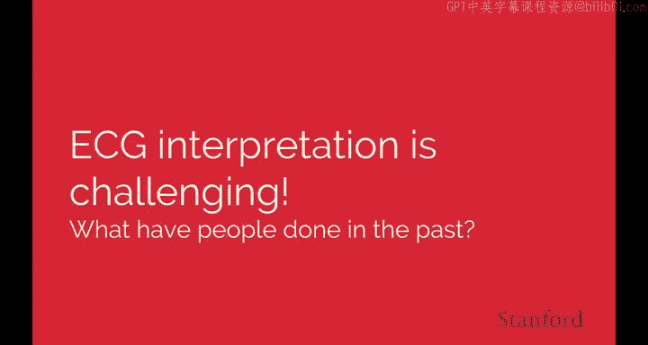

And one of the things that he that he mentioned we should do he said。

 let's just go out and read ECG books and let's do the exercises。 And if you're in med school。

 there are these books where。Where you can， where you can learn about E interpretation。

 And then there are several exercises that you can do to test yourselves。

 So I went to the med school library。 You know， they have those hand crank shelves at the bottom。

 So you have to move them and then grab my book。 And then we went for two weeks and did。😊。

Learn sort did go through two books and learn ECG interpretation。 And it was pretty challenging。And。

If we looked at previous literature to this， I think they were sort of drawing upon some domain knowledge here in that here we're looking at waves。

 How can we extract specific features from waves that doctors are also looking at。

 So there was a lot of feature engineering going on。 And if you're familiar with wavelet transforms。

 they were the sort of。They were the most common approach with a lot of sort of like different mother wavelets。

 etc cetera etc cea。 preprosing bandpa filters。 So everything you can imagine doing with signals was done。

 And then you fed it into your SVM。 and you called it a day。Now with deep learning。

 we can change things up a bit。 So on the left， we have an ECG signal。

 and on the right is just three heart rhythms。 We're going to call them A， B and C。

 and we're going to learn the mapping to go straight from the input to the output。

And here's how we're going break it up。 We're going to say that every label。

Labels the same amount of the signal。 So if we had four labels and the EC G would be split into these four。

 sort of this rhythm is labeling this part。And then we're gonna use a deep neural network。

So we built a 1D convolutional neural network， which runs over the time dimension of the input because remember。

 we're getting one scaler over， over time。 And then this architecture is 34 layers deep。

So I thought I'd talk a little bit about the architecture。We you seen renus before。Okay， so。

Shouldhall I go into this， Okay， cool， here's my one minute spiel of resnet。

 then is that you're going deeper in terms of the number of layers that you're having in a network。

 You should be able to represent a larger set of functions。😊。

But when we look at the training error for these very deep networks。

 what we find is that it's worse than a smaller network。 Now， this is not the validation error。

 This is the training error。 That means even with the ability to represent a more complex function。

 we aren't able to represent the training data。So the motivating idea of residual networks is to say。

 hey， let's add shortcuts within the network so as to minimize the distance from the error signal to each of my layers。

This is just math to say the same thing。So further work on Resnet showed that， okay。

 we have the shortcut connection。 How should we make information flow through it the best。

And the finding was basically that anything you， you add to the shortcut to the highway。

 Think of these as stop signs or。嗯。Or， or signals on a highway。

 And it's basically saying the fastest way on the highway is to not have anything but addition on it。

And then there were a few advancements on top of that。

 like adding dropout and increasing the number of filters in the convolutional neural network。

That we also added to this network。Okay， so that's the convolutional neural network。😊。

Let's talk a little bit about data。So one thing that was cool about this project was that we got to partner up with a。

With a startup that manufactures these hardware patches。

 And we got data off of patients who were wearing these patches for up to two weeks。

And this was from around 30000 patients。And this is 600 times bigger than the largest data set that that was out there before。

And for each of these ECG signals， what happens is that each of them is amated by a clinical ECG expert who says。

 here's where rhythm A starts and here's where it ends。 So let's mark the whole ECG that way。

 obviously very time intensive， but a good data source。And then we had a test set as well。

 And here we used， here we used。committeemittee of cardiologists so they'd get together。

 sit in a room and decide， okay， we disagree on this specific point。

s try let's try to discuss which one of us is right or what this rhythm actually is so they arrive at a ground truth after discussion。

And then we can， of course， test cardiologists as well。

 And the way we do this is we have them do it individually。

 So this is not the same set that did the ground truth。

 There's a different set of cardiologists coming in One at a time。 you tell me what's going on here。

 and we're going test you。

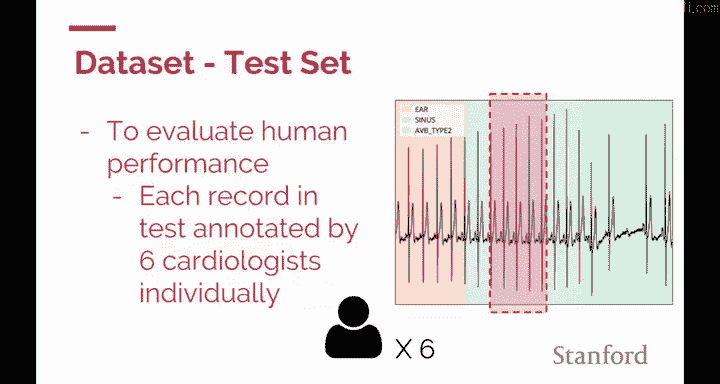

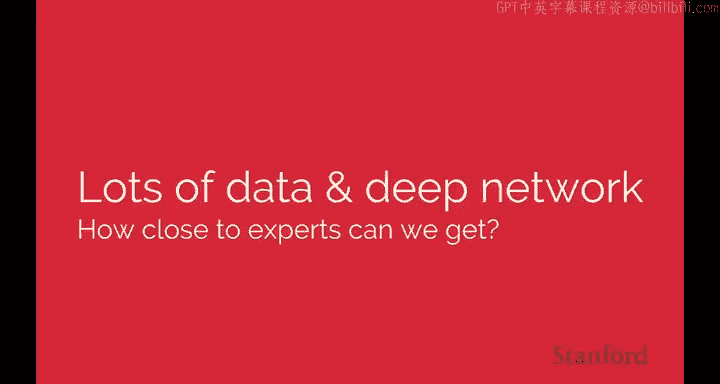

So when we compared the performance of our algorithm to cardiologists。

 we found that we were able to surpass them。😊，On the F1 metric so this is precision and recall。

And when we looked at where the mistakes were made。

 we can see that sort of the biggest mistake was between distinguishing two rhythms， which look very。

 very similar but actually don't have a difference in treatment。

 here is another case where the model is not making a mistake which the experts are making and turns out this is a costly mistake。

 this is saying a benign heart rhythm or what experts thought was a benign heart rhythm was actually a pretty serious one。

So that's one beauty of automation is that we're able to catch these misdiagnoses。

Here are three hard blocks which are clinically relevant to catch。

 on which the model outperforms the experts and on atrial fibrillation。

 which is probably the most common serious arrhythmia， the same holes。

So one of the things that's neat about this application and a lot of applications in healthcare is what automation with deep learning machine learning enables is for us to be able to continuously monitor patients。

 And this is not something we've been able to do before。

 So a lot of even science of understanding how patients risk factors。

 what they are or how they change hasn't been done before。

 And this is an exciting opportunity to be able to advance science as well。😊。

And the Apple Watch has recently released their ECG monitoring。

 and it'll be exciting to see what new things we can find out about the health of our hearts from these inventions。

😊。

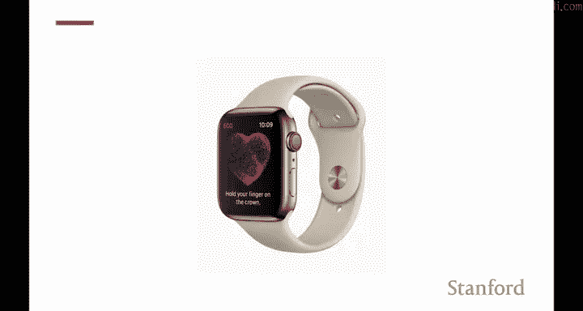

Okay， so that was our first question。 How big of a problem did you find privacy in collecting the way。

 Yeah， So repeat the question。 How what was it to sort of deal with data privacy and sort of keep patients information private。

 So in this case， we did not we had completely deidentified data So it was just some was ECG signal without any extra information about their their clinical records or anything like that。

 Sos it's very de identified sorry， I guess I guess to ask that how did you get the approval Google for that and were there problems in getting the because know。

 a lot of。 So did you have to get signed off authority ors in getting that be。

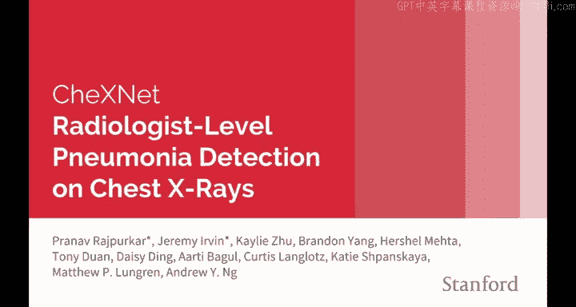

Oh， sure。 And I think we can， we can take this question offline as well。

 But one of the beauties of working at Stanford is that there's a lot of industry research collaborations。

 and we have great infrastructure to be able to work with that。😊。

So which brings me on to my second case study。 sorry， yeah， go for it。

So also go standard for turning what patient that has this。Its near a lot。

It feels like youre became the expert。Pyiologist at your family and I know you I also compare with their performance。

So how do you standard。 That's a good question。 So just to repeat the question。

 how did we define the gold standard when we have experts setting the gold standard。

 So here's how we did it。 So one， one way to come up with a gold standard is to say， okay。

 if we looked at what a consensus would say。What would they say。

 and so we got three cardiologists in a room to set the goal standard and then to compare the performance of experts。

 these were individuals who were separate from those groups of cardiologists who sat in another room and said what they thought of the of the ECG signals that way there's some disagreement where the goal standards set by the committee。

Great， so here we looked at how we can detect pneumonia off of chest x rays。

Cnemonia is an infection that affects millions in the US。 its big global burden is actually in kids。

 so that's where it's really useful to be able to detect that automatically and well。😊。

So to detect pneumonia， there's a chest x exam。And chest xs are the most common。

Imaging procedure with2 billion chest attackss ray done per year。

And the way of normalities are detected in chest deck trays is they present as areas of increased density。

 so where things should appear dark， they appear brighter or vice versa。And here's what。

Characteristically， pneumonia looks like where it's like a fluffy cloud。

 but this is an oversimplification， of course， because pneumonia is when the alveLI fill up with pu。

 but the alLI can fill up with a lot of other things as well。

 which lead to very different interpretations and diagnoses for the patients and treatment for the patient。

😊，So it's quite confusing， which is why radiologists trained for years to be able to do this。

The setup is we'll take an input image of someone's chest X ray and output the binary label 0 or1。

 which indicates the presence or the absence of pneumonia。

And here we use a 2D convolutional neural network， which is pretrained on ImageNe。Okay。

 so we looked at shortcut connections earlier， and densenets had this。

Idea to take shortcut connections to the extreme。 It says。

 what happens if we connect every layer to every other layer instead of just connecting sort of one instead of having just one shortcut。

 which is what resnet had。And Dennet beat the previous state of the art and has generally lower error and fewer parameters on the Inett challenge。

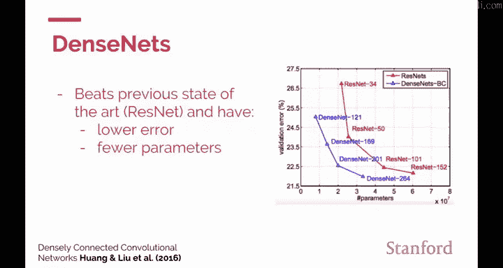

So that's what we used。For the data set。

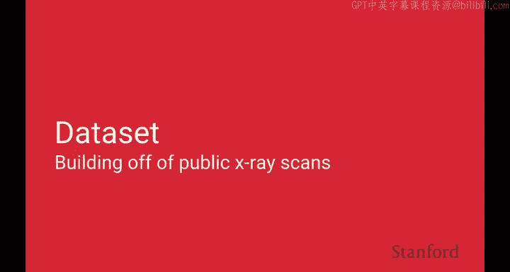

When we started working on this project， which was。Around October of last year。

There was this large data set that was released by the NIH。Of 100000 chest deck races。

 And this was the largest public data set at the time。

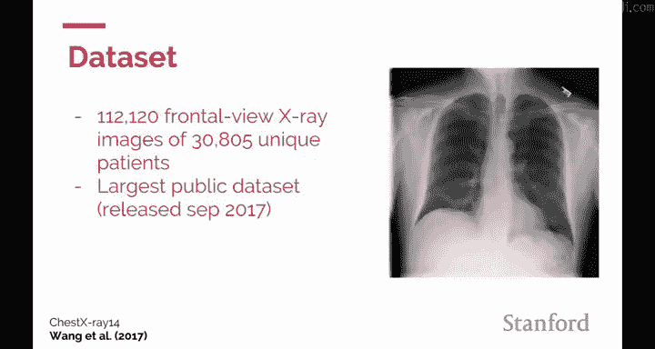

And here each x-ray is annotated with up to 14 different pathologies and the way sanitation works is there's an NLP system which reads a report and then outputs for each of several pathologies。

 whether there is a mention， whether there is a negation like not pneumonia， for instance。

 and then annotates accordingly。And then for a test set。

 we had four radiologists here at Stanford independently annotate and tell us what they thought was going on in those x rays。

So one of the questions that comes up often in medical imaging is， we have。We have a model。

 We have several experts， but we don't really have a ground truth。

 and we don't have a ground truth for several reasons。

 Sometimes one of them is just that it's difficult to tell whether someone had pneumonia or not。

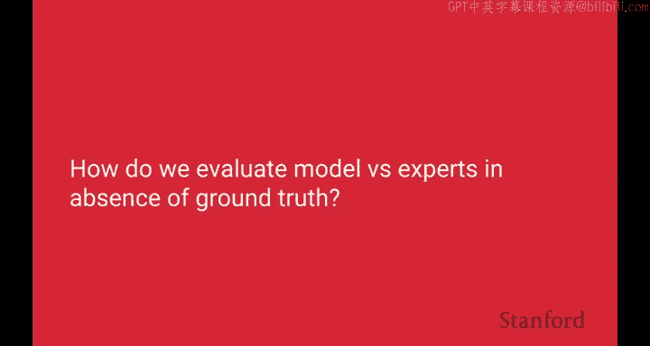

Without additional information like their clinical record， or even once you gave them antibiotics。

 did they get treated？So really， one way to evaluate。

Whether a model is better than a radiologist or as well as doing as well as a radiologist is by saying。

 do they agree with other experts similarly。So that's what we use here。 Does the idea， we say， okay。

 let's have one of the radiologists be the。The， the prediction model we're evaluating。

 And let's set another radiologist to be ground truth。 And now we're gonna compute the F1 score once。

Change the ground truth， do it the second time， change it again， third。

And then also use the model as the ground truth and do it again。

 And we can use a very symmetric evaluation scheme。But this time。

 having the model be evaluated against each of the four experts。 So we do that。

 And then we get a score for both of them。Well， for all of the experts and for the model。

 And we showed in our work that we were able to do better than the average radiologist at this task。

😊，Two ways to extend this in the future is to be able to look at patient history as well and look at lateral radiographs and be able to improve upon this diagnosis。

At the time at which we released our work on all 14 pathologies。

 we were able to outperform the previous state of the art。

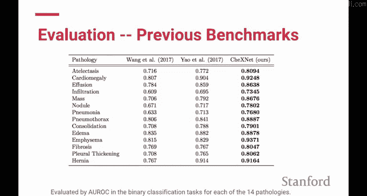

Okay， so model interpretation。Model interpretation， yes。

 there's question go back that slide that you had on future work So one more slide So if you have pneumonia。

 you present into the doctor you have like fever your cough in your rib shirt and cough too much。

 you can't sleep all those other issues， that's not included in the model。

 So I think my question is that if you're going into a data and you're trying to determine。

 does this person have pneumonia or that。That's one thing but you don't it's not that you just don't add that data。

 but you're not looking at other images， let's say does that person have cancer or that person to have like other pollutioncclusion that they love because they he coal or astss and so all those are images that you're not really to looking at so let's say in a tough situation so the obvious situation isn't really doing much good right but in a tough situation that you get。

Anyia that has a fever and it's coffee violently， you don't know if it's cancer or pneumonia or black blood。

Then how do you get your algorithm of work in that condition and also if you're not including all those other cases。

 then it's not just about what's the use of it like you know what I'm saying and I'm like， well。

 so I'm trying to keep it this it a technical class。

 what is there a neural network architecture that you would use to be able to solve problem number one？

So multitask learning is it like。Sure， sure。 Okay， So let me try to boil those sort of sets of questions down。

 So one is patients are coming in。 We're not getting access to their clinical historytor。

 So how are we able to make this determination at all。

 So one thing is that when we're training the algorithm， we're training the algorithm on。

On pathologies extracted from radiology reports， and these radiology reports are written with understanding of full clinical history and understanding of sort of what the patient presented with in terms of symptoms as well。

 so we're training the model on these radiology reports which had access to more information。

And the second is that the utility of this is。Not as much in being able to compare a patient's X-rays day to day。

 as much as here is a new patient with a set of symptoms and can we identifyify things from their chest x rays。

Which brings us to model interpretation。 So if you were a end user a model。嗯。Oh， I。

 so when I was back in undergrad and I was in the lab， we were working on autonomous cars。

 And I thought about this a lot。 How many of you have been in an autonomous car。😊。

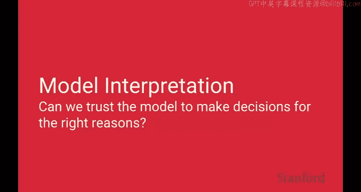

How many of you would trust being an autonomous car。All right， cool， yeah。

 I thought about this as well。 Would I trust being in an Thomas car。

 And I thought it'd be pretty sweet if the algorithm that was。

 that was in the car would tell me whatever decision it was going to make in advance。😊。

I know that's not possible at high speeds so that， you know。

 just in case I disagreed with a particular decision， I could say no。

 abort and and have the model sort of， you know， remake its decision。

 And I think the same holds true in health care as well。

 the one advantage that happens in healths rather than having to make decisions within seconds。

 like in the case of autonomous car。 there is often a larger time frame like minutes or hours that we have。

 And， and here it's。😊，It's useful to be able to inform the clinician that's treating the patient to say。

 hey， here's what my model taught and why。嗯。So here's the technique we use for that class activation maps。

 which you may cover in another lecture， so I'll just leave it out saying that there are ways of being able to look at what parts of the image are most evident of a particular pathology。

To generate these heat maps。So here's a heat map that's generated for pneumonia。

 So this X ray has pneumonia。 and I can， and。And the algorithm in red is able to highlight the areas where it thought was most problematic for that。

😊，Here's one in which it's able to do a collapsed right lung。

Here's one in which is' able to find a small cancer。

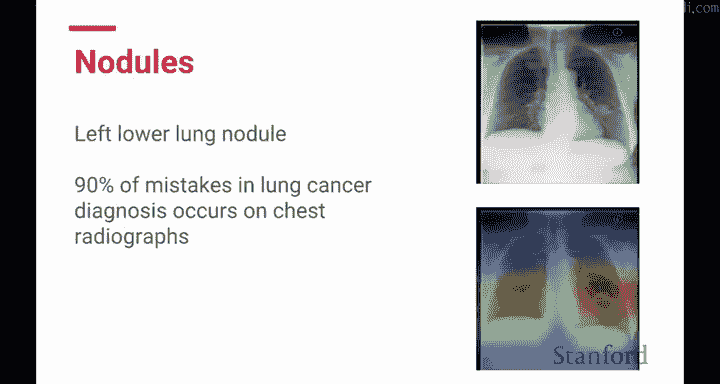

And here the goal is to be able to improve healthcare delivery， where in the developed world。

 one of the things that it's useful for is to be able to prioritize the workflow。

 make sure the radiologists are getting to the patients most in need of care before ones whose x-rays look more normal。

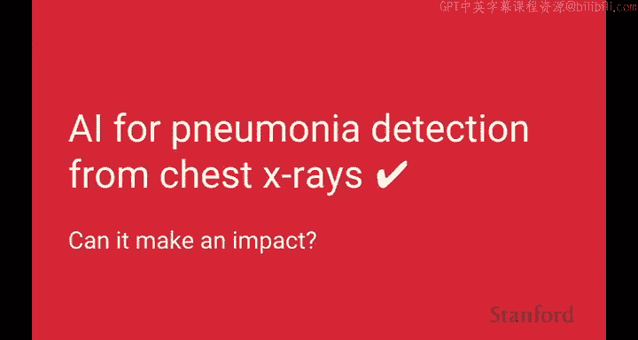

But the second part， which I'm quite excited about is to increase the access of medical imaging expertise globally。

 where right now the World Health Organization estimates that about two thirds of the world's population does not have access to diagnostics。

And so we thought， hey， wouldn't it be cool if we just made an app that was able to allow users to upload images of their。

Off Xrays and be able to give its diagnosis。

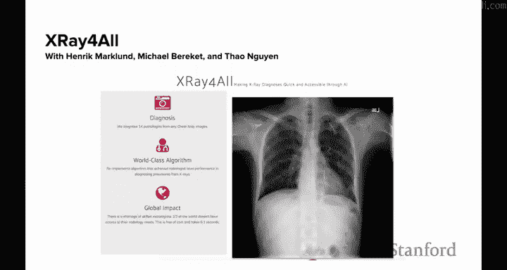

So this is still in the works， So I'll show you what we've got running locally。

 And so here I'm presented with a screen that asks me to upload an Xray。And so I have。

 I have several xrays here。And I'm gonna pick the one that says cardiomegaly。

 So cardiomegaly refers to the enlargement of the heart。So I uploaded it now it's running。

 the models running in the back end。 and within a couple of seconds。

 it's outputted its diagnoses on the right。So you'll see the 14 pathologies that the model is trained on being listed。

 And then next to them a bar。 And at the top of this list is cardiomegaly， which is。

What this patient has， the， the hard is sort of extending out。And if I hover on cardiomegaly。

 I can see that the probability is displayed on there。And now we talked about interpretation。

 How do I believe that this model is actually looking at the heart rather than looking at something else。

And so if I click on it。I get the class activation map for this。

 which shows that indeed it is focused on the heart。

To be able to and is looking at the right thinging。

 So I guess you can say the algorithm's heart's in the right place。はい好。呃。But I thought。

 so this is an image that I got from the， the data set that we were using NI H。

 But it's pretty cool if an algorithm is able to generalize to populations beyond。

 And so I thought what wed do is we could just look up。😊，嗯。Look up an image of cardiomegaly， and。

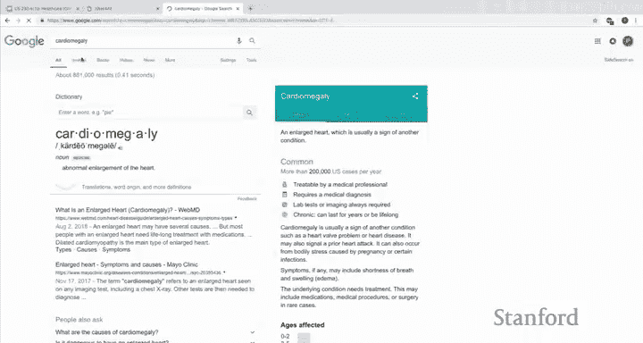

Download it and just see if our model able to。This one looks pretty large。So this。

And I't want an annotated one。Allright， that's good。 So we can。Do that。

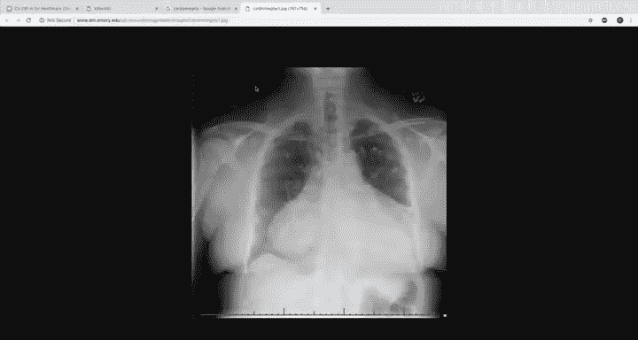

Save it， desktop。And now we can upload it here。And。It's already redone a thinging。

 and on the top is cardiomeggaly once again。So it's able to generalize to。And there's the highlight。

 So it's able to generalize two populations beyond just the ones it was trained on。

So I'm very excited by that。And what I got even more excited by is we're thinking of deploying this out in different parts of the world。

 and when we got an image that showed how X-rays are read in this hospital that we're working with in Africa。

 this is what we saw。

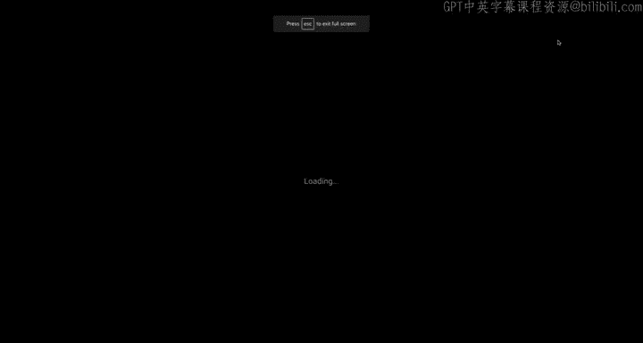

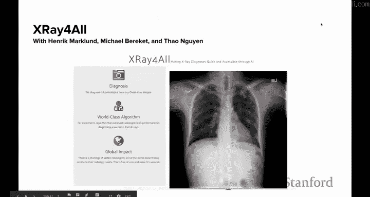

And so the idea that one could snap a picture and upload it seems and get a diagnosis seems very powerful。

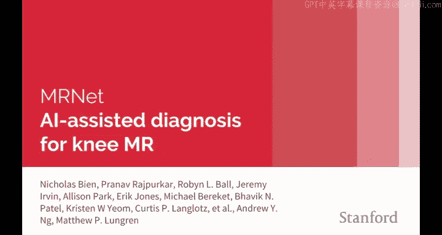

So the third case study I want to take you through is being able to look at MR。

 So we've talked about1 D， a 1 D setup where we had an ECG signal。

 We've talked about a 2D setup with an X ray。How many of you thinking of working on a 3D problem。

For your project。Few。It's good。货。嗯。So here we looked at knee MR。

 So MR is of the knee is the standard of care to evaluate knee disorders。

 and more MR examinations are performed on the knee than any other part of the body。嗯。

And the question that we sought out to。Answer was， can we identify kneeities。

 Two of the most common ones， including an A C L tear and a meniscal tear at the level of radiologists。

Now， with a 3D problem， one thing that we have that we don't have in a 2D setting is the ability look to look at the same。

 same thing from different angles。 And so when radiologists do this diagnosis。

 they look at three views， the sagital， the coronal and the axial， which are。

Which are three ways of looking through the 3D structure of the knee。 And in an MR。

 you get different types of series based on the magnetic fields。

 And so here are three different series that are that are used。

And what we're gonna to do is output for。A particular E MRR examination。

 the probability that it's abnormal， the probability of an A C Lter and the probability of a meniscule tear。

 important thing to recognize here is this is not a multi class problem in that I could have both types of tears。

 It's a multi label problem。So we're going to train a convolutional neural network for every。

View pathology pair。 So that's 9 convolutional networks， and then combine them together。

Using a logistic regressionion。So here's what each convolutional neural network looks like。

 I have a bunch of slices within a view。 I'm going to pass each of them to a feature extractor。

 and I'm going to get an output probability。So， we had 1000。

400 EMR exams from the Stanford Medical Center。And we tested on 1，20 of them。

Where the majority vote of three subspecialty radiologists establish the the ground truth。

And we found that we did pretty well on。

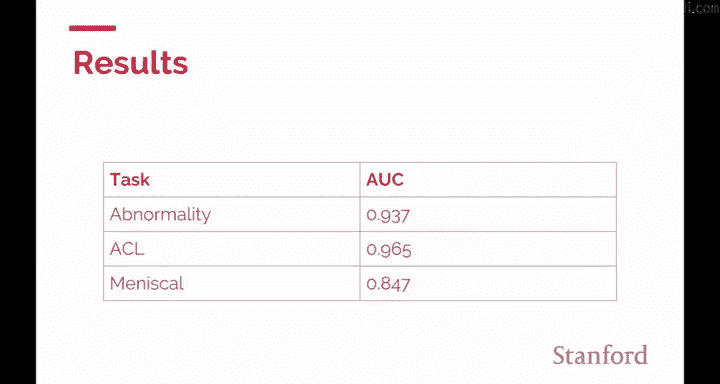

On the three tasks。And had the model be able to pick up the different abnormalities pretty well。

 And one can extend these， these methods of inter interpretability to。

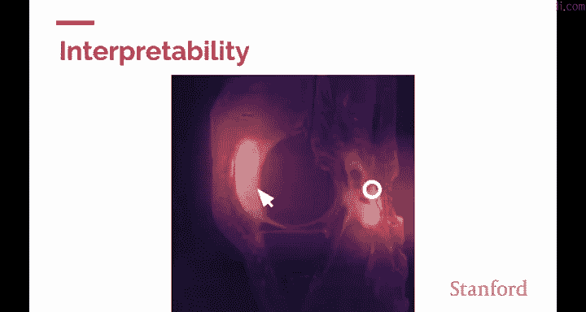

Two 3 3D inputs as well， so that's what we did here。

Okay。saw this cartoon a few weeks ago and I thought it was pretty funny。

 which is a lot of machine learning engineers think that they don't need to externally validate。

 which is find out how my model works on。Works on data that's not my where my original dataset came from。

 So there there's a difference in distributions， but it's really quite exciting when a model does generalize to data sets that it's not seen before。

😊，And so we got this data set that's that's public from a hospital in Croatia。

 And here's how it was different。 So it was a different。 It was a different kind of series。

 a different magnetic properties。 It was a different scanner。

 and it was a different institution in a different country。And we asked， okay。

 what happens when we run this model off the shelf that was trained on Stanford data。

 but tested on that kind of data。And we found that it did relatively well without any training at all。

But then when we trained on it， we found that we were able to outperform the previously best reported result on the data。

😊，So there's still some work to be done in being able to generalize sort of my network here that was trained on my data to be able to work on data sets from different institutions。

 different countries as well， but we're making some steps along that way remains a very open problem for taking。

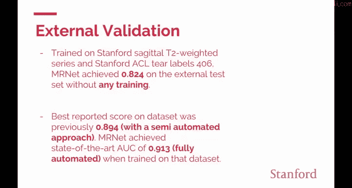

Image is acquired by environmental collection。Yeah。

 so we did the best we could in terms of processing。

 So we had so one of the preprocessing steps that's important is being able to get the mean of the input data to be as close to the mean of the input data that you train on。

So that was one preproing step we tried， but we were trying to minimize that to say out of the box。

 how would this work if we had never seen this data before， how would it work on that population。So。

 one big topic in。Across a lot of applied fields is asking the question， okay。

 we're talking about models working automatically， autonomously。 How would these models work。

In when working together with experts in different fields。

 And here we ask that questions about radiologists and about imaging models。

 Would it be possible to be able to boost the performance if the model and the radiologists work together。

And so that's really the setup， a radiologist W model。

 Is that better than the radiologist by themselves？And here's how we set it up。 We said， let's have。

Experts read the same case twice， separated by a certain set of weeks。

And then see how they would perform on the same set of cases。

And what we found that we were able to increase the performance generally with a significant significant increase in specificity for AC C。

 L tariff。 That means if someone， if a patient came in。😊，Without a。Without an ACL tear。

 I'd be able to find it better。So in the future， yes question。

The opinion of the radiologist art is that the intended thing that you want to kind of bias the opinion for actually looks at the dimensions out。

 Yeah， so that's a good question。 And I， and I think。How， so sort of。

Automation bias captures a lot of this in that once we have sort of models working with experts together。

 can we expect that the experts will sort of take it less seriously， because that's。

 that's a big concern and start relying on what the model says and says I won't even look at this exam。

 I'm just going to trust what the model says blindly。嗯。

That's absolutely possible in a very open area of research。

 Some of the ways that people have tried to address it is to say。

 you know what I'm going to do from time to time， I'm going to pass in an exam to the radiologist for which I'm going to flip the answer。

and I'll know the right one。 And if they get that wrong。

 I'll alert them that you're relying too much on the model。 stop。

But there are a lot of more sophisticated ways to go about addressing automated bias。

 And as far as I know， it's a very open field of research。

 especially as we're getting into deep learning assistance。

And one utility of this is to say basically that these set of patients don't need follow up。

 Let's not send them for unnecessary surgery。Great， so I shared three case studies from the lab。

The final thing I want to do is to talk a little bit about how you can get involved if you're interested in applications of AI to healthcare。

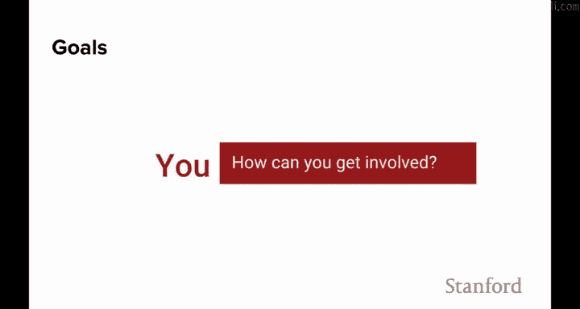

So the first is。The ability for you to just get your hands dirty with data sets and be able to try out your own model。

 So we have from our lab released the MoRA data set。

 which is a large data set of bone Xrays and the task is to be able to tell if it's if the x-rays or normal or not。

 and they come from different parts of of the upper body。

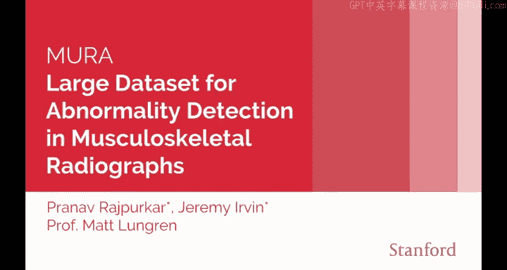

And that's， that's what the data Xrays look like。

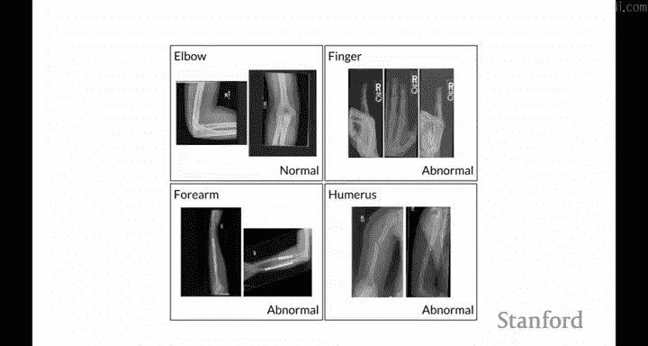

And this is a pretty interesting setup because you have more than one view more than one angle for the same body part。

 for the same study， for the same patient。 And the goal is be able to combine this well into convolutional neural network and and be able to output the probability of abnormality。

 And one of the interesting things here for transfer learning as well。

 is do you want to train the models differently per body part。

 or do you want to train them train the same model for body parts or combine certain models。😊。

So a lot of design decisions there， and this is what some train models look like。

 this is a model baseline that we released that's able to identify a fracture here and a piece of hardware on the right。

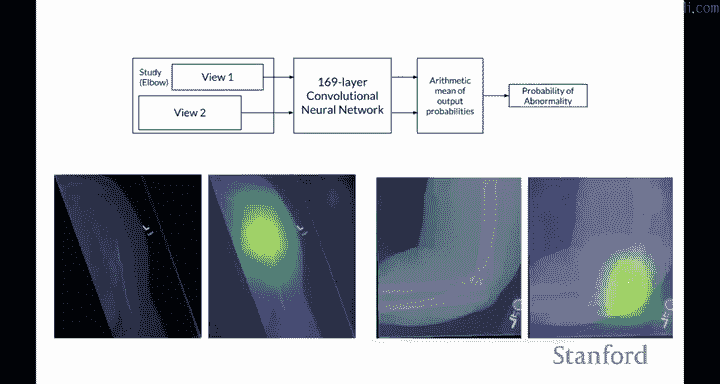

And you can download the data of our website。 So if you Google moreura data or go on our website。

 Stanford Ml group dot Github dot I O， you should be able to find it。

The second way to get involved is through the AI for healthcareca boot camp。

 which is a two quarter long program that our lab runs。

 which provides students coming out of classes like 230 and opportunity to get involved in research。

 and here students receive training from PSD students in the lab and medical school faculty。

To work on structured projects over two quarters， and if you have a background in sort AI。

 which you do， then you're encouraged to apply。And we're working on a wide set of problems across radiology。

 EHR， public health and pathology right now。

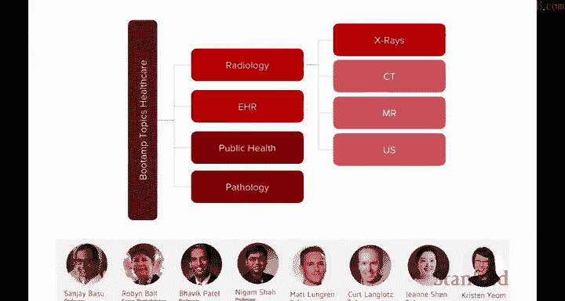

This is what。The lab looks like we have a lot of fun。

And the applications for the boot campm starting in the winter are now open。

 So the early applications deadline is November 23， and you can go on this link and。And， and apply。

So that's my time。 Thank you so much for having me。 and thanks for having me Ken。😊。

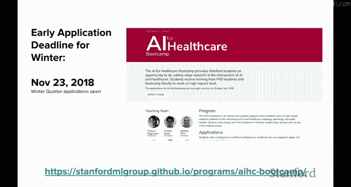

だってまかこ。But you want to take one or two questions。 Yes， I'll take a couple questions。

Let me already asked a question about the privacy concerns in terms to other ethics concerns。

What about a compensation for the medical experts that you're potentially putting out of business with a free tool like the one that you're developing or you know just in general？

Because their knowledge is being used to train these models， it's not free。Yeah， so the question was。

We're having these automated AI models trained with the knowledge of medical experts。呃。

What are ways in which we're thinking of compensating these medical experts right now or in the future when we have possibly automated models。

I think a lot of people are thinking about these problems and working on them right now。

 There are a variety of approaches that people are thinking about in terms of economic incentives。

 And there's a lot of fear about sort of will AI actually work with or augment experts in whatever fields they're working on。

 I don't have a great silver bullet for this。 But I know there's。

 there's a lot of work going on in there。I just want to know， when you're looking through MRIs。

 which are looking at four or five category of issues， like we listed there。

 one of them is the most likely。It's possible that a human looking at it could point out something that was not being looked at by the AI model at that time。

Yeah， so how do you address it。 Yeah， that's a great question。 So just to repeat the question。

 its we have， we're looking at MR exams， and we're saying for these three pathologies。

 we're able to put the probabilities， what happens if there's another pathology that we haven't looked at。

 So I have a couple of answers to that。 The first is that one of the。

 one of the categories here was simply to tell whether it was normal or normal。😊。

So the idea here is that the abnormality class will capture a lot of different pathologies。

 They're at least the ones seen at Stanford。But it's often the case that we're building for one particular pathology。

 And then there's obviously a。A burden on the model and the model developers to be able to convey。

 hey， look， our algorithm model only does this and you really need to watch out for everything else that the model doesn't cover。

Maybe that's the unless there's one more question。All right， that' the last question we'll take then。

 Thank you once again。So now you've got the perspective， is the microphone working yeah？

Now you've got the perspective of AI researcher working in healthcare now you are going to be the AI researcher working in healthcare we're going to go over a case study that is targeted at skin diseases so you know in order to detect skin diseases sometimes you take pictures microscopic pictures of cells on your skin and then analyze those pictures so that's what we're going to talk about today。

😊，So let me talk about the problem statement。You're a deepear engineer and you've been chosen by a group of healthcare practitioners to determine which part of a microscopic image corresponds to a cell。

Okay， so here is how it looks like。On the black and white， it's not a black and white image。

 it's a color image but it looks black and white， the input image is the one that is closer to me。😊。

And the yellow one is the ground truth that has been labeled by a doctor， let's say。

 so what you're trying to do is to segment the cells on this image and we didn't talk about segmentation yet or a little bit segmentation is about producing a value a class for each of the pixel cellss on our image。

😊，So in this case， each pixel would correspond to either no cell or cell。0 or one。

And once we output a matrix of zeros and ones telling us which pixels corresponded to a cell。

 we should get hopefully a mask like the yellow mask that I overlapped with the input image。

 Does that make sense， Yeah， isn't there a third category。 It's the boundary。

 because in the colored image， the yellow one。 You don't have the boundary part up。 Yeah。

 we'll talk about the boundary later。 But right now， assume it's a binary segmentation。 So 0 and one。

 no cell and cell。 Okay。😊，So it's going to be very interactive and I think we're going to use menti for several question and group you guys into groups of three。

 so here are other examples of images。😊，That were segmented with a mask。Now。

 doctors have collected 100，000 images coming from microscopes。

 but the images come from three different microscopes。 there is a type A。

 type B and type C microscope， and the data is splitted between these three as 50% for type A。

 25% for type B， 25% for type C。The first question I'll have for you is。😊。

Given that the doctors want to be able to use your algorithm on images from the microscope of type C。

This microscope is the latest one。 It's the one that is going to be used widely in the field。

 and they want your network to work on this one。 How would you split your dataset set into train dev and test set as a question and please group in teams of two or three and discuss it for a minute on how you would split this dataset。

よすがと。おらい。い。こ。Thanks here， thanks。十。系。は。おちさ。あざ。知。Yeah。はいま。そですよこす。大ど。めないす。我片。あかして。

You can start going on mentee and write down your answers as well。なし。は。需嘅人。そうで、すねなそれなじ。那就是。O。

So take 30 seconds to input your insights on Men， you can do one per team。

And we'll start going over some of the answers here。O。Death test。

 sleep split C train on A plus B 20 K in train。2。5 in Devon test。Training A0， all A， all B，5 K， C。

 dev，10 K， C test，10 K C。955 where tests and dev is from population we care about。

 I think these are good answers， I think there is no perfect answer to that but two things to take into consideration you have a lot of data so you probably want to split it into 955 closer to that than to 60-2020 and most importantly you want to have C images in the test dev and test set to have the same distribution among these two that's what you've seen in the third course。

😊，And we would prefer to have actually see images in the train set。

 you wanted your algorithm to have seen images， so I would say a very good answer is this one。

 955 where the five and 5 are exclusively from C and you also have C images in the 90% of train images。

😊，Any other insights on that。What you agree， yeah。How do we detect that like Microsoftpe's A and B data set doesn't have some like。

Hidden training so there is much more thing we didn't talk about here。

 One is how do we know what's the distribution of microscope A images and microscope B images versus microscope C。

 Do they look like each other if they do all good if they don't。

 how can we How can we make sure the model doesn't get bad hints from these two distributions。

 Another thing is data data augmentation。 We could augment these data set as well and try to get as much as C distribution images as possible We're going to talk about that。

O。Splilit has to roughly be 955 not 60，2020。 distribution of Dev and test set has to be the same contain images from C there there should also be C images in the training set。

Now talking about data augmentation。Do you think you can augment these data？And if yes。

 give only 3D method you would use If no explicate， explain why you cannot。

Do you want to take 30 seconds to talk about Ti with your neighbors？都写。かでいく。放。Yeahい。间。Yeah。只。す。ま。

啊自点ち。ですが。やめています。はいく。对不。ではいいです。Okay。変われて。にな。なんで。すい。咁又。O。好有嘢。太。都。す。Okay， guys。

Let's go over some of the answers。So rotation， zoom blur。

 I think looking at the images that we have from the cells， this might work very well， rotation。

 zoom blur translation combination of those stretch。Symmetry， like probably a lot of those work。

One follow up question that I'll have is， can someone give an example of a task where data augmentation might hurt the model rather than helping it？

😊，Yeah，'m going to overfi on the testet。If you want to overfit on the test set。

 can you be more precise？Like then。You don't want to generalize。Oh。

 you don't want your model to generalize too much， okay。

Yeah there are some cases where you don't want the model to generalize too much。

 especially not to any encoder， but any other ideas if you're doing like face detection。

 you would want the face to be like upside down or like either side I see so if you do face detection。

 you probably don't want the device to be upside down， although we never know depending on the use。

But it it's not going to help much if the camera is always like that and it's filming humans that are。

Not upside now。 but I don't think it's going to hurt the model。

 It's probably going to not help the model， I guess。Yeah。if you stretch the image。

 good point accurate So there there are algorithms， like maybe you know flownet。

 it's an algorithm that that's used for on videos to detect the speed of the car。

 let's say if you stretch the images， probably you cannot detect the speed of the car anymore。

And you other examples？Okay。Yeah。我得知道。Character recognition， I think， is a good example。

 So let's say you're trying to detect what this is。 and you do symmetry flip and you get that。

You know， like you're labeling is B， everything that was D and as D， everything that was B for9 and6。

 it's the same story， so these data augmentations are actually hurting the model because you don't relabel when you augment your data right okay？

😊，Okay， so yeah， many augmentation methods are possible cropping， adding random noise。

 changing contrast。 I think the augment is super important。 I remember a story of。

 of a company that was working on a cell driving cars and， and also virtual assistance in cars。

 You know， like this type of interaction you have with。Someone in your car virtual assistant。

 and they noticed that the speech recognition system was actually not working well when the car was going backwards。

Like。No idea why， like why it doesn't seem related to the speech recognitionognizance system of the car and they tested out and they looked and they figured out that people were putting their hands in the passenger seat looking back and talking to the virtual assistant and because the microphone was in the front。

 the voice was very different when you were talking to the back of the car rather than the front of the car。

😊，And so they used data augmentation in order to augment their current data。

 They didn't have data on that type of people talking to the back of the car。

 So by augmenting smartly， you can change the voices so that they look like they were used by someone who was talking to the back of the car and then solved the problem。

Okay。Small question。 We can do it quickly。 What is the mathematical relation between Nx and NY。

 So remember， we have an RGB image。And we can flatten it into a vector of size Nx。

 and the output is a mask of sizeny。 What's the relationship between Nx andny。

Someone wants to go for it。嗯。VeryVery cool。Who think very cool。Who thinks they are not equal and why？

Three used to one because you have RGB on this site can you just have。Color N would be3 N X sorry。

 Nx would be3 and y because you have RGB images。And for each RGB pixel， you would have one output 0。

1。That was a question on one of the meatterms。Was a complicated question。

What's the last activation of your network？Sigma8， you want probably an output 0 and1。

And if you had several classes。 so later on， we will see we can also segment per disease。

 then you would have a softm。What loss function should we use？

Go to give it to you to go quickly because we don't have too much time。 You're going to use。

A binary crosses Central pillars over all the output。The entries of the outputs of your network。

 Does that make sense？So always think the thinking through the loss function is interesting。Okay。

 so you have a first try and you've coded your own neural network that you've yell that you've named model N1 M1。

 and you've trained it for 1000 epochs， it doesn't end up performing well so it looks like that you give it the input image through the model and get an output that is expected to be the following one。

 but it's not。So one of your friends tells you about transfer learning。

And they tell you about another labeled data set of 1 million microscope images that have been labeled for skin disease classification。

 which are very similar to those you want to work with。From microscopspy。

So a model M2 has already been trained by another research lab on these new data sets on a 10 class D classification。

And so here is an example of input output of the model。

 you have an input image that probably looks very similar to the ones you're working on。😊。

The network has a certain number of layers and a softmax classification at the end that gives you the probability distribution over the D that seems to correspond to this image。

 so they're not doing segmentation anymore。😊，They're doing classification。Okay， so the question here。

Is going to be you want to perform transfer learning from M2 to M1。

 What are the hyperparmeters that you will have to tune。It's。More difficult than it looks like。

 So think about it， discuss with your neighbors for a minute。

 try to figure out what are the hyperparameter involved in this transfer learning process。二年一。そ。识打嘅。

ないそう。在ま。さ。So。是。でま。男。啊行你。smart。1二三4。れ。Like how。Yeah。これこれな。Okay， take 15 more seconds to wrap it up。O。

Let's see what you guys have。Learning rate， it is a hyperparmeter。

 I don't know if it's specific to the， to the transfer learning。😊，Weights of the last layers。

 so I don't think that's a hyperparameter。Weights are parameters。

New cost function for additional output layers。I think that's hyper that the choice of the loss you might count it as a hyperparmeter。

 I don't think it's specifically related to transfer learning。

 You will have to train with the loss you've used on your model M1。Number of new layers， yeah。

Weights of the new， not a hyperparmeter。Okay， last one or two hidden layers of M2。So do we train。

 what do we fine tune。It's a lot about layers， actually， size of added layers。Not sure。Yeah。Okay。

 let's go over it together because it seems that there's a lot of different answers here。

We try to write it down here。 So let's say we have we have the model M2。

Is it big enough for the back？We have the Model M2， and so we give it an input image。Okay케이， input。

And the Model M2 gives us a probability distribution。Softmax。So we have a softmic here。You。

 you will agree that we probably don't need the softmax layer。 We don't want it。

 We want to do set segmentation。 So one thing we have to choose is how much of this pretrained network。

 because it's a pretrained network。 How much of this network do we keep。Let's say， we keep。

These layers。Because they probably know the inherent salient features of the data set like the edges of the cells that we're very interested in。

So we take it。So we have it here。And you agreed that here we have a first hyperparmeter that is L。

The number of layers from M2 that we take。Now， what other hyperparmeters do we have to choose。

This is L。 We probably have to add a certain number of layers here。

In order to produce our segmentation。So there's probably another hyperparameter。Which is L0。

 How many layers do I stack on top of this one？ And remember， these layers are pre traineded。

But these ones are randomly initialized。That makes sense。 So two hyperparmeter。

 Anyone sees the third one。The third one comes when you decide to train this new network。

You have the input image。Give it to the network。Get the output segmentation mask。Segmentation mask。

 let's say sg mask。And what you have to decide is how many of these layers will I freeze。

How many of the pretrain layers I freeze？Probably if you have a small data set。

 you'd prefer keeping the features that are here freezing them and focusing on retraining the last few layers。

 So there is another hyperparameter， which is how much of this will I freeze LF。

What does it mean to freeze It means during training， I don't train these layers。

 I assume that they've been seeing a lot of data already。

 They understand very well the edges and the less complex features of the data。

 I'm going to use my my small dataset set to train the last layers。 So three hyperparmeter。L。

 L 0 and LF。Does that make sense。Okay， so this is for transfer learning。

 So it looks more complicated than the question。 The question was more complicated than it looked like。

Okay， let's where am I？Okay， let's go over another question。Okay， so this we did it。

Now it's interesting because here we have an input image and in the middle we have the output that the doctor would like。

😊，But on the right， you have the output of your algorithm。

 So you see that there is a difference between what they want and what we're producing。

And it goes back to someone mentioned it earlier， there is a problem here。

 how do you think you can correct the model and or the data set to satisfy the doctor's request。

 So the issue with this image is that they want to be able to separate the cells among them and they cannot do it based on your algorithm。

 it's still little hard。There is， there is something to add。So can someone come up with the answer。

 or do you want to explain， Actually， you mentioned one of the answers so that we。

 we can finish this like。 Yeah， you w to add boundaries because now it looks like you could have like three cells on the bottom left blurring in together。

 And so if you ask for adding boundaries， it makes the cells more well defined。Good answer。

 so one way is when you label your data sets， originally you labeled with zeros and wants for every pixel。

Now， instead， you will label with three classes。0，1 or boundary。 Like， let's say 0，1，2。

For boundary or even the the best method， I would say， is that for each click cell。

For each input pixel， the output will be the corresponding。 Okayk， this one is not good。

The corresponding label， like this is a cell picture。P of sell。P of boundary。N P of no。

What you will do is that instead of having a sigmoid activation， you will use a softmax activation。O。

And the softmax will be for a pixel。One other way to do that， if it still isn't work。

 doesn't work even if you label the boundaries。What is another way to do that？

You relaed your dataset set by taking into account the boundaries。😡。

The model still doesn't perform well。I think it's all about the weighting of the loss function。

 It's likely that the number of pixels that are boundaries are going to be fewer than number of pixels that are cells or no cells。

 So the network will be biased towards predicting cell or no cell。Instead。

 what you can do is when you compute your loss function， your loss function should have three terms。

 one binary cross enpy， let's say for no cell。1。For cell。And one for boundary。Okay。

 and this is going to be summed。Over。I equals 1 to an。The whole output pixel values。

 What you can do is to attribute a coefficient。To each of those alpha beta or one。

 And by tweaking is coefficient， if you put a very high， a very low number here and there。

 it means you're telling your model to focus on the boundary。

 You're telling the model that if you miss the boundary， it's a huge penalty。

 We want you to train by figuring out all the boundaries。 That's another trick that you could use。😊。

One question on that， yeah。you also you do that time study。 Good question。

 What do I mean by relabeling your dataset set This， this last Friday section。

 you've been labeling bounding boxes， you know， for the Yolo algorithm。

 So the same tools are available for segmentation where you have an image and you would draw the different lines。

😊，In practice， if the tool that you were using， the line used will just count as a cell。

 everything including the line with everything inside what you draw plus the boundary will count as cell and the rest has no cell it's just the line of code to make it different The line you drew will count as boundary Everything inside will count as cell and everything outside will count as no cell so it's the way you use your labeling tool。

That's all。 So do we make alpha and beta static， or do we make alpha and beta learnable parameters neural between。

 I think it's not learnable parameters。 It's more hyperpar to tune。You know。

 the same way you tune Lambda for your regularization， you would tune Al beta。

 So when do you make a distinction like attention mechanism， How do you combine those different。

 So this is not an attention mechanism， because it's just a training trick。

 I would say You cannot know how much attention we tell you for each image。

 How much the model is looking at this part versus that part。 This is not going to tell you that。

 It's just a training trick。What's the advantage to doing this way as opposed to like object detection like detecting each cell。

 So the question is， what's the advantage of doing segmentation rather than detection？ Yeah。

 so detection means you want to output a bounding box。 If you output a bounding box。

 what you could do is output the bounding box， crop it out and then analyze the cell and try to find the contour of the cell。

 But if you want to separate the cells。If you want to be very precise。

 segmentation is going to work well。 If you want to be very fast， bounding boxes would work better。

 I think that's the general way。 segmentmentation is not working as fast as the yellow algorithm works for object detection。

Yeah， I would say that。But it's more， much more precise。O。

So modify the data set in order to label the boundaries on top of that。

 you can change the loss function to give more weights to boundaries or penalize false positives。

Okay， we have one more slide， I think。 So let's go over it。 So now the， the doctors。

 they give you a new data set that contain images similar to the previous ones。

The difference is that each limb image now is labeled with 0 and 1。

0 meaning there are no cancer cells on that image and one means there is at least a cancer cell on this image。

 so we're not doing segmentation anymore it's a binary classification image， cancer or no cancer。😊。

Okay。😊，So you easily build the state of the art model because you're a very strong person in classification and you achieve 99% accuracy。

😊，The doctors are super happy and they ask you to explain the network's prediction。

So given an image classified as one， how can you figure out based on which cell the model predicts one？

So Pra I' talked a little bit about that。 there are other methods that you should be able to figure out right now。

 even if you don't know class activation maps。So to sum it up。We have an image。Input image。

Put it in your new network that is a binary classifier。是。And the network stay one。

You want to figure out why the network sayss one based on which pixels。 What do you do。Yeah。

Visualize weights， visualize the weight。What do you visualize in the？

So I think visualizing the weights is not related to the input。

 The weights are not going to change based on the input。

 So here you want to know why this input led to one。 So it's not about the weights。

Do ratings on each pixel of the inputs and see which one impact Good idea。 So， you know。

 after you get the one here， this is why hats。 Basically， it's not exactly one。

 Let's say it's 07 probability。What you can remember is that this number derivative of Y hat would be spec to x。

Is what。It's a matrix of shape， same as x， you know？It's a matrix。

And each entry of the matrix is telling you how much moving this pixel influences Y hat。You agree。

 So the top left number here is telling you how much x1 is impacting Y hat， is it or not。

 maybe it's not。If you have a cat detector and the cat is here。

 you can change this this pixel is never gonna to change anything。

 So the value here is going to be very small。 closer to 0。 Let's assume the cancer cell is here。

 You will see high number in this part of the matrix。 because these。

 these are the pixel left if we move them。 It will change why hat。 Does it make sense。

 So quick way to interpret your network。 It doesn't。 It's not， too good like。

You're not going to have tremendous results， but you should see these pixels have higher derivative values than the others。

Okay， that's one way。 And then we will see in two weeks how to interpret neural networks。

 visualizing the weights included and all the other methods。😊，O。So gradient with respect to it。

 your model detects cancer cells。From the test set images with 99% accuracy。

 while a doctor would on average perform 97% on the same task， is this possible or not？

Who thinks it's possible to have a network that achieves more accuracy on the test set than the doctor。

Okay， can someone say why？You have an explanation。全么对。Thanks。Possibly you can't get to mut。Okay。

 the network probably looks at complex things that doctor didn't say then didn't see。

 that's what you're saying。Possibly。I think there's。The more。Riggorous explanation。

 Human error is an approximation for Bayser， but we don't actually know what it is。 So theoretically。

 you can get better。Yeah， so here we're talking about Bay there human level performance and all that stuff。

 That's when you should see。 So one thing is that there are many concept that you will see in course 3 that are actually implemented in the industry。

 but it's， it's not because you know them that you're， you're going to。

I understand that it's time to use them。 And that's what we want you to get to。 Like， now。

 when I ask you this question， you have to talk， think about base， human level accuracy and so on。

 So the question that you should ask here。Is what was the data set labeled。

 What were the labels coming from， If the data was labeled by individual doctors。

 I think that looks weird。Like， if it was labeled by individual doctors。

 I think it's very weird that the model performs better on the test sets than what doctors have labeled。

 because simply because the labels are wrong，3% of the time， On average， the labels are wrong。

 So you're， you're teaching wrong things to your model，3% of the time。

So it's surprising that it gets better， it could happen， but surprising。

But if every single image of the data set has been labeled by a group of doctors。

 as Praav talked about it， then the average accuracy of this group of doctor is probably higher than one doctor。

 Maybe it's 99%， in which case， it makes sense that the model can beat one doctor。Does it make sense。

 So you have base。 you're trying to approximate with， with like the best error you can achieve。

 So we're grouping grouping a cluster of doctors， probably better than one doctor。

 This is your human level performance。 And then you should be able to beat one doctor。 Its。😊，O。

So you want to build a pipeline that goes from image。

Taken by the front of your car to steering direction。For autonomous driving。

 what you could do is that you could send this image to a car detector。That detects all the cars。

A pedestrian detector。Yeah。That detects all the pedestrians。And then， you can。

Give it to a path planner， let's say。That plans the path and outputs the steering direction。

 Let's say。 So it's not end to end。 N to end would be I have an input image。

 and I give it and I want this output。So a few other disadvantages of this is。

Is something can go wrong anywhere in the model。 You know， how do you know。

Which part of the model went wrong？Can you tell me which part I give you an image The steer direction is wrong。

 why？Yeah。もう一と出てく。try isolated。Good idea。 Looking at the different components。 So what you can do is。

Look what happens here and there。 Look Look what's happening here and there。

You think based on this image， the car detector worked well or not。 You can check it out。

Do you think the pedestrian detector works well not。

 You can check it out If there is something wrong here， it's probably one of these two items。

 It doesn't mean this one is good。 It just means that these two items are wrong。

How do you check that this one is good。 You can label ground truth images and give them here。

As input to this one and figure out if it's figuring out the steering direction or not。If it is。

 it seems that the path planner is working well。 If it is not， it means there's a problem here。Now。

 what if every single component seem to work properly， Like， let's say these two work properly。

But there's still problem。It might be because what you selected as a human was wrong。

The path plan cannot detect， cannot get the steering direction correct based on only the pedestrians and the car detection and the cars probably need the stop signs and stuff like that as well。

 You know， And so because you made hand engineering choices here， your model might go wrong。

That's another thing。And another advantage of， of， of this type of pipeline is that data is probably easier to find out at for every algorithm rather than the for whole。

 the whole N to end pipeline。 If you want to collect data for the entire pipeline。

 you would need to take a car， put a camera in the front。like。Like。

 build a kind of steering wheel angle detector that will measure your steering wheel at every step while you're driving。

 So you need to drive everywhere。 Basically， with a car that has this feature。 It's pretty hard。

 You need a lot of data， a lot of roads。 While this one。

 you can collect data of images anywhere and label its label the pedestrians on it。

 you can detect cars by the same process。Okay， so these choices also depend on what data can you access easily。

Or what data is harder to acquire。Any questions on that？

You're going to learn about convolutional neural networks now。

're going get fun with a lot of imaging。 You have a quiz and two programming assignment for the first module。

 Second module， same。😊，Meetterm next Friday， not this one。

 Everything up to C4 M2 will be included in the midterm。

 So up to the videos you're watching this week。includescludes TA sections and one and every in class lecture。

 including next Wednesday。😊，In this trial， you have a TA section。Any questions on that？Okay。

 see you next week， guys。

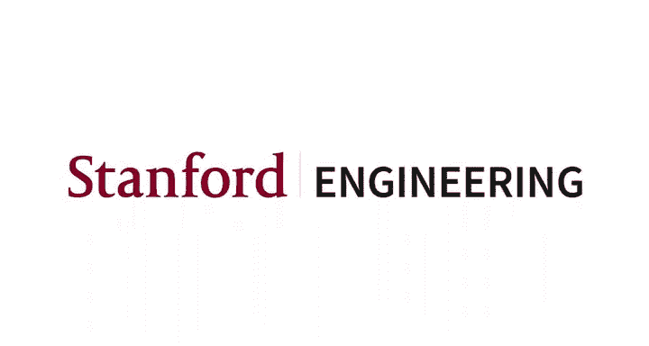