# 吴恩达@斯坦福大学《深度学习｜CS230 Deep Learning 2025》中英字幕 - P5：Lecture 5_ Deep Reinforcement Learning.zh_en - GPT中英字幕课程资源 - BV1J1x4zoEVK

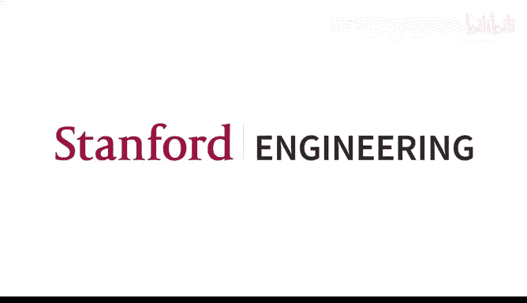

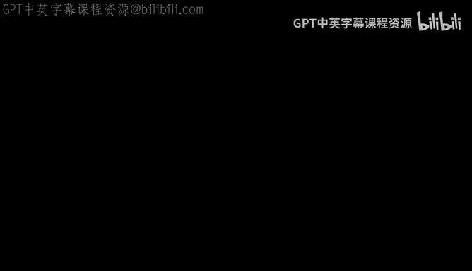

Welcome to our fifth lecture in person for Stanford Deep learning CS230 Today's lecture is going to be about deep reinforcement learning I actually switched the original plan of talking about neural network interpretability and LLM visualization simply because you haven't had the chance to study attention maps you know convolution on neural networks and so it would have been an overkill to do that week five so we're going to talk about neural network interpretability and visualization in a later lecture actually but today our focus will be on deep reinforcement learning which is probably my favorite lecture of the class I feel like I say that every week but it's okay I like it The agenda is pretty packed we're going to start with deep reinforcement learning which you can think of as the marriage。

beween deep learning and reinforcement learning together the baby is called deep reinforcement learning and we're going to see how reinforcement learning works and how neural networks can play a part in building reinforcement learning agent in the second half of the class we will focus on a very specific。

You know， concept called reinforcement learning from human feedback that you might have heard of。

 it's one of the core concept that really made the difference between what you might have remembered as GPT2 andCGT you know that's the leap that's really the technique that has you know democratized access to LLM because of the performance improvements and the alignment with humans so we're going to see what is this concept of our LHF and how does it work and why does it allow us to align a language model to human preferences。

😊，Ready to go as always let's try to make it interactive so the motivation behind deep reinforcement learning and as usual you're going to have all the most important papers that are covered in the class listed at the bottom of each slide reinforcement learning has grown in popularity one of the you very popular papers called human level controlled through Deep reinforcement learning is the work from Deep Mind has showed us that a single algorithms slash training method can allow us to train AI that can play many。

 many Atari games better than humans single algorithm over 40 50 games where it exceeds human capability which is quite impressive when you thought about the fact that you know machine learning leaves used to be niche and you will have to train a really niche。

😊，them to perform different tasks here's an algorithm that can just learn sort of every Atari game a little later you might have heard of Alphago Alfago is an algorithm that was developed to beat and exceed human performance in the game of go we'll talk about it a little more the game of Go is a very complex game some would argue way more complex than chess from decision making standpoint and from the possibilities that can happen on the board and so it actually got solved in 2017 again by the Deep Deep Mind team and David Silver's lab later on and again another great paper from Deep Min had showed us that reinforcement learning can also be used for strategy game that might be a touch more complex than chess or go that might actually。

😊，ve multiple players playing with each other or against each other。

 Some of you might have played Starcraft， for example。

 that's an example of a game where it requires a lot of longter thinking。

 shortterm thinking another one is dota some of you might have played dota or League of legend where you have a team playing against another team those are examples of games that involve multiple agents playing collaboratively and it's pretty hard to develop systems that can play with each other against multiple opponents and finally most recently this is 2022 so alongside the release of ChaGPT this paper that introduces the concept of reinforcement learning with human feedback applied to aligning language models with human preferences and we'll talk about that later so all these to say that reinforcement learning allowed us to exceed human performance in a variety of tasks。

😊，The first one I want us to think about is the game of go。

 So let's say that you were asked to solve the game of go with classic supervised learning。 Okay。

 everything we've seen together so far labeled data。

 How would you solve the game of go with classic supervised learning。What data would you collect。

 What would be the label。E cetera。Yes。哦。那是可以。看冇非。Okay， good point。

 you look at history of plenty of games， hopefully from good players if you want the algorithm to work and you look at X as the input being the current state of the board and why as the next state of the board and this would tell you what move was selected and you learn the move essentially and hopefully if you do that across many。

 many games you know you might see the agent become more attuned to the game and develop a better strategies So you know really hopefully it's a professional player。

 what are the disadvantages of that or the shortcomings that you can anticipate。😊，Yes。

YourSo to space。20。す。对。一个时。Others said。Yeah， yeah， great point。

 You might not see the entire space of possible states of the board。 Which is what you said。

 So you might miss out on a lot of different strategies。

 So the game of go is actually a game with two players。

 one player that uses the black stones and one player that uses the white stones and iteratively。

 they're gonna place those stones。😊，On the grid， a 13 by 13 grid that you can see on screen with the goal of surrounding their opponents。

 So you're constantly trying to surround the stones of the opponent。

 and the opponent is trying to surround your stones。

 And so you can imagine that for every intersection on the grid， there is multiple possibilities。

 Either there's a black stone or a white stone or nothing。😊。

And on a 13 by 13 grid you can imagine how many possibilities of a board state there are it's impossible to capture all of that with historical moves from professional players it would just never cover that the same thing could be said in chess as well you know that even the professional players can plan X number of steps in advance but nobody knows where the game takes you and in the late stages of the games or the end games players always find themselves playing a different game and that's part of the magic of being good at chess。

😊，So yeah， that's the problem， what's another problem or shortcoming beyond the fact that we can't observe possibly all the states？

Yes。also canulate。Anipate what does actually to。一吃。えま？事0。Okay。Correct， correct。 you。

 if I repeat what you said。 Well， first， you don't even know if this was a good move。 you know。

 so maybe it was not even a good move and you're learning something I was on a good move and you're labeling it as a good move。

 And second， you're actually only getting partial information。

 meaning you don't have the information of what's in the person's mind and what strategy they're trying to execute。

 So your store， you sort of looking at a single example among long term strategy。

 And you can't expect the model to guess what's the long termm strategy because it was just trained on X and Y and matching the inputs to a possible output。

 So you don't really have any concept of a strategy at that point。

 It looks one off at every decisions of the model。 Okay。

 those are really good points the other one is the ground truth might be illdefined。

 What I mean by that is。😊，嗯。Even the best humans in the world do not play their best game every day。

 and even their best game is not the ground truth。And that creates an issue because you're essentially training against a target that is off by a certain margin。

 you're never going to get better than the best human and the best human is not the best possible existing。

 the best possible strategy at every point。😊，So you could argue what if we get a panel of experts that we're monitoring and those are the best players in the world。

 even with a panel of experts that decides every move。

 you're still have an ill definedfin ground truth， you know。So that's a big issue。

 too many states in the game you mentioned and we will likely not generalize， which is what you said。

 meaning we're looking at one off situations， we're not looking at entire strategies。

 and so when we face a board state that we've never seen before because the model was not trained on strategy it sort of we get stuck。

😊，Okay， and this is an example of a perfect application for reinforcement learning because reinforcement learning is all about delayed labels and making sequences of good decisions。

😊，So if you have to remember in one sentence， what's RL， Rl is making good sequences of decisions。😊。

Sequences of good decisions， sorry。And do that automatically。Yeah。

Another way to look at it is the difference between classic supervised learning and RL is in classic supervised learning you teach by example in reinforcement learning you teach by experience。

😊，Which is also a different concept， you're not just showing cats and noncats to a model。

 you're actually letting the model experience an environment until it figures out what were the best decision it made and learns from them。

😊，Some examples of reinforcement learning applications， I'm going to mention them we have gaming。

 of course， that we already covered， what are other applications。😊，Of AI。

 where we need good sequences of decisions。Yes。Autm is driving yeah correct I mean in driving you could argue RL could work and there's some RL going on but what you mean I think is your you have some sort of a dynamic planning algorithm that allows you to strategize if you see a red light ahead you might start slowing down over time but maybe it will turn green so you might not slow down completely this is an example of a strategy that you need of course。

😊，Yeah有东司。Roboic controlling that's a great example also related to autonomous driving。

 but imagine you want to teach to a robot to move from point A to point B。

 the number of good decisions that the robot needs to make in terms of moving each of their joints is tremendous like it's actually super unlikely that a robot would move from A to B if it's not trained to make good sequences of decisions。

是。What else？Actually， the biggest one nobody mentioned yet。It's not a great application。

 I don't like it， but it happens to be the biggest one over enforcement learning。😊，Yeah。😊，は。Yeah。

 yeah， advertisement。 yeah， marketing。 you're right。 So yeah， we talked about robotics。

 advertisementment is another example， advertisement。😊。

Is a long game like companies are showing you multiple ads before you buy。 and in fact。

 the reason reinforcement learning is important is because。😊。

You know they're planning a strategy that might lead a buyer to execute purchase over time and it requires long term thinking。

 so there's a lot of reinforcement learning applied to marketing， advertisement。

 real time bidding processes， etc。Okay， clear on what RL is and how it differs from classic supervised learning。

No， so let's put some vocabulary around that concept in reinforcement learning。

 you have an agent and the agent interacts with an environment。😊。

As the agent interacts with the environment， the agent will perform certain actions that we will denote A T。

Where T is a time step and the environment will show you states that transition from time step T to time step T plus one。

So subject to an action 8T， an environment may transition from8 ST to ST plus1。

 you can think of the game of goal， I take the action of putting my black stone on a certain grid intersection and the environment has changed。

 it moved from the state has changed it moved from state times step T to time step T plus1 where my stone is on the grid。

😊，After that state update happens， there's two things that the agent observes。

 the agent observes an observation that we will note O T and a reward R T。Okay。

 so those are the vocabulary words。 And， of course。

 the goal of the agent will be to maximize the rewards。One thing to know about the observation。

 we'll talk about it a little more， the observation sometimes is equal to the state Can someone guess why we might need two concepts instead of a single concept。

😊，Why is it important to have a state and an observation？Yes。😊，啊。Yes。

 correct so in some cases the environment may not be fully transparent to the user and so for example in chess or in Google。

 the observation is actually equal to the state you see everything on your board all the information is available to you if you play League of legendd or starcraft。

 you know the concept of I think in English it's called like a cloud or a fog I think it's a fog。

 you only see certain parts of the map until you have explored everything or until your friends are sort of visiting the other parts of the map and so the observation is actually less information than the state of the environment。

😊，Okay， and then the last piece of vocabulary is a transition when I refer to a transition。

 I refer of the process of getting from state t to state t plus one， which means we're in state T。

 the agent takes an action A， it observes OT and a reward RT and it transition to the next state S T plus one question。

😊，啊，对。The state off。哦，我你白一。啊。Wait， what do you mean you mean。

 are there examples of environment where the state is so large that？Yeah。

 possibly for computational reasons， yeah yeah， you might have games， I mean。

 look at open world games like truly you could you could argue I don't know there are some games where you might press start and you see the entire environment but who cares of what's happening 20000 kilometers west of you if you're in a certain location that might not influence your strategy so you might actually put some sort of a you know。

 trust circle or like some sort of a circle in which you observe which you think has 99% of the information you need possibly for computational reasons that's a good point。

😊，Okay， let's get to a practical example of a reinforcement learning algorithm and develop it together。

This example is called recycling is good because recycling is good but also because it's a simple example illustrative of reinforcement learning so let's say we have a small environment with five states。

 there is a starting state marked in Brown which is state two， it's our initial state。😊。

And then on the right side， sorry on the left side you have state one which is a garbage and it's great to get to the garbage because you're gonna be able to to put in the garbage you know the stuff that you have in your hand。

 you know you're trying to throw away some garbage and the garbage can happens to be there and so we would expect there to be a reward on the other side if you actually go to the right you might pass by state three which is empty。

 you might pass by state four where there is a chocolate packaging that is left on the ground that you can pick up and it's good to pick it up and then on stage five a state five you have the recycle be which is more valuable than the garbage can because you can recycle and you should get better rewards for that。

😊，So that's our game in this game we define a reward that is associated with the type of behaviors that we want the agents to learn and the reward is as followed that's just one example plus two for throwing your garbage in the normal can plus one for picking up the chocolate packaging and plus 10 if you manage to make it to the recycled bin。

😊，Is it clear？Now the goal will be， and that's the case in reinforcement learning often time to maximize the return。

We define formally the return， but think about it as maximize the amount of rewards that you get as you go through this journey and you make your decisions。

In this specific game we have five states and there's three types of state in Brown is the initial states。

 we have normal states and we have in blue terminal states when you get to a terminal state in reinforcement learning。

 it will typically end the game， it will end one episode of the game。😊，We move to another episode。

 you'll get back to the starting state or initial state， and you'll redo another episode。

The possible actions for our agent here are going to be fairly simple， left and right。😡。

And we are going to add an additional rule that is important。

 which is that the garbage collector comes in three minutes and it takes a minute to get from one state to the other。

 why is that an important rule to add to the game？You guess。Yeah。😊，Hello just。Yeah。

 otherwise you just go back and forth between stage three and stage four。

 you just collect a bunch of chocolate packaging and you never make it to the binan and so it's not what we want。

😊，Okay， so how do we define the long term return， the long term return is going to be defined as capital R。

 which is the sum of rewards with a discount discount is a very important concept in reinforcement learning。

 it's also a very natural concept you think about， can you think of what what the discount would represent in for humans do you have an example of what it could be yeah。

😊，Yeah， the value of money and time exactly or the energy that a robot might have， things like that。

 yeah you would rather get you know a dollar now than a dollar in 10 years knowing that there's some inflation for example。

 that's the example of a discount in reinforcement link is the same you know。

 let's say you have a strategy that takes so much time you need to discount it because your robot might lose energy as you going through it for example。

😊，Discounts can vary， you know， but they stay between zero and one。

So what is the best strategy to follow if Yama the discount is equal to one。

 meaning you know time doesn't matter here if it's longer or shorter。

 just want to maximize the return。Best strategy to follow。I need to try。

Someone who hasn't spoken yet。Yes。一会。Bouce around， but remember the rule of three minutes。

You can bounce around because you will not get to the terminal state before the timeot is done。

But that would be a good idea if this rule was not true。What else could you do？Yeah。The idea。

's an easy one though。Not too hard。Best strategy for yma equals one。

And give me also the maximum reward you would get。People are sleepy today， yeah。Go to the recycle。

 so right， right， right， Yeah， that's right， Thank you。Right， right right。

 and then what's your total reward？Yeah， that's right，11。

So that's where we get terminal state and we grab our reward of 11 very good now assuming 0。

9 for Yama， we're going to complex s things a little bit。

 I'm going to walk you through a very simple algorithm that you know allows us to sort of determine the best strategy and we will put our numbers in a matrix so for instance。

 we'll define a Q table。😊，And Q stands it's a value function where the name Q learning。

 Q star you might have heard all of these things come from Q learning and so let's say we have a Q table which has the size of number of states times number of actions。

 so five rows two columns in our case。Every entry of the Q table。

Is essentially representing how good it is to take action。A in state B。

Do you agree that if we had a table with these numbers， essentially we solved the problem。

 meaning at any point the agent can just look in the table， I am in state three。

 let's look at column one that would tell me the value of action one and let's look at column two。

 it would tell me the value of action2， so I have everything I need to make my decisions。😊。

So that table is really the thing you want to find in this exercise Now the way we will find the table is sort of using backtracking algorithm where we might actually codify the environment as a tree and traverse a tree so here's what it looks like I start S2 and I have two options ahead of me I can go to the left where I will get a reward of two it's an immediate reward the immediate reward is not discounted。

😊，It's an immediate reward。Remember the formula for R， the immediate reward R0 is not discounted。

That would take me to S1， it's a terminal state， so there's nothing to do after。Yeah。Second option。

 I go to the right and I get a reward of zero that's my immediate reward and I end up in state three state three is not a terminal state so I can go and do the same exercise from state three in state three I have two options I can go to the left where I would see a reward of zero and I will end up in S2。

Or I will go to the right and I will get an immediate reward of plus one。 It's an immediate reward。

 we're not discounting it。 I will end up in S4 and from S4 again。

 I have two options back to the left to S3 with zero reward or to the right with the amazing reward of plus 10 and the terminal state of S5 So that's my map of immediate rewards that's not my discounted return So what we're gonna to do now is we're going to backtrack of the tree in order to compute the discounted returns actually if I'm in S3 right here。

😊，I see that I can get an immediate reward in S4 of plus1 and I want to compute my maximum return that I can get from when I'm in S3 my maximum return is that in S4 I could get a plus 10 right but I need to discount that。

My discount is 0。9 so I multiply 10 by 0。9 what it tells me is that from S4 I can expect 9 plus one。

 which I get as an immediate reward from moving from S3 to S4， I can update this number to 10。

 meaning from S3， the best you can hope for is a discounted return of 10， which is one plus 0。

9 times 10。Everyone follows。Now let's do the same exercise one step before in S2 you know in S2 I have an immediate reward of0 for going to S3 or an immediate reward of2 for going to S1 S1 is not going to be worth it。

 we already know that because when I'm in S3 I can actually expect 10 which I have to discount 0。

9910 is me 9 plus 0 immediate reward from S2 to S3 that tells me that the discounted return from state 2。

 which is our initial state is9。😊，我说蓉。So it a simple backtracking now I can copy back this so S3 I know that when I'm in S3 you know I can expect zero immediate reward to to sorry if I'm in S2 I can expect zero immediate reward plus a discount times the plus9 that I could expect in S3 and so that gives me values that should cover everything that we have in this Q table so I do that backtracking I copy paste all of that into my Q table all the way up here and this is what I get。

😊，We essentially finished game at this point we can look at a certain role。

 so let's say I'm in state number three I look on the third row of that Q table and I see that I have two options if I go back to S2 ultimately my discounted return will be 8。

1。Right？If I actually go to S4 on the right， I will get 10 because I would get 1 plus 0。9 times 10。

 which is 10。😊，So this is a toy example， but it tells you that if you were able to backtrack through the entire environment。

 you will be able to build a massive Q table and you will be able to give it to your agent to make its decisions。

😊，Yeah。😊，W。Sorry， can you be？Yeah here I'm simplifying I'm not considering the time remaining。

 but in practice you if I remove the time component。

 so I remove the fact that there's a three minute deadline before the garbage collector comes。

 then this would be slightly more difficult because you would have to do a time series essentially of adding the discount times the reward that you collect yeah but I'm simplifying here and that's why I use the three minute rule。

😊，Any question on the Q table？Super okay so this was the Q table and in fact we can put together our strategy for Yama equals 0。

9 the best strategy is still the same you go to the right and you can expect a return of nine。😊，Now。

 one of the most important concepts in reinforcement learning is this equation on the board called the Bellllman Opimality equation。

Oftentime you'll see its noted as Q star of state S and action A。

Equals r plus gamma times the max of that same function applied to S prime a prime。

Let me explain this equation for you because it's super important。

This equation is called the optimality equation because your optimal Q table will follow this equation。

 If you have finished again， this equation can be applied to any state action pair。

 and it will still be true。😡，The intuition behind why the Belman equation is the Opity equation is that if you have the perfect Q function Q table and you're in a certain state and you perform a certain action A。

 you will observe a reward。😊，This reward will you you have taken an action so you would be in a new state and from that new state you could repeat what you just did right and because you've done the backtracking and stuff like that you will get this equation to be true because it's the reward plus discount times the best next action that you could be taking。

Does that make sense， any question on that？That's exactly the backtracking that we did， by the way。

Immediate reward plus discount times the best possible action that you can take in the next state S prime。

The last concept I cover in terms of vocabulary is the policy。

 the policy is the function that given your state is going to tell you what to do and in Q learning。

 the way this policy is defined is arc maxax of Q star across the action so essentially what it says is like looking in the table and look at a certain state s you want the policy which is what you should do it's the function that tells you our best strategy。

 you just look at the true possible actions， which one has the highest Q value and select that action。

😊，That's it。This is a very simple example， but it's the core of Q learning that you know later on you will use policies widely。

 there's a lot of reinforcement learning algorithms， but this concept of understanding the policies。

 the function telling us our best strategy in Q learning it's the a maxax of the best Q value in the given state。

 it tells you which action to take， that's the core thing you need to understand。😊。

So remember this Bman equation because we're going to reuse it。😊，In a bit。

The main issue with this approach of a Q table is that state and action spaces can be super large and having a matrix that you discover through backtracking and where every time you want to do an action。

 you have to look up the given states， the possible action， it becomes impossible。

 But imagine you using the algorithm for the game of go where there's so many states。

 there are so many possible actions， you can put your stone anywhere on the board。

You can imagine how big this matrix becomes and how impossible it is to use So that's our problem。

 and that's the moment where deep learning comes into play。😊，So let's two credit。呃。

actually before I go there I'm just going to cover some vocabulary， we said the environment。

 the agent， the state the action， the reward the total return and the discount factor。

 we learned all of that， we saw that the Q table is the matrix of entries representing how good is it to take action A in state S and the policy is the function that tells us what the best strategy to adopt and the Bman equation is satisfied by the optimal Q table。

😊，So let's get to DPQ learning， which is what I was about to say is we are going to frame the problem slightly differently。

 so instead of using a Q table， we're going to use the fact that neural networks are universal function approximators and we're going to define a Q function that's essentially a neural network so that the function can take a state s。

😊，And in action A， and tell you how good。That action is in stateless。

So instead of a lookup in a matrix， you just run a forward pass in a neural network and it gives you the answer。

That feels like a better solution for games where there's a lot of states and a lot of actions。

So here is same problem statement in the past we looked for a Q table and this time we will look for a neural network one of the things we're going to do is to define the output layer to have two output so given a certain state as input think about it as a1 hot vector encoding the state so this one is the example of state201000 if you pass state 2 in this Q function with multiple layers it will give you two outputs。

 one output that corresponds to Q of S。Action right and the other one Q of S action left because it's the two actions。

If we had more actions to take， we would just increase the output layer and we might have many more neurons in the output layer。

我。So the big question is how the hell are we going to train that network because we're not in classic supervised learning。

 we don't have labels。She。So this one is a hard question， but what would you do。

 given we don't have traditional x and y pairs， how are you going to train this neural network？

Because remember at the beginning this neural network we give you garbage。

 it will take state S and it might tell you go to the left or to the right but it's completely random。

 so how are you going to tune it to the level where it makes really good decisions？Yes。直接。而。

Assume based on some prior knowledge。 Tell me more。BaYeah。最多有到是还不上班。不是。

So what are the things we know about this problem right now。

 what are the rules of the game that we could use in order to I'm seeing what you say you say we could estimate what good looks like。

 but based on what。いか？这开。Okay， so reward structure you're saying that's one thing we have in every game。

 we have a reward structure for every state that definitely should be used in order to estimate the good what a good decision looks like。

Yeah， the problem is not in every state you will see a reward and if you look at many games of like go。

 you might not see a reward until 50 moves。😊，So what do you do in this case？Yes。😊，12。

Station sea now ist good more。Yeah， so you could， you're actually bringing up a sort of a three search right you go down the tree。

 you do every possible action， and then you backtrack so which actions？Sp it out Okay。

 that's that's we're getting there。 So first possibility is we just go down the tree in the game of go。

 You could put your son everywhere。 So the tree already start by a 13 by 13 options。

 And then it's exponentially grows impossible， It's intractable。

 But what you said is what if there are certain actions that are more likely than others。

 Do we need actually to explore the entire tree， What's this， Like。

 what are you using when you're saying that。 How do you determine what action might be better than another one。

😊，Expected return， we're getting close yet， but you know how do you know the expected return without going through the three one at least？

As to make。Okay， you can estimate it using what。Yeah。

 maybe what what so that's exactly what we're going to do actually。

 but we're going to use the the Belman equation because there are two things we know about this problem。

 We know the reward structure we you brought up and we also know that the perfect Q function will follow the Belman equation that we know as well at the end。

 the Belman equation should be respected， meaning for every state。😊。

If you want to know the Q value of that state given an action。

 the way you will get that is you will look at the immediate reward plus the discount times the best Q value from the next state across all actions that equation we be respected so those are the only information we have and we're going to use them drastically to define our labels and sort of mimic classic supervised learning approach so here's what we have we have on neural network we have Q S to the left and Q S to the right that represent how good it is to go to the left in that state versus the right。

😊，And then I've pasted the Venmin equation on top right of the screen。

We're going to define a loss function， so let's say for the sake of simplicity because those are scalar values that we use know L2 loss quara loss that compares a certain label Y a certain Q value of a state in a certain action。

 so what we would like is to minimize this loss function。

 meaning y and the Q value for a given action in a given state is as close as possible to each other。

And we're going to leverage the reward and the developmentman equation。

 so let's do two things right now we don't have a why so in supervised learning you will have a picture of a cat and there's a cat。

 the y is one or0 here we don't have a y so we have to come up with an estimate of a good y actually is better than random So let's say at this point in time when I send a state S in the network it turns out that Q of going to the left is higher than Q of going to the right。

😊，Which means that today at that moment， the Q function tells me it's better to go to the left than to go to the right。

That is random at the beginning。 It's completely random Okay。

 so what I'm going to do is I'm going to use as my target value Y the immediate reward that I observe on the left。

😊，Plus， gamma termss the best Q value that I can get。

 so the best action that I could take in the next step based on my current Q value。

That's very important。Remember， this target is off。 It's not a perfect target。

 but it's better than nothing， meaning not only it tells us， hey， there is a good reward to the left。

 we should consider that in saying that that might be a good move because we're seeing an immediate reward。

 but on top of that， we also know that at the end of training the Q value should follow the development equation。

 so why don't we set the target as the development equation。

So we add the discounted maximum future reward when you are in the next state。

 so you were in state S， you go to the left now you're in state S next left。

And you look again at your Q values and you select the best one， then you add that number here。😡。

So there is actually two forward path in that process。Right。

There's one forward path where you send the state S in Q and you look at the two options left or right and you're like okay I'm going to the left and then you're like I'm going to compare that value to a target y but to get that target y I need to do another forward path so I take my action left。

 I perform it I get an S prime state S next and I send that S next into the Q network I look at the two options I have I pick the best one and I add it here with a discount。

So fundamentally what's happening is the following is we have a Q network that's random at the beginning。

 it has never observed the rewards， we just know that at some point it will get to the Q it will get to a perfect you know policy。

 it will get to a perfect Q function， but the best we can do right now is to say，😊。

As a guide to for our agent， we will look at the immediate reward and we will look at the development equation。

 which should tell us a better estimate than where we are right now。

 and we will try to catch up to that estimate and then we do that again and again。

 So remember every time your queue gets better。 it gets better for the next state as well。

 So you know the development equation tells you estimate it with the second forward path and you just keep getting better and better as youre observing more rewards。

😊，就先。我感肃作。有とてす。好。The forward。If want。这两当都再。How would you sort describe the loop you going to arrive？

Yeah好对。法官就是来。Again the。 yeah， you would stop at that point。 So what you， yeah。

 this is a good question。 I'll show you how we fix certain things， but you do only one step， meaning。

You have your Q value at this point。And it tells you go to the left and you just want to target Y so what you do is you put left and you look at your next state。

 you forward propagate your next state， you look at the two options， you pick the best。

 you don't go further， you just use that one step， you look one step ahead essentially you don't look multiple steps ahead。

 you could， but it will be more computationally heavy to do one more step again and so on。So以呃 yeah。

青春。分开。是啊。For one that said。So people know。公司的。How people treat their best。Yeah。

 it will typically be a function of the environment， the state space。

 how long it will take to converge， but you're perfectly right that。As the Q function gets better。

 the estimate y also gets better So the two things get better together right because the y is based on the Q function and if the state space is massive。

 you might have a very difficult time training this model。

 there's better approaches that we' see later。😊，Yep，There was a question there。完了。Noello。Yeah。

 so here I'm just saying let's say when you send state S in Q the left happens to be higher than right。

 but the same happens on the other side， let's say let's say the left is worse than right then what you will do is you will define your target y as the reward that you observe on the right plus from the next state of having gone to the right what's the best action and what's the Q value for that pair and then it will give you the target for that scenario。

So one complication with this training is that when you want to differentiate L so you want to perform a back propagation。

 you want to take the derivative of L with respect to the parameters of the network you want y to be a fixed thing right because in supervised learning y is not differentiable its just a fixed number zero or one or a certain number so here we're going to simplify and we're going to say this term that is dependent on the Q network。

 so technically this term has parameters so if you actually differentiate it it will give you a value will just hold it a fixed。

😊，So we say we do use ourQ network to perform an estimate of our Y， but we will not differentiate it。

 we will say it's not it's fixed。Explainplain why we discount this。Because you know。

 going back to the reason we discount is like the value of time。It's like you probably want to say。

 if you can win the game in 10 moves， win it in 10 moves rather than 100 moves。

Or if you can get $1 today day， get 1 today day rather than in 10 years。

 all of that is why we have a discount here and the discount is a hyperpar that you would define as well that would influence the strategy of your agent。

We're going to see it after actually， I'm going to do a concrete example because it's a little complicated yeah。

😊，He as to know。No， no， that was it's a good point。 It's not that it's just Q of。

It's it's a two by two it's a one by two so you have left and right I was just going down the first case so I put the state left ya yeah。

这个时。So。天听。What if the rewards are not fixed， I mean in most games we're going to see right now the rewards are going to be fixed by the designer of the game。

 the human that's designing the game， in practice you could have a separate function that actually comes up with the reward we're going to see an example later in the lecture where the reward might be different in different scenarios and there's a function or sometimes called a criticit that determines what's the reward in a certain state。

😊，Okay， D see is yet one last question and then we move because we're going to see a concrete example is' going to be clear So when we like hold it takes for laptop。

 is that what differentiate from through all of the。possible， yeah。

 so instead of doing the backtracking down the tree and going over everything。

 we're saying we're going to limit ourselves to just picking the best action based on our current understanding of the network。

You see like my network is kind of intelligent， not great。 We're in the middle of training。

 It says that I should go to the left。 And then if I look at the next state when I'm in the left。

It says I should go to the right， I will trust it because it's the best I have， best estimate I have。

 but I will discount that。😡，And then if you keep repeating that。

 it turns out that not only your estimate gets better。

 but your model gets trained and then ultimately both together get to an optimality equation。😊。

So it's a funky concept， right？But you get it。We're going to see examples。Okay。

 so then once you have been able to use the development equation to estimate your target。

 you perform a classic back propagation and you update the parameters of the network and you repeat that process。

对。Here is concretely if you were to code it in pseudocode。

 here is what it would look like to train neuro agentnt using Q learning we start by initializing our Q network parameters so initialization it's random at first then we will loop over episode as a reminder episodes are one full game from start to terminal state。

😊，Within an episode， we're going to start from the initial state S。

 and we're going to loop over time steps until we reach a terminal state。So within one time step。

 here' is what we will do， we forward propagate the state S in the Q network。😊。

We will execute the action A that has the maximum Q value。😡。

We will observe a reward and we will also observe a next state S prime。

 we will use that S prime to compute our target y by forward propagating S prime in the Q network。

And then computing ouras function。 And based on that。

 we will use gradient descent to update the parameters of the network。Should be simpler。

 looked like that， right？Okay， so this is the vanilla Q learning。So to summarize again。

 the main difference is that we don't have a target and we use our own network to estimate the targets and the rewards are what's going to help us get better over time。

🤧Yeah。By the way， it's okay if you don't understand everything this is an entire class at Stanford。

 you， an entire quarter of studying that type of stuff。

 so we're trying to get the basics within an hour and a half two hours。😊，Okay。

 let's go a little further now together。😊，And apply that to an actual game。 So here's the game。

 It's called breakout。 We want to destroy all the bricks who has played breakout in the past。

 What if you， Okay， good。 So you have a paddle that you control and you are trying to destroy the bricks。

 if the ball gets past your paddle you lost。 And if the bricks are all destroyed， you won。That's it。

Yeah。Let's do it together。What is the inputs of our Q network？What would you use as input？

remembering yeah。おし？Yes。Entire screen okay， let's do that so I think I define that as the state S。

 which is the input to my Q network， what's the output of the Q network。😊，Yes。

Good question we'll get there I'm going to ask you。

 but do we have to look at the full screen answer answer is no， but we'll see why what's the output。

Yeah， the game score， no， but we're going to talk about the game score in the back。好。Yeah。

 let's talk about the output first and then we talk about this stuff we can get rid of on the inputs。

 but what's the output yeah？😊，The actions， yeah， the actions。 so yeah it will be the Q values。

Associated with the actions in state S。 Remember， it's a Q function。

 So the output is we need one value for left， one value for right and one value for idle。

 You could make this game more complicated and say。We have8 actions。

 We have a little bit to the left， a lot to the left， a lot more to the left。 You know。

 if you add multiple buttons， But let's simplify and say three actions。 Either you don't move。

 you move to the left or you move to the right。 So these are the outputs。

 So now let's get to the question of the screen。 Do we need the entire screen。

So you were saying something earlier。Yes。Okay， so you say you need the tray and the bricks。

 I would argue you need more because there's the walls and I guess that you could。

 if you're an expert player， you could know where the walls are。

 but generally you need a little more than that， what would be obviously things we can get rid of and why would we do that？

The background wrong。Okay， the score， the score at the top。Who would remove the score at the top。

But half。Why would you not remove it？😡，Why would you remove it？

Okay you want to always win so the score doesn't matter， it's true。

 we would remove the score so you could actually crop the top。

 you could also crop the bottom I mean if you past the paddle you don't care about the few pixels at the bottom you could get rid of them and this is not always true there are games where the score matters and in fact。

You know I like football soccer in soccer， if you're 10 up， you can park the bus。

 so your strategy is dependent of the score that you have like you wouldn't park the bus if you're using one0 parking the bus。

 meaning you ask every player to come back and defend if you're losing you would actually do the opposite you would go all out and attack。

So in certain games， you want the scores in others you don't want。 And so it's part of the designer。

 the AI engineer that's working on that to determine what information we need and what we don't need。

 What else could we do to reduce the dimensionality of the problem and make our computation faster。

Yeah remove the RGB channels so do grayk essentially That's true here you actually don't need the colors it's just nice as a user for user experience purposes you don't need I don't think there's different points based on the bricks that you destroy it's all the same they're actually funny enough this algorithm was used by deep pine to play a lot of battery games and they did a single preprocessing where they removed the channels because they said it doesn't matter turns out in one of the games I think it was sequest I forgot which one the fish disappeared when you did that and so that game didn't work the agent couldn't crack it because they thought that the same preprocessing could apply to every game but actually they had to make a slight tweak。

😊，嗯。や。他我。我是就话。Correct。So just to recap， you could do it even better by using a lowdial representation of this game that describes the game。

 It's true， but because we want to use a single algorithm for 50 plus At games will say the human sees the screen we just need the screen and it will probably scale better essentially but you're perfectly right if you are working on only that game okay so let's do that we'll do preprocessing。

 there's one last thing that nobody mentioned， which is history because in fact。

 if you get only one screen， you don't know where the ball is going So actually you can't solve the game and the way you fix that is by giving a history of multiple screens for example。

 four screen so that you see the direction that the ball is going in So our preprocessing function is you know called p of S let's say and phi of S is a mix of you know you might do convert to gray scale。

 reduce the dimension， the height and width and also add the history of four frames。😊。

And that should be enough。 Turn out in most games， you will need the history。

 a little bit of history to know where the ball is going or。In this example not just occur to be。

Yeah， you could you could replace exactly you could replace。

The histories or multiple screen by just adding the gradient or the velocity of where the ball is going。

 That's true。 But would it scale to every game。 You know， turns out this。

 because we know humans look at the Atari machine and they look at pixels。

 this would be more likely to scale to every game。

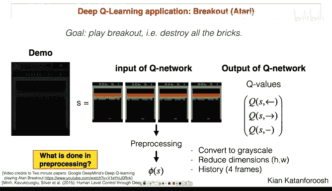

Yeah。Like think about a game where actually Squest is a good game or space invaders where you have multiple enemies coming at you。

 then you would need to change your preprocessing to take into account the velocity of all these enemies so it wouldn't work the same way。

 while if you actually give the pixels you actually from the pixels get the velocity of all your enemies and the directions they arere going。

Okay so this is our preprocessing， I'm going to refer to it as P and our deepQ network architecture because we're working with pixels is going to be a compositionution neural network。

 don't worry if you haven't learned it yet in the class but it's a bunch of conf and value activations and then we end with fully connected layer that gives us the three two values for the different actions。

😊，So nothing special here now。We're going go back to our vanilla training so this one that we saw together earlier and we're going to look at tips to train reinforcement learning algorithms those tips are not specific to Q learning some of them are applied to a lot more than Q learning and they're very important to know and they're part of the reason reinforcement learning has worked better in the last few years so one of the things that's pretty simple that we forgot to do is the preprocessing that we just did so anywhere I had an s I'm going to instead run S through the preprocessing step I'm going to use phi of S so I initialize instead of s with phi of S I start from the initial state p of S and then I for propagate p of S I get the Q of that preprocessed state in action A and etc etc and then when I get my next state so let's say。

I look at my current pre processcessed date。 I four propagated ones。

I see the three Q values in our case the two Q values。

 one of them was better than the other action rights， then I get my next state S prime。

 I want to preprocess that state as well。😡，No。So that's pretty straightforward。

 you just replace all of that。The second thing we forgot to do is to keep track of the terminal states in our pseudocode there is no concept of terminal state。

 it's pretty easy to add you would probably just do an ifel statement。

 you would create a Boolean to detect terminal state so let's say your Boolean is terminal equals false and then as you loop over the time step of a single episode every time you're going to check is the state that I'm going in based on the action I'm taking a terminal state if it's a terminal state then get out of the loop you know。

😊，There's nothing else after the one thing that you need to be careful of is if it's a terminal state。

 then your target is not the Bman equation is just the immediate reward remember you get to the terminal state。

 you get a reward of 10， there's no beman equation to apply it's just 10 it's immediate reward there's no discount。

😊，Et cetera。Okay。Okay so these are fairly easy changes。

 Now we're gonna to look at a new method that will enable more data efficiency。

 It's called experience replay。 one of the a couple of issues with the way we've been training so far is one the correlation of successive screens It's like imagine in the Atari game。

 you have the ball that's in the top left corner and it's traveling to the bottom right of the screen。

 you have like many， many times step that are essentially the same。

 It's all the ball traveling the in the same place。

 So you're actually training repetitively on something that is not that meaningful。

 you don't need to just train on a batch the equivalent in supervised learning is let's say you're trying to differentiate cats and dogs and you train on a mini batch of cats then you train on a mini batch of dogs then you train on a mini batch of cats and you will never converge it will just index too much on cats and then index too much on dogs。

😊，So you want to add some sort of a experience replay concept that we'll see in order to create more mixes in the data and get more diversity。

 the other thing that is important is in our current。😊，Training process， we are not reusing our data。

 like you've experienced something， you immediately train on it。

 you never see it again unless you re experienceper the same thing sometimes in the future。

 which might or might not happen。Experience replay is going to help us to keep experiences in memory and maybe retrain on them on a regular basis so that one experience might be useful multiple times。

😊，Which intuitivetu makes sense， like maybe you do an experience。

 you get an amazing reward and you don't want to forget it。

 You want to retrain the model on it on a regular basis。It's more data efficiency。

 So here's what it looks like。 The current way we were training was we're in a state。

 I'm just gonna to state state instead of preprocessed state， but it's preprocessed。

 we're in a state S we perform action A， we get a reward R and we get into the next state from that next state。

 we perform another action A prime we get a reward R prime and we get into S second and so on you know。

 and so on。 and each of these would be called one experience。

 it's one iteration of gradient descent So one experience So right now we're training on these experiences。

 So the training looks like I train on E1。 I update my parameters then I train on E2。

 I update my parameters then I train on E3 update my parameters those are highly correlated because they're part of the same episode and as I was saying with the ball traveling in one direction that might actually not not be that helpful to train on all of these know So instead what we'll do is we'll use experience replay。

😊，Where we will collect our first experience， but instead of training on it。

 we will put it in a memory。Called the replay memory D。We put it in there。 And then at every step。

 we will sample from that memory to decide what to train on。 So， of course， at the beginning。

 if we just have one experience in the memory， we will train on that experience。 But over time。

 you will see that we get more diversity and we use out of our experiences。 So for example。

 let's say I experience E2， I put it in the memory， and then instead of training on E2。

 I'm going randomly sample from the memory， I might get E1 or I might get E2。 then I experience E3。

 and I put it in the memory and I might get one of the three。 you know。😊。

This is the vanilla experience replay in practice there is more methods like prioritize sweeping which might tell you which experience you want to weigh。

 maybe some experiences had a higher gradient so you want to prioritize them more often。

 things like that。😊，Yeah。So all in all， this is what our training looks like with experience replay。

 we experience E1 we train on E1 then we the next training iteration is not on E2 it's on a sample from E1 and E2 either or the third experience is then put in the replay memory but we don't train on it。

 we train on a sample from whatever is in the replay memory and we repeat and that is more sample more efficient。

 allows more reusibility and less crosscorlation in our training。😊，Butuch。是。Okay。

So that's called replay memory。And you can use it with mini batch gradient decent notes that。😊。

You still experience in the direction that the game is played。

 like we still go and take the action as expected， we just don't necessarily update our model parameter based on the action that we ended up taking。

 We put it in the replay memory， we may train on it later。😊，Yeah。Okay。

So here's how it modifies our vanilla setup， we've added an experience。

From state S to state S prime to the replay memory。

 you know like let me walk you through it again within one time step。

 we four propagate our state into the Q network， we execute the best action given the Q values。

 this gives us a reward and the next state， the next state is pre process and then instead of training on that instead of training。

 we just add that transition to the replay memory and instead we sample randomly a mini batch of transition from the replay memory and we train on those。

😊，And we redo the same thing again and again。Yes。还是你贵的。あです。2。嗯。昨是你不我一直。Start being to do rewards。

Thank you would some on， yeah。Yeah， you would you would within one episode。

 but know if you play multiple chess game， your replay memory would get already bigger。

 so then you would see some end games， some middle of the game， some early games。Yes。

And in practice it's actually useful because you might imagine that in a chess game， you know。

 all of us， let's say if you're a beginner， you see a lot of beginning of the games。

 you actually people that are begins they are good at openings but they're bad at end games because they don't get to play a lot of end games well that type of approach could be useful you can retrain on end games more often and you know a more advanced version of the replay memory。

😊，Would also weigh the experience in the replay memory based on how much the gradient is going to be。

 so if you have an experience that actually was super insightful。

 you can weigh higher so that you prioritize grabbing it and retraining on it， essentially。

So I say you blunder in chess， you might actually want to resee that blunder later so that you don't do it again。

嗯。Okay， so these were all the different methods。 Another one that's very intuitive and very important is when during the training process。

 our agent gets stuck， gets stuck in a local minima。

Here is how it would work in practice you start in an initial state S1 and you have three states ahead of you if you take action A1。

 you go to state 2 which is a terminal state， if you take and you get a reward of zero if you take action A2 you get to S3 also a terminal state and you get a reward of one and if you get action A3 you get to state4 terminal state with a reward of1000 so of course to us it's obvious that we would want to explore the state number four it's pretty obvious。

😊，In practice， let's say you update you initialize your network and in the first forward path。😡。

That's what you get。First forward path， the network is random， you get Q value for action 1。

5 for action 2。4 for action 3。3。What does that mean。

 it means the agent is saying I'm going to go to action one。

 so I take action one and I see an immediate reward of zero。Because it's a terminal state。

 the developmentman equation thing doesn't happen， I just have the immediate reward。

 which becomes my target y， and so I perform a graduate decentcent update to say this Q value should have been zero。

 so I convert this Q value to zero。Now， second try。This time the Q value is saying take action2。

 it's the highest Q value， I take action2， I have an immediate reward ahead of me that's one because it's a terminal state there is no second discounted future reward term so I just take y equals1。

 I perform my gradientcent of and this converts to one and then third time the agent is still saying go to a2 go to the take action A2。

Reward of one， good， that's what you predicted， nothing to do。 Just keep going。

 we're done with training， we're stuck。We never visit the state we actually wanted to visit。Okay。

 so that wouldn't work for us， we will never visit that state using our current algorithm。

 does that make sense why we wouldn't ever visit that state？In practice， this is a big issue。

 the analogy of this concept of exploration versus exploitation is when every day you take your bike and you cross campus。

😊，You have a favorite route and turns out that the more you take that route。

 the better you get every time。 like you get a little faster， maybe your turn is faster or something。

 or you can pretty tell many people are gonna be at that roundabout and you know how to take it in the wide way So you go faster with've all done that。

 That's exploitation。 You exploit what you already know and you get better at it。

 But maybe there's another route that you're not thinking of that's pretty instead of going north from campus you go south and maybe it might be better。

 you will never see because you don't have the courage or the patience to do it。

 that's the difference between exploration and exploitation。😊，In practice。

 a good model would be able to handle both to explore 22 to explore it to explore when it needs to explore the way we do it in practice in our pseudocode is to inject some randomness so for example。

 when we are looping over time step we probability epsilon let's say 5% take a random action。😊。

So from time to time， on average， one time every 20 times you take a random action。

 it will allow you to visit maybe a new path， the analogy in chess is you know you might use a creative move from time to time that might be worse today but might allow you to learn something and to get better over time。

じゃ。example we just covered， could we resolve that by just setting the initial Q values to？

Setting the the couldn't we resolve this problem by setting the initial values from into infinity Well the problem。

 if you set the initial values to infinity so you would say instead of randomly initial initializing your network。

 you initialize it in a way that the outputs are equal to infinity Yes that we wouldn't get the issue of。

😊，我也可以。valueWell， in practice， if the three Q values are infinity。

 then you can't make a decision on the spot or you're saying just pick one randomly。

Because if the three are infinity， you can' decide which one to take， right？

And also if it's infinity and the reward is one， I mean if it's a really large number and the reward is one your gradient is going to be massive right so it's going。

 I guess the loss function is going to be massive and I don't know I imagine it would be really hard to train it。

😊，In practice， you start with the random initialization because this might be one example。

 but in the game of chess。Actually the reward is one at the end and zero all the time。

 or maybe the reward is 1000 at the end and when you lose your w it's a negative reward。

 you can't predict what the reward structure is going to be you want an agent that is able to adapt to it and it's better to find a method that can scale to different environments。

 essentially。U。Okay， so this was Epsilon greedy action which is adding some randomness with probability Epsilon take a random action okay so adding all our techniques because we get good at training reinforcement learning algorithms。

 this is what we have we initialize our Q network parameters。

 we have a random network we initialize our replay memory D， and then we loop over epi。

 we start from an initial state， we create a bulloleion that allows us to detect terminal states we probability T Epsilon。

 we're going to take a random action otherwise we're going to follow what we know which is forward propagate the state in the Q network。

 take the action that has the highest Q value that allows you to observe a reward and the next state take that next state for propagate it again。

😊，Instead then and then instead of oh no， sorry sorry， observe that next state。

 add it to the replay memory， sample from the replay memory and then train on that sample and in the process you will need to do another forward path because you need to estimate your target y using the immediate reward plus the developmentman equation。

 plus the discounted future reward。Okay， are you experts at Q learning？对， good。

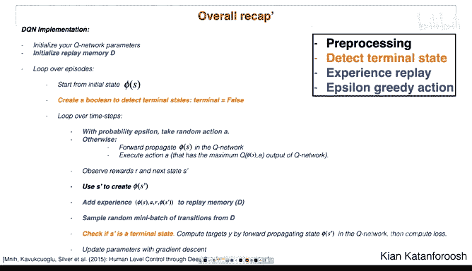

Sounds good and here's where we get at the end。You can claim proudly you have trained an Naar。

 it's not that complicated， as you can see， other than the Bman equation piece。

Turns out the agent has discovered that it can send the ball on the back and it's actually much easier to finish the game like that。

😊，Which is quite interesting， you know， a good player would know that you can dig a tunnel and you can finish the game without too much issues。

 yeah。😊，By the results the action of the。How do you quantify when the game has ended？Yeah， well。

 first you would start seeing the model get to good rewards as a play like it manages to get really good rewards why earlier it might not。

You know and so that's probably your best guess for how good the model is in practice。

 if you're Algo， you can also test it against the best humans in the world and you can observe that they're losing against the model。

But up like。

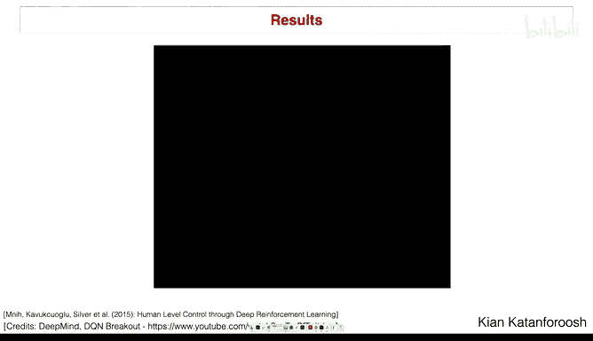

Different chest engines， and some of them are way。Yeah。Different。

Maybe theyre both based on the enforcement learning and at the end。

 they maximize most of every rewards， so how do you know which one？

Or you can get them to play together。所要啊两位先。No， you could actually monitor the loss function and look at is the Bel equation respected。

 if the Bel equation is respected， then your model is really really good and then we're going to see an example of competitive selfplay where you get the model to play against other models and then over time as you watch them play for thousands and thousands of time you can tell which model is ahead of another one you can then sort of。

Copy paste the best model into the other models and then make them play game for many times。

 And because you have the Epsilon greedity approach。

 one of the model is naturally going to get better than the others。

Because of the randomness that you are。走。Okay。Okay。

 let's look at a few examples and then we'll spend 20 minutes on the RLHF Here are other examples。

 this is Pong， which is1 V1 Seaquests。😊，Which is an underwater game and then the one that maybe more of you know。

 space invaders， very popular game。As what？So the impressive thing that they showed is that you can actually solve many games with the exact same algorithm。

Newwes。She's quite impressive。

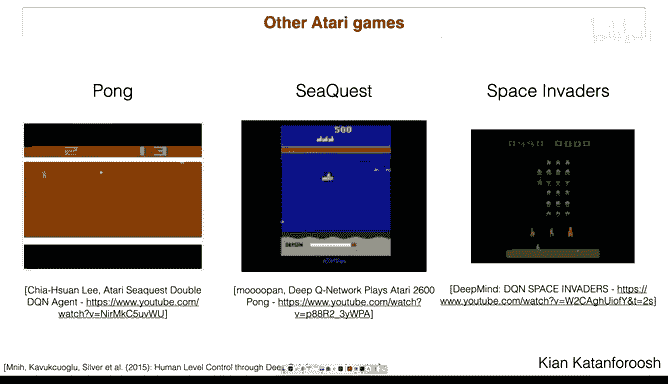

Let's go a little further and talk about advanced topics here's a game called Monteezzuma Renge this game is particular because you're controlling a little character right here and this character is trying to go and grab let's say this key right here and it has some obstacles or some enemies that it needs to take care of。

What。What do you think is going to be an issue if we apply what we just learned to this game？

What makes this game specially hard in comparison to let's say， chess or go？Yes。Yeah。

 the reward is very delayed。 Like if you start with a random network。

 what are the chances that the network is going to figure out that to get to the key。

It actually should go in the opposite direction， it should go in the opposite direction。

 it should jump down here， it should catch the rope。

 the rope will probably allow the character to go to the ladder， it goes down the ladder。

 it has to go jump up this enemy my guess is it's in an enemy。

 I'm not sure but I think it's an enemy because of the color and I know that in gaming if it was green。

 it might not have been an enemy， but it it's gray or red。

 it might be an enemy and then go up the ladder and grab the key the chance is very low that the agent is going to make that successive。

 good decisions to get there， you're right。😊，Why is it easier for a human to actually solve that game？

嗯。😊，Intuition， prior knowledge， so for example， when you look at this game。

 even if you have never played it， my guess is you would know you can go down the ladder because you know what the ladder is or you can see this little rope and you're like I'm going to catch the rope I'm going jump and go to the other side and you look at this little monster and you're like I'd better not touch this monster or if anything I will jump on top of it because you play Mario let's say。

😊，So all of this is human intuition， sometimes you would call as a baby survival instinct。

 like you throw the baby in the water and suddenly it flips and it can swim。

 those are things that are to a certain extent encoded in our DNA。

 but at the very least encoded in our experience of doing other things that have nothing to do with this game。

😊，And so the problem here is called imitation learning is is there a better way to start our network than a random initialization that allows the network to。

 for example， guess that this is a ladder， and turns out that if the network knows that it will be more likely to get to the reward first and then learn from that reward and then get better over time。

The other part that can also use human knowledge， which is what we're going to see together。

 is reinforcement learning from human feedback。Where you have an analogy here which is you can train a language model and it might be completely misaligned with what actually humans care about how does reinforcement learning help in those situations that's gonna be the next topic in the last part of the lecture Okay let me show you a few other results quickly today we talked about VQ and DQ learning in practice there is a lot more reinforcement learning algorithm but you got the gist of it you got the concept of making good sequences of decision and epsilon really exploration exploitation terminal state starting state all of that you got the one algorithm that is very popular right now is called PPO proximal policy optimization There is one that is even more popular right now that's actually from a year ago at Stanford called DPO that we won't study in the class one of the things to know about PPO just just to go over it really quickly and I pasted two important papers from Schulman a few years back。

😊。

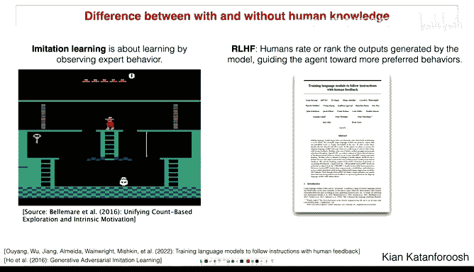

TRPO and PPO is that it is not a valuebased algorithm so in Q learning you learn the Q values and then you define your policy as the arg max of the Q values in PPO you learn the policy directly which is a more probabilistic method it also works well with continuous spaces if you look at the Q learning we learned one output for one action if you actually have a game that has continuous action like autonomous driving where it's not like just turn the wheel to the right or to the left it's like what degree you turn it it's continuous then the QN would not work well or you would have to granularize the number of action a little bit to the right a little more a little more which would not be really useful instead you would use PPO。

😊，Yeah。Where you see the year work。Let's your overmost things。Yeah。

So a question is how do you define the reward in the QN。

 different reward structure will lead to different types of agent strategies， but you're right。

 for the game of go， you could actually define the reward as one if you win and zero if you don't win。

😊，That's it you know every movie will be zero until the last move is a win in chess you might actually do intermediatem reward because you want to tell you want to tell the agent that it's good to kill the opponent pieces to get rid of them you could also do N to end and say I don't give any intermediate reward I just give a final reward which might be more complicated to train on but it might actually lead to a more optimal strategy because in fact you could actually win without taking any piece from your opponent。

😊，Other things about PPO is you know it's more probabilistic。

 it has a concept of an expected advantage which at every steps instead of telling you how good that action is it would tell you how much better it is than random then the current state like how much better would it be to do certain thing versus what you would have done otherwise I'm not going to go into the details it's all in the paper but those are things that are important here's a few examples of PPO so this example on the left is from open AI a few years back where you can see it's a continuous space where the agent is being bullied a little bit。

😊，But it's trying to grab the rewards， but it's also subject to external forces that are sort of throwing balls at it。

 It's a little bit mean， but。You can imagine that this is a continuous space。

 meaning you're controlling the nodes， you're controlling the joints of the agent and you're controlling the forces。

 the angles， and so that's why PPO would be better in that case。

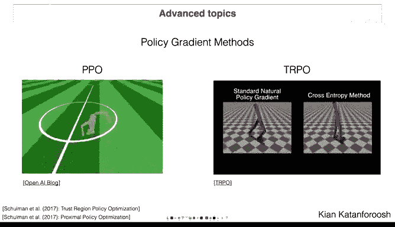

Super， here is a competitive self play， which I really like。😊，🎼Yeah。

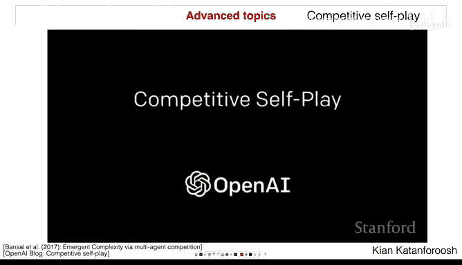

Where you have agent play with each other and this is the sum game。

 push the open end outside the ring and you get a reward。So actually。

 it's interesting because you're seeing some emergent behavior。

 which is they attack each other's feetat。😊。

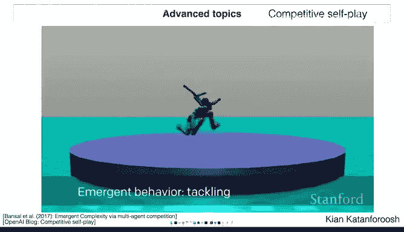

Or they lower their center of gravity to be more stable， for example。Is this exact table。Yeah， yeah。

 it's versions， sometimes different initializations， for example。😊，你上面。So no， but good question。

 So oftentime， what opening I would do back back in that time is they would。

Create copies of the same model。 They would initialize them differently。

 and they will let them learn。 and turns out one of the model will get better than the others。

 And then they will copy again that model to the rest and do the same thing again and again。

 pretty much。对呀。It's kind of funny， isn't he？That's a good judge。确死。Yeah。

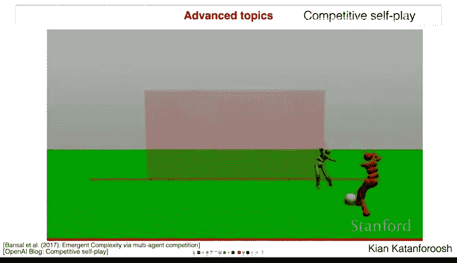

That's a good goal。对。Youd watch that for hours。They're a little awkward you have to say but but it works okay so you know I let you watch the video it's gonna be shared。

 but here's another set of games that are even more complicated that I mentioned early on Open AI 5 which you can think of an equivalent of League of legend dota where you have5 v5 game So you have to collaborate。

 etc cea， which makes adds like literally one additional degree of complexity and Starcraft Al star from Deep Mind is an example of where the observation is not the entire state you have fog and so that adds another layer of complexity I'm not going see that together today。

😊，I would encourage you to look at the Alphago documentary on Netflix if you haven't who has seen it already。

Nobody， Okay， Well， you can now watch it with a different eye understanding reinforcement learning。

 and at some point。In the。In the documentary， you will see that Alphago makes a very odd move。

 a very creative move， and people are like I don't understand that move。

 even the top researchers or the best players would say in the video they don't understand that move。

😊，It turns out that that move is very unintuy for humans because as humans。

 we are trained to maximize our chances of winning like literally if I can eat all your pieces in chess。

 I will eat all your pieces and if I can surround your stones in go as much as I can I will do it The agent is just programmed to win so that move actually look counterin2y because the agent doesn't care about winning by one or winning by a you know 20 stones it just cares about winning and that moves specifically put the agent in a good place to win by a small margin so that's an example of an inside that you will learn you understand from this class and you will see in the。

😊，In the documentary。Okay I think we have 10 minutes I'm just going to introduce reinforcement learning from human feedback because it's a more modern topic that is very trendy right now it's important to know and so let's look at it together we're going to start by recapping how language models are trained in a nutshell and then we'll see what what supervised fine tuning looks like we'll talk about how do we train a critique model a reward model and then finally what RLHF looks like and why is it so trending in the news so。

😊，Our training objective for language models is next token prediction， right。

 we've already talked about it in a formal lecture。 The idea is that I will get some inputs。

 I'm reading Wikipedia， let's say or some sort of a text online。 and I read a sentence。

 and I predict the last token。 and I do that again and again。 So， for example， deep learning。

 and then deep learning。😊，Ease， you learning ease。So the learning is so。滚。

And that's it so you get the idea right you always predict the next token and then over time it forces the model to explicit emerging behaviors and it understands the connections between those concepts and it's really good at generating text we compute the loss function you're actually going to study this loss function in C5 so I'm not going to talk about it right now but you perform you know a gradient descent loop and this is how you get your first pretrained language model you're gonna pretrain language model you can call it on a text or prompt and it we continually generate and you call it again and again and again and you generate generate generates。

😊，Everybody's comfortable with that， right， Okay， so that's how we trained a language model。

 But there is a couple of problems。 the first problem。😊。

Is that online data does not reflect helpfulness。So to give you a concrete example。

 what you might find in the training set is something like deep learning is so cool when actually what you might find in practice is people asking what is deep learning？

😊，So the data is not really reflective of you want an agent to be helpful。

 and that's a problem because the model was trained to continue text rather than answer questions。😊。

AndIn practice you would see it's a big problem Another problem is the model has no concept of good。

 polite or helpful yet， and to give you a concrete example。

 you might actually ask a pretrain language model， my laptop won't turn on what should I do？😊。

And then the model response， because it has readdit on Reddit or on Wikipedia is laptops sometimes don't turn on because of power issues。

 which is not what you ask， you ask what should I do。😊，And in fact。

 a better answer would have been check your charger if is properly connected or the outlet works if that's fine。

 try holding the power button for 10 seconds if it still doesn't start the battery or motorboard。

 blah， blah， blah， bh， that's a better answer。 That's what you want a language model to do nowadays。

😊，And the model can give you factual text because that's what it's been trained on。

 but it doesn't understand being helpful or having an answer that looks like a human like answer。😊。

So our solution to it will start with using supervised fine tuning。

 which is going to be learning from human written demonstrations of helpful food behavior。

 and then we get to even further and use RLHF， which will optimize not only for human written sentences or paragraphs。

 but for preferences， and the word preferences the keyword。😊。

Let's talk about how we can improve our pretraining model with supervise fine tuning。

I take that we want to align models with human written responses。

And the step one that we're going to lose is to build a data set。

 Let's build the data sets of human prompt response pairs。

So what actually opening eye is going to do， I'll explain it in a second is it might。😊。

Collect some of the prompts that we all use and then ask humans to respond to those prompts and put that in a data set。

 It might also ask separately experts to write really good prompts and then answer those prompts。

It's a fully humanm data set and then we use that data set to fine tune or pretrained model and by now you've learned fine tuning in the online video so you know what I'm talking about using supervised learning so what it looks like is I take my pre-trained model that I just told you how we train and then I give it a prompt。

 explain deep learning to a beginner and I also we concatenate to it。😊，A responsepon。

 a good response written by a human。 deep learning is a type of machine learning that uses neural。

And then I expect the model to come up with the word networks。

So it's literally do whatever we did to train the pretrained model。

 but we do it on human return prompt response pairs。

And if you do that many times and you use the same loss function。

 how far the model's response is from a human response。

 you do that many times and you will get SFT supervised fine tuning， but it has some shortcomings。😊。

One of the shortcomings is it is data that is extremely costly to collect， in fact。

 I believe in the first version of that instruct GPT。😊，There was only 13，000 pro response pairs。

And turns out they did really well despite that。The second aspect is it's unlikely to generalize well because you're again。

You're not doing reinforcement learning here， you're doing supervised learning。

And so you're just showing a set of examples， 13000 examples that you want to learn。

 but it's what tells you that it will generalize to an unseen prompt。

That we come up from your user base。And so this approach。

 SFT really teaches the model to imitate good behavior from humans， and that's the key。

 it's imitation， it is not preference optimization。To do preference optimization。

 that's where we're going to train a reward model and we're going to do proper R L HF。

 So let me talk to you about the R M reward model。 And then I'll tell you about。

OrLHF in your nutshell。The problem of RHF is to align not with human responses。

 but with human preferences。So what's going to happen is we're going to train a separate model to predict。

😊，Which responses human prefer。 And we're going to call that model the reward model。

 It's a separate model from whatever we've trained before。

 The model is going to use data from labelers。 So you're going to show labelers。

Two or more responses to the same prompts。And those responses will be sampled from the SFT so your best model right now is the SFT you will sample three or four responses and you know how we sample right you can tweak the temperature。

 you can select not only the top priority word the top the softmax layers number one word but you can sometimes sample differently and you will get a variety of answers and then you will ask a human labeler to say answer B is better than answer C and answer C is better than answer A and answer A is sort of equal to answer D。

 let's say。😊，Um。They will be asked which response they prefer and it can get more complicated It doesn't have to be just a simple ranking。

 you have multiple liker scale methods and so on， but the point is that you will collect those pairwise comparison that we call preference data and you will use it to train a reward model which is initialized from your SFT so your SFT is here it's your best model to date and you're going to modify the last layer so the softmax layer at the end of a language model that will tell you this is the token we should output or this is the word we should write instead of that youll get rid of that layer you'll put a scalar value as output you'll put a linear layer with the scalar value that will represent the reward head it will predict the reward know which is a proxy for the preference of the human the way youll train that reward model is youll give it a batch of two you know you'll give it a prompt X with a response a and the preference。

😊，Of the user。 and you give it the same prompt with a response B from the SFT with the preference of the user。

 So here the user is saying response A is better than response B。

 And so if you actually were sending that in this model， you will get。

Predicted reward for the preferred answer and a predicted reward for least preferred answer。

That allows you to train using loss function that I'm not going to cover given our time sensitivity。

 the loss function will encourage the model to assign higher rewards to preferred responses so you're trying to dissociate the higher reward better preference from the lower reward for lower preference and it turns out that if you do that many times you will have a reward model that given a prompt and a response will be approximating human preference。

 so you've just trained a critique。That represents your humans。 It's a proxy for what humans prefer。

 It's been trained on a lot of human preferences。The reason it's better to use a model than actual humans is because we can use it widely on all sorts of inputs and it can scale from a data standpoint。

😊，Also note that this method is better than SFT because it's way easier to ask humans what's your preference between those two things and to ask them to come up with on two prompts takes way less time and if you've used ShaGT。

 you've probably been asked before to tell them which response you prefer。

so once trained the reward model represses the human as the evaluator during reinforcement learning from human feedback and reinforcement learning from human feedback is very comfortable for you now I will show you what it looks like given the Q learning algorithm we learned but essentially we have first thought the model what good behavior looks like with SFT and then we build a reward model that can tell us how good an answer is according to human preferences and the RLHF approach is where we will lets this model practice get scored by the reward model or the criticit and update itself to produce higher scoring answer so more preferred answers and it's the same as the games we've seen together but some things differ so I just paste it here the exact setup that we've learned together for reinforcement learning。

😊，The differences are the following， you know， our objective is still to maximize expected reward that is produced by the reward model aligned with human preferences。

The agent is the language model being fine tuned。The environment is the space of placeable prompts and continuations。

😊，It's any， any text that you can encounter。 The state is the specific prompt plus the tokens that were generated so far。

 The next state is one more token。😊，Added， and the action is the next token that is chosen by the agent or the model。

Which is of course， determined by the policy。😊，And then， the reward is。

Estimated by the reward model that we trained to represent human preferences。不是。😊。

In this case one episode is one full prompt， so imagine that you get a prompt and you start generating and you go through this reinforcement learning loop and you observe the rewards and then you try to maximize the future rewards and then at the end of training you end up with having your pretrain model turn into an SFT and your SFT turn into a way better model using RLHF。

😊。

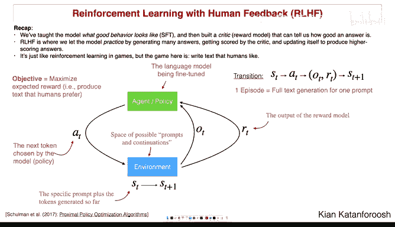

嗯。Okay so a few things to note to end on this， the model does not get a reward at every single token。

 it gets a reward at the end of a sequence when the completion is finished because the reward model was asked to rate prompts and responses together so you need to finish the generation in order to see what's the reward and so again。

 going back to making good sequences of decision that's exactly it you want the model to make enough good sequences of decision so that the response is preferred by the critique which represents a proxy to the human preferences。

😊，So all intermediary rewards are typically zero， and that makes it a very sparse reward episodic tasks。

😊，Just like a game of chess where you only get a reward when you finish assuming you're not defining intermmate degreeV reward。

 so you only know if you did well at the end and you have to then use that information to update your network and get a better proxy for it。

😊，Super there's a very nice video we're not going to play for the sake of time but I will send it online。

 it's from four days ago it's you know former Stanford students Andrish Kapati who is very thoughtful and articulate and was explaining four days ago why reinforcement learning can be terrible at times and that human minds work way more efficiently and so I would encourage you to watch this four minute video because he's very clearly outlying why reinforcement learning is still not great。

 even if it's the best thing we can use in many ways。😊。

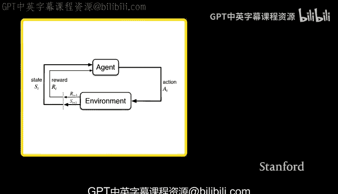

