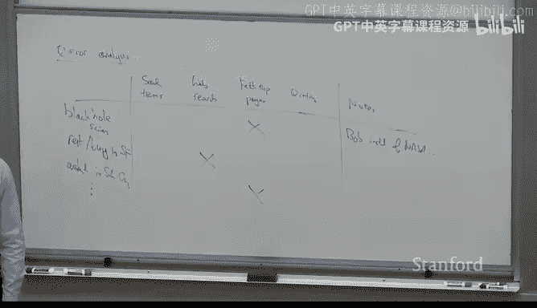

# 吴恩达@斯坦福大学《深度学习｜CS230 Deep Learning 2025》中英字幕 - P6：Lecture 6_ AI Project Strategy.zh_en - GPT中英字幕课程资源 - BV1J1x4zoEVK

So what other want to do today is continue our discussion on AI project strategy。

 so if you're building a deep learning system。For some and today for the first part of today day I'm going to use a speech recognition voice activated device example。

 and then for the second half I'm going to use a kind of AID researcher example。

 but what I want to do is walk you through a couple concrete examples of projects you might work on。

And let you understand what it feels like to be in the thick of building an AI system。

 making dayto-day decisions on what you do next， I find it， I think as you've heard me say before。

 understanding the albums is important So this class you learn a lot from the online videos about the deep learning algorithms。

 how to build pipelines but even beyond understanding how the algorithms work。

 what really drives performance is a team's ability to have an efficient development process。

 how do you tune how the parent is， how you collect data。

 when you try something and it doesn't work the first time。

 which it often doesn't what you do next the skill and making those decisions is what often makes a massive literally 10x difference in productivity and as it's reflecting is preparing for what to say to you today it's reflecting on quite a few projects where that 1x difference in productivity is really not an exaggeration maybe more than 10x but I've literally seen many teams in many。

You know， well known companies with good brands spend a year working on a project that I will see a more skill team execute in like a month。

 right， So these differences in skill are real。And one of the challenges for many people learning this is。

If you work for some company， maybe you work on a different project every year or two but so it takes you like you know two years of two years or year of your life to gain experience on one more project and then after I don't know。

10 years， you finally seen 10 projects and a pretty experience But what I want to do is in today's class walk you through a few concrete examples of projects that similar to want to kind of simplify versions of stuff that I've seen myself to try to accelerate your handson experience。

 looking at these projects and thinking through， if you are the one in the hot seat building a system and it works or doesn't work on this problem。

 whatever making those decisions for what you would do。

 so try to get you through that today with a couple examples rather than you having to spend years and years of your life to finally see a small number of examples of how these projects can be driven。

对。So the first first the two moiving examples I'm going to use today is building a voice activated。

デバイすあ。And my house I have， you know like Amazon echo have a lot with them actually and I think it's a delightful experience。

 But those devices like that， Amazon Echo or Google Home or the Apple3 home pod。

 they require quite a bit of setup They require some connected the wfi figure a way to connect their phone so you know。

 actually for a long time， even though I built smart speakers for a long time in my house。

 I had one light bulb connected to my home wfi internet， you know。

 because it's just so much of a hassle to set things up。

 I think now I have two light bulbs connected in my house。

 it was actually I should connect more stuff。😊，But so for this moving example。

 I want to talk about if you are part of a startup building a new product that makes it much easier to get these voice control devices without the user needing to do this home wfi setup process so you know。

I'm not very going to drawing。 but if you could go to some store and buy a desk lamp and the desk lamp already has a name。

 I' just call this lamp Rob it and it could just take plug just your desk and you say Rob it turn on and then turns on。

 say Rob it turn on that turns off without needing to be connected to internet and cloud access and all that。

 that would give users a easier set of experience there's a project my friends would actually discuss a few years ago that we thought would actually be a decent startup of idea。

 we decide not to do it because there're too many ideas or even more subtle about but we felt that know like a reasonable startup of idea to build a little IC circuit integrate a circuit to sell to say lamp manufacturers in other device manufacturers to make it really easy if say some company sell lamps to build a little thing so they can very quickly make their device voice enabled and if you have a few prebuilt names。

 maybe give the users a。Or as you can call you lamp， Robert or Leer， you know。

 or I don't know or Johnny or I don't know， Alice or whatever have a little switch then users could。

Just buy a lamp， put it down and then immediately have it be voice controlled without needing to worry about how do you get this onto my w-fi and net where and if my internet is down。

 then my whole house stays off as well his off things like that right and I actually did once an it was building a lot of voice assistant actually set up my office to have a lot of voice control devices So had different names of different lamps standing desk to his name as well。

 So I'd say I forget where my detiny was know like Jonathan go higher or whatever and then my standing deskt go up and down Its actually pretty cool。

So what I want you to sew。Just for today's illustration。

Probably you should give the different devices different names because you can't have every device in your house called Robert。

 Otherwise you say Robert turn on the whole house illumininates then robot turn off。

 whole house is plunge into the document So we found out you do need different devices to have different names。

 but just for today， I'm going to use as illustration the task of training a neural network of building a system that detect text when someone says Robert turn on and you need kind of Robert turn on。

 Robert turn off if you have a choice of names and layna turn on。

 layna turn off a variety of handful of options of names。

 but just the simplicity I'm going worry only about detecting the phrase。Ro it turn on。

And what we do for this to convince and repeat to get the turnoff command and a handful of other names to make them user selectable。

 what name they want to give the same。Okay。So this is something they'll need to run on device。

 small IC circuit and and I'm going to ask you a question right。

When you've graduated from CS230 or maybe when you graduated from Stanford。

 if you are the CTO of a startup responsible for building this。Wage is you right？ So call out。

 So imagine you just graduated from CS 230 or just graduate from Stanford and your other CTO was startup up。

And you want to build this lamp that can turn on when anyone says， Rob turn on。

How would you approach this problem？ And I know this is an incredibly open ended question。

 And it turns out life is incredibly open endeded， right， You guys you're going to see a230。

 you have to decide what to do。 So if this is what you're doing。

 if feel further to raise your hand to call it out if you want to build this product。😊。

What's the first thing to do， how would you think about it？cover分。系讲我要。

The speak to the the to the us。说过。对。我不知道。你说。你好就。Yeah， cool。 Yeah， right。

 So get some like open source speech text novel or something。 and's see if you run。 Yeah。

 the make good start。😊，Anything else？一该系。他们没要求。Increasing in complexity the first when we detect audioo。

就佢有要色。Thank主。But par the three。Okay， sorry， three models， one to detect Robertit and then one。

Thats see cool， right， Okay， right， so so few models to detect Robert understand rest sentence or detecting the song。

好各谁。そで。Oh， sorry to say。Its if we model that。Let's see what that's saying。7分。

Do you have to pick up the same process for game。That。So， it' that。为足。

Takeick a model that takes giving my students I them。And better other comments see like3 to。

I think I to policy the。Okay， obviously， oh like like a signese network。

 we actually teach a signese network late this class where something that inputs to audio files and decides the same same word so you can more easily generalize the new words than the Rob Oh now that's actually brings。

Yeah， go go for。最多的时间。这他那0多少。根据。PeopleSo like I image。他是这。慢慢搞就间。各位最常症状。这我。Sorry。

 you mean just connect up your device to Siri？也是他认的这个。你说还有为唔买。And the we signal very。

Let see head cool。 Yeah， right， yeah， that sounds interesting think it sounds like a different product than this if。

 if we need to connect to your cell phone and all that though。Yeah， cool right。

 so let me just lots of interesting ideas， let me just make some observations。

So I find that when building software products， there's actually lots of good ideas or lots of reasonable things you could try。

 but you know， as you heard me mention a few weeks ago。

 I think one of the strongest predictors is for the odds if you're building something compelling is speed。

 So I find that of all of these ideas， I think some are better than others。

 but doesn't but whether the idea is a bit better a little bit worse。

 it is important but its actually secondary to how quickly， you can just get something built。

 So if you're actually the CT of a startup like this， I would encourage you to look and say。

 all right， what can we build today or what can we build maybe in a week and any of these architecture choices and build it and see what happens because even if what you build is a little bit less good you can find out out in two days。

 course correct very quickly。I've I've actually built a lot of smart speakers。

 so I have maybe firsthand experience of this and I just share some things that I happen to know that there's no reason you will know。

 but it turns out that let's see， at least today， general purpose speech recognition is still a little bit heavyweight takes quite a lot of know crossing screen power is a bit expensive to run on an edge device if you want to make this like just a few dollars but it turns out that if you look at the smart speakers。

There's usually if you want to train a neural network just to detect one phrase。

 be it a phrase like you know OK， Google or hey Siri or Alex Alexa or whatever。

 any the smart speaker trigger words， that can be done with a fairly small neural network。

 but to your point if we want to do different neural networks， different words。

 we'll need to swap all different neural networks or Rinse repeat but if you have only a small handful of names phrases one detect I think that' would be okay。

And then one other piece of advice I would give if you're embarking on this is the first thing I would do。

 actually， if I was working on this for the first time is actually a literature search。

 and it turns out that I think we're fortunate that the AI world has a ton of software and a ton of open research papers。

Some surprisingly， despite smart speakers haven't been around for a long time。

 there still to this day isn't like a single architecture that everyone's agreed on on the best way to do this。

 If you look at the literature， there's still actually a diversity of opinions on how to do this type of wake word or trigger word we So when you say something that okay Google or history theory or Alexa。

 that sometimes called a wake word because a wake of device or trigger word trigger device take activity。

 So some surprisingly， even though it smart speakers a long time now for a lot more than a decade。

 there still isn't a single agreed on unified architecture that the committee has agreed on what's the best algorithm to do this。

 But I feel like。If you are embarking on this the first time the number one boost in your speed of learning。

 it could be implementing something， but I would say doing literature research and try open source software would be that even faster accelerator and I want to give you a few tips for that right real quick so you know today if this is there are a lot of research articles and blog posts and GiHub res on many topics。

 certainly Wware detection and what I find is that if this is research paper one， research paper2。

 research paper3 research paper4， I find that you sometimes people will spend a lot of time reading research paper one until you're done this is 0% complete this 100% complete。

And then spent a lot of time reading research paper two。

 spent a lot of time reading research paper three， and I just recommend you not do that instead when。

I'm doing a literature research， what it often feels like is， you know。

 do a few web searches for a handful resources， skim all of them。0% complete，100% complete， right。

 based on initial reading， you may decide to go back to paper C and spend more time to really read and understand that。

 but that'll help you find additional references you can skim and maybe you find a paper 7 that's really seminal。

 spend a lot of effort。 But this is what。Doing a very broad survey of the literature will feel like where you know。

 you're really put in the time to finish only a very small number of resources。

 but spend a lot more time skipping around and giving a cursory level。

 understanding of a broader set of papers， which can also point you to。

Also points you to the more useful resources to focus potential on。

And just one thing I've seen among Stanford students there one other thing that I find people tend to under use。

 which is trying to talk to exps。 So if you are actually a seat of a author I trying to build this for the first time I feel like we all want to do our own work and not bother other people which is good but I just encourage you to consider if after you've done your own work。

 if reach out to an exp can reallyaceate your learning So something I've often done this know I will do my own work I don't want to call random exps。

 you try to bother them before I've at least done my work but if youve sometimes I'm reading a paper I'm really struggling to understand it and I find that instead of me struggling for another like four hours if I send the authors a respectful email and say hey I read your paper try to understand understand this I'm so confused can you help me can explain this to me a lot of the time including when you know。

That's well known right but I think a lot of people。

 if they see that you're doing your work and not just reaching out to them before you've even done anything。

 a lot of not everyone， but a lot of research authors would actually be quite you know understanding and then try to help you out。

 And so I find that for a lot of process I did finding that one expert。

 sometimes sometimes a standardford professor actually we have a lot of speech faculty and a Stan faculty as well。

 but when I had problems with my speech recognition system。

 know sometimes I like Danki whatever and then like a half hour conversation or even a 10 minute conversation really accelerates what I've being able to do。

 So I just encourage you to it takes you like 10 minutes to send an email and maybe there's a 50% chance of respond I don't know not a0 chance。

 but sometimes that tends to be really high Ri And then what I think you find is that if you do a literature search。

You will likely discover that most of the robust enterprise great smart speaker systems all have a specialized system。

 train to detect the wake world or the trigger world and there's a variety of architectures。

 you probably come with some good neural network architectures for this and it turns out that there is no data set on the internet with lots of people saying Robert turn on right that's just not a thing right so if you decide that the names are Robert and Leer and you know It know Jeremy and Alicia or whatever sorry if there are people of those real names。

 it was actually kind of weird when you chose people's names but which is that for some reason but it turns out that there is no large data set on the internet of lots of people saying Robert turn on So if you want to train a neural network to detect if someone has said this phrase。

 you need to collect that data yourself right So let me then ask you another question。

So you've done the literature search， found some open source code you can try。

 but that has led you say to conclude that you need data sets of people saying Rob and turn on。

You need a data set to train to distinguish between someone saying Robert turn on versus not someone say Robert turn on。

How would your approach getting a data set like that？So yeah， go for it。嗯，对。Texas Beach。Yeah， cool。

 yeah， y， you use Texas speech as one method， I'll come back to that later you new ideas。不せ。Oh。

 sorry。Just take those and。Yeah。Yeah yep cool yep， I like that yeah， so walk around and ask people。

 tell them what you're doing get the permission to record and use their voice and then if they're okay giving permission。

 just record their voices yeah I like that。Anything else？Cool啊 yeah。就是。第四的业。一是跟。すね。这是在。对。确别。Oh。

 sorry， please。没容。Soさ。あ、有く。继续解持。Yeah， yep， cool， yup， right。

 So samples of people saying not Robert turn on no， not beautiful， y， yep， yeah， cool，30%以上的。各位则。上个。

还有比当现在。没看。抓。知能呢啲都。맛시 있고。Actually right。 So data is were people saying Robert。

 but you don't want that to your mistake。 that's a good point。 I'll come back to that later。 yes。

 do you say something。Oh， same thing。 Oh， interesting， cool， awesome， great， alright， so。

One of the yes， so I really liked the idea of know just going around and asking people for permission to record their voices。

 and by the way， in today's where privacy is important。 Con is important。

 So you know don't do anything sneaky or weird just tell people clearly what you're doing awesome for permission make sure any permission is really given and they don't give permission is fine。

 they really respect privacy that is really important Having said that I find that a lot of people in the world are very nice not everyone but the boss majority majority people in the world seem very nice and nicely know I know the girls have done this myself they will give permission for you to provide their data and then just one of the frame I encourage you to think about as always is a speed So how long will it take you to wander around campus or wander around services Francisco go and collect a sample of voices and I think you actually get a lot done get maybe dozens of samples。

 maybe hundreds of samples usually in the day inside。

Those are good tactics and then let me share you some things and then it turns out synthetic data using text speech is an interesting tactic I would usually not use that as the first thing I do mainly because it turns out I just it's hard to know how accurate synthetic data is compared to true you know natural data and maybe just show you one thing I've run into I've actually you done lost synthetic data for speech recognition right one thing you have to watch out for is。

If it go to a lot of the synthetic sources of data， how many voices。

 how many different voices does it provide and is it gonna be a pain to get enough you know diversity in different people's voices So it turns outt know for example I often talk to open eye voice on my phone iss up typing。

 but the number of voices there is limited and if you go to TTS provider I guess now some services with a larger number of voices。

 but these are things you end up worrying about and it's all solvable synthetic data does work for speech recognition right but it turns out that they're often enough details associated with filling with the synthetic data generation process that ends up taking longer So for a lot of machine learning applications you know using synthetic data is a good idea and eventually you might get around to it but using synthetic data is usually not the first type of data。

We collect because usually there are just too many hyper parameters and too many knobs you have to worry about。

 And then at the back your head be wondering whether is there something you know。

Read about the synthetic data that I' not thought of before and whereas you collect natural data。

 collect real data is just one， one less thing to worry about。Maybe just just tell one more story。

 not a speech， but self driving cars right so if you're building self driving cars you want to detect other cars。

 where do you get pictures of cars it turns out that a lot of people will have the idea of oh。

 there lots of video games with cars driving around while we use video games to get pictures of cars out of the video game。

Okay。But it turns out a problem with a lot of video games is there could be like 20 different cars in the entire video game depends on the video game。

 but it turns out that pebilistic video game。 you know。

 you don't need 1000 different calls and there are tons of different cause designs on the road。

 But you need a very narrow set of cause。 And so to a human you know。

 seeing the same 20 cars over and over。 looks at the road looks fine the video game plays fine。

 But for a lot of video games， you know， the data just isn't rich enough to capture anywhere near the richest of the real world。

 whereas in contrast， you've got real pictures， It's just one less seen as the whereabout So I find it for society data。

 it works is very valuable to use it a lot。 but I usually get to it only later in the process。So。

And then。In the interest of building these things quickly。

 let me share you the types of things that you my teams have done to collect data for this right and I feel like know when you read research papers that you take causes。

 often you get a very clean view of data， I'm going to tell you you know about one of the weird random hacks that one of my teams has used to build like a very serious working really well commercial system right and at least as part of the journey to do so。

Which is。Let's see， so。嗯。Right。So， collected。Yes。Hund0 train audio clips。Yeah。

And a 25 development set to tune2 and a zero tests right one thing I'll often do if my main goal is to just build a system that works as suppose to publish research paper is to not have a test set we just have a depth set that we will tune the parameters to and if I want to publish a research paper probably a clean a bias test set but if my goal is to just build something you know and have it work and ship it sometimes I just say I'm not going to bother to collect any test data just a training set and a death set and I just unapolishically unapologetically to my system to the death set right。

And once。Thing you could do is。Let's see。So audio clips。So audio is， let's see。

 so you may have seen the audio waveforms， right， which one just time。

 your exercise is time and audio waveforms kind of are these weekly time series。

Right and sound is very rapid vibrations in the air that your ear perceives as sound and what the microphone does is it records these very rapid changes in air pressure right so that's why I see all the wave foams that look like this。

And。So one thing that one of my teams once did was collected 100 samples of。

 you know audio waveforms where somewhere in the middle of it is someone saying Robert turn on。

 So you know， hey， how are you going oh yep， and let's say Robert turn on and could not talk about some of the things and so the phrase Robert turn on takes about one second to say and one way to collect a constructive training set would be。

To take a three second clip。 So this is where Robert turned on was said。

 This is where they just finished saying robot turn on。

 And so if you collect a00 audio clips like this。One way to turn this into bigger a training set is to take these long audio clips。

And then。She。This。Itcomes a training example with a label one because that's an utterance where the end of the utterance is corresponds to when someone just finished saying Robbin turn on。

And in contrast。This would be an example， would be a negative example。哦。

And this two is a negative example， you know， and this two is a negative example does it make sense。

 So given a say 10 second clip。Given the 10 seconds of audio， we will have。Cut out a phrase where。

You get a positive label if that three second audio corresponds to someone just finishing。

 saying Robert turn on， which is when you should turn on the lamp and anything else is label0。

 And so this is a way to take， say，100 training examples and turn that into。3000 binary examples。

 So 10000 audio clips， sorry， I should say 100 audio clips。Yes。Yes。Right， and if we take 30 windows。

 all of this， they can turn this into。嗯。Say， 30。Training examples。

 each of a binary 01 label that labels is this moment in time when someone just finished saying the phrase probably turn on。

So it turns out that if you do this and we did do this。Then we wound up。历事。We wound up with a system。

 So ran this and tested this on the。Death sets。嗯。And we want that with a system that we trained to predict binary recons。

Was 97% accurate。Right。But it turns out， it did this by outputting zero all the time that had zeros detections。

And so。With this training said， we basically train a very large neural network work。Where。

I would have gotten exactly the same result with that one line of Python code。Right。

So this is the kind of stuff that happens in real life， right and and by the way。

 I'm sure you these stories not you know just entertain you though hopefully you're entertain。

 but because I think of is by living these experiences that you go oh。

 I could see this problems is why I could see this So my question to you is if you collect this to data train the system。

😊，N7% accuracy， isn't that fantastic， but you realize that you just implemented very huge neural network。

 a print zero statement or the equivalent of print zero that is never finding the phrase Rob turn on。

 like what do you do next？What's going on with did you next？这。安とく。你保管。最行是。Yeah， cool awesome right。

 So， so increase the number of Robert turn ons in the example。

 which is a very unbal training example and it's been great by just saying Id never hear this phrase right。

 How would you go about you or anyone else， How would you go about increasing the number of positive examples。

😊，啊高分。Oh， but how do you do that？那我。Oh audio as it is I see w， I see cool yeah， interesting， okay。

 yes， that would work that gets the synthetic data again right is which actually works and law says all the convexes with synthetic data but it turns that it does work so I know it works because like come back to you。

Yeah， like I see。就是这。不是问题。Yeah， yep， that works too。

 So one thing you could do is take your positive examples。

 the examples of Robert turn on and just duplicate those examples or maybe just give those examples more weight to the training objective。

any other。你 example a example。Yeah， yeah， cool yeah。 that that that， yeah。

 So few variations the vision。 So I think the， the， the easy things to try。 one would be。

To take the examples and duplicate it right so you know mathmatic。

 this equivalent to taking your positive examples and just making multiple copies of that in your training set。

 it turns out that will work the lot solve it and by the way。

 unbalanced data sets is a common issue in training neural networks I'll tell you the rule of some I use and you know is many neural networks are pretty good at handling。

Up to like a one to10 ratio of unbalanced dataset sets so people often worry what an unbalanced dataset set in this example。

 we have like a one to three or T ratio and yourlish may vary sometimes it work。

 sometimes it won't in this case it didn't work， but I find that if you have a you know like a one to two ratio just usually not that worry about it neural network is fine training like that maybe up to one to10 is when I start to worry about it being a little bit too unbalanced for you know standard training procedures and when I might do something to make a little bit more balanced but duplicating the examples would be one tactic。

Yes， so penize false takes。 Yes， that would work to you。

 So I think there are a few ways to train the to change the cost function。

 You can give the positive examples more weight or。Yes。

 or penizing falsecing has will be another way to change the cost function that we work。没。Yeah。

 go ahead。一是。对。对。先分。の。よしいです。对す。Yeah yes so you can also decrease the number of negative examples that will work too the one downside of that is like it's okay I think it's fine to do what you said the one slide downside is if you are reducing the diversity of the negative examples and the neural network has just as a little bit less information to learn from I think there's a small what I just said is a small difference though I think that will also work is a quick as a quickly to try。

Yeah。And I just tell you another I'll tell you what my team actually did and I'm telling you this not because this is a brilliant technique I'm proud of。

 but because I just want to tell you the examples of the types of hacks that actual commercial machine learning teams do that actually work right so I'll tell you what we did it was very close to duplicating the positive examples。

 but we had just a slightly different variation， which was。😊。

We said that instead of the positive example being the one window where Robert turn on just finished。

 So here we're having a sequence of labels。Where zero corresponds to。

It's that moment in time when someone just finished Rob turn on and in the architecture I described。

 we are detecting a very， very narrow window in time where someone just finished Rob turn on and you got to turn on。

But the hack that we used was actually。Just extend this a little bit。

 So so instead of saying does someone just finished saying Robert turn on the last you know 100 milliseconds。

 we extended that out to half a second or a second And so if someone finished saying Robert turn on anytime the last half second let's turn on the light right And so this actually generates a few more training examples。

 So the reason we did that and again， it's a small difference is this actually creates a little bit more diversity in the positive examples than just duplicating it because now this red red is a positive example and so is this one and so is this one and so is this one it just creates a little bit more diversity in the positive examples I expect this will make a very small difference in the training the learning of performance。

 but it's just you know maybe just slightly better to have slightly。

It got covers the space of positive Vietnam just a little bit just very， very little bit。但是。

Because sense。嗯。So okay， just to keep going with the story。Let's say you do this。And now。嗯。

You still do well。Are the training sites？95% accuracy on treat sites。大家。嗯。50% accuracy。

 so not good enough。On your death set。Sa fix one problem。

And another one comes up and so what do you next？不ect。是。所以。这是个。

Yeah could also be overfiing and regular。Go。就是。对是。I it so right。

 is it that training and death set distributions are not the same in this example。

 because we collected the training in the death sets if we randomly shuffle between train and de。

 then they would be the same distribution。是。Yeah， but sometimes there's one other thing I do see。

 which is。If you it turns out earlier in the history of machine learning。

 there was always this assumption of obsession with making the training set in the depth set and the test set have the same distribution。

 I think it's because if the training set and the test set the same distribution is easy to prove theorems。

 easy to give guarantees whatever So kind of academic machine learning。

 there was always this you know theoretical assumption， which makes the theory work way better。

 the training set and your test set come from the same distribution right it's just like。

From a publishing people's point of view， that makes life much better。

From a practical point of view what I see is a lot of the time your training set distribution is just different than your tested distribution。

 that's just life because you know it's hard to demand data of a certain sort and so for example。

 one common thing is if you do use synthetic data generation。

 you can come up with really clever ways to generate synthetic training data like using TTS or editing audio or whatever there these techniques let you generate a massive training set。

But the price of that is， you know your synthetic data， I mean。

 that's not how users talk where users don't speak synthetic data， they speak raw data。

And so to make sure that your test metric truly reflects how users will perceive your product。

You know， I would put true data in your test set and so you end up with law systems where training set distribution is synthetic data or other things you fiddle with。

 and then your test set is whatever the world actually cares more about and two distributions is very different。

 And then I think the question you just asked is is the training set distribution too different from your synthetic data That is a problem。

 Those would be good question solve。系。All right。So。

If you see this this is overfitting because we're doing freedom on trading set not so well on so one thing to try the first thing to try is very regularization so that a good thing to try and then beyond using regularization I find that for a lot of speech problems if you're overfitting getting more data is nice and so just to share you I know I know suggestion of synthetic data earlier I'll share you one thing for synthetic data that does work which we eventually wind up using which is。

It turns out that sorry， this this audio stream， right。

 It turns out that there are a lot of if you can get audio clips of background noise。 So。

 for example， in this room， if I'm not， if I'm quiet。

 can hear a little bit of air conditioning noise， right。

 So a lot of rooms have little background noise or if you're near highway， there's in the background。

 So theyre actually most most people where they may use the lamp， you know。

 there's a little bit of background noise。 So if you're able to get audio of background noise。😊。

And then additionally， record some very clean audio clips of Robert turnon it turns out that if you take two audio waveforms and sum them together。

 you end up with an audio waveform that sounds like someones saying this in the presence of the background noise I think it's called the superposition properly or sound。

 but basically sound ads， which is why if you take two audio clips and you just add the audio waveform together。

 then you end up with an audio recording that sounds like both sounds going on at the same time。

So what we can do is take， you know。Background noise。

There's actually a lot of audio clips of background noise on YouTube as well and so on that check the licensing terms before you stuff like that。

 right， but there are actually quite a lot of openly licensed audio clips of， you know。

 just someone like a quiet like a coffee shop noise or someone sitting in a house setting or whatever and so if you can take some background noise audioc clips and then take a。

Clean voice。 someone saying， Robert turn on， right。 And if you add these two together。

 then you end up with background noise。 Robert turn on and more background noise。 and this。Because。

Positive example using the process that we。Southth Bridgedge is now。

And if you have a handful of clips of Robert turn on and a lot of clips of background noise。

 you can synthesize the phrase Robert turn on， against a lot of different types of background noise and create you know a pretty large training set。

It turns out one problem what I just described is if you do exactly what I just said。

 you won't actually find a robot turn on detector， you end up with a voice activity detection detector because you have a lot of background noise and anytime anyone says anything。

 the only thing people say is Robert turn on it's much easier to just decide is there a loud sound someone talking and actually recognize things so the other thing we should do is instead up adding Robert turn on know pick a dictionary or find other types audio I think that's where you have the comment just out of make sure it don't confuse other things I dont know just someone to say the word know cardinal or whatever other words。

 so you have a bunch of examples and people saying words other than robot turn on and also a bunch of examples people saying Robert turn on and by having a handful of clean recordings of Robert turn on and a handful of clean recordings of people saying other stuff and synthesizing the data like this you can get a data set with many thousands of examples。

Of Robert turnranon pretty efficiently， and if you train a neural network on this。

 you get like a decent wakeor or a trade word detector。I sense。So。哦。Yeah， right。

So we have a process like this。Yeah。So this is what working on a machine learning project feels like。

 right， you try something doesn't work。Like you find out that。You have a S data set。

 be creative in how you create collect data。 You may find that you have a S data set。

 it just doesn't work。 You may find its own fitting。

 and I find that it is the ability to drive iterations of a system that determines how quickly you can get something to work。

这好就这。这不と有な。及的不是。都要。How you simple and capable of the friendship。レす。就是。So for the Robert turn example。

没有。So if I found that there were a lot of users that are listening to music。

 then I would probably synthesize data with music in the background and then have someone say Robert turn on So if you think a lot of users listen to music and there's our desk lamp and once make sure we catch them say Robert turn on then I would probably。

Synthesize more training data to include loudish music in the background。嗯。Sorry。

 one of the genre using？主当的。我是是个自己才会去。To different music to the long。

 It's extremely extremely different。Oh yeah， so it turns out that if you have a I feel like as a rule of thumb。

 if you can have a more diverse set of training data。

 it's usually better right so you know so maybe I'm not sure what music my user base likes to listen the most is it classical and say rock because EBM is it whatever。

 if you could。Collect a very rich training set that includes all of the above and even more Then usually they'll do better than going to narrow and risking。

 picking wrong。 Yeah， and and and the one asterisk to what I said is so long as you can train a neural network that's big enough。

 usually more diverse data， more data， more diverse data is better。

 if your neural network is too small， then it may lack the capacity on the intelligence and memorize all this stuff。

 which could be a problem。 you need to very small network that runs at the edge。

 But usually usually if you have the capacity to get more rich， more diverse training data。

That ends up。Delloring better results。Any sense。是。Good。嗯。All right。Now， I want to share a you。

So it turns out when you're building a machine learning system。

Very common experience is you try something and it doesn't work。And then you have to figure out。

All the wonderful ways it could be not working and it got to fix whatever is not working right and even in this you know example we went through is the training data too ske。

 is it overfitting so you need either organization or more data or is it like something else or the synthetic data distribution。

 not max data distribution。It turns out that when you're training a neural network。

 when you're training when you're building AI system it's really difficult to know in advance what's going to go wrong mix。

 I find it in software development， if I'm writing traditional software。

 you know you kind of control all the code， and so it's more okay to write a spec and then you just build it and then it kind of where you soon to debug it。

 but the bugs are you it's like my own bugs right？In contrast。

 we're building machine learning system。Is much more like。

 I don't know what's gonna to happen next maybe because I don't know what the data will give me how to predict how how the algorithm will perform。

 And so the workflow of machine learning feels much more like debugging than development。

 and by debugging， I mean， there is a process where you build a system and you just repeatedly trying to find how it doesn't work and fix it。

 if you're trying to do a task that humans can do then the bugs or the gaps in performance is often whatever a human can clearly do。

 but the AI system is unable to do。 So for many machine learning teams that you know I' led or worked in。

 if can get the team to healthy rhythm of this debugging cycle， you can make really rapid progress。

 So， for example， it turns out let me give one example。

 I've been on teams where we would do the following usually morning。Afternoon。Evening。

Night so we run our trading jobs at night， right？Yeah。And for example。

 it turns out for some of these models we're training for speech recognition or it it takes four hours。

So the training job takes about four hours see training doing well。So2 night in the morning。

 we look at the results。这个。不不行。You know luckily the results through error analysis。

 try to figure out what's wrong。And the afternoon。You know。

 we write code right to figure out how we're going to fix what everything we've discovered the date before and in the evening。

You， right before we go home， we launch the training job。

And it advance overnight and the next morning， we do it again and again and again。

And it turns out that if you can fix one problem a day。

That's actually pretty good and within you know likehu and then you saw me walk through three three or four problems when I built this figure there are slightly more problems in that right but I find that you can get a team inside cheats where you train stuff。

 local results， figure out it this biass variances， data mismatch。

 oh actually should this should be cold of get data。Fix it you know。

 and then the evening before you go home， launch the job， maybe if you have time or evening。

 just baby the trading job will we still running， but then come back in the next morning to see how it did。

 then you just do this over and over and can make really rapid progress and find as often this discipline that lets you make progress In contrast。

 the teams that kind of wake up and we go what do we do next let's call meeting this afternoon。

 wait what's the data Okay because we meet tomorrow to look at the data and then and then like oh in down and teams like that move much slower than they really disciplined teams and just。

Keep on rolling forward it。And。One more observation， it turns out that iteration cycle。

 sometimes it is driven by this。So I've worked on machine learning jobs where it took us about philosophy training model and philosophy is long enough don't want to away for it。

 but you know running overnight is just fine。 I've also worked on teams we typically training job took about three weeks on average and so if it takes three weeks to train a neural network for particular type model we're working on then the pacing is very different So how long it takes a train in neural network really drives the pacing of this where sometimes we would you know launch a training job and then like hope for the best we would monitoring during those three weeks it's not that we do nothing but those three weeks but you just go launch a training job and then frankly you hope that it works three weeks later but we take three weeks and after that tons of analysis and debugging whatever work that would take us one to two weeks to set us up for the next training job they're gonna to take us another three weeks to get the result and then we're also paralleling while launching this job we're analyzing the job for the previous job and we would launch a few jobs asynchronously。

I find that how long it takes， this is a huge driver for how you do this。

The other end of the spectrum is if it takes 10 minutes to train in neural network。

 then that's wonderful。 you just train it， get the result， train it， get a coffee， come back。

 you know then do their analysis， and then the bubble and neck is how quickly can you analyze the data and get more data So this really drives the design of this process and one other thing that happens is for a lot of projects you start off of a small thing it takes10 minutes to train but then as you get more and more data know then like bigger then but now it takes2 hours to train it goes even bigger then it takes two research chain' like now this thing takes a month and a half to train staff experienced that as well where unfortunately as a performance climb we decided we had to train bigger and bigger models with more and more data and then it went from this really fantastic10 minute iterations to these like months long iterations but it just had to be done because we were training bigger and bigger networks。

You the。喂我我解释佢先唔好越师好。只要支持把我。Oh no。We probably didn't stop the model that much so sometimes you can look at checkpoints and if you see that for some reason。

 so actually if you're training like a three week job。

 you kind of expect the performance to be at a certain level after a couple days or after a week and it was way off then before burning another two weeks。

 you might ask is my learning rate clearly wrong or or maybe this new data set we try clearly wrong。

 So you can actually start to run some analyses in the checkpoints and sometimes we were yank the job and just could I would that happen very rarely。

Yeah。由为。对。入ってる。还有4个楼。嗯。Yeah， yes， so what you learn about in the online videos is transfer learning。

 we train a large data and then maybe fine tune on just a much smaller data and then if you process a fine tune or a much smaller data takes you half an hour right then that's great then you can also drive much faster iterations that based on that half hours of limiting fact of the training time。

我。Cool。All right。嗯。One the reason I obsess about speed is because。是。It turns out that's a。

If the X axises， imagine you're building as have to launch this product， right？I find it。

If a team takes you know， twice as long。To do it， they're just much less competitive in the marketplace。

 right， So here's what I mean。 So if this is era。And this is your months。

 right there's some machine learning systems that we work on for months to keep on trying to improve it。

And if。This is you。And if a competitor say takes twice as long to reach the same level point。

 So instead taking this long to get here， they take this long to get here。

 instead taking this long to get here， they take twice as long get here。

 So if the competitor kind of does that right， It's just take twice as long。 You know。

 they take two days instead of one day to do something。

 but it always take two days to do what you would take one day to do， then the performance over time。

 looks like this。Okay。And what the customer cares about at a certain moment in time is you are so much better than that。

 right， So these two differences in speed。😊，Really translates into a massive difference in the performance of your system versus someone else's system in the marketplace and I find that the fast moving teams are just so much more effective you might think。

 yeah， you know， I took two days they took one day what's a big deal the big deal is not that you're day slower。

 big deal youre two times slower。It's very not just in the marketplace， it's just not competitive。

You could take twice as long， for some applications。Okay行。😊，All right。

There one other example want to cover。 Let me try to do that quickly。

 So what I've talked about so far is。Speech recognition， wave detection。

 which is more of an end to end deep learning system where input audio goes to the neural network。

And in this outputs， you know， is this RTO Rob turn on。

 right so the entire system you're trying to build is just a single neural network。

For a lot of applications you build， you end up building pipelines or sometimes call them cascades。

 so I'm going to use the term pipelines。 we saw one example of this last time where to detect people coming up to unlock the door with face recognition we had video that fit a visual activity detection to see if anyone is even in front of it and then that fit a neural network to recognize you know is this an authorized person and then01 to say is this a person that we should unlock the door What I want to do is use a different example of a pipeline of a AIT researcher。

Yeah。So it turns out right all the I think all of the leading OM almost all or the leading OM providers have deep researchers where you can ask the query or go and search internet。

 look a lot of web pages and come back and syn as a very thoughtful report， right？And so yeah。

 but I actually use the open AIT researcher quite a lot。

 I think I know some the team that built as really well。

 but I think some others us also did a good job， but so you know input the query like this example I'm taking from the agent AI calls online but input the query like show me the latest research on black holes right some query like that and then。

Yeah。One thing you might do is take a query like whatever， black hole research。は。And then use an LOM。

 use La Angeleswa to generate search terms to feed a web search engine。

So it might generate a few terms like you know black hole research latest in astronomy and black holes or whatever。

 so generate a handful of search terms。This then call out to web search engine be it Surpa Google do go。

 I't know I used to really quite a lot。 but multiple actually actually more and more web search engines designed for AI rather than for humans。

 which I think it pretty needs。 So this can call。Called western Shenzin。Yes。Okay。Yeah。

And then fetch the top URLrs。So。嗯上。Oh sorry， I mean， especially the top pages are then told URLs。

So if a web search engine returns 10 pages， you may not want to fetch all 10 of them。

 you can read the snippets， decide which ones the most relevant again maybe with an another with large language model to decide what are the pages you want to download so just like a human you know do a web search。

I won't click every single link。 I'll take a glance and into decide wish I was going to click。

 so identify and fetch top Jls and then feed all that into。Writing， and this gives the final。

So this is a， by the way， I think this is a more traditional de researcher article。

 sorry the researcher architecture， the more modern research article architectures that the system decide when to do more web search when to fashionable web pages and are more you autonomous。

 more agent。 But this is what the early researcher architectures look like Its more of a linear pipeline。

 there are more modern architectures where system more fashion pages and autonomously decide。

 I need to go back and do more research and what topics and iterate a few times。

 But this would be like a know， pretty decent basic。The researcher right。

And it turns out that if you actually build this。Com。

There one of the in the speech recognition system， Robert Tran on La example。

 we talk a lot about how to improve one component which is a neural network if you have a pipeline like this。

 the other thing you need to do which is critical important is to decide of all the different components in the pipeline。

 which one do you want to focus your attention on。So I find that one thing that makes a huge difference in a team's performance is again。

 being able to drive a discipline evaluation and error analysis process to decide what to work on I find that a lot of machine learning is not。

 you know whilely doing things to see what works is actually a very thoughtful。

 very disciplined process where where the system maybe is not doing as well as we wish。

So we should look at it to decide in terms of lots of things could be wrong。

Is it generating search terms not quite right， right？

Or maybe we're using a web search engine that is returning results that aren't that good。

 So for example， is my web search engine comprehensive enough or is it just you know maybe I picked a lower cost web search servers or something it's just not returning the latest materials it turns out the for some internet articles。

 many web search engines will do really well but if you want to fetch news， really fresh news。

 there's actually a lot of difference in the performance。

 some web search engines are much better at having really fresh content some just don't update as frequently so do I need to switch web search engines。

Or am I successfully identifying the best web pages to fetch， so if I have black hole signs。

 you know， I think NAA。gov is very very authoritative web page。

 but if a web page website engine returns you know like't know Bob's background astronomyblock。

com right that's less authoritative than NASA。gov。Am I correctly fetching the most authoritative scientific articles versus whatever is hyp up。

 you know， or maybe like know am I fetching a lot of like random takeha videos。

 you know rather than really scientific authoritative things and then lastly。

 given all this information am I writing a thoughtful article with an Lm from a final research output。

 So it turns out that with a pipeline like this， there are lots of steps that could go wrong and your ability to decide what is the components you should focus your effort on that that's a massive driver of your productivity and improving a system like this。

And the good news is there's actually one other thing I've seen Sometimes I've seen a few experienced machine learning people。

 sos actually one thing I've seen， sometimes the team will build a system like this。

And if it's a less experienced team， your the system， it's not quite working。

 trying to decide what to do next。One thing I've seen many times is if you get a few senior machine learning people around。

 as time I've seen this quite a few times， sometimes the student' done the project maybe build a system like this。

 if you get a few you know experienced professors to work at the system， you find that。

Our opinions on what to do next， there's remarkably little variance right so so you find that many you know experienced AI people look at it and will go well based on what it seems。

 we think this is a problem。 this wrong you try this。

 It's not that we always agree visual 100% but the variance is much less than you might think and to me that you know I think there's a methodology behind how to approach these problems。

 Where is the variance in what to try next among less experience engineer is much larger so to me。

 I think there's actually if you have a systematic way of doing error analysis to figure out where is actually underperforming you know experience people all kind of does make an experience we always right。

 there's just no variance there really is a methodology to figure out what to do next。

And one of the key ideas is error analysis， and I talk about this on online videos as well。

 but this is so important we just go through。Yeah。Yeah。

Right and one thing to do is to look at the outputs of each of these intermediate steps and it's a one of these things I know I'll say it you probably even agree it's a good idea。

 but the percentage of people that will actually do it when the time comes are found to be followed and 100% right。

 but it's just， you know。Take a handful of queries。

 be it is it latest in black hole signs or should I rent or buy an apartment or you know。

 what's the what helped me make fun plans for a weekend in Santa Cruz， whatever。

 some handful of a queries for a T researcher。And then look at what search terms it generates and see if they make sense。

 look at the web pages it fetches， see if they look good。

 Look at the top pages that fetch and see if the top web pages selected is similar or was materially different than what you would pick like my example。

 whether this decides to fetch Bobs back astronomy page do co rather than NAA dot go right then you go。

 okay， maybe I need to change how to do that。 And then also look at the final writing to see given the source articles is in writing the appropriate articles and what I find is。

For a process like this。Yes。You know， it turns out error analysis is often a very manual process because when the system isn't performing。

 error analysis or gap analysis is often a manual process of figuring out what the human would do that is better than what the AI system would do。

 and we're trying to。Inject knowledge from the human into the AI system。

 So because AI doesn't have this knowledge yet， usually you do need a human time to do this。

 And I know， you know， and people are talk about automating some of this。

 and maybe there'll be prior there。 But so far， I find error analysis。

 It just takes human to look at it and have the insights into where AI system is doing something different than the expert human will be。

 And is that insight that then points you in the direction for how to improve it。

And soph so often I would build a spreadsheet like this where I have a query that is black hole signs。

And then another one， do I rent versus buy， you know， in whatever。

 San Francisco or you region activities in Santa Cruz？Right， whatever。Have， I don't know。

 maybe up to 100， I find that I often have patients look at up to 100 examples beyond 100。

 sometimes more than 100， but' somewhere between to 10 and 100。

Have a list of queries and have a list of steps。 And so the sets would be。Right， search terms。Yeah。嗯。

Was that web search？呃。Ftch pages。Yeah。Yeah。Yeah。Yeah。

So this is what it feels like to do error analysis。

 it is a labor intensive process because there's a process of identifying where a human outperforms AI to try to close gap。

 just do this over and over。But so what I would do is I'll sit down often with a spreadsheet in front of me open like this and I will run black hole signs through the whole system and then just read are the search term satisfactory and if I'm not explain black hole signs I going need to get an expert or do a bit of work to figure that out。

But if I find that the search terms center of web engine are completely satisfactory。

 then I'll just say， okay， this one's good。Then given those search terms。

 I'll look at the web search results and say，hu， did the web search engine retrieve reasonable things and it looks good and great。

And then I look at， did my system， maybe an LM。 Did it make a good choice in the top web pages to actually go and fetch。

 And maybe I found this retrieving。 it chose to retrieve， Bob Bobs back out astronomy blog。

 but skip NAa。tgo。 Then I'll say， okay， there's a problem there。 right。

 And then often I did me a note， you know。Bob， instead of。亮死了。

Just of just take notes on what you're seeing and then I'll say given these sources。

 this is writing okay， maybe it's okay and then the process is to take a handful somewhere between 1020 and 1 hundred of articles where the performance is subpar and it's called error analysis because I want to focus on where underperforming right so there's some articles where it's doing a great job on I would tend to pay less attention to those but a focus on finding anywhere from 1020 to 100 queries where its clearly underperforming what I think a human should be doing or what I hope this will do and then going through to just try to get a sense of how often the hotspots are in different parts of the pipeline and so maybe for rent versus by I might say boy there's really authoritative blogger that talks about this because somehow web search misses I don't know maybe I'm using in the wrong web search engine we can and Santa Cruz yeah。

I I don't know， buying into the you know some hyp up tourist things rather than actually finding locally interesting web pages and so on and then by doing this for。

You know，2030，50 queries， you can then start to get a sense of where the hotpots are， right。

 So again， all of these are subpar results。 I'm focusing on queries where the performance is not good enough。

 And then if I find that， you know， I don't know，40% of the time is failing to top web pages。

 only 5% of the time， right， failing to do that。 actually， they find that 70% of the time。

 I'm really not happy this 5% the time， Web search is not good enough。 you know。

 maybe 20% of the time， short terms are wrong。 and maybe 20% of the time。

 the writing is not good enough。 these are has to added to 100%。

 sometimes you have problems and what one called。 But if this is what it turns out to be then will go well。

 clearly。lot of the my dissatisfaction results is because it's just not choosing good pages from the white search to return。

 So let me go focus on that。And the thing about a lot of machine learning systems is you just don't know if you don't do this error error analysis ahead of time in terms of what component to focus on。

 And so I find that's teams that know how to drive this process systematically and it sometimes takes us hours that daily schedule thing sometimes it takes a few hours to go through this process of each conclusions。

 but then the benefit of spending like whatever you know three four hours on this is that it can save you weeks of otherwise heading in the wrong direction。

 So teams can drive this。Eval is an error analysis process in a very methodical way。

 You're much better picking what direction to work in。 and that allows your team to go way faster。

 And just way more than a 2x different。 So I've actually literally visit teams that have been working something for six months。

 I go like gee you know， I could't told you six months ago。

 this wasn't going cut it right imagine if this was the problem We're not writing the right web pages。

 But you know， for some reason， the team kept on trying out different web search engines。

 maybe there's someone trying to sell a new web search service to you。

 So you spent a lot of time the sales team into a lot of integration or a new website。

 there's actually more web search services and most people know right So and I actually swap between them whenever I feel like it。

 So so imagine you spend all your time trying to come with a better web search service know for six months。

 I's possible。 then you could just it just won't move the needle for the overall performance。

 which is。The type error analysis process is so important right I walk through this with the example of one pipeline。

 the online videos go through other examples as well。

 but both building deep learning pipelines as kind of AI agent pipelines。

 I think this is a very important concept to master there。

