# 吴恩达@斯坦福大学《深度学习｜CS230 Deep Learning 2025》中英字幕 - P7：Lecture 8_ Reinforcement Learning.zh_en - GPT中英字幕课程资源 - BV1J1x4zoEVK

Hi everyone， welcome to another lecture for CS230D learning。Today。

 we're going to talk about enhancing。Large language model applications。

 and I call this lecture beyond LLM。It has a lot of newer content and the idea behind this lecture is we started to learn about neurons and then we learned about layers and then we learned about deep neural networks and then we learned a little bit about how to structure projects in C3 and now we're going one level beyond in what would it look like if you were building agent AI systems at work in a startup in a company and it's probably one of the more practical lectures again the goal is not to build a product end to end in the next hour or so。

 but rather to tell you all the techniques that AI engineers have cracked figured out or exploring so that after the class you have sort of the breadth of view of different prompting techniques。

 different agentic workflows。T agency stands， EVs， and then when you want to dive deeper。

 you have the baggage to dive deeper and learn faster about it okay。

Let's try to make it as interactive as possible as usual when we look at the agenda the agenda is going to start with the core idea behind challenges and opportunities for augmenting LLMs so we start from a base model how do we maximize the performance of that base model then we'll dive deep into the first line of optimization which is prompting methods and we'll see a variety of them then we'll go slightly deeper if we were to get our hands under the hood and do some fine tuning what would it look like and'm not a fan of fine tuning and I talk a lot about that but I'll explain why I try to avoid fine tuning as much as possible and then we'll do a section four on retrieval augmented generation or rag which you've probably heard of in the news maybe some of you have played with rags we're going sort of unpack what a rag is and how。

😊，works and then the different methods within rags and then we talk about agentic AI workflows I define it Andrew Eng is one of the call it first ones who have called this trend agentic AI workflows and so we look at the definition that Andrew gives to agentic workflows and then we start seeing examples the section6 is very practical it's a case study where we will think about an agentic workflow and and I'll ask you to measure if the agent actually works and we brainstorm how we can measure if an agentic workflow is working the way you want it to work there's plenty of methods called EVS that solve that problem and then we look briefly at multiageia workflow and then we can have a sort of open and the discussion where I'll share some thoughts on what's next in AI。

😊。

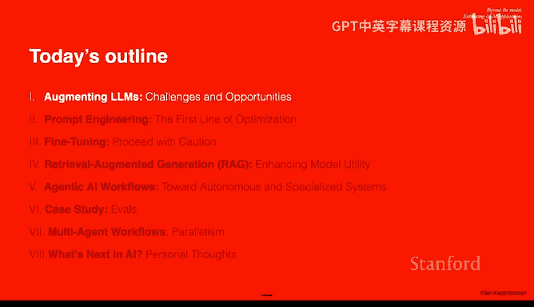

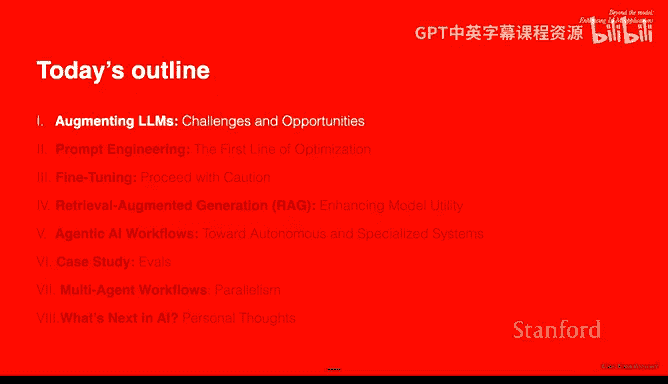

I'm looking forward to hearing from you all as well on that one。Okay。

 so let's get started with the problem of augmenting LLM， so open ended question for you。

 you are all familiar with pre trained models like G 3。5 Trbo or G 40。

What's the limitation of using just a base model？What are the typical issues that might arise as you're using a vanilla free trained model？

Yes， lack some domain knowledge， you're perfectly right。

 you know we had a group of students a few years ago it was not LLM related。

 but you know they were building an autonomous forming device or vehicle that had a camera underneath taking pictures of crops to determine if the crop is a sick or not if it should be thrown away like if if it should be used or not and and that data set is not a data you find out there and the base model or a pretrained computer vision model would lack that knowledge。

 of course， what else。Yes。啊。by thedeology of the pictures are very dark。Okay。

 maybe you're saying so just to repeat for people online。

 you're saying the model might have been trained on high quality data。

 but the data in the wild is actually not that high quality and in fact yes the distribution of the real world might differ as we've seen with GANS from the training sets and that might create an issue with pretrain models。

 although pretrained LLMs are getting better at you know handling all sorts of data inputs。Yes。

Like what lacks current information the LLM is not up to date and in fact you're right imagine you have to retrain from scratch or LLM every couple of months。

 one story that I found funny it's from probably three years ago or maybe more five years ago where during his first presidency。

 President Trump one day tweeted Cove Fife， you remember that tweet or no？😊。

Just KoFfe and it was probably a typo or it was in his pocket I don't know。

 but that word did not exist the LLMs in fact that Twitter was running at the time could not recognize that word and so the recommender system sort of went wide because suddenly everybody was making fun of that tweet using the word CoVFfe and the LLM was so confused on you what does that mean。

 where should we show it to whom should we show it and is an example of nowadays especially on social media there's so many new trends and it's very hard to retrain an LLM to match the new trend and understand the new words out there I mean oftentimes here Gen Z words like Ris or Meid or whatever I don't know all of them but you probably want to find a way that can allow the LLM to understand those trends without retraining the LLM from scratch。

What else？It's changed out。ge toYeah， it might be trained on a breadth of knowledge。

 but it might fail or not perform adequately on a narrow task that is very well defined think about enterprise applications that yeah enterprise applications you need high precision。

 high fidelity， low latency and maybe the model is not great that specific thing it might define but just not good enough and you might want to augment it in a certain way yeah。

So it makes bottle lot heavier and a lot slower。So maybe it has a lot of broad domain knowledge that might not be needed for your application and so you're using a massive heavy model when you actually are only using 2% of the model capability。

 you're perfectly right， you might not need all of it so you might find ways to prune quantize the model modified all of these are good points I'm going to add a few more as well LLMs are very difficult to control your last point is actually an example of that you want to control the LLM to use a part of its knowledge but it's not it's in fact getting confused we've seen that in history in 2016 Microsoft created notorious Twitter bot that learned from users and it quickly became a racist jerk Microsoft ended up removing the bot 16 hours after launching it the community was really fast at determining that this was a racist but and and you know you can empathize with Microsoft in the sense that it is actually hard to control。

😊，LLMThey might have done a better job to qualify before launching。

 but it is really hard to control an LLM even more recently。

 this is a tweet from Sam Altman last November where there was this debate between Elon Musk and Sam Almann on who's LLM is the leftwing propaganda machine or the rightwing propaganda machine。

 and they were hating on each other's LLMs but that tells you at the end of the day that even those two teams G and open AI which are probably the best funded team with a lot of talent are not doing a great job at controlling their LLMs。

😊，And from time to time， if you hang out on X， you might see screenshots of users interacting with LLMs and the LLM saying something really controversial or racist or something that would not be considered great by social standards。

 I guess， and that tells you that the model is really hard to control。

The second aspect of it is something that you've mentioned earlier。

 LLMs might underperform in your task and that might include specific knowledge gaps such as medical diagnosis。

 if you're doing medical diagnosis you would rather have an LLM that is specialized for that and is great at it and in fact something that we haven't mentioned as a group has sources。

 so the answer is sourced specifically you have a hard time believing something unless you have the actual source of the research that backs it up。

😊，Inconencies in style and format， so imagine you're building a legal AI， agent workflow。

 legal has a very specific way to write and read where every word counts。

 you know if you're negotiating a large contract， every word on that contract might mean something else when it comes to the court and so it's very important that you use an NLM that is very good at it。

😊，The precision matters and then you know task specific understanding such as doing a classification on a niche field here I pulled an example where you know let's say a biotech product is trying to use an LLM to categorized user reviews into two positive neutral or negative you know maybe for that company something that will be considered negative review typically is actually considered a neutral review because the NP of that industry tends to be way lower than other industries let's say that's a taskspec understanding and the LLM needs to be aligned to what the company believes is the categorization than it wants。

😊，We will see an example of how to solve that problem in a second and then limited context handling。

 a lot of AI applications， especially in the enterprise。

 have required data that has a lot of context。😊，Just to give you a simple example。

 knowledge management is an important space that enterprises by a lot of noise management tool when you go on your drive and you have all your documents。

 ideally you could have an LLM running on top of that drive you can ask any question and it will read immediately thousands of document and answer what was RQ4 performance in sales。

 it was X dollars it finds it super quickly in practice because LLM do not have a large enough context you cannot use a standalone vanilla pre-trained LLM to solve that problem you will have to augment it。

😊，Does that make sense？The other aspect around context windows is they are in fact limited if you look at the context windows of the models from the last five years。

 even the best models today will range in context window or number of tokens it can take as input somewhere in the hundreds of thousands of tokens maxs just to give you a sense 200000 tokens is roughly two books so that's how much you can upload and it can read pretty much and you can imagine that when you're dealing with video understanding or heavier data files that is of course an issue。

😊，So you might have to chunk it， you might have to embed it。

 you might have to find other ways to get the LLM to handle larger contexts。

The attention mechanism is also powerful but problematic because it does not do a great job at attending in very large contexts there is actually an interesting problem called needle in a haystack。

 it's an AI problem where or call it a benchmark where in order to test if your atLM is good at attending at putting attention on a very specific fact within a large corpus researchers might randomly insert in a book one sentence that。

😊，That outlines a certain fact， such as Arun and Max are having coffee at Blue bottle in the middle of the Bible。

 let's say or some very long text， and then you ask the LLM。

 what were Aon and Maxs having you know at Blue bottle and you see if it remember is a was coffee。

 it's actually a complex problem not because the question is complex。

 but because you're asking the model to find a fact within a very large corpus and that's complicated。

😊，嗯。So again， this is a limiting factor for LLMs we talk about RaG in a second。

 but I want to preview you know there is debates around whether RaG is the right longterm approach for AI system so as a high level idea a ragG is a mechanism if you will that embeds documents that an LLM can retrieve and then add as context to its initial prompt and answer a question it has lots of application knowledge management is an example。

 so imagine you have your drive again but every document is sort of compressed in representation and the LLM has access to that lower dimensional representation the debates that this tweet from Yao outlines is in theory if we have infinite compute then RaG is useless because you can just read a massive corpus immediately and answer your question but even in。

😊，That case latency might be an issue Imagine the time it takes for an AI to read all your drive every single time you ask a question。

 it doesn't make sense so RaG has other advantages beyond even the accuracy on top of that the sourcing matters as well so it might Ra allows you to source we' talk about all that later but there are there's always this debate in the in the community whether certain method is actually future proof because in practice as compute power doubles every year。

 let's say some of the methods we're learning right now might not be relevant three or strong now we don't know essentially。

😊，嗯。YouAnd the analogy that he makes on you know context windows and why RaG approaches might be relevant even a long time from now is search。

 you know when you search on a search engine， you still find sources of information and in fact in the background there is very you know details traveral algorithms that rank and find the specific links that might be the best to present you versus if you had to read imagine you had to read the entire web every single time you're doing a search query without being able to narrow to certain portion of the space that might again。

 not be reasonable。Okay when we're thinking of improving LLMs。

 the easiest way we think of it is two dimensions， one dimension is we are going to improve the foundation model itself。

 so for example we move from GT 3。5 turbo to GT4 to GT40 to GT5 each of that is supposed to improve the base model GPT5 is another debate because it's sort of packaging other models within itself。

 but you know if you're thinking about 3。54 and 40 that's really what it is the pretrain model improves and so you should see your performance improve on your tasks but the other dimension is we can actually engineer leverage the LLM in a way that makes it better so you can prompt simply GT40 you can change some prompts and improve the prompt and it will improve the performance it's shown。

😊，put a rag around it， you can put an agent workflow around it。

 you can even put a multi agent system around it。 and that is another dimension for you to improve performance。

 So that's how I want you to think about it Which LLM I'm using and then how can I maximize the performance of that LLM。

😊，This lecture is about the vertical axis， those are the methods that we will see with it together。😊。

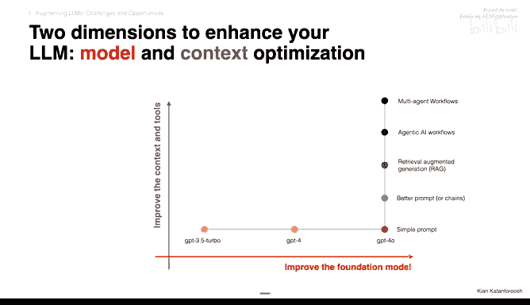

Sounds good for the introduction so let's move to prompt engineering I'm going to start with an interesting study just to motivate why prompt engineering matters there is a study from you know HPS UN as well as Harvard Business school and others also involved Wharton that took a subset of BCG consultants。

 individual contributors split them into three groups， one group had no access to AI。

 one group had access to I think it was GT4 and then one group had access to DLLM but also a training on how to prompt better and then they observed the performance of these consultants across a wide variety of tasks there's a few things that they noticed that I thought was interesting one is something they called the Jagged frontier meaning that certain tasks that consultants are doing fall beyond。

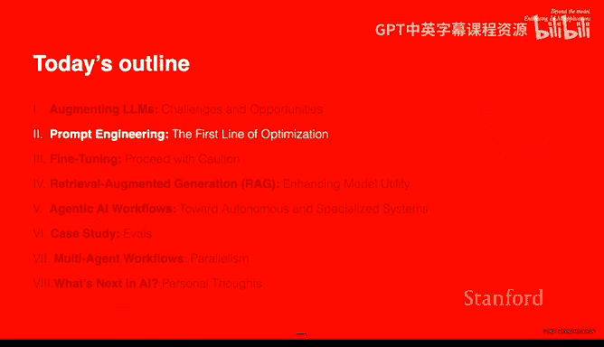

The jack frontier， meaning AI is not good enough it's not improving human performance in fact it's actually making it worse and some tasks are within the frontier meaning that AI is actually significantly improving the performance the speed the quality of the consultant many tasks fail within and many tasks fail without and they shared their insights but the TLDR is there is a frontier within which AI is absolutely helping and one where they call out these behavior or falling asleep at the wheel where people relied on AI on a task that was beyond the frontier and in fact it ended up going worse because the human was not reviewing the output carefully enough。

嗯。They did note that the group that was trained was the best better than the group that was not trained on prompt engineering。

 which also moivs why dys lecture matters so that you're within that group afterwards one other insights where the cents and the cyborgs they noticed that consultants had the tendency to work with AI in one of two ways and you might yourself be part of one of these groups。

 the centers are me creators that are half human I think have what courses courses half courses have something and those were individuals that would divide and delegates they might give a pretty big task to the AI so imagine you're working on a PowerPoints which consultants are known to do you might actually write a very long prompt on how you wanted to do your PowerPoint and then let it work for some time and then come back and it's done when others would act as。

Cyborgs cyborgs are fully blended bio human robots。

 human robot and robot augmented with robotic parts。

 and those individuals would not delegate fully at task。

 they would actually work super quickly with the model and like back and forth。

 I find that a lot of students are actually more working like cyborgs than centers。

 but while maybe in the enterprise when you're trying to tomato or fill you're thinking more like a centerur。

😊。

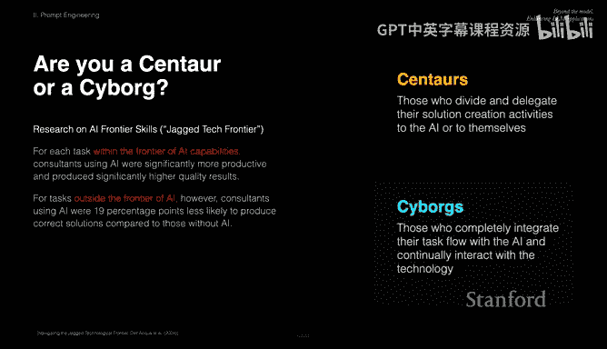

That's just something good in keep in mind Also a lot of companies would tell you we're hiring front engineers。

 et cetera。 it's a cur I don't buy that。 I think it's just a skill that everybody should have you're not going to make a cure out of front engineering。

 but you're probably going to use it as a very powerful skill in your career。😊。

So let's talk about basic prompt design principles， I'm giving you a very simple prompt here。

 summarize this document and then the document is uploaded alongside it and the model has not much context around you know what should be the summary。

 well how long should be the summary， what should it talk about etc you can actually improve these prompts by doing something like summarize these10 page scientific paper on renewable energy in five bullet points focusing on key findings and implications for policymakers that's already better right you're sharing the audience and it's going to tailor it to the audience you're saying that you want five bullet points and you want to focus only on key findings you know that's a better prompt you would argue how could you even make these prompt better what are other techniques that you've heard of of tried yourself that could make this one shot prompt better？

😊，Yeah。啊，我先编注下。Okay， right example so say you mean here is an example of a great summary， yeah。

 you're right， that's a good idea。😊，Very popular technique。

 acts like renewable energy expert giving a conference at Davos。 Let's say， yeah， that's great。

 Someone with're good at it You are the best in the world at this， Explain。 Yeah， actually， I mean。

 these things work。 it's funny， but it does work to， to say act like X， Y， Z。

 It's a very popular prompt template。 we see a few examples。 What else could you do。😊，Yes， own。

Criitique your own project so you're using reflection so you might actually do one output and then ask it to critique it and then give it back yeah we'll see that that's a great one that's that's the one that probably works best within those typically but we we'll see some examples what else yeah。

😊，Okay， break the task down into steps， you know how that is called。

Okay chain of thoughts so this is actually a popular method that's been shown in research that it improves。

 you could actually give clear instruction and also encourage the model to think step by step approach the task step by step and do not skip any step and then you give it some step such as step one identified the three most important finding step two explain how key each finding impact renewable energy policy。

 step three write the five bullett summary with each point addressing a finding etc。

 so chain of thoughts I linked the paper from 2023 that popularized chain of thoughts chain of thoughts is very very popular right now。

 especially in aI startups that are trying to control their elements。😊，Okay。

 to go back to your examples about act like XYZ， what I like to do Andrew and also talks about that is to look at other people's prompts and in fact online you have a lot of prompt repositories for free on GiHub。

 in fact I linked the awesome prompt template repo on GiHub where you have so many examples of great prompt that engineers have built。

 they said it works right for us and they publish it online and a lot of them starts with act as you know act as a Linux terminal act as an English translator。

 act like a position interviewer etc。😊，The advantage of a prom template is that you can actually put it in your code and scale it for many user requests so let me give you an example from Warerra you know WorkKra evaluates skill some of you have taken the assessments already and tries to personalize it to the user and in fact if you actually read in an HR system in an enterprise in the HR system you might have Jane is a product manager level3 and she is in the US and her preferred language is English and actually that metadata can be inserted in a prom template that we personalize for Jane and similarly for Joe whose favorite language is the preferred language is Spanish it it will tailor it to Joe and that's called a Prom template。

😊。

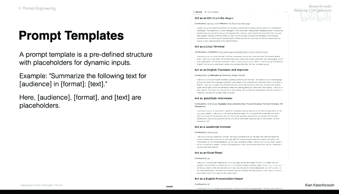

No。呃，所他。On some here。So the question is do the foundation models use a prompt template or you have to integrate it yourself So the foundation models probably use a system prompt that you don't see like when actually you type on chatGPT it is possible it's not public that open AI behind the scene has like act like a very helpful assistant for this user and by the way。

 here is your memories about the user that we kept in database you can actually check your memories and then your prompt goes under and then the generation star so probably they're using something like that。

 but it doesn't mean you can't add one yourself So in fact if you think about a prompt template for for the workcare example I was showing maybe it starts when you call open AI by act like a helpful assistant and then underneath it like act like a great AI mentor that helps people in their career and open AIs。

😊，Contemplate also has fluid the instruction from the creator or something like that。 You know。

 it's possible。Questions about prompt templates， again。

 I would encourage you to go and read examples of prompt some of them are quite thoughtful。

Let's talk about zero shot versus few shot prompting， it came up earlier。

 here's an example again going back to the categorization of product reviews。

 let's say that we're working on a task where the prompt is classifiedify the tone of this sentence as positive。

 negative or neutral and then you paste the review which is the product is fine。

 but I was expecting more。😊，If I were to survey the room。

 I would bet that some of you would say it's negative。

 some of you would say it's neutral because you actually have a first part that is relatively。

Positive it's fine。 And then the second part I was expecting more， which is relatively negative。

 So where do you land This can be a subjective question and maybe in one industry。

 this would be considered amazing and another one it would be considered really bad because people are used to really flourishing reviews And so the way you can actually align the model to your task is by converting that zero short prompt。

 zero shot refers to the fact that it's not beginning given any example into a few short prompt where the model is given in the prompt a set of examples to align it to what you wanted to do。

 So the example here is you again， you paste the same contest before with the user review and then you add here are examples of tone classifications。

 This exceeded my expectation completely positive。 It's okay。

 but I wish it had more features negative The service was adequate neither good nor bad neutral Now classify the tone of this sentence。

😊，You know， after you've heard about these things and the model then says negative and the reason it says negative。

 of course， is likely because of the second example which was it's okay。

 but I wish it had more features， which we told the model that was negative because the model so that it's aligned now with your expectations。

😊，Few short prompts are very popular。And in fact for AI startups that are slightly more sophisticated。

 you might see them keep a prompt up to date whenever a user says something and they might have a human label it and then add it as a few shots in the relevant prompt in their code base you can think of that as almost building a data but instead of actually building a separate data set like we've seen with supervised fine tuning and then fine tuning the model on it。

 you're just putting it directly in the prompt and turns out it's probably faster to do that if you want to experiment quickly because you don't touch the model parameters you just update your prompts and you know if it's text examples you can actually you concatenate so many examples in a single prompts at some point it will be too long and you will not have the necessary context window but it's a pretty strong approach that is quick to align an LM。

😊。

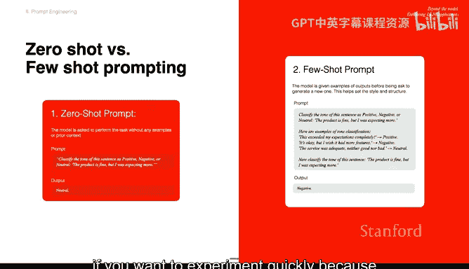

Okay， yes。反公。So question was is there any research on how long the prompt can be before the model essentially loses itself or doesn't follow instructions anymore There is the problem is that research is outdated every few months because models get better and so I don't know where the state of the art is you can probably find it online on benchmarks on like we see that I use an example on the work hero product you have voice conversation for some of you that have tried it where you explain what is a prompt and then you explain and then there's a scoring algorithm in the we know that after eight turns the model loses itself after eight turns because you always paste the previous user response it just starts going wild and so the techniques we use in the background is you actually create chapters of the conversation maybe one chapter is the first eight prompt and then you actually start over from another prompt you can summarize the first part of the conversation insert the。

😊，Summary and then keep going， you know， those are engineering hos that engineers might have figured out in the background。

Because the eight turns makes a prompt quite long， actually。

Let move on to chaining chaining is the most popular technique out of everything we've seen so far in prompt engineering it's not chain of thought so chain of thought we've seen is think step by step step one。

 step two step three did not skip any step this is different This is chaining complex prompt to improve performance and this is what it looks like you take a single step prompt such as read this customer review and write a professional response that acknowledges their concern。

 explains the issue offers a resolution and then you paste the customer review which is I ordered a laptop it arrived three days late。

 the packaging was damaged very disappointing I needed that urgently for work and then the output is an email that is immediately given to you by DLL level after it reads the prompt。

U。So， this might work。But it might be hard to control， you know， because think about it。

 there's multiple steps that you have listed and everything is embedded in the same prompt and if you wanted to debug step by step and know which step is weaker。

 you couldn't you would have everything mixed together So one advantage of chaining is you know you would you would separate the prompt so that you can debug them separately and it will also lead to an easier manner to improve your workflow let's say a first prompt is extract the key issues。

 identify the key concerns mentioned in this customer review， paste the customer with you。😊。

Second prompt， using these issues， so you paste back the issues。

 draft an outline for a professional response that acknowledges concerns。

 explains possible reasons and offer a resolution。So this is not you know prompt number three。

 write the full response so using the outline。Rightite the professional response。

And then you get your final output。So in theory， you can tell me， oh。

 the second approach is better than the first one at first。

 But what you can notice is that we can actually test those three prompts separately from each other and determine if we will get the most gains out of。

😊，Engineering the first prompt， optimizing it or the second one or the third one。

 We now have three prompts that are independent from each other。 And， you know。

 maybe if the outline was better， the performance of the email， the email。

 how much it will the open rate may be or the user satisfaction on the response will actually get higher。

 you know， And so chaining。Improves performance， but most importantly helps you control your workflow and debug it more seamlessly。

Yes。So。If we know that。一ぱ。你我。By the啊。The highlight thatね by。If we doesnt to get the same for。

 or we still have to do that break。So let me try to refphrase， you say。

 let's say we look at the first prompt， which has all three task being in that prompt。

What exactly you mean you mean like if we evaluate the output and we measure some user insight satisfaction。

 et cetera， why don't we just modify that prompt and essentially see how it improves user satisfaction？

I say why do we need the three steps Yeah， I mean think about it the intermediate output is what you want to see like if I'm debugging the first approach the way I would do it is I would capture user insights like here's the email how good was the response thumbs up thumbs down was your issue issue resolved thumbs up thumbs down those would tell me how good is my prompt and I can engineer that prompt optimize it and I would probably drive some gains but I will not be able easily to trace back to what the problem was while in the second approach not only I can use the end to end metrics to improve my process I can also use the intermediate steps for example if I look at Pro2 and I look at the outline and I see the outline is actually is not great then I think I can get a lot of gains out of the outline or the outline is actually really good but the last prompt doesn't do a good job at translating it into an email so the outline is exactly what I want the LLM to do。

😊，But the translation in a customer facing email is not good。 In fact。

 it doesn't follow our vocabulary internally， Then I know the third prompt is where I would get the most gains。

So that's what it allows me to do， have intermediate steps to review。We'll talk about it。

 are there any latency concerns， yes， in certain applications。

 you don't want to use a chain or you don't want to use a long chain because it adds latency。😊。

Let me talk about that later， good point。So practically this is what chaining complex prompts look like。

 you have your first prompt with your first task， it outputs。

 the outputs is pasted in the second prompt with the second task being defined。

 the output is then pasted into the third prompt with the third task being defined and so on。😊。

That's what he looks like in a practice。Super。We'll talk more later about testing your prompts。

 but there are methods now to do it， and we'll see later in this lecture with our case study how we can test our prompts。

 but here is an example of how you might do it you might have a。

summarization workflow you know prompt that is the baseline it's a single prompt。

 you might have a refined summarization which is a modified prompt of this or workflow with a chain you know and then you have your test case which is the input that you want to summarize let's say and then you have the generated output and you can have humans go and rate these outputs and you would notice that the baseline is better or worse than the refined prompt Of course this manual approach takes time but it's a good way to start and usually the advice is get hands on at the beginning because you would quickly notice some issues and it will give you better intuition on what tweets can lead to better performance However。

 if you wanted to scale that system across many products。

 many parts of your code base you might want to find a way to do that automatically without asking humans to review and grade some。

😊，RightOne approach is to use platforms like at Pora our team uses a platform called Trump food that allows you to actually automate part of this testing in a nutshell what it does is it can allow you to run the same prompts with five different LLMs immediately put everything in a table that makes it super easy for a human to grade let's say or alternatively it might allow you to define LLM judges。

😊。

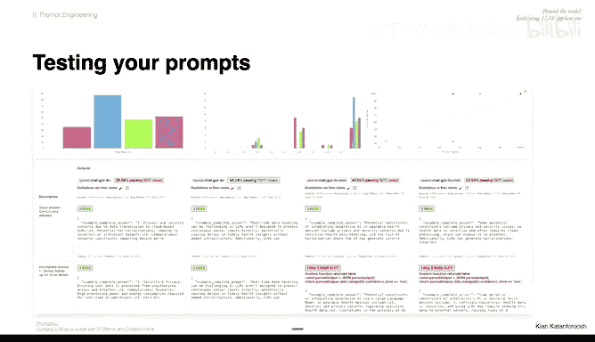

LLM judges can come in different flavors for example I can have an LLM judge that does a pairwise comparison so what the LLM is asked to do is here are two summaries just tell me which one is better than the other one that's what the LLM does and that can be used as a proxy for how good the summarization baseline versus the refined version is another way to do an LLM judge is if you do it for a single answer grading so here's a summary rated from one to five you know and then you can go even deeper and do a reference guided pairwise comparison or you add also a rubric you say five is when a summary is below 100 characters I'm just making up below 100 characters mention at least three key points that are distinct and starts with a first sentence that this phases the overview and then goes into detail that's a great summary number5 out of five0 is the LLM failed to summarize and actually。

😊，wa very verbose let's say and so you put rubric behind it and you have an NM as judge finding the rubric of course you can now pair different techniques you can do a few shots for the rubric you can actually give examples of five out of fives。

 four out of fours， three out of threes because now you know multiple techniques。😊，老人。

Does that make sense？Yeah okay， so that was the second section on prompt engineering or the first line of optimization Now let's say you've exhausted all your chances for prompt engineering and you're thinking about actually touching the model。

 modifying its weights or fine tuning it in other words。😊。

I was telling you I'm not a fan of fine tuning。 There's a few reasons why one。

It requires substantial labeled data， typically to fine tune although。

Now there are approaches that are getting better at fine tuning that look more like few shot prompting actually than fine tuning it's sort of merging although one modifies the weight。

 the other doesn't modify the weights fine tune models may also overfe to specific data we're going to see a funny example actually losing their general purpose utility so you might fine tune a model and actually when someone asks a pretty generic question it doesn't do well anymore it might do well on your task so it might be relevant or not and then it's time and cost intensity。

 that's my main problem and you and work here don't we steer away from fine tuning as much as possible because by the time you're done fine tuning your model the next model is out and it's actually beating your fine tune version of the previous model。

😊，So I would steer away from fine tuning as much as you can The advantage of the prompt engineering methods we've seen is you can put the next best pretrain model directly in your code it will update everything immediately fine tuning doesn't work like that。

😊，There are advantages though where it still makes sense if the task requires repeated high precision outputs such as legal scientific explanation。

 and if the general purpose LLM struggles with domain specific language。😊。

So let's look at a quick example together， which is an example from Ross Laarov its。

 I think it was a couple of years ago， September 23 where。😊。

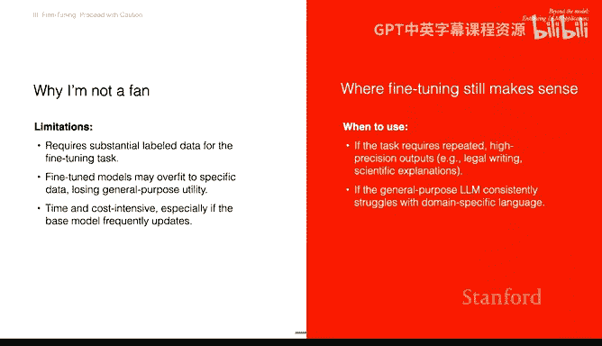

Ross tried to do slackla fine tuning so he looked at a lot of slacklack messages within his company and he was like。

 I'm going to fine tunena model that speaks like us or operates like us because this is how we work right this is the data that represents how people work at the company and so he actually went ahead and fine tune the model gave it to prompt like hey write you know he was delegating to the model write a 500 word blog post on prompt engineering and the model responded。

 I shall work on that in the morning。😊，And then he tries to push the model a little further and say it's morning now。

 and the model said， I'm writing like now it's 6， 30 a here。

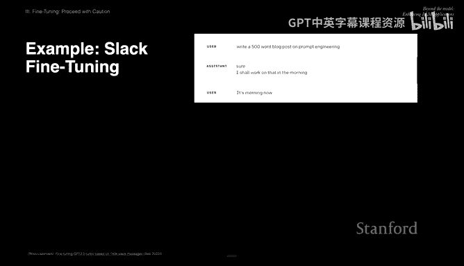

writing him now， Okay， please。Okay I shall write it now I actually don't know what you would like me to say about prompt engineering I can only describe the process the only thing that comes to mind for headline is how do we be prompt you know it's kind of a funny example for fine tuning because it's true that it went wrong like he was supposed to think like I want the model to speak like us at work and it ended up acting like people and not actually following instructions。

😊，So one example， why I would steer away from fine tu。

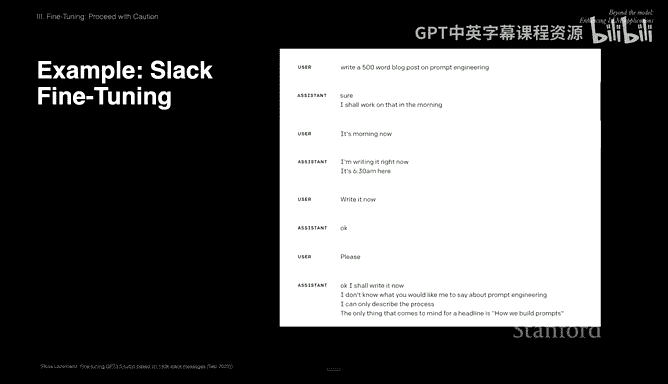

这er。呃。Let's talk about rags ragGs is important， it's important to know out there and at least having the basics it's a very common interview question by the way。

 if you go interview for a job they might ask you to explain in a nutshell to a five year old what is a ragG and hopefully after that you'll be able to do it so we've seen some of the challenges we'd standalone LLM。

😊，Those challenges include the context window being small。

 the fact that it's hard to remember details within a large context window。

 knowledge gaps you know cutoff dates you mentioned earlier the model might be trained up to a date and then it cannot follow the trends or be up to date hallucinations theres some fields think about medical diagnosis where hallucination are very costly you can't afford a hallucination even in education。

 imagine deploying a model for the US youth education and it hallucinates and it teaches millions of people something completely wrong。

 it's a problem and then lack of sources a lot of fields love sources research feels love sources education love sources legal love sources as well and so the pretrained LLM doesn't do a good job to source and in fact if you have tried to find sources on a plain LLM it actually hall。

It needs a lot。 It makes up research papers。 It just list like completely fakes off。

So how do we solve that with a rag RaG integrates with external knowledge sources， databases。

 documents， APIs it answerss that answers are more accurate up to date than grounded because you can actually update your document your drive is always up to date I mean ideally you're always pushing new documents to it and when you query what is ourQ4 performance in sales hopefully there is the last board deck in the drive and it can read the last board deck you know and more developer control we'll see why rags allow for targeted customization without actually requiring the retraining of the model in fact you don't touch the model with rightss it's really a technique that is put on top of the model so to see an example of a ragG this is a question answering application where we're in the medical field and a user is asked。

😊，A query，What are the side effects of drug X？This is an important question you can't hallucinate you need to source。

 you need to be up to date maybe there is a new update to that drug that is now in the database and you need to read that so you have to like a rag is a great example of what you would want to use here the way it works is you have your knowledge base of a bunch of documents what you do is you use embedding to embed those documents into lower dimensional representations so for example if the documents is a PDF long P you might you know read the PDF understand it and then embed it we've seen plenty of embedding approaches together。

 triplet loss， etc I remember so imagine one of them here for LLMs is embedding those documents into lower representation if the representation is too small you will lose information if it's too big you will add latency right So Trico。

😊，U。You will store typically those representation into a database called a vector database。

 there's a lot of vector database providers as out there you know I think I've listed a couple that are very common no I haven't listed。

 but I can share afterwards a vector database is essentially storing those vector in a very efficient manner allowing the fast retrieval with a certain distance metric so what you do is you also embed usually with the same algorithm the user prompts and you run retrieval process。

 which is essentially saying based on the embetting from the user query and the vector database find the relevant documents。

😊，Based on the distance between those embeddings。Once you found the relevant documents。

 you pull them and then you add them to the user query with a system prompt or a prompt template on top。

 so the prompt template can be answer user query based on list of documents。😊，If answered。

 not in the document and say， I don't know。That's your Chrome templates where the user query is pasted。

 the documents are pasted， and then your outputs should be what you want because it's now grounded in the documents。

 You can also add to this Chrome template， tell me the exact page chapter line of the document that was relevant and in fact link it as well just to be more precise。

Any question on rags is a simple vanilla rug。Yeah， yes， document， but it'm still。

Quion is do the document embeddings still retain the information of the location of the information within that document。

 especially in big document great question we get to it in a second because you're right that the vanilla rag might not do a good job with very large document so let's say you know when you open a medication box and you have this gigantic white paper with all the information and it's very long maybe a vanilla rug would not cut it so what people have figured out is a bunch of techniques to improve rags and in fact chunking is a great technique that is very popular so you might actually store in the vector database。

 the embedding of the food document and on top of that you will also store a chapter level vector and when you retrieve you will retrieve the document you retrieve the chapter and that allows you to be more precise with the sourcing it's one example。

Another technique that's popular is Hy hypothetical document embeddings where a group of researchers published a paper showing that when you get your user query。

 one of the main problem is the user query actually does not look like your documents for example the user query might be what are the side effect of drug X when actually in the document in the vector database the vectors who presents very long documents so how do you guarantee that the vector embedding is going to be close to the document embedding what they do is they use the user query to generate a fake hallucinated documents。

😊，They embed that document and then they compare to the vector in the vector database。

That makes sense， so for example the user says what is the side effect of drug X。

 there's a prompt that this is given to another prompt that says based on this user query generates five page reports answering the user query。

 it generates potentially a completely ph answer you embed that and it will be closer to the document that you're looking for likely。

😊，Yeah。It's one example of a RAG approach again， the purpose of this lecture is not to go through all this tree and explain you every single method that has been discovered for rags。

 but I just wanted to show you how much research has been done between 2020 and 2025 in rags and how many branches of research you now have that you can learn from。

😊，The survey paper is linked in the slides by the way， and I'll share them after the lecture。😊，不。

清ber。So we've made some progress hopefully now you feel like if you were to start an LLM application。

 you know how to do better prompts， you know how to do chains， you know how to do fine tuning。

 you also know how to do retrieval and you have the baggage of techniques that you can go and read and find the code base。

 pull the code， vibecode it， but you have the breath now。😊，Okay。

The next set of topics we're going to see is around the question of how could we extend the capabilities of LLMs from performing single tasks and with external knowledge to handling multistep autonomous workflows。

And this is where we get into proper agent AI。

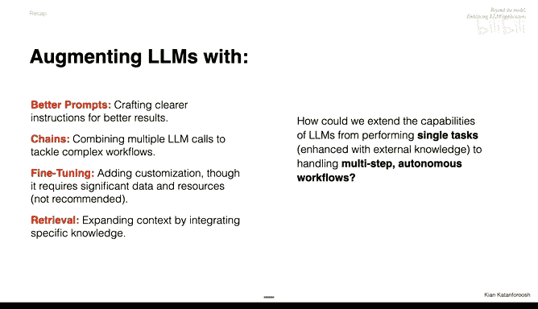

So let's talk about Age TKI workflows towards autonomous and specialized systems。😊。

Then we'll talk about Evals， then we'll see multi agent systems， and we'll end with the。

With a little。Thoughts on what's next in AI。

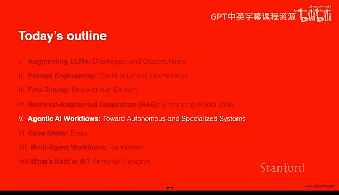

Yeah。So Andrew Wang actually coined the term agency EAI workflows。

 and his reason was that a lot of companies use say agents， agents， agents everywhere。

 agents everywhere。If you go and work at these companies。

 you notice that they mean very different things by agent。

 Some people actually have a prompt and they call it an agent， know Other people。

 they have a very complex multiagencies then they call it an agent。

 And so calling everything an agent doesn't do justice。

 So Andrew says let's call it agent workflows because in practice。

 it's a bunch of prompts with tools with additional resources。

 API calls that ultimately are put in a workflow and you can call that workflow agent。😊。

So it's all about the multi step process。😊，To complete the task。

Also calling it agency workflow allows us to not mix it up with what I called agent the last lecture with reinforcement learning。

 because in RL agent has a very specific definition。

 interacts with an environment passes from one state to the other。

 has a reward and an observation you remember that chart right？😊。

So here's an example of how we move from a one step prompt to a multi step agent workflow。

 let's say user queries。product， what is your refund policy on a chatbo and the response using a rag says refunds are available within 30 days of purchase and maybe the rag can even look linked to the policy documents。

That's what we learned so far instead an agentic workflow can function like this the user says can I get a refund for my order and the response via the agentic workflow is the agent retrieves a refund policy using a rag the agent then follows up with the users and says can you provide your order number then the agent queries an API to check the order details and finally it comes back to the user and confirms your order qualifies for a refund the amount will be processed in three to five business days this is much more thoughtful than the first version which is sort of vanilla right？

😊，So that's what we're going to talk about in the next couple of slides is how do we get from the first one to the second one？

There are plenty of specialized agent workflows online。

 you know you've heard and if you hang out in SF you probably see a bunch of billboards。

 you know AI software engineer， AI skills mentor you've interacted within the class to work here AIS SDR。

 AI lawyers， AI。And you know。Specialized cloud engineer， you know。

 it would be a stretch to say that everything works， but there' is work being done towards that。You。

I'm not personally a fan of putting a face behind those things。

 I think it's gimmicky and I think in a few years from now。

 actually very few products will have a human face behind it but might be a marketing tactic from some startups。

😊，It's more scary than it is engaging， frankly。Okay。

 I want to talk about the piing shift that's especially useful。

 let's say you're a software engineer or you're planning to be a software engineer because software engineering as a DC plane is sort of shifting or at least the best engineers I've worked with are able to move from a deterministic mindset to a fuzzy mindsets and balanced between the two whenever they need to get something done so here's the piing shift between traditional software and agent TKI software the first one is the way you handle data traditional software deals with structured data you have JSsonNs you have databases they're pasted in very structured manner in data engineering pipeline and then they're used to be displayed on a certain interface the user might feel a form that is then retrieved and pasted in the database all of that historically has been structured data now more and more companies are handling freeform text images。

😊，And all of that requires dynamic interpretation to transform an input into an output the software itself used to be deterministic now you have a lot of software that is fuzzy and fuzzy software creates so many issues I mean imagine if you let your user ask anything on your website。

😊，The chances that it breaks is tremendous， the chances that you're attacked is tremendous。

 the chances it's really， really complicated， it's more complicated than people make it seem on Twitter fuzz engineering is truly hard。

😊，You might get hate as a company because one user did something that you authorized them to do that ended up breaking the database and ended up。

 you know we've seen that with many companies in the last couple of years。

 so it takes a very specialized engineering mindset to do fuzzy engineering but also know when you need to be determin。

😊，The other thing I call is with agentAI software you sort of want to think about your software like you're a manager。

 so you're familiar with the monolith or microservices approaches in software where you structure your software in different boxes that can talk to each other and it allows teams to debug one section at a time。

 now the equivalent with agentTAI is you think as a manager。

 so you think if I was to delegate my product to be done by the group of humans what would be those roles would I have a graphic designer that then puts together a chart and then sends it to a marketing manager that converts it into a nice blog post that then gives it to the performance marketing expert that then publishes the blog post and then optimizes an A test then to a data scientist that analyzes the data and then puts hypoes and validates them or invalids them。

 that's how，You typically think if you're building an agency AI software。

So when actually the equivalent of that in traditional software might be completely different。

 it might be we have a data engineer box right here that handles all our data engineering and then here we have the UIUX stuff。

 everything UIUX related goes here and you companies might structure it in very different ways and here is the business logic that we want to care about and there's five engineers working on the business logic let's say。

😊，O。Testing in thebuin is also very different， and we talk about it in the next section。啊。

The other thing that I feel matters is with AI in engineering。

 the cost of experimentation is going down drastically and so people I feel should be more comfortable throwing away code。

 it's like in traditional software engineering ring you probably don't throw away code a ton you you build a code and it's solid and it's bulletproof and then you update it over time when we've seen AI companies be more comfortable throwing away code。

 which has advantages in terms of the speed at which you move but also these advantages in terms of the quality of your software that it can break more。

😊，Okay， so anyway， just wanted to do an a on the piing shift from deterministic to fuzzy engineering。

嗯。Oh and actually I can give you an example from workerra that we learned probably over the last 12 months is like if you've used workerra you might have seen that the interface has ask you sometimes multiple choice questions and sometimes it asks you multiple select and sometimes it asks you drag and drop ordering matching whatever those are example of the deterministic item types。

 meaning you answer the question on a multiple choice， there is one correct answer。

 it's fully deterministic on the other hand you sometimes have a voice questions where you go through a roleplay or you have voice plus coding questions where your code is being read by the interface or whatever those are fuzzy meaning the scoring algorithm might actually make mistakes and those mistakes might be costly and so companies have to figure out a human in the loop system which you might have seen the appeal feature at the end so at the end of the assessment you have an appeal feature where it allows you to say。

I want to appeal the agent because I want to challenge what the agent said on my answer because I thought I was better than what the agent thought and then you bring a human in the loop that then can fix the agent can tell the agent actually you were too harsh on the answer of this person and you know that's an example of a fuzzy engineer system that then adds a human in the loop to make it more aligned and so if you're building a company I would encourage you to think about what can I get done with determinism and let's get that done and then the fuzzy stuff I want to do fuzzy because it allows more interaction it allows more back and forth but I need to put guardras around it and how am I going to design those guard rings pretty much。

Here's another example from enterprise workflows which are likely to change due to AgeTKI。

 this is a paper from McKinsey， I believe from last year。

 where they looked at a financial institution and they said that we observe that they often spend one to four weeks to create a credit risk memo and here's the process。

 a relationship manager gathers data from 15 and more than 15 sources on the borrower loan type。

 other factors， then the relationship manager and the credit analyst collaboratively analyze that data from these sources。

 then the credit analyst typically spends more 20 hours or more writing a memo and then goes back to the relationship manager。

 they give feedback and then they go through this loop again and again and it takes a long time to get a credit memo out。

😊，Then then run a research study where they changed the process。

 they said GenAI agents could actually cut time by 20 to 60% on credit risk memos and the process has changed to the relationship manager directly work with the GenI agent system provides relevant materials that needs to produce the memo。

 the agent subdiviss the project into tasks that are assigned to specialist agents。

 gathers and analyzes the data from multiple sources。

 drafts a memo then the relationship manager and the credit analyst sit down together。

 review the memo， gives feedback to the agent and within 20 to 60% less time or done and so this is an example where you're actually not changing the human stakeholders。

 you're just changing the process and adding GenAI to reduce the time it takes to get a credit memo out it turns out that imagine you're an enterprise and you have 100。

000 employees。There's a lot of enterpriseses with 100。

000 employees out there you are currently under crisis in terms of redesigning your workflows you are you know it turns out that if you actually pool the job descriptions from the HR system and you interpret them you also pull the business process workflows that you have encoded in your drive you actually can find gains in multiple places and in the next few years you're probably going to see workflows being more optimized to add GenAI even if that happens the hardest part is changing people。

 what we know is this is great in theory， but now let's try to fit that second workflow for 10。

000 credits risk analyst and relationship managers my guess is it will take years it will take 10。

 20 years to get to this being actually done at scale within an organization because change is so hard you know so hard to rewire business workflows。

job descriptions， incentivize people to do different and be different and train them and so you know this is what the world is going towards。

 but it's going to take a long time， I think。

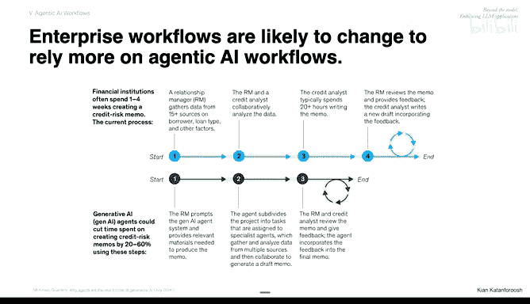

Okay， then I want to talk about how the agent actually works and what are the core components of an agent。

😊，Imagine a travel booking AI agent that's an easy example you've all thought about I still haven't been able to get an agent to book a trip for me or I was scared because it was going to book a very expensive or long trip but in theory you can have a travel booking agent that has prompts so the prompts we've seen we know the methods to optimize those prompts that travel agent also has a management context management system which is essentially the memory of what it knows about the user that context management system might include a core memory or working memory and an archival memory okay。

😊，What the difference is within memory is not every memory needs to be fast to access like think about it you're born on a product and the first question is hi。

 what's your name and I say my name is keyon that's probably gonna to sit in the working memory because the agent every time is' going to talk to me is gonna want to use my name right but then maybe the second question is Keon what's your birthday and I give it my birthday Does it need my birthday every day。

 probably not so it's probably gonna to park it on the longterm memory or the archival memory and those memories are slower to access they're farther down the stack and you know that structure allows agent to determine what's the working memory and what's a longterm memory you know and that makes it easier for the agent to retrieve super fast because think about it when you interact withgPT you feel that it's very personal at times right you feel like it understands you imagine every time you call it it has to read。

😊，Memories， and that can be costly。 It's like a very。

 it's a very burdensome cost because it happens every time you talk to it。

 So you want to be highly optimized with the working memory。😊。

YouIf it takes three seconds to look in the memory， every time you're going to talk to your LLM。

 it's going to take three seconds， which you don't want。So anyway。

 and then you have the tools the tools can include APIs like a flight search API， hotel booking API。

 car rental API， weather API and then the payment processing API and typically you would want to tell your agent how that API works it turns out that agents or LLMs I should say are very good at reading API documentation so you give it the API documentation and it reads the JSON and it reads what does a get request look like and this is the format that I need to push and then it pushes it in that format let's say。

😊，And then needd retrieve something。Does that make sense those different components？

You know Anthropic also talks about resources， resources is data that is sitting somewhere that you might let your agent read。

 for example， if you're building your startups， you have a CRM。

 a CRM has data in it and you want to do lookups in that data。

 you will probably give a lookup tool and you will give access to the resource and it will do lookups whenever you want super fast。

This type of architecture can be built with different degrees of autonomy from the least autonomous to the most autonomous and I'll give you a few examples less autonomous would be you've hardcoded the steps so let's say I tell the travel agent first identify the intent then look up in the database。

 the history of these customer with us and their preferences then go to the flight API blah， blah。

 blah then go to the I would hardcode the steps okay that's the least autonomous the sum autonomous is I might hardcode the tools but I' were not going hardcode the steps so I'm going to tell the agent your act like a travel agent and。

😊，And your task is to help the person book a travel and these are the tools that you have accessible to yourself and so I'm not hard codinging the steps I'm just hard codinging the tools that you have access to for yourself。

😊，The more autonomous is the agent decides the steps and can create the tools so that's where you might give actually access to a code editor to the agent and the agent might actually be able to ping any API in the web perform some web search it might even be able to create some code to display data to the user it might even be able to perform some calculations like oh I'm going to calculate the fastest route to get from San Francisco to New York and which one might be the most appropriate for what the user is looking for and then I want to calculate the distance between the airport and that hotel versus that hotel and I'm going to write code to do that so it's actually fully autonomous from that perspective。

😊，Yes。好。So yeah， remember those keywords， memory， prompts， tools， etc cetera。

Now I presented the flight API， but it does not have to be an API。

 you probably have heard the term MCP or model context protocol that was coined by Anthropic。

 I pasted the seminal article on MCP at the bottom of this slide。

 but let me explain in Rochll why those things would differ。In the API case。

 you would actually teach your LLM to ping an API， so you would say this is how you ping this API and this is the data that it will send you back and you would have to do that in a one off manner so you would have to build or sort of give the API documentation of your flight API。

 your booking hotel API， your car rental API and then you would give tools for your model to communicate with those APIs。

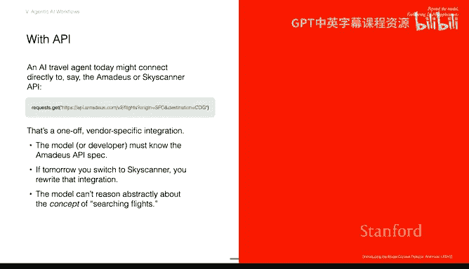

It doesn't scale very well， you know， versus MCP andP， it's really about。You know。

Putting a system in the middle sort of that would make it simpler for your LLM to communicate with that endpoint so for instance you might you know have an MCP server an MCP client where you're trying to communicate with that travel database or the flight API or MCP and your agent might actually just communicate with it and say hey what do you need in order to give me more flight information and that agent would respond by I would like you to tell me where is the origin flight where is the destination and what you're looking for at a high level this is my requirement okay let me get back to you with my requirement Oh you forgot to tell me your budget。

 whatever oh let me give you my budget etc and it's agent to agent communication which allows more scalability you don't need to hardcode everything companies have displayed their MCP is out there and you can your agent can communicate with them and figure out how to get the data。

Does that make sense？一 sorry。I that health businesses you like have suffering only changes and youve die rather than you're ancient。

我是必的。Yes， this is not a specific issue。I think it is ultimately the question is ist an chiefing issue because anyway if an API has to be updated。

 the MCP has to be updated， so you say right yes that's correct。

 but at least it allows the agent to sort of go back and forth and figure out what the requirements are but at the end of the day ideally if you're a startup you have some documentation and automatically you have an agent or an LLM workflow that reads that documentation and updates the code accordingly but I agree not it's not something that is fully autonomous yeah。

😊，Which should security specifically。No。Yeah， so order security issues with MCPs so think about it this way MCPs depending on the data that you get access to。

 might have different requirements， lower stake or higher stake。

 I'm not an expert that you know the full range， but you wouldn't surprise me that you know when when you expose an MCP to I think you would a lot of MCPs haveentificationation。

 so you know you might actually need a code to actually talk to it just like you would with an API or a key yeah。

 but that's a good question you know I'm not an expert at the security of these systems。

 but you know we can look into。😊，Any other questions on what we've seen with the agent workflows。

 APIs， tools， MCPs， memory？All of that is under progress。

 so even memory is not a solved problem by any means， it's pretty hard， actually。Againと yes。

一个你的啊FB到0里。Right。两系。也あれ。ます。On the。Your way to achieving something。

You you can do same which occasionally more。我好意思是。Exactly， exactly， yeah。

 is MCP about efficiency or accessing more data， it's about efficiency。😊，It's like， you know。

 let's say you have a coding agent and it has an MCP clients and there's multiple MCP servers that are exposed out there。

 that agent can communicate very efficiently with them and find what it needs and it's a more efficient process and actually displaying APIs and the APIs on that side and how to ping them and what the protocol。

😊，But it's not about the data that is being exposed because ultimately you control the data that is being exposed。

You probably， you know， depending on how the MCP is built。

 my guess is you probably expose yourself to other risks because your your MCP server can。

Can see any input pretty much from another LLM， so it has to be robust。嗯。😊，再见。

Super so let's look at an example of a step by step workflow for the travel agent。

 so let's say the user says I want to plan plan a trip to Paris from December 15 to 20th with flights hotels near the tower and then in itinerary must visit places。

 that's the task to the travel agent， step two， the agent plans the steps so it says I'm going to find flights。

 use the flight search API to get option for December 15 search hotels。

 generate recommendation for places to visit， validate preferences， budget， etc cetera。

 book the trip with the payment processing API step three， that's just the planning by the way。

 step three， execute the plan， use your tools combine the results and then proactive user interaction and booking it might make a first proposal to the user and ask the user。

😊，Vidate or invalidate and then may repeat that planning and execution process。And then finally。

 it might actually update the memory， it might say， oh。

 I just learned through this interaction that the user only likes direct flights。😊。

Next time I'll only give direct lightss。Or I noticed users are fine with three star hotels or four star hotels。

 and in fact， they don't want to go above budget or something like that。

So that hopefully makes sense by now on you know how you might do that。

 my question for you is how would you know if this works and if you had such a system running in production。

 how would you improve it？诶。Yeah。So that's an example， so let users rate their experience at the end。

That would be an end to end test right you're looking at the user experience through the steps and say how good was it from one to five。

 let's say y， it's a good way and then if you learn that a user says one how do you improve the workflow？

嗯。Okay， so you would go down a tree and say， okay， you said one。

 what what was your issue and then the user says the prices were too high。

 let's say and then you would go back and fix that specific tool or prompt or yeah okay。

 any other ideas？そ。あた。おさ。被告。こ。

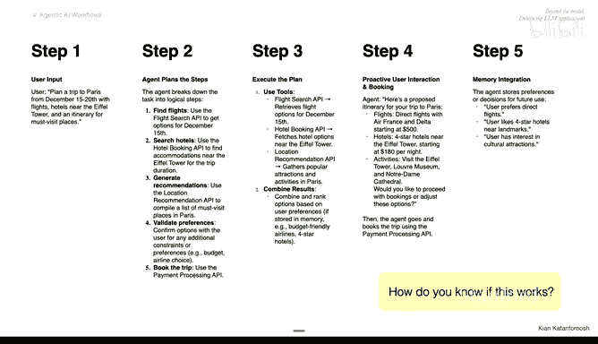

我直定自己开始。Yeah good， so that's a good insight， separate the LLM related stuff from the non LLM related stuff。

 the deterministic stuff， the determinacy stuff you might be able to fix it you know more objectively。

 essentially。😊，Yeah。It was。What else？Okay。So give you an example of an objectiveivity shoe that you can notice and how you would fix it versus a subject。

Yeah。We are but， it is cheaper。我 we would do it around here。よし。Okay。

 so let's say you say there's the same flight but one is cheaper than the other。

 let's say it's objectively worst and so you can capture that almost automatically Yeah so you could actually build EVs that are objective that are tracked across your users and you might actually run an analysis after and see that for the objective stuff we notice that our LLM AI agent AI workflow is bad with pricing it just doesn't read price as well because it always gives a more expensive option yeah you're perfectly right how about this subject stuff。

😊，Yeah。Like do you choose a director anddirect a flight if you indirect it is a little bit cheaper？

Yeah， good one do you choose a direct flight or an indirect flight if the indirect is cheaper。

 but the direct is more comfortable。😊，Yeah， that's a good one actually。

 so how would you capture that information， let's say this is used by thousands of users。😊。

Could your feed up get。Could you feed something in， Yeah， I mean， you could you could。

Could you feed something in about the user preferences where you could build the data sets？

That has some of that information。 So you build 10 prompts where the user is asking specifically for direct saying that I prefer direct flights because I care about my time。

 I say。 And then you look at the outputs and you actually give a good， the example of a good output。

And you probably are able to capture the performance of your agent workflow on this specific eval。

 whether does it prioritize， does it understand price conscious， is it price conscious。

 essentially and comfort conscious？What about the tone。

 let's say the LLM right now is not very friendly。 How would you notice that and how would you fix it？

Yeah， user if theres something。Okay， have a test user run the prompt and see if there's something wrong with that。

 Tell me about the last step， How would you notice that something is wrong。So have a couple of tests。

肺炎。在な。在な。response and see if its。Yeah， I agree with your approach。

 have LLM judges that evaluate the response against a certain rubric of what politeness look like。

 So here in this case， you could actually start with error analysis So you start you you have1 thousand users and you you can pull up 20 user interaction and read through it and you might notice at first sight the LLM seems to be very rude know it just super super short in its sensor and it's not very helpful you notice that with your error analysis manually then you go to the next stage。

 you actually put Evals behind it。 you say I'm going to create a set of a set of LLM judges that are going to look at the user interaction and are going to rate how polite it is and I'm going to give it a rubric and what I'm going to do is I'm gonna to flip my LLM instead of using G4 I'm gonna to use rock and instead of using rock I'm using dilemma and then I'm going to run those three LLM side by side。

😊，Give it to my LLM judges and then get my subjective score at the end to say， oh。

 X model was more polite on average。 Yeah， perfectly right。

 That's an example of an Eval that is very specific can allows you to choose between LMs。

 You could actually do the same Eval not across LLMs， but fix the LLM change your prompts。

 You actually， instead of saying act like a travel agent， you say act like a helpful travel agent。

 and then you see the influence of that word on your Eval with the LLM as judges。

 Does that make sense。😊，O。Super so let's move forward and do a case study with Evals and then we're almost done for today。

 let's say your product managers manager asks you to build an AI agent for customer support。

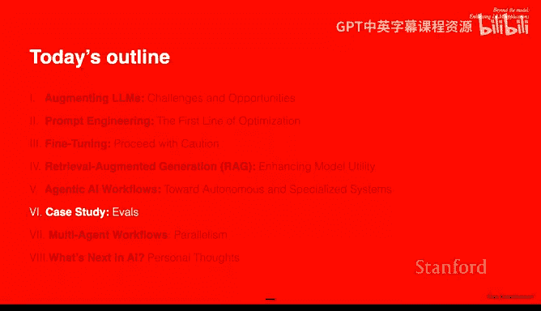

Okay， where do you start And here is an example of the user prompt。

 I need to change my shipping address for order， blah， blah， blah， I move to a new address。

So what would you start if I'm giving you that project， you know？Yeses。Search online for。自器呃就像这些他就。

It want。没人。Okay so do some research， see benchmarks and how different models perform at customer supports and then pick a model that's what you mean yeah it's true you could do that what else could you do。

Okay。当时是。Okay， yeah， I like that， try to decompose the different tasks that it will need and try to guess which ones will be more of a struggle。

 which ones should be fuzzy， which one should be deterministic yeah， you're right。the。啊。Yeah。

 similar to what you said， that's what I would recommend as well you say I would sit down with a customer support agent for a day or two and I would decompose the task they're going through I will ask them where do they struggle。

 how much time it takes Yes that's usually where you want to start with task de composition so let's say we've done that work and we have this list I'm simplifying but the customer support agent human typically with extract info。

😊，Then look up in the database to retrieve the customer record， then check the policy， you know。

 are we allowed to update the address or is it a fixed data point and then draft a response email and sends the email？

Okay， so we've decomposed that task。Once you decompose that task。

 how do you design your agent workflow？Yes。完你说补充。い。Right as个 whatever。いは。我。Exactly， so to repeat。

 you're going to look at the decomposition of tasks。😊，Get an instinct of what's fuzzy。

 what's deter deterministic and then determine which line is going to be an LLM One shot。

 which one will require maybe a rag， which one will require a tool。

 which one will require memory which one So you will start designing that map。 completely right。

 That's also what I would recommend you might actually draft it and say okay， I take the user prompt。

 And the first step of my task decomposition was extract information。 That seems to be a vanilla LLM。

 you can guess that the vanilla LM would probably be good enough at extracting the user wants to change their address。

 And this is the order number， and this is a new address。

 You probably don't need too much technology there other than the LLM。The next step。

 it feels like you need a tool because you're actually going to have to look up in the database and also update the address。

So that might be a tool and you might have to build a custom tool for the LLM to say。

 let me connect you to that database or let me give you access to that resource with an MCP。

After that you probably need an LLM again to draft the email。

 but you would probably paste confirmation， you paste the confirmation that your address has been updated from X to Y。

 and then the LLM will draft an answer and of course just to not forget。

 you might need a tool to send the email， you might actually need post something for the email to go out。

And then you get the output。Does that makes sense， so exactly what you describe。

Okay now moving to the next step， once we have the composer tasks。

 then we have designed an agent workflow around it。

 it took us five minutes in practice it would take you more if you're building your startup on that。

 you want to make sure your task composition is accurate your thing is accurate here and then you can have a lot of work done on every tool and optimize it and latency and cost but let's say and now we want to know how if it works you know and I'm going to assume that you have LLM traces LLM traces are very important actually if you're interviewing with an AI startup I would recommend you in the interview process to ask them you have LLM traces because if they don't have LLM traces it is pretty hard to debug an LLM system because you don't have visibility on the chain of complex prompts that we called and where thebug is and you so it's a basic sort of part of an AI startup stack to have LLM traces So let's assume you have trace。

😊，Sas how would you know if your system work I'm going to summarize some of the things I heard earlier。

 you gave us an example of an end to end metric you look at the user satisfaction at the end you can also do a componentbased approach where you actually will look at the tool the database update and you will manually do an error analysis and see oh the tool actually always forgets to update the email。

 it just fails at writing and I'm going to fix that this is the deterministic pretty much or you know when it tries to send the email and ping the system that is supposed to send the email it doesn't send it in the right format and so it bugs at that point again you could fix that。

Draft of the email DLLM doesn't do a great job it's not very polite at drafting the email you know so you could look at component by component and it's actually easier to debug than to look at it n to end you would probably do a mix of both another way to look at it is what is objective versus what is subjective So for example。

 an objective example would be an DLLM extracted the wrong order ID you know the user said my order ID is X and theLLM when it actually past looked up in the database it used the wrong order ID this is objectively wrong you can actually write a Python code that checks that checks just the alignment between what the user mentioned and what was actually pasted in the database or for the lookup。

😊，You also have subjective stuff which we talked about where you probably want to do either human rating or LLM as judges it's very relevant for subjective es and finally you will find yourself having quantitative eVs and more qualitative evils so quantitative would be percentage of successful address updates the latency you could actually track the latency component base and see which one is the slowest let's say sending the email is five second know it's so long let's say you would notice component base or the full workflow and then you will decide where am I optimizing my latency and how am I going to do that and then finally qualitative you might actually do some error analysis and look at you know where are the hallucinations where are the tone mismatches you know are the user confused and by what they're confused you know that would be more qualitative and typically it will take。

😊。

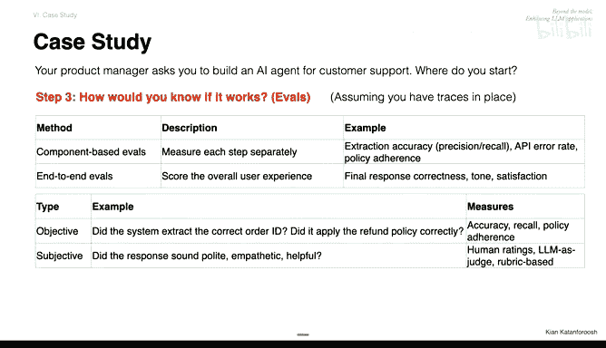

More white glove approaches to do that。Okay， so here's what it could look like。

 I gave you some examples， but you would build EVAs to determine objectively， subjectly。

 component based， end to end based， and then quantitatively and qualitatively where is your LLM failing and where it's doing well。

😊，Does that give you a sense of the type of stuff you could do to fix improve that agent workflow。

Super， well that was our case study on EVS， we're not going to delve deeper into it。

 but hopefully it gave you a sense of the type of stuff you can do with LLN judges with you objective。

 subject， component base， end to end， etc cetera。😊，Last section on multi agent workflows。

So you might ask hey， why do we need a multiagent workflow when the workflow already has multiple steps already calls the LLM multiple times already gives them tools why do we need multiple agents and so many people are talking about multiagent system online it's not even a new thing frankly multiagent system I've been around for a long time the main advantage of a multiag system is going to be parallelism it's like is there something that I wish I would run in parallel sort of independently but maybe there are some sinks in the middle but that's where you want to put a multiagent system it's when it's parallel the other advantage that some companies have with multiag system is an agent can be reused so let's say in a company you have an agent that's been built for design that agent can be used in the marketing team and it can be used in the product know and so now you optimize。

😊。

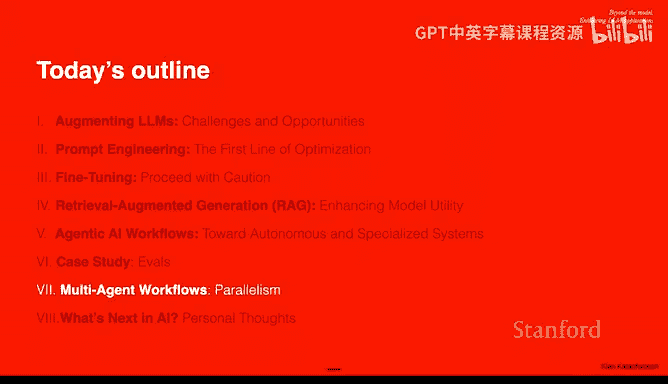

An agent which has multiple stakeholders that can communicate with it and benefit from its performance。

Um。Actually， I'm going to ask you a question and take a few maybe a minute to think about it。

 let's say you were building smart home automation for your apartment or your home。

What agents would you want to build？Yeah。Write it down and then I'm going to ask you in a minute to share some of the agents that you will build。

 also think about how you would put a hierarchy between these agents or how you would organize them or who should communicate with who okay okay。

 take a minute for that。Be creative so because I'm going to ask all of your agents and maybe you have an agent that nobody has thought of。

Okay， let's get started， who wants to give me a set of agents that you would want for your home。

 smart home， yes。そあ。The first is like set of agents that drop my movement in their policy。我平方时。

Another agency receive of information。I just the chair like。And诊疗费据证据发包。さ？Okay。A关于这个然后。Okay。

 so let me repeat， you four agents， I think， roughly。One that tracks biometric。

 like where are you in the home， where you're moving， how you're moving， things like that。

 that sort of knows your location， the second one determines the temperature of the rooms and has the ability to change it。

The third one tracks energy efficiency and might be feedback on energy and energy usage and might be I don't know。

 maybe it has the control over the temperature as well。

 I don't know actually or the gas or the water might cut your water at some point and then you have an orchestrator agent。

 what is exactly the orchestrator doing？And that是然。すし。Okay， passes instructions。

 So is that the agent that communicates mainly with the user。Okay， so if I have。

 I'm coming back home and I'm saying I want the oven to be preheated。

 I communicate with the orchestrator and then it would funnel to another agent Okay。

 sounds good yeah， so that's an example of a I want to say a hierarchyical agent multiag system。

What else any other ideas， what would you add to that？嗯，咁可。

ITo avoid access to the minimal action that we got do you might enter a room。

In computer agree the minimum kind of action we have a lot of。But honest and then depending on who。

 who is it。我去讲啲住话表依家好水。Oh I like that that's a really good one so let me summarize you have a security agent that determines if you can enter or not and when you enter it understands who you are and then it gives you certain sets of permissions that might be different depending of if you're a parent or a kid or you know you might have access to certain cars and not others or the kid cannot open the fridge or I don't know like something like that yeah or okay I like that that's a good one yeah and it does feel like it's a complex enough workflow where you want a specific workflow tied to that I agree。

😊，What else？Yes， the more complicated so you can try to introduce。是吧。其是最多的。比说话。house so also。对吧。

IAnother that out as well much shorter。T products grocery store understanding what's in。

It you are out to。Well that's really good actually so you mentioned two of them。

 one is maybe an agent that has access to external APIs that can understand the weather out there。

 the wind， the sun and then has control over certain devices at home， temperature blinds。

 things like that and also understand your preferences for it that does feel like it's a good use case because you could give that to the orchestrator but it might use itself because it's doing too much so and also these problems are tied together like temperature outdoor with the weather API might influence the temperature inside how you want it ce and then the second one which I also like is you might have an agent that looks at your fridge and what's inside and it might actually have access to the camera in the fridge for example。

 and know your preferences and also has access to the ecommerce-commerce API to order Amazon groceries ahead of time I agree and maybe the orchestrator would be the communication。

With the user， but you might communicate with that agents in order to get it done。Yeah。

 I like those so those are all really good examples here' is the list I had。😊，U there。

 so climate control， lighting， security， energy management， entertainment。

 notification agent alerts about the system updates。

 energy saving and orchestrator so all of them you mentioned actually and then we didn't talk about the different interaction patterns but you do have different ways to organize a multiagent system flat hierarchical it sounds like this would be hierarchical I agree and the reason is UIuxX is I would rather have to only talk to the orchestrator rather than have to go to a specialized application to do something like it seems like the orchestrator could be responsible for that and so I agree I would probably go for a hierarchical setup here but maybe you might also add some connections between other agents like in the flat system where it's all to all for example with climate control and energy if you want to connect those two you might actually allow them to speak with each other when you allow agents to speak with each other。

😊，Is basically an MCP protocol， by the way。 So you treat the agent like a tool， exactly like a tool。

 Here's how you interact with this agent。 Here is what it can tell you。

 Here is what it needs from you， essentially。Okay， super and then without going into the details。

 there are advantages to multiagent workflows versus you know single agent such as debugging it's easier to special debug a specialized agent and to de debug an entire system parallelization as well it's easier to have things run in parallel and you can earn time you know there are some advantages to doing that and I leave you with this slide if you want to go deeper super so we've learned so many techniques to optimize LLMs from prompts to chains to fine tuning retrieval and to multiagent system as well and then just to end on a couple of trends I want you to watch I think next week is Thanksgiving evening is that it Thanksgiving evening break the week after okay well ahead of the Thanksgiving eating break so if you're traveling you can think about these things what's next in AI I wanted to call out a couple of trends so Elias is discover one of the EOGs of。

😊，You know LLMs and you know opening eye cofounder raises that question about are we plateauing or not。

 you know the question of are we going to see in the coming years LLM sort of not improve as fast as we've seen in the past it's been the feeling in the community probably that you know the last version of G did not bring the level of performance that people were expecting although it did make it so much easier to use for consumers because you don't need to interact with different models is's all under the same hood。

 so it seems that it's progressing but the plateau is unclear the way I we think about it is。😊。

The LLM scaling laws tell us that if we continue to improve compute and energy then LLM should continue to improve but at some point it's going to plateau So what's going to take us to the next step。

 it's probably architecture search still a lot of LLMs even if we don't understand what's under the hood are probably transformer base today but we know that the human brain does not operate the same way there's just certain things that we do that are much more efficient。

 much faster we don't need as much data so theoretically we have so much to learn in terms of architecture search that we haven't figured out it's not a surprise that you see those labs hire so many engineers because it is possible that in the next few years you're gonna to have thousands of engineers trying to figure out the different engineering hacks and tactics and architectural searches that are going to lead to better models and one of them suddenly will find the next transformer and it will reduce by 10x the need for compute and the need for energy it's sort of if you've read。

Zasimovs foundation series， individuals can have an amazing impact on the future because of their decisions。

 you know whoever discovered transformers had a tremendous impact on the direction of AI I think we're gonna to see more of that in the coming years where some group of researcher that is itrating fast might discover certain things that would suddenly unlock that plateau and take us to the next step and it's going to continue to improve like that and so it doesn't surprise me that there's so many companies hiring engineers right now to figure out those hacks and those techniques the other set of gains that we might see from multimodality so the way to think about it is we've had LLM's first text based and then we've added an imaging and today models are very good at images they're very good at text turns out that being good at images and being good at text makes the whole model better so the fact that you're good at understanding a CA image makes you better at text as well。

😊，For a cat now you add another modality like audio or video， the whole system gets better。

 so you're better at writing about a cat if you know what a cat sounds like。

 if you can look at a cat on an image as well does that make sense So we see gains that are translated from one modality to another and that might lead in the pinnacle of robotics where all these modalities come together and suddenly the robots is better at running away from a cat because it understands what a cat is。

 how it sounds like， what it looks like， etc that makes sense。😊。

The other one is the multiple methods working in harmony in the Tuesday lectures we've seen supervised learning on supervised learning。

 selfupvised learning reinforcement learning， prompt engineering。

 rags et ce if you look at how babies learn it is probably a mix of those different approaches like a baby might have some metal learning。

 meaning know it has some survival instinct that is in the encoded in the DNA most likely and that's like the baby's pretraining if you will on top of that the mom where the dad is pointing at stuff and saying bad good。

 bad good supervised learning on top of that the babys falling on the ground and getting hurt and that's a reward signal for reinforcement learning on top of that the babies observing other people doing stuff for other babies you know doing stuff unsupervised learning you see what I mean we're probably a mix of all these methods and I think that's where the trend is going。

😊，I where those methods that you've seen in CS230 come together in order to build an AI system that learns fast。

 is low latency， is cheap， energy efficient， and makes the most out of all of these methods。Finally。

 and this is especially true at Stanford you have research going on that you would consider human centric and some research that is nonhumancentric by human centric I should say human approaches that are modeled after the brain and approaches that are not modeled after humans because it turns out that the human body is very limiting and so if you actually only do research on what the human brain looks like you're probably missing out on compute and energy and stuff like that that you can optimize even beyond neuronal connections in the brain。

 but you think can learn a lot from the human brain and that's why there are professor that are running labs right now that try to understand how does back propagation work for humans and in fact it's probably that we don't have back propagation we don't use back propagation we only do forward propagation let's say so this type of stuff is interesting research that I would encourage you to read if you're curious about the direction of AI and then finally one thing that's going be pretty clear。

😊，All the time but it's the velocity at which things are moving you're noticing part of the reason we're giving you a breath in CS230 is because these methods are changing so fast so I don't want to bother going and teaching you the number 17 methods on rag that optimizes the rag because in two years you're not going need you so I would rather you think about what is the breadth of things you want to understand and when you need it you are sprinting and learning the exact thing you need faster because the halflife of skill is so low you know you want to come out of the class with a good breadth and then have the ability to go deep whenever you need after the class and so that's sort of how that class is designed as well。

Yeah， that's it for today， so thank you， thank you for participating。

