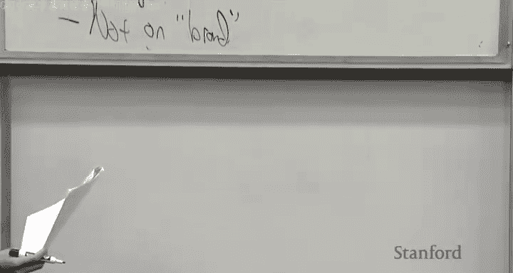
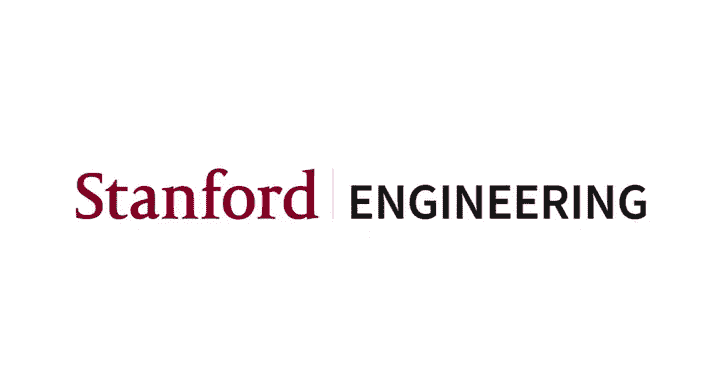

# 吴恩达@斯坦福大学《深度学习｜Stanford CS230： Deep Learning ｜ Autumn 2018》中英字幕（豆包翻译 - P8：-08-Lecture 8 - Career Advice _ Reading Research Papers.zh_en - GPT中英字幕课程资源 - BV19y421z7jz

Okay， hey everyone， looks like we're on。So as usual， if you have not yet。

 please enter your S U ID so that we know you're here in this room。

So can you hear me okay at the back， I this okay。Oh， yes， is the volume O at the back？All right。

 No one's responding。Yes， okay。 al right， thank you。

So what I want to do today is share a view two things。 you know we're approaching the end quarter。

 hope you guys looking forward to the Thanksgiving break next week actually and I guess we a lot of home viewers but those of you that are viewing this from outside California know that we're all breathing really bad air here in California I hope some of you are watching this at home you have better air wherever you are but what I hope to do today is give you some advice that will set you up for the future even beyond the conclusion of CS230 and in particular what I want to do today is share you some advice on how to meet research papers because you know deep learning is evolving fast enough that even though you've learned a lot of foundations of deep learning and learn a lot of the tips and tricks and know better than many practitioners how to actually get deep learning algorithms of work already when youre working on。

applications， whether in computer division or national language processinging or speech recognition or something else for you to be able to efficiently figure out the academic literature on key parts of the deep learning world。

 hope you keep on developing and staying on top of ideas。

 even as they evolve for the next several years or maybe decades。

 So first thing want to do is give you advice on how when say when I'm trying to master a new body of literature。

 how I go about that and hope that those techniques will be useful to help you be more efficient。

 how you read research papers And then the second thing is。😊，In previous offerings of this class。

 one request from a lot of students was just advice for navigating a career in machine learning。

 And so in the second half of today， I want to share some thoughts with you on that。So。

It turns out that。So I guess two topics， reading research papers， right， and and then second。

 career advice in machine learning。 So it turns out that。You know。

 reading research papers is one of those things that a lot of PhD students learn via osmosis， right。

 meaning that if you're a PhD student and you see you know。

 a few professors or see other PhD students do certain things that you might try to pick it up by osmosis。

 but I hope today to accelerate your efficiency and how you acquiring knowledge yourself from the academic literature And so let's say that there's an area you want to become good at。

 let's say you want to build that speech recognition turns it off for now。

Let'lie want to build that speech recognition system that we talked about with the Robert turnon and the Delam。

 This is what I read， This is a sequence of steps I recommend you take， which is first。

Compile list of papers and and by papers， I mean， both research papers often posted on archive onto Internet。

 but also plus medium pose。Yeah， or maybe some occasional Github posts， although those are rarer。

 but whatever text or learning resources you have。And then what I usually do is end up skipping around a list。

 so if I'm trying to master a new body of knowledge。

 So you want to learn about speech recognition systems。

 This is what it feels like to read a other papers， which is maybe you initially start off。

With five papers。 And if on the horizontal axis， I plot， you know，0% to 100% red。Slash understood。

The way it feels like reading these papers is often。Read， you know。

 10% of each paper or try to quickly skim and understand each of these papers。 And if based on that。

 you decide that paper number two is a du， right， Other other other authors even ci it and say， boy。

 they sure got it wrong。 or you read it。 It just doesn't make sense。 Then go ahead and forget it。

 And as you skip around the different papers， you might decide that paper 3 is a really seminal one。

 and then spend a lot of time。To go ahead and read and understand the whole thing。 And based on that。

 you might then find the six paper from the citations and read that and go back and flash are you understanding of paper for and then find a paper 7 and go and read that all the way to the conclusion。

 But this is what it feels like as you you know， assemble a list of papers and skip around and try to master a body of literature right around some topic that you want to learn。

And I think some rough guidelines， you know， if you read 50 to 20 papers。

 I think you have a basic understanding of of an area right like maybe good enough to do some work。

 apply some algorithms， if you read 50 to 100 papers in an area。

 like speech recognition and and kind of understand a lot of it。

 then that's probably enough to give you a very good understanding of an area， you might。

 I don know I'm always careful about when I say you mastering a subject。

 but you read 50 or 100 papers on speech recognition。

 you have a very good understanding of speech recognition。

 or if you're interested in say domain adaptation by the time youve read 50 or 100 papers。

 you have a very good understanding of of a subject like that。 but read 5 to 20 papers。

's probably enough for you to implement it， but maybe not not sure is enough for you to do research or be really at the cutting edge。

 But these are maybe some。Guidelines for the volume of reading。

 you should aspire to if you want to pick up a new area or take one of the subshaakes and CS 230 and go more deeply into it。

 right。嗯。Now好。Okay。How do you read one paper and I hope most of you brought your laptop。

 So what I'm going to do is describe to you how I read one paper。 and then after that。

 I'm actually going to ask all of you to download the paper online and just take I don't know take a few minutes to read a paper right here in class and see how far you can get understanding a research paper in just minutes right here in class。

So when reading one paper。 So the， the bad way to read the paper is to go from the first word until the last word。

 right， Thiss just a bad way to we have a paper like this。 Oh， and by the way。

 actually here I tell you what my real life is like， so。

I actually pretty much everywhere I go whenever I backpack。 this is my actual folder。

 I don't want to show。 this is my actual folder of unread papers。 So pretty much everywhere I go。

 I actually have a paper， a stack of papers is on my personal reading list。

 This is actually my real life。 I didn't bring this to show you this is in my backpack all the time。

 And I think that It know these days on my team at landing AI deepblind AI。

 I personally lead a reading group where I lead a discussion about two papers a week but to select two papers。

 it means I need to read like five or six papers a week to select two you know to present or discuss the landing AI deepblind AI reading group。

 So this is my real life and how I try to stay on top of the literature I'm doing a lot。

 if I can find this if I can find the time to read a couple papers a week。

 hopefully all of you can do But when I'm reading a paper。

 this this is how I would recommend you go about it。

 which is don't go from the first word and read until the last word。Instead。

 take multiple passes through the paper。Right， and so， you know， step one is。Me the title。

The abstract。And also the figures， especially in deep learning。

 there are a lot of research papers where the entire paper is summar one or two figures in the figure captions。

 So so sometimes just by reading the title abstract and you know。

 the key neural network architecture figure that just describes what the whole paper is about and maybe one or two of the experiment section。

 you can sometimes get a very good sense of what the whole paper is about without know hardly reading any of the text in the paper itself that's the first pause。

Second pass， I would tend to read more carefully。The intro。The conclusions。

Look carefully at all the figures again。And then， skin。嗯。The rest， and， you know。

 I don't know how many of you have publish academic papers， but when people publish academic papers。

 part of， you know， the publication process is convincing the reviewers that your paper is worthy for acceptance。

 And so what you find is that the abstract intro and conclusion is often when the authors try to summarize their work really。

 really carefully to make a case to make a really clear case to the reviewers for why， you know。

 they think their paper should be accepted for publication。 And so because of that you know。

 maybe slightly not slightly unusual incentive， the intro and conclusion and abstract often give a very clear summary of what's the paper actually about。

And depending on。嗯。Again， just be bluntly honest with you guys。

 the related work section is useful if you want sometimes useful if you want to do understand related work and figure out what what are the most important works in the papers。

 But the first time you read this， you might skim or even skip， skim the related work section。

 It turns out unless you're really familiar literature。

 if this is a body of work that you're not that familiar with the related works section is sometimes almost impossible to understand。

 And again， since I'm being very honest with you guys。

 sometimes the related works section is when the authors try to cite everyone that could possibly be reviewing the paper to make them feel good and hopefully accept the paper。

 it's a related works section is sometimes written in funny ways。And then step 3。

 I would often read the paper。But。Just skip the math。Right。And 4， beat the whole thing。

But skip points， don't make sense。はい。You know。I think thats。

One thing that's happened many times in the research is that， I mean。

 the papers you read tend to be cutting a research。 And so when we publish things。

 we sometimes don't know what's really important and was not important right So there there are many examples of wellknown highly cited research papers where some of it was just great stuff and some of it you know turned out to be unimportant。

 but at the time the paper was written， the authors did not know no one on the planet knew what was important and what was not important。

 And maybe one example the Lette5 paper some paper by Yan， part of it was phenomenal。

 just established a lot of the foundations of cons and so one of the most incredibly influential papers。

 you go back and read that paper another sort of whole half of the paper was about other stuff transducers and so on that is much less used。

 And so and so it's fine if you read the paper and some of it doesn't make sense because it's not that unusual Well sometimes it just happens that great research means we publishing things at the。

Re of our knowledge。 And sometimes the stuff you see， you know。

 will realize five years in the future that that wasn't the most important thing after all。

 or that what was the key part of the album， maybe wasn't what the authors thought。

 So sometimes the parts paper don't make sense。Is okay to skim it initially and move on。

 right unless you're trying to do a P， unless you're trying to do research and you really need to master it。

 then go ahead and spend more time。 But they're trying to get through a lot of papers。 Then。

 you know， then then it's just prioritizing your time。Okay。And so。啊。Just a few。Lost things。

 And then I'll ask you to practice this yourself with a paper， right， You know。

 I think that when you read and understood the paper。These are questions you try to keep in mind。

 And when you read a paper in a few minutes， maybe and try to answer these questions。

 What do the authors try to accomplish。And what I hope to do in a few minutes is ask you to download the paper off the internet。

 read it， and then try to answer these questions and discuss your answer to these questions with your peers。

 with others in the class。嗯。What were the key elements？Yeah。对。Yeah。What can you use yourself and。

Yeah。Okay， so I think if you can answer these questions。

 hopefully that will reflect that you have a pretty good understanding of the paper。

And so what I would like you to do is pop up your laptop。 And then so you there's actually。

 so I think on the con videos on the the deep AI con videos on coursera。

 you learned a bit about various neural network architectures up to resnets。

 And it turns out that there's another follow on piece of work that maybe builds on some of the ideas of resnets。

 which is called densenets。 So what I like you to do is and and so what I like you do is actually try this。

 And when I'm reading a paper。Again， in the earliest stages， don't get stuck on the math。

 Just go ahead and skim the math and read the English text we can get through faster。

 And maybe one of the principles is go from the very efficient high information content first and then go to the harder material later。

 which is why often I'll just skim the math。 And I don't。

 if I don't understand similar in the equation， just move on。

 And then only later go back and and really try to figure out the math more carefully。

So what I'd like you to do is take， I don't know， what you take。呃呃。我这个。Let's，s， let's try。's。

 let's have you take 7 minutes。 I'm thinking maybe 1，1 minute per page is quite fast and。

Search for this paper。Densely connected， convolutional neural。Networks by。Okay。Guoang S all。 O。

 once you I take out your laptops， search this paper， download it， You should find this on archive。

AR X， I V， right？ And， and this is also something else called this dense nets， I guess。

And go ahead and take， once you take like 7 minutes。 read this paper。

 and I'll let you know when the time has passed。 And then after that time， I'd like you to， you know。

 discuss with your with the others， right， what what what you think are the answers。

 especially the first two， because the other two， you can leave off。

 But once you go ahead and take a few minutes to do that now。 And then I'll let you know when。

So the like seven minutes have passed， and then you can discuss your answers with these with your friends。

 okay。All right， guys。Anyone with any thoughts or insights？Surprises。thoughts from this。

 So now you spent 11 minutes on this paper， right，7 minutes reading，4 minutes discussing。

 which is really， really short period of the time。 But any， any thoughts。

What do you think of the paper。Go on， you'll just spend a lot of time staying a lot of stuff at each other。

Okay。What do people think of？The time you spend trying read the paper。Actuallysh。

 did you feel actually raise your hand if you feel， you know。

 you kind of understood the main concepts in the paper。就是这。But yeah，20 of you have many you。

And actually， what did you first think of the figures？Wow。

 people are really less energetic ethics today than usual。 Hope back everyone。

So I think is one of those papers where the paper is almost entirely summarized。

Fures one and2 right I think if you I see a lot of people now if you look at figure one and the caption there and figure two on page3 and the caption there and understand those two figures。

 those really convey you know，80% of the idea of the paper right and I think that。

A couple other tips。 So it turns out that as you read these papers with practice， you do get faster。

 So， for example， table 1 on page 4。Right， this mess of a table on top。

 this is a pretty common format a format like this is how a lot of authors use to describe the network architecture。

 especially in computer vision。 So one of the things you find as well is that the first time you see something like table1。

 it just looks really complicated。 But by the time youve read a few papers in a similar format。

 You really look at table 1 and go， oh yep， got it。

 this is this is the densenet 121 versusnet 169 architecture and more quickly pick up those things。

 And so another thing you find is that reading these papers actually gets better of practice because you see different authors use different ways or similar ways of expressing themselves and it gets used to that。

 you actually be faster and faster at implementing these at understanding ideas。 And I think。know。

 these days， when not reading a paper like this。 It maybe takes me about half an hour to feel like and I know I gave you guys7 minutes when I thought I would need maybe half an hour to figure out a paper like this。

 And I think for more and I find that is' not unusual for people relatively new to machine learning maybe an hour to kind of really understand a paper like this。

 And then know I'm pretty experienced machine learning。

 some down to maybe half an hour for a paper like this， maybe even 20 minutes if's a really easy one。

 but there are some outliers。 So some colleagues sometimes stumbleboard crawl a really difficult paper。

 you need to chase out a lot of references and learn a lot of other stuff。

 So sometimes you come across a paper that takes you three or four hours or even longer to really understand it。

 but I think depending on。How much time you want to spend per week reading papers you could actually learn。

 you know， learn a lot， doing what you just did， but maybe spending half an hour per paper on half paper rather than seven minutes。

 right？嗯。So。Alright， I feel like yeah。 so I think it's great。

 And I notice that I've actually not said anything about the content of this paper。 right。

 So whatever you guys just learned， that was all you， I had nothing to do with it。 So， you。

 like you have the ability。 You go and learn this stuff by yourself。 You don't need me anymore。

 right。😊，あ。Oh。So， just a。Last few comments。 Let's see。 So the other few questions I get is， you know。

 where， where do you go。The deep learning field evolve so rapidly。 So where。

 where do you go So if you're trying to master a new body of knowledge， definitely do web searches。

 And they're often good blog posts on， know， here are the most important papers and speech recognition。

 There lots great resources is there。 And then the other thing you I don't know a lot of people try want to do is try to keep up with the say the odd of deep learning。

 even as it's evolving rapidly。 And so I just tell you where I go to keep up with you know。

 discussions announcements。 Surprisly， Twitter has become surprisingly important place for researchers to find that about new things。

 There's M subredit。Its actually pretty good。 A lot of noise。

 but many important pieces of work do get mentioned there。

 Some of the top machine learning conferences are Nps， IC M L。And I clear。Right。

 and so whenever these conferences come around， take a look and glance through at these the title。

 see if there's something that interest you。 And then I think unfortunate， I guess friends， you know。

 both colleagues here at Stanford colleagues of several of the teams I work with that that just tell me when there's a cool paper。

 I guess。 But I think here within Stanford or among your workplace for those of you taking this if you inform a community that shares interesting papers。

 So lot of the groups I have are on slack and we regularly slack each other or send each other text messages on the Sla messaging system where you find interesting papers and that's been great for me actually。

Yeah， oh， and Twitter， let's see。Kian is。 I follow Kian。 You can follow him， too。This is me。Andrew W。

 right。I probably don't slack our papers as often as I do。 But if you look at， I dont know。

 you can also look at who we follow。 There are a lot of good researchers that that will share up these things online and。

There's a bunch of people that also use a website called archiveive sanity。

 I don't as much sometimes， but lots of visuals is like that， right？嗯。扣。

So just two last tips for how to。Be papers and good， good at this。嗯。

So to more deeply understand the paper。Some of the papers will have。Math in it。 And actually。

 if you read the， I don't know， you'all learn about bam， right in the second module videos。

 If you read the bache paper， It's actually one of the harder papers you read。

 there's a lot of math in the derivation of bachal。 But there papers like that。

 And if you want to make sure you understand the math， here's what I would recommend。 which is。

Read through it， take detailed notes， and then see if you can re deriveive it from scratch。

So if you want to deeply understand the math of an algorithm like you know batchal or the details of backpro or something。

 the good practice。 and I think a lot of them sort of a theory。

 theoretical computer science and mathematics PhD students will use a practice like this。

 which is go ahead and read the paper make sure you understand it and then to make sure you really。

 really understand it put aside the result and try to reeriveve the math yourself from scratch and you can start from a blank piece of paper and rederve one of these algorithms from scratch。

 and that's a good sign that you really understand it when I was a PhD student。

 I did this a lot right that you know I would read a textbook or read a paper or something and then put aside whatever I read and see if I could reive it from scratch。

 starting from a blank piece of paper as only if I could do that that I would feel like。

 I think I understand this piece of math And it turns out if you want to do this type of math yourself is your ability to derive this type of math。

 rederive this type of math that gives you the ability。To generalize。

 to derive new novel pieces of math yourself。 So I think I。

 I actually learned lot the math of several machine learning by doing this and is by rederiving other people's work that allowed me to learn how to derive my own novel algorithms。

 And actually， sometimes you go to the。😊，Art galleries， right， Like go the Smithsonian。

 You see these art students， you know， sitting on the floor， copying the great artworks。

 the great paintings painted by the masses centuries ago。 And so I think just as today。

 they are art students sitting in the the young museum or whatever And I was at the Getty museum in L a few months ago。

 You actually see these art students， you know， copying the work of the masters。

 And I think a lot of the ways that you want to become good at the math of machine learning yourself。

 This is， this is a good way to do it。 It's time consuming， but but you can become good at that way。

😊，And same thing for code， right， I think the simple。

 lightweight version one of learning would be to download and run the open source code。

If you can find it。And a deeper way to learn this material is to reimment it from scratch。お。

Right it's easy to download open source thing and run it。 and then， it works。

 But if you can reimplement one of these algorithms from scratch。

 then that's a strong sign that you really understood this algorithm。Okay。嗯。All right。And then。

Longer term advice。え。Great。Yeah。お。You know， for you to keep on learning and keep on getting bathroom better。

 the more important thing is for you to learn steadily。

 not for you to have a focused intense activity。 you know， like all of Thanksgiving。

 you read 50 papers over Thanksgiving。 and then youre done for the rest of your life。

 it doesn't work like that and I think you much better off reading two or few papers a week for the next year then you know cramming everything over one long weekend or something actually in education。

 we actually know that space repetition works better than cramming。 So the same same thing。

 same body of learning， if you learn a bit every week and space it out。

 you actually have much better long term attention than you try to cr everything in the short term。

 So is a very solid result that we know from pedagogy and how the human brain works。

 So So if you're able to again the way my life is my backpack。

 I just always have a few papers with me and I find that I read almost everything on the tablet almost everything on an iPad。

 but I find that research papers all those things。The ability to flip between pages and skim。

 I still find more efficient on paper。 So I read almost nothing on paper these days。

 except for research papers。 But that's just me， your knowledge may vary。

 Maybe something else will work better for you。Okay。All right， so let's see。

 that's it we reading me papers， I hope that while you're in CS230， you know， by the way。

 if some of you find some cool papers， of you go further for the Dennet paper and find an interesting result there。

 go ahead and post on PR there if any of you want to start the reading group of other friends here at Stanford。

 you encourage you to look around class， find a group here on campus among your CS230 class space or with your work colleagues for those you taking this on the SCD so that you can all keep studying the literature and learning and helping each other along。

So that's it for reading papers。 The second thing we want to do today is just give some longer term advice on navigating a career。

In machine learning， right any questions about this before I move on。Cool， allright。

But I hope that was useful， some of this I wish I had known when I was the first year PhD student。

 but。All right。Let's see。Can we turn on the lights， please， Alright， so kind of in response to。And。

Requests from earlier students and earlier versions of clause before we， you know。

 as we approach the end of the quarter， want to give some advice for how to navigate a career machine learning。

 right， So today， machine learning， there are so many opportunities to do so many exciting things。

 So how do you you know， what what do you want to do。 So I'm going to assume that。

Most of you will want to do one of two things， right？ at some point， you know， you want to。嗯。

Get a job， right， Maybe a job that does work in machine learning。

 including a faculty position for those of you whom who have a professor。

 But I guess eventually most people end up with a job， I think， I guess there are other alternatives。

 But but and some of you want to go on more advanced graduate studies。

 And although even after you get your PhD at some point， most people do get a job after the PhD。 And。

 and， and by job， I mean， either in a big company。You know， or or a startup。Right。

 but regardless of the details of this， I think I hope most of you want to do important work。So。

What Id like to do today is break you know， this into how do you find a job or join a PhD program or whatever that lets you do important work。

 And I want to break this discussion into two steps。 One is just you know how do you get a position。

Right，How do you get that job offer or how do you get that offer of admissions in the PhD program or admissions in the master's program or whatever you want to do。

 And then two is selecting a position。Yeah。Right，But between， you。

 going to this university versus that university or between taking on the job and this company versus that company。

 What are the ones that will tend to set you up for success for long term personal success and career success。

 And really， I hope that， by the way， I hope that all these are just tactics to let you do important work。

 right， And at least I hope that's what you want to do。So you know what do recruiters look for？

Oh and I think just to keep the language simpler， I'm going to pretend that I'm just going to talk about finding a job but a lot of the very simple things apply for PhD programs is just instead of saying recruiters。

 I would say admissions committees right it's actually some of this is is let me just focus on the job scenario。

 So most recruiters。Look for technical skills。 So， for example。

 there are a lot of machine learning interviews。 They'll ask you questions like， you know， well。

 would you use gradientdesscent or badesscent gradient bascent。

 what happens in the batch size is too large， too small， right， So there are companies。

 many companies today， asking questions like that in the interview process can you explain there LCM and a GR。

 When would you use G So you really get questions like that in many job interviews today？

 And so truth is looking for M skills。As well as。And so you often be quiz on ML skills as well as your coding ability。

 right？And then beyond your and and I think Silicon Valley become quite good at giving people the assessments to test for real skill in machine learning engineering and in software engineering。

 And then the other thing that recruiters will look for。

 that many recruiters will look for is a meaningful work。😊，Okay。And in particular，You know。

 there are some candidates that apply for jobs that have very theoretical very academic skills。

 meaning you can answer all the quiz questions about， you know， what is ba， you for this。

 But unless you've actually shown that you can apply this a meaningful setting is harder to convince a company or recruiter that you know。

 not just a theory， but that you know how to actually make this stuff work。

 And so having done meaningful work using machine learning is a very strong。

 it's a very desirable candidate， I think， to a lot of companies， kind of work experience。

 I think really whether you've done whether you've done something meaningful， reassures that。

 you know that you can actually do work， It's not just you can answer quiz questions。

 but you know how to implement learning algorithms that work。 and， and， and maybe。哦，呀。没钱。

And that many recruiters actually look for your ability to keep on learning new skills and stay on top of machine learning even as it evolves as well。

 right。And so a very common pattern for the successful。You know， AI engineers。

 say machine learning engineers would be the following where if on the horizontal axis。

 I plot different areas。 So you might learn about machine learning。Learn about deep learning。

 Learn about probabil graphical models， Learn about N LP。

 Learn about computer vision and so on for other areas of AI or machine learning。

 And if the vertical area， if the vertical axis is。Deaf。

 lot of the strongest candidates or jobs are teashad individuals。

 meaning that you have a broad understanding of many different topics in AI and machine learning and very deep understanding and you。

 maybe at least one area， maybe more than one area。

 And so I think by taking cyst to 30 and doing the things you're doing here。

 hopefully you're acquiring a deeper understanding of one of these areas of deep learning in particular。

 But the other thing that even you， deepens your knowledge in one area will be the projects you work on。

The open source contributions you make， right， whether or not you've done research。

And maybe whether or not you've done an internship。And I think these two elements， you know。

 broad area of skills and then also going deeper to do a meaningful project and deep learning or work of a Stanford professor。

 right， and do a meaningful research project or make some contributions to open source。

 publish on Github。 and then let's use it。 These are the things that let you deepen your knowledge and and convince recruiters that you both have the broad technical skills and when called on。

 you're able to apply these in in a meaningful way to an important problem。And in fact。

 the way we design CS 230 is actually a microcosm of this where， you know。

 you learned about neural nets， learn about topics at baal， confidences， sequence models。

 let' me just say RNANNs。So。Actually， you have a breath within the field of deep learning。

 and then what happens is then and the reason want you to work on a project is so that you can pick one of these areas and maybe go deep。

And build a meaningful project in one of these areas which which will and it's not just about making your resume look good right。

 It's about giving you the practical experience to make sure you actually know how to make these things work and give you the learnings to make sure that you actually know how to make a CNN work。

 make an R work and then constantly many students also the approaches of the resumes obviously。😊，嗯。

So， I think the。Let's see， the failure modes， the things， bad ways to navigate your career。

 There are some students that just do this。RightThere are some Stanford students that just take class after class。

 after class， after class and go equally in depth in a huge range of areas。 And this is not terrible。

 You can actually still get a job still get sometimes you can even get into some PhD programs like this without the de。

 but this is not the best way to navigate your career。

 And so there are some Stanford students that take tons of classes。

 you cant get a good GP doing that， but do nothing else。 and this is not terrible。

 but is this is not this is not great is not as good as the alternative。

There's one other thing I've seen Stanford students do， which is just try to do that。

Right which is just try to jump in on day one and go really， really deep in one area。 And again。

 this has its own challenges。 I guess you know1 failure mode， one mode that is actually not great。

 sometimes we actually get undergrad freshman at Stanford that have not yet learn a lot about coding software engineering or machine learning and try to jump into research project right away。

 And this turns out not be very efficient because it turns out Stanford classes are online courses of Stanford classes is a very efficient way for you to learn about the broad range of areas。

 And after that going deeper getting experience in one vertical area。

 then deepens your knowledge and make sure you know how to actually make those ideas work。

 So I do see sometimes unfortunately you know some Stanford freshmen join us already knowing how the code and have implemented some learning algorithm。

 but some students that do not yet have much experience。

 try to jump into research project right away。 And that turns out not to be very productive for the student over the research group because until you。

Taking the course and master basics is difficult to understand what's really going on in the advanced projects。

Right， so I would， I would say this is actually worse than that right is， this is actually okay。

 this is actually pretty bad。 is I would not do this for your career。はい。Probably not， yeah。

And then the other not so great mode that you see some Sams do is get a lot of breath。

And then do a tiny project here。 do a tiny project there。 do a tiny project there。

 Do a tiny project there。 And you end up with 10 tiny projects。

 but no one or two really significant projects。 And again， this is not terrible， but， you know。

 beyond a certain point。By the way， recruiters are not impressed by volume， right。

 So having done 10 laneme projects is actually not impressive。

 not nearly as impressive as doing one great project or two great projects。 And again。

 there's multilife and impressing recruiters。 But recruit is very rational。

 And the reason recruiters are less impressed by someone whose profile looks like this is because they're actually probably factually less skilled and less able at doing good work and machine learning compared to someone that has done a substantive project and knows what it takes to see。

 see the whole thing。😊，Does that make sense。 So when I say， you know。

 recruit is more or less impressive because they're actually quite rational in terms of trying to understand how good you are at at doing important work and building meaningful AI systems。

 sense。And so in terms of building up both the horizontal piece and the vertical piece。

 this is what I recommend to build the horizontal piece。

 a lot of this is about building foundational skills。

And it turns out coursework is a very efficient way to do this， you know， in these courses， right。

 you know， various instructors。Like us， but many other Stanford professors put a lot of work into organizing the content to make it efficient。

For you to learn this material。 And then also reading。Research papers， which we just talked about。

 having a community will help you。 and then。That is often。A building a more deep。不是不是。

And relevant project， and and the projects have to be relevant。 So， you know。

 if you want to build a career in machine learning， build a career in AI。

 hopefully the project is something that's relevant to CSs or machine learning or A or deep learning。

 I do see， I don't know。 for some reason， I feel like a surprisingly large number of stas。

 I know understand Stanford dance true and spend a lot time on that， which is fine。

 If you enjoy dancing， go have fun' you don't need to work all the time。

 So go join the dance true or go on the overseas exchange program and go hang out in London and have fun。

 but those things do not as directly contribute to this right。😊，Yeah， I know， I think。

 I think in the earlier version of this presentation， students walked away saying， you know。

 Andrew says we should not have fun should work all the time。 that's not to go。好吧。嗯。Alright。

 there is one。All right。You know， there is the。Saturday morning problem， which all of you will face。

whichch is every week， including this week on Saturday morning， you have a choice。

 You can read the paper。だ。哦。Yeah。Workic on research。哦。Work on open source。

 or I don't know what people do， or you can watch TV or something， right。

And you will face this choice like maybe every Saturday， you know。

 for the rest of your life or for lost Saturdays for the rest of your life。And， you know。

 you can build up that foundational skills， go deep or go have fun。 and you should have fun。

 All rights explore the record。 But one of the problems that a lot of people face is that even if you spend all Saturday and all Sunday reading a research paper。

 you know， the following Monday maybe spend all Saturday and Sunday working hard。

 It turns out that the following Monday you're not that much better at deep learning is like， yeah。

 you work really hard。 So you read five papers， know， great。 But if you work of a research group。

 the professor or or your manager if you' in a company， they have no idea how hard you work。

 So there's no one to come by and say oh， good job working so hard all weekend。

 So no one knows these sacrifices， you may all weekend to study your code open souls and no one knows。

 So there's almost no short term reward to doing these things。

 but whereas there might be short term rewards to doing other things， right。😊。

But the secret to this is that it' not about reading papers really。

 really hot for one Saturday morning or for all Saturday once and then being done。

 The secret to this is to do this consistently you know for years or at least for months。

 And it turns out that if you read two papers a week and you do that for a year。

 then you have read 50 papers after a year and you will be much better at deep learning after that right I mean。

 when you you have read 100 papers in a year， you read two papers a week and so so for you to be successful。

 it's much less about the intense burst of effort you put in over one weekend。

 it's much more about whether you can find a little bit of time every week to read a few papers or contribute open source or take some online courses and if you do that。

 you know every week for six months or do that every week or a year。

 you will actually learn a lot about these views and be much better and be much more capable at deep。

machine or whatever。So， yeah， but yeah， actually， interesting my wife and I actually do not own a TV after what is。

But again， if you， if you oh my go ahead， it' fine make sure don't don't don't don't drive yourself crazy and have a healthy work life integration as well。

All right。So。So I hope that doing these things， well， it's not about finding a job。

 it's about doing these things to make you more capable as a machine learning person so that you have the power to go out and implement stuff that matters。

 right to do stuff that actually， do work that matters。

 The second thing when I chat about is selecting a job。And it's actually really interesting， I。

Gave this part of the presentation last year。 actually sorry earlier this year。

 And shortly after that presentation， there was a student in the class。

 There was already in a company who emailed me saying， boy， Andrew。

 I wish you had told me this before I accepted my current job。 So let's， let's see， let's see。

 let's see。 hopefully this would be useful to you。 So it turns out that。😊，You know。

 I so when you at some point you， you be deciding， you know。

 what PhD program do you want to apply for， what companies you want to apply for a job at。

 And I can tell you what。Wow。So if you want to keep learning new things。

 I think one of the biggest predictors of your success will be whether or not you're working with great people。

And projects。Right， and in particular， you know there are these fascinating results from I think I want to say from the social sciences showing that if your closest friends。

 if your five closest friends， your 10 closest friends are all smokers。

 there's a much high chance you become a smoker as well And if you five or10 closest friends are overweight。

 there's a much high chance you do the same and conversely you know。

 so I think that if your five closest friends work really hard。

 read log research papers care about their work learning and making themselves better。

 then there's actually a very good chance that you will be。

That they'll influence you that way as well。 So we're all human。 We all。

Influenced by the people around us， right And so I think that and I've been fortunate。

 I've told to Stanford for a long time now。 I've been fortunate to have seen a lot of students go from Stanford to various careers。

 And because I've seen how many hundreds or maybe low thousands of Stanford students that I knew。

 right， when there were still Stanford students go on to separate jobs。

 I saw many of them have amazing careers。 I saw， you know， a few have like。😊，Like okay careers。

 But I think over time， I've learned to pattern match what is predictive of your future success after you least Stan I want share you some of those path。

 share you some of those patterns as you navigate your career。

 and it's just there's so many options in machine learning today It's kind of tragic if you don't。

 you know， navigate to hopefully maximize the chance of being one of the people that gets to do fun and important work that helps others。

😊，Um so。When selecting a position， I would advise you to focus。On the team。You interact with。

 And by team， I mean， you know， somewhere between 10 to 30。Persons， right， maybe be up to 50， right。

Because it turns out that if you there will be some group of people， maybe 10 to 30 people。

 maybe 50 people that you interact with quite closely。

 and these will be your peers and the people that will influence you the most。

 right Because if you join a company with 10000 people， you will not interact with all 10000 people。

 that will be a core of 10 or 30 or 50 people that you interact with the most。 and is those people。

 how much they know， how much they teach you， how hardwork they are。

 whether they are learning themselves that will influence you the most。

 rather than all these other hypothetical 10000 people in a giant company And of these people。

 one of the ones that will influence you the most is your manager。Right。

 so make sure you meet your manager and get to know them and make sure there's someone you want to work with。

 And in particular， I would recommend focusing on these things and not on the brand。Of the company。

 because it turns out that the brand of the company you work with is actually not that correlated。

 You know， maybe there's a very recor， but it's actually not that correlated with what your personal experience will be like。

Right。And so。And， and by the way， again， just， you know full disclosure。 I you know。

 I have a research group here at Stanford， right， My researcher at Stanford is one of the better known research groups in the world。

 But just don't join us because you think we're wellknow。

 right It just not a good reason to join for the brand。 Instead， you only work with someone。

 meet the people and evaluate the individuals or look at the people and see if you you think these are people you can learn from a work of and a good people。

😊。

So。So in today's world， there are a lot of companies recruiting Stanford students。

 So let me give you some advice。 And this piece of available good because many is， well。

 I'll just give you the advice。 So sometimes。There are giant companies with， let's say， you know。

50000 people， right， And I'm not thinking of any one specific company。

 If you're trying to get or company I'm thinking of， there's no one specific company I'm thinking of。

 But this pattern matches to many large companies。 But maybe there's a giant company with， you know。

50000 people， right。And let's say that they have a。300%。Right， AI team。

It turns out that if you look at the work of the300 person AI team and if they send you a job offer to join the 300 person AI team。

 that might be pretty good this maybe the group whose work you hear about their potions papers。

 you really want news。 and so if you get a job offer to work with this group。

 that might be pretty good or even better would be sometimes even within the 30 person AI team is actually difficult to tell what's good and what's not。

 There's often a lot of variances， even with this what's even better would be if you get a job offer to join the 30 person team。

So you actually know who's your manager， who your peers， who you're working with。

 and if you think these are 30 great people you learn from， that could be a great job offer of it。

The failure mode that unfortunately， I've seen several Stanford students go down。 actually。

 this is true storyri。 There was one several years ago。

 the Stanson I knew that I thought was a great guy， right， You know， I knew his work。

 He was coding machine learning algorithms。 I thought he was very sharp and did very good work。

 working with some of my PhD students。He got a job offer。

From one of these giant companies that has a great AI group and his offer wasn't to go to the AI group。

 His offer was to join us and it will assign you to a team。

 So this because student that was a Stanford student I know about of care about he wound up being assigned to a really boring Java backend payments team。

 And so after he accepted the job offer， he wound up being assigned to a。

 you know back and apologize you work on Java backend payment processing systems。

 I think they're great。 But the student was assigned to that team and he was really bored。

 And so I think that this was a student whose career。

 I saw his career rising while he was at Stanford， and after he went to this， you know， frankly。

 not very interesting team， I saw his career plateau。 and after about a year and a half。

 he resigned from this company after wasting a year and a half of his life and missing out really on a year and a half of this very exciting growth of AI machine learning。

😊，Right，So this was very unfortunate。 And and it was actually after I told this story last time I told this class earlier this year that actually someone from actually was actually from the same big company。

 You email me and said， boy， Andrewa， I wish you told me the story earlier because it is exactly what happened to me。

 at the same big company。Oh。Oh。Now， I want to share with you a different。

OhSo so I would just be careful about rotation programs as well。 you know。

 when a company is trying to recruit you， if a company refuses to tell you what project you work on who's your manager。

 exactly what team you're joining， I personally do not find those job office that attractive because they can't you know if they refuse to tell you what team you're gonna to work with chances are telling you the answer will not make the job attractive to you that's why I did not telling you。

 So I just be very careful and sometimes rotation programs sound good on paper but it's really know we'll figure out where to send you later。

 I feel like I've seen some students go into rotation programs that sound good on paper that sound like a good idea but just as you wouldn't after you graduate understand that。

 would you want to do full internships and then apply for a job。

 that would be a weird thing to do So sometimes rotation programs are Yeah come and do four internships and then will let you apply for a job and see what we want to send you and it could be a job back in payment process just be。

Is about the marketing of rotation programs。 Oh and again。

 if you do but if what they say is do rotation and then you join this team。

 then you can look at this team and say， yep， that's a great team。 I want to do a rotation。

 but then I would go and work with this team。 And these are the 30 people I work with。

 So that could be great。 But do a rotation。 And it could send you anywhere in this giant company that I would just be very careful of。

😊，Now， on the flip side， there are some companies。 I'm not gonna to mention any companies。

 but there are some companies with， you know， not as glamorous， not not as right cool brands。

 And maybe this is a， I don't know，10000 person company。 1000 or a 50000 person world。

 Let's say 1000 company。 I have seen many companies that are not super wellknown in the AI world They are not in the news all the time。

 but they may have a very elite team of 100 people。Doing great work in machine learning， right。

 And there are definitelyaf companies whose brands are not， you know。

The first companies you think of when you think of great AI companies that sometimes have a really。

 really great 10% or 50% or 100 person team that works on learning algorithms。

 And even if the overall brand of the overall company， you know。

 isn't as like is a little bit sucky if you manage to track down this team and if you have a job offer to join this elite team in a much bigger company。

 you could actually learn a lot from these people and do important world。You know。

 one of the things about Silicon Valley is that。The brand on your resume matters less and less less than ever before。

 I mean， I guess I think the exception of Stanford brand， you totally you want standard brand resume。

 but with that exception， your silicon values become really good the world has become really good at evaluating people for your genuine technical skills and your genuine capability and less for your brand And so I would recommend that instead of trying to get like the best stamps of approval on your resume to go and take the positions that lets you have the best learning experiences and also allows you to do the most important work。

 And that is really shaped by know30 or 50 people you work with and not by the overall brand of the company you work with So the variance across So there's a huge variance across teams within one company and that variance is actually bigger or might be bigger than the variance across different companies。

 I would and if a company refuses to tell you what team you will join， I would seriously。😊。

Consider just doing something。 if you have a better option， I would do。Something else。 And then。

 finally。嗯。Yeah， and and so really， I guess I don't want to name these companies。 But you know。

 think of some of the large retailers or some of the large healthcare systems or the lot of companies that are not wellknow in the AI world。

 But I've met the AI teams。 I think they're great。 And so if you're able to find those jobs and meet their people。

 you can actually get very exciting jobs in there But of course。

 for the giant companies with E AI teams， you can join that U AI team。 I that's also。

 that's also great。 I'm a bit biased since I used to lead some of these E AI team。

 I think those teams are great。 but also some teams in。😊，啊。讲。Alright， lastly， you know。

 just general advice。 This is how I really live my life。 I tend to choose the things to work on。

Does allow you to。Learn the most， and。Eith we try to do important work。Yeah。RightSo， you know。

 especially if you're relatively early in your career。

 whether you learn in your career will pay off for a long time。 And so。

 and so joining the teams and working with a great set of 10 or 30 or 50 teammates will let you learn a lot And then also。

 you know， hopefully， I mean， yeah， and just don' don' don't join like a cigarette company and you know。

 give more people cancer or stuff like that is just don't don't do stuff like that。

 But if you can do meaningful work that helps other people and do important work and also learn a lot on the way。

 Hopefully you can find positions like that。RightThat that that lets you set。

 set yourself up for long term success， but also do work that you think matters and that。

 and that helps other people。Alright。Any questions while we wrap up？くするか。

What are some topics would you think are like regard is important。What can be for。

It wasn' important though。You know， yeah， I think one of the most meaningful things to do in life is to help other people。

 either advance a human condition or help other people。 But the thing is， I'm nervous。

 I don't want to name one or two things because the world needs a lot of people who work on a lot of different things。

 So the world's not gonna function if everyone works on computational biology。

 I think Comp bioo is great。 but it's actually good that where people work on Comp bioo。

 my PhC students like mainly work on AI applied to healthcare。

 my team at landing AI does a lot of work on AI applied to manufacturing to agriculture to some healthcare and some other industries。

 I actually， especially California fire is burning。 know。

 I actually think that there's important work to be done in AI and climate change。

 But I think that there's a lot of important work and a lot of industries。

 I actually think that you know， I actually think that the next wave of AI。

Exe me I should say machine learning is， we've already transformed a lot of the tech world， right。

 so， you know， yeah， I mean， we've already hoped a lot of the Sil Valley tech world become good at AI。

 And that's great。 right， help build a couple of the teams that wound up doing this， right。

 Google brain help Google become good deep learning， the Ba do I group， Hope I do become， you know。

Good at one of the greatest AI companies in the world in China。

 And I'm very happy that between me and some of my friends in the industry weve made a lot of good AI companies。

 I think part of the next phase for the evolution of machine learning is for to go into not just the tech companies like like the Google and Baidu。

 which I as well Facebook， Microsoft， which had nothing to do with as well whatbn Pinterest Uber all these great companies I hope they'll all embrace AI。

 But I think some of the most exciting work to be done still is also look outside the tech industry and to look at all the sometimes call traditional industries that do not have shiny tech things because I think the value creation there as surprise you could implement there。

 maybe even bigger than if you I mention one interesting thing。

 one thing I noticed a lot of the large tech companies all work on the same problems So everyone works the machine translation everyone works on speech recognition。

😊，Face detection at clickthrough rate。 And probably feels like this is great because it means there's a lot of progress in machine translation。

 And that's great。 We do want progress in machine translation。

 But sometimes when you look at other industries， So you know。

 when I look at manufacturing or some of the medical devices。

 things looking at or sometimes on on these farms hang out with farmers on on on， you like。😊。

In in my own work or my team's work， sometimes we're stumbling across brand new research problems that the big tech companies do not see and have not yet learned to frame。

 So I find one of the most intellectually exciting challenges is actually to be constantly on the cutting edge looking at these types of problems。

 There's a different cutting edge than the cutting edge of big tech companies。

 So I think some of you will join the big tech companies。 And that's great。

 We need more AI in the big companies in the tech companies。

 But I think a lot of the exciting work to do in AI is also outside what we traditionally consider tech。

Alright，10 1250s。 So hope， I hope this was helpful。 And let's， let's break for today。 Oh， have a。

 have a great Thanksgiving， everyone。 and we'll see you in a couple weeks。😊。

