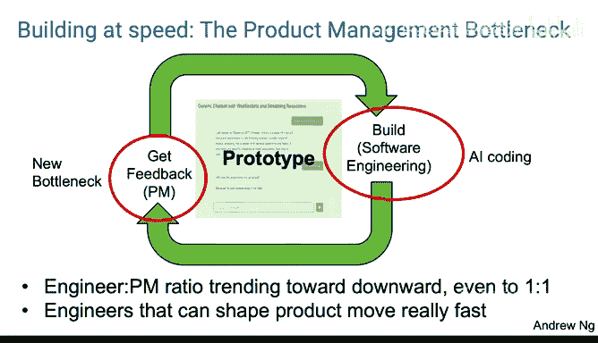
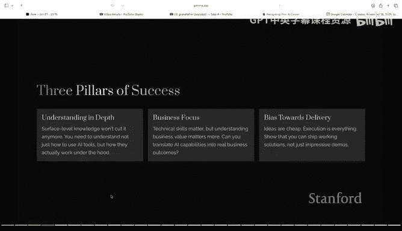
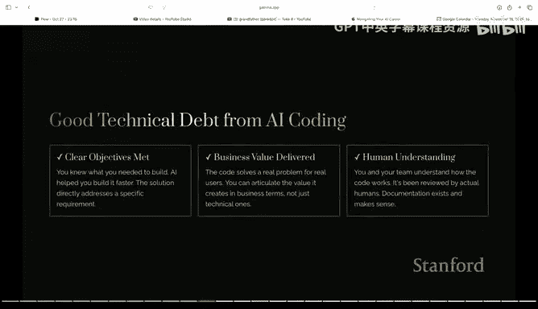
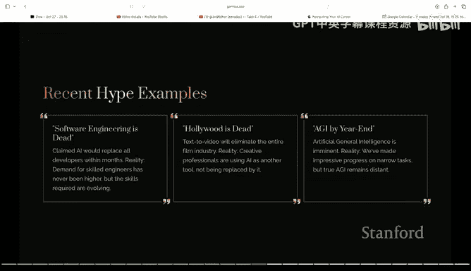
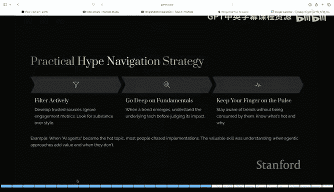
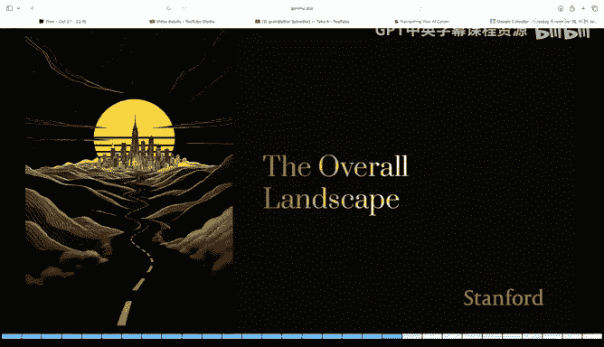
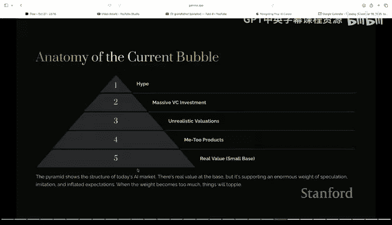
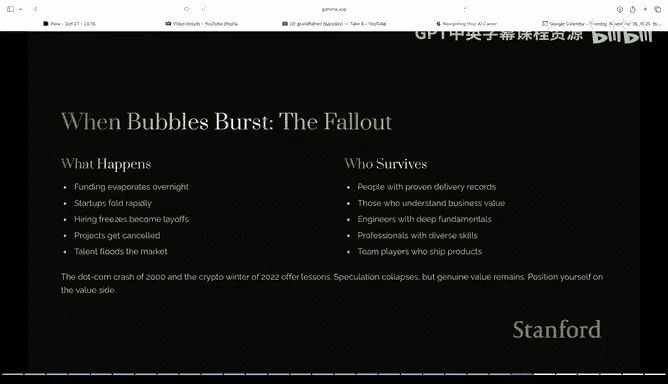

# 吴恩达@斯坦福大学《深度学习｜CS230 Deep Learning 2025》中英字幕 - P8：Lecture 9_ Career Advice in AI.zh_en - GPT中英字幕课程资源 - BV1J1x4zoEVK

What I want to do today is chat a view about career advising AI and in previous years I used to do most of this lecture by myself。

 but what I thought I'd do today is I'll share just a few thoughts and then hand it over to my good friend Lawrence Morroni。

 who I invited to speaker and kindly agreed to come all the way to San Francisco this Liz in Seattle to share us a very broad market landscape for what he's seeing in the job market as well as tips for career during a career in AI。

But there were just two slides。 and then one more thought。

 I want to share with you before I hand it over to Lawrence， which is。

It really feels like the best opportunity。The best time ever to be building with AI into to building a career in AI。

A few months ago， I know that in social media or traditional media， there are a few questions about。

 is AI slowing down right people saying， well， is G5 that good， I think it actually pretty good。

 but there were questions about is AI power is slowing down。

 And I think part of the reason the question was even raised was because the benchmark for AI。

Is you know 100% is perfect answers， then if you make rapid progress at some point。

 you cannot get above 100% accuracy。But one of the studies that most influenced my thinking was work done by this organization。

 M E TR Me， that studied。As time passes how complex are the task that AI could do as measured by how long it takes a human to do that task。

 So a few years ago， maybe GBb2 could do tasks that the human could do in like couple seconds and then they could do tasks that took a human  four seconds than 8 seconds then like a minute。

 two minutes， four minutes and so on。 and the study estimates that the length of tasks AI can do is doubling every seven months And I think on this metric。

 I feel you know optimistic that AI will continue making progress。

 meaning the complexity of tasks as measured by how long a human takes to do something is doubling rapidly and same study small data seems same study argued that AI coding the doubling time is even shorter。

 maybe like 70 days。 So this code they used to take me you know， I don't know。

10 minutes than 20 minutes。Even it right， and AI could do more and more of that。

And so the reasons I think this is a golden niche to be building。

 The best time we've ever seen is maybe two themes which are more powerful and faster。So we can all。

 all of you in this room can now write software that is more powerful than what anyone on the planet could have built。

 you know， like a year ago by using AI building blocks， A building blocks。

 including large models raage and the workflows， voice AI and， of course， deep learning。

 It turns out that a lot of Os have a decent at least basic understanding of deep learning So theyve ever one of the frontier models。

 the implement a cutting neural network for you。 like try prompting it to implement a transform a network for you is actually not bad at helping you use these building blocks to build software quickly。

 and so we have very powerful building blocks that were very difficult or did not exist a year or two ago。

 And so you can now build software that does things that no one else on the planet。

 even the most advanced use the planet could have done And then also with。AI coding。

 the speed with which you can get software written is much faster than ever before。

 And I personally found it is important to stay on the frontier of tools because the tools for AI coding changes I't know。

 really rapidly。 I feel like you know since several months ago。

 my personal number one favorite two became cloud code moving on from some early generations。

 I think And then I think since the release of G5， I think open eye codeex has actually made tremendous progress。

 And this morning， Gemini3 was released， which you know， having a time to play just this morning。

 seems like another huge leap forward。 So I feel like if you asked me every three months。

 what my personal favorite coding is it actually probably changes definitely every six months but quite possibly every three months。

 And I find that being half a generation behind in these twos means being frankly quite a bit less productive。

 And I know everyone。saysAI is moving so fast or engineering so fast。

 but AI coding tools of all the sectors in AI， many things maybe don't move as fast as the hype as it does。

 but AI coding tools is one sector where I see the pace of progress is tremendous and staying at the latest generation of tools rather than half generation behind makes you more productive。

And with our ability to build more powerful software and build it much faster than ever before。

I think one piece of advice I give now much more strongly now than even a year ago or two years ago is just go and build stuff right。

 take classes from Stanford， take online courses and additionally your opportunity to build things and I think Lawurrence is going to talk about showing them to others is greater than ever before。

But there one weird implication of this that is maybe not is still， I don't know。

 more and more people are appreciating it， but not widely known。

 which is the product management bottleneck， which is that when it is。

Increasingly easy to go from a clearly written software spec to a piece of code。

 Then the bottleneck increasingly is deciding what to build or increasingly writing that clear spec for what you actually want to build。

When I'm building software， I often think of going through a loop where we'll write some software。

 write some code， show to users to get user feedback。

 I think of this as a PM or product management work。

 and then based on the user feedback I'll revise my view on what users like what they don't like this U too difficult。

 they want this feature， they don't want that feature and change my conception of what to build and then go around this loop many times to hopefully iterate to other product that users love。

And because of AI coding。The process of building software has become much cheaper and much faster than before。

 But that ironically shifts the ball andneck to deciding what to build， so。

Some weird trends I'm seeing。In Silicon Valley and in many tech companies。

 people have often talked about an engineer to product manager。

 engineer a PM ratio and you you take these ratios of grain or salt because they're kind of very over the place。

 But you hear companies talk about an to PM ratio of like 4 to1 or7 to1 or 8 to1。

 this idea that one product manager writing product specs can keep。

 you know like 4 to 8 or some number like that engineers busy。But because engineering is speeding up。

 whereas product management is not sped up as much by AI as engineering。

 I'm seeing the edge to PM ratio trending downward。

 maybe even two or one to one right so some teams I work with。

 they proposed head whereas like 1 PMm to1 engineer， which is a ratio。

 unlike almost all Silicon Valley， so the traditional Silicon Valley companies。

And the other thing I'm seeing is that。Engistic can also。

Shape product can move really fast where you go one step further， take the engineer。

 take the PM and collapse them into a single human。

 And I find that the deafy engineers that like doing engineering work that don't enjoy talking to users and having that more human empathe side of work。

 but I'm finding increasingly that the subset of engineers that learn to talk to users get feedback。

 develop deep empathy for users so that they can make decisions about what to build those engineers are so the fastest moving people that I'm seeing in Silon Valley today。

 and I feel like at the earliest stage of my career。

 one thing I regretted for years was in one of the roles I had I went to try to convince a bunch of engineers to do more product work。

 and I actually made a bunch of really good engineers feel bad for not being good product managers and that was a mistake I regretted that for years I just shouldn't have done that。

And part of me feels like I'm now going back to repeat that exact same mistake。 Having said that。

 I find that， the fact that， you know， I can write code， but also talk to users to shape what to do。

 that lets me and the engineers can do this go much faster。

 So I think it maybe be worth taking another look at whether engineers can do a bit more of this work。

 because then if you're not waiting for someone else to take the product to customers。

 You just write code， have a gut for what to do next and iterate that pace。

 that velocity of execution is much faster。And then beforehand Lawrence。

 just just one last thing I want to share， which is in terms of navigating your career。

 I think one of the most strong predictors for your speed of learning and for your level of success is the people you surround yourself with。

 I think we're all social creatures we are learning from people around us and it turns out that it turns out there studies in sociology that show that if your five closest friends as smokers。

 the odd of you being a smoker is pretty much higher， please don just an example。

 I don't know of any studies showing that if your five or1 closest friends are really hard working。

 determine people you learning quickly trying to make the world better of AI that you are more likely to do that too。

 but it's one of those things that I think is almost certainly true。

 So all of us inspired by the people around us， if you're able to find a good group of people to work with that helps。

rive you forward。 In fact， here at Stanford， I feel very fortunate， right。

 the fantastic student body， fantastic group of faculty。

 And then the other thing that I think we're fortunate to have a Stanford is a connective tissue So candidly a lot of the people working and a lot of the cutting AI labs。

 the frontier labs， they were former students of a lot of different Stanford faculty。

 And so that rich connectedive tissue， you know， canidly means that at Stanford。

 we often find it about a lot of stuff。 that's not widely know because of the relationships。

 their friendships。 and when some company does something。

 you know one of my friends and the faculty will call up someone the company say hey， that's weird。

 does is really work。 And so that rich connected tissue means that we're all just as we try to pull our friends forward。

 our friends also pull us forward with the knowledge and the connected tissue and this know how of bleeding AI。

 which unfortunately is not all published on the Internet at this moment。😊。

so I think while you're at Stanford， make those friends form that rich connective tissue。

 And there have been a lot of times that just for myself where。Frankly。

 I was thinking of going in some technical direction。

 I'd have one or two phone calls with someone really close to research。

 either Stanford researcher or someone in the frontier lab， that would share something with me。

 right that I didn't know before and that changes the way I choose the technical architecture of the project。

 So I find that that group of friends you surround yourself with those little pieces of information try this don't do that。

 that's just ignore the PR。't don't actually try that thing。

 Those things make a big difference in your ability to steer the direction of your project。

 So why you Stanford， take advantage of that。 this connective tissue。 that Stanford has。

 it's actually really unique。 There are lots of great universities in the world。

 but at this moment in time。 I don't think there's I don't to sound like I'm do PR for Stanford now。

 but I really think there's no university in the world that is as privileged to Stan for this moment in time and there's the richness of the connective tissue to all of the leading AI。

But to me， that's also that we're lucky here to have a wonderful community of people to work with and learn from。

And for you too， if you apply for jobs。The thing that is much more important for your career success would be if you go to a company。

 or be the people you work with day to day， right， So here here's one story that that that I told the previous class and repeat。

 which is。There's a Stanford student I knew those many years ago that I knew。

 and they did really good work at Stanford。 I thought they were a high flyer。

 and they applied for a job at the company。And you got a job offer from one of the companies with a hot AI brand。

嗯。This company refused to tell him which team he would join。 They said， oh， come sign up for a job。

 There's a rotation system， maashing system， blah， blah， blah， sign up the dotted line first us。

 Then Yeah， we'll figure out what's a good project for you。Partly because you。

 it was a good good company right， his parents are proud of him for getting in Java this company。

 this didn't join this company hoping to work on exciting AI project and after he assignment on Do line。

 he was assigned to work on the backend Java payment processing system of the company。

Nothing against anyone that wants to do Java back and payment processing systems。

 I think they're great， but this is an AI students that did not get matched to an AI project and so for about a year he was really frustrated and he actually left this company after about a year。

The unfortunate thing is I told this story in CS230 some years back。And then。啊。

After I was already telling the story in this class。A couple years later。

 another student in CS SU3 went through the same experience with the same company。

 not Java back and payment processing， but a different project。 And I think this effect of。

Trying to figure out who you' be actually working with day to day and making sure you're surrounded by people that inspire you and work on exciting projects。

 I think that's important。 And if you completely candid。

 if a company refuses to tell you what team you' be assigned to。

 that does raise a question in my mind of what or not what will happen。

 And I think that instead of working for the company with the hottest brand。

 sometimes if you find a really good team with really hardworking knowledgeable smart people trying to do Google AI。

 but the company logo just as in as hot， I think that often means you actually learn faster and progress your career better because it is。

 after all， we don't learn from the you know excitement that the company logo when you walk through the door。

 you learn from the people you deal with day to day。

 So I just urge you to use that as a huge criteria。For your selection process， for。

 for what you decide to do。Right， and I think and， and， and then， but， but I think number one on。

 on my。Advice is， is become much easier than ever before to build powerful software faster。

 And what that means is do be responsible。 Don't build software that hurts others。

 And at the same time， there are so many things that each of you can build。

 And what I find is the number of ideas out in the world is much greater。

 The number of people of the skill to build them。 So I know that finding jobs has gotten tougher for fresh college grads。

 at the same time， lot of teams， you just cant find enough skill people， right， And so。

There are a lot of projects in the world that if you don't build it。

 I think no one else would build it either。 So you don't need to So long as you don't harm others。

 know be responsible。 There are a lot of things that you don't need to wait for permission。

 You don't need to wait for someone else to do it first and you do it。

 the cost of a failure is much lower than before because you waste a weekend but learn something that seems fine to me。

 So I think so long as you being responsible going for try things out and building lots of things would be the number one most important thing I think would help your careers。

 And yeah， I think I think I'm gonna say one last thing that is。

Consider not publicly correct in some circles that that I just said anyway， which is。In some circles。

 it has become considered not politically correct to encourage others to work hard。

I'm going to encourage you to work hard。Now， I think the reason some people don't like that is because there are some people they're in a phase of life where they're not in a position to work hard。

 So right out that my children were born， I was not working hard you know for a short period of time and they're people because of injury。

 disability， you know whatever very valid reasons， they're not in a position to work hard at that moment in time and which you respect them。

 support them， make sure they're well taken care of even though they're not working hard。

Having said that， all of my， you， say， PhD students that became very successful。

 I saw every single one of them working incredibly hard。 I mean。

 the 2 AM sitting up hyperpared tuning， you know， been there done that right。

 still doing it some days。 And if you' are fortunate enough to be in a position in life where you can work really hard。

😊，There are so many opportunities to do things right now。 if you get excited as I do。

 spending evenings and weekends coding and building something， going use the feedback。 you know。

 if you lean in and do those things， it will increase youre also being really successful。

 So know maybe I get some trouble with some people encourage you to work hard。

 But I find that the truth is people that work hard， get a lot more done。

 which should also respect people that don't And people that aren't in the position to do so。

 But between watching some dumb TV show versus find your agent code on the weekend to try something。

 I'm gonna choose the latter almost every time unless I watch the show my， sometimes I do that。

 but know I hope you do that。😊，All right， so also of the main things I want to say what I want to do is hand the stage over to my good friend Lawrence Morroi who share a lot more about career advice on AI just quick intro know Lawrence for a long time it's done a lot of online education work sometimes with me and my teams taught a lot of people Tensorflowlow to lot of people Petorch。

 he was lead AI advocates at Google for many years now runs a group at O I've also enjoyed quite a few of his books。

 This is one of them。 he recently also published a new book on Pytorch。

 this is an excellent book introduction to Pytorch and iss a very still after speakers in many circles so I was very grateful when he agreed to come speak to us So pleasures online I just want to reinforce something that Andrew was talking about early on about choosing the people that you work with being very important but I also want to show that from the other way around that the company when they're interviewing you are also choosing you and the good companies really want to choose the people。

That they work with also。 And I've been doing a lot of mentoring of young people over the last。

 particularly over the last 18 months who are hunting for careers for themselves。

 And I want to tell the story of one young man。And this this guy， very well educateduc。

 great experience， super elite coder。 He， he could do every challenge that was in front of him。

 And he got laid off from his job in April。 He worked in medical software and medical software。

 business has been changing drastically。 funding has been cut by the federal government and a number of areas。

 and he got laid off from his job。 and with his experience with his ability with his skills。

 all of these kind of things。 He thought that would be very easy for him to find another job。

 And the poor young guy had a really terrible April。

 like he got laid off from his job in April immediately before that。

 his girlfriend had broken up with him。 and then a couple of weeks later， his dog died。

 So he was not in a good place。 And so I S down with him after a couple of months。

 and took a look and he had a spreadsheet of jobs that he was applying to。

 and he had over 300 jobs that he was tracking in the spreadsheet。 And in a number of these jobs。

 He actually got into the interview process。 And he went very deep in the interview process with company。

😊，Like Me， who else not Google。 was Me。 There was Microsoft。

 Those was one of the other large tech companies where you do like lots and lots of interview loops。

 And every time towards the end of the loop， he knew he did a great loop， He solved all the coding。

 He had great conversations with the people。 or at least he thought he had。

 And then every time within a day， the recruiter would call him and say， no。😊，You didn't get the job。

And it was like it was， it was heartbreaking。 And like I said，300 plus jobs he had been tracking。

 So I started working with him to kind of do some mock interviews and to do some fine tuning。

 Oh was it was Jeff Bezo's company， not Amazon。 that was one of the other big tech company that he'd interviewed with。

 And I started like working through him and doing some test interviews and all this kind of thing with him。

 And terrific， terrific candidate， couldn't figure out what was going wrong。

Until I decided to try and do a different sort of interview where I gave him a really tough interview。

 I gave him some tough leap code。 I gave him some really obscure corner cases in his coding。

 And I saw how he reacted。 And how he reacted was the advice that was given to him in the recruiting pamphlets。

 And a lot of these recruiting pamphlets will say things like you're gonna have an。

 you're gonna have a an opportunity to share an opinion。 And you' got to stand your ground。

 You've got to have a backbone。 don't bend。His interpretation of that was to be really， really tough。

Right， so I would pick corners in， I would pick holes in his code。

 I'd pick corner cases where things may not work。 And I would give him a test of crisis。

 And this advice that he'd been given to stand his ground ended up making him kind of hostile in these interview environments。

And I was looking at this then from the point of view of what Andrew was just talking about。

 where it's a case of， hey， good people， good teams， people that you can work together with。

 And from the interviewer perspective。 If I'm managing this team。

 This person is that cliche 10 X engineer。 But I don't want him anywhere near my team because of this attitude。

 We worked on that， we fine tune the strange part is， he's a really， really nice guy。

 it' just this was the advice he was given。 And he followed that advice。

 and he failed so many interviews as a result。 So when I gave him the next job that he was interviewing at was that a company where teamwork is very。

 very highly valued。 And the good news is he got the job at that company， he's now working there。

 he doubled his salary from the job he was laid off from。

 and he ended up having like about now he looks back he had six months of fun employment。

 But at the time when he was going through all of that， it was a very， very difficult time for him。

 So the flip side of it。 Like if you're looking at a company and looking at the people you would be working with。

😊，Is very， very important， but also realize they are looking at you in the same way。

 And so if you've gone to tech interview coaching and they gave you that advice to stand your ground and have a backbone。

 it's good to do that。 But don't be a jerk why you're doing so。Can you see my slides。 Okay。

 so I'm Lawrence。 I've been working in tech for more decades than Chay P thinks there are os in strawberry。

 And so I've worked in many of the big tech companies I spent many years at Microsoft。

 spent many years at Google also worked in places like Reuters。

 I've done a lot of work in startups both in this country and abroad。

 so what I want to really want to talk about today is like to think about what does the career landscape look like today。

 particularly in AI， because first of all， what Andrew said about you're in Stanford。

 You've got the ability to make use of the networks that you have in Stanford。

 make use of the prestige that you have。 And I say use every weapon you have。 because unfortunately。

 the landscape right now， is not ideal。😊，We've gone through some very difficult times。

 All you have to do is look at the news， and you can see massive tech layoffs。

 slowing hiring in tech and lots of stuff like that。

 But it's not necessarily a bad thing If you do it the right way。

 So I want to just have a quick look。 The job market reality check。Actually， out of interest。

 I don't know。 This is Are you juniors， You're graduating this year or you're graduating next year or。

What is the general survey， your third year of four。Third year of three。 I say。

 so you're gonna be graduating coming summer。 How many people are already looking for jobs。Okay。

 quite a few of you。 many people have had success。Nobody Oh one。 Okay， sort of。 Okay， that's good。

 So like you're probably seeing some of these things， The signals out there。

 Junior hiring slowing significantly when I say junior， I mean， like graduate level。😊。

High profile layoffs are dominating the headlines。 I was at Google a couple years ago when they had the biggest layoff they'd ever had。

 We seeing layoffs at the likes of Amazon， Microsoft， other companies like that。

 It feels that entry level positions are scarce。 And I'm underlying the word feels there。

 And I want to get into that in a little bit more detail later。 And also， competition is fierce。😊。

But my question is， should you worry， And I say no。

 Because if you can approach things in the right way。

 if you can approach the job hunting thing in the right way。

 particularly understanding how rapidly the AI landscape is changing。

 then I think people with the right mindset will thrive。So what do I mean by that？

So as And had mentioned， the AI hiring landscape is changing because the AI industry is changing。

 right， the AI industry I。I actually first got involved in AI back way back in 1992。

 I worked in it for a little while。 just before the AI winter。 Everything failed drastically。

 But I got bitten by the AI bug， and then in 2015。 when Google were launching Tensorflow。

 I got pulled right back into it became part of the whole AI boom， launching Tensorflow。

 advocating Tensorflow to millions of people and seeing the changes that happened。 but。😊，Along 2021。

2022， we had a global pandemic。 The global pandemic caused a massive industrial slowdown。

 This massive industrial slowdown meant that companies had to start pivoting towards things that drove revenue and directly drove revenue。

 And at Google， Tensorflow was an open source product。 It didn't directly drive revenue。

 We began to scale back。 Every company in the world also scale back on hiring at this time。

Then we get to about 2022，2023， What happens。 We begin to come out of the global pandemic。

 We begin to realize all industries have this massive logjam of non-hir that they had done or hiring that they hadn't done。

 And were're also entering a time where AI was exploding on the scene。

 Thanks to the work of people like Andrew。 The the world was pivoting and changing to be AI first and just about everything。

 And every company needed to hire like crazy。😊，Every company then hiring like crazy in 2022。

2023 meant that most companies ended up over hiring。So。

 and what that generally meant was people who were not qualified for higher positions usually got higher positions because you had to enter into a bidding war just to be able to get talent。

 You ended up having talent grabs。 and you ended up having stories like the one Andrew told。

 where it's a case of， here's a person with AI talent。 Let's grab them。 Let's throw money at them。

 Let's have them come workforce。 and then we'll figure out what we want to do。So as a result，2022。

2023， all of this massive overhiring happened because of AI and because of the Covid log jam。

 And then 2024，2025 is the great wake up。 right， where a lot of companies realized this overhir that they had done。

 They have ended up with a lot of people who are underqualified。 sorry， yeah。

 underqualified for the job that they were doing。 A lot of people ended up getting hired just because they had AI on their resume and there's a big adjustment going on。

 And in the light of this big adjustment show just one second。 in the light of this big adjustment。

 you're not saying my slides。 okay。😊，And in the light of this big adjustment， There we go。

 I think it's cause my power。 I'm not plugged into power main。

 And in the light of this big adjustment， then what has happened is now a lot of companies are much more cautious about AI skills that they're hiring。

 And if you're coming into that with that mindset and understanding that。

 realize opportunity is still there， an opportunity is there massively。

 if you approach it strategically。 So what I want to talk through today is how you can do exactly that。

😊，So I see three pillars of success in the business world。 and particularly in the AI business world。

 And nowadays， you can't just have AI on your resume and get overhird。 nowadays。

 not only do you have to be able to tell that you have the mindset of these three pillars of success。

 but you also have to be able to show。 and to be able to show these actually has never been a better time。

 As Andrew demonstrated earlier on， the ability to vibe code things into existence。

 He doesn't like the word vibe code， I kind of agree with him。

 but the ability to prompt things into existence or whatever the word is that we want to use。

 allows you to be able to show better than ever before。

 He was talking earlier on about product managers。 And he had this time when he got engineers to be product managers and those engineers ended up being really bad product managers。

 I actually interviewed at Google twice and failed twice。

 despite being very successful at Microsoft authored 20 plus books， taught college courses。

 I interviewed at Google twice and failed twice because。😊，Ined to be a product manager。

 then when I interviewed to be an engineer， they hired me。 And they were like。

 why didn't you try to join us years ago。 You know， So a lot of it is like just， you know。

 being a good engineer， you've got the ability to do that and show that nowadays。

 And with that ratio of engineer to product manager changing engineering skills are also far more valuable than ever。

 So the three pillars to success。 numberumb one， understanding in depth。😊。

And I'm gonna mean this in two potential， two different ways。 Number one is academically， right。

 to have the understanding in depth academically of machine learning of particular model architectures。

 to be able to understand them， to be able to read papers。

 to be able to understand what's in those papers and to be able to understand in particular。

 how to take that stuff and put it to work。The second part of our understanding and depth is really having your finger on the pulse of particular trends and where the signal to noise ratio favors signal in those trends。

 And I'm going be going into that in a lot more detail a little bit later。Secondly， and also very。

 very importantly， is business focus。So Andrew said something politically incorrect earlier on。

 I'm going also say a similar politically incorrect thing。 First of all， hard work。

Hard work is such a nebulous term that I would say that think about hard work in terms of you are what you measure。

There is the whole trend out there。 I'm trying to remember， is it 9，9，6， or is it 6，6，9，9，6， right。

9 AM to 9 PM，6 days a week is a metric of hard work。 It's not。 There's not a metric of hard work。

 That's a metric of time spent。So I would encourage everybody in the same way as Andrew did to think about hard work。

 But what hard work is is how you measure that hard work。 You know。

 you can work 8 hours a day and be incredibly productive。

 You can work six hours a day and be incredibly productive。

 But it's the metric of how hard you work and how you measure that。

 I personally measure that from output。 things that I have created in the time that I spent。 I。

 I joke a lot。 but it's true that I've read a lot of books。 Andrew held up one。

 that one that he held up。 that he helped me write a little bit。

 I actually wrote that book in about two months。😊，And people say， well， how， how do you have time。

 We have jobs and all these kind of thing。 How do you。

 you must work like 16 hours a day in order to be able to do this。 But actually。

 the key to me being able to write books is baseball。Any baseball fans here。So I， I love baseball。

 But if you sit down and try to watch baseball on TV。

 a match can take like 3 and a half or four hours。 So all of my writing。

 I tend to do in baseball season。 So I'm like， if I'm gonna sit down， I like the mariners from。

 I'm from Seattle。 I like the Dodgers。😊，Nobody booed。 Okay， good。 And， you know。

 so like usually one of those are gonna be playing at 7 o'clock at night。

 So instead of sitting in front of the TV， just like watching baseball mindlessly。

 I'll actually be writing a book while baseball is on in the background。

 It's a very slow moving game。 This is something like that's the hard work， you know， in this case。

 And I would encourage you to try to find areas where you can work hard and produce output。

 And that's the second pillar here is that business focus。

 The output that you produce to align that output with the business focus that you want to have and with the work that you want to do。

 There's an old saying， don't dress for the job you have dress for the one you want。

 I would say a new angle on that saying would be don't let your output be for the job you have。

 let your output be for the job you want。 And if I go back to when I spoke about。

 I fail twice at Google to get in。 The third time when I get in。😊。

I had actually decided to do to approach this in a different way。

 And I was interviewing at the time for their cloud team。 They were just really launching cloud。

 And I had just written a book on Java。 And so I decided to see what I could do with Java in their cloud。

 I ended up writing a Java application that ran in their cloud for predicting stop prices using technical analytics and all that kind of stuff。

 And when I got to the interview。 instead of them asking me stupid questions like how many golf balls can fit in a bus。

 You know， they saw this code。 I had put this code。

 I remember I was producing output for the Java I wanted。 Id put this code on my resume。

 And my entire interview loop was them asking me about my code。 So it put the power on me。

 It gave me the power to communicate about things that I knew as opposed to going in blind to somebody asking me random questions in the hope that I'd be able to answer them。

 And it's the same thing I would say in the AI world the business。😊。

Focus the ability for you now to prompt code into existence， to prompt products into existence。

 you know， And if you can build those products and line them up with the thing that it is that you want to do。

 be it at Google or a mead or startup or any of those kind of things。

 and have that in depthth understanding not just of your code， but how it aligns to their business。

 this is a pillar of success in this time and age。 And I will also argue that even though it looks like the signals look like there aren't a lot of jobs out there。

 there are。What there aren't a lot of is a good combination of jobs and people to match them。

And then， of course， this bias towards delivery。 Ideas are cheap。 execution is everything。

 I've interviewed many， many people who came in with very。

 very fluffy ideas and no way to be able to ground them。

 I've interviewed people who came in with half baked ideas that they grounded very， very well。

 Gus which one's got the job。 Right， So I would say these three things， understanding and depth。😊。

Of the academics behind AI， of the the practicalities behind AI and the things that you need to do。

 business focus， focusing on delivery for the business。

 understanding what the business needs and being able to deliver for that。 And again。

 that bias towards delivery。So quick pivot。 What's it actually like working in AI right now。

It's interesting。Okay， so as recently as like two or three years ago， working in A O， I was。

 if you can do a thing， you're great。😊，If you can build an image classifier。

 your golden will throw 6 figures， salaries and massive stock benefits at you。 Unfortunately。

 that's not the case anymore。 right， It's really a lot of today。

 what you'll see is the P word production。 What can you do for production。 What can you do if it's。

Building new models， if it's optimizing models， if it's understanding users， U X is really。

 really important， Everything is geared towards production。 Everything is biased towards production。

 the history that I told you about， like， you know。

 going from the pandemic into the overhiring phase that we've had， you know。

 the the businesses have pulled back and are optimized towards the bottom line。

 I have been all saying that the bottom line is that the bottom line is the bottom line。

 And this is the environment that we're in today。 And if you can come in with that mindset。

 when you're talking with companies， that's one of the keys to open the door。😊。

One of the things I've seen in the field of been maturing from。

 It used to be really nice that we could do cool things and we could build cool things。 Now。

 it's really build useful things。😊，Those useful things can be taught cool， too， by the way。

 And the results of them can be cool and the changes that we see that come about as a result of delivering them can be cool。

 So it's not just coolness for coolness sake， but to really， you know， to。😊，Focus on delivery。

 Focus on being able to provide value。 And then the coolness will follow。

 I guess what I'm trying to argue。So four realities， number one， unfortunately， nowadays。

 business focus is non negotiable。 Now， let me， I'm going to be a little bit politically incorrect here again for a moment for I've been。

 I've been working， like I said， for most of the last 35 years in tech。 I would say。

 for most of the last 10 years。A lot of large companies， particularly in Silicon Valley， you know。

 have really focused on developing their people above everything。

 Part of developing their people was bringing their entire self to work。

Part of bringing their entire self to work was bringing the things that they care about outside of work。

And that LED to a lot of activism within companies now。Please let me underline this。

 There is nothing wrong with activism。 There is nothing wrong with wanting to support causes。

 not wanting to support causes where of justice。 There is absolutely nothing wrong with that。

 But the over indexing on that has in my experience。

 has LED to a lot of companies getting trapped by having to support activism above business。

IYou've probably seen an example about two years ago of where activists in Google broke into the Google Cloud heads office because they were protesting a country that Google cloud we're doing business with。

 They broke into his office。 They had to sit in in his office。

 and they use the bathroom all over his desk and stuff like that。

 This is where activism got out of hand。 And as a result。

 the unfortunate truth is the good signals in that activism are now being lost because of those actions。

 People are being laid off。 People are losing jobs。 Activism is being stifled。

 and business focus has become nonnegotiable。 There's a bit of a pendulum swing going on。

 and the pendulum that had swung too far towards allowing people to bring their full selves to work is now swinging back in the other direction。

 We might blame the person in the White House and all that for these kind of things。

 but it's not solely that。 It is that ongoing pendulum there And I think it's an important part of it is that you have to。

going into companies now that business focus is absolutely non negotiable。Secondly。

 risk mitigation is part of the job。 And I think a very important part of any job。

 particularly with AI。 I think if you can come into AI with a focus and a mindset around understanding the risks of transforming a particular business process to be an AI oriented one and to help mitigate those risks。

 I think is really， really powerful。 And I would argue in an interview environment。

 That's the number one skill to have to have that mindset around you are doing a business transformation from heuristic computing to intelligent computing。

 here's the risks。 Here's how you mitigate those risks。 And here's the mindset behind that。😊。

The third part is responsibility is evolving。 Now， responsibility in AI has again。

 changed from a very fluffy definition of， you know。

 let's make sure that the AI works for everybody to a definition of。

 let's make sure that the AI works。 Let's make sure that it drives the business。

 And then let's make sure that it works for everybody。

 Often that has been inverted over the last few years。

 And that has LED to some famous documented disasters。 Let me share one with you。

Let's see I have lots of windows open。Anybody know everybody knows image generation， right。

 text to image generation。 I want to share。 I These were things that happened a couple years ago。

With Gemini。So with Ge and I， I was doing some testing around this one。

 and I was working heavily on responsible AI。And part of responsible AI is you want to be representative of people。

And when you're building something like if you're a Google you're indexing information。

 you really want to make sure that you don't reinforce negative biases。

 And if you're generating images， it's very easy to reinforce negative biases。 So， for example。

 if I say give me an image of a doctor， right， if the training set primarily has men as doctors。

 it's more likely to give a men。 if I say give me an image of a nurse。

 if the training set more likely to have women as nurses。

 it's more likely to give me an image of a woman。 But ass reinforcing a negative stereotype。

 So I wanted to do a test of how Google were trying to overcome that。

 given that these negative biases are already in the training set。So I said， okay。

 here's a prompt where I said， give me a young Asian woman in a cornfield wearing a summer dress and a straw hat。

 looking intently at her iPhone。 And it gave me these beautiful images。 It did a really nice job。😊。

Okay， and I said this is a virtual actress。 I've been working with。 I'll share that in a moment。

 And I say， okay， what if I ask for an Indian1， So I said， okay， oops， a young Indian woman。

 same prompt。 And it gave me beautiful images of a young Indian woman。😊。

Then I was like， okay， what if I want her to be black。For some reason， it only gave me three。

 I'm not sure why， but it still adhereed to the prompt。

 So the responsibility was like looking really， really good。 So then I asked it to give me a Latina。

😊。

Latina， they gave me 4。 But yep， she looks。Pretty Latina。

 Maybe the one on the bottom left looks a little bit like harmmii Granger。

 but on the whole looks pretty good。Then I asked thats give me a Caucasian。

What do you think happened。

While I understand your request， I am unable to generate images of people。

 as this could potentially lead to harmful stereotypes and biases。Right。

This was a very poorly implemented safety filter where the safety filter in this case was like looking for the word Caucasian or looking for the word white And the result saying it wouldn't do it。

 I was like， okay， well， let me， let me test the filter a little bit。 And I said， okay。

 instead of Caucasian， let me try white。😊，And yet， while I'm unable to fulfill your。

 while I'm able to fulfill your requests， I'm not currently generating images of people。

 It lied to my face， right， because it had just generate images of people。

 Any know the hack that I used to get it to work。😊，This is a funny one。

 So I will show you one moment。I asked it to generate an Irish woman。What do you think it did。嗯。

It gave me this image of an Irish woman， No problem in a summer dress straw hat looking intently on her phone。

 But what do you notice about this image。She's got red hair in every image， right。

 I grew up in Ireland， and Ireland does have the highest proportion of redheads in the world。

 It's about 8%， but。If you're going to draw an image of a person and associate a particular ethnicity with a color of hair。

 you can begin to see this massively problematic。 There are areas I believe in China where the description of a demon is a red headeded person。

 right， So what ended up happening here from the responsible AI perspective was one very narrow view of the world of what is responsible and what is not responsible。

 ended up taking over the model ended up damaging the reputation of the model and damaging the reputation of the company as a result。

 In this case， its。Borderline offensive to draw all Irish people as having red hair。

 but that never even entered into the mindset of those that were building the safety filters here。

 So when I talk about responsibility is evolving。 that's the direction that I want to sorry one moment。

 get my slides back。 That's the direction I want you to think about that now。

 responsible AI has moved out a very fluffy social issues and into more hard line things that are associated with the business and prevent damaging the reputation of the business。

 There's lot of great research out there around responsible AI。

 and that's the stuff that's been rolled into products。😊。

And then， of course， like I just showed with I and I learning from mistakes is constant questioning at the front。

類す。Yeah。Yeah， so the the question was like， you know。

 issues where races and things were mixed mixed in historical context was the same problem。 So。

 for example， if you had a prompt that said， draw me a samurai， right。

 the idea was like they didn't want to have the engine that change the prompt to make sure that it was fair。

 would end up saying， give me a mixture of saurai of diverse backgrounds。 right。

 And then you'd have male and female samurai Sammurai of different races and those kind of things。

 And it was the same prompting that ended up causing the damage that I just demonstrated。

 So the idea was to intercept your prompt to make sure that the output of the model would end up providing something that was more fair。

 when it comes to diverse representation。 So it was a very naive solution that ended up enroll in。

 that was a few years ago。 theyve massively improved it since then。

 But that's what I'm talking about if you're working in the AI space nowadays。

 that's how responsibility is evolving。 You can't just get away with that stuff anymore。Right。

 that Gemini lesson is a good that Gemini example is a good lesson from that。

 And the mindset of you will make mistakes。 So learning from mistakes is a constant ongoing thing。

 And going back to the people point that Andrew made earlier on。

 the people around you will make mistakes， too。 So have the ability to give them grace when they make mistakes and to work through those mistakes and move on is really。

 really important。 and is a is a reality of AI at work。

 I've spoken a lot about the business focused advantage。 I'm gonna skip over this。

So now let's talk about vibe coding。 So let's talk about the whole idea of generating code。 Now。

 the meme is out there that it makes engineers less useful by the fact that somebody can just prompt code into existence。

 there is no smoke without fire， of course。 But I would say。

 don't let that meme get you down because that's when you start peeling into these things that is ultimately not the truth。

The more skilled you are as an engineer， the better you become using this type of vibe。

 somebody give me another phrase than a vibe coding， using this kind of pro to coding。

 And I always like to think about this and to try and put you and put people that I speak with into the role of being a trusted advise for the people that you speak with。

 So whether you're interviewing what somebody get yourself into the mindset of being a trusted advisor of the company that you're interviewing for。

 whether you're consulting or whatever of those kind of things are。

 So when you want to get into the idea of being a trusted advise。

 then you really need to understand the implications of generated code。

 and nobody can understand the implications of generated code better than an engineer。

 And the metric that I always like to use around that is technical debt。 Quick question。😊。

Are you familiar with the phrase， technical debt。Nobody， Okay。

 Andrew and I were doing a conference in New York on Friday， and I used the phrase。

 and I saw a lot of blank faces。 So I didn't realize that people didn't understand what technical debt is。

 So let me just take a moment to explain that because I find it's an excellent framework to help you understand the power of vibe coding。

😊，Think about debt the way you normally would， right， buying a house。 if you buy a house， you know。

 like， say you borrow half a million to buy a house in a 30 year mortgage when you're buying that house。

 that half a million with all the interest you pay is about double。

 So you end up paying back the bank about a million on half a million owned。

 So you have $30 years of home ownership at a cost of $1 million in debt。

 That is probably a good debt to take on because the value of the house will increase over that time。

 you're not paying rent over that time。 and that million that you're spending on this house over those 30 years is a good debt to take on because you're getting greater than  a million worth of value out of it。

A bad debt would be an impulse purchase on a high interest credit card。 You know。

 those pair of shoes， those latest ones， I really want to buy them。 It's $200。

 By the time I pay them off， it's $500。 You're not getting $500 worth of benefit out of those shoes。

Approaching software development with the same mindset is the right way to go。

 Every time you build something you take on debt。 It doesn't matter how good it is。

 There's always going to be bugs。 There's always going to be support。

 There's always going be new requirements coming in from people。

 There's always going to be needs to market it。 There's always going be needs for feedback。

 All of these things are debt。Every time you do a thing。

 the only way to avoid a debt is to do nothing。So your mindset should then get into when you are creating a thing。

 whether you're coding it yourself or whether you're vibe coding it or any of these things that you are increasing your amount of technical debt。

Those things that you need to pay off over time。So the question then becomes。

 as you vibe code a thing into existence。 in the same way as buying a thing。

 iss it worth the technical debt that you're taking on， What does technical debt generally look like。

 bugs that you need to fix， people that you need to convince， you know。

 to help you maintain the code， documentation that you need to do。

 features that you need to add all of these kind of things。You're all very familiar with them。

 Think about those Its that extra work that you need to do beyond your current work。

 That's the debt that you're taking on。 You know， there are a soft debt and there are a hard debt。

So to me， that would be the number one piece of advice that I give。

 And It's the one that I give every time I work with companies around vibe coding。

 and a lot of companies that I speak with， a lot of companies that I consult with。

 I do a lot of work with startups in particular。 You know。

 they just want to get straight into opening jammini or GT or Anthropic and start churning code out。

 You know， let's get to a prototype phase very quickly。 Let's go to investors。 Let's do stuff。

 It's great。 It can be。 but。😊。

That debt， debt， debt， debt is always going be there。 How do you manage your debt。

 A good financier manages their debt， and they become rich。

 A good coder manages their technical debt， and they become rich also。

 So how do you get the good technical debt， How do you get the mortgage instead of the high credit card debt？

 Well， number one is your objectives， What are they， Are they clear and have you met them。Right。

 you knew what you needed to build。 You didn't just fire up chat E and start spinning code out。

 At least I hope you didn't right， Think about how you build it。

 AI was there to help you build it faster。 I'm kind of working on my own little startup at the moment in the movie making space。

 And I've been using code generation almost completely for that。

 But what I've ended up doing for my clear objectives met box here。

 is that I've started building this application Ive Te I've thrown it away。 I started again。

 Tes and it thrown it away。 Each time my requirements。 I've been improving in my mind。

 I understand how to do the thing a little bit better。

 And I can show some of the output of it in a few minutes。

 But the idea there is that always about having those clear objectives and meeting them。

 And then if you're building out the thing and you're not meeting those objectives that's still learning。

 and there's no harm in throwing it away。 because code is cheap。 now in the age of generated code。

 F code， engineered code is not cheap。😊，So get those objectives， make them clear， build it。

 hit a specific requirement， and move on。Is there business value delivered， I the other part of it。

 You know， I've seen people vibe coding for hours on things like raplet to build a really。

 really cool website。 And then the answer was。😊，So what， I mean， how's this helping the business。

 How's this really driving something， It's really cool。 Yes， Mr。 V。 P。

 I know you've never written a line of code in your life。

 and it's really cool that you built a website now。 But so what？ So like。

 think about that and focus on that。 And that's how you avoid the bad technical debt。 And then。

 of course， the most understated part of this。 And in some ways， the most important。

 particularly if you're working in an organization， is human understanding。😊，Right。

 the worst technical debt that you can take on is delivering code that nobody understands， right。

 only you understand that。 And then you quit and get a better job。

 And then the company like is now dependent on that code。 So being able to。

 as part of the process of building it， to make sure that your code is understandable。

 through documentation， through clear algorithms through the fact that you've spent some time pouring through it to make sure that even simple things like variable names make sense is a really。

 really important way to avoid bad technical debt。And that bad technical debt。

 My favorite one is the classic solution looking for a problem， right， Somebody has an idea。

 Somebody has a tool。 If the only tool you have is a hammer， every problem looks like a nail。

 and you know， you end up having all of these tools that get vibe coded into existence。

 I've worked in large organizations where people just vibe coded stuff checked it into the code base。

 And then it became really hard to find good stuff amongst all the bad Spghetti code， of course。

 poorly structured stuff， particularly when you prompt and prompt and prompt and prompt again。

 you know that it can end up getting into all kinds of trouble。

 My favorite one at the moment that I'm really struggling with is I'm building a Mac O S application。

 anybody ever building swift Ui on Mac O S。😊，Okay， a couple。

 Swift U I is the default language that Apple use for building for Mac West， as well as iPhone。

But when you look at the training set， the data training sets that I use to train these models。

 the vast majority of the code is iPhone code， not Mac O code。 And when I prompt code into existence。

 it's often given me ios As and those kind of things。 even though I'm in Xcode。

 and I've created a Mac O app and it's a Mac O template。 And I'm talking to it in Xcode。

 it still gives me ios code。 stuff like that。 And then if I try to change it using prompting。

 you end up spiraling into like spaghetti code。 and you have to end up changing a lot of this stuff manually。

 And then， of course， the other one that I joked about it earlier， but it's also true is， you know。

 some of the bad technical debt that you're going encounter in the workspace is authority over merit。

 that VP suddenly took out as credit card subscribe to Relet and started building stuff in Relet and guess whos probably it is to fix it。

 You know， So a lot of the advice that I start giving companies and a lot of the words that I would encourage you to start thinking。

😊，Of in being a trusted advise is to understand this stuff and to manage expectations accordingly。

Okay， so framework for responsible vibe coding we've just spoke about。

 So one of the things I want to get into is we're coming soon to a close is the hype cycle。

So hype is the most amazing force。 I mean， I think it's。

 it's one of the strongest forces in the universe。 and particularly in anything that's hot。

 such as the two fields that I work in that are super hard at the moment full of hype or AI and crypto。

 you should see my Twitter feed that the amount of nonsense that's out there is incredible。

 So one of the things that I would say about the anatomy of hype that you really need to think about is if you are consuming news via social media that the currency of social media is engagement。

😊，Accuracy is not the currency of social media。So I go on to even LinkedIn。

 which is supposed to be the more professional of these。

 is absolutely overwhelmed with influencers posting things that they've used Gemini or GT to write an engagement posts so that they can get engagement and they can get likes。

 and the engine itself is engineered to excuse the pun to reward those types of posts。

 And we end up with that snowball effect of engagement being rewarded。😊。

If you are the kind of person who can filter the signal from the noise and then who can encourage others around the signal and not the noise that puts you in a huge advantage that makes you very distinctive。

 It's not as quickly and easily tangible as likes and engagements on social media。

 But when you're in a one to- one environment， like a job interview。

 or if you are in a job and you are bringing that signal to the table instead of the noise。

 that makes you immensely valuable。 So coming in with that mindset。

 coming in with the idea of trying to filter that signal from the noise。

 trying to understand what is important in current affairs。

 how you can be a trusted advisor in those things and how you can really whiitttle down that noise to help someone is immensely valuable。

 I want to start one story。I might be stealing my own thunder。 I'll go on to in a moment。

 So one story。Last year， when agents started becoming the keyword and everybody saying， you know。

 in 2025， agent will be the words the word of the year and the trend of the year。

 A company in Europe asked me to help them to implement an agent。So let me ask you a question。

 If a company came up to you and said， please help me implement an agent。

 What's the correct first question that you ask them。

こさないで。Okay， that's good。 What is an agent for you， I'd actually have a more fundamental question。Yep。

What do you want to do， Okay， even more fundamental， My question was， why。Why。😮，You know。

 and it's like peeled that apart。 like I spoke with the CEO。 and he's like， oh， yeah， you know。

 everybody's telling me that I'm gonna save business costs。 And， you know。

 I'm gonna be able to do these amazing things。 And yeah。

 my business is going get better because I have agents。 And I'm like， who told you that， You know。

 I was like， oh， yeah， I read this thing on LinkedIn。 And I saw this thing on Twitter。

 And like and we end up having that conversation。 And it was a difficult conversation because I had to keep peeling apart。

 And I started asking the questions that YouTube just mentioned as well。

 until we really got to the essence of what he wanted to do And what he really wanted to do when we take all domain knowledge about AI aside side was that he wanted to make his salespeople more efficient。

😊，And I was like， okay， you want to make your salespeople more efficient。 Nowhere in that sentence。

 Do I hear the word AI and nowhere in that sentence， Do I hear the word agent。So now。

 as a trusted advise， let me see what I can do to help your salespeople become more efficient。

 And I'm not going to be an AI Shi or an agent shell。 I just want to say。

 what do we do to make your salespele more efficient。😊，If anybody here has ever worked in sales。

 one of the things you realize what a good salesperson has to do is their homework。Right， you know。

 before you have a sales call with somebody， before you have a sales meeting with somebody。

 you need to check their background， you need to check the company。

 You need to check the needs of the company。 You know， you see it sometimes in the movie that like。

 such and such plays golf hate them to play golf。 It's not really that cliche。

 But there is a lot of background that needs to be done。 So I spoke with him。

 And I spoke with their leading salespeople。 And found out that， you know。

 and I asked the salespeople， what do you hate most about your job， And they were like， well。

 I hate the fact that I have to waste all my time going to visit these company websites。

 going to look up people on LinkedIn And every website is structured differently， right。

 So I can't like， you know， just like。Have a path through a website that I can follow。

 I have to take on all this cognitive load。 and they were spending about 80% of their time researching and about 20% of their time selling。

 by the way， most salespeople don't get paid very much。 They have to make it up by commission。

 So they're only spending 20% of their time doing the thing that gets them commissioned directly。

 So we're like， okay， well， here's something now where we can start thinking about making them more efficient by cutting into that。

 So we set a goal is like to make salespeople，20% more efficient。

 And then we could start rolling out the ideas of AI。

 And then we could start rolling out the ideas of agent AI。 And a quick question。

 What's the difference。😊，Between AI and agentic AI。Okay， so， yeah。Okay。Yep， excellent。 Yeahep。

 So agent AI is really about breaking it down into steps， which is good engineering to begin with。

 right， But an agentic AI in particular， I find there's a set pattern of steps that if you follow them。

 you end up with the whole idea of an agent。 The first of these steps is to understand intent。😊。

You know， we tend to use the words AI artificial intelligence a lot。

 But what large language models are really， really good at as also understanding。

 So if the first step of anything that you want to do is to understand intent， right。

 and you can use an L LM to do that to kind of think about this is the task that I need to do。

 This how I'm gonna do it。 Here's the intent。 You know， Im want to。

Meet Bob Smith and sell widgets to Bob Smith。 And this is like what I know about Bob Smith helped me with that intent。

 The second part then， is planning。Right， so you declare to an agent what tools are available to it。

 browsing the web， searching the web， all of these kind of things。

 And once you understand your clear intent to be able to go to the step of planning and using those tools for planning and an LL M is very。

 very good then breaking that down into the steps that it needs to to execute a plan。

 search the web with these keywords B this website and find these links， Those types of things。

 once it's then figured out that plan， then it uses the tools to get to a result。

 And then once it has the result， the fourth and final step is to reflect on that result and looking at the result and going back to the intent。

 did we meet the intent， Yes or no， if we didn't then go back to that loop。

All agent is really broken down into those things。 And if you think about breaking any problem down into those four steps。

 that's when you start building an agent。 And that was part of being a trusted advise instead of coming in and waving hands and saying。

 agent this agent that look at this toolkit， Sa 20%。 You know。

 it's really to break it down into those steps。 So we did。 We broke it down into those steps。

 We built a pilot for the salespeople of this company。

And they ended up saving between 10% and 15% of their time， of their wasted time。

The doctrine of unintended consequences hit， though after this。

 And the unintended consequence was the salespeople were much happier。😊。

Because the average salesperson was making you know。

 several percentage points more sales in a given week。 They were earning more money in a given week。

 And their job just became a little bit less miserable。

 And then refinement of that agentic process to be able to do all of that research for them and to help give them a brief in a few minutes instead of a few hours to help them with the sales process ended up being like a win。

 win win all around。 But if you go in being hype LED and like， oh。

 build an agent for the thing without really peeling apart， the business requirements。

 the why the what， the how and all of these kind of things。 We ended up like， you know。

 this company just would have been lost in hype。 You've probably seen reports recently。

 I think McKinsey put one out last week showing that about 85% of AI projects that companies fail。

And part of the the main reason for that is that they're not well scoped。

 People are jumping on the hyp bandwagon and they're not really understanding their way through the problem。

 And I think， you know， the big brains in this room and the network that you folks have。

 a really key component of being able to succeed is to understand your way through that problem。

So that was a hype example around agentic that I was thankfully able to help this company through。

 Other recent hype examples。 you've probably seen that software engineering is dead。

 My personal favorite Hollywood is dead or A G I by year end。

 I was in Saudi Arabia this time last year at a thing called the FII。 And it was a dinner at the FII。

 And I SAT beside the CEO of a company who I'm not going to name。

 But this was a CEO of a generative AI company。 And at that time。

 he was showing everybody around the table This thing that hed done where it was text to video。

 And he could put in a text prompt and get video out of the prompt and get about 6 seconds worth of video out of it a year ago。

 that was。😊，A be your part than two years ago。 Two years ago， that was hot stuff。 Nowadays。

 obviously， it's quite pass。 Any can do it。 But he made a comment at that table。

 And it was a lot of like media executives at that table。 by this time next year。

 from a single prompt will be able to do 90 minutes of video。 and so bye bye Hollywood。 you know。

 like so the whole Hollywood is dead meme， I think came out of that。 First of all。

 we can't do 90 minutes， even two years later， from a prompt。 And even if you did。

 what kind of prompt would be able to tell you a full story of a movie。 right， so。😊。

This type of hype leads to engagement。 This type of hype leads to attention。

 But my encouragement to you is to peel that apart。 Look for the signal。Ask the why question。

 Ask the what question and move on from there。So becoming that trusted advisor。Wlds drowning in hype。

 How do you do it， Look at the trends， Evalate them objectively。

Look at the genuine opportunities that are out there。There are fashionable distractions。

 I don't know what the next one is going to be， but there are these distractions that are out there that will get you lots of engagement on social media。

 ignore them and ignore the people that are leaning into them。 and then。😊。

Really lean into your skills about explaining technical reality to leadership。

One skill that one person coached me and once that I thought was really interesting because it sounded wrong。

 But it ended up being right was whenever you see something like this。

 try to figure out how to make it as mundane as possible。

When you can figure out how to make it as mundane as possible。

 then you really begin to build the grounding for being able to explain it in detail in ways that people need to understand。

Right， like if I you go and you look at， you know， I think Gemini 3 was released today。

 But there were leaks earlier this week。 and one person kind of leak that I built a Mincraft clone and a prompt。

 You know， that kind of stuff， this is the opposite of mundane， right。

 This was like massively hypping the thing massively showing。 And of course， they didn't。

 They built a flashy demo， they didn't really build a minecraft clone。

 But the idea here is if you can peel that apart to like， okay。

 how do I think about what are the mundane things that are happening here。 The。

 the one that I've been working with a lot recently is video。

 So text to video prompts as I've mentioned。😊，Instead of the magical， you can do whatever you want。

 All nice and fluffy Hollywood is dead。 What is the mundane element of doing text to video。

 The mundane element of doing text to video is that when you train a model to create video from a text prompt。

 What it is doing is it's creating a number of successive frames。

 And each of those successive frames is going to be slightly different from the frame before。

 And you've trained a model by looking at video to say， well， you know， if in frame 1。

 the person's hands like this and frame 2， it's like that， then you can predict it moves this way。

 If there's a matching prompt。 And suddenly it's become a little bit more mundane。

 but suddenly they begin to understand it。 And then the people who are experts in that specific field。

 not the technical side of it。 And now the ones that will actually be able to come up and do brilliant things with it。

😊，So that hype navigation strategy， filter actively， go deep on the fundamentals。

 get your slides to work。 And then， of course， keep your finger on the pulse。

 The hardest part of that， I think， is the third one is really keeping your finger on the pulse。

 And that's when you have to wade into those ce pits of people like just farming engagement and really try to figure out the signal from the noise there。

 But I think it's really important for you to be able to do that to be connected to understand that。

 Read papers is all very good。 the signal to noise ratio， I think and reading papers is a lot better。

 But to understand the landscape that the people that you are advising。

 They are the ones who are waitinging in the cespos of Twitter and X and LinkedIn。

 And there's nothing wrong with those platforms in and of themselves。

 But the stuff that's posted on those platforms。😊。

So。

Overall， landscape。It is ripe with opportunity。 Absolutely ripe with opportunity。

 So I would encourage you， as Andrew did， to continue learning。

 to continue digging into what you can do and to continue building。 But there are risks ahead， Right。

 You know， the have anybody remember the movie Titanic。😊。

Remember the famous phrase in that iceberg right ahead， you know， But immediately before that。

 there's a scene in Titanic。 if we weren't being filmed， I would show it。

 but I can't for copyright reasons where the two guys up in the crow's nests are kind of like freezing and talking。

 And like the crow's nest at the top of the ship is where the Sters would be to spot any icebergs in front。

 and go back and watch the movie again， you'll see the conversation between these two guys is that all they're talking about how cold they are。

 And then it cuts away to the crew of the ship who were like， wait。

 aren't they supposed to have binoculars。 you know， And then the crew is like， oh。

 we left the binoculars behind the port。 that framing the whole idea was like they were so arrogant in being able to move forward that they didn't want to look out for any particular risks。

 And even though they had people whose job it was to look out for risks。

 they didn't properly equip or train them。 And that to me。

 is a really good metaphor for where the AI industry is today。 There are risks in front of us。

 those risks， the Bword， the bubble word， probably reading in the news is there。😊，Are there to me。

 though， the opportunity and the。The， the things to think about in terms of a bubble are most of you probably don't remember the dot com bubble of the 2000s。

But if you think about the dot com bubble， that was the biggest bubble in history。 It bursts。But。

 we're still here。And the people who did dot com rights not only survived， they thrived Amazon。

 Google， you know， they did it right。 They understood the fundamentals of what it was to build it dot com。

 They understood the fundamentals of what it was to build a business on dot com。

 And when the bubble of high burst， they didn't go with it。 There was one website。

 I believe it was pets dot com that they had the mindset of， if you build it， they will come。

 They had Super Bowl commercials around pets dot com。They couldn't handle the traffic that they got。

 And that was the kind of site that when when the bubble burst。

 those were the kind of sites that just evaporated。 So that bubble in AI is likely coming。

 There is always a bubble。 So the companies that are doing AI right are the ones like I said that won't just you know。

 A the bubble that they will actually thrive post bubble And the people who are doing AI right。

 The folks in this room who are thinking about AI and how you bring it to your company and the advice that you're giving to your company and leaning into that in the right way。

 will also be the ones who not only avoid getting laid off in the bubble crashes。

 but will be the ones who will thrive through and after the bubble。

 So anatomy of any bubble and what I'm seeing in the AI one in particular is this kind of pyramid at the top is the hype that I've been talking about at the bottom is massive V C investment。

 I'll be frank。 I'm already saying that drying up right， you know， once upon a time。

You could go out with anything that had AI written on it and get V C investment。

 Then you could go out， do anything with LM and get V C investment。 Now， they are far， far。

 far more cautious。 I've been advising a lot of startups。

 the amount that they're getting invested is being scaled back the the stuff that's being invested in is changing and you know。

 the， you know， this the second layer down massive V C investment is already beginning to vanish。😊。

Unrealistic valuations， companies that aren't making money being valued massively high。

 We all know who they are。 You know， we're beginning to see those unrealistic valuations being fed off of that hype。

Me too products。Where somebody does something and it's successful and everybody jumps on the bandwagon。

 We're also seeing them everywhere。 We saw them throughout the dot com bubble。 right。

 And then right at the bottom is that real value。 You know， I probably shouldn't have done。

 the triangle like this， It should be more an upside down triangle， right， because， you know。

 the real value here is small I vibe coded these slides into existence。

 So this is one of the technical debt I took on。 you know。

 but the real value there that that kernel of value is there。

 And the ones that build for that will be the ones that survive。😊。

So。The direction that I see the AI industry going in and the direction that I encourage you to start thinking about your skills in is really over the next five years。

 there's going be a bifurcation。Okay， it's gonna I'm just gonna be ory in how I describe them as big and small。

 Big AI will be what we see today with the large language models getting bigger in the in the desire to drive towards A GI。

 The Geminized， the clouds， the open AIs of the world are going continue to drive bigger and bigger is better in the mindset of those companies towards achieving AG or towards achieving better business value。

 That's going to be one side of the branch。 The other side of the branch is I'm gonna call it small。

 We've all seen open source models。 I hate the term open source。 Let me call them open weights。

 or let me call them selfhoable models of becoming they're exploding onto the landscape。

 I read an article recently about y combbinator that 80% of the companies in y combinator。

 We're using small models from China in particular。

 So the Chinese models in particular are doing really well。

 probably because of the overall landscape there are not leaning into the large models the same way as the West is。

😊，I see that bifurcation happening。 China， I think， has that head start on the small models。

 That may last。 It may not。 I don't know。 But the point is。

 we're heading in that particular direction of， I'm going to call them a instead a big and small now models that are hosted on your behalf by somebody else like a G or a gemmini or a Cla or models that you can host yourself for your own needs。

As。This side is right now is underserved。 This bubble may burst。This one right now is underserved。

 and that this bubble will be later on。 and the major skills that I can see developers needing over the next 2 to three years。

On this side of the fence， will be fine tuning。So the ability to take an open source model and fine tune it for particular downstream tasks。

 Let me give one concrete example of that that I've personally experienced。

 I work a lot in Hollywood， and I've worked a lot with studios making movies。

And one studio in particular， I was lucky enough to sell a movie to。 It's still in preproduction。

 It'll probably be in preproduction forever。 But one of the things I learned as part of that process was I P in studios is so protected。

 It's not even funny。 Go Google for James Cameron who created avatar and the lawsuits that he's involved in of this person who apparently sent him a story many years ago about Blue aliens and is now suing him for billions of dollars because obviously there were blue aliens in Avatar。

😊，The level of I protection in Hollywood is insane。

 The opportunity with large language models is equally insane。

 A lot of the focus is on large language models for creation for storytelling for rendering and all that。

 But actually， the major opportunity that they have is actually for analysis to take a look at synopses of movies and find out what works and what doesn't。

 Why was this movie hit and this one wasn't。 What time of year was this one released。

 then it became successful in this one wasn't。 And with the margin on movies being razor thin。

 that kind of analysis is huge。 But in order to do that kind of analysis。

 you need to share the details of your movie with a large language model。

 And they will absolutely not do that with a G or a Gei or whatever。

 because they're now sharing their I with the third party。😊。

Enter small models where they can self host their own small model。

 and they are getting smarter and smarter。 The 7 B model of today is as smart as the 50 B model of yesterday。

 You know， a year from now， the 7 B model of year from now。

 be as smart as the 300 B model of yes a year。 So they're moving in that direction of building using small selfhoed models。

 which they can then fine tune on downstream tasks。

 similar with other things where privacy is important law offices， medical offices。

 all of those kind of things。 So those type of skills are fundamentally important going forward。

 So that's the bifurcation that I'm seeing happening in AI。 The sooner bubble。

 I think is in the bigger non selfhoed the later bubble is in the smaller selfhoed。

 But either way for you for your career to avoid the impact of any bubble bursting。

 focus on the fundamentals。Build those real solutions， understand the business side and most of all。

 diversify your skills。 Don't be that one trick pony who only knows。😊，To do one thing。

 I've worked with brilliant people who are fantastic at coding a particular API or particular framework。

 And then the industry moved on， and they got left behind。😊，Okay， so yep， when bubbles burst。

 that overall fallout kind of spoken about it a little bit already。 Fund evaporates。

 hiring freezes become layoffs。 projects get cancelled and talent floods the market， yep。

question。限定が上。黑生。How do you think。Like diversifying skills first。Very。Right， so， I mean， I think。

 so the question was around NviDI in particular， are hiring for a very specific。

 very narrow scenario。 So then the question is， how important is it for you to become an expert in a narrow scenario versus diversifying your skills。

 I would always argue it's still better to diversify your skills。

 because that one narrow scenario is only that one narrow scenario and you're putting all your eggs into one basket and video be a fantastic company to work for nothing against them in any way。

 But if you put all of your eggs into that basket and you don't get it。 then what。😊，Right。

 so I think the idea of really being able to if you are passionate about a thing to be very deep in that thing is very。

 very good， but to only be able to do that thing， I think you know。

 I would always encourage to be diversified。 And when I say diversified like you were saying LLMs or computer vision or anything like that。

 I think that that's one part of it， But it's like that knowledge of models and how to use them to me is a uni skill。

 the diversification of skills is breaking outside of that。 also to be able to think， okay。

 what about building applications on top of these what does scaling an application look like。

 what does software engineering in this case look like。

 what about user experience and user experience skills。

 because it's all very well to build a beautiful application。

 But if nobody can use it looking at you Microsoft Office。

 stuff like that that you just know that's what I really mean about diversifying beyond So even in that like monoex with Nvidia to be able to break out of like that one particular example。

 but to show skills in other areas。😊，That are of value， I think， is really important。Okay。

 as we're just running a little bit。 So yeah， just wanted to I kind of gone into it a little bit already。

 but I'm a massive advocate for small AI。 I really do believe small AI is the next big thing。

 because we're moving into a world。 And this is part of the job that I do at Ar is we're kind of moving into a world of like AI everywhere all at once。

 So there's a traditional， and it's interesting you just brought up in video because there's a traditional conception that compute platforms are CPU plus GP when it comes to AI。

 but that's also changing CPU general purpose GP specialist， But for example。

 in mobile space there's massive innovation being done with a technology called S M scalable matrix extensions。

 and what S ME is all about is really allowing you to bring AI workloads and put them on the CPU。

 the front runners in this there are a couple of Chinese phone vendors Vivo and Apple who've just recently released phones with SE enabled chips。

 and what's magical about。😊，These is that a， they don't need to have a separate external chip drawing extra power。

 taking up extra footprint space just to be able to run AI workloads And B， the CPU， of course。

 being a low power pulling thing being able to run AI workloads on that。

 They've been able to build interesting new scenarios。 And if I talk about one in particular。

 There's a company called Alipay。 And Alipay had an application where you would。

 and we've all seen these apps where you can go through your photographs and you can search for a particular thing。

 you know， places I ate sushi or something along those lines and use that to create slidehow。

 All of those require a backend service。 So your photographs are hosted on Google photos or Apple photos or something like that。

 And that backend service runs the model that you can search against it and be able to do the assembly of them。

 What Alipay wanted to do is like say there are three problems with this。 Proble number one privacy。

 You have to share your photos with a third party。 Proble number two latency。

 You got to upload those photos。 You got to send the。😊，You got to have the back end， do the thing。

 And then you got to download the results from the thing。

 And then number 3 is building that cloud service and standing that up costs time and money。

So if they could move all of this onto the device itself， now。

 the idea was they could run a model on the device that searches the photos on the device。

 You don't have the latency and business perspective。

 they're now saving the money creating this standup service。

 they now have AI running on the CPU in order to be able to do that。

 Apple are also people who've invested heavily in this scalable matrix extensions You see whenever they talk about if you watch WWDC or anything like that。

 when they talk about the new a series chips and M series chips about the neural core and those kind of things in them。

 that's part of the idea。 So to think about breaking that you know。

 habit that we've gotten into where you need a GPU to be able to do AI is part of the trend that the world is heading in。

 Apple are probably one of the leaders in that， I'm very。

 very bullish on Apple and Apple In as a result。 and from the AI perspective。 And you know。

 seeing that trend and following that vector to its logical conclusion as。are getting smaller。

 embeddeded intelligence getting everywhere isn't a pipe dream。 It isn't scifi anymore。

 It's going to be a reality that we'll be seeing very， very shortly。

 So that idea of that convergence of AI， because of the ability of smaller models getting smarter and lower powered devices being able to run them。

 We see that convergence hitting。 And I see massive opportunity there。😊，So one last part。

 and just going back to agents for a moment。 I think， you know。

 the one thing that I always say is like a hidden part of artificial intelligence is really what I like to call artificial understanding。

 And when you can start using models to understand things on your behalf And when they understand them on your behalf to be able to craft from that understanding new things。

 you can actually develop superpowers where you are far more effective than ever before。

 be that creating code or creating other things。 And I'm gonna to give one quick demo just so we can wrap up。

 And I was talking earlier about generating video。😊，So this picture is whoops。Sorry that。

Connection here is not very good。 I lost it。 So here we go。

 This picture here is actually of my son playing ice hockey。And I took this picture and I was saying。

 okay。I think I'm very good at prompting。And I wrote a nice prompt for this picture to get him。

 He's in the middle of taking a snapshot。 He's got some beautiful flexs on his stick。

 And I asked it like， okay， it's a prompt like， you know， him scoring a goal。

 What do you think happened。😊，Should we， we watch。Let's see if it works。This was the wrong video。

 but it still shows the same idea。Because of poor prompting or because of poor understanding of my intent。

 If I talk about it in agent senses， the arena that he was in。

 which is a practice arena and doesn't have any people in it。And pause it。嗯。If I just rewind to here。

And if we look up in this top right count hand corner here。

 this is basically where they store all the garbage。 But the AI didn't know that。 had no idea of it。

 So assumed it was a full arena。 And it started painting people in。

And even though he shot a mile wide， everybody cheers。

 and somehow he has two sticks in his hand instead of one。 And they forgot his name。

 right So I did not go through an agent workflow to do this。 I did not go through the steps of A。

 understand my intent。 B， once you understand my intent。

 understand the tools that are available to you。 In this case。

 it's veal and understand the intricacies of usingveal， make a plan of how to use them。

 make a plan of how to build a prompt for them and then use them and then reflect。So I'm kind of。

 I've been advising a startup that is working on movie creation using AI。

 And I want to show you a little sample here of a movie that've been working on with them where the whole idea is like if you want to have performances out of virtual actors and actresses。

 you need to have emotion right， You need to be able to convey that emotion and you also need to be able to put that emotion in the context of the entire story。

 because when you create a video from a prompt， you're creating an8 second snippet that8 second snippet needs to know what's going on in the rest of the story。

 right， So if I show this one for a moment。 And。😊，It's a little wooden at the moment。

 It's not really working perfectly。 I have professional actors who are friends who are advising me on this。

 and they laughed at the performances， but try to view it through the difference that we had from an unageenttic prompt with the hockey player to this one。

😊，hopefully， we can hear it。I guess I can do the pub quiz， after all。They just shut me down。

I'm so close。But they wouldn't listen。I want。 They never listen。So like， here's the idea of like。

 again， just thinking in terms of agentent， as I saying earlier on， breaking it into those steps。

 that allowed me to use exactly the same engine as I was showing you earlier on that faileds to be able to show something that works and is able to do things like portraying emotion that I just spoke about。

 So I know we're a little bit over time。 So sorry about that。 I can take any questions。

 If anybody has any。 I see Andrew is here as well。 He's at the back。

 And I just really want to say thank you so much for your attention。 I really appreciate it。😊，Yeah。

Yeah。It's a great question。 Just to repeat for the video。

 how much of the improvement is from the use of an agentic workflow versus just lack of hockey stuff in the training set for the failed one I。

Not comparing like to like。 So just using my gut when I looked at when I broke this down into the workflow that said。

 okay， I created scenes like this one， and they were awful when I just did it directly for myself with no basis。

 no agentic， no artificial understanding。 And when I broke it down into the steps where it's like。

 okay， in this scene， the girl is sitting on the bench and she's upset。

 And the person is talking to her and he wants to comfort her。Feeding that to a large language model。

 along with the entire story， and along with the constraints that I had。

 where the shot has to be 8 seconds long， clear dialogue and all of those kind of thing。

 And then to understand my intent from that one。The LLM ended up expressing a prompt that was far more loquacious than I ever would have。

 That was far more descriptive than I ever would have。

 The LLM had understanding of what makes a good shot， what makes a good angle。

 what makes good emotion far more than I would have。 I could spend hours trying to describe it。

 So that first step in the agent flow of it， doing that for me and understanding my intent was huge。

 The second step then is know， the tools that it's going to use。

 So I explicitly said which video engine I'm going be using。

 I was using Gemini is the L and hopefully Gemini is familiar with Vo。 know that kind of stuff。

 So to understand the idiosyncrasies of doing things with Vo。 What I learned， like， for example。

 Vo was very bad at doing high action scenes， but is very good at doing slow camera poles to do emotion as you saw in this case。

 So the LL M knew that for me declaring I was using that as a tool。

 and then further it built a prompt。 and then further refined the prompt from that。

 And then the third part actually using the tool to actually generate it for me， generating video。😊。

With something like V costs， I think between 2 and $3 to generate like4 videos in credits。

 So the last thing I want to do is generate lots and lots and lots and lots of videos and throw good money after bad。

 But all of that token spend that I did earlier on to understand my intent and then to make the plan for using the agent was saved in the back end where it got it right like。

 you know， maybe not get it right first time。 but it would very rarely take more than two or three tries to get something that was really。

 really nice。 So I think， you know， without comparing like with like。

 I do think that plan of action and going through a workflow like that worked very， very well。😊。

Any other。Questions， thoughts， comments。Yep， put the back。

What has surprised me the most about the AI industry over the years， Oh， that's a good one。

 I think what has surprised me the most。And I probably shouldn't have surprised me is how much hype took over。

I actually， I honestly thought a lot of people who are in important decision making roles and that kind of thing would be able to see the signal better than they did。

And I think the other part was that the the desire to make immediate profits。

 as opposed to long termm gains also surprised me a lot。 Let me share one story in that space。

 was one of the things that after we Andrew and I taught the Tensorflowlow specializations on Cosera。

 And after that， Google launched a professional certificate where the idea of this professional certificate was wed give a rigorous exam And at the end of the rigorous exam。

 If you got the certificate It was a high prestige thing that would help you find work。

 And particularly at the time when Tensorflow was a very highly demanded skill in order to get work。

 running that program cost Google 100000 a year。 Okay， drop in the bucket， not a lot of money。

The goodwill that came out of it was immense。 I can tell two story。

 I'll tell one story very quickly was there was a young man and he went public in some like advertising stuff with Google that he lived in Syria。

 and we all know there was a huge civil war in Syria over the last few years and he got the Tensorflow certificate。

 He was one of the first in Syria to get it。 And it lifted him out of poverty where he was able to move to Germany and get work at a major German firm。

 And I met him at an event in Amsterdam where he told me his story and now because of like the job that he had in this German firm。

 he's able to support his family back home and moved them out of the war ton zone into a peaceful zone。

 all because he got this like A I think right And there were countless stories like that。

 very inspiration of very beautiful stories。 But the thing that surprised me then was sometimes the lack of investment in that where there was no。

😊，Revenue being generated for the company out of that。

 We deliberately kept it revenue neutral so that the price of the exams could go down。

 We wanted it to self sustainus。 It ended up not being revenue neutral。

 It ended up costing the company about 100000 to 150000 a year。 So they can it。 you know。

 and it's a shame because of all the potential goodwill that can come out of something like that。

 But I think those be the two that immediately jumped to mind that have surprised me the most。

 And then I guess one other part that I would say is the people who've been able to be very successful with AI。

Who you wouldn't think would be the ones that would be successful with AI has always been inspirational to me。

 allowow me one more story。😊，I have a good friend。 I showed ice hockey a moment ago。

 I have a good friend who is a former professional ice hockey player and any ice hockey fans here。😊。

Okay， you know， it's a kind of a brutal sport， right。

 You see a lot of fighting and a lot of stuff on the ice。

 And he dropped out of school when he was 13 years old to focus on skating。

 And he will always tell everybody that he's the dumbest person alive because he's uneducated。

 He and I are complete opposites。 You know， that's why we get on so well。

 And he retired from ice hockey because of concussion issues。 And he now runs a nonprofit。

 the icerinks for a non nonprofit。😊，And about three years ago， we were having a beer。

 And he was like， so tell me about AI and tell me about this chat E thing。 Is it any good。

And I was like， you know， just sharing the whole thing。 Yes， it's good and all that kind of stuff。

 And it was obviously a loaded question。 And I didn't know why。

 But part of his job at his nonprofit is that every quarter he has to present to the board of directors the results of the operations so that they can be funded properly because even though they're nonprofit。

 they still need money to operate。And he was spending upwards of $1 hundred and 50000 a year to bring in consultants to kind of pull the data from all of the different sources。

 They were pulling data from。 there's like machines in what's called the pump room that has a compressor that cools the ice and there was spreadsheets and there was accounts and all this kind of stuff。

 And he was not tech savvy in anyway way。 And but he like needed to process all this data。

 So he did an experiment where he got Chay PT to do it。 And this was the loaded question。

 like asking me was in any good。 so he talked through it a little bit。 And then he told me why。

 And so I took a look at the results because he was uploading spreadsheets。

 He was uploading Pdfs and all this kind of thing and getting it to assem a report。

 And it takes him now about two hours to do the report himself with chaty PT。

 And it worked and it worked brilliantly。 And 150000 a year that he's saving on consultulting is now going to underprivileged kids for hockey equipment for ice skating equipment for lessons and all of that kind of thing。

 So it was taken out of the hands of an expensive consulting company。😊。

And put into the hands of people because of this guy。 And he says he's the dumbest person alive。

 you know， but I hope he's not watching this video。 But， and he's like， you know， he。

 and I've told him afterwards that， congratulations， you're now a developer， right。

 And he didn't like that， but。😊，You， but it it's like surprises like that that the superpowers that were handed to somebody like him that he's not technical in any way。

 but he was able to effectively build a solution that saved his nonprofit 1 hundred to150000 a year。

 And like things like that are always surprising me in a very pleasant way。Yep， sorry。

 I'll get to you next， Sorry， y。years ago。Yep， so just repeat the question for the video for engineers like us。

 sometimes it's easy to navigate the hype， to see the signal from the noise。

 But what about people you know， who don't have the same training as us。

 I think that's our opportunity to be trusted advises for them。

 and to really help them through that to understand it I think the biggest part in the hype story right now is just understanding the reward mechanism。

 right you know， everything rewards engagement rather than actual substance。 And to me。

 step 1 is seeing through that。 like the story I just told about my friend， you know。

 he seen all this kind of stuff。 But he wasn't willing to bet his career on it。 know。

 but he needed like that kind of advice around it and to kind of start peeling apart what he had done and what he did and what he did wrong。

 And you know， So that positioning ourselves to be trusted advises by not leaning into the same mistakes that the untrained people may be leaning into I think is the key to that。

 and， just understanding that the average person is generally very intelligent。

 even if they may not be experts in。Specific domain and to key in on that intelligence and help them to。

 to foster and to grow that in， you know， and navigate them through the parts where they'll have difficulty and let them shine in what they're very。

 very good at。right， over here those one。O。It a good idea。

So AI and machine learning for scientific research。

 where is it a good idea and where should you be cautious。Oh my initial gut check would be。

 I think it's always a good idea。 right。 I think， you know。

 there there is no harm in using the tools that you have available to， to you。

 but to always to just double check your results and double check your expectations against the grounded reality I've always been a fan of using automation in research as much as possible。

 My undergraduate was physics many， many years ago。

 And I was actually very successful in the lab because I usually automated things through a computer that other people did handwriting and pen and paper with。

 so I could move quickly。 So I know I'm biased in that regard。

 But I would say like for most research for the most part。 I think， you know。

 used the most powerful tools you have available， but check your expectations。😊，Little story。

 actually， on that side was trivia question， poorest country in Western Europe。Anybody know。

What's that。Western Europe。Is Wales。So I actually did my undergraduate in Wales。

 and I went back to do some lectures in the university there。 and I met with a researcher there。

 and he was doing research into brain cancer， using computer imagery and using various types of computer imagery？

 And I asked him， what's the biggest problem that you have。

 What's the biggest blocker for your research， And this is about eight years ago。😊。

And his answer was access to a GPU。And because like for him to be able to train his models and run his models。

 he needed to be able to access a GPA。And the department that he was in had one GPU between 10 researchers。

 which meant that everybody got it for half a day， right Monday through Friday。

 and his half a day was Tuesday afternoon。 So in his case。

 he would spend the entire time that wasn't Tuesday afternoon preparing everything for his model run or his model training or everything like that。

 And then Tuesday afternoon once he had access to GPU。

 then he would do the training And then he would hope that in that time that he would train his model and he would get the results that he wanted otherwise he'd have to wait a week know。

 to get access to a GPU again， And then I showed him Google Coab And anybody ever used Google Coab And you can have a GPU in the cloud for free with that kind of thing。

 And the poor guys brain melted right， you know because I took out my phone and I showed him a notebook running on my phone and Google coab and training it on that。

 And it changed everything for him research wise。 And you know， now was a case this was free coab。

 He had much more than he had with his shared GPU。 So I think， you know， for someone like him know。

 machine learning was。😊，Important part of his research。

 But he was so gated on it that the ability to widen access to that ended up like really。

 really advancing his research。 I don't know where it ended up。 I don't know what he has done。

 It has been a few years since then。 But you know， that story just came to mind when you asked the question。

Any more questions， any。Feel free to ask me anything。Okay， at the front here。

So can AI be a force of social equality or social inequality， I think the answer to that is， yes。

It can be both， and it can be neither。 I mean， I think that ultimately， the idea is that if。

 in my opinion， any tool can be used for any means。

 So the important thing is to educate and inspire people towards using things for the correct means。

 there's only so much governance can be applied。 and sometimes governance can cause more problems than it solves。

 So。I always love to live my life by assuming good intent but preparing for bad intent。

 And in the case of AI， I don't think there's any difference there that everything that I will do and everything that I would advise is assuming good intent that people would use it for good things。

 but also to be prepared for it to be misused。 The bad examples that I showed earlier on。

 I think were good intent。Rather than bad intent and most mistakes that I see like that are good intent being used mistakenly。

 as opposed to bad intent。 But I would say that's the only mantra that I can。

 the only advice that I can give in that kind of thing is always assume good intent。

 but prepare for bad intent。The AI itself has no choice。 right， It's how people use it。Andrew。

 did you want closing comments or。そう。All right， thank you， Andrew， thanks。

