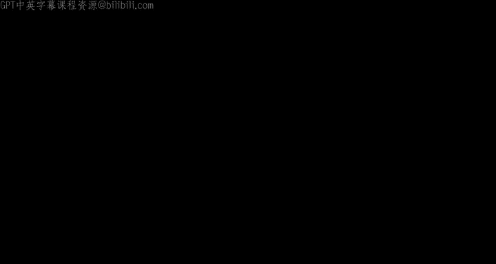
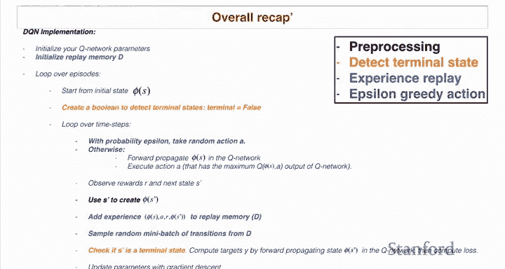
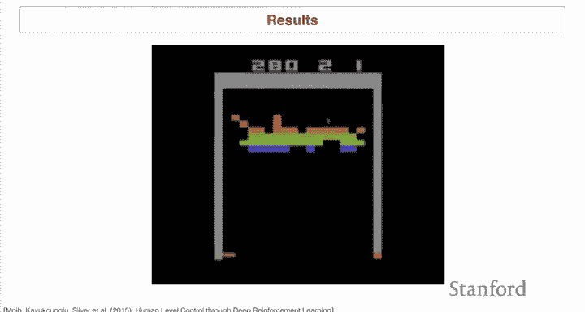
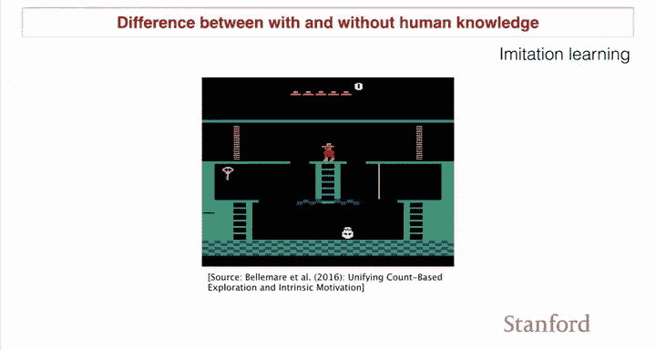
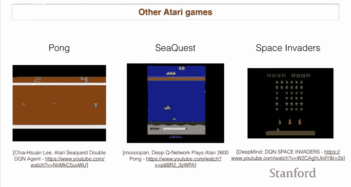
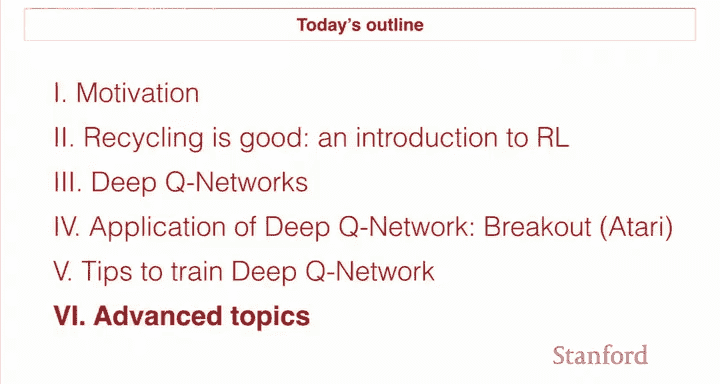
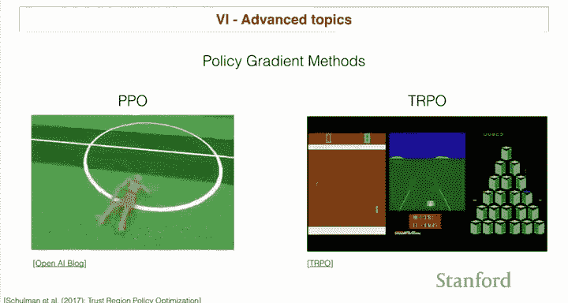
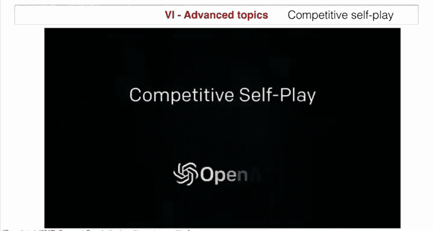
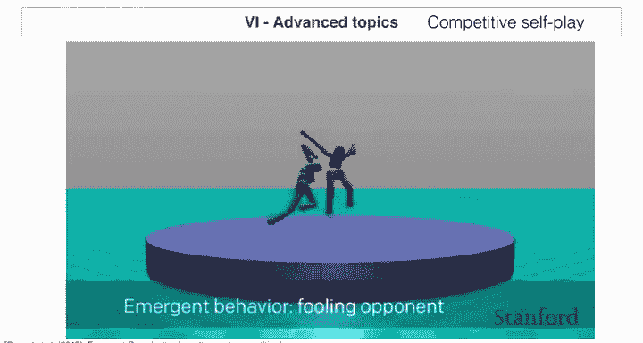
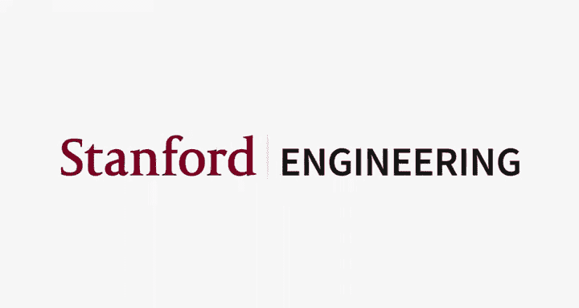

# 吴恩达@斯坦福大学《深度学习｜Stanford CS230： Deep Learning ｜ Autumn 2018》中英字幕（豆包翻译 - P9：-09-Lecture 9 - Deep Reinforcement Learning.zh_en - GPT中英字幕课程资源 - BV19y421z7jz

Hi， everyone and welcome to lecture 9 for CS 230。 Today。

 we're going to discuss an advanced topic that will be kind of the。

The marriage between deep learning and another field of AI。

 which is reinforcement learning and we will see a practical application and how deep learning methods can be plugged in another family of algorithm so it's interesting because deep learning methods and deep neural networks have been shown to be very good function approimators essentially that's what they are。

 we're giving them data so that they can approximate a function There are a lot of different fields which require these function approimmators and deep learning methods can be plugged in all these methods。

 This is one of these examples。😊，So we'll first motivate the setting of reinforcement learning。

 why do we need reinforcement learning why can't we use deep learning methods to solve everything There is some set of methods that we cannot solve with deep learning。

And reinforcement learning applications are examples of that。

We will see an example to introduce an algorithm of a reinforcement algorithm called Q learning。

And we will add deep learning to this algorithm and make it deep Q learning。

As we've seen with generative ad networks and also deep neural networks。

Most models are hard to train。We had to come up with Z initialization， with dropout with batch norm。

AMyriads myriad of methods to make these deep neural networks train in Gs。

 We had to use methods as well in order to train Gs and tricks and hacks。

 So here we will see some of the tips and tricks to train deep。Q learning。

Which is a reinforcement learning algorithm。And at the end。

 we will have a guest speaker coming to talk about advanced topics， which are mostly research。

 which combine deep learning and reinforcement learning。 Sounds good。Okay， let's go。

So deeper reinforcement learning is a very recent field I would say。

 although both things are reinforcement learning has existed for a long time。

 only recently it's been shown that using deep learning as a way to approximate the functions that play a big role in reinforcement learning algorithms has worked a lot so one example is Alfago and you probably all have heard of it it's Google Deep Minds Alfago has beaten world champions in a game called the Game of Go。

 which is very a very old strategy old game。😊，And the one on the right here or on your right。

 human level control through deep reinforcement learning is also deepmind Google Deep Mind paper that came out and hitd the headlines on the front page of nature。

 which is one of the leading multidisciplinary peer reviewed journals in the world。

 and they've shown that。With deep learning plugged in a reinforcement learning setting。

 they can train an agent that beats human level in a variety of games。And in fact。

 these are artery games。 So they've shown actually that their algorithm。

 the same algorithm reproduced for a large number of games can beat humans on all of these games。

 most of these games， not all of these games。😊，So these are two examples。

 although they use different subtechns of reinforcement learning。

 they both include some deep learning aspect in it。

 and today we will mostly talk about the human level control through deep reinforcement learning。

 also called deep Q network presented in this paper。So。

 let's start with with motivating reinforcement learning using the Algo setting。嗯。

This is a board of Go and the picture comes from Deep Minds block。 So go。

 you can think of it as a strategy game where you have a grid that is up to 19 by 19。

 and you have two players。 One player has white stones and one player has black stones。

 And at every step in the game， you can position a stone on the on the board on one of the grid cross。

😊，The goal is to surround your opponent， so to maximize your territory by surrounding your opponent。

 and it's a very complex game for different reasons。

One reason is that you have to be you cannot be short sighted in this game。

 you have to have a long term strategy another reason is that the board is so big it's much bigger than a chess board。

 right？Chessboard is 8 by 8。So let me ask you a question if you had to solve。

Or build an agent that solves this game and beats humans or plays very well at least with deep learning methods that you've seen so far。

 how would you do that？Someone wants to try。So let's say you have you have to collect a data set because in classic supervised learning。

 we need a data set with X and Y。What do you think would be your X and Y？Yeah。

You mean more is the input within the output is the probability of your from that position？Okay。

 input is game board and output is probability of victory in that position。 So that's a good one。

 I think input output。 What's the issue with that one。So， yeah， yeah。

 it's super hard to represent what the probability of winning is from this boy。

 Even like nobody can tell， even if I ask an expert human to come and tell us what's the probability of black winning in this or white winning in this setting。

 they wouldn't be able to tell。So this is a little more complicated。 Any other ideas of data sets。

Yeah，Okay good point so we could have the grid like this one and then this is the input and the output would be the move。

 the next action taken by probably a professional player so we would just watch professional players playing and we would record their moves and we would build the data set of what is a professional move and we hope that our network using this input output will at some point learn how the professional players play and given an input a state of the board we be able to decide of the next move。

What's the issue with that？Yep。好は。All version of that。Yes。

 you need a whole lot of data why and you said it you said because we need basically to represent all types of positions of the board。

 all states， so if we were actually' let's do that if we were to compute the number of possible states of these board。

 what would it be。Okay。Yes。It's a 19 by 19 board。Remember what we did with adversarial examples。

 We did it for pixelels， right？Now we're doing each footer board。

So what then the question first is you want to try？3 for the 19 square， yeah。3 to the power。

19 times 19。Or 19th3。Yeah， so why is it that？why is it， I it this can have have no stone。

 a white stone。 Yeah， each spot and there are 19 times，19 spot can have three state， basically。

 no stone， white stone or blackstone。 So this is the all possible state。This is about 10 to the 170。

So it's super， super big。So we can probably not get even close to that by observing professional players first。

 because we don't have enough professional players。

 And because we're humans and we don't have infinite lives。

 So the professional players cannot play forever。They might get tired as well。

 But so one issue is the state space is too big。 Another one is that the ground truth probably would be wrong。

It's not because you're a professional player that you will play the best move every time， right。

 Every player has their own strategy。So the ground truth we're having here is not necessarily true。

 and our network might not be able to beat these human players。

 What we're looking into here is an algorithm that beats humans。Okay。Second one。

 too many states in the game， as you mentioned， and third one， we will likely not generalize。😊。

The reason we will not generalize is because in classic supervised learning。

 we're looking for patterns。 If I ask you to be an algorithm to detect cats versus dogs。

 it will look for what a pattern of a cat is versus what the pattern of a dog is in。

 and the convolutional filters will learn that。 In this case， it's about a strategy。

 It's not about a pattern。So you have to understand the process of winning this game in order to make the next move。

 you cannot generalize if you don't understand this process of long term strategy。

So we have to incorporate that， and that's where our L comes into place。RL is reinforcement learning。

 a method that could be described with one sentence as automatically learning to make good sequences of decision。

 So it's about the long term。 It's not about a short term。

And we would use it generally when we have delayed labels。Like in this game。

 the label that you mentioned at the beginning was probability of victory。 This is a long term label。

 We cannot get this label now， but over time， the closer we get to the end。

 the better we we are at seeing the victory or not。And it's to make sequences of decision。

 so we make a move， then the opponent makes a move， then we make another move。

 and all the decisions of these move are correlated with each other。😊。

Like you have to plan in in advance when you're a human， you do that when you play chess。

 when you play go。So examples of RL applications can be robotics。

 and it's still a research topic how deep RL can change robotics。

 but think about having a robot walking from here and you want to send it there。

 you want to send the robot there。What you're teaching the robot is if you get there， it's good。

 right， it's good you achieve the task， but I cannot give you the probability of getting there at every point。

 I can help you out by giving you a reward when you arrive there and lets you trial an error so the robot will try and randomly initialize the robot will just fall down at the first at first get a negative reward then repeat this time the robot knows that it shouldn't fall down。

 It shouldn't go down It should probably go this way。

 So through trial and error and reward on the long term。 the robot is supposed to learn this pattern。

Another one is games and that's the one we will see today Games can be represented as a set of reward for reinforcement learning algorithms。

 so this is where you win， this is where you lose， let the algorithm play and figure out what winning means and what losing means until it learns。

😊，Okay， the problem with using deep learning is that the algorithm would not learn because this reward is too long term。

 So we're using reinforcement learning and finally， advertisement。

 So a lot of advertisements are real time bidding。 So you want to know given a budget when you want to invest this budget。

 and this is a long-ter strategy planning as well。 that your reinforce learning can help with。Okay。

So this was the motivation of reinforcement learning。

 We're going to jump to a concrete example that is a supervan example to understand Q learning。😊，So。

 let's start with this。Game or environment。 So we call that an environment generally。

 and it has several states。 In this case， five states。

So we have these states and we can define rewards， which are the following。

 So let's see what is our goal in this game。😊，We define it as maximize the return or the reward on the long term。

 And what is the reward is the numbers that you have here that were defined by a human。

 So this is where the human defines the reward。Now what's the game， the game has five states。

 state one is a trash can。And has a reward of plus2。State 2 is a starting state， initial state。

 and we assume that we would start in the initial state with the plastic bottle in our hand。

The goal would be to throw this plastic bottle in a can。If it's the trash can， we get plus2。

 if we get to state 5， we get to the recycled bin and we can get plus 10。Super important application。

State four has a chocolate。So what happens is if you go to state four。

 you get a reward of one because you can eat the chocolate and you can also throw the chocolate in the recycle bin。

 hopefully。Does this setting make sense？So these states are of three types。

 One is the starting state initial， which is。Brown。The normal state， which is not a starting neither。

 neither a starting nor an ending state。 and it's gray。And the blue states are terminal states。

 So if we get to the terminal state， we end up a game or an episode， let's say。

Does this setting make sense？Okay， and here are two possible actions。 you have to move。

 either you go on the left or you go on the right。An additional rule we we'll add is that the garbage collector will come in three minutes and every step takes you one minute。

So you cannot spend more than three minutes in this game。 In other words。

 you cannot stay at the chocolate and eat chocolate forever。 You have to to move at some point。Okay。

So one question I'd have is， how do you define the long term return？

Because we said we want a long term return。 We don't care about short term returns。

What do you think he's？A good way to define a long term return here。Yeah。

The sum of the terminal states the sum many you have when you reach。

There's sum of how many points you have when you reach a terminal state。 So let's say I'm in state 2。

 I have zero reward right now。If I reach the terminal state on the right on， the on your left。

 the plus two， I get plus two reward， and I've finished the game。

 If I go on the right instead and I reach the plus 10。

 you're saying that the long term return can be all the sum of the rewards I got to get there。

 So plus 11。So this is one way to define the long term return。Any other ideas？你告诉。

Cate the time stuff。Probably take what reduced the the award。Yeah。

 we probably want to incorporate the time steps and reduce the reward as time passes。 And in fact。

 this would be called a discounted return versus what you said would be called a return。呃。

Here well use a discounted return， and it has several advantages。

 Some are mathematical because the return you describe， which is not discounted， might not converge。

 It might go up to plus infinity。This discounted return will converge with an appropriate discount。

So intuitively also， why is the discounted return intuitive because time is always an important factor in our decision making。

People prefer cash now than cash in 10 years， right， Or similarly。

 you can consider that the the robot has a limited life expectancy。

 like it has a battery and loses battery every time it moves。

 So you want to take into account this discount of if I can eat chocolate close。

 I go for it because I know that is a chocolate is too far。

 I might not get there because I'm losing some battery Some energy。 for example。

 So this is a discounted return now。If we take gamma equals one。Which means we have no discounts。

 The best strategy to follow in this setting seems to be。To go to the to the left。

 to go to the right， starting in the initial state，2。Right。

 and the reason is it's a simple computation on one side， I get plus  two on the other side。

 I guess plus 11。😊，What if my discount was 0。1。Which one would be better？Yeah。

 the left would be better directly to plus。 And the reason is because we compute in our mind。

 We just do 0 plus 01 times 1， which gives us 01 plus 。1 squared times 10。 And it's less than 2。

 We know it。Okay。So now we're going to assume that the discount is 0。9。

And it's a very common discount， to use。Inment learning。 And we use a discounted return。

So the general question here， and it's the core of reinforcement learning in this case of Q learning。

 is what do we want to learn？And this is really， really think of it as a human。

 What would you like to learn， What are the numbers you need to have in order to be able to make decisions really quickly。

 assuming you had a lot more states than that。And actions。Any ideas of what we want to learn。

What would help our decision making？冇 action。Optimmal action at each state。

That's exactly what you want to learn for given a state， tell me the action that I can take。

 and for that I need to have a score for all the actions in every state。

In order to store these scores， we need a matrix， right， So this is our matrix。

 We will call it a Q table。 It's going to be of shape number of states， times number of actions。

If I have this matrix of scores and the scores are correct， I'm in state 3。

 I can look on the third row of this matrix and look what's the maximum value I have。

 Is it the first one or the second one if it's the first one I go to the left if it's the second one that is maximum I go to the right this is what we would like to have。

Does that make sense， is Q table？So now let's try to build a Q table for this example。

 if you had to build it， you would first think of it as a tree， oh and by the way。

 every entry of this Q table tells you how good it is to take this action in that state。

State corresponding to the row action corresponding to the column。So now how do we get there。

 We can build the3。 And that's， that's similar to what we would do in our mind。

 We start in S 2 in S 2， we have two options。 Either we go to S 1， we get 2 or we go to S 3。

 and we get 0。From S 2， we， from S 1， we cannot go anywhere it's a terminal state。 but from S 3。

 we can go to S 2 and get 0 by going back， or we can go to S 4 and get1。Does make sense。

From S4 saying， we can get 0 by going back to S3 or we can go to S5 and get plus 10。

Now here I just have my immediate reward for every state。

 What I would like to compute is the discounted return for all these state。

 because ultimately what should lead my decision making in a state is if I take this action I get to a new states。

 what's the maximum reward I can get from there in the future。😡。

Not just the reward I get in that state。If I take the other action， I get to another state。

 What's the maximum reward I could get from that state。

 not just the immediate reward that I get from going to that state。

So what we would do we can do it together。 let's say we want to compute the value of the actions from S3 from S3 going right and left from S3 I can either go to S4 or S2 going to S4 I know that the immediate reward was 1 and I know that from S4 I can get plus 10 this is a maximum I can get。

So I can discount this 10， multiplied by 0。9。10 times 09 givesus 9 plus 1。

 which was the immediate reward， gives us 9， me us 10。

So 10 is the score that we give to the action go right from state S3。Now。

 what if we do it from one step before S 2。From S 2， I know that I can go to S 3 and to S 3。

 I get0 reward。 So the immediate reward is 0， but I know that from S 3。

 I can get 10 rewardUltimately， on the long term。 I need to discount this reward from one step。

 So I multiply this 10 by 。9， and I get 0 plus 09 times 10， which gives me 9。So now in state two。

 going right will give us a long term reward of9。Makes sense。And you do the same thing。

You can copy back that going from S4 to S3 will give you0 plus the maximum you can get from S 3。

 which was 10 discounted by 。9。Or you can do it from S 2 from S 2， I can go left and get plus 2。

 or I can go right and get 9。 And the image reward would be 9 would be 0。

 And I will discount the 9 by。9 and get 8。1。So that's the process we would do to compute that。

 and you see that it's an iterative algorithm。😊，You will just copy back all these values in my matrix。

 and now if I'm in state2。😊，I can clearly say that the best action seems to say go to the left because the long term discounted reward is9 while the long term discounted reward for going to the right is2。

And I'm done。 That's Q learning。 I solved the problem。 I had， I had state a problem statement。

 I found a matrix that tells me in every state what action I should take。 I'm done。😊。

So why do we need deep learning？It's a question we will try to answer。

So the best strategy to follow with 0。9 is still right， right， right。

 And the way I see it is I just look at my matrix at every step。

And I follow always the maximum of my row。 So from state 2。

9 is the maximum so I go right from state 3，10 is the maximum so I still go right and from state 4。

10 is the maximum so I go right again。So I take the maximum over all the actions in a specific state。

Okay。Now。One interesting thing to follow is that when you do this iterative algorithm at some point。

 it should converge and ours converged to some values that represent the discounted rewards for every state and action。

There is an equation that's this。😡，Q function follows。

 and we know that the optimal Q function follows this equation。

 The one we have here follows this equation。This equation is called the Belman equation。

And it has two terms。 One is R， and one is discount times the maximum。

Of the Q scores over all the actions。So how does that make sense？Given that you're in a state S。

 you want to know the score going of taking action A in this state。

 the score should be the reward that you get by going there。😡，Plus。

 the discount times the maximum you can get in the future。

 That's actually what we used in the iteration。Does this Bmin equation make sense。Okay， so remember。

 this is going to be very important in Q learning。 this Bellllman equation。

 It's the equation that is satisfied by the optimal Q table or Q function。😊。

And if you try out all these entries， you will see that it follows this equation。

So when Q didn't is not optimal， it's not following this equation yet。

We would like Q to follow this equation。Another point of vocabulary and reinforcement learning is a policy。

 policies denoted P sometimes are mu and sorry pi pi of s is equal to arc max over the actions of the optimal Q that you have What it means it's exactly our decision process。

 even that we're in state S。 we look at all the columns of the state S in our Q table。

 we take the maximum。 and this is what pi of S is telling us It's telling us this is the action you should take。

 So pi， our policy is our decision making。😊，Okay。It tells us what's the best strategy to follow in a given state。

Any questions so far。Okay， and so I have a question for you。Why is deep learning helpful？Yes。No。

 this tweet who I for。Yeah， that's the reason。 number of states is way too large to store a table like that。

So like if you have a small number of states， a number of actions。Then easy， you can use a Q table。

 You can at every step， look into the Q table。 It's super quick and find out what you should do。

 But ultimately， this Q table will get bigger and bigger depending on the application， right。

And the number of states for go is 10 to the power 170， approximately。

Which means that this matrix should have a number of rows equal to 10。With 1700 after。 I mean。

 you know what I mean， is's very big。 And number of actions is also going to be bigger。In go。

 you can place your action everywhere on the board that is available， of course。Okay。

 so many way too many states and actions。 So we would need to come up with maybe a function approximator that can give us the action based on the state instead of having to sort this matrix。

That's where deep learning will come。 So just to recap these first 30 minutes in terms of vocabulary。

 we learn what an environment is。 It's the， it's the general game definition。

 An agent is the thing we're trying to train the decision maker， a state。😊，An action， reward。

 total return， a discount factor， the Q table， which is the matrix of entries representing how good it is to take action A in state S。

 a policy which is our decision making function telling us what's the best strategy to apply in a state and Bellman equation。

 which is satisfied by the optimal Q table。So now we will tweak this Q table into a Q function。

 and that's where we shift from Q learning to deep Q learning。😡。

So find a Q function to replace the Q table。Okay， so this is the setting。

 We have our problem statement。 We have our Q table。

 We want to change it into a function appmator that will be our neural network。😊。

Does that make sense how deep learning comes into reinforcement learning here。

So now we take a state as input for propagated in the deep network and get an output， which is。

An action， an action score。For all the actions。It makes sense to have an output layer that is the size of the number of actions because we don't we don't want to give an action as input and a state as input and get the score for this action taken in this state。

 Instead we can be much quicker。 We can just give the state as input。

 get all the distribution of scores over the output。And we just select the maximum of this vector。

 which will tell us which action is best。So we felt we foreign in states。2， let's say。Here。

We're in state2， and before propagate state 2， we get two values。

 which are the scores of going left and right from state2。 We can select the maximum of those。

 and it will give us our action。The question is how to train this network。We know how to train it。

 We've been learning it for nine weeks。Computer the loss， back propagate。

Can you guys think of some issues that make this setting different from a classic supervised learning setting。

The word changes dynamically， third word changes dynamically。The reward changes dynamically。

 So the reward doesn't change。 The reward is set。 You define it at the beginning。

 It doesn't change dynamically。 But I think what you meant is that the Q scores change dynamically。

That's true。 The Q scores change dynamically， but。That's。

 that's probably okay because our network changed that。 Our network is now the Q score。

 So when we update the parameters of the network， it updates the Q scores。What's。

 what's another issue that we might have。No labels。 no labels。Remember， in supervised learning。

 you need labels to train your network。 What are the labels here。And don't say compute the Q table。

 use them as labels。 So I'm going to work。Okay， so that's the main issue that makes this problem very different from classic supervised learning。

 So let's see how， how deep learning can be tweaked a little。

 And we want you to see these techniques because they they。

 they're helpful when you read a variety of research papers。We have our network。

 given a state gives us。2 scores that represent actions for going left and right from this state。

 The loss function that we define。Is it a classification problem or a regression problem。

Re regressiongress problem。Because the Q score doesn't have to be。

A probably be0 and1 is's just a score that you want to give。

 and that that should me make the long term discounted reward。So， in fact。

 the last function we can use is。Is the L2 last function。 Y minus the Q score squared。

So let's say we do it for the Q going to the right。The question is， what is why。

What is the target for this queue。And remember， what I copied on the top of this slide is the Bellllman equation。

 We know that the optimal Q should follow this equation。 We know it。

The problem is that this equation depends on its own cue。You know。

 like you have  Q on both sides of the equation。It means if you set the label to be R plus gamma times max of Q stars。

Then when you will back propagate， you will also have a derivative here。

Let me let me go into the details。Let's define the target value。

 Let's assume that going left is better than going right at this point in time。

 So we initialize the network randomly before propagate state 2 in the network。

 and the Q score for left is more than the Q score for right。

So that's the action we will take at this point is going left。Let's define our target。 Y。

 as the reward you get when you go left immediate plus gamma times。The maximum。

Of all the Q values you get。From the next step。So let me spend a little more time on that because it's a little complicated。

I mean S， I move to S next using a move on the left。 I get immediate reward R。

 and I also get a new state S prime S next， I can for propagate this state in the network and understand what is the maximum I can get from this state。

😊，Take the maximum value and plug it in here。So， this is。

Hopefully what the optimal queue should follow。😡，It's a proxy to a good label。

It means we know that the Belman equation tells us the best Q satisfies this equation。But in fact。

 this equation is not true yet because the true equation， we have Q star here。Not you。To star。

 which is the optimal cu。 What we hope is that if we use this proxy as our label and we learn the difference between where we are now and this proxy。

 we can then update the proxy， get closer to the optimality， train again， update the proxy。

 get closer to optimality， train again and so on。😊，Our only hope is that this will converge。

So does it make sense how this is different from deepearning， the labels are moving。

They're not static labels。We define a label to be a best guess of what would be the best Q function we have。

Then we compute the loss of where the Q function is right now compared to this。

 We back propagate so that the Q function gets closer to our best guess。

Then now that we have a better cu function， we can have a better guess。So we make a better guess。

And we fix this guess。 And now we compute the difference between this Q function that we have and our best guess。

We back propagate。Up， we get to our best guess。 We can update our best guess again。

 And we hope that doing that iteratively will end with a convergence and。😊。

A Q function that will be very close to satisfy the development equation， the optimal be equation。

Does he make sense？This is the most complicated part of Q learning。

We generate the output of the network。 We get a Q function。 We compare it to the Q。

 the best Q function that we think is it is。 What is the best function The one that satisfies the development equation。

But we never actually computed the mobile equation。 We don't。

 but we guess it based on the cu we have。Okay， so basically， when you have Q。

 you can compute this Belman equation， and it will give you some values。

 These values are probably closer to where you want to get to where from where you are now。

 where you are now is is farther from this optimality。

And you want to reduce this gap to close the gap， you back propagate。Yes， that label to be divrg？

So the question is， is there a possibility for this to divert。

 So this is a broader discussion that would take a full lecture to prove。

 So I put a paper here from Francisco Melo， which proves the convergence of this algorithm。

 So it converges。And， in fact。It converges because we're using a lot of tips and tricks that we will see later。

But if you want to see the math behind it and it's a full lecture of proof。

I invite you to look at this simple proof for convergence of the development equation。O。Okay。

 so this is the case where a left score is higher than right score。

 and we have two terms in our target， immediatete reward for taking action left。

 and also discounted maximum future reward when you are in state as as next。Okay。

The tricky part is that let's say we compute that。 we can do it。

 We have everything we have everything to compute our target。We have R。

 which is defined by the human at the beginning， and we can also get this number because we know that if we take action left。

 we can then get S next and we propagate S next in the network。

 We take the maximum output and it's this。 So we have everything in in this equation。😊。

The problem now is if I plug this and my Q score in my last function。

 and I ask you to back propagate。By propagation is what w equals w minus alpha times the derivative of the loss function with respect to w。

 the parameters of the network。Which term will have a nonze value？Obviously。

 the second term Q of S go to the left will have a nonze value because it depends on the parameters of the network W。

 but y will also have a nonzero value。Because you have Q here。So how do you handle that。

 You actually get。A feedback loop in this back propagation that makes the network unstable。

 What we do is that we consider this fixed。 We will consider this Q fixed。

 The cu that is our target is going to be fixed for many iteration。😊。

Let's say a million or 100000 iteration until we get close to there， and our gradient is small。

 then we will update it and we'll fix it。 So we actually have two networks in parallel。

 one that is fixed and one that is not fixed。and the second case is similar if the Q score to go on the right was more than the  Q score to go on the left。

 we would define our target as immediate reward of going to the right plus gamma times the maximum  Q score we get if we're in the state that we in the next state。

And take the best action。Does this make sense， It's the most complicated part of tuing。

This is the hard part to understand。 So immediate reward to go to the right and discounted maximum future reward when you in site S next。

Going to join。So this is hold6 for backdrop。So no derivative。 if we do that， then no problem。

 Y is just the number。 We come back to our original supervised learning setting。 Y is a number。

 and we compute the loss， and we back propagate。No difference。Okay。

 so compute DL over Dw and update W using stochastic gradient and descent methods。RMS S drop， Adam。

 whatever you guys want。So let's go over this full DQN deepQ network implementation and this slide is a pseudocode to help you understand how this entire algorithm work we will actually plug in many methods in this pseudocode so please focus right now and if you understand this you understand the entire rest of the lecture。

We initialize our Q network parameters， just as we initialize the network in deep learning。

 we loop over episode。 So let's define an episode to be one game。

 like going from start to end to a terminal state is one episode。

We can also define episodes sometimes to be many states， right。Breakout。

 which is the game with the paddle， usually is 20 points。

 The first player to get 20 points finishes the game。So a episode would be 20 points。

Once you're looping over episode it starts from an initial state S， in our case。

 it's only one initial state， which is state2 and loop over time stepss。

4 propagate S state 2 in the Q network。Execcutute action A， which has the maximum Q score。

Observe an immediate reward R and the next set S prime。Compute target Y and to compute Y。

 we know that we need to take S prime for propagated in the network again。

And then compute the loss function， update the parameters with gradient descent。

Does this loop make sense， It's very close to what we do in general， the only difference。

Would be this part， like we compute target Y using a double four propagation。 So we for propagation。

 we four propagate two times in each loop。Do you guys have any questions on？On this see code。Okay。

So we will now see a concrete application of a deep network。 So this was the theoretical part。

 Now we're going to the practical part， which is going be to be more fun。 So let's look at this game。

 It's called breakout。😊，The goal when you play breakout is to destroy all the bricks without having the ball pass the line on the bottom。

 so we have a paddle and our decisions can be idle， stay where you are。

 move the paddle to the right or move the paddle to the left。Right。And。This demo。

And you have the credits on the bottom of the slide shows that after training breakout。

Using Q learning， they get a super intelligent agent， which figures out a trick。

To finish the game very quickly。So， actually， even like。Good players。You don't know this trick。

 professionalessional players know this trick， but in breakout。

 you can actually try to dig a tunnel to get on the other side of the bricks。

 and then you will destroy all the bricks super quickly。From top to bottom， instead of bottom up。

 what's super interesting is that the network figured out this on its own， without human supervision。

And this is the kind of thing we want。 Remember if we were to use inputs。

The go boards and output professional players。 We will not figure out that type of stuff。

 most of the time。So my question is， what's the input of the Q network in this setting。

 Our goal is to destroy all the bricks， so play breakout。What should be the input？Try something。

F position， position of the board at the bottom， position of bricks。Position of the paddle。

 position of the bricks。 What else Ba position。Okay， yeah， I agree。

 So this is what we would call a feature representation。 It means when you're in an environment。

 you can extract some features。Right， and these are examples of features。

 Give me the position of the ball is one feature。 Give me the position of the bricks。

 Another feature。 Give me the position of the paddle， another feature。

 which are good features for this game。 But if you want to get the entire information。

 you'd better do something else。😊，Yeah。The pixels， you don't want any human supervision。

 You don't want to put features。 You， you just， okay， take the pixels。 Take the game。

 You can control the paedddle。 Take the pixel。So yeah， this is a good input to the Q network。

 What's the output， I said it earlier。Probably the output of the network will be trick Q values。

Representing the action going left， going right and staying idle in a specific state。

 that is the input of the network。So given a pixel image， we want to predict。

Q scores for the three possible actions。Now， what's the issue with that。

 Do you think that would work or no。Can someone think of something going wrong here。

Looking at the inputs。嗯。Okay， I'm going to head to you。呃。If I give， your en try。

How to know that the wallet。Oh， yeah。 good point。 Based on this image。

 You cannot know if the ball is going up or down。So actually。

 it's super hard because the action you take highly depends on if the goal is going up or down。

 right？If the ball is going down。And even if the body is going down。

 you don't even know which direct direction is going。Nowown， so there is a problem here。 Def。

 There is not enough information to make a decision on the action to take。And if it's hard for us。

 it's going to be hard for the network。So what's a hack to。To prevent that。

 it's to take successive frames。So instead of one frame， we can take four frames。Successive frames。

 And here， the same setting as we had before。 But we see that the ball is going up。

We see which direction is going up， and we know what action we should take， because we know。

The slope of the ball。 And also also if it's going up or down。That makes sense。Okay。

 so this is called the prepro。 given a state computer function phi of S that gives you the history of this state。

 which is the four sequence of four last strings。What other preprocessing can we do。

And this is something I want you to be quick。 like we learned it together in deep learning。

 input prepro。Remember the second lecture where the question was， what resolution should we use？

Remember。You have a cat recognition。 What resolution would you want to use。Here's saing。

If we can reduce the size of the inputs， let's do it。If we don't need all that information。

 let's do it。For example， do you think the colors are important。Very minor。

 I don't think they're important。So maybe we can grayscale everything。

That remove three that converts three channels into one channel。

 which is amazing in terms of computation。😊，What else？ I think we can crop a lot of this。 Like。

 maybe there is a line here we don't need。To make any decision， we don't need the scores， maybe。

 So actually， there are some games where the score is important for decision making。

An example is football， like or soccer when you're， when you're winning 1，0， you。

 you'd better if you're playing against a strong team defend， like。

 get back and defend to keep this  one0。 So the score is actually important in the decision making process。

And， in fact， they're famous coach in football， which have this technique called Park the bus。

 where you just put all your team in front of the goal once you have scored a goal。

 So this is an example。😊，So here there is no park the bus。

 but we can definitely get rid of the score， which removes some pixels and reduces the number of computations。

And we can reduce the gray scale。 One important thing to be careful about when you reduce the re gray scale is that gray scale is a dimensional literary addiction technique。

 It means you lose information。😊，But， you know， if you have three channels and you reduce everything in one channel。

 sometimes you would have different color pixels， which will end up with the same gray scale value。

 depending on the gray scale that you use。And it's been seen that you lose some information sometimes。

 So let's say the ball and some bricks have the same gray scale value。😊。

Then you would not differentiate them。Well， let's say the paddle and the background have the same gray scale value。

 Then you would not differentiate them。 So you have to be careful of that type of stuff。

 And there's other methods that do gray scale in other ways， like luminance。So we have our phi of s。

 which is this。Which is this input to the Q network and the deep Q network architecture is going to be a convolution neural network because we're working with images。

 So before I propagate that， this is the architecture from in Kavouk so glue silver et al。

 from deep pin。Comre， convertre， Conrelu， two fully connected layers， and you get your Q scores。

And we get back to our training loop。So what do we need to change in our training loop here is we said that one frame is not enough。

 so we preprocess all the frames， so the initial state is converted to phi of s。

The four propagation state is phi of S and so on。 So everywhere we add S or S prime。

 we convert to phi of S or phi of S prime， which gives us the history。Now。

 there are a lot more techniques that we can plug in here， and we will see three more。

 One is keeping track of the terminal state。In this loop。

 we should keep track of the terminal state because we said if we reach a terminal state。

 we want to end the loop， break the loop。 Another reason is because the y function。 So basically。

 we have to add create a booleion to detect the terminal state before looping through the time steps and inside the loop。

 we want to check if the new S prime we're going to。Is a terminal state。 If it's a terminal state。

 then I can stop this loop and go back play another episode。

 So play another start at another starting state and continue my game。😊，Now。

This y target that we compute is different if we're in a terminal state or not。

Because if we're a terminal state， there is no reason to have a discounted long term reward。

 There is nothing behind that terminal state。So if we're in terminal state。

 we just set it to the immediate reward and we break。 If we're not in a terminal state。

 then we would add this discounted future reward。Any questions on that？Yep。

Another issue that we're seeing this and which makes this reinforcement learning setting super different from the classic supervised learning setting is that we only train on what we explore。

It means I'm starting in a state S。I compute， I forward propagate this5hi of S in my network。😡。

I get my vector of Q values。 I select the best Q value， the largest。

 I get a new state because I can move now from state S to S prime。 So I have a transition from S。

 take action A， get S prime or phi of S， take action A， get phi of S prime。😊，Now。

 this is what I will use to train my network。I can forward propagate phi of S prime again in the network。

😡，And get my y target， compare my y to my Q。And then， back propagate。The issue is。

 I may never explore this state transition again。 Maybe I will never get there anymore。

 It's super different from what we do in supervised learning。

 where you have a dataset set and your dataset can be used many times。😡。

With batch gradient descent or with any gradient decentscent algorithm，1 epoch。

You see all the data points。So if you do  two epos， you see every data points two times。

 If you do 10 epos， you see every data points three times 10 times。

 So it means that every data points can be used several times to train your algorithm in classic deep learning that we seen together。

 In this case， it doesn't seem possible because we only train when we explore。

 and we might never get back there。Especially because the training will be influenced by where we go。

 So maybe there are some places where we will never go because while we train and while we learn。

 it will it will kind of direct our decision process and we will never train on some parts of the game。

 So this is why we have other techniques to keep this training stable。

 One is called experience replay。😊，So as I said， here is what we are currently doing。

We have phi of s4 propagate， get a。From taking action A。

 we observe an immediate reward R and a new state Phi of S prime。Then from phi of S prime。

 we can take a new action A prime。Observ a new reward R prime。And the new state5 of S prime prime。

And so on。And each of these is called a state transition。And can be used to train。

 This is one experience leads to one iteration of gradient descent。E 1， E 2， E3， experience，1。

 experience 2， experience 3。And the training will be trained on experience 1。

 then train on experience 2， then train on experience 3。

 What we're doing with the experience replay is the following。We will observe， experience 1。

Because we start in a state， we take an action， we see another state in a reward。

 and this is called experienceer one。 We will create a replay memory。😊。

You can think of it as a data structure in computer science。

 and you will place this experience one toppo in this replay memory。Then from there。

 we will experience experience two。We will put experience doing the replay memory。

Same with the experience tree， put it in the replay memory。And so on。Now， during training。

 what we will do is we will first train on experience 1， because it's the only experience we have so。

 so far。Next step， instead of training on E2， we will train on a sample from E1 and V2。

 It means we will take one out of the replay memory and use this one for training。

But we will still continue to experiment something else。And well sample from there。And at every step。

 the replay memory will become bigger and bigger。 And while we train。

 we will not necessarily train on the step we explore。 We will train on a sample。

 which is the replay memory。 plus the new state we we we explore。😊，Why is it good is because I。

 as you see， can be useful many times in the training。 And maybe I one was a critical state。 Like。

 it was very important。Data point to learn our Q function。And so on， and so on。

Does the replay memory make sense？So several advantages， one is data efficiency。

 We can use data many times。 Don't have to use one data point only one time。Another very important。

Advantage of experience replay is that if you don't use experience replay。

 you have a lot of correlation between the successive data points。

So let's say the ball is on the bottom right here。And the ball is going to the top left。For the next。

10 data points。 The ball is always going to go to the top left。And it means。

The action you can take is always the same。 It actually doesn't matter a lot because the ball is going up。

But most likely， you want to follow where the ball is going。

 So the action will be to go towards the ball for 10 actions in a row。

 And then the the ball will bounce on the wall and on the top and go back down here。

 down to the bottom left， the bottom right。What will happen if your pddle is here is that for 10 steps in a row。

 you will send your pddle on the right。Remember what we said when we when we asked the question。

 if you had to train a cat versus dog classifier with batches of images of cats。

 batches of images of dog， train first on the cat， then trains on the dogs， then trains on the cat。

 then trains on the dogs。 we will not converge because your network will be super biased towards predicting cat after seeing 10 images of cat。

Super biased with predicting dogs when sees 10 images of dog。 That's what's happening here。

So you want to derelate all these experiences。 You want to be able to take one experience。

 take another one that has nothing to do with it and so on。This is what experience replay does。

 And the third one is that the third one is that you're basically trading computation and memory against exploration。

😊，Exploration is super costly。 The state space might be super big， but， you know。

 you have enough computation， Probably， you can have a lot of computation and you have memory space。

 Let's use an experience replay。😊，Okay。So let's add risk experience replay to our code here。

The transition resulting from this part is added to the experience to the replay memory D。

 and will not necessarily be using the iteration space。 So what's happening is we propagate5 of S。

 we get， we observe a reward and an action。😊，And this action leads to a state phi of S prime。

This is an experience。Instead of training on this experience， I'm just going to take it。

 put it in the replay memory。Addd experience to replay memory。

And what I will train on is not this experience is a sample random mini batch of transition from the replay memory。

So you see， we're exploring， but we're not training on what we explore。

 We're training on the replay memory， but the replay memory is dynamic。It changes。

And update using the sample transitions。 So the sample transition from the replay memory will be used to do the update。

 That's the hack。Now， another hack we want， the last hack we want to talk about is exploration versus exploitation。

So as a human， let's say you're commuting to Stanford every day and you know the road you're commuting at。

You know it。 You always take the same road and you're biased towards taking this road。 Why。

 Because the first time you took it， it went  well。And the more you take it。

 the more you learn about it， Not that it's good to know the tricks of how to drive fast， but。

 but like， you know， the tricks。 You know that this， this。

This light is going to be green at that moment and so on。 So you。

 you build a very good expertise in this road， Super expert。😊。

But maybe there's another road that you don't want to try that is better。

 You just don't try it because you're focused on that road。 You're doing exploitation。

 You exploit what you already know。Exploration would be， okay， let's do it。

 I'm gonna try another road today。 I might get late to the course。

 but maybe I will have a good discovery， and I will like this road， and I will take it later on。

 There is a trade off between these two because the oil algorithm is going to figure out some。😊。

Strategies that are super good。And we'll try to do local search in this to get better and better。

 But you might have another minimum that is better than this one。 and you don't explore it。

Using the algorithm we currently have， there is no trade off between exploitation and exploration。

 we are almost doing only exploitation。So how to incentivize this exploration？You guys have an idea。

So right now， when we're in a state S。We're forward propagating the state preprocesed state in the network。

 and we take the action that is the best action， always。So we exploiting。

 We're exploiting what we already know。 We take the best action。Instead of taking this best action。

What can we do。Yep， Monte Carola sampling， Monte Carola sampling。Good point。 Another one。

 You wanted to try something else。Could have a parameter That's the ratio times you take the best action versus exploring another action。

 Okay， take a hyperparmeter that tells you when you can explore， when you can exploit。

That what you mean。Yeah， that's a good point。 So I think that that's， that's a solution。

 You can take a hyper parameter。 That is a probability telling you。With this probability， explore。

Otherwise， with one minus C probability exploit。That''s what we're going to do。

So let's look why exploration versus exploration does't work。We're in initial state 1， S1。

 and we have three options。 Either we go using action A1 to S 2 and we get reward of 0。

 or we go to action， use action 2， get to S 3 and get reward of1。

Or use action 3 and go to S 4 and get a reward of 1000。So this is obviously where we want to go。

 we want to go to S4 because it has the maximum reward and we don't need to do much computation in our head。

 It's simple。 there is no discount， it's direct。Just after initializing the Q networks。

 you get the following Q values 4 propagate S1 in the Q network and get。Point5 for taking action 1。

4 for taking action 2， point3 for taking action 3。So this is obviously not good。

 but our networking was randomly initialized。What it's telling us is that。😊，0。5 is the maximum。

So we should take action 1。 So let's go。 Take action 1， observe S 2。 You observe a reward of 0。

 Our target， because it's a terminal state is only equal to the reward。 There' is no additional term。

 So we want our target to match our Q。 Our target is 0。 So Q should match 0。

So we train and we get the Q that should be 0。Does that make sense？

Now we do another round of iteration。 We look where S1。 We get back to the beginning of the episode。

 We see that our Q function tells us that action 2 is the best because 0。4 is the maximum value。😊。

It means go to S3。I go to S3， I observe reward of one。What does it mean， It's a terminal state。

 So my target is one。 Y equals one。I want the Q to match my y， so my Q should be one。Now， I continue。

 Third step。Up Q function says go to A2。I go to a2。 Nothing happens。

 I already matched the the reward。First step， go to A2。You see what happens。 We will never go there。

 We will never get there。Because we're not exploring。So instead of doing that。

 what we're saying is that。5% of the time take a random action to explore。

 and 95% of the time follow your exploitation。Okay。So that's where we added it。

 We probability epsilon， the hyperparmeter， take random action A， Otherwise。

 do what we were doing before， exploit。Does that make sense？Okay， cool。

 So now we plugged in all these tricks in our pseudocode， and this is our new pseudocode。

 So we have to initialize the replay memory， which we didn't have to do earlier in blue。

 you can find the replay memory added lines。😊，In orange。

 you can find the added lines for checking the terminal state。 And in purple。

 you can find the added lines related to Epsilon greeditty。呃。Exploration versus exploitation。

And finally， in bold， the preprocessing。Any questions on that？

So we want to see a variant of how deep learning can be used in a setting that is not necessarily classic supervised learning setting。

And you see that the main advantage of deep learning in this case is it's a good function approximator。

 Your convolution neural network can extract a lot of information from the pixels that we are not able to get with other networks。

Okay， so let's， let's see what we have here。 We have our super artery。

But that's going to dig a tunnel and it's going to destroy all the bricks super quickly。

It's cool to see that after building it。So this is work from Deep Minds team。

 And you can find this video on YouTube。

Okay，Another thing I wanted to say quickly is what's the difference between we and without human knowledge。

 You will see a lot of people， a lot of papers mentioning that this algorithm was trained with human learn knowledge or this algorithm was trained without any human in the loop。

Why is human knowledge very important？Like think about it。

 just playing one game as a human and teaching that to the algorithm will help the algorithm a lot。

When the algorithm sees this game。What it sees its pixels。What we see when we see that game。

 we see that there is a key here。 We know the key is usually a good thing。

 So we have a lot of context， right， as a human， We know I'm probably gonna go for the key。

 I'm not gonna go for this， this thing， no。Same ladder。 What is the ladder。 We。

 we directly identify that the ladder is something we can go up and down。

 We identified that this rope is probably something I can use to jump from one side to the other。

 So as a human， there is a lot more background information that we have even without knowing it。

 without realizing it。So there is a huge difference between algorithms trained with human in the loop and without human in the loop。

 This game is actually Montezumo revenge。 The DQN algorithm when the paper came out in nature。

 the second version of the paper， they showed that they beat human on 49 games that the same type of games as breakout。

 but this one was the hardest one。😊，So they couldn't beat human on this one。 And the reason was。

 because there's a lot of information。 And also the game has is very long。 So in order。

 it's called Monteezzuma E。 And I think Ramin Kammat is going talk about it a little later。

 But in order to get to win this game， you have to go through a lot of different stages。

 and it's super long。😊，So it's super hard for the algorithm to explore all the state space。

Okay。So that said， I will show you a few more games that the Deep Mind team has solved。

 Pong is one Seaquest is another one。And space invaders that you might know， which。

 which is probably the the the most famous of the three。

G know。O。So that said， I'm gonna hand in the microphone to， we're lucky to have an naL expert。

 So Ramt Kramatti is a fourth year PhD student in R L working with Profess Burnernski at Stanford。

 And he will tell us a little bit about his experts。

 And he will show us some advanced applications of deep learning and R L and how these plug in together。

😊。

Thank you。 Thanks， Ken， for the introduction。 Okay， can everyone hear me now？ Allright， good。😊，Cool。

 okay， first， I have like，8，9 minutes。Have more。 Okay， great。 Okay， first question。

 after seeing that lecture so far， like， how many are are you thinking that already is actually cool。

 like honestly。😊，That's like， oh， that's a lot。 Oh。😊，That's。 Okay。

 my hope is after showing you some other advanced topics here。

 then the percentage gonna even increase。 So let's， let's see。

 it's almost impossible to talk about like advancement in R。 like recently without mentioning Algo。

 I think someone right now wrote that on the table that it's almost 10 to the problem1 and 70 different configuration of the board。

😊，And that's roughly more than。 I mean， that's more than the estimated number of atoms in the universe。

 So one traditional on algorithm like before the deep learning and stuff like that was like to research in R。

 which is。😊，Basically， go exhaustive search all the all possible action that you can take and then take the best one in that situation。

 I for。 that's all almost impossible。 So what they do。

 that's also a paper from Deep Min is that they train。😊，A neural network for that。

 They kind of merge the to research with deep a neural network that they have。

 They have two kind of networks。 One is called value network。

 and value network is basically consuming this image， A image of a board and telling you。

 what's the probability that if you can win in this situation。😊，So if the value is higher。

 then the probability of winning is higher， How does it help you he help you in the case that if you w to search for the action。

 you don't have to go until the end of the game because the end of the game is a lot of steps and it's almost impossible to go to the end of the game in all the simulations。

So that just helps you to understand what's the value of each game like beforehand。

 Like after the 40 or 50， if you're gonna win that game or if you're gonna lose that game。

 there's another network of the policy network， which helps to take action。

 But I think the most interesting thing of the alphago。 is that it's trained a scratch。

 So it transform nothing and they have a called selfplay that there is two AI playing with each other。

 the best one， I replicate the the best one I keep it fixed。

 And I have another one that is trying to copy the previous version of itself。

 And after it complete the previous version of itself like reliably many times。

 then I replace this again for the previous one。 And then I just So this is a trend curve of like a self selfplay of the alphago。

 as you see and it takes a lot of compute。 So that's kind of crazy。 But finally， they beat the human。

😊，Okay， another type of algorithm。 this is like the whole different class of algorithm called like policy gradient。

We have developed an algorithm called Trust Region policy Op Can I the this method was able to learn locomotion controllers for senior cane please？

Okay， great。 so policy an algorithm。😊，Okay， what I can do is that I stop this from here。

No its not doesn't work。Okay， so here， like in the D Q N that you have seen you。

You came and compute the Q value of each state。 And then what you have done is that you take the arc max of this with to action。

 and then you choose the action that you w to choose， right。

 But what can at the end of the day is the action， which is mapping from a state to action which we call it a policy。

 right？ So what you can at the end of the day is actually the policy。

 Like what action should I take iss not really Q value itself， right。

 So this of methods that call the policy gradient is trying to directly optimize for the policy。

 So rather than update the Q function I compute a gradient of my policy and update my policy in for again and again and again。

😊，So let's see these videos。So this is like this guy that is trying to reach the pink ball over there and sometimes it gets hit by the some external forces。

 and this is called one of the algorithm called a PPO。😊。

Policy gradient and try to reach to that book。So I think that you've heard of open AI like5。

 like the butt that is putting dota。 So this is like completely like PPU algorithm。😊。

And they have like a lot of compute to showing in that。 And I guess I have the numbers here。

There is like 180 years of play in one day。This is how much concrete they have。呃。

So that's fine。 There's another even funnier video' called。😊。

Sometimes today， again， to stay my idea with policy。

Is that you put two agents in front of each other and they trying to boot each other and if they beat each other。

 they get a reward。The the most interesting part is that， for example， in that game。

 the purpose is just to pull the other one out， right， but they understand some emerging behavior。

 which is。😊。

And for us， human makes sense， but for them to learn out of nothing is kind of cool。

So there's like one risk here that when they're playing。 okay。

 this this guy is trying to kick the ball inside。 One， one risk here is to overfi。That's also cool。

Okay， one technical point before we move。 One technical point here is that here。 wait， where is that。

No， the next one。 Okay， here that two two agent are playing with each other。

 and we are just updating the person with the best other agent like previously。

 we are doing like a selfplay is that you overfe to the actual agent that you're in front of you。

 So the agent in front of you is powerful， but you might overfi to this。

 And if I put the agent that is not that powerful， but is using a simple trick that the powerful agent that never uses。

 then you might just lose game， right， So once you're here to make it more stable is that better than playing against only one agent。

 you alternate it between different version of the agent itself。

 So it all like learns all the skill together。😊，It doesn't overfit to this stuff。

So there is another thing called meta learning。 Me learning is a whole different algorithms again。

 And the purpose is that a lot of tasks are like similar to each other。 right， for example。

 walking to left and walking to right and like walking in front direction。

 they are like same task essentially， So the point is， rather than training on a single task。

 which is like go left or go right， you train a distribution of tasks that are similar to each other。

 And then the idea is that for each specific tasks。

 I should learn with like a very few gradient steps。 So very few updates should be enough for me。

 So if I learn play these is like at the beginning。

 this agent that has been trained with meta learning before， doesn't know how to move。

 But just look at the number of gradient steps。 like after two or three gradient steps。

 it totally knows how to move。 that normally takes a lot of the steps to train。

 But that's only because of the meta learning approach that we've used here。 metal learning。😊。

It also cool。 I mean， the algorithm is from Berkeley， Chelsea Finn。

 She is now also coming to a Stanford。 It's called Mother diagnosticgnotic Me learning。😊，So。

 allright， another point， this very interesting game multi Zer revenge thatan talk。

 How much time they have。right， Okay， so you've seen exploration exploitation dilemma， right。

 So it's， it's， it's that if you don't ex exploit， you're gonna fail many times。

 So if you do the exploration with the scheme that you just saw like we call X。😊。

This is a map of the Mo Za game。And you're gonna see only two rooms of that game。

 if you do like exploration randomly。 And game， I think， has like 21 or 2 something different rooms。

 That is hard to reach。😊，So there is this recent paper。

 I think from Google Bra from Mark Bill and Martin team iss called unifying the Can based Me for exploration。

 Expation is essentially very hard challenge， mostly in the situation that the reward is as sparse。

 For exactly in this game， the first reward that you get is when you reach the key， right。

 And from top to here， it's almost like 200 steps。 And getting the number of actions after 200 steps exactly right by like random exploration is almost impossible。

 So you're never gonna do that。😊，What a very interesting trick here is that。

You kind of keep a count on how many times you visited the state。And then if you visit the state。

That is。That has like fewer accounts。 Then you give a rewardt to the agent。

 So we call it intrinsic reward。 So it's kind of makes the。快体快体。是。So， it changes that。

Looking for the environment is also intensive and it has the incentive to just go and search around because Iva increase the counts of the state that it has never seen before so this gets the agent to actually explore and so it just goes down visit like different rooms and stuff like that。

So I mean this game is interesting if you start with a lot of people that recently claim to solve the game as a huge research on like who can get the highest reward of this game and it's just fun also to see the agent play。

A佢咩。Shartly。Any questions。Well哎。There is also。Another interesting。

Point that would be just fun to know about。 It's called。Imitation learning。

 imitation learning is the case that， well， I mean， R agent。 So sometimes you don't know the reward。

 Like， for example， in art games， the reward is very well defined， right， If I get the key。

 I get the reward。 that's just obvious。 But sometimes like defining the reward is hard。 For example。

 when the car， like the blue1， Why not drive in a in some highway。

 like what is the definition of the reward， right， So we don't have a clear definition of that。

 But on the other hand， we have a person like we have human expert that can drive for us。

 And then we see， oh， this is the right way of driving， right， So in this situation。

 we have something called imitation learning that we try to mimic the behavior of an expert。😊。

So not exactly copying this， because if we copy this and then you show us at completely different states that we don't know what to do。

 But from now， we learn。 And this is like one example。 And this is a paper that。😊。

Called Journal at the Soviet Imation Learn， which was like from Estefao's group here at Stanford。

 and that was also interesting。😊，Well， I think。That's advanced topic。 if you have any questions。

I'm here， Ken。per先。能。そです。For next week， so there's no assignments you guys have to finish。C5。

 and you know about equals models。 now， we want you to start a not organizing on this project project。

 the big part of the30， as you know， and there's going to be。Project team mentorships in this Friday。

 they will have T section with reading research papers We go over the object detection。

 Yolo and Yodo V2 papers from Redmons office Okay， see you guys。

