# 吴恩达@斯坦福大学《深度学习｜CS230 Deep Learning 2025》中英字幕 - P9：Lecture 10_ What’s Going On Inside My Model_.zh_e - GPT中英字幕课程资源 - BV1J1x4zoEVK

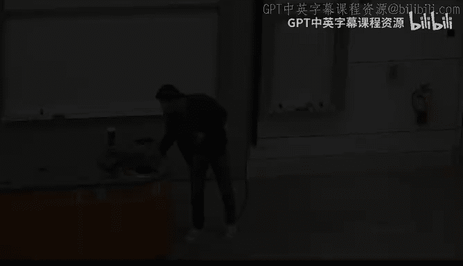

Welcome to lecture 9 already。 I hope everybody had a good fall break。Today。

 we're going to talk about neural networks。Both convolutional neural networks and transformers。

 And we're gonna unpack it to see what's going on inside。

 This lecture used to be called neural network interpretability。

 but I've broaden the scope because there is section now where we talk more about frontier models and the interpretability or visualization methods have not quite been figured out for most models that you play with out there。

 So think about this one as research areas， what we know from convolutions and what we're trying to figure out for frontier models。

We're gonna start with a very packed agenda with a case study where I'm going to ask you a question and let you brainstorm a little bit altogether on how you would。

You know， try to understand what's happening inside of a frontier model。In the second section。

 we're going look at the example of convolutions specifically and try to interpret everything possible about a convolution。

 meaning we're going to look at input output relationship。

 we're going to look at a specific neuron inside and try to interpret it we're going to look also at specific feature maps and try to understand what they do I will present many methods to do that。

 those methods are real and they've been used for convolutions but again they're not the methods that you might see frontier labs used for today's language or vision large large models however they're going to bring you the skills that will allow you to understand the methods for frontier models as researchers are trying to figure them out。

The second half of the lecture is going to focus more on the modern representation analysis。

 We're going talk about scaling laws， capability benchmarking， data diagnostics。

 and then I I'll end on on a few closing remarks。Okay， are we ready for this one。

 Lots of visualizations in this lecture。 So first question for you all。😊。

Let's say the case study is you are a model trainer。And you're， you know。

 working on a 200 billion parameters model at a frontier lab。 And overnight， you know。

 a new checkpoint passes a training sity check， but a few issues arise， things like， you know。

 model is getting worse on reasoning benchmarks。 Some safety eVs are failing。

And there is a weird spike。 mean， let's say latency for tool use when you actually use this model for an agent workflow。

Your VP is wondering what's happening。 And they ask。

 what is going on and what are you going to look at first。

 So what I want you to discuss for a minute or so， think about it first。

 and I'll open up is what are the type of evidences that you would look。Want to inspect before even。

 you know， touching the code or retraining the， the model。

 What are the things that you wantan to look at。Jumping， there's no single answer， so。

I w to know everything you're gonna to look at。Okay， so ear analysis。 So look， look at， you said。

 I will look at the reasoning benchmarks and find the examples where the model is failing。

 specifically try to find patterns in order to pinpoint what the issue might be。

 And then same thing on the safety evolvevals where you wanna see what type of safety issues are arising。

 Is it everywhere。 Is it specific to something。 Yeah， I agree。Aero analysis in general。 What else。

Remember， you， you're the model trainer。 So you're training this model。 You're。

 you're supposed to be watching certain things when you're training。What can be interesting。有。Yeah。

 let's say not necessarily passing， but those are great examples。 So you're mentioning， yeah。

 as you're the model trainer， you would be watching the training loss and you want to see what are you going to look for in that training loss。

Okay， conversionence。You probably want to make sure that it's smooth。 You don't want big spikes。

How about the validation loss， What， What is your expectation on the validation loss。Yeah。

 should probably follow the same curve as the training loss。

 but is likely slightly higher because you're probably performing slightly less well on the validation set than on the training set。

 If you're seeing spikes， it might。It might lead to。 It might mean there are some issues。What else？

Are you looking at。Yeah。けてしがう。So this batch you mean。 Yeah， yeah yeah。

 So you're looking at this round of training data。 maybe the last round of data that we trained on。

 there was some issue in that data。 Maybe that data was， you know， probably， you know。

 poisoned or biased toward a certain category of data that were failing on。 You're。

 you're totally right， yeah。Maybe that specific checkpoint is doing poorly compared to the previous checkpoint。

 And so you have pinpoint， you pinpoint where the issue arises， you know， during the， the training。

 What else are you looking at。Yeah。Okay， because it's overnight and it seemed everything was good up to yesterday。

 And now there's an issue。 Maybe you saying there' is a hardware issue。 Yeah。

 we could check actually， is。Yeah， latency has been pointed out， so maybe the hardware has failed。

 Yeah， you're right。What else。So we we， we， a lot of the answers are global answers。

 You're looking at the model in general。 You're not looking at specific portions of the model。

 What would you look at if you were to inspect the model more precisely from the inside。

And this one's a language model。 So you can， you can think about the fact that it's a language model。

Yeah。嗯。第。Yeah， you're right， like you want to look at different checkpoints。And see。

 where did we fail and might be able to trace back to that moment and figure out what the issue was。

 So， for example， maybe your initialization was actually pretty good。

 And the first checkpoints were doing well。 But suddenly， at some point。

 the model saturated in a certain way。 Maybe you're seeing exploitd ingredients or vanish ingredients in certain moments and you want to pinpoint that。

 yeah。WhatWhat else？Were， we're adding so many methods right now。

 But I want to hear what else you have for language models。

What other things can you visualize for language models that might。

 might mean something's going wrong。Yeah。し。The attention maps。Yeah， yeah。 fair enough。

 you you've learned about transformers in the online videos， the attention maps。

 which are representative of， you know， the relationship between different tokens。

 they might not make sense to you。 You might actually be plotting certain attention maps and be like this token has nothing to do with that one。

 but the model seems to think it has。 and you might be able to identify certain issues with the attention maps。

What else beyond the attention maps。What， what， yeah。So you mean。

 tell me more about the sensitivity analysis。 What would you fix， for example。

 and what would you change。要。Okay， yeah， but I like the idea of sensitivity analysis。 You might fix。

 you might try to figure out which hyperpar went wrong。Is there something wrong with our optimizer？

 Is our learning rate schedule poorly tuned。Maybe scaling laws。 you know。

 we know that we can play with compute。 We can play with data。 We can play with model size。

 And one of those might be going wrong。 Maybe an analysis would allow us to identify the model is fine。

 It just needs to be trained longer or the model is actually too small for the amount of data we're giving it。

 You know， that type of stuff would come with either doing a sensitive analysis or comparing what we're doing to the scaling laws that we know from other models。

😊，We're going to look into that。Okay， any other ideas？Might be。 So you're， you're saying you。

 I gave you 200 billion parameters， which is a very large model， even as of today。

 it might be over parameterized。 That's a good question because it depends on what it's been trained on。

 how much data we're feeding it， how much compute It's all relative to each other。 But yeah。

 it's a large model。 So I would expect a lot of compute and a lot of data along with it。You know。

 in fact， a lot of these models might be built as a mixture of experts。 You you've， you， you。

 you've heard about mixture of experts。 One thing that could happen is that some of the experts are failing。

And you might be inspecting if experts are， in fact。

 failing or the routing module is always selecting the same expert because it's just， you know。

 found an expert that is really good and generalized。 And the other experts are not being used。

 that might be another issue as well， that might， you know， be related to the model capacity。

 because if the model is not using all its experts。

 It's probably not actually operating as a 200 billion parameter model。

 It's operating as a smaller model。😊，Okay， so， you know， generally， this is to motivate the lecture。

 We're going to look into all of these together today。😊。

And we start with convolutions because they're very visual for the convolutional part。

 we're gonna go super deep。 But then for the frontier models。

 I'm just gonna get broader and and give you the areas of research。

 So the answer to the question I asked typically would fall under four buckets。

 Every solution that we looked into together。 One is training and scaling。

 So people are looking at lost curves， you know， things like gradients， learning rates。

 mixture of experts routing， scaling laws。 we're gonna talk about all these the second category is representation and internal aspect of the model。

 you mentioned attention heads and maps， embeddings， nobody mentioned embeddings。

 but you could actually visualize embeddings and see， does it make sense to you。 are these you know。

 tokens close to each other as you would expect， meaning the the models。

 mental understanding of language is correct。😊，And then your own level behaviors。

 although that's really hard with a large model。 and nobody has quite figured it out yet。

 And then the other category might be data and distribution， maybe。You know， the actual。

A benchmark that we're looking at has been contaminated， meaning， you know。

 the model is just not either is doing too well on that benchmark or it doesn't mean anything or is doing poorly for a certain reason。

 because the data distribution used in the test set is completely different from the training or validation set。

And then， you know， it might be fling at different levels。

 You can run benchmarks on the language model。 You can run benchmarks on the genetic workflow that is using that language model。

 And because you want the language model to be used in agent workflow。

 Those are two levels that you need to inspect。 So， for example。

 when a frontier lab says our model is doing really well for tool use。

 What they mean is the language model has been tested on upstream tasks in a workflow。

 and it's actually good at tool use。😊，Against their benchmarks。

 So those are different levels of capability analysis。Okay， so let's talk about convolutions。

 We're gonna dive deep inside convolutions。 and then we'll go back up and look at frontier models。

 okay。So first case study for convolutions。 Let's say that you have built animal classifier for a zoo and they are very reluctant to use your model without any human supervising because they don't understand the decision making process of the model。

😊，How can you alleviate their concerns， How can you give them intuition about the decision making process of the model so that they feel like。

 the modelss。Doing things that feel natural and and human。So let's say just to simplify。

 let's say you have a。AConvolution neural network。 And there's a softm layer。

 and it's supposed to identify animals。 So the number of classes are many animals， yeah。

If you were to write a quick Python code to give them some intuition， how would you do it。Yeah。

 first song。我也。二十毒？警ビ場や。そそう。然我。O。Good， good， good。 So just to recap。 the zoo is not AI native。

 So you have to explain certain things。 You're gonna tell them what softm is。

 So we're gonna have a probability for each animal classes。 That's how it works。 And on top of that。

 you also mentioned you might talk about convols and say， here are how features are identified。

 Here's how a filter scans through the image。 And you， we're expecting these to learn。

 So youre gonna educate them first。 That's totally right。

 The second thing you mentioned is maybe you run a data search。

 So you can try to build their intuition by showing them animal pictures and showing that the model is doing well。

 And yeah， I agree。 those are good approaches。 We're gonna see how to do a proper dataset search large scale。

 But what else can you do。 that's gonna give a little bit more confidence。

 because this is explanation。 But it's not proof that the model is looking at the right place systematically yeah。

😊，So you say ideally， you would give them intuition at a at at a filter level。 like this filter。

 we know it's responsible for finding the legs of an animal。 That's what you're saying。 So。

 how would you do that。You know， good， you know， intuition。 you're asking。

 is it as simple as just printing out the weights of that are identified or the feature map that results of that filter。

 unfortunately， not， usually， because that might be true for the first layer。 But as you get deeper。

 things mixed up so much that， you know， if you were just to print the filter。

 it wouldn't make any sense pretty much。But there are other methods that we're gonna see。

 So your intuition is right。 We， we're gonna try to give them that something simpler input output relationship。

 How would you show that that the output is actually related to the right portions of the inputs for this dog。

 for example。Yeah。Yeah， confusion metrics across a lot of data， you would find true posities。

 false et cetera。 Yeah， correct， something else。有。So similar to what he said with。

 you want to give them intuition from the inner workings of the network。 And you're saying。

 how about we mask the latter parts of the network and we treat every intermediary layer as an output and analyzing the output makes sense。

 Yeah， we're gonna look at that， actually。 Yeah， those are more advanced。

 What I was looking for is even more more basic， much more basic。s。

 if you want to show the relationship between an input and an output of the CNN or you know。

 any vision model you might take the score of the dog in the output layer。 Okay。

 and what is exactly this quantity， What， what， what is the intuition。

 Your intuition for what this quantity means。You take the derivative of the score of a nano class with respect to X。

With X being the input image。就我。How does the score of Do change when you move pixels around？

Which is what you want， right， You want to be able to， if you can do that。

 you would indicate that which are the pixels of the image， that if we change them。

 it changes the score of dog。If you can print that。

 then you would be able to show this is where the model is looking at when it's predicting a dog。

Right， so， yeah， if you actually calculate this derivative。

 you would get something like that where some of the pixels are gonna be brighter。

 meaning their gradient is higher and some of the pixels are gonna be darker。

 meaning we moved that pixel and it didn't modify the score of dog at all。😊。

That's a very quick way to look at which pixels in the input were relevant for the score of dog。

呃 now。Why should we select the score of dog preoftmax versus postofmax。

It's usually a very common misconception。有。So what's the issue with the scale。Pion。Class of dog。 Yes。

 so what you said is the the postofm score is not only dependent on dog。

 It's also dependent on all the other scores。 So you could actually take a pixel， move it。

 And it happens to modify the score of a panda because there's a panda in the background or something。

 and it would influence what you're trying to show。 but you're only looking at dog。

 You just want the score of dog to be influence。 So that's why in this method called sency maps。

 we use the preoftm scores that is only representative of the class at hand that you're analyzing。😊。

Okay， so you could do that。 And actually， if you were to in the past， not anymore。

 but you could use that for a quick segmentation。 chasanitity check because the pixels that are brighter。

 the gradients that are brighter are representatives of the pixels that should be overlaid on the dog。

😊，And in fact， if you do the salientency maps and you realize that the pixels that are bright when you compute that gradient are all over the place。

 it's probably that the model is not even looking at the right place， it's just getting lucky。Okay。

So this first method， salient seamas。Now have that in your toolkit。 Very easy to implement， right。

 You just write a python script， you， you perform a gradient calculation， you print it。

 It's a matrix of。Pixels that are brighter or darker， and you're done。

 One of the main issues with se maps is that it's looking at just a pixel level。

Which doesn't make too much sense if you want to interpret semantically where the model is looking at。

You know， the model we never see a cat or a dog with one pixel being different than the rest。

 It would be too discontinuous。 So instead， there's another method。 I'm not gonna go into the detail。

 but I linked the paper， which is way more common called integrated gradients。

 And integrated gradients the idea is that instead of doing that directly by taking the D S of dog over D X。

 We're gonna take an image of the animal， and we're gonna generate you know。

 sort of many pictures that are taking dark， completely black zeros a pixel all the way to the animal。

 the final image。 And then we're going to look at the path of gradients across all of these update and it's going to be way more interpretive。

 I'm not gonna go into the details but integrated gradients is just an extension of salency maps that happens to use a different formula with an integration and is way more common。

 If you look at it practically，😊。

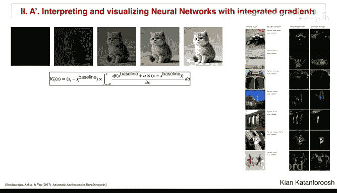

Example from the medical field， here is a an image of a retina。

 And if you perform the integrated gradients， you would see that the original image。

 the the the annotation for the lesions are exactly where the model is looking at。

When it's giving you a probability that there is a lesion。Okay。

 so the second method called integrated gradient。Let's push it a little further。

The next case study is that， you know， you， you， you。You。

 you wanna now tell them a little more about the decision process of the model with。I guess。

 I guess let me， let me rephrase。The salency maps looked at the pixel level。 what。

 what you can do in order to give a better intuition， which was mentioned earlier。

 is another approach called occlusion sensitivity， which is actually way more intuitive and simple where you could actually you know。

 take the dog image and paste it into the CNN and you would get a score of a dog。

 You could also overlay a dark square。 So zero out or mask partially the input image and give it to the same CNN and track the modifications on the score of dog that you're tracking。

😊，If you actually do that， you can plot a probability map of how is the score of do changing as I move the dark square through the image。

So let's do it together。 I'm gonna say that， you know， this one when you。

 when you actually put the dark square on the top left of the image， the score of dog is unchanged。

 It's still very high。 Now you move the square a little bit to the right。

 and you see that it's still very high。 The score of dog。 You do it again， still very high。 Now。

 the square is partially o the face of the dog and you should see the score of dog drop。

 If the model is， in fact， looking at the dog。 and you perform that many times。

 So you scan through the image with your dark square and you plot what we call you know， the。

 the probability map of the true class for different positions of the gray square。😊。

Does that make sense？So pretty simple， computationally expensive， though。

Just have to rerun the image so many times through the model。

 here are practical examples to look at the first one。 the true label is a。Pomeranian， cute dog。

 And you see that the model is failing to recognize the true class when the square is overlapping with sort of the center of the face。

 which makes sense because here， the true class that we're tracking is not dog。 It's pomeranian。

 And I could see how if you occlude the face， it's hard to get the breed of the dog。

The second example， the true label is a car wheel。 sorry。

 I hadn't shown you that the true label is a car wheel。

 And you can see that when the square is on the wheel， it is， it is， in fact。

 dropping in terms of the true class probability。 And then finally， the Afghan hound。

 what's interesting about that third example is the probability is dropping when the square is on the dog。

 but it's also increasing when the square is on the face of the human on the left。

 which means that if you actually include the the face of the human。

 the model thinks even more that the true class is， in fact， an Afghan hound。😊。

You're just removing additional unnecessary information for it to discover the true class。

 So this model seems to be doing well， right？ It seems to be looking in the right place。

We call that occlusion sensitivity， pretty simple， another tune with agencyency map and integrated gradients in your toolkit。

Let's push it， slightly。Further。嗯。Here。Here we're， we're given， you know。

 along with the classification output。 we the zoo wants a real time visualization of the model's decision process。

 And you have one day to show that。 And we're talking about convolutions again。 What do you do。

 So the important part is to know since the the methods that we've seen so far or sort of post methods where you analyze the output or you show something here。

 we're looking at sort of ideally a module that we could plug in our network that would constantly give us the decision making process of the network。

 Well at least where it's looking at。😊，How would you do this？This is our network， by the way。

 we're taking an input。 We're adding zero padding， and we have a series of conrelu max pool blocks。😊。

And then at the end， we flatten。 We have a triplep fully connected layer， a softmax。

 and we get our probability output for classification。😊，So just first question。

 where do you think is the weakness of this network when it comes to interpreting where the model is looking at on a picture。

A part of this architecture is very makes interpreting the network way harder， yeah。Why。你不是。Yeah。

 totally right。 The fully connected layers。 you're looking at all the pieces at the same time。

 you're mixing everything and you're doing it three times。 So by the end of those three layers。

 the information has been mixed together。Essential。

 you do not find the localized information that you had pre dot with the max pools and the con con layers。

 So how could you change that layer in order to avoid that。 How would you modify your network。

 if you wanted to retain maybe the， the， the performance of the model。

 but not lose that localized information。😊，Yeah， good idea。 How， how could we。

 instead of doing three， can we do one， can we， you know， still have a layer that makes the you know。

 makes the interpretation easy， actually， there's another trick， which we're gonna see。

 But it's similar to what you describe。 Let's say we convert this network into something where the。

 you know， the flattening of the pixels and the fully connected layers are converted into a single global average pooling layer and a fully connected layer。

😊，So here we reduced from 3 to 1， the fully connected layers。

 We still need our fully connected layers in our softms because it's a classification task。

 and we want a good decision engine at the end。 But we converted。 we。

 we added a global average pooling。 So let me explain why， why this is better。😊，So。😊。

The last con blot， essentially， is giving us a volume for the sake of simplicity。

 Let's say that volume is a 4 by 4 with 6 channels。😊，Okay。And I color coded them for simplicity。

So each of these channels is a feature map that is resulting from a filter being scanned through。

The previous input， right。Everybody's clear on that。So global average pooling。

Is going to take each of these channels， feature maps。

 and is going to average them in a single number。😡。

So if you take the orange matrix and you average it， it gives you one of 4。7。

You do the same thing with the green 1， the blue 1， all six of them。

 and you get a volume or call it a vector of sizesi 6。1，1，6。So why is that interesting。

 Because we actually did not lose the localized information。 We did not mix things up。

 We just assigned a single number to a feature map that we retained。

 So the localized information is still there on the previous volume。

And now we can treat that as a vector that goes through a decision engine or a fully connected layer that ultimately goes through our softm and give us the probabilities。

😊，So this architecture is easier to trace back to localized information in the input space because you can actually look at。

 let's say one of the score of dog and you can look at the weights of each of these edges that tell you how much has the feature map from the volume before contributed to that score。

So in other words， if I had to summarize， let's say the feature map looks like this。

 So this feature map is very high， has somehow activated heavily in some portion of the input image。

The others similarly have activated to other things。

 you're taking the weights from your fully connected layer。 by the way。

 you have to retrain that layer， you have to just train that layer， that last one。😡。

And then you sum all of them， and it gives you what we call a class activation map for the class that you're visualizing。

So you're overlaying those last six feature maps and you're weighing them with the weights of the last fully connected layer。

 You're not losing information。 You're not mixing three fully connected layers that are impossible to trace back to the input space。

Okay， so if you now give it an input image and you overlay the class activation map for the score of dog。

 which you can do for other classes， You can do the same thing for the class of cats。

 look at the different weights， the feature maps。 and maybe for the class of cat， the the weights we。

 will certainly be different。 So the contribution of each feature map will be different。😊，Yeah。

 and this is what you get。 This is called class activation map and。😊。

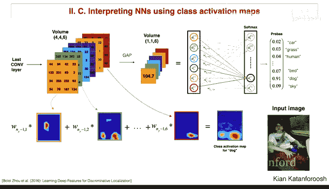

It's from folks over at Berkeley。 And so here's a video that describes it。 It runs really quickly。

 You can think of it as a slight modification to a。

 a vision network that can allow you to unpack what's happening inside and what's the decision process。

😊，There is also sort of an improvement to the cam or class activation map algorithm called Grdcam。

 which enhances that method。Okay。Any questions on class activation maps？

So we're getting to know convolutions a little better yeah。Yeah， so you were saying in the video。

 it seems like the model sometimes is looking at meaningless things。 Yeah， I mean。

 it's not surprising， frankly， this is the previous generation of models。And on top of that。

 you're looking on a video。 The model is a classification network。

 So it might look sometimes at things that are not even labeled。

And so it has to find the closest one。 It might not make sense at all。

 That's why you build that type of module to visualize and understand， like。

The network is actually not working that well， no。Yeah。

 but maybe on the main objects that you actually want for your task。

 let's say the zoo wants to do very well with cats and dogs。

 you can verify that when a cat is moving， even at fast speed， the model is quickly looking at it。

 you know。Super， let's do a couple more methods because it's gonna build our intuition for frontier models。

 So now the zoo trusts you。 It trusts that the model correctly locates animals。

 but they get sort of scared and they wonder if the model understand what a dog is。Like。

 does it understand， actually what a dog is or is it just like pattern matching， random things。

You know， how could you take this convenet。And sort of query。What the dog。

 what the model thinks a dog is。 How would you do that。 how could you ask the model。

 what's your best representation of the dog。Okay， yeah， you did say two things。 So get an image。

So a forged image that maximizes the probability of dog。 Yeah， let's do that actually。

 And then on your second point about。Reverse engineering。

 We're gonna look at the method there as well。 But yeah， I agree。 you could。

 So how would you concretely do that， Like， what would you maximize。Okay。Actually。

 what we said earlier， but I I think you came right after that is we would not take the softm output because the softm output is dependent on other classes。

 You divide by the sum of the exponentials of other classes。

 And so you could actually maxim the softmax output by not maximizing the class you want。

 but by minimizing the other classes， which is different than what you want。😊。

So here's what we'll do。 We'll define the loss function where we take the preofm score of doc。

 So the thing right before the softm， which is only dependent on that specific class。

 and we might also regularize it to make sure it looks natural。

 The reason we want the regularization term is because pixels need to be between 0 and 2，55 roughly。

 And so you don't want to run an optimization a problem where pixels can have values that go all over the place。

 It's just not gonna look good to the human eye。😊，And so we're gonna do that。

 We're gonna run a gradient as algorithm。 So similar to what we've seen in some of the previous classes where we are gonna update the pixels of an input image。

 a completely random input image until we can maximize the loss function we defined。

 So before propagated the random image。 We compute the objective。

 We back propagate all the way back to the pixels。 And then we update the pixels to maximize that objective。

 And we do that many times until we end up with something that might look like this。😊。

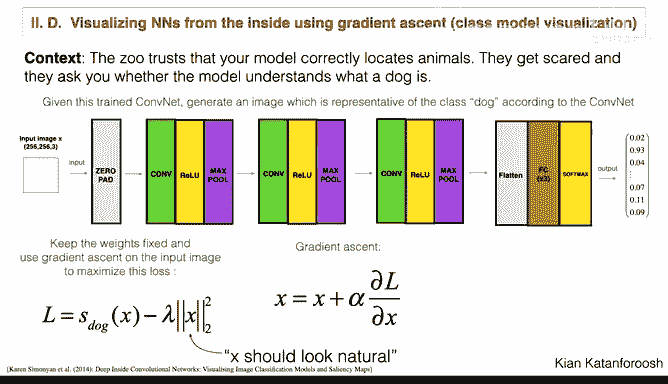

So let's say we take the score of a Dalmatstian。You know， here researchers and。

 and showed and this is worked for Jason from Jason Yosinski shows that you can start seeing the model。

 If you ask the model what is a Dalmatsian and it will tell you。

 it's something with black dots on a white background。Roughly。

So actually might not understand fully what the dog is。 but it， that's what it thinks it is。

So we just unpacked it a little bit and queed que that。 Another interesting one is。

 if you look at the goose。 So here the， the， the top left label goose。For the model is many of them。

What does that mean， It means probably the model has seen a bunch of。

Geese all the time together and has rarely seen a single one。

And maybe the labeled data was labeling that as goose when it was geese。

 And so the model actually doesn't understand that it's a single one。 It thinks that all of them。

Or the label。Does that make sense？Okay。Super， so that's called class model visualization。

 You can actually， Oh， sorry， I wasn't showing what I was talking about。 or no。

 I was showing the the。

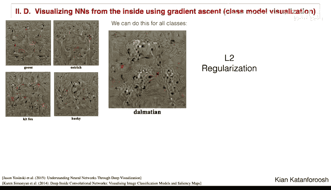

The， the way to improve those visualization is just to change some of the regularization methods。

 So the researchers have shown that you can actually add more color by regularizing better。

 So it looks better to the human eye。 And then it becomes easier to query the model for a variety of classes just to make sure that it understood those classes。

And so same with flamingos， actually， the labels flamingo to the model feels like many flamingos。

Just something you can observe。Any questions on class model visualization， not super new。

 Just another。You know， tool in your kit。It turns out you can apply the same type of method as class model visualization。

 But instead of doing it at the class level， you do it in an intermediary activation。

 So you could actually do the same exercise sort of what you were saying earlier with the masking of the later layer and just looking inside the network。

 You could pick an activation in the network。Create an objective function with the regularization and say。

 hey， show me the input picture that maximizes this activation。😊，And that should tell you。What is。

The input that maximizes activation， the most。Right。Okay， so that's class model visualization。

 which can also be applied with gradient ascent anywhere inside the network at any neuron。

And that already gives you some sort of it。A method to look at the neuron level and say， hey。

 what's the input that maximizes the fake input that theoretically you could generate that maximizes that activation。

嗯。The next method is actually the most commonly used today because it's so simple and intuitive。

 It's a data set search。So what you could actually do is to pick a filter。 You， you。

 you just pick one filter。 you pick its feature map。Among， you know。

I guess you pick one feature map at some point in the network such as after this max pooling layer。

 and so let's say you have 256 filters in that convolution layer。

 So you have 256 feature maps of size5 by5 and you find across all your data， your validation set。

 the top five image that maximize this feature map。😊，Yeah。

 so you just track the activations in that feature map。

 You find the highest activation across all your data， and you find the top， the top five images。

 and you can do that。 You know， again， you would say this seems that the filter that produced that feature map has learned to detect shirts。

 because if you find the top five images that activated that feature map the most。

 that filter the most， it's all images of shirts。😊，If you were to find something like this。

 you would say it seems that the filter has learned to detect edges。

And you could do that across every feature map。To interpret your filters。Okay。

 simple data set search。That can allow you to interpret， if。

If a filter is reacting to something meaningful。So if you look at these pictures that I printed at the bottom of the slide。

 they're all cropped。So why are they crops。They don't look like images from the data set。

 The The image is probably bigger than that， right。嗯。Do， do what。So， so we took， we。

 so we took the input image。 We send it through the conrelu blocks。

And then we pick a feature map in the fifth block， let's say。What is this feature map looking at。

 Is it looking at the whole image or no， Sorry， what is the， So we pick a feature map。

 And in that feature map， we find the activation that's the highest。

 So let's say the activation is the。Rule number 5， column number 3。If you pick that activation。

Does it have access to the entire input image or not。嗯。不好意す。都才。Do think。F like喷。Yes。

 so you don't necessarily have access to the entire image。

 The best way to visualize it is that the first layer。 And say， on the first layer。

 you take the input image， you take a filter and you run it through。 Well。

 that activation in the feature map of the first layer is only going to see what the filter see。

 right。When you go deeper into the network， do you see more or less on average of the image。

A single activation。 does it have access to more or less parts of the image。Say more。Yeah， it's more。

Let let's look at it。 So here's a picture，64 by 64 by 3。 let's say we have a combv network，5 layers。

 And after five layers， the last comb has 13 filters。And leads to a 13 by 13。 Sorry。

 it has 256 filters that leads to a，13 by 13 feature maps。If I look at this feature map。

 let's say that's the most activated。I trace back to the input space。

 It will have access to this part of the image， let's say。Now， if the。

 there was another con value block。And I was looking at a feature map。

 It would have even more abstraction of multiple portions of these squares。

 So it would actually see slightly more from the input image。 Does that make sense。😊，So， you know。

 that that's， that's， that's how you would think about it。

 And it makes sense because at the end of it， the last output has access to the entire image， right。

 cause all these。Things are， are adding up。To the prediction。Okay， so the deeper the activation。

 the more it sees from the image。 And that's why the images were cropped。

 They were just cropped based on tracing back what that activation was looking at in the input image。

 which you can do very simply computationally。Okay。

 so now we're gonna look at our last method for cons， which has to do with reverse engineering， conv。

 And then we'll move to the frontier models。So remember this slide from when we introduced generative adversarial networks。

 agains。I didn't talk too much about the generator architecture。 I just said it was a neural network。

 but I did mention that something weird about that network。

 which is that the input is way smaller than its output。 The input is a vector Z。

 The output is an image。Of more dimensions。It is very common that such a network needs to ups sampleample and thus would use a decoconvolution。

Sometimes in the literature， you're gonna see dimensions of the convolutions as an up sampling network with the input is smaller than the output。

Sometimes those are called transpo convolutions， but we're gonna talk about why。

Another example where you might run into up sampling is when you have an encoder decor type networks。

 such as for segmentation。 So let's say you're given an image of a cellular set of cells like this。

 and then you want to label segment to the pixels that belong to a cell just to find the different cells。

 typicallyyp you would use a set of convolutions that reduces the volume in height and width。

And then。Youll get information encoded in a dense format that you will then unsemble because your output should be of the size of the input minus the number of channels。

 but at least every pixel should have its own class。And so typically。

 that would be a set of convolutions。Followed by the convolutions。 So you downsle。

 you ups sampleample。Why am I talking about the convolutions。

 Because we're going to try to reverse the engineer。Com networks by adding。A module。

 a deconvolutional module that will take a specific activation and will reverse the engineer the traces to verify what was the reason this activation was high。

Okay， this idea is key not only for comms， but for any network you'll think about in the future when you work on it。

 if you wanna actually reverse engineer the， the， the reason a specific neuron has been active。

So let's take the example of a 1 D convolution。 This is the most。ABas example， just for the。

 the sake of understanding the math。 And I give you an input X。

 which has some padding with  two zeros at the top 20s at the bottom。

 and then X 1 through x 8 values。 And I send that input to a 1 D convolution。

 which has one single filter of size 4， with a stride of2。What's the size of my output Y？

Remember the formula。What。5， correct。Yes， I assume you， you did this。This。So。You know， you took的。

And x， you。Applied the formula and you floated it， you didn't forget to add one。

And then you ended up with5， is that。Correct。Super。So we have our output of  five。

 and let's say we define our filter size for W 1， W2， W3， W 4。

 It's actually easy to see that the co 1 D can be written as a system of equations where y1 equals W1 times 0 plus W 2 times 0 because of the padding plus W 3 times x 1 plus W 2 times x W 4 times x 2。

😊，Right。You're just overlaying the filter on top of the first four indices of the inputs。

And you're doing a dot product。Same thing with the second one， third one。

 all the way to the fifth one， and that's your system of equation that describes this comm 1 d。Now。

Because it's a system of equation， you could actually write it as a matrix multiplication。

 So you could say。The co 1 D is literally just a weight matrix that we multiply by the input。

 So the inputs and the output sizes， we know，5，1 and 121。😊。

So the weight matrix is necessarily a 5 by 12 weight matrix。So， we just。

Re wrote the Com 1 D as a single weight matrix that you multiply by the input。 get the output。

If you were to， you know， draw this matrix， this is what it would look like。

 So it would be a matrix with。Values all along the diagonal and the rests are zeros。

So that's our conclusion。 Com 1 D can be rewritten as a matrix vector multiplication。

Everybody photos。So if you can write it as a matrix multiplication。 Remember。

 we're talking about reverse engineering， then I could say decom。Is possible。

 It's possible to reverse engineer that。 And， in fact。

 I'm gonna make a very big assumption that is not always true。 Sometimes it's true。

 But for practical reasons， we're in deep learning， right， It's an engineering field。

 We're gonna assume that W is invertible。 And so you can find a matrix H that is equal to the inverse of W。

Such that x equals H Y。So that you're able to reverse engineer the signal。

I'm gonna make a second assumption in the sizes I printed， which is even bigger。

 is that W is not only invertible， is also orthogonal， meaning that its inverse is its transpose。

It happens that it's sometimes true。 And， in fact， if you think about the edge detector。

 So let's say our filter is -1，0，0，1， 0，0，0，1。 It's， it's a， it's an an edge detector。 So it。

 I have won too many zeros， but it's an edge detector。 and it's actually。You know。

 invertible and its inverse is its transpose。And so that simplifies our reverse engineering because we have a co1 D。

And we know that we can write it as a matrix vector multiplication。

 and we can transpose that matrix to reverse it。And maybe it's not always true。

 but it's true enough for it to work in deep learning。그 맞。You're going to do that so many times。

 right？That's why in the literature， oftentimes， the convolutions are called transpo convolutions。

I give you the 1 D example。 The 2D example is similar。 It's just more complicated。 There's more math。

 Things mix up， but， you know， same same idea。Now， there is a trick that makes it simpler to。

Code the deconvolution。 And to see that trick。I just drew X equals W transpose y。So you have your x。

 which is a vector of size 12， although there is two padding at the top or at the bottom。

 And then I transpose the W matrix that I was showing you。

 And then I multiplied that by my vector Y of size 5。

 It's This is actually a transpose convolution with stride 2。

 is equivalent to something slightly different， which is a subticel convolution of stride 1 half。

 It's a mathematical trick。😊，You can do it at home。

 but you would see that these two operations are equivalent。

 meaning you can actually flip the filter。 So you see in the right side in the left side of the screen。

 the filters are flipped。 So if you look at the first row of my matrix。 It's not W 1 through W 4。

 It's W 4， through W 1。 So I flipped the filter。😊，And I scanned it all the way through the diagonal。

I also used another trick， which is my y vector。 I inserted zeros in between the values。

It's called subpixel。So I inserted zeros， and I also added some padding。So a couple of tricks， but。

No， no need to， to remember it by heart。 If， if there's anything you can remember。

 it's that implementing a deconvolution in the subpel version I was describing is。

 is similar to a convolution。 But what you do is you create a sub pixelel version of the input by adding zeros in between the values and padding it。

 You flip the filters and you divide the right by2。And that's what a decoconvolution is。

If you have a convolutionary a neural network and you want to reverse engineer it。

You take the filters。You flip them。You create a subpel version of the inputs。

You divide the strip by two and you run the process， you will have reversed that convolution。

The reason we're doing that is because。We're just rewriting the convolution as another convolution。

 But the hyperpar are different， but it's easy to code， okay。You're just reusing the same code。

 pretty much。So。Anyway， let's get back to our example here。 We have。An image of a dog。

We run it through a convnet， and we pick at some point in that convnet。A feature map。

We pick one feature map only among the 256 possible feature maps right here。

And we're gonna look at the max activation of that feature map。 So we find the max。

 Let's say it's this one。 So row 2， column 3 is the maximum number of that feature map。😊，We。

 what does it mean， It means the filter that LED to that feature map。 when it looked at its input。

 it was maximal in that location。 It's maximally shine activated in that location。

We zero out every other。嗯。Entries of this。Matrix。And then we reverse the network。 So we max pooled。

 We unpol。 We re。 We do the reverse。 We do a decom instead of the comb。

 which is a transpose convolution sub pixelel version， flip， flip the filter， divide us right by 2。😊。

And we do that how many times， three times because we have three blocks。And then。

We should be able to reconstruct。What this activation was maximally activated for。

And we get the cropped version， as we learned， the crop part of the image that this activation was looking at and exactly the pixels that maximize its value。

😊，Does that make sense？It's pretty complex， but it's important to know these methods because you might run into something similar in the future。

Or be asked to sort of interpret certain feature maps， certain activation maps， etca。O。

So some additional details that we cover is what is on pool and why do we do some value in there。

 So very simply。

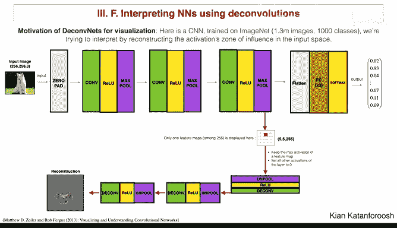

Let's say I take the max pooling layer。 I max pool this filter size 2 by 2， straight of 2。嗯。

If you wanted to unpo this。How would you do it？Are pooling layers， max pooling layers inverible。嗯。No。

 why。Yeah。Yeah， exactly。 It's not invertible because if you pick， you write the。

 the sixth here on the top left。You can tell that the6 was in one of these four。

 but you don't know where it was。So you can't invert， and it's very important to know where it was。

 right。嗯。So it's not invertible， but you could actually use a trick to make it invertible。

 which is passing what we call switches。So during the forward propagation。

 you look at all your pooling， your max pooling。 and you remember with the binary matrix。

 or very lightweight matrix， where the pooling happened， where the max pooling happened。

 And then when you're doing the unpooling， you remember those switches。

 So you keep them in memory and you pass them back and that should tell you where the value came from。

😊。

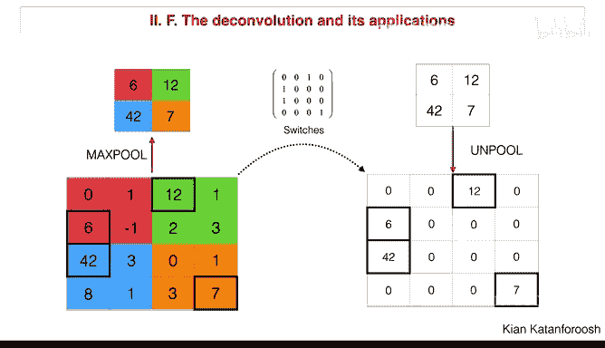

So that's what we mean by unpooling。Okay， so I go back to my previous map。

 The only thing I need to change to be able to reverse engineer my network is to pass the switches。

And the filters， by the way， because the deccom is just the flip version of the filter。

With subpixel and stride divided by 2。 And so I do that。So you can see you can。

 you can literally invert your network here and trace back from one activation to the input space。

And then for relu is a little odd。 I'm not gonna spend too much time on it because it's more empirical than nothing。

 but Relu forward is essentially zeroing out every value that is negative during the forward path。

 technicalically， a re backward is impossible unless you have also the switches。

If you have the switches， you could actually， you know。

 pass linearly back whatever was kept because it's the identity function。

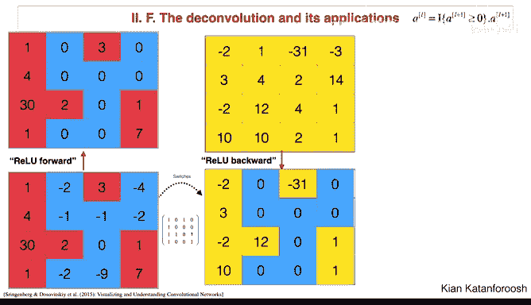

But， but actually， that would kill your， your positive signal coming back。 So instead。

 you just reuse relu。呃。Basically， you you use the re because you want to start from the activation that is the highest on your feature map and to keep passing the positive signal back to the input space。

 Don't worry too much about it。 It's just that relu is just passed as a re during the reconstruction process。

 not as a proper re backward。😊，Okay， so here we go。 We send our dog through the network。

 We look at a specific Max pool output。 We take the feature map。

 We find the activation that is the highest in that feature map with zero out all the rest。

 We reverse in general network。 We find the cropped part of this dog with the pixels that LED to that specific feature map finding。

 We are interpreting the filter that LED that feature map。

 and you can do that anywhere across across the network。 But， of course， if you're earlier。

 the crop is gonna be even smaller。😊，If you're later， generally bigger。Okay。

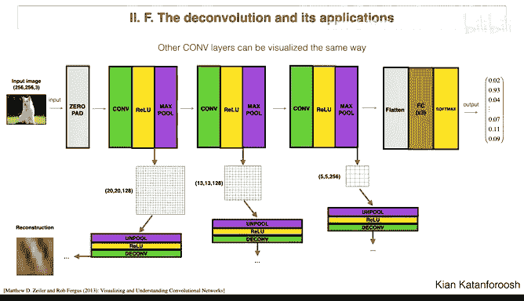

So you learned Dcoms， slash transpose comms。Now， let's look at some practical visualizations from Matthew Zer and Rob Fergus。

 These， these are great researchers in the space of visualizations， been making so much progress。

 So they trained a network。 Okay， they looked at results on a validation set of 50000 images。😊。

And so what you're seeing is the first layer。 and specifically the patches。 what the patches are。

 theyre the top 9 strongest activation per filter。喂。So for each filter in the first layer。

 they look at the top 9 strongest activation， and they remember the data point that was leading to that。

 So that's the data set search method that we saw together。

 What are the9 images that LED to that maximum。That that that feature map activating the most print them。

 Those are the patches for each filter。 If you do that。

 you can already interpret some of the filters by seeing that， oh。

 this one reacts to edges that are diagonal or this one reacts to edges that are straight。

For example。On the bottom right， we actually print the filters raw。 And， of course。

 because it's the first layer， it is interpretable。 So if， in fact， you have an edge detector。

 you should see when you print that matrix that it looks like an edge detector。That doesn't work for。

Layers beyond one。So now let's go a little deeper。 Now we're going layer 2。

And we're looking at the decoms。 So what are they doing， They're essentially。

 they're essentially looking at the top one strongest activation per feature in the second layer。

 So the second layer has 256 feature maps。They're presented here。You pick one feature map。

You look across all these。50000 validation images。 You find the maximum feature map。

 You take the specific portion of that feature map， the specific entry that's maximally activated。

 you zero out the rest。 you do your de。 You pass the switches blah， blah， blah。

 and you get the cropped part of the image that represents why it was activated。

 And this is printed all over here。 And you can see you can start interpreting that by doing the top 1。

 or you can do the top 9。 And if you actually do the top 9， you would start seeing that， in fact。

 certain filter have very clear purposes。 Some filters detect circles， Some filters detect。😊，Or。

 you know， shapes。咩。If you keep， you know， doing that in layer 3。

 you would start seeing with the decom method that the filters are capturing more complex information。

 Remember， in the first lecture we did together， I said that the deeper you go in the network。

 the more the information adds up and you get more complex features later， This is a proof of that。

 pretty much。Now， if you go to layer 3 and you pro you can do， you can do all of it。

 You can do the top 9 patches where if the 9 patches look very similar， you you know。

 you can probably safely say that this filter was responsible for this type of shape or color or you know。

 a salient feature and， and then you can do the decom as well。 essentially。

Let's watch together a very short video of Jason Yosinski neural networks have enabled that shows a little bit of everything we've learned together。

 They can recognize school buses and zebras and can tell the difference between multi terriers and yo。

😊。

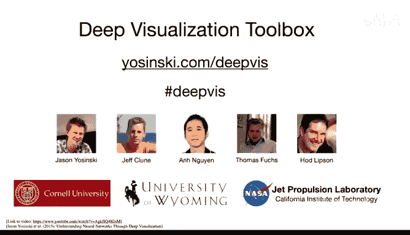

We now know what it takes to train these neural networks well。

 but we don't know so much about how they're actually computing their final answers。

We developed this interactive deep visualization toolbox to shine light into these black boxes。

 showing what happens inside of neural nets。😊，In the top left corner。

 we show the input to the network， which can be a still image or video from a webcam。

These black squares in the middle show the activations on a single layer of a network。 In this case。

 the popular deep neural network called AlexNe running in Cafe。By interacting with the network。

 we can see what some of the neurons are doing。For example， on its first layer。

 the unit in the center responds strongly to light dark edges。Its neighbor， one neuro on over。

 responds to edges in the opposite direction， dark to light。Using optimization。

 we can synthetically produce images that light up each neuron on this layer to see what each neuron is looking for。

We can scroll through everything。 we've seen that matter。 including convolution。

 pooling and normalization layers。

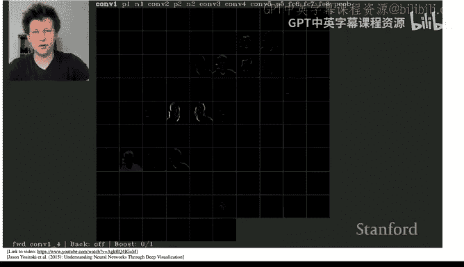

You can switch back and forth between showing the actual activations and showing images synthesized to produce high activation。

This is a class model visualization method。By the time we get to the fifth convolutional layer。

 the features being computed represent abstract concepts。For example。

 this neuron seems to respond to faces。 We can further investigate this neuron by showing a few different types of information。

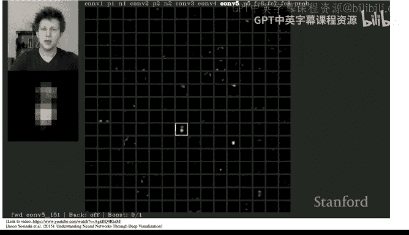

First， we can artificially create optimized images using new regularization techniques that are described in our paper。

 Does the class model images show visualization response to a face in childrens。

We can also plot the images from the training that's the data set search。

 as well as pixels from those images most responsible for the high activations。

 and that's the devolution。This feature responds to multiple faces， in different locations。

And by looking at the decoms。We can see that it would respond more strongly if we had even darker eyes and rosesier lips。

 We can also confirm that it cares about the head and shoulders that ignores the arms and torsin。

We can even see that it fires to some extent， for cat faces。Using backdrop or decon。

 we can see that this unit depends most strongly on a couple units in the previous layer con 4 and on about a dozen or so in con 3。

So because of decoms， you can trace back the entire layers before。 And where the top9 imagess。 Okay。

 I'm， I'm gonna leave it to you。 But you get the idea the。

These researchers build a toolkit that essentially reproduces some of the methods we've seen together。

 although we've seen more methods than what's in the toolkit。 And so your。

 your kit is now able to answer many questions about convolution such as， hey。

 what part of the input is responsible for the output。

 We now know that we can use occlusion sensitivity or class activation maps。

 What is the role of a neural filter layer， We have many methods that can allow us to do that。

 Can we check what the network focuses on， given the input image， We have methods to do that。

 and how does the neural network see our world， We have the gradientcent class model visualization method that allow us to maximize an input image with respect。

 sorry， find the input image that maximizes a certain activation。😊，Super， so that was the first part。

 And then we're gonna move toward frontier ideas。Any questions on。CNNs。

 you feel like you have a better idea of how to look inside a CNN。So， let me start by。Comparing CNNs。

Two more you know， modern frontier networks。The core distinction is going to be that CNNNs deal with localized information。

 They visualize edges， textures and shapes when in modern， call it LL Ms。

We visualize relationships and meanings between concepts， or between tokens。

And this is because transformers are based on。Attention。

And that started with the attention is all you paper。

 which essentially explained why attention on its own is highly performant and can allow us to model very complex relationships。

So， you know， by the way， this is just the the， the。

 the first figure of the attention is all you paper。

 which you should all be able to read and understand by now in the class。

 And transformers really represent language using two very simple ideas that are visualizable。

 They they， we can interpret them to a certain extent。The first one is the attention patterns。

You know， attention looks at the relationship between tokens。 So you look at a specific token。

 which can be a word， a subword or a sllable。 You know。

 I'm going simplify by saying it's a word and its relationship with other words in the training set。

And that's the attention that the transformer looking at it。

 Each attention had learns different patterns， so it can learn things like linking pronouns。

 to nouns or tracking structures or enforcing a certain ordering。

 And then I really like this visualization， which is from Jesse Vig in 2019。

 and this visualization essentially shows you there's a very nice blog post that he wrote with a few figures where you can see he presents how attention can be visualized in simple ways。

 What is the connection between a fixed token with the surrounding tokens。😊，Let's see。嗯。So。

This is essentially the transformer analog to the CNN Saency maps。That we look at。Pretty much。

The other things that transformers are more modern language model uses em biddings。You know。

 during the pre traininging phase， you're also learning biddings。

You are ready to read the birth paper。 In fact， now， with the baggage you have from the class。

And what's interesting about embeddings。 And I printed a picture here from Garrg in 2021。

 I also encourage you to see that short block post where he uses a visualization method called T。

 It's a dimensionary reduction method。 We're not gonna present it in the class。

 but it's taught actually a lot in the in biotech and healthcare it's used very extensively for those of you who work with the Stanford Hospital。

 and it allows you to visualize embeddings。 and embeddings are sort of how the language model perceives our words。

 So you would expect tokens that should have similar semantic meanings to be next to each other in that space or tokens that have nothing to do with each other to be far away from each other in this sense。

 And that can be a way to sanitity check that your model actually is learning meaningful representations。

Right， so together， attention and embeddings are what let large language models track relationship and meanings。

 and and you can visualize your embeddings with dimensionary reduction tool。

 you can even visualize attention relationships as well。 Unfortunately。

 the modern transformers are so complicated that even the cutting edge research is only able to interpret those relationships with two layer transformers pretty much。

😊，The best you find out there is probably anthropics work。 So I linked two papers。

 The first one is called the mathematical framework for Transer circuits。

 which is essentially explaining how the different components within a transformer interact with each other。

 and they introduce the concept of a circuit。 And then the second one is a follow up to that paper called in context learning with induction heads。

 induction heads are probably the best tool we have to sort of visualize what's happening inside the transformer。

 It's pretty complex。 You should be able to understand it by now。

 but you'd have to spend quite some time to go deeper into it。 I just will link them。

 We're not going talk about it for the sake of time。😊，Let's get to。Some fun stuff。

 training and scaling diagnostics。 So how do labs frontier labs check if a model is training well。

 We've talked about it in the first case study。 but one very natural ways to look at our lost curves。

 You can look at the training loss at the validation loss and make sure that they follow sort of a smooth trajectory。

 And if it's not smooth， there's probably something that went wrong。

 You've probably trained your own network where some loss functions look very funky。

 I remember back in the days， there was even blogs where people would post their ugliest loss functions。

 and there was a lot on there。😊，You might find sudden jumps on the loss。 That means maybe the。

 the batch that has been processed has been corrupted。

 Maybe you're doing extremely well on it when you should actually not。You know， do that well。

 and it might raise a flag。 You might， you know， find bugs in your code because of that。

 you might find gradients that are exploding gradients that are vanishing all of that you could visualize at the loss function level。

 Now， note that loss functions can be run at a global level or at， you know。

 on a specific subset of your data。 We're gonna talk about it in data diagnostics。

The other things that are interesting to track also sometimes refer to in in the community as a training telemetry is to watch and track your gradient norms。

 look at your learning rate schedule， or even look at hardware efficiency metrics to feel if you've underutil compute。

 which we talked about again， in the first part。 So imagine that if you're working at a major frontier lab。

 You probably have a dashboard that tracks your different loss function for different subset of the data。

 your checkpoints， all of that。 know， you would have all of that。 Unfortunately。

 very few of these are published because their I。 know， they can't really。

 they don't want to give it out because it will leak essentially information about their architecture about what's going well。

 what's not going well， etc。 And that's why you find very few information on these。

 The one thing that I。😊，You do find some charts on that are really helpfully scaling laws。

 So scaling laws， which we've talked about in a previous lecture。

 is essentially trying to understand the relationship between our model performance and some other call it hyperpar。

 such as the model capacity。 So the size of the model。

 the amount of compute that being used or the data set size。 Deep mindd has done amazing work。

 I think it was in 2022， a couple of years ago， which in Chia。 This chart is。😊，You know。

 borrowed from the chininchilla paper， where essentially what I want you to look at here is they're comparing the chininchilla model。

 the green star to other models， including G 3， which came up you know， a little before。

 And what they're showing is that。The scaling law is actually slightly different than what Open AI thought。

And they analyzed G 3， and they said G3 is actually not performing well enough for the size that it is at。

 And it was found that G 3 was not trained for long enough。

 They essentially explained that if you kept training G 3 for longer。

 you would have had way better performance。 and it was not about the model size。 In fact。

 the model was underutil。So they plotted these lines。

 So the dotted line is what probably we thought in 202021， the scaling law， the power law would be。

 and they showed that it's actually not exactly that。Where essentially， the idea is they plot the。

 the， the， the， the full line here and they say， this is our analysis of the scaling law。

 If your store is above that line。It's probably that your model should be trained longer。

If it's on the line， it's respecting the scaling laws that they're finding。

And that's what's interesting about this shinchilla paper， yeah。So that's after the G3 paper。

Chinchilla came in 2022， saying you should have trained G3 longer。 You would have done better。

 And here's Chin Chiilla， a model that has less parameters than G 3。 So 70 billion versus 1。

75 billion。 And that is performing better。Yes。To go deeper。

 I also pulled a few charts from that that that show you the power laws between， you know， the。

 the loss function。 So on the vertical axis， you have the test loss。Okay， that shows。Essentially。

 your performance on the test set。 And then on the horizontal axis on the X axis， you have compute。

 data set size and parameters。 So how are those scaling laws established，Essentially。

 they fix two of them and they vary the third one and they see if things are respected， meaning。

Let's say you're increasing the， you're keeping the same compute the same data set size。

 But you're training a model that is twice as big。In log， in， in logarithms。

 what what does it tell you about the performance，Essentially， Are those scaling laws respected。

 And so what's nice now is that we have a precedent for scaling laws。

 So if you were actually training such big models， you would compare to the scaling laws that are available out there。

Remember， another reason these are important is because models， training runs are so expensive。

It wasn't shared publicly， but we， we estimate that G 5 is probably in the hundreds of millions。

You know， and so you w to know， should I train that model twice longer or not。

 because that's a big financial decision， right？ And the scaling laws allow you to determine。

 should I invest in compute， Should I invest in growing my data。

 So finding more data or should I invest in model capacity， making my model bigger。😊，Okay。So yeah。

 together these forms sort of a health dashboard for the model。

So that's training and scaling diagnostic， loss functions， you， eta， health dashboard， scaling laws。

 all of that are things that researchers might use to get a broad sense of where to invest more in terms of improving their model。

The other one is something we've already seen to a certain extent is how models。

 how labs evaluate model capabilities and safety， and they might do it with benchmark。

 So capability benchmark might be evaluating the model in you know。

 tasks like reasoning or coding or math or multilingual tasks， etctera。

 It might also be comparing checkpoints that help you understand how your model is improving over time depending on what you're feeding it or depending on some hyperparmeter that you're tweaking。

😊，And also error clusters。 So just to tell you a little more about error clusters。

 if you actually use benchmarks across a wide variety of tasks。

 you might see that all the model checkpoint number 5 is actually doing very poorly at reasoning。

 Let's see。 why is that。So here are some examples from a competitive math benchmark。

2025 aim published by Open AI on G 5。 And actually， the bottom one is from today this morning。

 M Strla announced their。Theyre。Third generation model。

 So I thought I'd pull it to show you that how real time these things are。 and just published today。

And they're comparing across reasoning and math and et cea， against benchmarks。 Now the risk is。

 are these benchmarks contaminated？😊，You know， how， how can a benchmark be contaminated。Yeah。

 if it was in the training data， the problem is these models are trained on so much data online。

 You don't know。 Maybe it was trained on a blog post where someone actually was presenting a benchmark and describing what the benchmark was about。

 Maybe it was trained on Github。 And there was a text file in a very shady part of the Github that was listing some of the test set information。

 All of those might contaminate benchmarks。 How would you identified that a benchmark has been contaminated。

됐et has been called거든요。Yeah， Lama 4 you brought up just to repeat， look good on benchmark。

 looked poorly poor on in practice after the community tested it。 the general consensus， I mean。

 my opinion is。I， I actually don't look too much at the benchmarks when a foundation model provider publishes them。

 or in other words， I would look at them in relative value between models rather than absolute value。

And you'll wait for the community to test it on agentic workflows， on their tasks。

 And then people will sort of get a taste for if it works or not and on what it works。

So it took some time， for example， for the community to realize how good cloud was at coding。

 and's say it wasn't clear from， it was clear from the benchmark， but others were also clearly good。

 But， you know， over time， people felt like， oh， wow， it's actually really good at coding，Yeah。

 you had a question or no？Okay。Cool， so， oh， yeah， contamination。 So， you know， we how。

 how to detect if a test set has been， you know， exposed。Few， few methods。嗯。Some， you know。

 researchers might do a search within the data set。

 So let's say you have a training set and you have a heldout test set and you actually look for n grams。

 So you take sequences of tokens size 7，8。 and you search through the train set。

 and you find that they same n gras is also found in the test set。

 There's a chance some of it has been contaminated。 You can do it also with hashs or with embeddings。

 Actually， maybe the test set has been contaminated， but not word for word。 Maybe seically。

 And so you might do the same thing with an embedding and run a search and say that， oh， wow。

 these specific example from the test set is found in the training set semanically very similar stuff。

😊，So you might actually run analysis to figure out if it's contaminated。

 And if you find that your test set has been exposed or you have a reason to think it's been exposed。

 What you do， you would usually fix the test set。 The test set is smaller。

 You would remove all those examples that you think are exposed。

 and you would replace them with brand new ones that are completely held offline in a folder that is separate。

 not available online etcter。Yeah。Then there's a problem of safety evaluations not gonna spend too much time on it。

 but safety is important to foundation model providers。

 They stress test their model and their many adversarial attacks， jailbreaking， social engineering。

 misuses， They also assess harmful content generation， hallucination， privacy leakage， etca， etca。

 And then they also look at how the foundation model behaves in an agent workflow。

 As I was saying earlier。😊，So not only evaluating it sort of one shot。

 but evaluating it in a workflow。Here are some examples of actually very nice joint collaboration between open AI and Anthropic from last year。

 where they worked together to assess the safety of their models。

 and they tried to jabreak the model to socially engineer and they published some findings on password protection or phrase protection。

 I linked it， and I would encourage you to quickly look at it。

 They wrote prompts to try to extract a password from a model and see if the model was good at not you know。

 leaking the password。😊，其实。So these dashboards essentially inform the go no go decision for。

 you know， releasing or for determining what the R L HF will be based on。

 So if you're actually going to do supervised fine tuning or re reinforcement learning from human feedback。

 you， it's expensive and you want to do it on the stuff that's failing。

So if you identify exactly which evas are failing， you will then use that information to focus the RLHF on that specific problem and save a lot of money and humankind。

Lastly， let me see if there is anything else I wanted to mention here。嗯。Yeah。Yeah。

Let's talk about the data diagnostic and we'll end on that。So data diagnostics。

 this is probably the last area that frontier models are very focused on。

 so how labs detect data issues。嗯。There are。Many things you can do。

 but I really like distribution checks。 So I， I pull this chart from a paper called pile。

 the pile from 2020， where the pile is a very large data set，800 gig that is made from diverse text。

 And they kept the data domain。 So they explain using that figure what the data is made of。

 So the data might be made of information from free law。

 or it might be made of Wikipedia stack exchange Github with coding。

 And so you have different domains within that dataset。 And in fact， when you train a model on that。

 you can plot the loss function across the entire dataset or you can plot the loss function across different domains within that dataset。

 which give you more intuition for where it might be failing or working。

 And so you might want to track domain proportions in your dataset。

 and domain proportions also matter because it is observed that。😊。

If certain domains are underrepresented in the data。

 the performance of the model on that domain is likely going to drop in comparison to another domain。

So all things are not equal。 You know， you， if you actually have so much， you know， we。

 we remember with the speech recognition example where I said you have too many zeroes and too few ones。

 And so the model just doesn't learn the ones。嗯。Yeah。This is also a problem with online learning。

 So imagine， you know， those frontier model， they're learning live， right， Like oftentime。

 they're just being fed data constantly。 And maybe the batch from the last month had very little coding data。

 And so the last portion of the training， the distribution of the coding domain or the frequency was lower than other domains。

 And so sometimes you might see a drop in performance for a specific domain， if you're not careful。😊。

That can be fixed with sampling， like smart sampling。

 You remember what we saw in reinforcement learning with the experience replay。

 where we actually kept experiences， and we put them in a replay memory。

 And then we sampled from that。 Those are the types of method。

 sampling methods that allow a model provider to make sure they keep the frequency of data domain the same at different portions of the training。

😊，Yeah。Token statistics， just to mention it a little bit， you know， you。

 you want to count the frequency changes for key tokens， which I was mentioning。 So let's say。

You know， a math token is underrepresented。 That will be a problem that， you know。

 the derivative symbol is underrepresented。 That might actually lead to way worse performance for that specific task where you ask the model to make derivatives。

嗯。And so labs oftentime monitor token drift or distribution or the frequency or token。

 and they use sampling to fix it。 And finally， the contamination checks。

 which we have talked about earlier， I also give you concrete examples。

 not gonna go through all of them。 But， you know， these are examples of token distribution reef reports tokenizer statistics that issues that that that I。

 I raise here or some annoes on you know， corrupt data detection。 So if I。

 if I read one of the examples for you。Let's say， let's pick this one， maybe。You know。

 no non- Englishlish tokens increase from 12% to 19% after a new web crawlwl。

 where that might mean that the domain of that specific language is increasing relative to others。

 and that might lead to a an increase in performance or a drop in performance for a different language。

As simple as that。Okay。To summarize everything。What are examples of things that frontier labs monitor？

Global training loss， validation loss， both global and domain specific on the subset of the data。

 scaling curve alignment， you know， comparing your loss test loss to your compute。

 to your data set or to your model capacity。 or we didn't talk too much about router。

 But mixture of experts。 You know， imagine you have a。

A lot of the models that are top models right now are mixtures of experts。

 meaning that in your transformer block。For the multi layerer perceptron。

 there is actually multiple experts that are being trained in parallel。

 And there is a router that will route that batch of data to the right experts to top1。

 top 2 top 3 experts。 And it's very common for the router to fail to。

 or to always exploit the same mixture of experts。 You need a mechanism to detect when this happens。

 And so you might have in your health dashboard， some sort of a router information or whether the mixture of experts are all used as much as each other。

 Sometimes certain experts are gonna be so specialized that they are never gonna be used almost。

 And you want to avoid that。 And you might do some load balancing to avoid that。You know。

 gradient norms。Learning rates， checkpoint to checkpoint， Eval benchmark， token distribution。

 tokenizer。 think we we we covered all of that at a high level。 And as I said earlier。

 frontronier labs rarely publish those dashboards because it's I and because it can leak certain deep information about their I and how their models are trained。

 And so you usually learn about these things year after。

 Yeah you might you might learn about these things on a model that last that came out three years ago or four years ago。

 and they're okay now with sharing it。😊，prettycom， okay。So closing remarks， any questions first。

 or yeah。理如说。general。Yeah， so you're asking， if Anthropic is training float code。

 Do they care mostly about coding data or do they also add other data。Yeah。

 it's it's a tough question。 I don't have the exact answer。

 It's been shown that certain domains might improve the performance of other domains。

 So I imagine that in coding， you know， if you have math data。

 maybe math data actually helps the performance of coding， especially for functional programming。

 let's say coding languages that are more mathematical。

 But I could clearly see that if they were training cloud code on web crawl and everything。

 it would not perform well， because you would have so much crap data that is not relevant for what you're trying to get the model to do。

 And so I think there is a balance between those things。いこ多で。I think you could run experiments。

 So would you include neighbouring domains if I were training cloth code and I had a lot of money to do that。

 I would probably， you know。Maybe you you start with a Python language and you get as much。

 and there's so much data on Python language。 So you probably have enough already there。

 But then you want a model that scales to other programming languages。 Well。

 probably Python is useful for C plus plus C plus plus is useful for Java。

 And then functional programming。 if you're going to Alexir。 you know， Scala things like that。

 They're helping each other probably to a certain extent。

 but you will need to have a representation of those。 I， I could see that。I'm， I'm， I'm pretty sure。

 and I don't work at anthropic。 So I don't know， But I'm pretty sure let's say a language like rust increases in popularity。

 which is the case， right？ And then in the data distribution。

 you start seeing more frequency of those tokens from rust。

Does that affect the performance on other languages， Probably yes， That's my guess。

 And how do you track it， This is all what we talked about。Yeah。Yeah， question is， you know。

 let's say we， we trained on everything online。 And now real data。 And now。

 what about synthetic data， Should we use it a lot， Should we use it strategically。

 What's the future of that， so。dependspends of。Are you talking about general purpose models or not specialized models in general。

 It is a good idea to do data augmentation to use synthetic data。

 although I would always watch the token frequency。 meaning you know。

 you can't because synthetic data is way cheaper And so if you actually generate so much synthetic data of a certain data domain。

 And then it impedes on the rest and lowers the performance on the rest。

 because the model just is always strain on that synthetic data， then that's a problem。 in practice。

 I think also the returns of synthetic data might be plateauing at some point。 The recent news。

 I guess， And if you look at the deep paper， it's probably that we're lacking high quality data more than we lacking synthetic data for most domains right now。

 But who knows if it's gonna be the case。 know， some other people would say what we're actually lacking is letting these agents play in R environments in the wild and generate their own synthetic data or。

Real data， But part of the game。 You know， nobody has quite the answer。

 I would just say the trend has gone from。Actually， you should look at the a paper from epoch AI。

 Maybe youve， you， you've seen that already， but epoch AI has a really nice research report。

 which says by I forgot the exact numbers， but it's in there by 2020 2025。

 the world would have the the frontier lines would have exhausted low quality data available online by 20 in text。

😊，By 2027， low quality data in audio image and video would have been exhausted。 By 2030。

 high quality data would also have been exhausted。 And at that point， it's like， what's next。

 You know， probably by that time， data is not gonna be the bottleneck anymore。

 and it's gonna be more about model architecture。Potially。

Are we producing more data than we're using， probably yes。

 but it doesn't mean the models are not plateauing。The data that， you know。

 you go and you code in Python， your Python code is gonna be already online somewhere。

 most likely or 99% of it。 So the model is actually not learning that much from it。

It's just more data， not higher quality data。 And that's why I think the plateau is there。

 Like maybe the best radiologist in the world is producing a research paper that is so unique that it's high quality by definition of what the models feel is high quality today。

 But， you know， how much of that can we expect。😊，好。Yeah， it's risky。 Like I。

 is it risky for the model to like your model， let's say is online learning。

 So it's learning from new data being produced by everyone。

 Is that gonna risk the model performance to drop， essentially， that's what you're asking or。Yeah。

 yeah， in that case here。Yeah， the data produce is also coming out of AI。 Yeah， for sure。

 more today than before， like coding data today。Is increasingly used by， you know， by。

 by is it increasingly generated。 And so it's just fed back。 So just long story short。

 it's not that interesting。For training。Super。So closing remarks and reminder on what's next。

 So by the way， I hope you feel after this lecture that you have a better understanding of the techniques that you can use in order to look inside a model。

 look outside a model， both for CNN Ns and for frontier models。 Again， it's just a to hour lecture。

 We don't have time to go so deep as much as I would like it in each of these domains。😊，I。

 it's my last lecture this quarter。 And so thank you for participating。

 I enjoyed spending time with you all。 I hope you spend time on your projects。

 projects can be very delightful in C S 230 over the years。

 I've seen people use their projects to get a job to start a company to make friends。

 And so I don't think you will regret putting time and effort into your projects。

 even if we don't have too much time left。 those are the， the last， you know， milestones for the or。

 or deliverables for the class。 hope you enjoyed the class。 We're always looking for feedback。

 And so I mean you're to hear from you all。 Thank you。😊。

