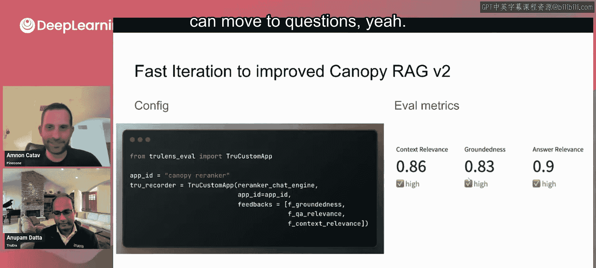

# 吴恩达deeplearning.ai直播课程《构建生产级别的LLM应用Building Production-Grade LLM Apps》 - P1 - GPT中英字幕课程资源 - BV1jt421V7tX

Hey everyone， my name is Diana Chan Morgan and I run all things community here at deeplearning。

aiI Today we have a very special session to talk about building production grade LLM maps this session will be recorded and the slides notebook can be found in the video description。

😊，In this workshop we will have very special technical leaders from Pinecone and Tura that will share how to create apps that are high quality and production ready The principles will be illustrated with Pine cone canopy and tree lengths and this workshop you will be able to learn what you need to create enterprise readyy AI models and apps。

 what you need to evaluate iterate on apps quickly so you can gain confidence that your app is ready for production and rapid response what happens when an app generates a hallucinatory or irrelevant or unsafe response how to monitor。

 recognize when your app is in trouble and quickly get it back on the rails。😊。

For our event partners today we have PineCone and Trurera this workshop is actually inspired by two of our short courses that we've released with these partners that we will link in the chat below for PineCone we had built out building applications with vector databases and with Trera we had built out building and evaluating advanced RAG applications。

😊，For more information about PineCon， PineCon created the vector database。

 which acts as a longter memory for AI models and is a core infrastructure component for AI powered applications。

 the managed service lets engineers build fast and scalable applications that use embeddings from AI models and get them into production。

Forra Tra is the leader in AI observability， helping companies to monitor debug and test their AI apps in order to drive performance。

 quality and trustworthiness， powered by the enterprise class artificial intelligence。

 its sability technology based on over nine years of research， Tra is able to facilitate faster。

 more accurate ML model monitoring and analysis and debugging better than any other vendor。

And now for speakers， so I'd love to introduce Amman Kata， Hey Amman。

Heyy thanks to having we absolutelyly super excited to dive in for some more background on Amnon。

 he is a machine learning engineer on the GenAI team at Pinecom he is a core contributor to Canopy Pinecon's open source RaG framework and focuses on the evaluation of RA systems Before joining Pcom he was an applied data scientist at Microsoft he holds an MS degree in CS from Tel Aviv University where his research focuses on explainability of AI。

😊，And for our second speaker， we have AnaPM data。Hey out of him。

Hi hi great to be here absolutely glad to have you back Annapam is the co-founder president and chief scientist of Tura he was on the faculty at Carnegie Mellon University from 2007 to 2022 most recently as professor of electrical and computer engineering and computer science at SU that is research focuses on trustworthy AI spanning evaluation。

 explainability， fairness and adversarial robustness of MO models and GenAI applications he obtained his PhD in MS degrees from Stanford University and a BT from IIT CarP all in Comp science。

😊，So happy to have you guys here today， was very excited to dive in。

 I know that our community was really enthusiastic about learning so many topics about building production grade LLM maps so why don't you guys take it away。

Yeah， thanks a lot， Diana， and let me share my screen and we can get started。Right。

I think we're still here we go， great。😊，So 2023 was the year of experimentation and prototyping。

And 2024 is going to be the year to move all of these cool apps and a good chunk of them into production and so one of the big challenges。

Facing the field today is how do you build production grade LLM maps。

 and that's what Amnon and I will talk about today with a particular focus on retrieval augmented generation。

 So here's the structure we'll kick off with a very quick intro but dive in pretty quickly into。

What's involved in building production grade apps？And Anon will talk about canopy pineco and some of the cool work that。

He's been doing with his team on this topic。And then in the third part of the conversation。

 we will talk about how to evaluate and iterate on applications to improve their quality。

 to get it to that point where it's ready to move into production and for that I'll talk about how true lens。

And Tra can be used for that and a lot of the work that we are doing here is an open source。

 both canopy and true lens are an open source。They are connected at the hip to production grade systems as well with Finecoe and Tra at the same time we want the key learning outcome from this conversation to be around addressing some of the main challenges in building production grade rags。

 we also have a sample notebook for you to try hands on。

You can take a look at canopy and Dr lens if you want to。Scan these Qr codes。

 You can go to our Githubs and the developer teams are collecting stars。 So please。

 please be generous。 So with that i'm going to。Handed back to。I'm known to kick off the introduction。

Yeah， it's the。Okay， there see okay， so thanks， Anna for the great introduction。

 I'm really excited to be here and discuss this discuss this important topic。😊。

Let me start with a very simple example for one of the first issues you usually encounter when you start working with working with LLMs。

 for example， if you ask JGPT what is the new name given to Twitter by Elon Musk you' probably going to answer something like my knowledge cutoff is January 2022 I never heard about any name change from Twitter which we all know it's not true it changed to be called X and when you build LLM applications with LLMs。

 you usually want your LLM to know about the fresh data and be updated with what happens in the world and taking a step back here。

 what actually happens is that。Models， all all all of their knowledge is all only what they saw during training。

And when you use open AI models or even open source models。

 usually they only use some web data from some point in time。

 they retrain the model once in a year on a few months。

 so it's really is to say that like the knowledge LLM have is only web data and they kind of only have access to ST web data what they don't have is like access to fresh web data like in the example we just saw and also they don't have access to proprietaryriety data。

 and when you create production level application you do want access to these two。

 especially for proprietaryriety data because in a lot of applications imagine you want your LLM to talk about the documents of your organization or even on your select channel and things like that and obviously when openAI and open source teams work on training language model。

 they can't use your，Own data and so what we want to do。

 we want to connect these models to fresh web data and pop data and I guess it like kind of makes sense。

And the way to do that and this is like the leading way I tend to do it in the state of the art is to do rug。

 I assume that most at least most of the audience here already held about Ra。

 so we do a very quick high level overview of what is Ra。

So the main idea flag is that instead of just giving to your model in the prompt。

 the user question or query， you want to combine it with some relevant data from your proprietary data or fresh webb data that is relevant to the query and combine it with the query like make like a prompt that say this is the query。

 this is some pieces of relevant information and ask the model to generate a knowledgeable answer。

And a lot of time and when you do that you have like a lot of data。

 we're talking about we have a lot of customer having like millions of documents。

 maybe hundreds of new documents， we have even few customer have billions of documents and obviously you can't fit all of this knowledge into the prompt so what you want to do is to use search like you search in Google and you can just always read all the internet for every question you use search。

😊，And when you do search on your own data， right now。

 what you usually do for is to use vector databases like Pcon and。

And the idea of and I will try to give a very simple extension of why and how you use vector databases。

 so to do what we call a semantic search， which is something that helps you search over unstructure data like PDFs or files。

 you need two things， you need vector database， you need embeddings。

 the role of embeddings is like a kind of a model that was trained to represent your data as a vector。

And the way that you take your data， you present， for example。

 your document as vectors and your question as vector。

 and the model was trained to make these vectors closer as much as as long as the query the document is more relevant to the query。

AndSo what you do usually you take your data， you put it in this embedding model。

 you get a vector and then you store it in a vector database。

 then once embedding once a query comes you take the same embedding model or very similar embedding model you run it through this embedding process you get another vector and you query the vector database with it the role of the vector database here is to store all these best amount of embeddings and once a query comes you need to find the closest vectors to this query so we find the most relevant documents to your query but if it wasn't very clear for you right now don't worry about it this is not the main point in in this webinar the main point is that we want to do search over the data once they use query comes we just do search。

 we take a。Let's say10 most relevant documents concatenated with the query， put it to the model。

 and then we can get knowledgeable answers that we can provide our users and so the issue we just discussed。

AndLuckily， building a demo or constructing a POC for Ag is very easy。

 there a lot of framework like Lch or Lama index and canopy here this is a I provide a very simple example of how like you can use like I don't know five commands in Python and you get a AG system working so I think it's fair to say that building a demo is very easy。

lucky a lot of scenario starts when you go to production。

And we see it with a lot of customers and like Annaon say。

 this is the year of production where we really encountered the actual issues with working with LLMs and being LLM production grade applications。

And there are many problems I just going to describe some of them and then we're going to talk about how you can address them so one of the most famous and common one is hallucination。

Meaning that sometimes your model might just invent false information and this is not something you want in application because you don't want an application that give your users nonfunctionual information。

And another problem is context overflow。 Most of the models like GT have some limits for how much tokens you can fit in the pro。

 for example， GT 3。5 have a limit of 4K tokens or words and when you do lag a lot of time you overflow this context because doing search like might produce a lot of tokens。

 imagine you do let give me the top 10 most relevant documents and all of them are very long you might end up with 10k words or tokens and then when you try to fit it into the model you just gonna get anarrow saying you overflow the prompt or the context So this is the context overflow problem and other problem that kind of harder is how you to understand how you can correctly ing the data and clean it so search will work better。

How you chunk or split it to smaller parts that you can feed into the embedding models。

 how you choose the right embedding model that works best for your data and overall。

 doing a high quality search system is very hard and there are a lot of things you need to tune to make it right and like Annaon said this is something everyone all the community is working very hard to do。

And now we're going to start talking about how we can address these issues using both canopy and tool together。

We're going to start with canopy so what's canopy canopy is an open source project hidden in Python it was built by Pcon and the community and it's only focused about drag and when we build canopy we really focused about how we can build a framework that is suitable for production level and meaning that we we will see it we're going to see a list of it soon but the idea is that we thought about HK says we have a lot of tests there。

 make a very solid CI that make sure that all the place together well and we think about all the things you need to take care of in production。

And this is like a short list of things you get when you use a canopy， so first of all。

 you get like an application that help you to do N to andR。

 it's very easy in if you command airlines in Pyon in Python you can get a working end to endR。

It's built for scale using PCon like for example， a few months ago。

 I had a chance to build an application with canopy on billion documents and it worked very well thanks to PCon that really excels when it comes to scale or putting a lot of data in your database。

It it also automatically handles the context overflow issue what we do there is that let's say you ask for the most the 10 most relevant documents。

 we make sure that it never overflow the point we know how to tra it the tokens and leave only the most relevant tokens such that you won't get this kind of error so this is something you get for free here and also we build canopy。

 we allow canopy to be built from a config file we're gonna to see it soon it's like a no code way to build canopy meaning that you just provide a Yael config and you get a working canopy and you can change it without changing code this is important for production because a lot of time maybe there is some issue in production you want to do a small change so and you don't want to change code so you just change the config maybe you have different customers that need a different version of your system the best practice is。

Configuration and not have a different code based voice customer， right？And。

And another thing we provide with canopy is that we also provide you a template of F API application within the library and also we publish often a docker image that you can pull and just publish and you know。

 have a running system。And。Here， I want to show you like a very short example of how we can run a canopy as a service。

 So if you just use our command line that and say something like canopy start from this configuration Yal。

 you get a F API application running， maybe on your kputia or maybe on a Doca。

 which can help you very quickly go to production with canopy。

And this is an example for a configurationfig that actually works with canopy。

 this is the default configuration， what you can see here is that you can change I'll see that system pop because in a lot of time you see in the library array that work with LLM it's very hard to find where is the prompt here it's very easy you just go to the configuration configurationfig file you can chat it without changing the code。

😊，AndFor example here in the red box， but it says that we tell canopy to use G 3。

5 tubo if you want to change your G4 it's very easy， you just change this string。

 deploy again and that's it you can also change to other providers like ohhe or even use Azure open AI and all of this you can do just from configuration which is very。

Easy to use。嗯。But before I go to to actually show you a notebook that demonstrate how to build with canopy。

 I want to talk a bit about evaluation， because it's very important。

 what we see very often from our customers that they're really struggling with evaluation is very important today for them。

 what first why evaluation is important， because imagine you never evaluate your system it means that you don't have any way to know if it's good or bad。

 you have no way to know how to improve it。 So usually what happened is that over time。

 you just dont end up with a system that just。Don't match your user's need and maybe give。

Bed quality results for your users。But the thing is that evaluation is very hard because imagine the difference between evaluating a multichoice exam and evaluating an essay。

 evaluating an essay is much harder and this is kind of what you need to do it with LLMs because theyre just talking with you I need to evaluate this answer which is abstraction you don't even if you have can tools is very hard to compare it like an essay and so I think like evaluation is very hard and this is where tolerance comes in and can really help you and I will let the anopom add some color here。

Yeah and that was a nice analogy there on evaluating an essay versus evaluating a multiple choice question and that's the first bullet point on this slide gets into that that it's hard to even define what evaluation metrics to use that you can programmatically evaluate an essay or the generations coming out of。

Large language model or ag application and also making these evaluations reliable and comprehensive。

So later we'll talk about how to address this challenge。

 another piece of it is logging the app execution trace as the application executes。

Making sure that you have a very fine grained logging of that process so that the prompts。

 the responses， the intermediate results are all logged。

At scale and so that later on you can use those or parts of those execution trace as part of the evaluation and monitoring。

The third piece is uns sccalably and cost efficiently evaluating and monitoring apps in production as the data volume goes up。

 the workloads go up。That becomes another big problem so you want to start in development as the developers are building the application。

 you want to be able to。Evaluate them， debug， improve them， but then continuing that on production。

where the data volumes can be a lot larger doing so in a way that's cost efficient and low latency tends to be a hard challenge as well and then finally fast iteration to improve applications and this is something we will get into with the notebook in a little bit。

On you have a first version of the app， it's not doing so well with respect to your evaluations。

 how do you quickly iterate on it and that speed of iteration becomes extremely important。

As people are starting to roll out lots and lots of GenIFs。

 so these are some of the top level challenges that we will start getting into now， how to address。

Thanks and Pa， yeah agree with all the points， I think that if you get it right and have all these bullets like sold for you and also you use like a scalable system for。

 you really can get a high quality system。And but now let's just switch to see like how you like let me do go over the agenda like until now we talked about like we made some introduction。

 we talked about the problems and a bit about canopy now we're going to show you how you can build rug with the canopy and P on a notebook then we're going to continue to talk about more about the tool and show how you can combine all of it。

Together so this is the notebook it's going to be available here in the YouTube channel for you to to run but now we're going do a very quick work tour on it。

 and here I just going to focus on the section where we build our initial default canopy system。

And so first of all， we need to install our dependencies， we install canopy， we install tools。

 we install some other stuff we need for this specific notebook。

Here we need to provide some API keys， for example。

 a pineCon API key open I API key specifically here we need also coherent API key。

 it's not like always you need all of them， but here we need all of them。

Here we need to provide a spec for PCon， it's like defining which environment you run。

 you can configure maybe different cloud providers。

 it's very important in some cases in this example and make it simple and just put the spec for a free trial for PCon and here you have a link where you can understand how you can use another environment。

Here we just download public data that we scrape and we explain what is this data because we're going to work with him through this notebook。

 the data is simply scraping of Pcon docs， which is like the documentation of Pcon。And this is。

 for example， a scraping of the limits page which explains you what are the limits when you work with Pcon for example。

 you can see that the maximum vector dimensionality is 20k or that the maximum top k value you can put inqueries is 10k。

We're going to try to remember these numbers because we're going to work with them soon。And。

Here but let's continue this is like just the data what we do now we're gonna construct our canopy system first of all we need to build a tokenizer tokenizer is something that just take strings and you know how to separate and into a token which is the units that LLMs can read and the main reason that we need a tokenizer in P con is what we talked about like in the context overflow issue canopy need a way to know how to count the tokens in the same way that yourL count the tokens so it will make sure it's not overflow your prompt。

So what you do here is that you need to make sure that you build the tokenaz that is compatible with your LLN。

Here what we're going to do isre going to take this data。

 we just show and like upload it to Pcon or to canopy。So for this。

 we have like the concept or in canop be called knowledge base。

 this is the thing that actually manage your data or your knowledge。

And it's built on top of a Pcon index that we will call Pcon docs in this example so first of all。

 we build in it this instance of knowledge base and we create an underlyinglined canopy index of Pcon index here we connect to this knowledge base and make sure that everything is set up the API key and and the index itself and here we actually upload or up this documents what we do the knowledge base as we orchestrate also the embedding here so knowledge basease is talking in text as you can see I just build a document object that hold the text from the our data and here are just up this data to this knowledge base and it's stored in Pcon using canopy。

And now， so now we have all the data in canopy and now we want to start chatting with it or build our chatbo。

 So first of all， we need to build something we call a context engine and the idea is that knowledge base is only something that you can query get top K results when you top 10。

Context Engine is like a layer above the knowledge base which talks with with once it get a query。

 it's actually returning a piece of text and this is the thing that makes sure that your context is not an overflow。

 you can give it a budget you say I for this query to get 1000 tokens and it makes sure you get up to 1000 tokens。

 this is the main idea of context engine。And this is maybe the most interesting part。

 this is the chat engine， this is the thing that you' going to talk with。😊。

And this is the main orchestrator and a very interesting feature about canopy。😊。

Is that we made the chat engine to be fully compatible with open AI API。

 meaning that the input and the output of open AI of the chat engine of canopy is the same as open AI。

So for example， here we construct a very standard history chat like you would do in Open AI and we asked we're going to ask our chatbot。

 what is the maximum top K for a query to Pcon？And here。

 once all of you that they used to work with the open I going to observe that it's like the same output here。

And like in open AI， and here we just gonna to call our chat engine with the chat call。

 provide the chat history and get an answer。And the answer is that the maximum value for top K in P con is 10 k and for those of you who follow this was the right answer。

 so at least for now we are happy and now going take it back to anupam we explain as how we do evaluation here and how we can connect tool and sweet canopy。

Great， yeah， thanks。Thanks， I， let me share my screen again and。I'll touch on a couple off。

More general conceptual points about evaluation and iteration。

And then circle back to the same notebook to see that in action with the rag that。

Unknown just presented with canopy。 the cool thing about。

Canopy here is that it has this nice separation between the configuration。Of the app from the code。

 So you can change a lot of hyper parametersa and so on in the config file in the Yal file without having to touch the code。

 which is。just makes it a lot more maintainable in production。So I really like that aspect。

 so let's get into the evaluation and iteration and this is a quick view into the overall how we see the world in terms of evaluation and iteration。

😊，As developers are building these applications like the RA that Amnon just presented。

 you can use our open source library called TruruLens to evaluate and debug these applications to get that to that high quality that's ready for production and this fast tigereration loop is very valuable and we'll see that in action shortly on the notebook。

And then once it moves into production， there's also production monitoring and as we think about a general framework for evaluation。

 here are some of the key pillars that I want you to take away。

 one is ensuring that our evaluations are comprehensive but they're quite broad and deep that it's extensible。

 meaning that developers can add， there's a whole bunch that's available out of the box。

But it's also easy to add your own evaluations。To extend the set of evaluations based on your use case。

 based on your application， and then the reliability of the evaluations themselves。

Experiment sorry just to interrupt we don't have the slides so if we could share them Oh sorry。

We'll just add it sure， or click， sorry。Is it visible now？Yes， absolutely。

 sorry for the interruption。Yeah， no thank you， I was flying blind a little bit there。

This is the workflow that I was discussing around evaluation debugging and monitoring。

 the evaluation and debugging pieces are available in open source through Tru lens。

 it's a very permissive MIT license feel free to download and play with it as you're using the notebook you'll get a quick quick intro hands-on intro as well and there's a lot more on our website。

 the GiHub。And then the full platform is built for scale and also includes monitoring。

And I was touching on the importance of making sure evaluations are comprehensive。

 extensible and reliable， experiment tracking tends to be very helpful in order to select the best app configuration and we'll see that in action。

In the notebook itself。And then on the debugging side。

 what we have found is it goes back to that challenge that if you it's very important to have a fine grainined logging of the trace so that you can do granular evaluations through what we call lenses on parts of it and I'll illustrate that in a bit and then once you get into production monitoring。

 scaling to large data volume。Getting alerts and then making sure that。

The evaluations in production are lower cost and lower latency than what you do in development that's extremely important as well because otherwise the cost of monitoring can become 10 times the cost of just operating the appsa so there we have done some additional work on using smaller models and so on so we won't get into that today I just wanted to give you the big picture view before diving into the section around evaluation and debugging。

So what kind of evaluations make sense in this context， so one of the concepts that we introduced。

Last year was this notion of a rag triad to guard against hallucinations。

 the rag triad has now become quite extensively adopted and a bit of the de facto standard in this field。

Of how to get started with evaluations to guard against hallucinations so it very much follows the structure of the rag that I'm now presented。

 the user comes in with a query， there's a set of retrieved pieces of context or chunks from the vector database and then those get summarized to produce the final response the summarizeization is done by an LLM along each edge there are failure modes that you want to guard against and that's what the evaluations help catch so there's context relevance which checks is the retrieved context relevant to the query。

So the reason context relevance is important is that the retrieval step is not perfect because it's doing embedding similarity between the question and the previously。

Put in chunks which are in the vector database like a pine cone right so the embedding similarity can work fairly well。

 but it's not perfect and we'll see some examples of failure more shortly in context relevance。

And evaluations can help catch that。Groundedness is checking is that final response that we are getting out of the rag is that is every statement there backed up or supported by the retrieve pieces of context。

 are they traceable back？To those retrieved pieces of context。

 which we put in our knowledge base and I' say a Pi code database。

And this is important because this is where an LLM， even if you use a ragg。

With the vector database as a knowledge base， the LLM can still hallucinate in that last step of response generation。

And we'll see that again in a little bit concrete examples of how hallucinations creep in because part one way to think about this is that LLMs are。

Very eager to please， meaning that they're built to generate the next word。

 if you give them a set of sequence of words， their job is to generate the completion for that sequence so。

Especially when the retrieve pieces of context don't contain the answer to the question that is being asked。

The LLM will try to fill in the gaps with what it has learned before。

 and in that process it can introduce hallucinations and groundedness can guard against that。

And then finally， this answer relevance， which is checking is the answer relevant to the query that was asked。

 so with these three evaluations， we can get to a a fairly robust evaluation of。

The rag golf guarding the rag against hallucinations and these are not the only evaluations out of the box in true length。

 you have a lot of other evaluations to ensure that。Applications are honest and harmless and helpful。

 the ragg triad falls in this bucket， you can see answer relevance。

 groundedness and context relevance here， but also looking at things like toxicity， stereotyping。

 guarding against jail breaks， some of these coherence， concisees like linguistic evaluations。

 these are all very valuable in building up the quality of applications so that you can trust trust to move them into production。

And then the custom evaluations is something we see our users make use of a lot where they can add their own evaluations or feedback functions。

Into into their code。And evaluate on other dimensions that are not covered by the out of the box evaluation。

 so because it's a community effort as well， that way we see a way to for the community to contribute to the open source effort。

 which everyone can then benefit from and if you're using it in your commercial applications。

 you don't have to contribute it back。It's not a GPL license。

 it's an MIT license so you can keep it for your own use as well。

So let me give you some concrete examples of failures of these evaluations and then we'll come back to the。

To the notebook that Renon started to see how it plays out with canopy。

 but I do want you to get some of these general learnings which are not tied to either true lens or to canopy。

But these are general principles for how to evaluate and improve your applications that are now starting to get very broad adoption so in this rag we indexed the Trurero website and we asked who is Sak the Syik' my cofounder and former PhD student and and the response from the Rag is mostly correct。

Except for that last sentence。That last sentence talks about him being a member of the Bank of England。

 England's AI public private For and that's not accurate Now when we do the evaluations of context relevance with true lens here is what we see the top two rows。

 there were four pieces of retrieve context from the vector database from a Pine con。

The top two were actually about Shaig， the bottom two were not。

But when we do the automated evaluation of context relevance using our out of the box evaluations。

 the opt were correctly assessed to be relevant， so they got high context relevance scores on a scale of zero to one。

 it was one。Whereas the bottom two were got to low context relevance scores because they were about a different person。

 Shami， who also works in T。Now in fact， that last sentence had come from these the third and fourth pieces of context。

 that's how the inaccuracy crept in， this is an example of a retrieval failure but the automated evaluations of context relevance correctly detects it and therefore you can use a form of context filtering where you say。

 well if the evaluations show a score of above 0。8 only then will I forward it to the LLM to generate the final response so if you put in a threshold based context filtering like that then only the top two pieces of retd context goes to the LLM for summarization and then you don't see that last sentence creeping because those were from these other retrieve pieces of context。

We should these low scores。So。And this can be done during development。

 it can also be built into guardrails in production so you can actually do this in production as well now under the hood there are LLM based devs that are automatically doing this。

 but we also have some smaller models that can do these in a more cost efficientff way。

The next thing I wanted to show you is an example of lack of groundedness。

 so here there's a phone call person in a hotel room called room service。

 the details are not that important and then there's a summarization of that call using an LLM。

And what does groundedness do， it shows for each statement here in the summary it's coming up with a score based on how backed up it is by the full call transcript or in the case of a rag。

 you can trace it back to the four pieces of retrieve context and say for each statement in the summary。

 can I trace it back to the call to the retrieve pieces of context so here you can see the first and third sentences。

 they get a higher score。Because theyre well backed up。

 but the middle one middle sentence is not well backed up。

 there is a comment in the final summary about the emotional state of the person making the call。

 but that's not well backed up by the actual substance of the full call transcript。

So this kind of groundedness evaluation can really help you do a fine grain detection of hallucinations and then you can have a guardrail in the application that based on the use case can can take different kinds of action so if the answer is not well grounded at all across the board you might just block it and say that this is I don't have enough information to answer the question if most of it is correct and some of it is not well grounded。

 then you could potentially market it out and say well these two sentences are well grounded。

 this one is not so you may want to take that with a grain of salt so that kind of logic can be very helpful down the road。

And then answer relevance is also very similar in the interest of time。

 I'll give that the other thing I want to quickly touch on and there was some questions about it on the channel is how do you select the best app configuration。

 What's the best chunking strategy and so on。 And the nice thing about。

True lens is that you it supports experiment tracking where you can explore the space of different choices like what chunk size to use。

 what model you're using to select embeddings， what retrieval method you're using。

 what LLM you're using， what hyperparameter you're using for the LLM and as you vary these choices you can see in the dashboard。

How it's doing with respect to the evaluation metrics that you care about and cost and latency and so on。

 And then you can pick the optimal configuration。 In fact。

 this can be made even simpler with canopy because with canopy。

s because all of this is in the these kinds of things are in the config file。

 the Yaml file that Amnon showed you earlier。You can make these changes much more easily and observe the impact of that on the metrics that matter。

 So with that， let me now switch back to the。Notebook。And I want to show you a couple of。A couple of。

A couple of fairways in which。We now instrument the canopy rag with true lens。

 so this is our rag triad， if you remember， and when we are doing the instrumentation in the notebook。

 which is this section of the notebook instrumenting static methods used by the engine with true lens。

 you will see that。We are instrumenting two things there's the context engine and the chat engine。

 both of which Amnon talked about a few minutes ago。

 the context engine is covering these steps over here so。From the context engine。

 when we instrument it the query gets logged and the retrieve pieces of context get logged。

 so now there's enough information available to true lenss to do the context relevance evaluation because that requires access to the query and the retrieve pieces of context。

And then the other piece that we instrument is this chat engine。

The chat engine has the query and the response， so it's the other edge of the triad here。

 these two pieces。 Now we have the query， the response and across with the combined instrumentation。

 we have all three pieces because we have all three pieces we can do all three evaluations for the rag tri。

And you can see in the notebook that we create these feedback functions using the instrumented methods that's over here if I pick。

呃。Here can see the input here refers to the query。 The output is the final response。

 and the context here is the。Is a list of the retrieve pieces of chunks from the vector database in the that's this piece。

 So now in the input， the input is called the query here。

 the context is the same as the context in this picture and the output is this final response。

 So we have all the building blocks we need appropriately logged。After this instrumentation。

 when you run the app， this will get logged into a local database like an SQL light database。

 and then that can then be used for the。Evaluation， so we're here。

We have a groundedness feedback function， the groundedness feedback function makes use of the combined pieces of context and the output。

And so it's checking for each sentence when you later run this groundedness feedback function。

 it'll check for each statement and the output， much like I showed you in the example。

Is it backed up， is there evidence in the combined context to support that statement。

 I'll come up with a score， it'll do it for all of these sentences。

 let's say there are five sentences in the summary for each sentence in the summary you get a score which is how well backed up is it by the retrieve pieces of context and then this aggregation step is going to aggregate across those across the scores of those five pieces of context and it's actually a two layer aggregation for each sentence。

If there's four pieces of retrieve context then for there's a score that shows the first retrieve context has a let's say a score of zero in terms of backing it up。

 the second one has 10， the third one has two the fourth one has one then you take the max and that the second one actually has the best support for this sentence and then you get that for all the five sentences then you do aggregation across all five and then similarly you can set up the answer relevance and context relevance functions and then once you've set up these functions you can run the evaluation you can create the recorded up run it run the evaluations and maybe maybe I'll。

If you want to add in a bit of color here， I'm not on the recorded app and what's involved in running it I can the screen up。

 but you can speak to it。Sure， first of all， I think it's was mentioning that like it's really I think it's really cool that we build canopy without considering tools。

 but you still can rep， you can use tools with canopy。

 it meaning that probably with any application you build。

 you can use tool and it's kind of playing together without a lot of effort。😊，And。

But let's go back to the evaluation So what we here is like a very small set for evaluation we have like three questions about the P con documentation。

😊，And what we do here is just run all these questions to to recording automatically record these answers and here we just print the answer for the first question which is what's the maximum dimension for the dense vector in Pcon and it answers that the maximum dimension is 4 billion。

 which is like not true if you remember we saw the right answer when we read the documentation。

 the answer is 20k and I can tell you why it was one because I know a lot of the documentation。

 this is actually the maximum dimension for the sparse vector which is a different type of vector you can put in pin con and this is simply put like a mistake and the thing is that you once in a while you should and you you evaluate manually this kind of answers but in scale you can't really do this you won't go。

ブ？Thousands of questions and if you do want to do a parameter sweep you have much more question to go over and you want an automatic way to evaluate your system so this is wheretora comes in and kicks in and like here you can see the results for all the metrics and pump described for this set of tricky questions for evaluation and what you can see that governanceness is very low。

Meaning that it seems like this metric captured the idea that the model probably like got some explanation about spars vector and then he provided an answer about dense vector par because you wanted to please the user like Aopon said。

 because this is what models do but the main point here is that instead of just going manually question by question here。

 you actually see an automatic metric that aggregates the score and you can understand that there is a problem in the system and mainly in the ground part。

And。Yeah。Yeah， so maybe。As we。As we ran this evaluation。

 these are some of the kinds of metrics that we saw and the groundedness in particular was quite low。

Just returning a little bit to。The comment that I'm not made。

We have built rulelen in a very general way so that you can work with different frameworks for building rags。

Canopy is a new is a new framework that has some very significant value for building production apps。

 and so that's one of the reasons we wanted to work together and we saw that the actual abstractions that are there in true lens for。

Logging these traces in a way that we have these lenses that can look at these spans or parts of traces to carry out this context。

Relevance， groundedness and answer relevance kind of evaluations。

 And the whole set is a lot bigger than that。 But the general abstractions， which lets us。

Look at these intermediate results， instrument the app， log it， and then do carry out the evaluation。

We had previously done this for line chain and Lama indexex and had built out some very specific abstractions for them that makes it easier。

 we worked for any kind of Python app and it was very interesting to see that for canopy it it the abstractions were so nice in terms of these context engines and chat engines that was really very little work to get this to work with canopy as well。

And so maybe like this is the first version of the app。

 we know it's not doing so well with respect to groundedness and then in the next version of the app。

And I noticed that we are running out of time Imnon so I'm going to speed up a little bit and say that we introduce this reranking method and once you introduce the reranking method。

 these these metrics go up a lot and you can see context relevance grounderness and answer relevance really starts getting to that a+ level with and the nice thing again like I do want to emphasize this is this just because you can change the config files so easily it was really fast iteration and this is something we see a lot andm I'm curious to hear your experiences PCon has lots of users。

 lots of customers as well。So at Trera， we see this a lot that in the development workflow。

 it's incredibly valuable to have to be able to quickly iterate。

 look at the space of options for different hyperparameters to quickly iterate。

 identify failure modes， iterate and improve the application， and that part of the workflow。

 just the productivity gains。😊，Have like just huge impact in rolling out generative AI apps and companies and i'm curious to hear from you I'm not also about that I do want to point people to this course that Dan I alluded to earlier which we released last year in November has gotten。

Tens of thousands of folks who have taken it it's just a short monarch course and it cover some of the other advanced drag applications as well and then P con has a similar similar course some of the key takeaways you can build production rate rag apps significantly easier with canopy and with true lens and you can get evaluate debugging fast iteration as you're building out the apps and continuing into production Any final thoughts am I think we also should take a look at monarch to questions I think up very well again your question we do see that you know the ability to iterate F is really enable you the way to evaluate fast because usually if your system is how to configure you will just end up not experiment with it because it's hard so it's kind of the amount of evaluation you can add。

Its kind of a function of how it's easy to change your system。

This is like what we see and I guess we can move to questions。

Yeah， let me stop sharing and yeah。Perfect， well thank you so much for this workshop。

 I know this has been really great， I know we only have a few minutes left so we'll just dive into some of the most popular questions。

😊，So the first question， which models are better for RaG solutions。

 instruct or conversational to small models like tiny llma or are useful in RAG implementations？😊，诶。

You only need to take it or yeah I go for it Yeah， okay。

 so I think for the first question In or conial I guess first of it all it depends on your application If your application is chat。

 you obviously need to use a chat model like you have no option。But in general， what we see。

 like if you look at open AI， they kind of if I'm not all duplicated the in idea because a lot of time chat models can act as in models。

But I guess its again， it depends like if your， again， if your application is is jetty。

 you need a chat， if the kind of model you are using is tend more to be advanced on the change charge you you chat if it's invested on the stock you use in fact。

😊，It just depends on the specific use case。Yeah， and and there's a few questions around like the scope of models and so on。

 so I just want to emphasize that。On the true land side we are not really attached to open AI。

 you can use a lot of different models for evaluation。

 you can use the open source models like Lama V too and so on。

 there's lots of connectors to lots of models it's just built in a very open way and on the Panone side as well it' very similar exactly and we got these small models like obviously the downside is usually maybe less powerful upside is maybe it's easier to run them maybe cheaper but maybe you want to use small model even like first if it's just workflow and second if you want to find tune because you want to find tune your model for a specific use case。

 you usually maybe to use smaller models and with fine tuning you add more data maybe you end up with the model even more powerful than a larger model that is just coming out of the box。

Absolutely， on to our next question， do we need to feature proof our vector dimensionality as new models will be released。

 do we need to upgrade it to as well？😊，It's a good question。

 so how would Py on poll like now is that every index when you build an index in advance to specify what is the dimension。

And so what happened is that like like imagine that if you switch model you always you also need to reindex everything because your vector is gonna be different。

 So anyway， let's imagine you switch from one one to another either if you change the dimension or not anyway you need to re embed everything so on pinecoine just mean you need to reinex everything also because it's just new data right in pinecon side it's only about vectors then if you have new models you have new vectors and you're just gonna need to ingest everything again。

But P con version is the same， Pcor or something like。Absolutely， great。

 how can I fix LOM inconsistency in our product？要できたた。Yeah， sure。

 I'm not entirely sure what you mean by LLM inconsistency。

 but I suspect what you might be referring to is that。

LLNs are stochastic and so if you ask the same question multiple times。

 you may not get the same response。There are two pieces to it that I'll say one is。Ideally。

 you want to keep if you care about。Answers being consistent then usually the temperature parameter you want to keep it low close to zero and the other piece is the on the ongoing monitoring and guardrails where you will。

That even when the temperature is zero， it will sometimes change at output it's not a。Guarantee。

 so having guardrails in place to make sure that you're guarding against hallucinations。

 you're guarding against some of the relevance related pitfalls。And toxicity and so on。

 and having that be a part of your application so that you can block inappropriate responses or make adjustments or rero things。

thats path forward here。Yeah， and another to I saw people sometimes do it a bit expensive。

 but what you can do， you can generate multiple answers and then have another layer of an LLM trying to say which one is like the majority answer in some sense。

 in this way， you kind of。Looking at the expectation of what the model thinks。え。You know。

 depends on your application。Yeah。For sure。Absolutely great。

 well I think that may be all the time that we have for now。

 thank you so much Anaham and Amnon for your workshop I know our community really enjoyed it for follow up steps the slides will be sent out and the notebook is available in the video description so you should be able to be able to access it there and please fill out our surveys so we can continue putting on great events for everyone。

😊，Thanks everyone we'll see you us next time， bye thank you， appreciate the conversation。😊。

