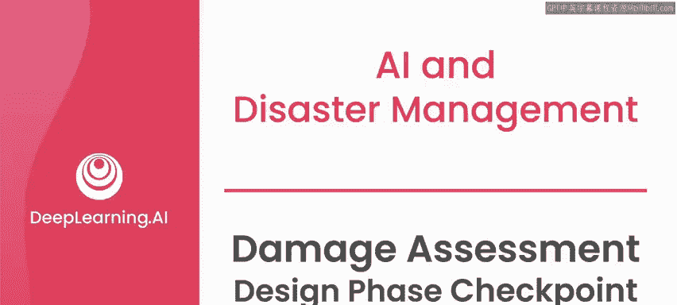
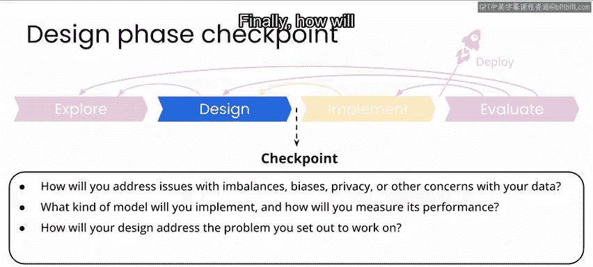
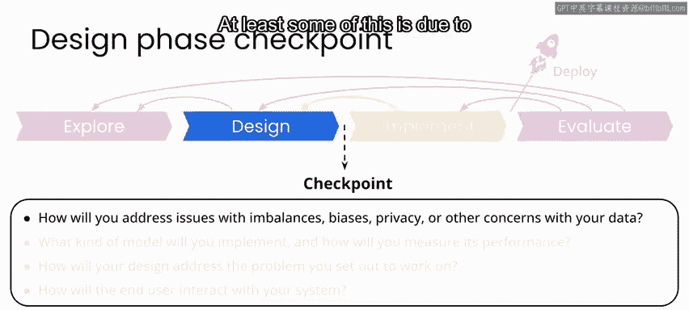
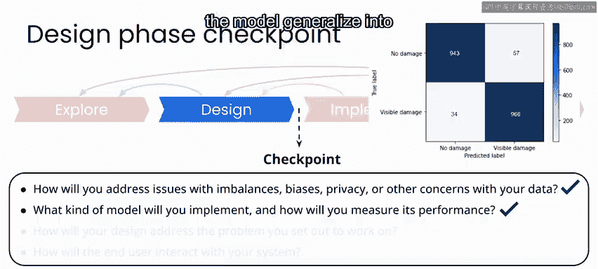
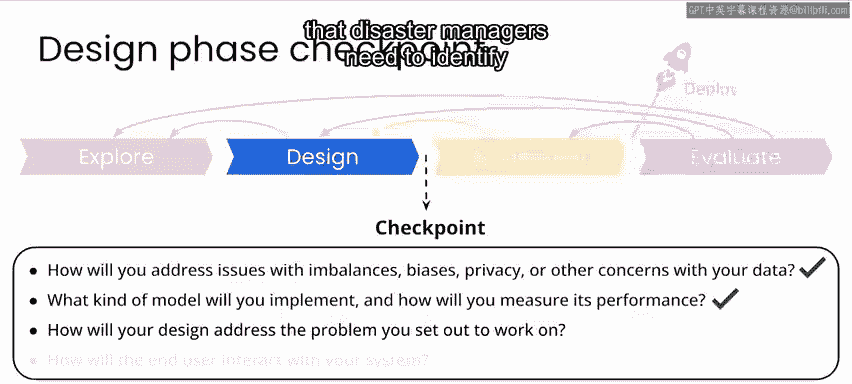
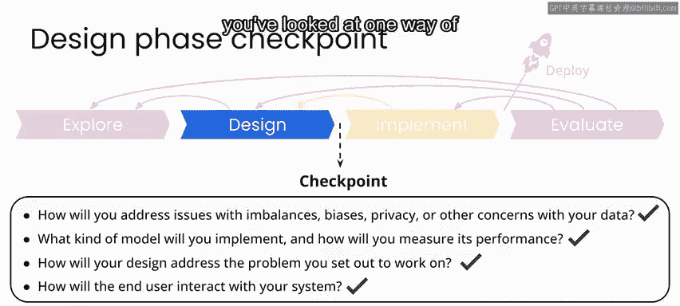

# 吴恩达《AI for Good专业课程》 AI与公共卫生、气候变化、灾难管理｜中英字幕 - P101：19_损害评估设计阶段检查点.zh_en - GPT中英字幕课程资源 - BV13u411F7xZ

In the last lab you trend a neural network model for the task of image classification for this project。

 the classification task is to determine whether an image contains evidence of damage after a hurricane you found that your model performed relatively well across errormetric like accuracy。

 precision and recall and considered which of those accuracy measures is the most appropriate one for you。

You even looked at how one component of the user interface might appear when an image is displayed along with the model prediction for whether or not there is evidence of damage。

Now it is time to check in on whether you have what you need to move forward to the implementation phase by addressing the following questions。

First， how you address issues with imbalances， biases， privacy， and other concerns with your data？

What kind of model will you implement and how you measure its performance？

How will your design address the problems that you set out to solve？And finally。

 how will the end user interact with your system。

With regard to data concerns for this damage classification project。

 you identified that in many cases it would be hard even for a human to correctly identify damage in the images。

 and at least some of this is due to the fact that flooding was the main cause of damage and often the buildings were left intact。

In your design you implemented data augmentation techniques to make the model more robust。

 although collecting more labeled data from other disasters could help your model generalize better to other scenarios in terms of privacy issues。

 you're aware that for a real- world disaster response project。

 you could be working with photos of people and property that in your data pipeline would need to be treated as confidential personal information and delete them as quickly as possible after the completion of a project rather than storing or published in them。

Apart from that， in terms of biases or privacy issues。

 you should just continue to be mindful of any other concerns that arise in any impacted communities。

In terms of what kind of model you aim to deploy you trained a basic convolutional neural network model to be able to classify images as showing damage versus no damage your model displayed relatively high accuracy on the test data set and you explore the confusion matrix as well as individual images to get a sense of whether model was working well and where it was not。

In order to improve your model performance， you can think about things like collecting trending data from other disaster response scenarios to help with the model generalise into different conditions and environments。

The problem that you set out to address is that。

Disaster managers need to identify and assess damaged areas using large volumes of overhead imagery to prioritize response efforts。

 allocate resources， and plan for recovery and reconstruction activities。With the caveat that。

 at this point， your model would not likely generalize to have the disaster response scenarios。

 your design would be able to address this problem by automatically classifying thousands of images quickly and providing the results in some kind of user interface。

And finally， the end user in this case is likely a disaster responder who needs to be thinking about things like resource allocation on the grant access to certain areas as well as long term recovery planning。

In your design so far， you've looked at one way of displaying the model results for a particular image in terms of the model prediction where both the model prediction and confidence are easy to visualize。

This could potentially be part of a visualization tool to help responders understand what the damage looks like and how your model is working。

And that's it for the design phase of this project in the implementation phase you'll put together your image processing pipeline in such a way that you can start with a collection of images and quickly display classifications along with the locations on a map。

