# 吴恩达《AI for Good专业课程》 AI与公共卫生、气候变化、灾难管理｜中英字幕 - P102：20_损害评估实施阶段.zh_en - GPT中英字幕课程资源 - BV13u411F7xZ

You are now in the implementation phase for this project using satellite imagery to do damage assessment after a hurricane。

In this phase， your goals are to get your model or models ready for deployment to develop the user experience further and to test with the end users。

For the purposes of this project， this will mainly involve building out the user experience to include a visualization of what parts of the image your model is focusing on to make each prediction and then plotting up all the predictions on a map。

In this lab， youll take your a model that was trained in the design phase and do a little bit more work on how to present those model results visually。

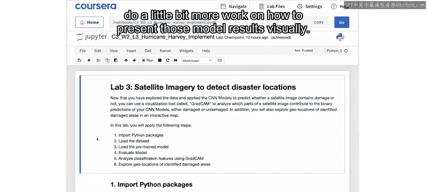

Here at the top， you can begin as usual by importing the Python packages that you will need for this lab。

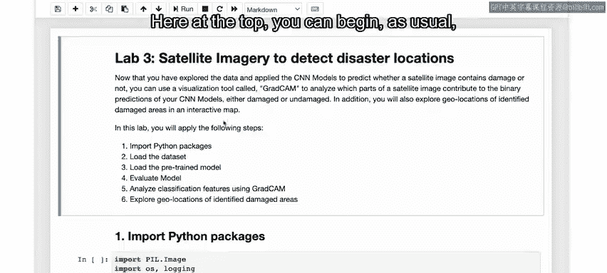

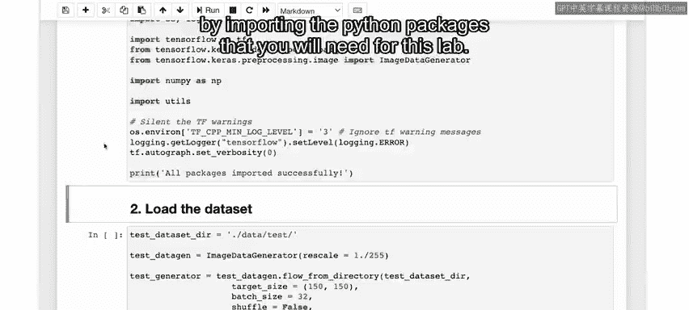

Next， you'll run some of the same steps that you ran in the design phase。 First。

 you'll load the test data set。

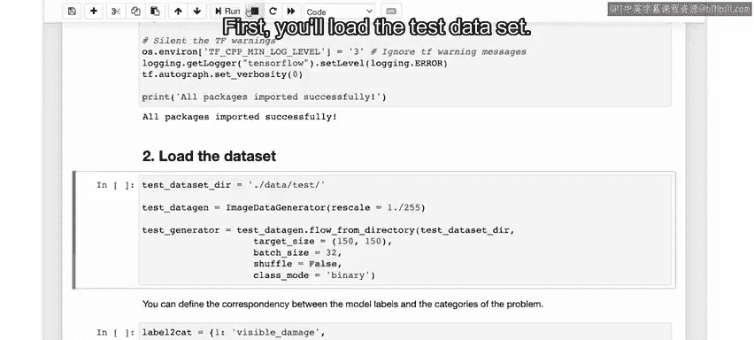

Next， you'll assign labels to the categories of visible damage and no damage。

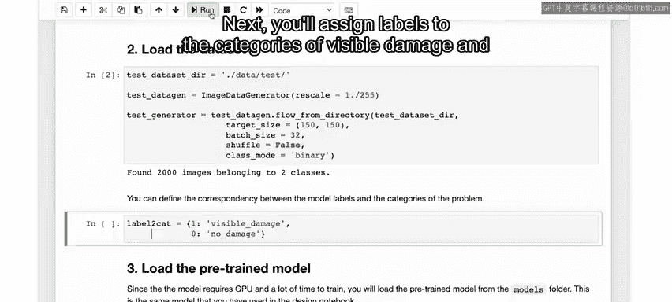

Then you'll load the train model and then run these next cells to again evaluate your model on the test data set and plot the confusion matrix as a reminder of how that looked。

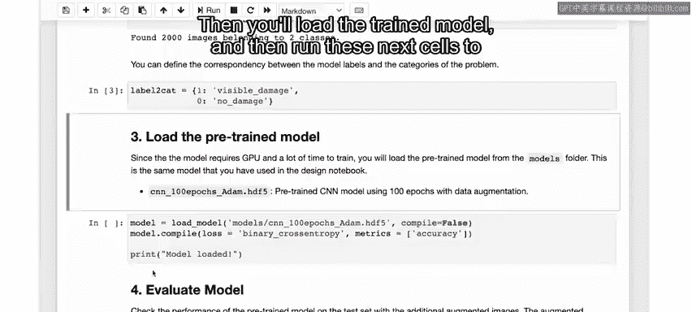

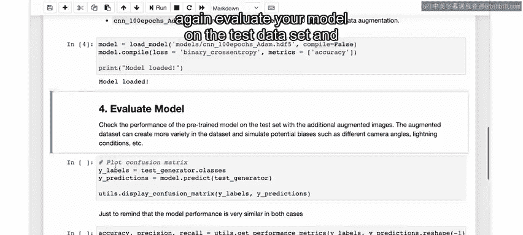

After that， you'll start looking at ways of visualizing what parts of an image your model is focusing on for each prediction。

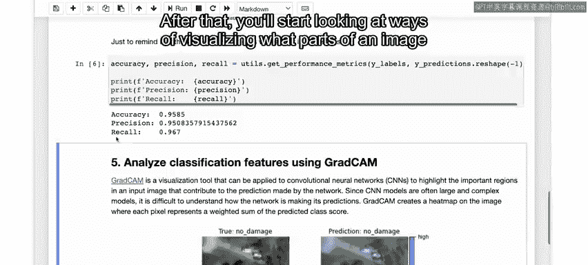

This is a method called gradCm and while they don't need to worry about the details of how it works。

 the thing to note is just that gradCm can show you which pixels in an image are the most important for your model's prediction。

So here's just a couple of examples， one showing no damage and the other showing damage。On the right。

 there's this sort of heat map over each image and this color bar showing low to high from light blue to pink。

Pixels that appear blue in these heat maps are those that were of relatively low importance in the model prediction for these images。

Pixels that appear pink in the heat map are the ones that were of high importance。

So here in the top image， you can see that the model seems to be picking up on some of these sharp lines and shadows。

And in the bottom image， it looks like maybe it's looking more at some of the floodwater and trees。

It's worth noting that to the human eye， it's not always obvious why some of the features in an image might be important for classification。

But this is just a relatively user friendly way I' seen a bit more detail about what's going on inside of neural network。

And this is because neural networks could sometimes seem like a black box where you put things in and other things come out。

But it may not be immediately obvious how a particular conclusion was drawn or prediction was made so in essence you can think of this gradCm method as a way of making neural network predictions more interpretable and this can be important for many applications。

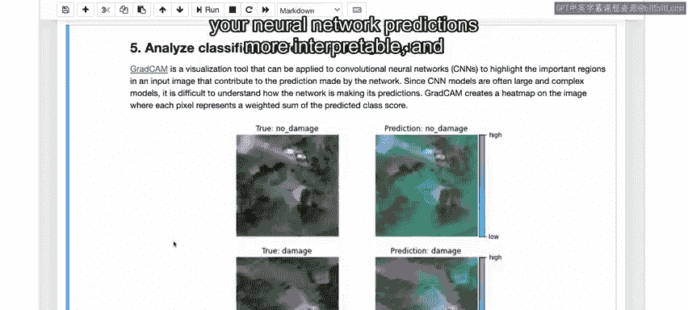

When you run this Excel cell， you'll see examples of before and after image pairs along with the model output shown as this confidence meter。

 along with the images and gradcam overlays。

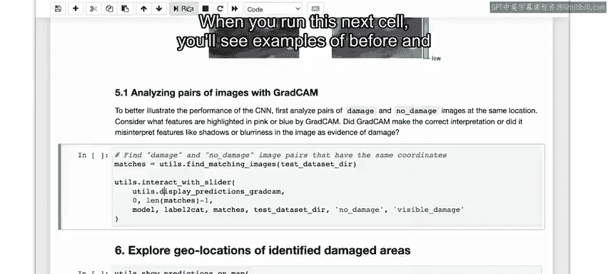

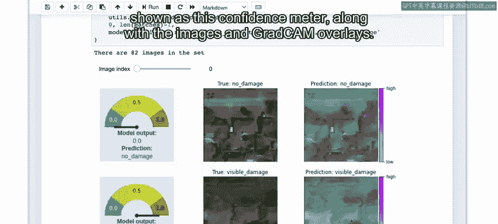

You can use this slider or the arrow keys on your keyboard to examine different pairs of images to get a sense of what the model results were and where the network was focused on its predictions。

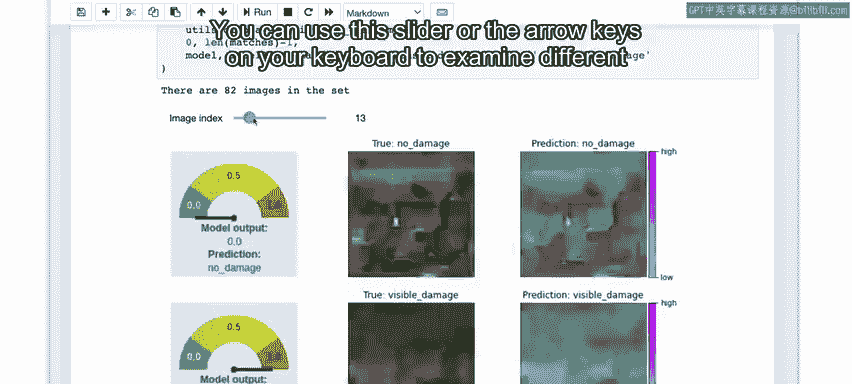

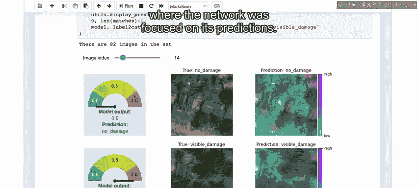

And just to clarify one thing that can seem confused in these comparisons。

 the pixels appear in pink and the grad cam overlays here are just indicating which pixels were important in the model prediction。

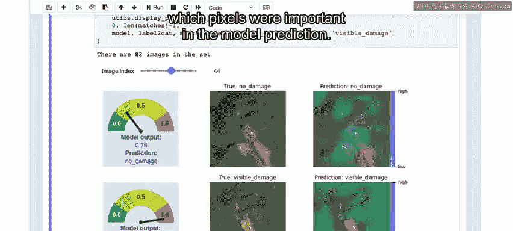

They're not predicting where the damage was the highest。

 they're telling you which part of the images were most predictive for either damage or no damage。

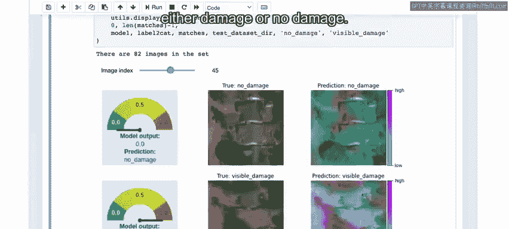

Run this last cell to show each of these predictions on a map here。

 just like you did in the explore phase， you'll get pins on a map showing the location of each image in the data set。

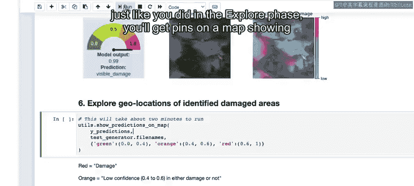

And in this case， the test data are set。Now， however， they grouped into three categories。

Red pins were damage， as indicated by model prediction greater than 0。6。Green pins for no damage。

 as indicated by a model prediction less than 0。4。And orange pins where the recommendation is for a human to review because the model prediction was between 0。

4 and 0。6， which indicates essentially a low confidence prediction by your model。

And you can change these thresholds up here if you want to just set a wider band for review or other flags。

And as you can imagine， predicting model confidence and tuning in that confidence is an entire field of which many dissertations have been written even of itself。

Now， what you can see when you click on a pin is your model prediction。

 as well as the image in each case。So have a look around at the results here and see what you find。

And that's it for the implementation phase of this project Of course your implementation and user interface is still very much a prototype。

 but I hope that you can see with just a few quick notebooks you were able to get from an initial exploration of the data back in the Exp phase to an interesting prototype of what at least one part of the end user experience might look like。

Join me in the next video to complete the implementation phase checkpoint and wrap up this project。

