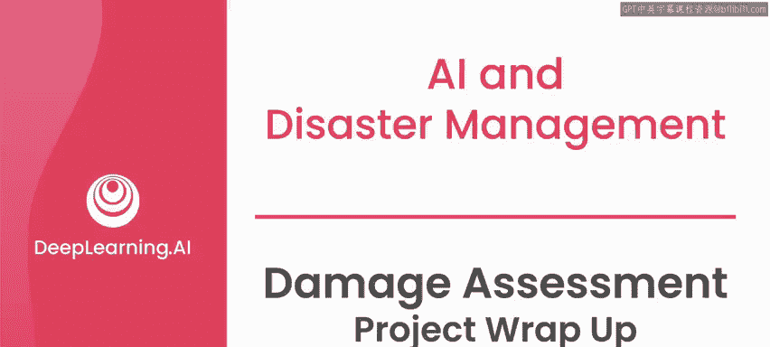
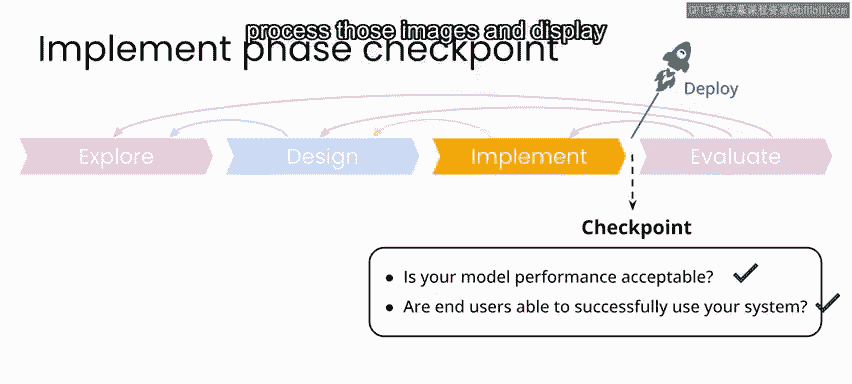
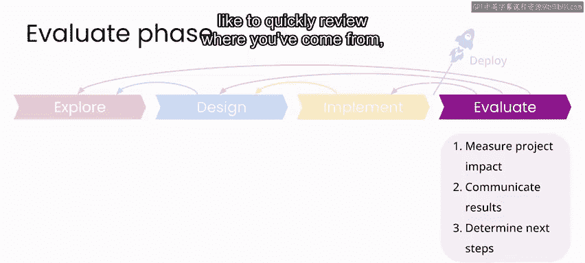
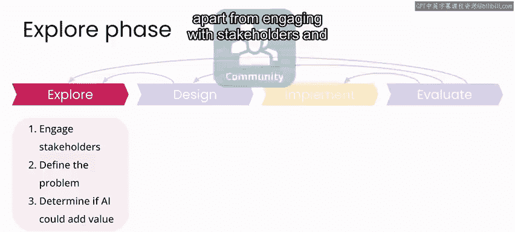
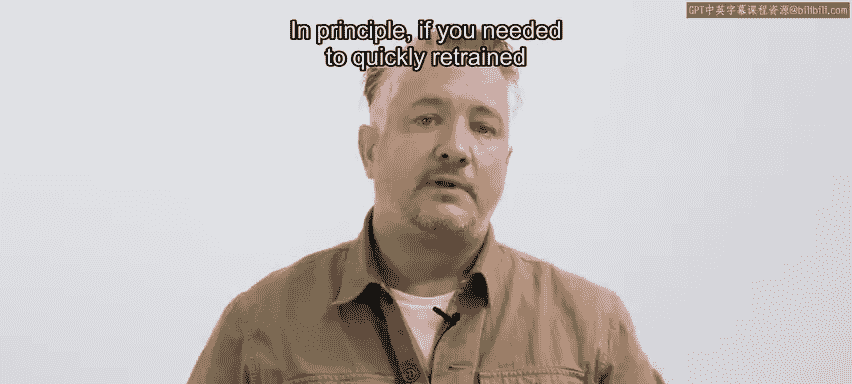
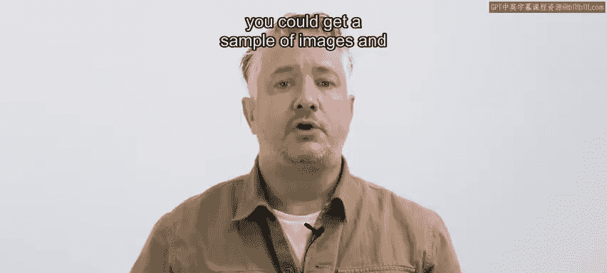
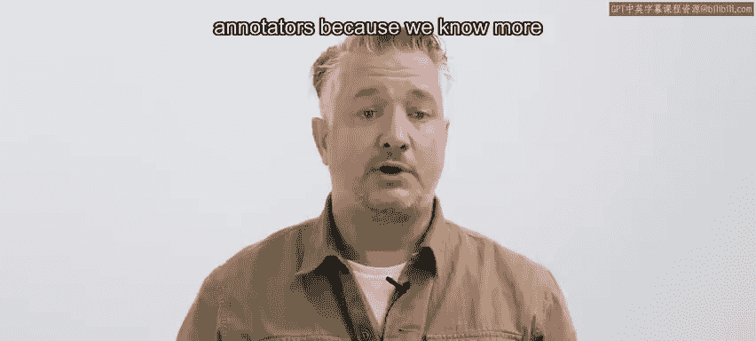
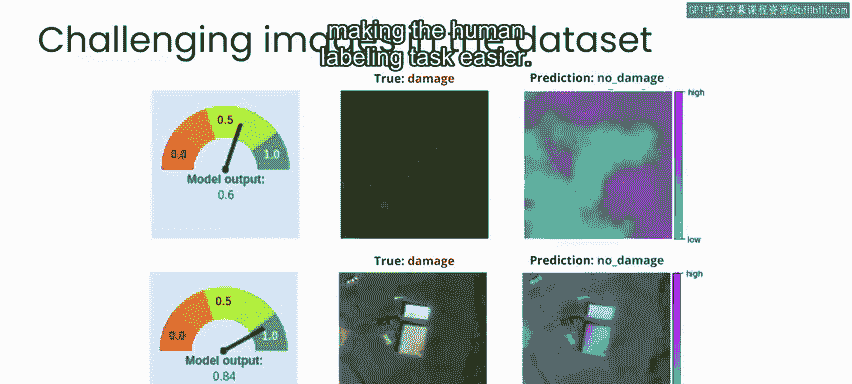

# 吴恩达《AI for Good专业课程》 AI与公共卫生、气候变化、灾难管理｜中英字幕 - P103：21_损害评估项目总结.zh_en - GPT中英字幕课程资源 - BV13u411F7xZ

Throughout the labs in the last several lessons， you've now put together an image processing in pipeline that could work as an automatic damage assessment tool for disaster response and recovery。

Now， of course， to implement a project like this in the real world。

 there would be many more details to attend to and each phase of the project would be much longer and more complex。

But you do now have all the key components， including neural network models implemented so that in principle。

 you could develop this further in your implementation of a project for any disaster relief project involving overhead imagery。

In this video， I'll review those key components of your implementation and talk a little about how you might refine your implementation and evaluate your results。

😊，The two questions that you would need to be able to answer in the affirmative to conclude the implementation phase are is your model performance acceptable and are the end users able to successfully interact with your system In this case your model performance is pretty good。

But you need to be aware that the images you've trained on are from one specific scenario and your classifier would likely not work very well in an area where the environment and conditions after the disaster are very different。

The user interface that you prototyped allows users to explore classified images through a mapping application where they can see the location and model results for individual images If you have experienced the software engineering or work with a team that does。

 you'd be ready to go ahead and deploy your system similar to the other projects in these courses。

 the deployment steps would include many technical challenges that we're not going to cover here。

 but in principle you could deploy an application similar to this to receive automatic image uploads from new image campaigns。

 process those images and display the results on the interactive map along with the damage assessments。

In terms of the evaluation phase for a project like this。

 you could measure the project's impact in terms of the value you provide to responders on the ground or other stakeholders involved in the response and recovery efforts after a disaster。

In the long term， you can measure your success by the degree to which your project helped to direct needed resources towards impacted communities and helped them recover in ways that might have been more difficult in the absence of such a tool。

Before we wrap up， I'd just like to quickly review where you've come from。

 start to finish in this project。

In the Exp phase， apart from engaging with stakeholders and defining the problem that you wanted to work on。

 you needed to have a labeled data set of images in order to begin work on this project。

The labeled data set you had access to for this project was originally provided by a private satellite imaging company and labeled by volunteers on the Tommlod platform while it can be nice to be able to start with data that someone already labeled for you。

 you saw that you were able to come up with a workingdage assessment model starting with a relatively small collection of labeled images in principle。

 if you needed to quickly retraining system like this for a new disaster response scenario。

 you could get a sample of images and have people label those in that new scenario。

 as was the case here and like my previous work in Hurricane Sandy that could be volunteers but an actual disaster response scenarios today。

 we tend to rely more on professional crowdssourceult workers or annotators because we know more about their experience and it is easier for us to address security and privacy concerns when we are engaging in professional annotation companies as compared to opening upper task to amous workers on the Internet。

This data from Hurricane Harvey presented some interesting challenges in that the damage in the labeled images was not always easy to identify in a real- worldor implementation of this project you will never know whether you might have access to before and after images of the impacted area in the event that you do this could be a potential way for making the human labeling task easier you could even consider a developing a system where the inputs include both before and after images in the neural network model in the event that both are available for your project。

I hope that you have found this project interesting and inspiring just like the other projects in these courses。

 the goal here is not necessarily to make you an expert at being able to identify flood damage after Hurricane New Texas。

 but rather to give you ideas and a sense of the tools you might need to tackle and prototype for a project like this that you might be interested in someday in the future。

I hope that you've got some wheels turning in your head and maybe you're ready to start exploring a project of your own someday。

😊。