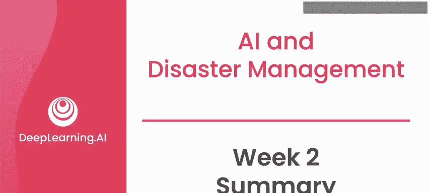
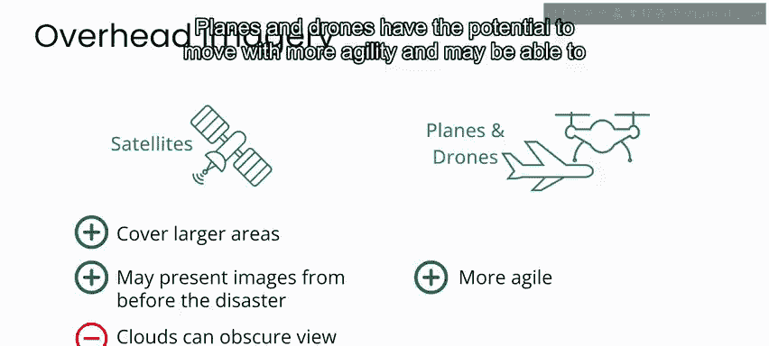
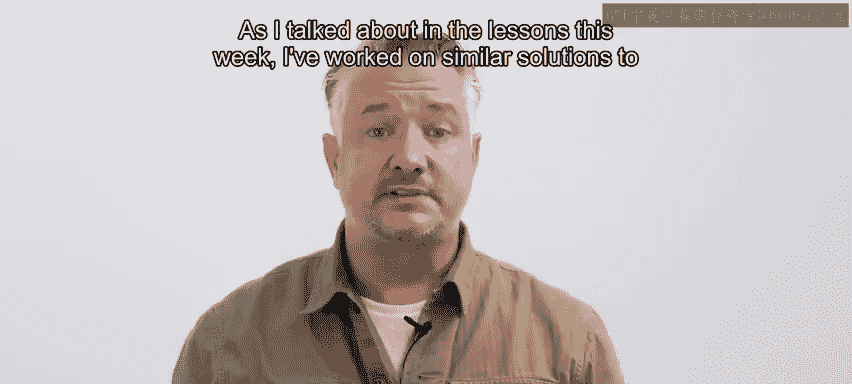
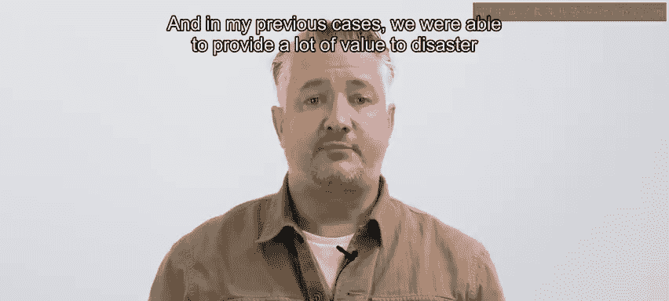
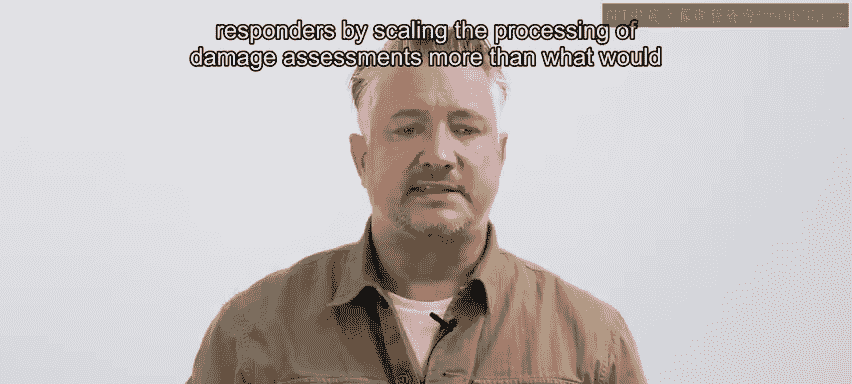
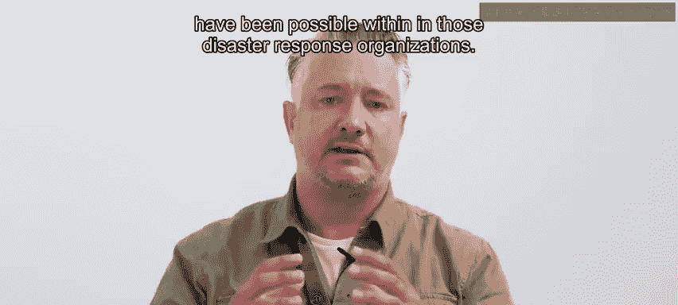

# 吴恩达《AI for Good专业课程》 AI与公共卫生、气候变化、灾难管理｜中英字幕 - P104：22_第2周总结.zh_en - GPT中英字幕课程资源 - BV13u411F7xZ

This week， you explored using overhead imagery for a damage assessment after a natural disaster。

 We started off by discussing the relative pros and cons between different platforms for aerial imagery。

 namely satellites， planes and drones。 satellite imagery can cover large areas。

 and given the regular cadence of many satellite image campaigns。

 This could be a really good source of images showing what an area looked like before the disaster happened。

😊，However， clouds obscure satellite views of the ground。

 making them less useful in situations like hurricanes where the storm may take many days to pass。

Planes and drones have the potential to move with more agility and may be able to fly below the clouds。

 but will be limited to a smaller coverage area your project this week was to build a system for automatic damage assessment based on satellite images。

In principle， your system could be extended to work with images taken from a drone or a plane as well you worked with a labeled data set of several thousand images collected after Hurricane Harvey in the US where flooding and high winds caused extensive damage。

In this case， you were able to achieve relatively high performance in terms of accuracy of your model by training your neural network classifier on your labeled data set。

As I talked about in the lessons this week， I've worked on similar solutions to the system that you've been looking at in this week's project and in my previous cases we were able to provide a lot of value to disaster respondpoers by scaling the process of damage assessments more than what would have been possible within those disaster response organizations there are a number of people around the world who are working on solutions like this right now and to wrap up this week we have a project spotlight for one of them Shahzd Galamami is a senior research scientist at the Microsoft AI for Goodlab working on doing damage assessment associated with satellite imagery so check out the next video and then I'll see you in the third and final week of this course。

