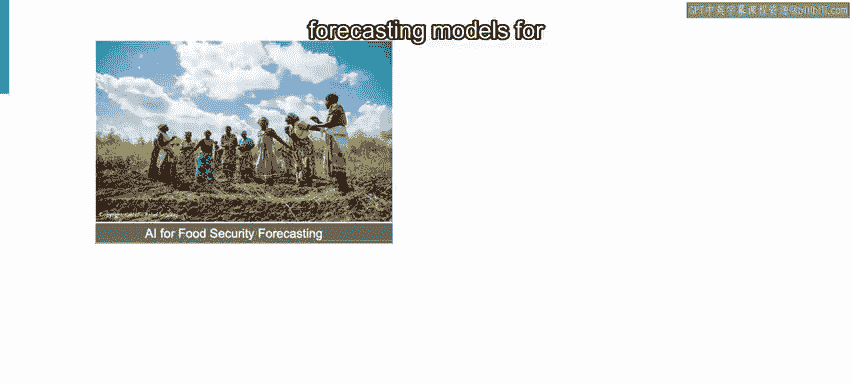
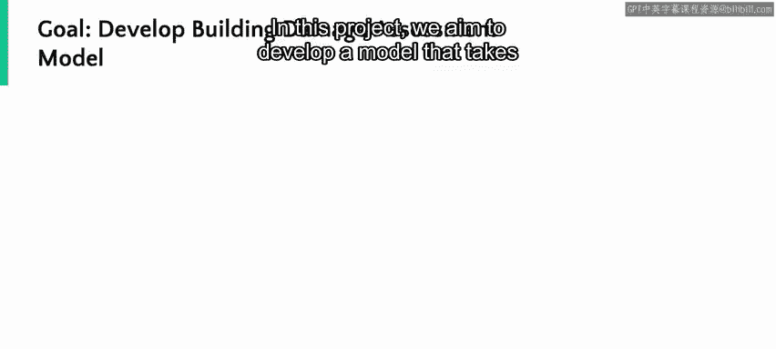
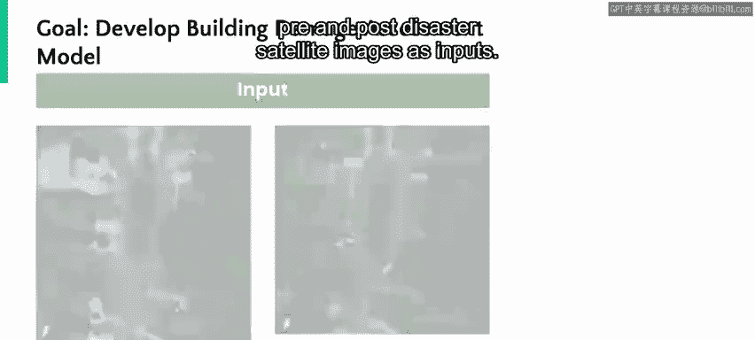
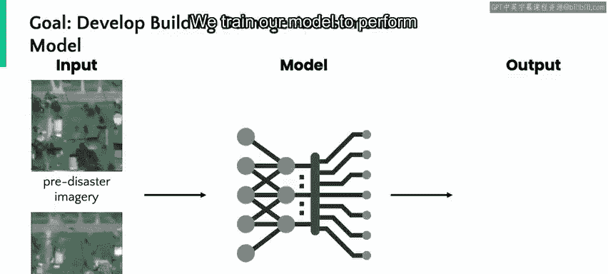
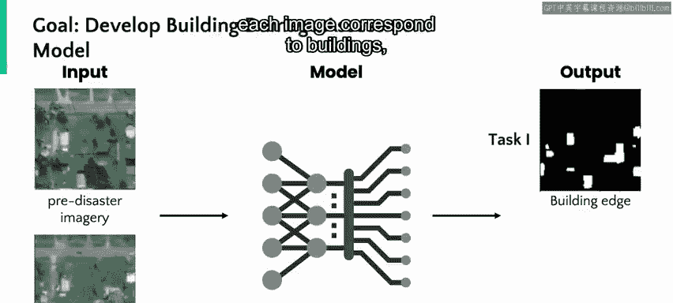
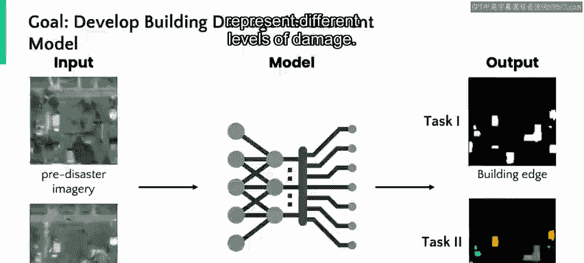
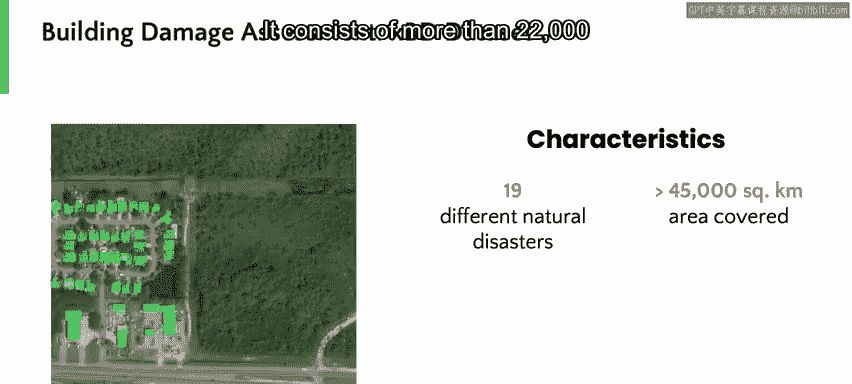
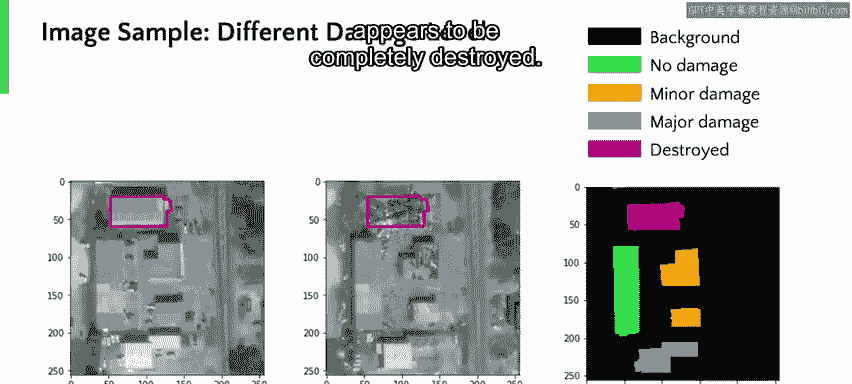

# 吴恩达《AI for Good专业课程》 AI与公共卫生、气候变化、灾难管理｜中英字幕 - P105：23_Shahrzad Gholami通过卫星图像进行损害评估.zh_en - GPT中英字幕课程资源 - BV13u411F7xZ

Hi， I'm Sha Z Komi and I'm a Se research scientist with the Air for Good team at Microsoft。

At Microsoft's AI for Good Lab， we collaborate with domain experts and apply AI to develop multidisciplinary solutions for real world problems。

 some of the projects I have been involved in include developing forecasting models for food insecurity in southern Maawi。

 identifying poachers hotpots in order to save endangered species in African national parks and predicting eye diseases from retinal images for patients with macular challengingic Asiaia。

😊。

I would like to tell you about one of our projects at the intersection of AI and natural disaster response。

This project is a collaboration with 510 global and initiative of the Netherlands Red Cross。

In this project we aim to develop a model that takes pre and post disaster satellite images as inputs。

 identifies exactly where buildings appear in the images and provides a post disaster damage assessment。

So here you can see that the input images look like this， where before the disaster。

 the area looks like this and after the disaster there are buildings that appear damaged。

We train our model to perform two tasks given these inputs。

First， the task of identifying exactly which pixels in each image correspond to buildings and second。

 providing a damage assessment for the area， so these different colors here represent different levels of damage。

In this study， we use the XPD dataset， which is a largest scale dataset containing pre and post disaster satellite images from 19 natural disasters across an area covering more than 45。

000 a square kilometer。It consists of more than 22。

000 images where human annotators have identified buildings， as you can see here。

 Mar in green on this image。

And so the data we trained our model on looks like this。

 where we have pre and post disaster images and each pair of images comes with labels indicating where buildings are and with the damage to each building classified into four levels。

Class 1 shown here in green denotes no damage， so you can see this building on the left here is a still intact in the second image and so is identified as having no damage。

Class 2 shown in orange， indicates minor damage， so as you can see these buildings here are visibly damaged in the second image。

Class 3 shown in purple indicates major damage， so this building at the bottom looks like a major section of it is damage。

And class 4， shown in dark pink， indicates destroyed buildings。

So this building at the top here appears to be completely destroyed。

After training， here's an example of our models results。

 where we are automatically identifying buildings and then making a damage assessment for each pixel associated with a building in the image。

The first row shows the ground truth， which is to say the training data of pre and post disaster images aligned with building polygons and the level of damage that were determined by human annotators。

The second row shows predictions from our model。The first two images are just showing where the buildings are。

 and the last image on the right shows the damage level measured at each pixel in the image。

What's interesting here is that you can see there are actually two buildings that were missed in the ground truth mask that have been captured properly by our model。

Here is another example in this result you may notice some misclassified buildings which you can see here by the differences between the ground truth map and the model output below。

The way our model works is that damage is classified based on the distortion of pixels。

 which means that classifying buildings on the extreme ends of the damaged spectrum as destroyed or no damage is actually easier than classifying buildings with partial damage。

We deployed our model for use with a visualization tool to communicate the results back to our stakeholders。

Using this interactive map， you can compare the predi imagery on the left to the post disaster imagery on the right。

You can also overlay the damaged building predictions by toggling the predicted damage layer option on the bottom right。

With this project， we demonstrated a proof of concept for using deep learning and satellite images to increase efficiency in analyzing impacted areas and improve disaster response。

😊，This is an ongoing project within the Microsoft Air for Good Gspatial team。

In order to enhance the performance of our model， we are working on approaches to pretrain models that can easily be fine tuned to provide results in new disaster scenarios and locations。

In addition， we are working on methods for integrating human experts into the modeling loop。😊。

To learn more about our project， you can check out our paper and also follow our work on the Microsoft Air for Good website。

