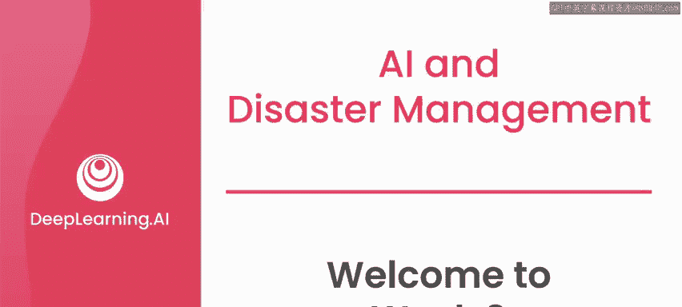
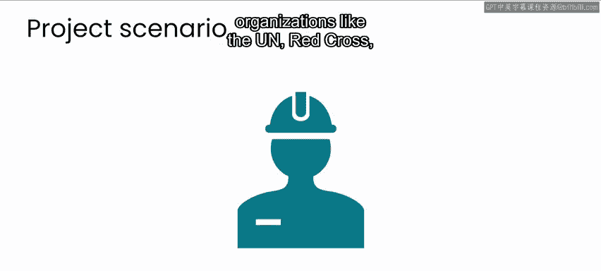
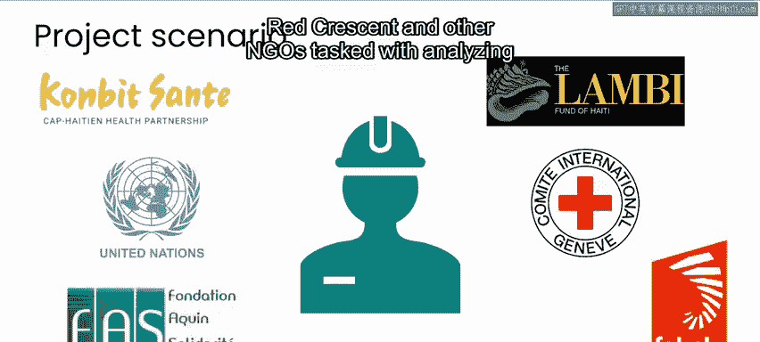
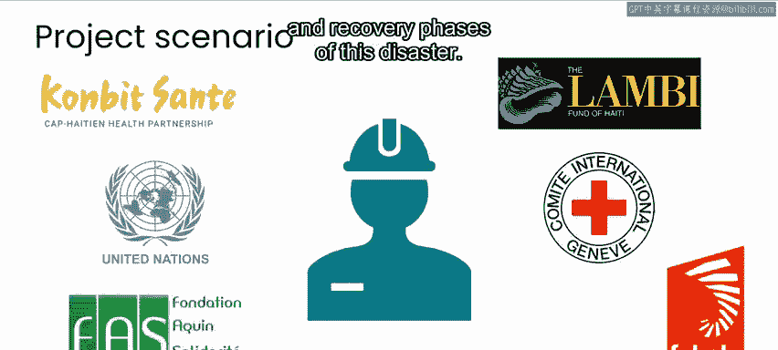
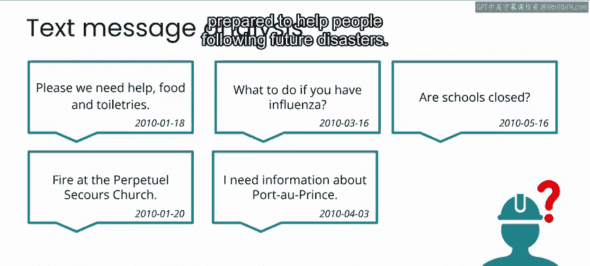
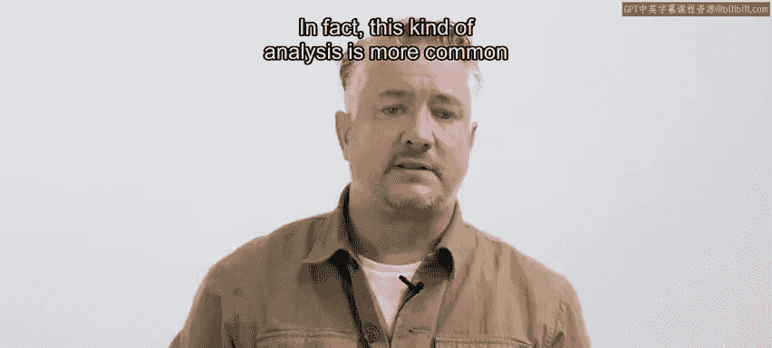
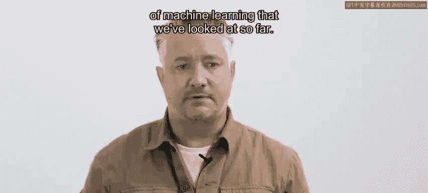
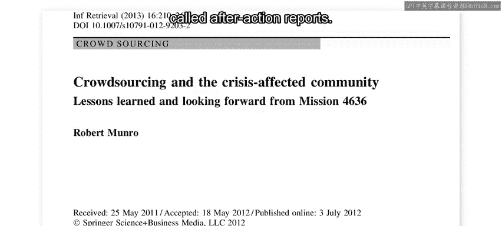
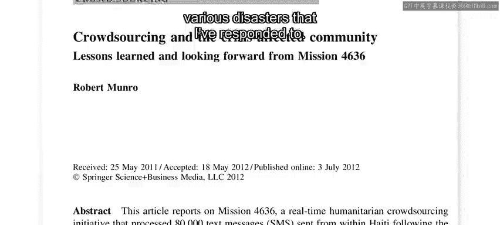

# 吴恩达《AI for Good专业课程》 AI与公共卫生、气候变化、灾难管理｜中英字幕 - P106：24_欢迎来到第3周.zh_en - GPT中英字幕课程资源 - BV13u411F7xZ

Welcome to week three， the final week of this course on AI and disaster management。This week。

 you will work through a case study where you will analyze a data set of text messages sent in the days and weeks following the earthquake in Haiti in 2010 to determine how the relative need for things like assistance。

 food， water and information evolved over that time period。

In this scenario you can picture yourself as part of a group of individuals and organizations like the UN Red Cross Red Crescent and other NGOs tasked with analyzing communications after the response and recovery phases of this disaster your goal is to provide insights into the changing needs of people in the response and recovery phases after a disaster so that your organisation will be better prepared to help people following future disaster。

This is a little bit different from the case studies you looked at in the previous courses of this specialization and that here you won't be producing a software product instead you can imagine this as a scenario where you're analyzing disaster response and recovery data in order to generate a report that could inform future response and recovery efforts and in fact this kind of analysis is more common in disaster response than the kind of machine learning that you've looked at so far in disaster response circles you will often hear such reports called after action reports and I've written such reports for various disasters that I've responded to in this case for Haiti I worked as disaster responsepoer and also wrote one of the after action reports which ultimately became part of my PhD dissertation。

But first， let's take a closer look at what happened in the event and how text message communication emerged as a critical component of the response effort immediately afterwards。

😊。