# 吴恩达《AI for Good专业课程》 AI与公共卫生、气候变化、灾难管理｜中英字幕 - P107：25_海地2010年地震.zh_en - GPT中英字幕课程资源 - BV13u411F7xZ

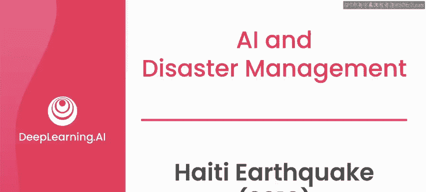

In this video， I will walk you through the details of what happened in the immediate aftermath of the earthquake in Haiti and how the response efforts were coordinated。

On the 12th of January 2010， at about 5 pm local time， a magnitude 7。0 earthquake struck Haiti。

The earthquake immediately killed more than 100，000 people and left millions homeless and in need of eight。

In the days following the earthquake， many nations and international organizations sent aidide and volunteers to help with the rescue effort and the distribution of supplies。

😊。

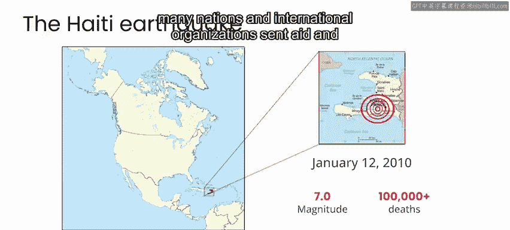

With many people still trapped under the rubble or lacking basic necessities like food。

 water and shelter， the immediate response was essentially a massive logistics problem。

Responnders needed to know where impacted people were located and what support they needed in order to plan the deployment of search and rescue teams。

 medical staff and supplies， food， water， and other aid。

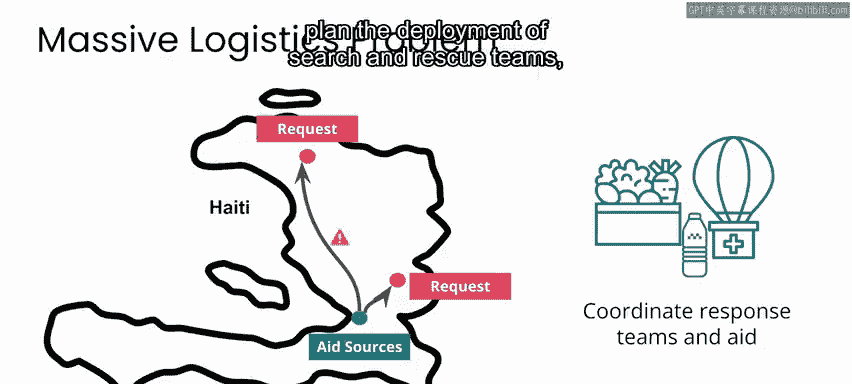

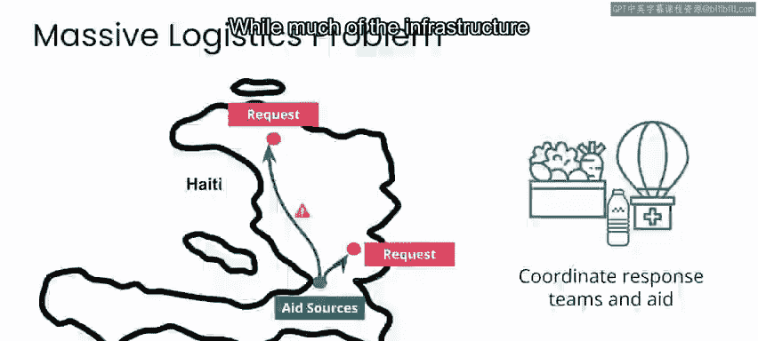

While much of the infrastructure was damaged or destroyed。

 most of the cell phone towers were still intact and functioning。

 and so people were communicating via text message and reaching out for assistance or information。

After the earthquake， I worked with a number of different organizations to set up a messaging service called Mission 4636。

 where anybody within Haiti could send a free text message to the number 4636 to communicate their needs and locations to disaster responders。

😊，The vast majority of these text messages were in Haitian Creole language most of the international responders didn't speak and at that time there was no app that could automatically translate between Haitian Creole and English and English was the only language common among the international responders as part of Mission 4636 I recruited and worked with thousands of members of the Haitian diaspora who came online around the world to quickly translate and geolocate the messages some examples of messages like these you can see that people are reaching out for help describing what the situation is and given a location like a address or a particular place name。

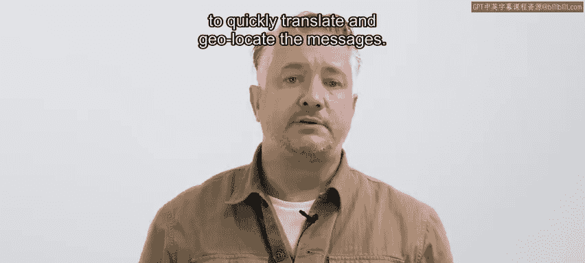

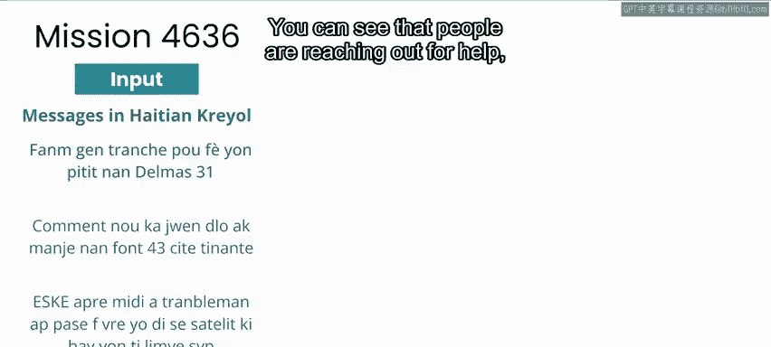

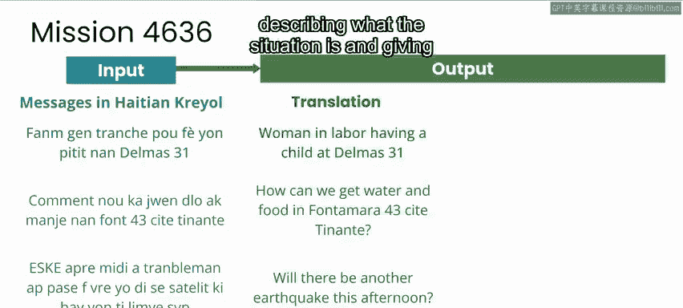

Now with English translations， these messages were also matched to the exact locations。

 in many cases relying on the local knowledge from the Haitian volunteers working with Mission 4636。

These translations and locations were then routed to responders who could follow up with communication back to the person who reached out in the first place to provide more information or to deploy support on the ground For an example of how this worked。

 you can look at a message like this one which would have been translated to English like this。

And so you can see this is actually a message from someone in the local community directing people to where they could find an open hospital。

 however， understanding where OCAP is located is not straightforward， you probably can't see it here。

Oh here。Or if I zoom in again here。But if I tell you that capaccian is Ocap。

 you could maybe guess why OcapAP could be slang for capasian。

Even then you wouldn't know that the hospital being referred to here is actually more than 10 kilomet south of the city itself。

So in this case， in order to communicate to people in the area where they should go for medical help。

 both the translation and location of this message relied on local knowledge of the language and where the hospital is located。

😊，Beyond just translation and local knowledge of where things are。

 there will always be a need for people from the crisis impacted population to be part of the disaster response efforts。

 without a doubt the most important people in the response to this earthquake in Haiti were the Haitians themselves with Mission 4636。

 members of the Haitian diaspora were able to process more than 80。

000 messages in the days and weeks following the earthquake and the work of the Haitian diaspora around the world definitely save lives within Haiti。

After the response and recovery phases， we were able to transfer this system to be run by paid workers within Haiti。

 where it continued to be a service that people could rely on。

To support future disaster response and translation efforts。

 we published a subset of the text messages after removing all messages that contain personal identifying information。

 even individual first names， this data set has served as the foundation of many disaster response planning studies as well as initial data for various machine translation services including the Microsoft and Google translation services from Haitian Crele to English which were both released relatively quickly after the earthquake struck the location names that were plotted for the first time in these messages were also shared first with Opentreetmap and then with other mapping services as a result of the technologies that were developed based on these data sets translated a message like this and locating the Sacr Heart hospital in OcapAP is now actually a manageable task for someone who does not speak Haitian Creole。

 but who has access to the Internet and can search for this particular hospital in Haiti This is。

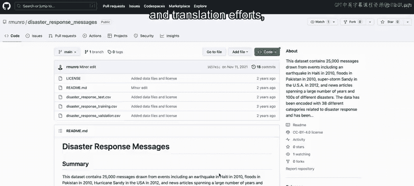

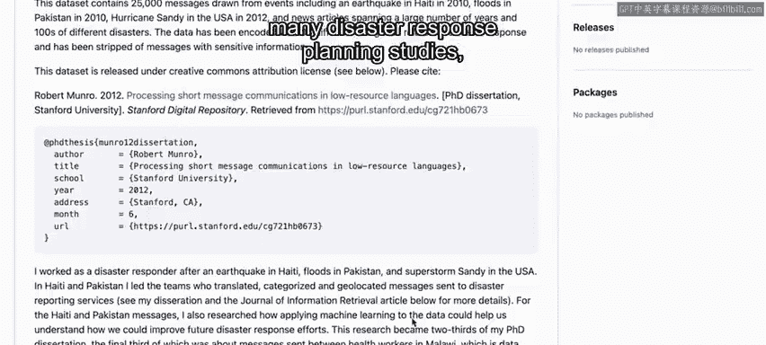

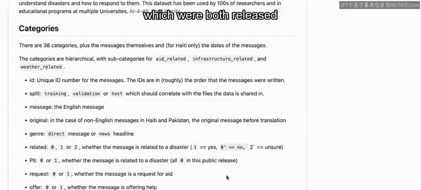

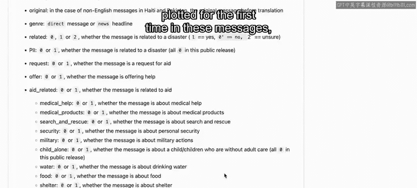

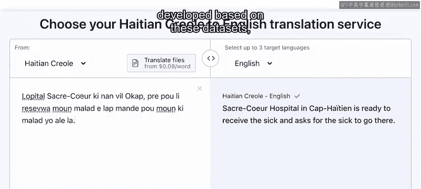

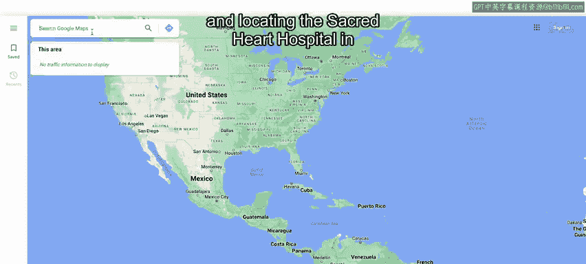

Really good example of how working with low resource language communities to deploy general applications for things like translation or mapping or search can later provide great value for those communities when it comes to any number of tasks。

 including disaster response efforts。However， in many places around the world today where low resource languages are spoken。

 the same challenges we faced in Haiti in 2010 remain。

 namely there are no automatic translation services for local languages and limited mapping capabilities especially with place names in those languages in the labs this week you'll be working with the data of text messages translated and geolocated by members of the Haitian diaspora and paid workers within Haiti after the earthquake you'll approach this project as someone interested in studying how the request for aid and information evolved in the days and weeks follow a disaster and this will help those of us in the disaster response community better understand and plan for future disaster response efforts so please join me in the next video to begin the explore phase for this project where you will identify stakeholders and define a problem statement。

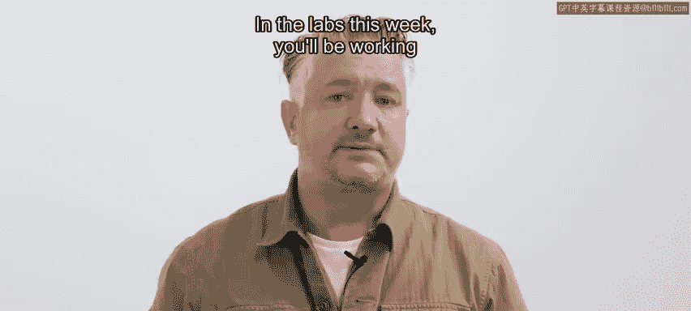

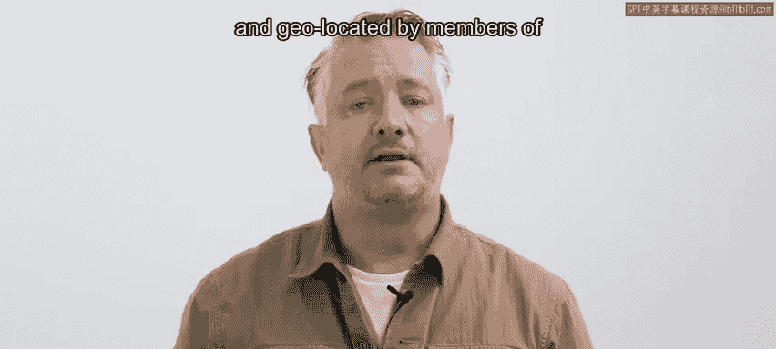

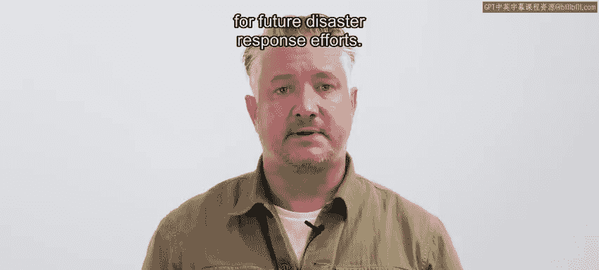