# 吴恩达《AI for Good专业课程》 AI与公共卫生、气候变化、灾难管理｜中英字幕 - P108：26_主题建模探索阶段.zh_en - GPT中英字幕课程资源 - BV13u411F7xZ

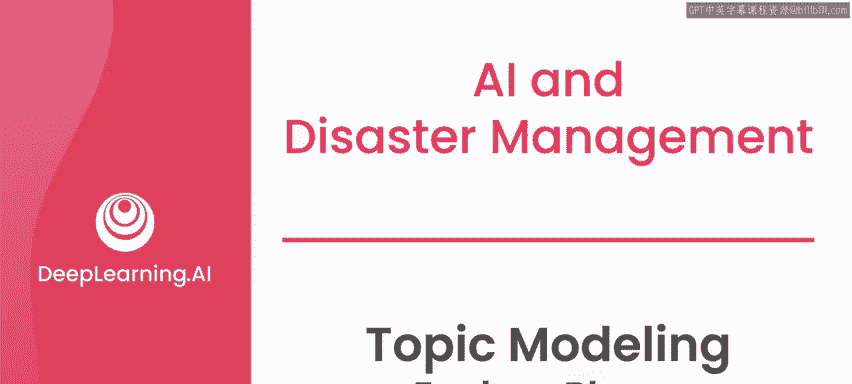

In the previous video， you looked at what happened after the 2010 earthquake in Haiti and how the Haitian diaspora and paid workers within Haiti played a critical role in translating and geolocating text message communications that were sent from individuals in the impacted communities these messages were then rerouted to the responders via the missionion 4636 project。

Like I talked about in the first course of this specialization in the first decade of the 21st century。

 access to cell phones went from being relatively limited to almost ubiquitous throughout the world。

 so in 2010， it was a relatively new phenomenon that after a disaster many individuals in the impacted communities had the ability to reach out directly for help even though in a situation where much of the surrounding infrastructure have been destroyed today it's now expected that digital communications whether it's via phone。

 text， social media or some other messaging service will be something that is available for people to send and receive during a crisis in planning the response to future disasters it's important to study how such platforms were used what methods could prove useful in routing or responding to such communications as well as the content of messages exchanged。

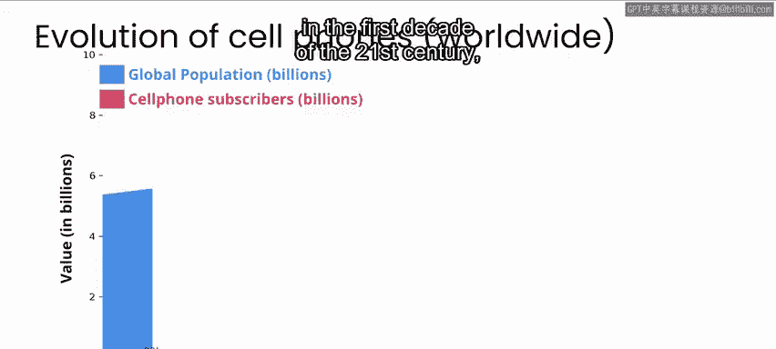

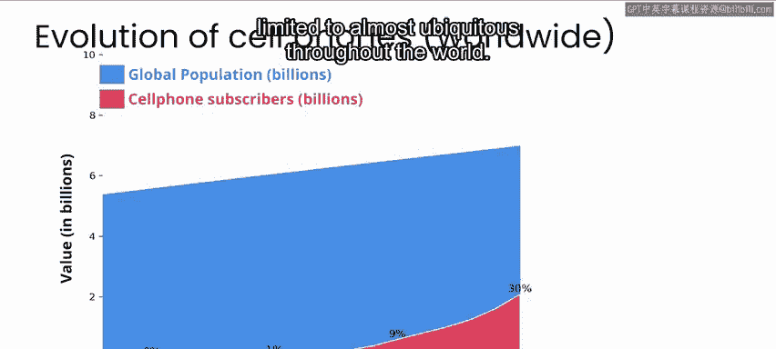

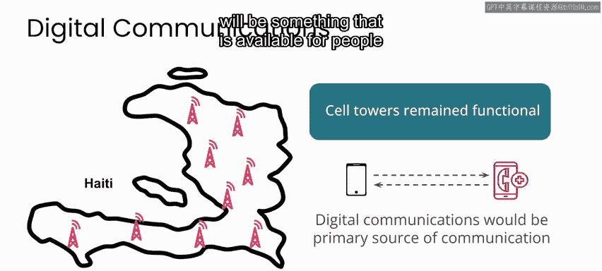

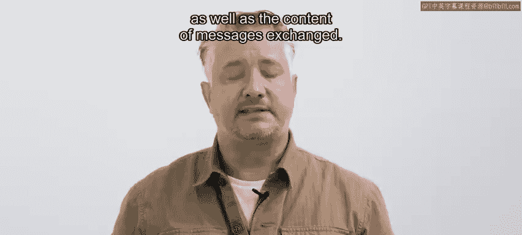

In this context you'll be looking at the data set of text messages sent after earthquake in Haiti to extract insights that could help inform the response to future disasters like I've said before。

 this kind of exploratory data analysis is actually more widely used in disaster response today than machine learning based methods so what you're learning here is something that can provide real insights to somebody like me planning for future disasters。

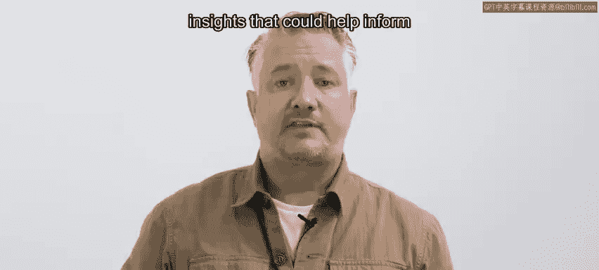

Right now you are in the explore phase of this project。

 where your goals are to engage with the stakeholders define the problem that you aim to work on and determine whether AI can add value as part of a solution for the step of engaging stakeholders in this case there could be a number of people and organizations that you would want to connect with first off。

 you want to connect with members of the impacted community in this case。

 Haitians both within the country and within the global diaspora to better understand their experience other stakeholders might include the organizations who participated in the response like local organizations in the international NGOs as well as organizations that might be likely to participate in some future response effort。

It could also include the companies running the digital communications platforms in Haiti in 2010。

 this was a small number of cell phone companies and radio stations。

 but nowadays this might include cell phone providers radio stations。

 social media platforms and others For example， I've mentioned UNICEF's your reportport system a few times in these courses that system previously worked via text messaging but now operates on the Whatsapp messaging platform in any disaster the exact details of the different needs for support and services and how those needs evolve will depend on the specific location。

 the nature of the disaster and what infrastructure existed before and remain functioning after the disaster hit。

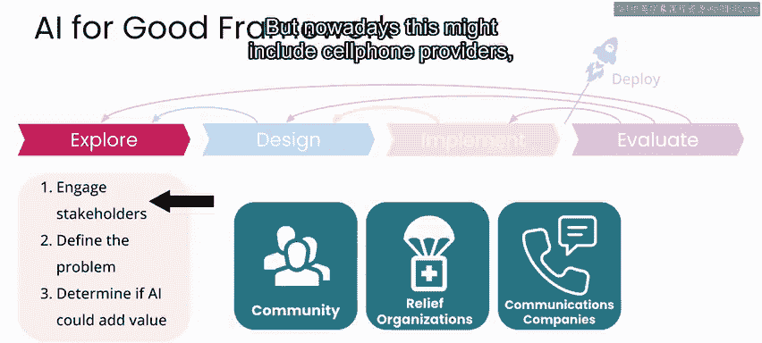

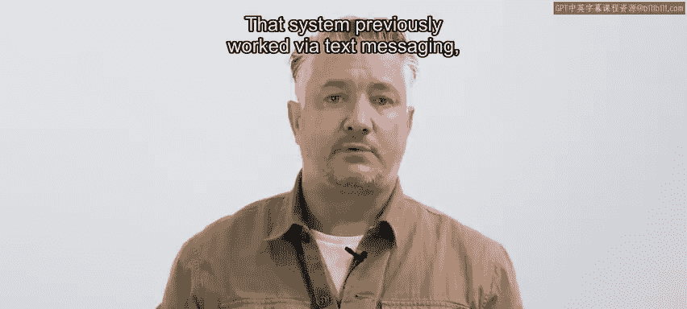

Rather than attempt to consider all possible scenarios here。

 I'd like you to imagine the aim is to help one low resource language community in the response and recovery phases from a sudden onset disaster。

In this case， you'll also want to talk to people who have worked on the problem they're hoping to address and hear that my people have worked with mission 4636 and similar efforts。

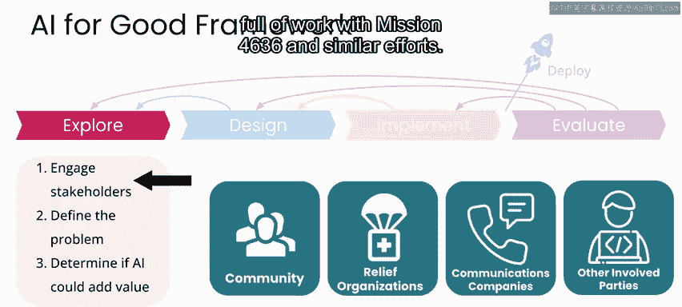

Even having narrowed down this project to supporting a single resource language community。

 there are many different aspects of this problem that you could think about working on for example。

 you could work on the translation piece to build better translation surfaces for that language you could also consider working on extracted information from unstructured documents in real time to support resource allocation and you could think about automatically map in these messages based on the written locations within them for the purposes of this project will narrow it down even further to look specifically at the things people will request in and how those requests evolved in the days and weeks after the disaster keep in mind that this is just one small piece of a giant puzzle but that similar to the other use cases that we've looked at in these courses with the framework you apply here you could also work on another piece of this puzzle in this data set or a different use case altogether So in this case。

 let's say the stakeholders for your projects are。

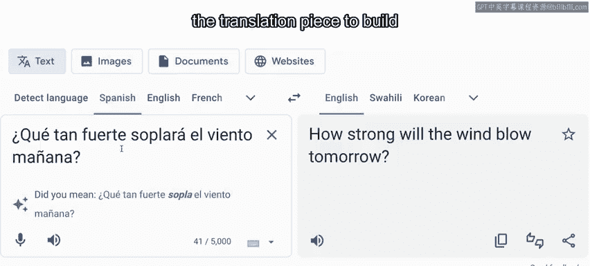

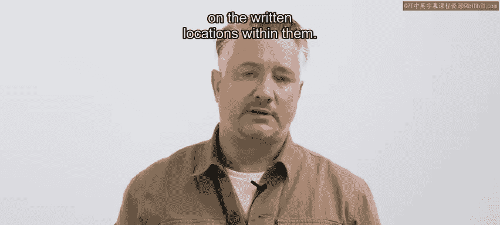

Members of the community that you hope to serve。

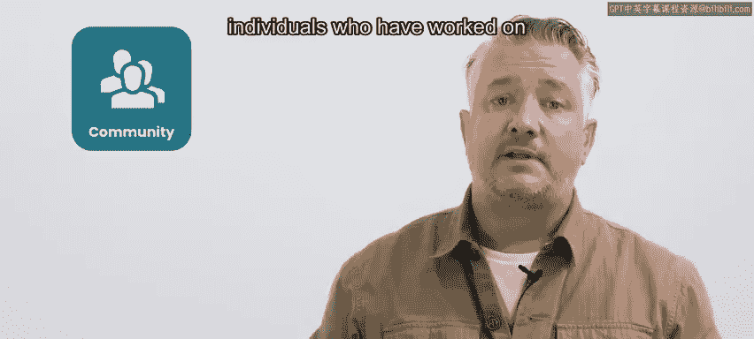

Individuals who have worked on related solutions in the past。

Organizations are likely to be involved in response and recovery efforts。

And companies that maintain the communication platforms that people are likely to use。

A problem statement for this scenario could therefore be something like。

People in impacted communities and aid organizations want to understand how request for a change over time following a sudden onset disaster in order to better plan for future disasters anywhere in the world。

With stakeholders identified in a problem statement defined you're ready to move on to the third step in the explore phase Of course there are many ways in which you could proceed from this point with an impactful project and many that do not involve AI but these courses are about AI for good and so that's where we're headed next and so the next step in this project is to determine whether or not AI can add value to the problem that you're hoping to work on as mentioned previously the data set for missionion 4636 is published online and thus's the data set that you'll be working with for this project just like the other projects that we've looked at in these courses in order to determine whether AI can in fact add value to your work you need to explore the data first so that's what's next join me in the next video to get started exploring the data。

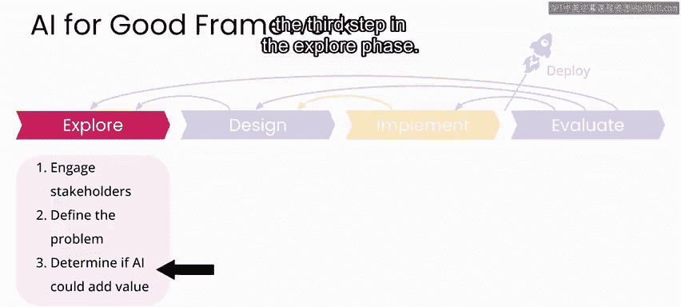

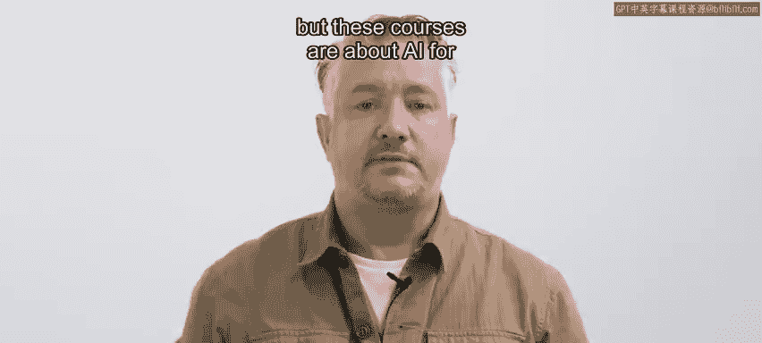

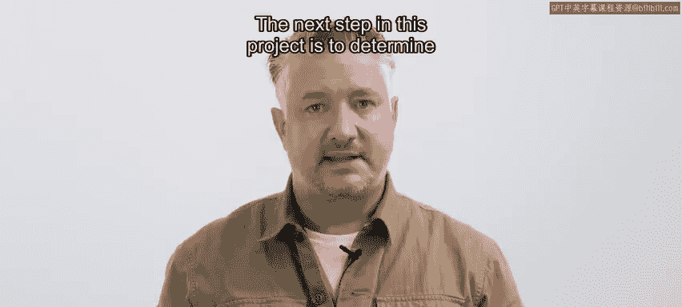

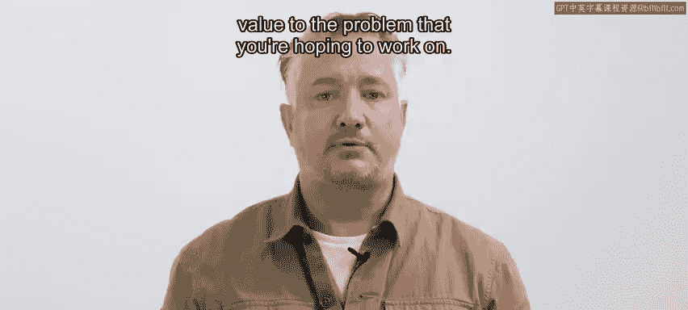