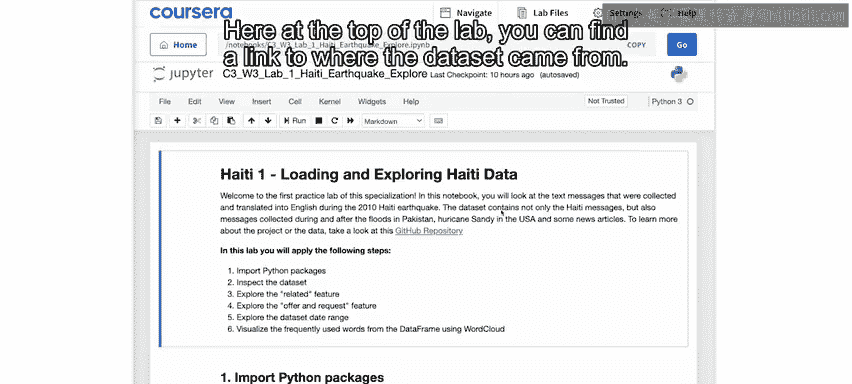
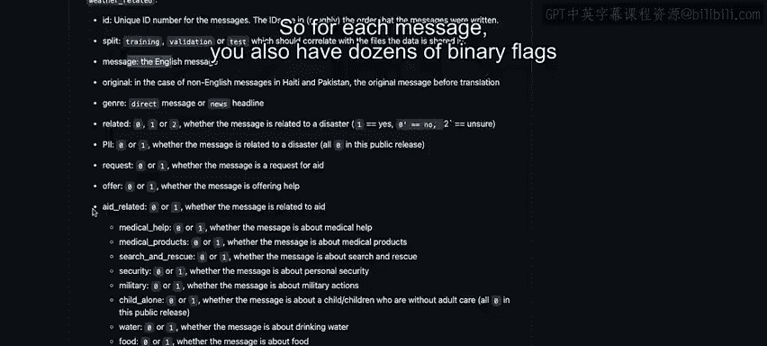
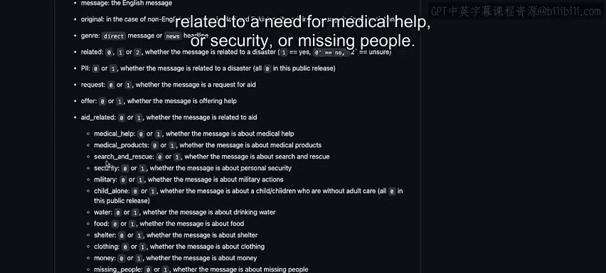
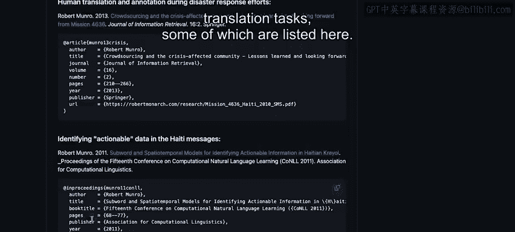
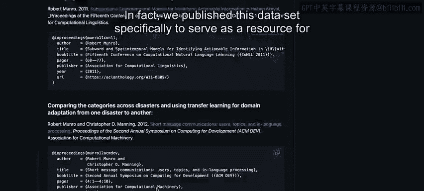
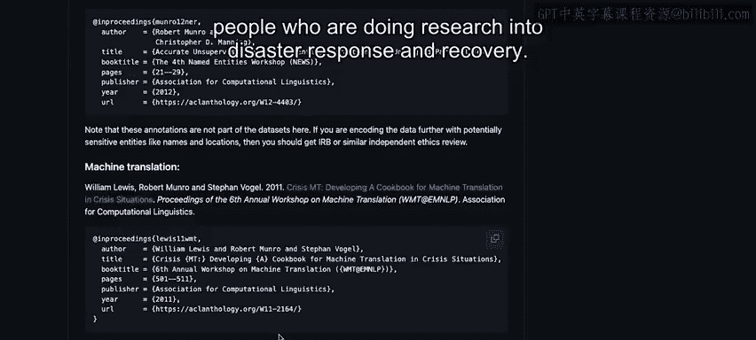
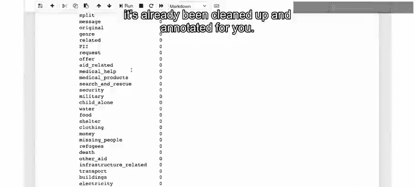

# 吴恩达《AI for Good专业课程》 AI与公共卫生、气候变化、灾难管理｜中英字幕 - P109：27_主题建模探索数据.zh_en - GPT中英字幕课程资源 - BV13u411F7xZ

In this project you are analyzing text messages sent following the earthquake in Haiti in 2010。

 specifically you are looking to characterize the evolving needs for things like assistance。

 information， and other requests in the days and weeks after the disaster。

In order to determine whether AI can in fact provide value for the project that you're hoping to work on。

 you'll get started by exploring the content of the messages themselves。

 the various categories assigned to each message and other characteristics of the data set and at this point I should warn you that a lot of these messages are very harrowing even more than 10 years past since the disaster and certainly people have experienced trauma just from reading these messages in the past so keep this in mind that if you choose to proceed you are going to get a very real and very sad understanding of what it's like following a disaster。

Here at the top of the lab， you can find a link to where the data came from。

 and this case it's my own GitHub repo。

And here you can find a summary of what's in the data set。As you can see here。

 the dataset set contains a total of 25，000 messages。Drawn from different disaster responses。

 including the 2010 earthquake in Haiti， the floods in Pakistan later that same year。

 and Hurricane Sandy in the US in 2012， plus a collection of news stories talking about disasters。

If you scroll down here， you can see more detail on what's contained in each row of data。

These are things like a Nick ID for message， the content of the message。

 whether or not the message was related to the disaster and other details。

Each individual message has been labeled by human labelers as to the details of the content of that message。

So for its message， you also have dozens of binary flags to indicate whether the message。

 for example， was aid related。

And then flags detail in the specifics like whether this was related to a need for medical help or security or missing people。

There were also flags for infrastructure and weather related topics。

Then there's a column to indicate which event the message is from and the date the message was sent。

In this case， dates are only present for the Haiti messages。So again。

 the main idea in looking at the data in the explore phase of your project is to determine whether AI might add value as part of the solution If you scroll down a little bit further here。

 you can set this data set as been used in a large number of different machine learning related projects。

 including various classification and translation tasks， some which are listed here， In fact。

 we publish this data specifically to serve as a resource for people who are doing research into disaster response and recovery。

Heading back over to the notebook here， I'll first just remind you that for each of these labs。

 your lab notebook is in a folder with other things and you can see the contents of the folder by clicking up here on the Jupyter icon。

So here you have a data folder that contains the data sets from the GitHub repository。Then as always。

 you have a data sheet describing where the data comes from。

 in this case pointing back to the GitHub repository where you can find much more information on the details of this data set。

Then as in the other labs in these courses， you have U file here。

 where I've put some of the code you'll be running in this lab。

You can take a look at what's in here if you're familiar with Python and curious about what's happening behind the scenes in some of the steps in this notebook。

And then here is the notebook itself。And I can get back to the notebook by clicking on it right here。

To get started on this first cell to import the packages that you'll need for this lab。

When you see the message or packages imported successfully， you're ready to move on to the next step。

Next， you're reading the dataset and here you're reading in the full dataset。

 which has been separated into training， validation and test sets。But here。

 because we are doing unsupervised analysis across the entire data set， we'll combine them all。

After that， you'll print out the first few lines of the data to ensure that everything was ready and okay。

So here you can see that you've got almost 24，000 rows of data and the columns are those that you were just looking at in the GitHub repo。

And you can see in those columns which you have an ID， the message English。

 as well as the original language， and then all the various flags for the different categories。

This PII flag is to indicate which of the messages contain personally identified information。

And like we said， these ones have actually been removed from the data set before as published。

 but to be certain， we'll check in a moment to verify that at zero and other cases here。

 meaning there's no flag indicating personal information in the data。

Here you also have a field indicating which event the message was from， so in this case。

 all these ones at the top here are from the Haiti earthquake。When you run this next cell。

 you'll print out all of the column names。Then you can run this next cell to check the values of entries in the PII column。

What the cell is doing is saying print out all the unique values that occur in the PAI column and so in this case you can say that it's just one unique value and that's zero。

 So the PAI flag is set to zero for all entries in the data and that's by design like I already mentioned。

In the full data set of messages that were recorded after the earthquake， of course。

 many of the messages did contain， personally identifying information。

 but we were very careful to identify， flag those， remove those from the data set before making it public。

 and in fact deleting those entirely。In any project you work on that involves direct communication between individuals。

 you will need to be really careful about not storing or publishing any data that contains private information without the explicit consent from those individuals information is revealed in the data and you'll also need to ensure that someone has the opportunity to come back and ask for their data to be deleted later。

With this next cell， you're printed out the unique values in the event column。

 and there you can see that the different events include the Hei earthquake。

 Hurricane Sandy in the US， the Pakistan floods， and this Nan entry。

 which is just an nu value to indicate which items in the data set are from news stories。After that。

 you'll filter the data down to just the data set from Haiti。

 but you can change this filter to look at the data from the other events if you're interested。

 Just keep in mind that some of the fields you'll be looking at like the date， for example。

 are not present for the other data sets。 So some of the code in these notebooks but't necessarily work if you change this filter。

And now you can see your data includes about 9，900 rows specifically for the Haiti event。

When you run this next cell， you'll print out the number of missing values for each column in the data set and find that it's zero across all the columns。

This is different from some of the data sets you looked at in the labs in previous courses where missing values were present。

Here you're working with a data that has been fairly heavily curated。

 so it's already been cleaned up and annotated for you。

So you're working with a data of around 10，000 messages that were sent in the aftermath of the earthquake in Haiti in 2010。

 you read in the data and it's time to start exploring further join me in the next video to start visualizing this data。

