# 吴恩达《AI for Good专业课程》 AI与公共卫生、气候变化、灾难管理｜中英字幕 - P10：9_Felipe Oviedo乳腺癌成像异常检测.zh_en - GPT中英字幕课程资源 - BV13u411F7xZ

Hello， my name is Fepe Viedo， I'm a Seni research scientistist at the Microsoft AI for Good Research La。

I have a background in applying AI to scientific problems such as computational chemistry。

Piology and medical imaging。And I' am very excited about the applications of AI in these nontraal domains。

I would like to tell you about a medical imaging project I've been working on where we have developed a system that uses deep learning to assist ci radiologist in the early detection of breast cancer。

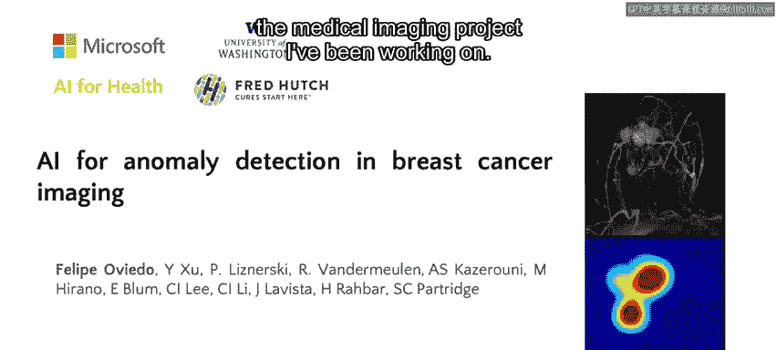

This project a partnership between Microsoft AI for Health， the University of Washington。

 and the Fred Hodge Cancer Research Center。

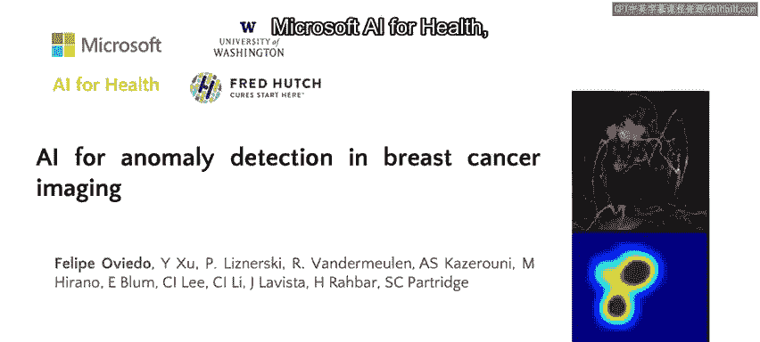

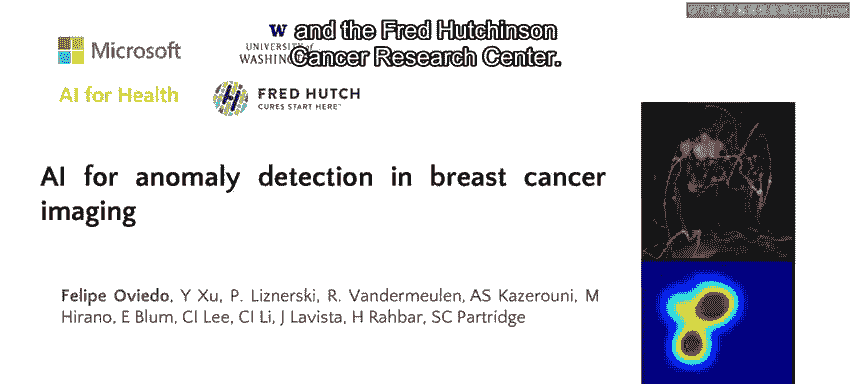

Breast cancer is one of the most common types of cancer worldwide in the US。 there are around 300。

000 new diagnoses and 40000 deaths per year。Radiologist。

Often use magnetic resonance imaging or MRI scans to perform cancer screening and early detection in high risk women。

 like those who have a family history of cancer。However。Even with an MRI scan。

 small lesion can be missed leading to false negatives。

And benign lesions can be mistaken for malignant lesions leading to false positives and unnecessary biopsies。

AI can be a useful tool to inform the decision making of our radiologists to both reduced interpretation time and increase the accuracy of an MRI exam。

Our goal in this project was to develop an explainable machine learning model to assist radiologists in the early detection of breast cancer。

 we envision this tool helping radiologists by reducing the effort required for the analysis of MRI imaging and quickly identifying areas in the breast that are abnormal and require follow up。

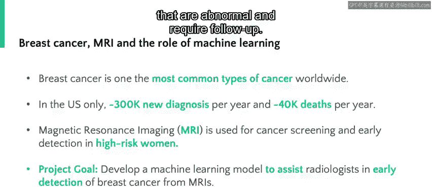

A common problem in radiology is distinguishing between normal and have abnormal exams。

In the case of woman with a high risk of breast cancer， anmeor recommended every few years。

This image shows a 2D projection of an MRI scan。A radiolog analyzes the full MRI scan trying to answer these key questions。

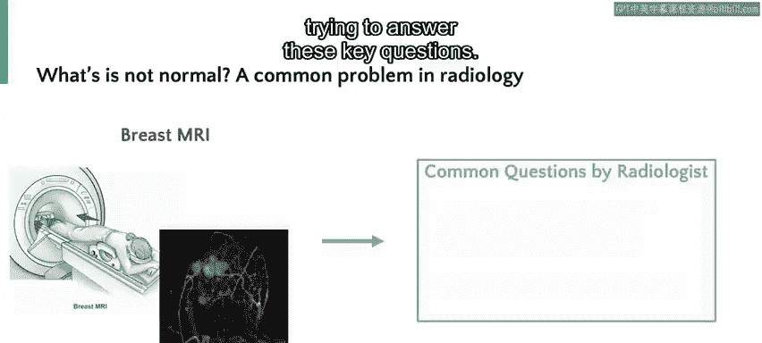

Is the breast or abnormal， Where are the abnormalities in the image。If there are abnormalities。

 can we make cancer diagnosis or risk predictions？MRI scans are complex three dimensional spatial measurements。

And so answering these question requires a very experienced radiologlogy and substantial analysis time。

 particularly in cases that have very subtle abnormalities。

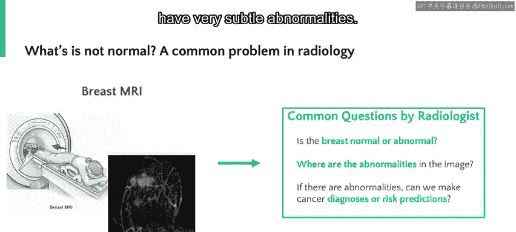

This problem can be tackled using machine learning by training a neural network to automatically identify abnormal MRI scans。

 However， applying machine learning to a problem like this comes with significant challenges。

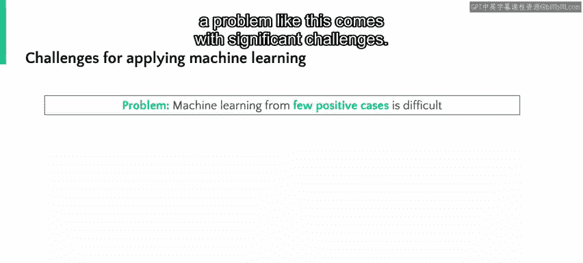

Negative cases， meaning normal breast images， are much more common than positive cases where the cancer is present。

 especially during the early stages of cancer。

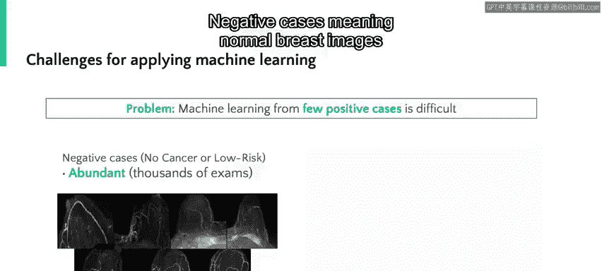

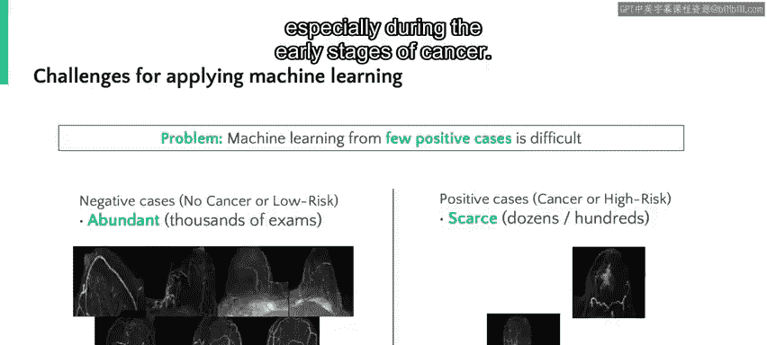

To train the neural network， we have access to data from over 4000 patients。Totaling more than 10。

000 individual MRI exams。But only a fraction of these patients around 2% develop cancer。

The challenge this presents when it comes to training a machine learning model is that your model could simply learn to predict no cancer for every single image and be correct 98% of the type。

In order to effectively identify that critical 2% of positive cases。

 we need to take a careful approach。The way we did this is by customizing our model for an detection。

 which means identifying normal or negative images very well through training on the abundant negative data。

 and then being able to identify abnormal images by looking for features that are absent in the dataset set or are different compared to the normal images in the dataset set。

 this is often called one class classification。

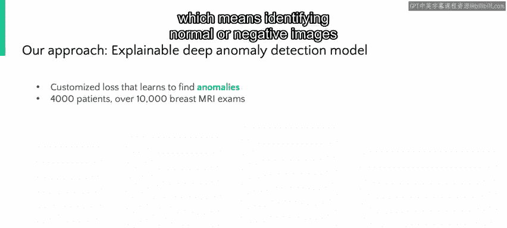

And so with this model for any MRI scan， the model outputs where the image is normal or abnormal。

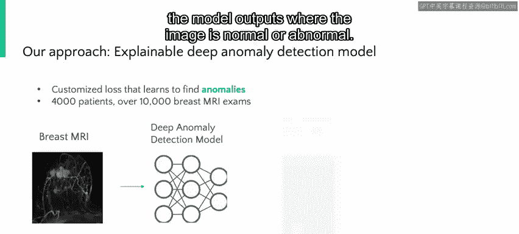

We can take this。Analysis one step further， going beyond the simple classification of versus abnormal and produced maps of abnormal areasas in the abnormal images。

 These maps can then later be used by a radiologist to visualize exactly what a portion of the image was found to be abnormal。

 And if for a more detailed analysis or biopsy。

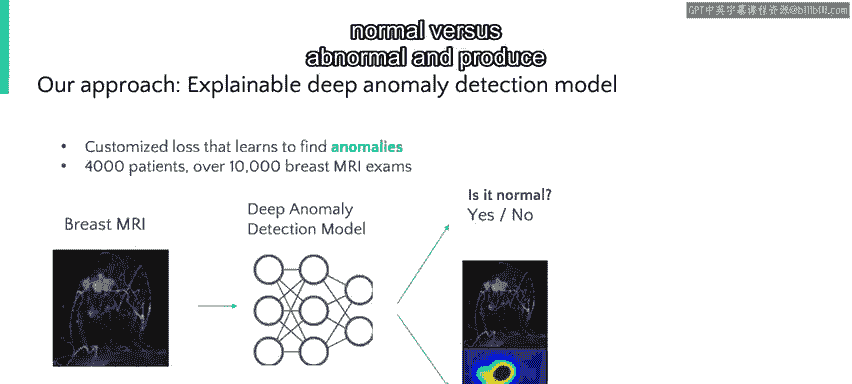

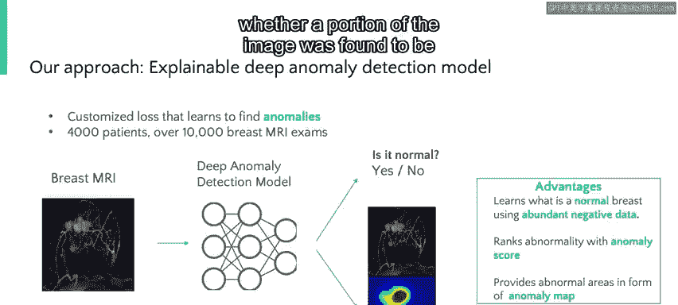

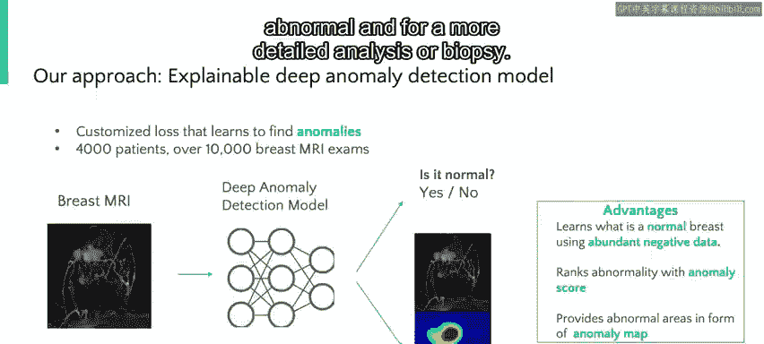

Our final model demonstrated over 90% accuracy cure in detecting existing cancer in patients and over 80% accuracy in predicting the five year risk of cancer。

This results un comparable to the accuracy of a trained radiologist reviewing MRI scans in the context of a patient's complete clinical history。

In addition。By automatically analyzing images， our system was able to reduce the workload of radioologies by over 80%。

 The inputs and outputs from our model look like this。

 where the top row is a collection of MRI images for multiple patients。😊。

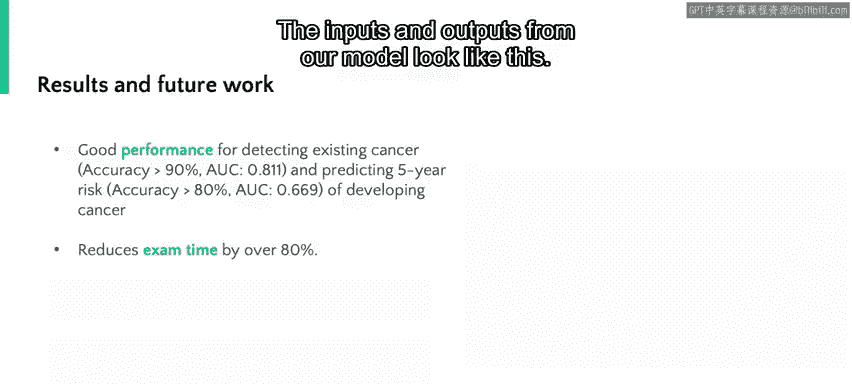

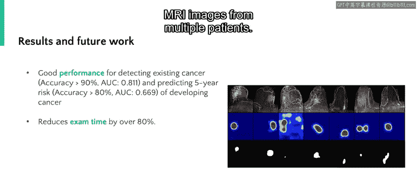

The areas in red in the middle row of images are the areas I identify as an abnormal by the model。

And the areas in white in the bottom row are those deemed abnormal by a radiologist。

 With this comparison， we observe a good match between the model predictions and the judgmentment of our radiologologies without any manual notations。

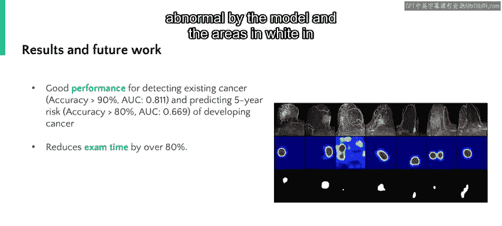

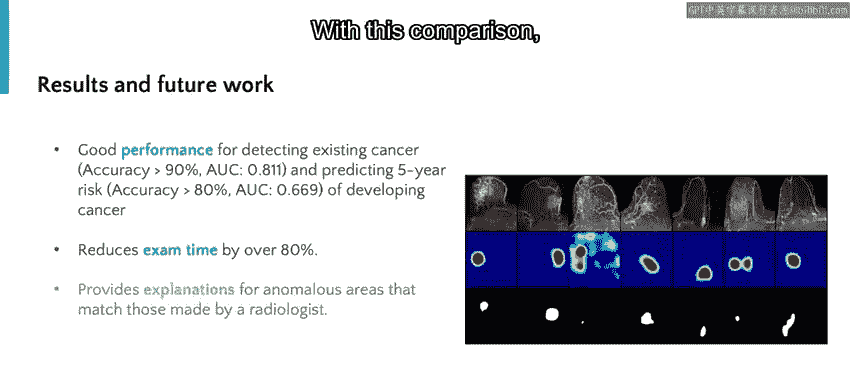

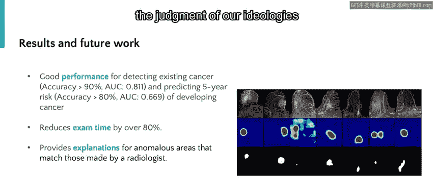

Our next steps for this system are to integrate it into the clinical workflow of radiologists to reduce their workload and help them quickly identify cases that require further analysis by a human。

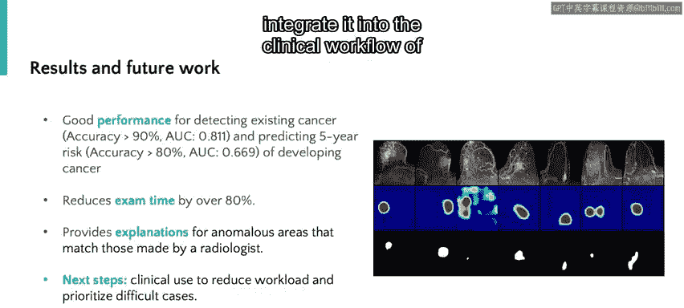

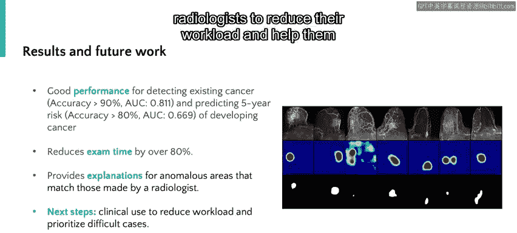

The future of medicine will no doubt include many AI assisted tools like this one。

 but it is important to remember that AI is no replacement for a trained medical professional。

 Instead， we hope that tools like these can help reduce the burden of teachers's work on clinicians and help them provide better outcomes for patients。

 Thank you。