# 吴恩达《AI for Good专业课程》 AI与公共卫生、气候变化、灾难管理｜中英字幕 - P110：28_主题建模可视化数据.zh_en - GPT中英字幕课程资源 - BV13u411F7xZ

In the last video you started exploring the text message data set here I'm going to walk through the rest of the lab where you will be visualizing that data to get a better sense of the distribution of message types。

 the content of the messages， and how the number of different types of messages sent evolved over time。

Your goal in this exploration is to determine whether or not it looks like AI could provide value as part of your analysis and before we get into any of the specifics yet of how AI works with text data。

 what you'd be looking for in these visualizations are ways in which the message seem to naturally separate into different groups or clusters or topics based on the content of the messages when they were sent and other characteristics。

If you're just opening up the lab now， you'll need to run all the cells up to this point。

 but if you've already been following along， you can start right here。

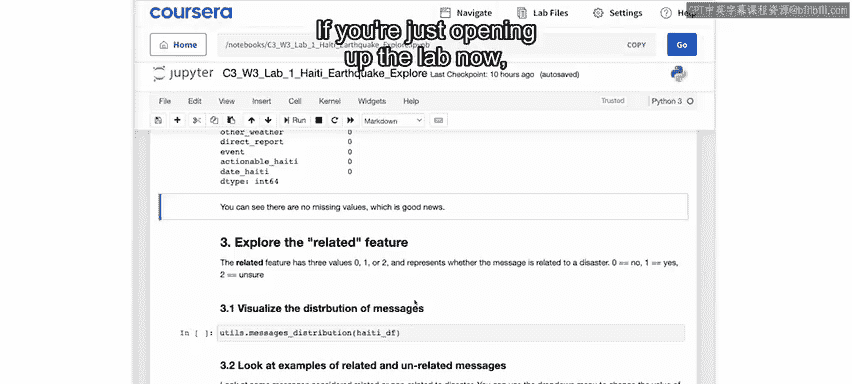

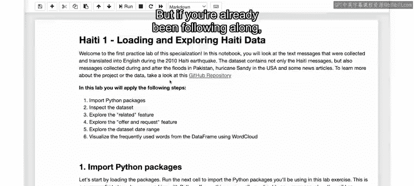

When you run this next cell， you will see the distribution of flags in the column called related。

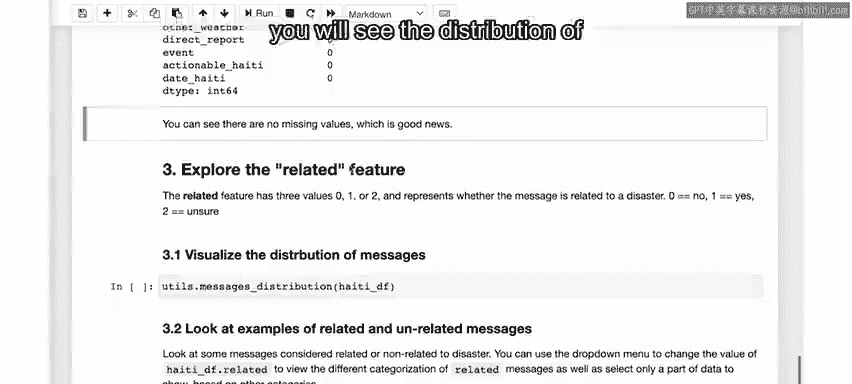

Which indicates whether a message was related to the disaster or not。

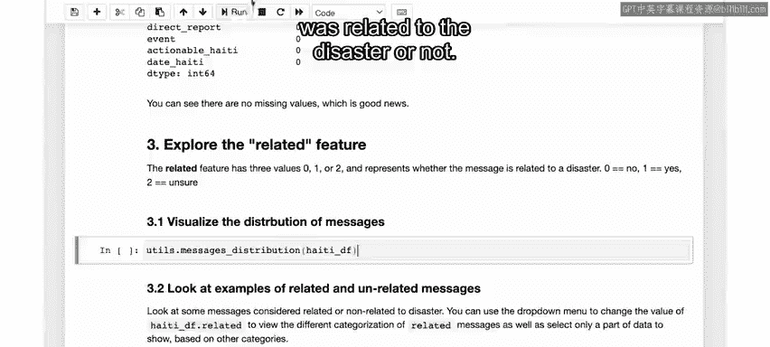

In this boshot， you can see the kind of messages that were characterized as being related to the disaster。

And one in this column versus those that were not related， zero in this column。

 as well as those which were ambiguous， labeled as two。

So you can see that the majority of the messages were related to the disaster with about half as many been unrelated。

 and a few for which the annotators were unsure。

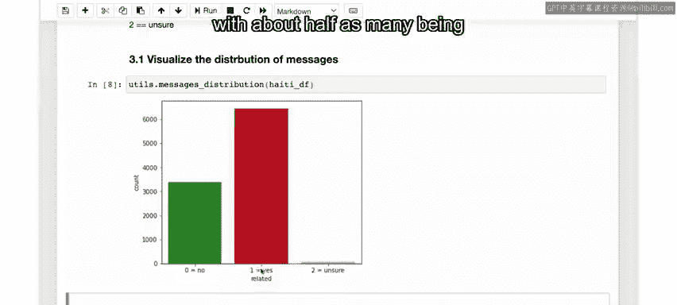

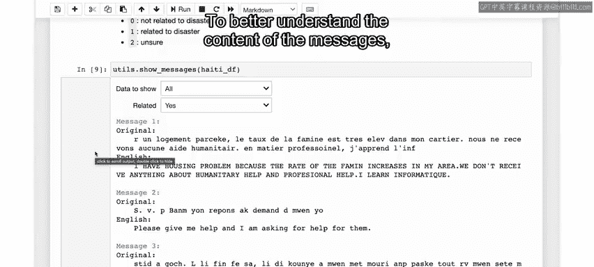

To better understand the content of the messages， you can run the Excelel。

 which prints out a sample of the messages in the data that meet the criteria that you choose in these pull down menus。

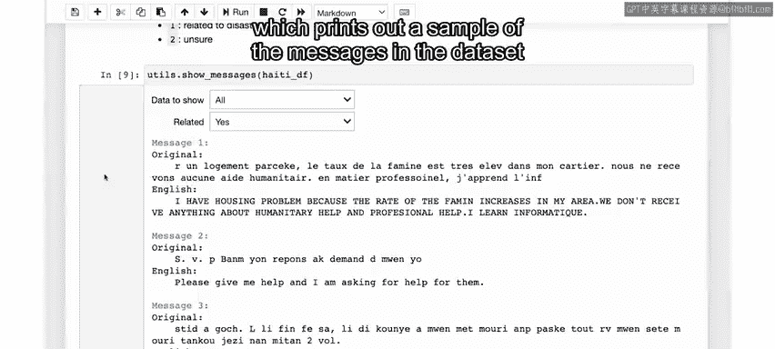

Here you can choose between yes， no or unsure to select between messages that were related or not related to the disaster。

This is probably a good point now to remind you that a lot of these messages are very hard to read。

 even for myself as a disaster responder who worked on this response。

 it's still not easy for me to go back and look at some of these messages。

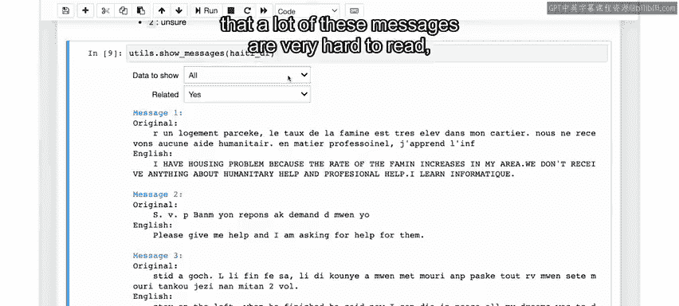

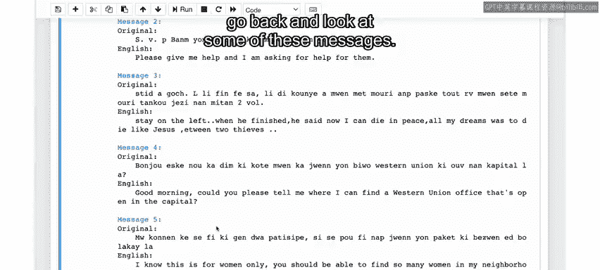

And if you want to work in disaster response， it's certainly important to understand the things that people cared about and what they' were expressing following a disaster。

It's also perfectly okay if you don't feel that you're up to looking at these messages。

 in which case， again， I encourage you just to skip to the end of these particular labs。

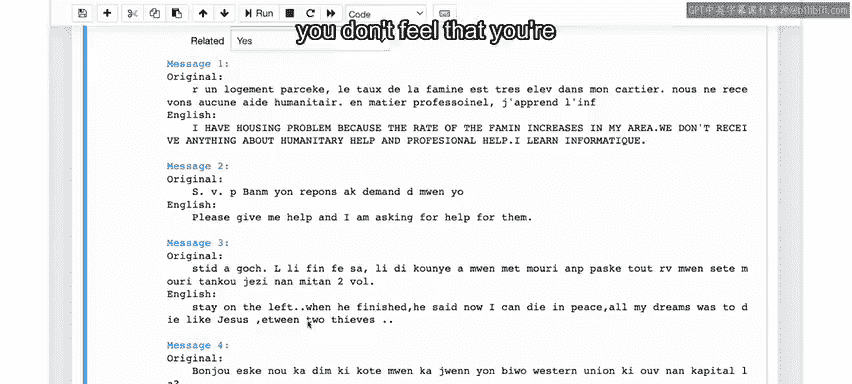

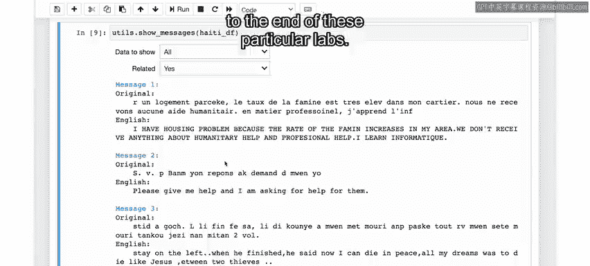

Here you can also select a subset of those messages with this menu where again you can choose all or one of the specific categories identifying messages related to specific topics。

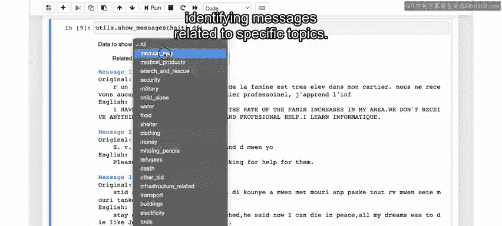

The messages that get printed out， those that meet the criteria you have shown。

So for these binary categories， you're looking at messages where the particular flag was set to one。

So here you have the original Haitian Creole in each case， as well as the translation to English。

And I'd like you to investigate what the measures look like in the different categories。 So。

 for example， if you select money。

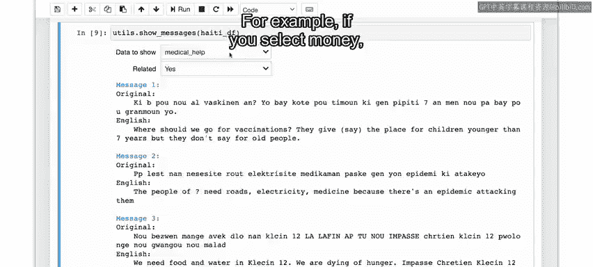

You'll see some examples of people who are asking questions or making requests which are related to money。

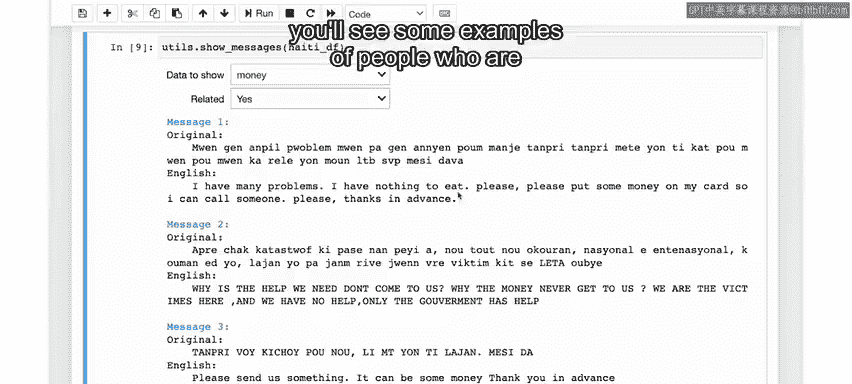

If you choose another example here， say hospitals， you will see examples of messages that's related to hospitals。

 and in some cases this might be hospitals that are available to take people or in other cases。

 people who are seeking information about what hospitals might be open。

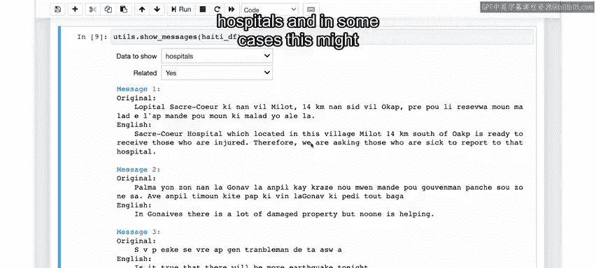

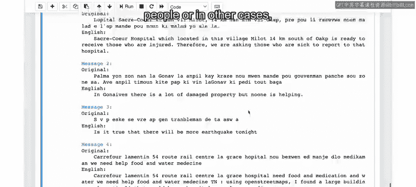

In some cases you might run into this message that says no samples in the data set with selected parameters。

 so in this case it just means that in addition to PI。

 we took out all the messages related to unaccompanied minorrs。Or children alone。

 as it's flagged here。

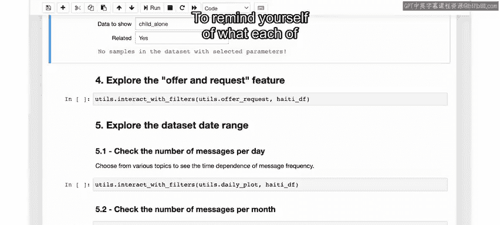

To remind yourself of what each of these categories is all about。

 you can head back over to the GitHub repository where each flag is described。

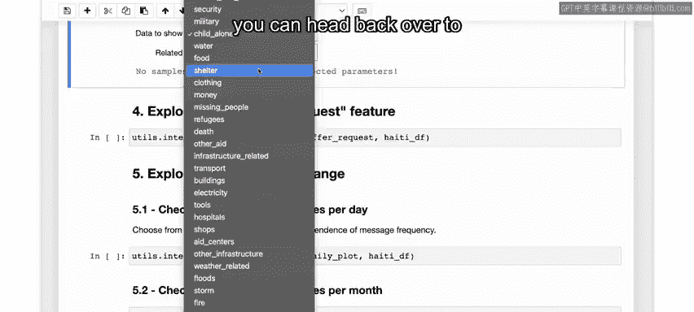

Read through the messages for different combinations of criteria to see what you find。

With this next cell， you're going to generate another bar chart to look at the count of messages categorized as being an offer a request or neither。

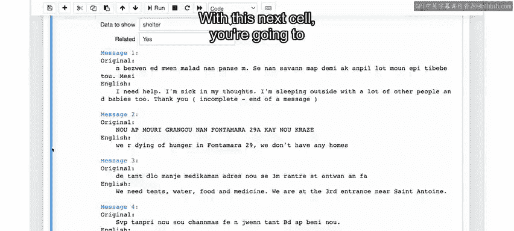

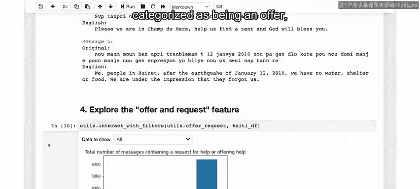

Again， you can try this for different categories to see how the distribution looks。

You'll see that across the most categories， the majority of messages were requests。

Although the distribution is different depending on the specific category。

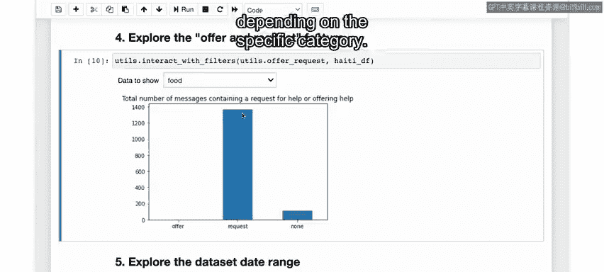

Run this next cell to show the number of messages recorded per day。

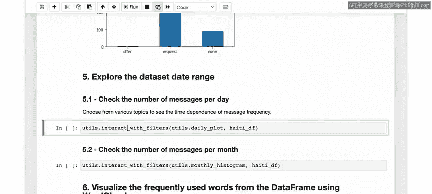

Here again， you can use the pull down menu to look at how the number of messages evolve for different types of messages。

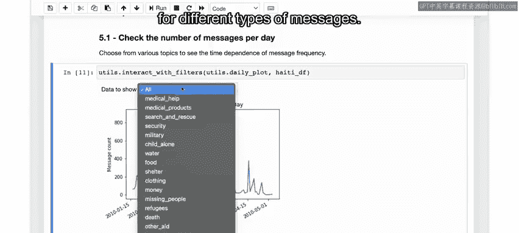

Looking at all the messages， you can see that there were more messages sent in the days immediately following the disaster。

Have a look and see if you can figure out what types of messages were most common immediately following the event versus those that were more persistent over time or even appeared for the first time later。

This is where you can start to gain some rough insights into how different needs changed over time。

 looking at the daily trends can be a little bit noisy。

 but you can run this next cell to perform the same analysis now counting the messages by month。

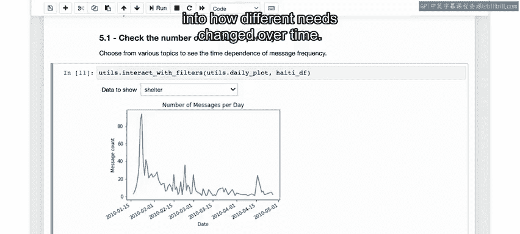

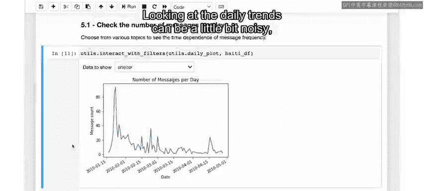

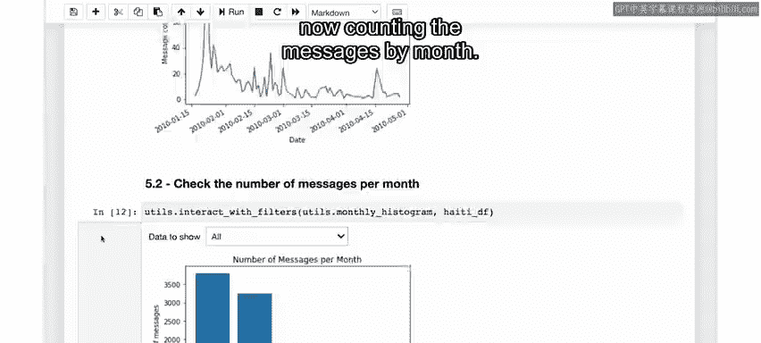

So here you should be able to look to see whether some of the insights youll seeing above were actually true when we aggregate to the monthly level。

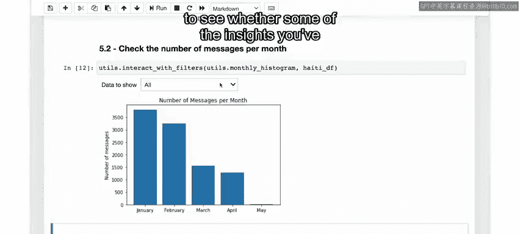

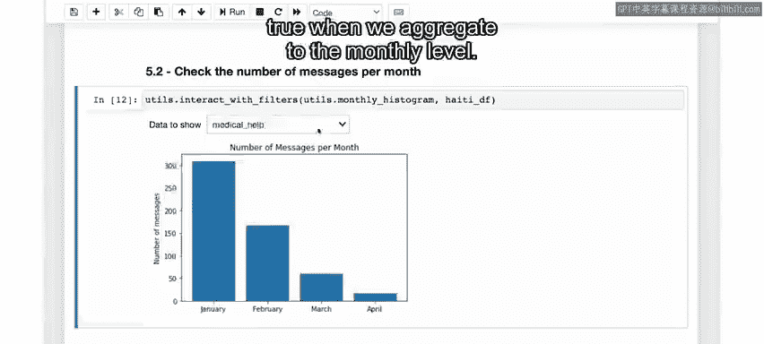

And finally， we can look at the data using word clouds。

 generally word clouds aren't as useful as they might appear。

 but here they actually show us something important about the data and how we want to process it。

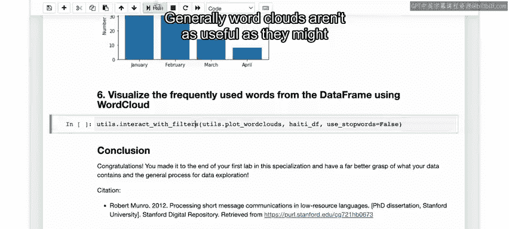

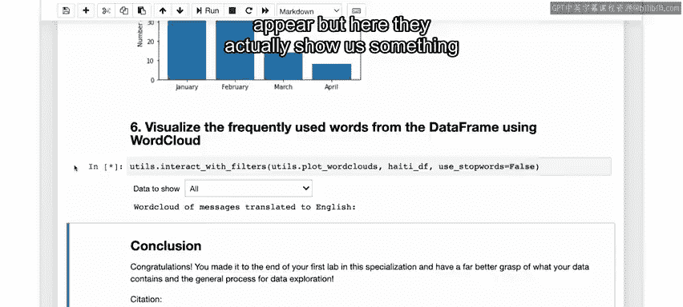

So a word cloud， if you're not familiar， is just a collection of the most common words for in this case。

 the given message type that you've chosen。And the bigger the word。

 the more frequent it is in the data。So looking across all message types。

 you can see the most common words that appear in the English translations are relatively uninteresting words like in the and we are。

 etc。If you're a Haitsian Creole speaker， you'll see that the same types of words are appear in largest done here in a word cloud for the original Haitian Creole messages。

Now I'll say that normally these kind of text analytics tools will default to avoiding words like these。

 but I've set this use stop words parameter default false so that all the words are included in this word cloud the reason I'm doing this is because in the text processing and modeling steps that we follow in the next lab you'll be considering the entire message in each case so these very common words will be something that you will need to account for。

If you want to get a sneak peek at how the more important and descriptive words appear in a word cloud。

 here you can just set this use stop words parametermeter to true。With a capital T instead of false。

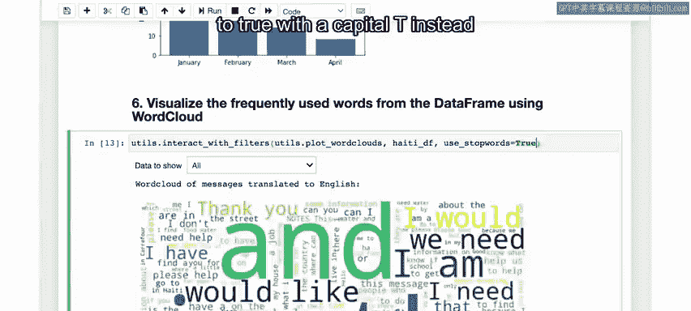

And try looking at the word clouds for different message types to see what you find。

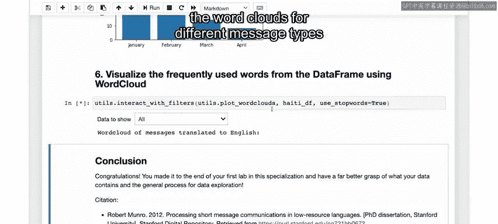

That's it for the explore phase of the lab here you looked at the data set to get a better sense of what it contains and what some of the characteristics of the data are you saw that different categories of messages seem to naturally break into groups when it comes to the content of the messages when they were sent and whether or not they were related to the disaster so it looks like it will be worthwhile to head into the design phase with this project and do a deeper dive into the data and start to look at how you might model different topics。

Before that， however， you'll complete the Exp phase checkpoint to make sure that you've got what you need to head into the design phase。

 join me in the next video for the Explo phase checkpoint。

