# 吴恩达《AI for Good专业课程》 AI与公共卫生、气候变化、灾难管理｜中英字幕 - P111：29_主题建模探索阶段检查点.zh_en - GPT中英字幕课程资源 - BV13u411F7xZ

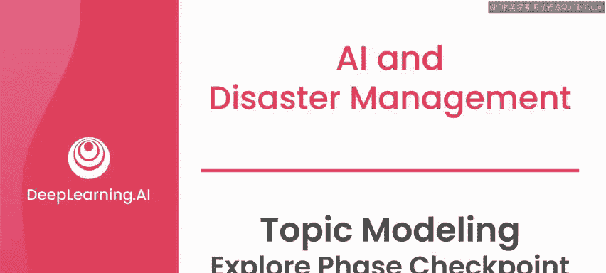

In this lesson， you've been exploring a scenario where you are part of a group of individuals and organizations studying disaster response and recovery to better prepare for future disasters。

The case study that you're exploring is the response and recovery after an earthquake in Haiti in 2010。

 as recorded in text message communications sent after the earthquake。

At this point you've identified the stakeholders to your problem statement and explored a data to determine where it looks like AI might add value in this project。

 just like in the previous case studies in these courses。

 the questions that you and your team would need to answer at the end of the Exp phase are。

 what is the specific problem that you are addressing who are the stakeholders。

 do you have access to or can you collect the necessary data， can AI add value。

 where and how specifically and how does the Juno harm principle come into play here？

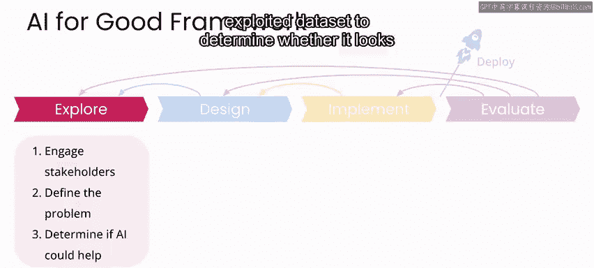

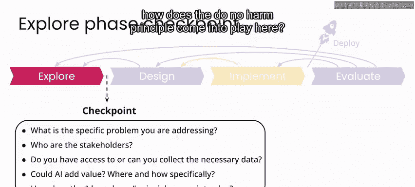

In this case， the specific problem you are addressing is people impacted communities and aid organizations want to understand how requests for a change over time following a sudden onset disaster in order to better plan for future disasters anywhere in the world the stakeholders for your project are members in impacted community as well as the community you hope to serve in the future。

 individuals who have worked on related solutions in the past。

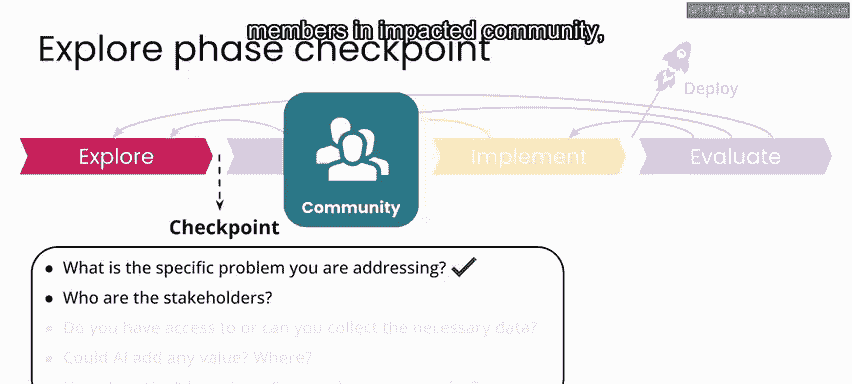

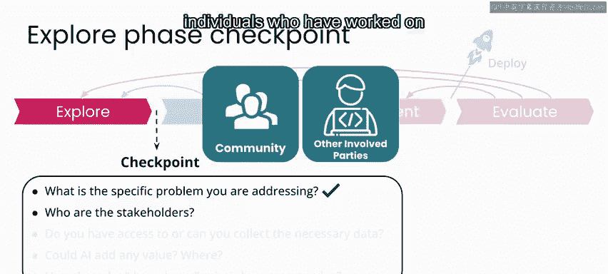

Organizations that are likely to be involved in response and recovery efforts and companies that maintain the communication platforms that people are likely to use。

😊。

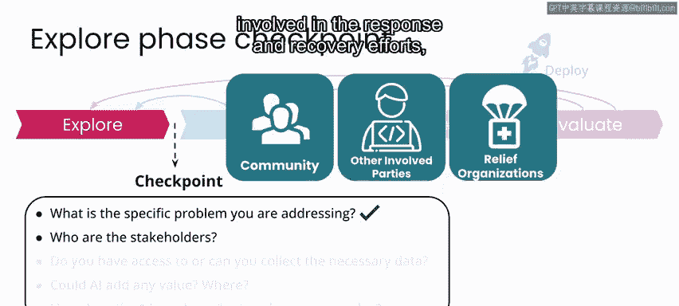

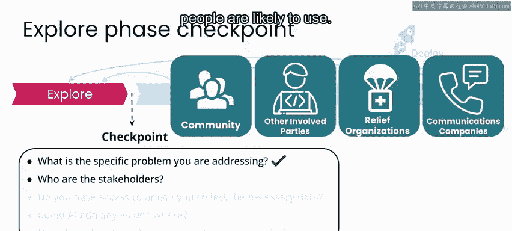

This problem statement and list of stakeholders are defined in a fairly general sense here。

 but as we said above， you can imagine working on a project like this with a specific low resource language community in mind and depending on where that community is located and what kind of disasters they might anticipate experiencing。

 you could customize this list of stakeholders further。

The data that you plan to use has been curated for research purposes and looks to be well suited to the task of tracking how requests for aid are changing over time。

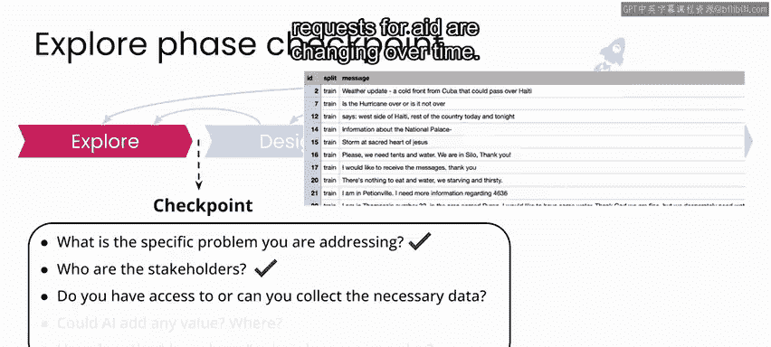

In your exploration of the data， you found that messages seem to naturally separate into groups or topics based on the message content and so it looks like it will be worth exploring some natural language processing techniques to model how these topics evolve over time In this case。

 the data has all personally identified information removed as well as the specific geolocation of each message。

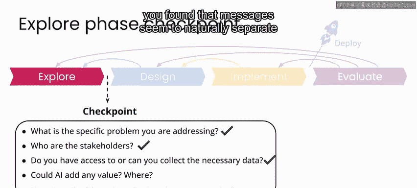

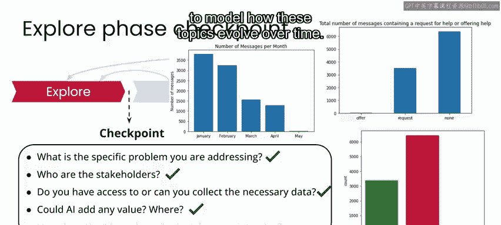

And it was the Haitian community themselves who decided what should count as personally identified information in this context in any sort of reward application with similar kinds of messages。

 both the personally identified information as well as the location of individuals sending in the messages would likely present the potential for harm to be done but in this particular case there is not this risk one area that this could cause harm is in applying it to future disasters so the main risk here would be that because the goal is to inform future planning for disaster response and recovery and any future disaster is sure to have unique elements and challenges that may not be present in the past that you're trying to study。

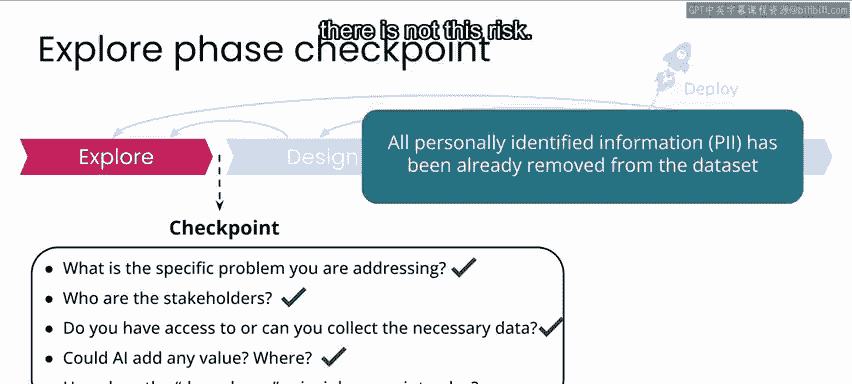

So for example， even if you created a detailed thoughtful plan for response and recovery to a disaster based on the experience with the data from Haiti。

 your plan may fail to solve or even amplify problems in a new disaster scenario with different challenges present。

So with all this in mind， you're ready to move into the design phase where you'll start experimenting with some natural language processing techniques to carry out a deeper analysis of your data I will see you in the next lesson to kick off the design phase。

