# 吴恩达《AI for Good专业课程》 AI与公共卫生、气候变化、灾难管理｜中英字幕 - P112：30_处理文本数据.zh_en - GPT中英字幕课程资源 - BV13u411F7xZ

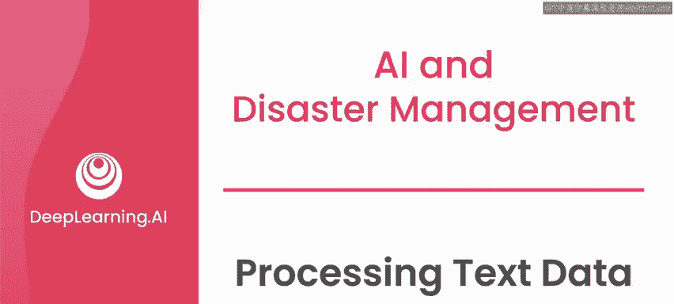

You are now in the design phase of the Haiti TMes Project where you're looking to analyze the messages in your data in an effort to determine how requests for things like information。

 aid， and other needs evolve after the earthquake。The steps you'll focus on in the design phase for any project are prototyping your data and modeling strategy。

 addressing any privacy and security issues， and designing the end user experience for your product。

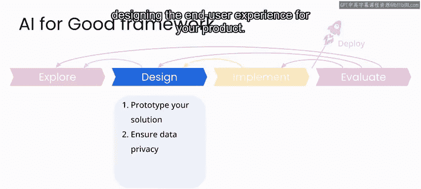

This case study is a little different to the other case studies that we've looked at in these courses and that you work with a highly curated。

 more academic data set and you won be developing a software product and so we are less worried about the security of data going forward and you'll be thinking about rather than building a platform or a product with user experience in the future instead presenting results as part of an after actionional report on the disaster response efforts。

In the project so far in these courses you work with dataset sets made up primarily of numbers or images in this project you work with text data and so you'll be applying techniques from the field of natural language processing or NLP for short。

 NLP is a field of study that combines linguistics。

 computer science and artificial intelligence to enable tasks such as language translation。

 sentiment analysis， text generation， summarization or search engines My PhD was in the Stanford NLP lab and my dissertation actually included analysis or the data that you're working on in this project。

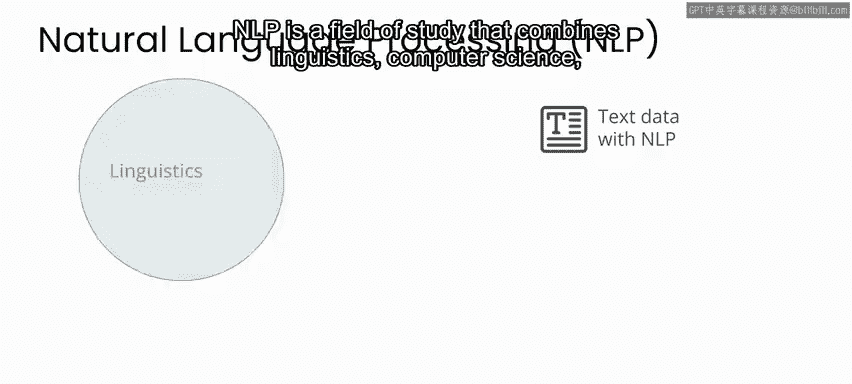

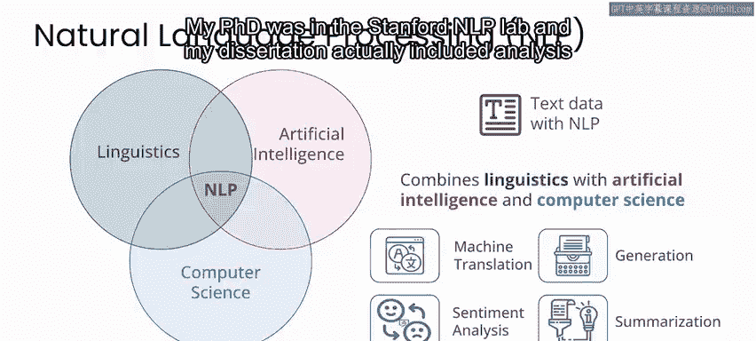

In you'll work in the design labs with this project。

 you'll be working with a technique called topic modeling where you aim to model a set of distinct topics in a corpus of text data so for example if you imagine you had a bunch of news articles as your corpus of text data and some of these articles related to science。

 others were related to food and still others might be related to sports then with the topic modeling algorithm you could train a model to essentially discover these different topics in your data and what specific words in those articles most readily identify them as being associated with one topic or another In fact you won't necessarily even need to know ahead of time what the topics are or depending on how you approach it how many topics your text data actually contains。

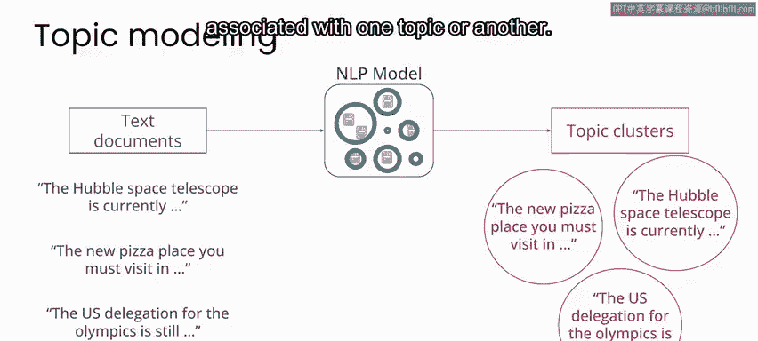

You instead include a step in your analysis to discover the topics and the right number of topics in your corus of documents and explore further to determine what characterizes each of these topics and so that's what you'll be doing through the next lab。

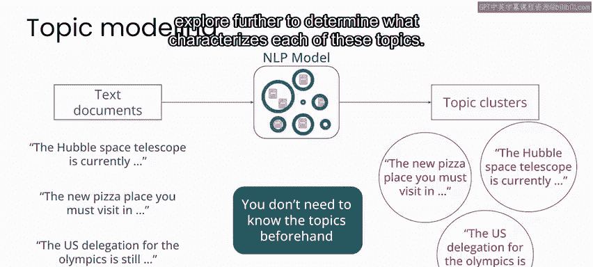

You'll first process the text message data to prepare it for analysis。

 and then you'll apply a topic modeling technique to discover the main topics in the data。

The next lab will be focused on processing and preparing your data for analysis。

 so I'll give a little introduction here about how that works and then we'll jump into the lab itself。

To understand how you're going to process the text data。

 you can first think intuitively about what you're trying to accomplish here。

 you're hoping to be able to group different text messages by their content。

 so you need a way of being able to compare the content of different messages。

One way to compare the content would be to simply read the individual messages and look for similarities of differences。

As a human you could read the text to different messages and compare them directly like here you have three similar messages regarding the need for things like food。

 water and other assistance however your aim is to have an algorithm look for the similarities or differences between text messages so you can discover these similarities over a scale that is difficult for purely manual human analysis。

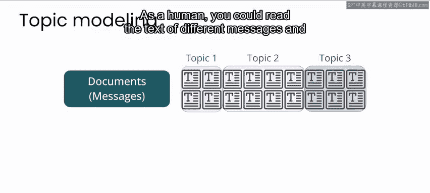

So for example， you have the word food in each of these three messages as a human it's easy for you to recognize that the same。

 but to an algorithm， these aren't necessarily words are just digital representations。

 and so unless you're accounting for it， food in all lowercase is going to look different to an algorithm from these two other versions of food。

 one of which is in all caps and one of which is in title case。😊，Similarly。

 your algorithm isn't going to automatically recognize verbs in different tensesors。

 so need and with the suffix needing， where they clearly indicate the same thing here。

 are not going to look the same to your algorithm again unless you're able to break a word up into its components。

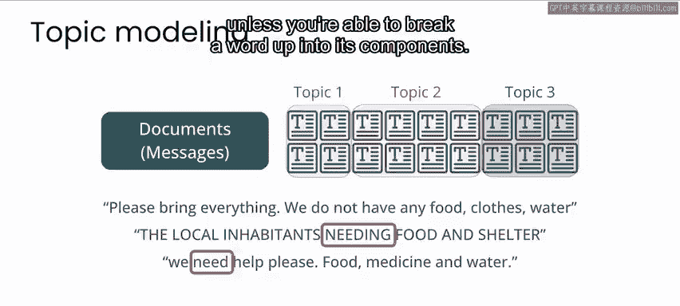

To handle these examples， you'll process the texts into what are called tokens。

 and you can think of these as cleaned up versions of the words to make it easier for an algorithm to smooth over differences in things like suffixes。

 prefixes and capitalization。So the first step will be to separate the words from any leading and trailing punctuation into a list like this。

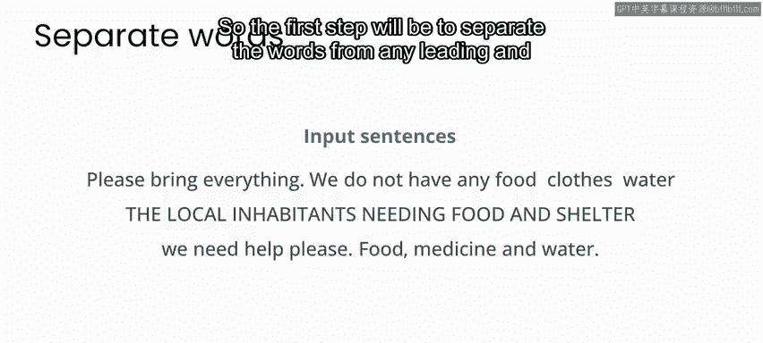

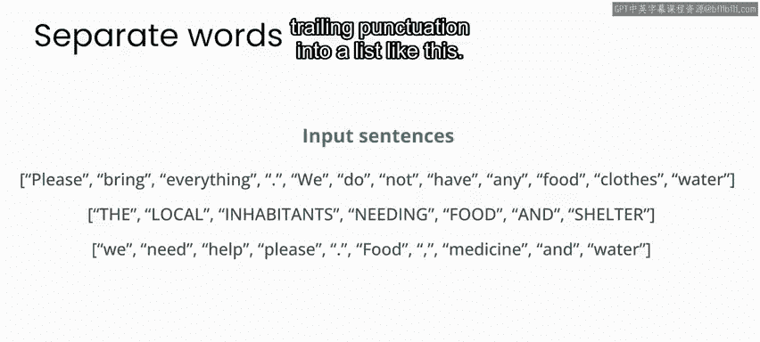

Next， you'll drop all punctuation since you are interested in considering punctuation in the meaning of the text here。

After that， your lowercase other letters such that now all three instances of the word food in this case look exactly the same。

Then you'll remove what are known as stop words which in English at least are words that tend not to add any meaning to statements。

 so words like the and and that don't necessarily add meaning will be removed at this stage。 Finally。

 you'll perform a step calledleitization， which is just a fancy way of saying you're removing the prefixes and suffixes from other the words down to which root form So for a concrete example。

neing will become need through leitization and then both of these will appear as the same instance of the wordne。

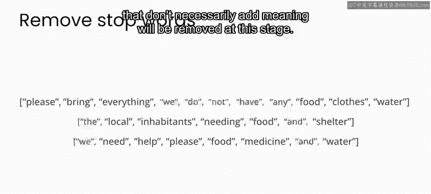

So what you're left with are the tokens for each message now you can use an algorithm to compare tokens directly between messages and look at things like how frequently words appear and what words tend to appear together。

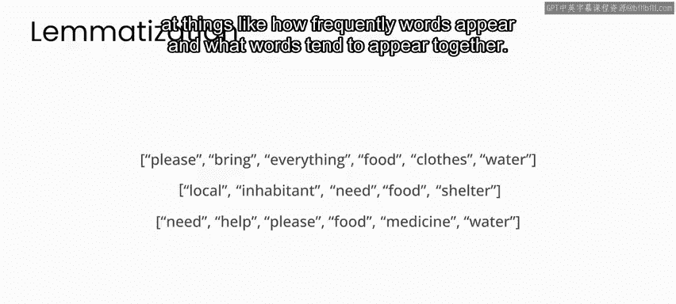

This kind of normalization of the data is very common in text processing and you can probably imagine that this is a very simple way to do it and you can lose information there are cases where capitalization is meaningful there might be instances well what we're calling stop words will impact the meaning as it changes back and forth and if you speak another language you're probably already aware that languages other than English tend to have more prefixes and suffixes and they tend to carry more meaning than they do in English as a result and so we're not going to go into the finiter details of how you would process a language other than English in this scenario just know that this is something that's very important and very hard to deal with once we go out of a very standardized language like English and so that's where we're headed next generally in the next video today。

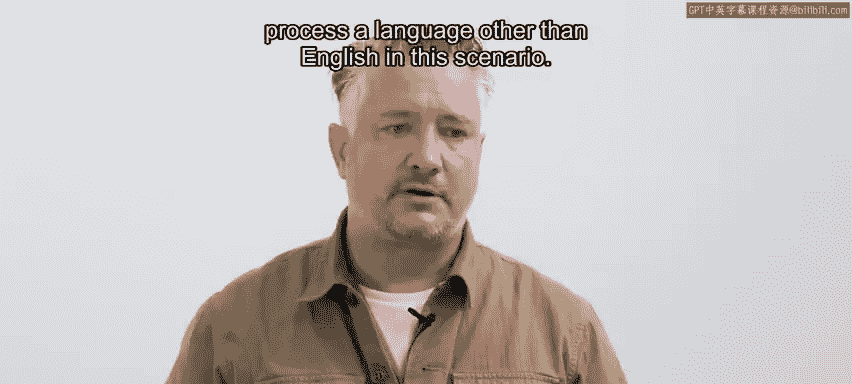

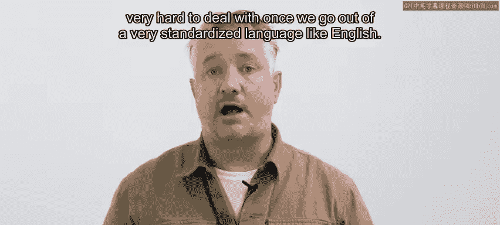

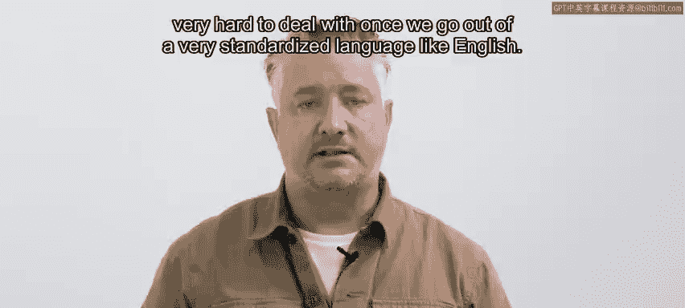

Inter the lab on text processing。