# 吴恩达《AI for Good专业课程》 AI与公共卫生、气候变化、灾难管理｜中英字幕 - P113：31_主题建模处理文本消息.zh_en - GPT中英字幕课程资源 - BV13u411F7xZ

In the last notebook， you explored the data set of text messages sent following the earthquake in Haiti。

 and in this notebook you will now apply the text processing steps that we looked at in the last video to prepare your data for modeling。

Here again， at the top of the notebook is a link to the Gitthub repo where the data came from。

And you'll start， as always， by importing the packages required for this lab。

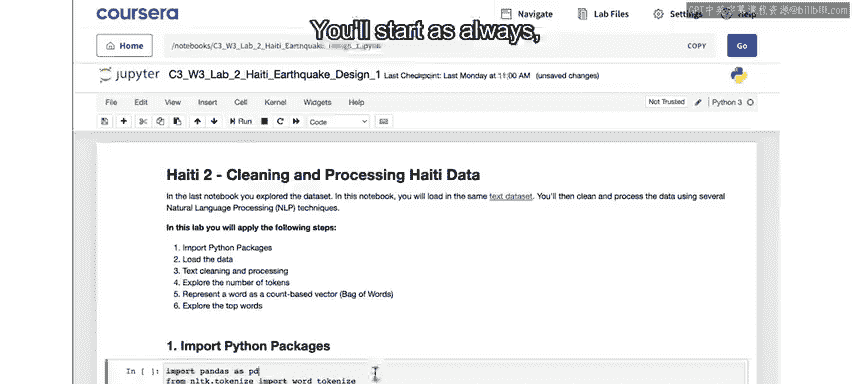

Then you'll run this Excelel here to load the data。

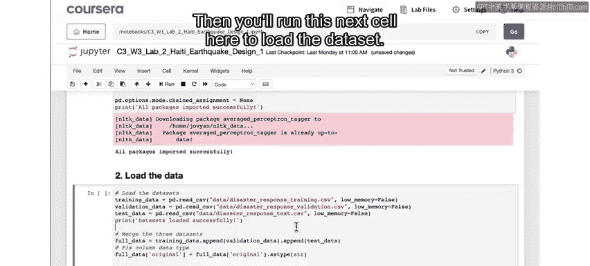

Here again， you're loading the entire data and then filtering down to just the text messages sent following the earthquake in Haiti。

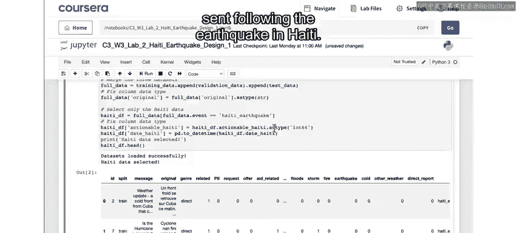

But you can change this filter to look at the same analysis for other events。

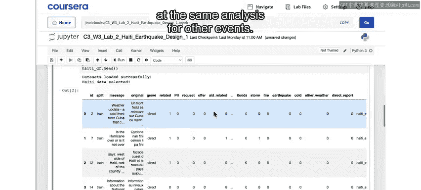

And then you're printing out the first few lines of the data to see that everything looks like it was read in OK。

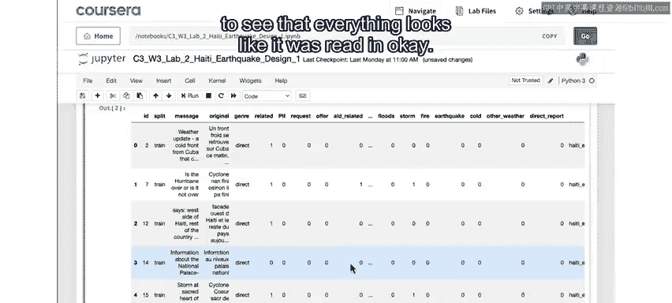

The next cell is set up to run all the steps we looked at in the previous video。

Which was tokenization， removing punctuation， lower casing， removing stop words， and lamatization。

You can use these pull down menus to choose from different message types like you did in the last lab and each time you choose a different type。

 you'll see how other messages look as you run through each of these steps。

So you can see here that with tokenization， it is more or less broken up the text into the different words。

 although in a handful of cases it might break words apart and remove trailing punctuation lower casing is as it sounds moving capital letters or rather converting them to lowercase letters。

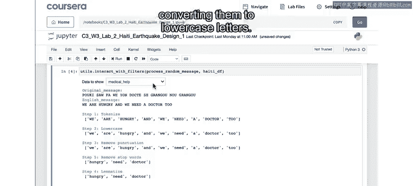

Punctuation removes any token that is fully punctuation。Stop words， removes those words in English。

 which are often very frequent but tend not to carry too much meaning。

 and thenlematization reduces the words by taking away different prefies or suffixes。

 which themselves in English at least tend not to carry a whole lot of information。

Tt in these steps on different messages to get familiar with this process in pipeline。

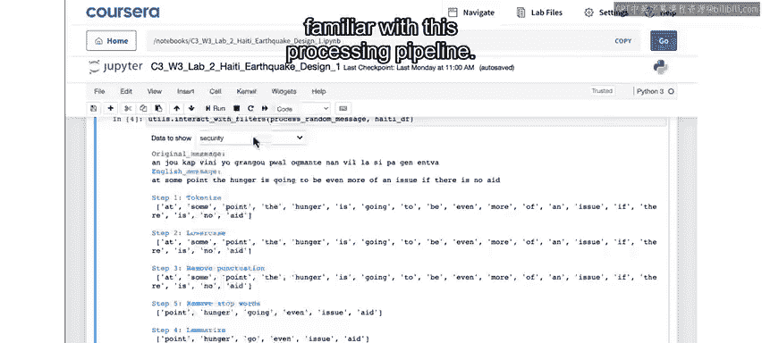

For the stop Word step here you're just applying a standard list of English stop wordss。

 words like the and E and so on and it's often the case in text processing that you'll find you want to exclude additional words beyond this standard list and if you have a look at the UTLs file you'll see that we've extended the standard list a little bit more here based on the content of these messages。

You'll also have a chance to remove additional stop words in the next lab。

When you're run this N cell。

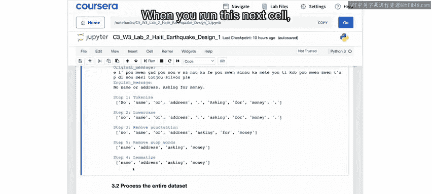

You'll apply the process and pipeline to the entire data and create a new column in your data frame called Message tokens。

 where you'll store the list of tokens for its message。

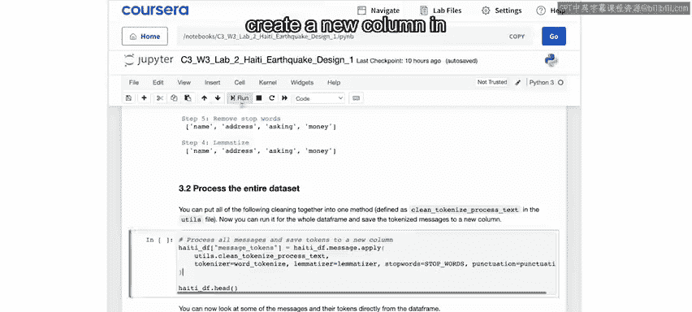

If you look at the original message column alongside the message tokens column。

 now you can see how each message was converted into tokens。

runun this next cell to look at examples from different categories of the initial messages。

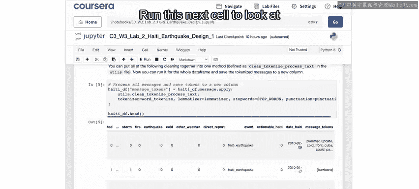

And the process tokens。

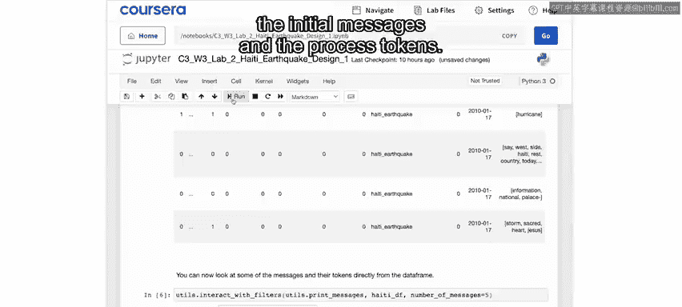

Again， you can choose different categories from the pull down menu to look at different examples。

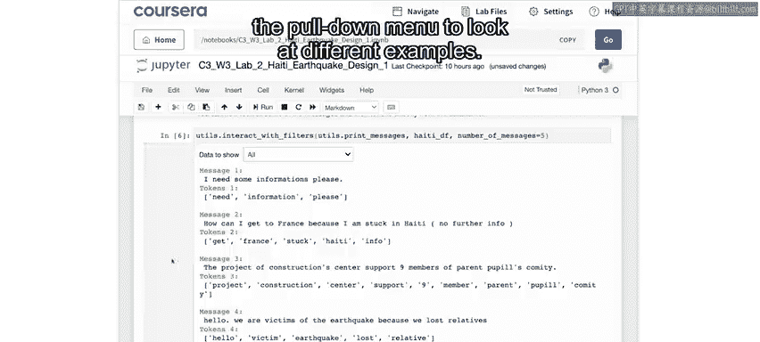

It's also interesting to see how many tokens were generated from each message。

Here you're adding another two columns to your data frame。

 one with the count of the number of words in the original message and another with the count of Tokens F's message。

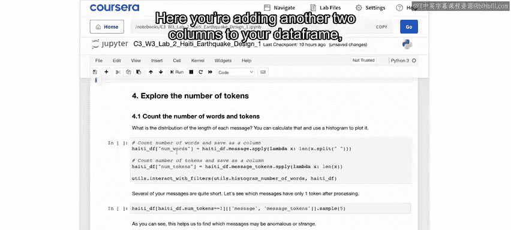

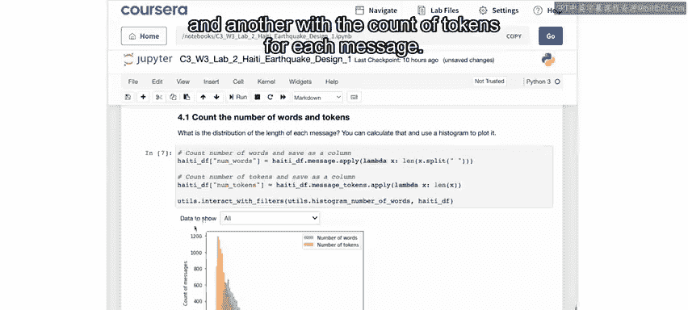

Then you'll plug in a histogram of the number of words and the number of tokens。

You can see that in general， the number of tokens is smaller than the number of words。

 but it's different in each case。

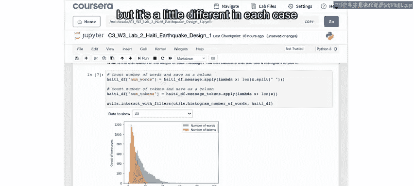

Again， you can visualize this for different types of messages。

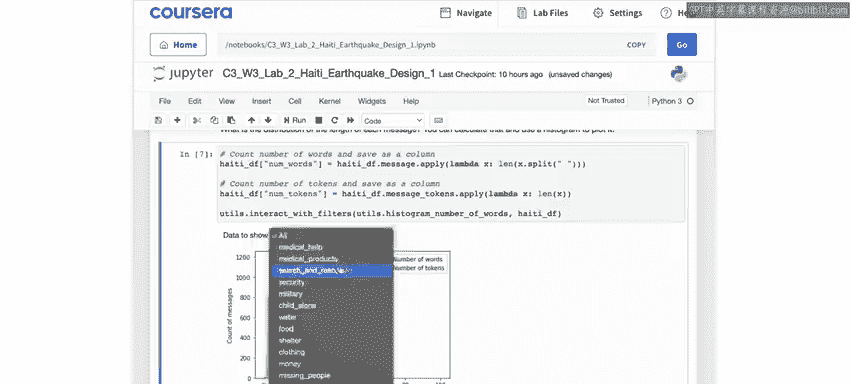

Interestingly， there are a number of messages that have been reduced just one token。

 You can have a look at those by running this next cell here。

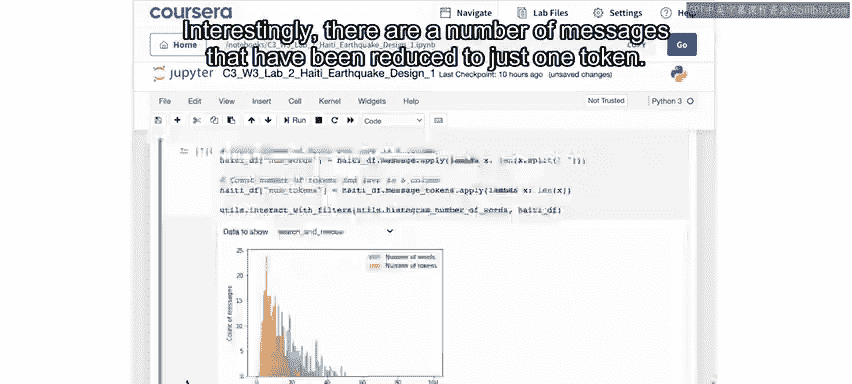

And this just prints a sample of five sets messages。Each time you run the cell。

 you see another five examples。So you can see that in some cases。

 it looks like there's indeed just one word of interest like earthquake， but in other cases。

 the message just looked like noise。

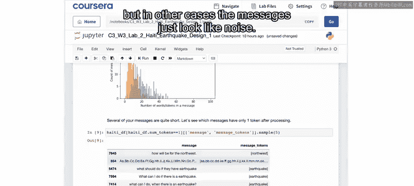

Next， you're going to turn each set of tokens into a vector or a list of numbers represented how many times each word appears in each set of tokens。

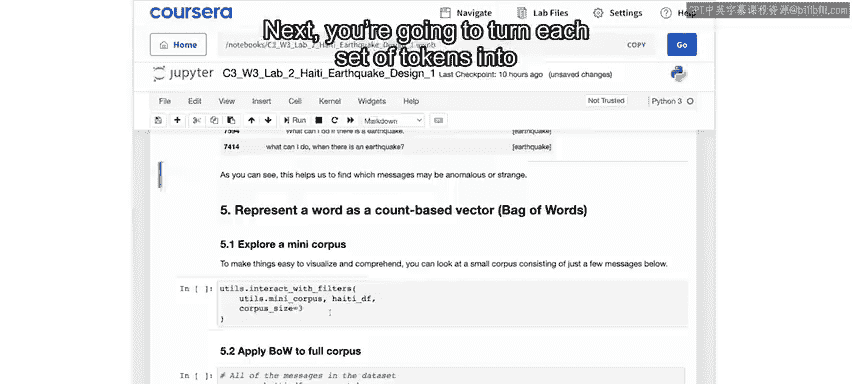

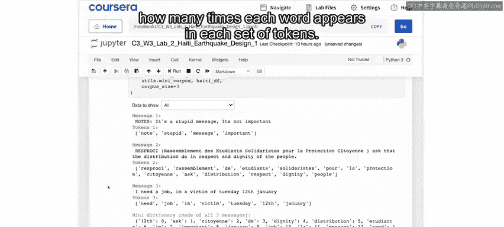

When you run this Excel cell， you'll see how this works for just a few messages at a time。Here again。

 you can choose between different message types to get a sense of what this additional processing step looks like。

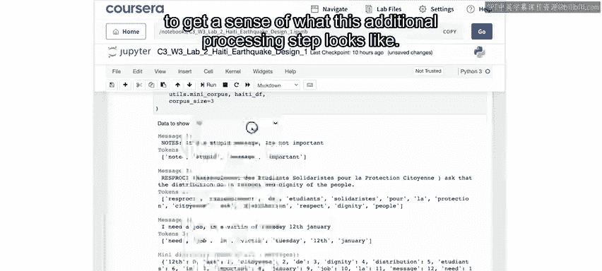

So here you have three original messages， which I'm calling your mini corpus。

 and the tokens those messages were converted to。

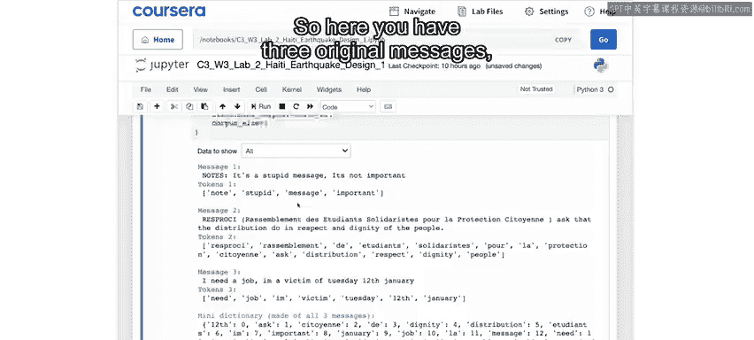

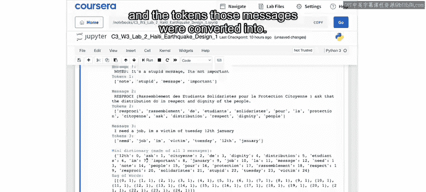

Next， you'll have what we're call in your mini dictionary。

 which is just a list of each of the unique words that appear the messages above with each one assigned to a number like this。

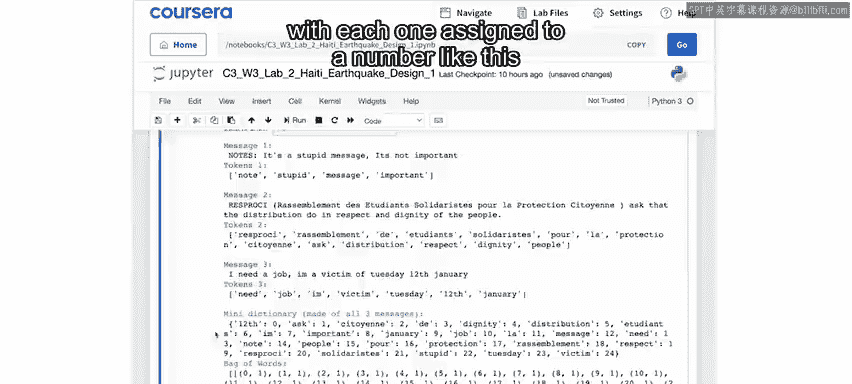

So here in this mini dictionary， you can see that area is given the index of zero， asthma1， blood2。

 drinkable 3， find four， etc。

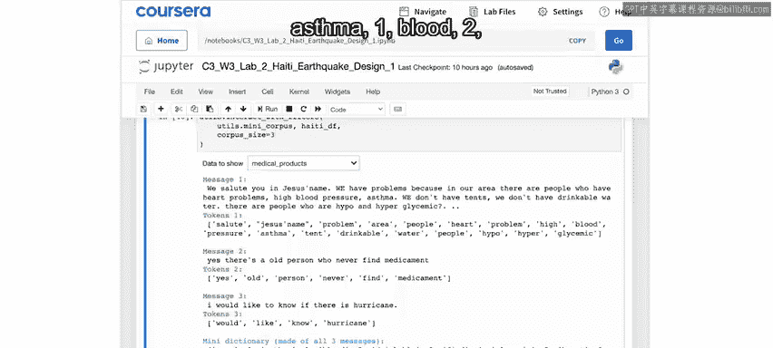

Then you use that mini dictionary to create a list of pairs of numbers。

 one number for each word or token。

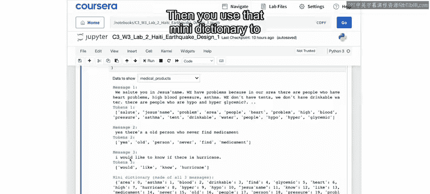

And then the number of times that word appeared among the tokens for all messages in your mini corus。

So in the human readable example here， you can see that most of these occur just once。

 although a handful like problem and people occur two times。

The process of simply counting up the occurrences of words in a set of documents for mini corpus in this case is known as a bag of words approach。

 so that's what I'm referring to here， although obviously this is a bag of tokens after we have removed stop wordss。

Basically， you're just preparing your data in such a way that you can know for your entire corpus of text。

 your entire bag of woods， as it were， how many times each word appears？

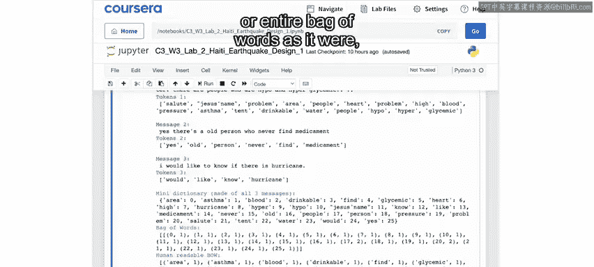

And finally， here you have the human readable version of the bag of words。

 where you have each word in the text and how many times that word occurred in the messages above。

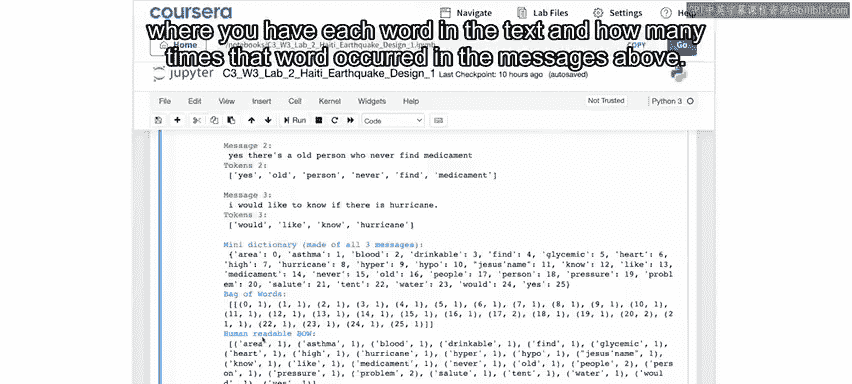

When you run this on the entire dataset， you'll have a different number associated with each unique token that appears in the corpus of messages。

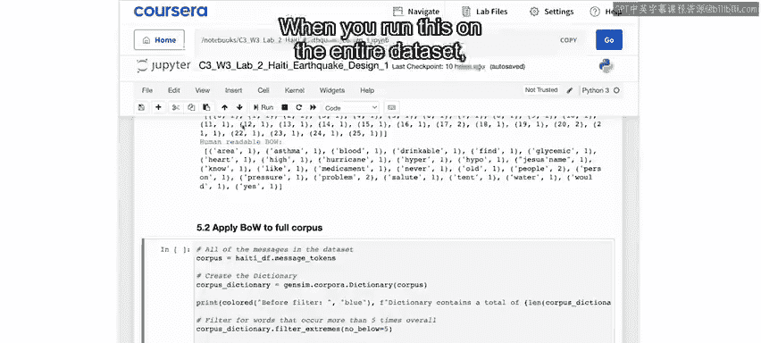

You can run this next cell to apply this technique to the full data set。

Now you can do things like look at the frequency of words or tokens across the entire data set。

And at the same time， you're reducing that list down to only words that appear at least five times。

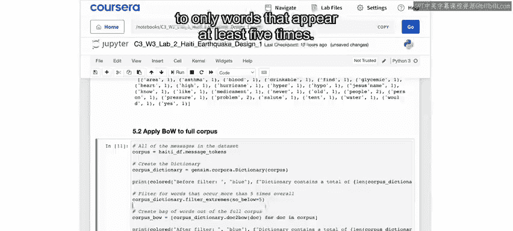

When you run this next cell， you're printing out a list of the top 20 most commonly occurring tokens across the entire data set。

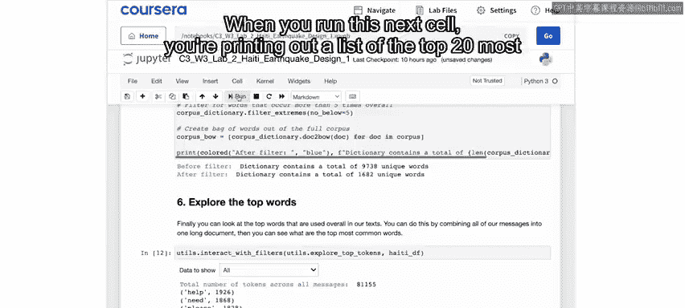

And so you can see here that these are help need and sadly pleased。

 people are very polite despite how terrible this situation was。

What you can see here is that in total， you have a little over 80，000 tokens in this data set。

Or on average， roughly  eight tokens per message， since we had about 10，000 messages to begin with。

You can choose from these pull down menus to see the top 20 words for each message type too。Next。

 you can run a word cloud visualization of the tokens for the different message types。

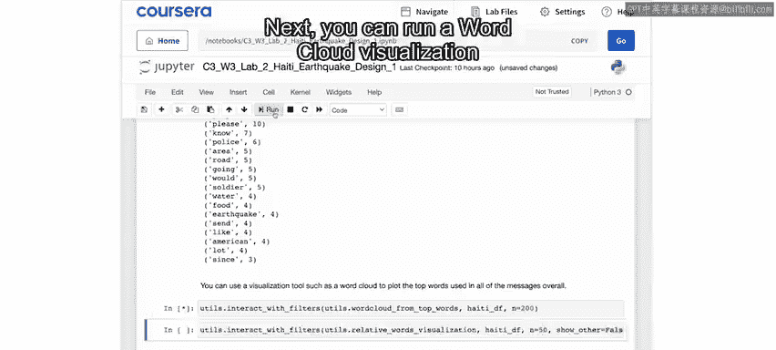

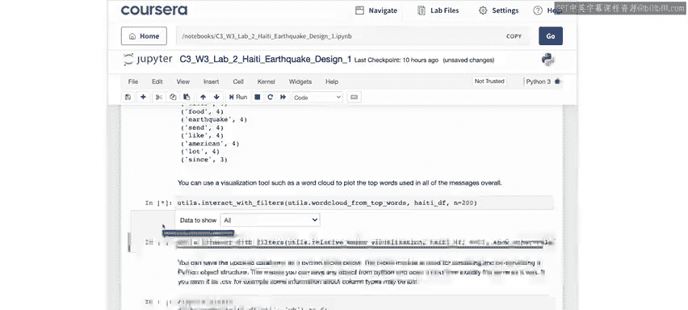

Notice that now your word cloud for different topics isn't dominated by words that it carry。

Very little content like and or the， as was the case in the previous lab。 This， of course。

 is because you filtered out the stop words in this analysis。And finally。

 you can look at the so called tree maps with different message types。

 where the relative area of each rectangle indicates how frequently a word appears in the data。

Here I'm showing the top 50 words， but you can change this parameter and up here to look at more or fewer words。

 if you like。

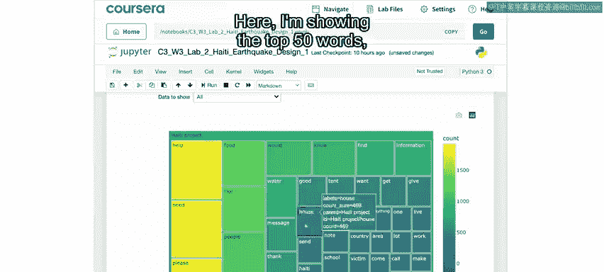

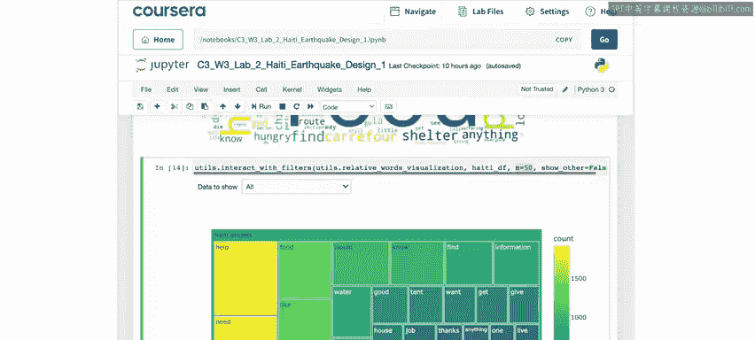

So again， the idea is to get a sense of what was characterized different categories and start to get a sense of what some of the broader topics in the data set might be。

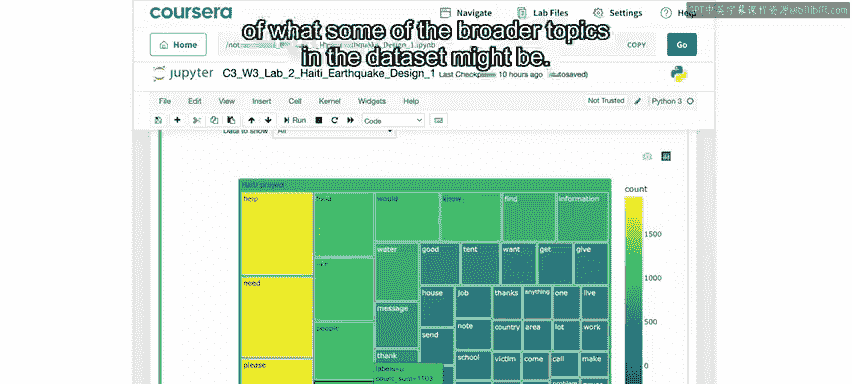

This last step that's coming out here is just showing how you can save your processed data set。

We did that for you and you'll pick it up again in the next lab， but if you cancomment this line。

 you can save your own copy here for this lab。

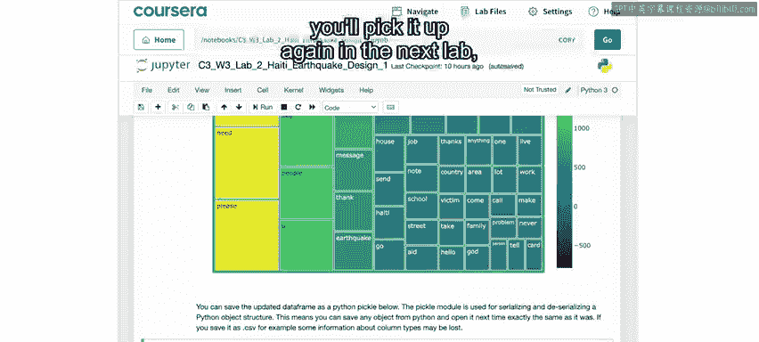

And that's it for this first part of the design phase。

 you've now processed your corpus of text messages into tokens and then taken the additional step to represent those tokens as vectors。

 and this will help you look at the relative frequencies of words across different message categories。

Next up， we'll get started to building a model， so join me in the next video to begin modeling the topics in this data set。

