# 吴恩达《AI for Good专业课程》 AI与公共卫生、气候变化、灾难管理｜中英字幕 - P114：32_主题建模潜在狄利克雷分布.zh_en - GPT中英字幕课程资源 - BV13u411F7xZ

In the previous lab， you prepared the text data for modeling by converting the words in each message into tokens and then counting up the tokens to model the entire corpus of text messages。

In this lab you'll apply a technique known as latent Durslay allocation or LDA for short。

 and you can think of LDA as a method for running a statistical comparison across your corpus of documents。

 in this case， text messages。With this method you'll be able to group messages that are statistically similar in terms of the relevant words or more specifically the tokens that they contain。

 so let's jump into the lab and see how this works。First off， at the top here。

 you can see there's a blog post explaining the LDA algorithm if you're interested to learn about it in more detail。

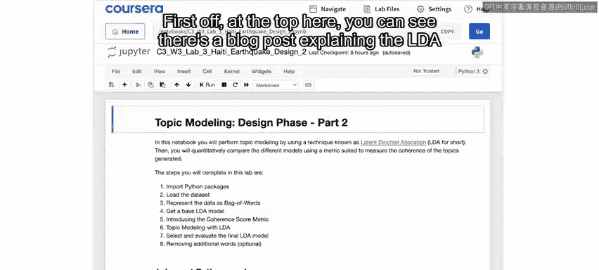

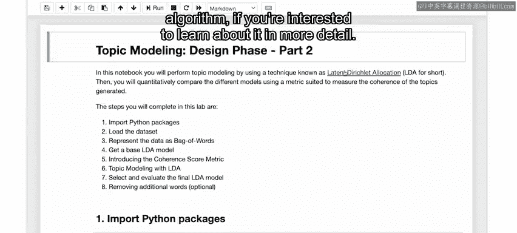

You'll start as always， by running this first cell to import all the packages required for this lab。

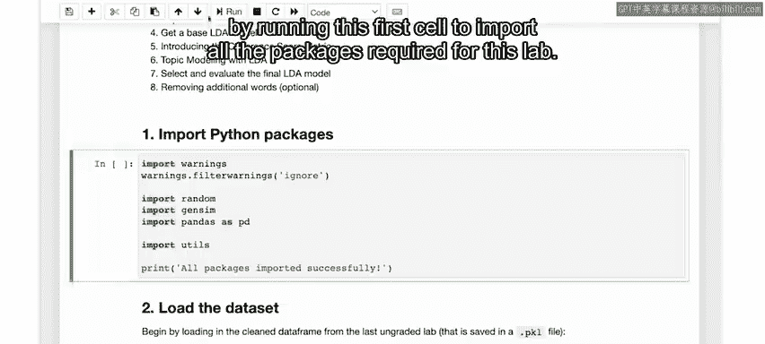

When you run this next cell， you'll load the data， including the process tokens that you prepared in the previous labva。

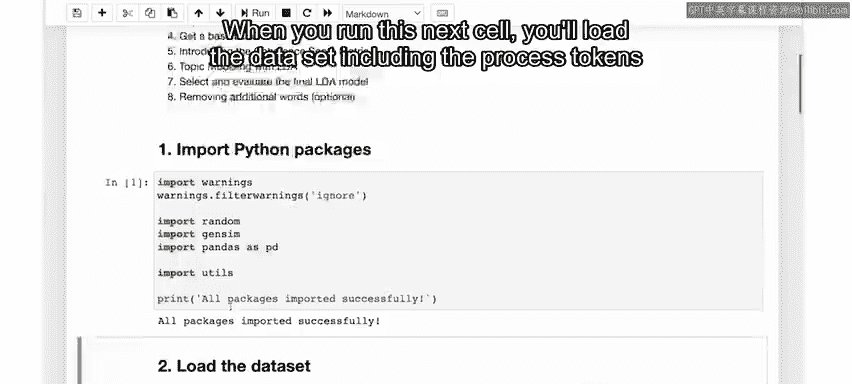

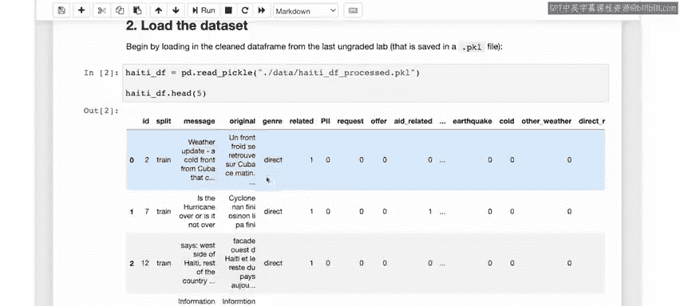

And next， you will again convert your corpus of tokens into a bag of words representation。

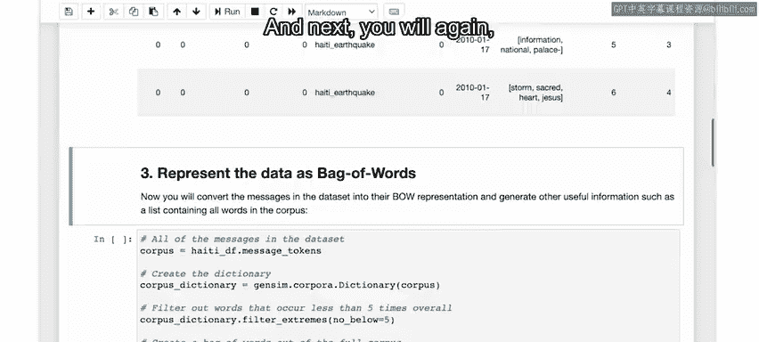

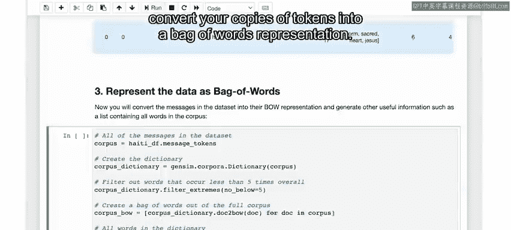

And this just means assigning a number to each unique token in your data set so that the LDA algorithm can take advantage of it。

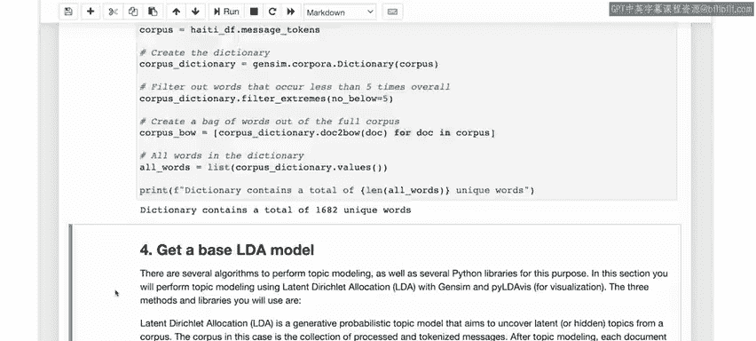

With this next cell， youll run the LDA method on your data。

 in this case specifying that you want to model the data as containing two topics。With LDA。

 you typically hard code the number of topics， but we'll also be looking at how we can work out what an optimal number of topics might be。

The output here is showing the most common words that occur in the topics that the model identified。

Note that you haven't specified anything about what you want the content of these topics to be about。

 you've GS run a model to separate the data into two topics based on the statistical similarities and differences between the messages in the data set。

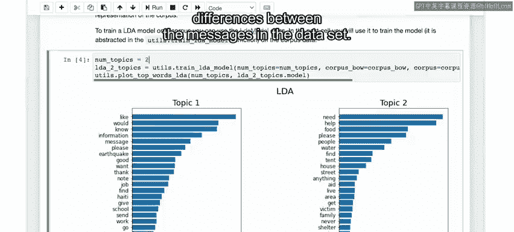

Next you'll look at something called the coherent score for different collectionions of words there are some links here to learn more about the coherent score if you're interested。

 but the takeaway is that this is a measure of how consistent or how good the topics are that you've identified。

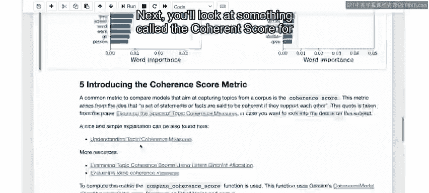

And there's a long literature about the pros and cons of using coherence for measuring the quality of topic modeling that I encourage you to read if you're interested。

The way that current is measured at a high level is by computing an estimate of the similarity between the most frequently occurring words。

So in general， the score is a negative number and numbers closer to zero indicate a higher degree of coherence or in other words。

 a better model。Also， you get just one measure of the coherence， no matter how many topics you have。

 So in this case， two topics。But you could run this for more as well。 And you'll do that below。

To visualize how this works， you'll compute the coherence for the top 10 words of each of the two topics you identified in the previous modeling step and then compare that with a coherent score for a random list of words from the data set。

Each time you run this， you'll compare against a different random set of words and what you'll find is that the coherence of the top words in your model topics is much closer to zero than for random words。

So this indicates your model topics are much more coherent than a random collection of words。

And this is just a good sanity check to make sure that you've built your data pipelines correctly and you are creating meaningful and not semi random topics。

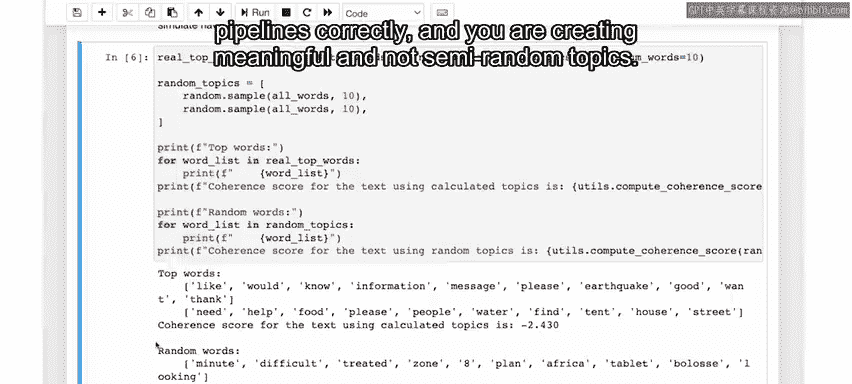

As I mentioned， you can also run models for a greater number of topics。

 and that's what you'll do with this next step。 So here you'll generate models ranging from two to six topics。

And like with previous labs， you can see that we'll speed this up a little for you in the video。

 It'll probably take about a minute in total。Once that's finished。

 you can visualize the results of top words for each topic and the coherent score for each model。

So here I can see the for a model with two topics。The coherent score is about negative 2。43。

 and the top wears for each of those two topics。listeded here in the order of relative frequency。

 you can then use this pull down menu to look at the coherent score and the top words for models with the different number of topics。

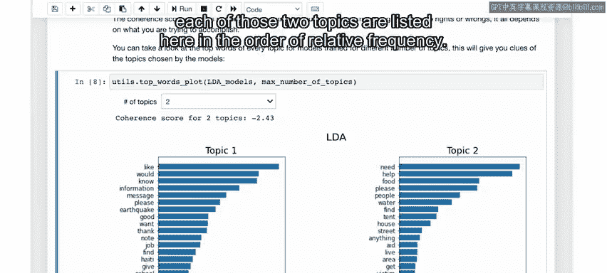

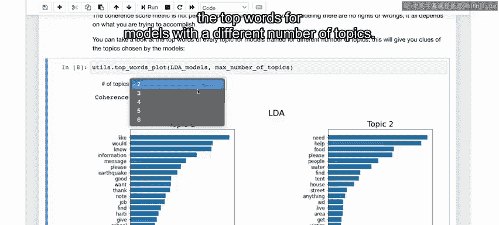

When you run this next cell， you'll generate a plot of coherent scores versus number of topics for each of the models that you generated above。

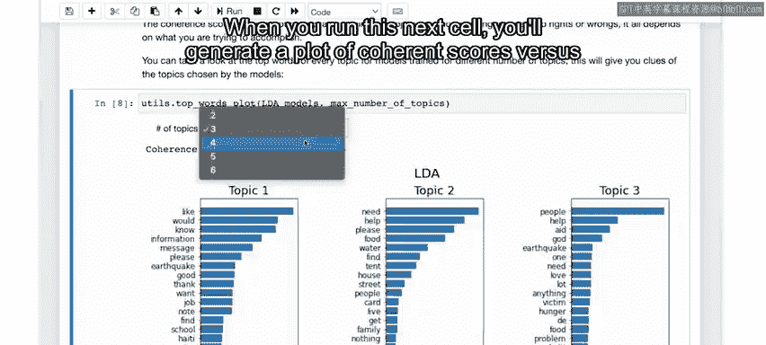

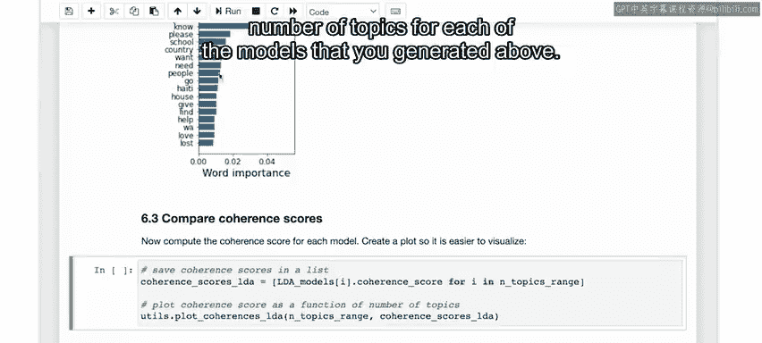

Again， better models will have a higher， less negative score。

 so here you can see that it looks like two topics remains the best model in this case。

To proceed with the analysis below， you can indicate a number of topics and select your final model。

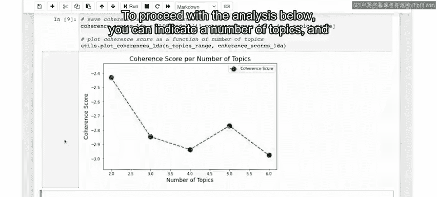

So here I'll select two topics since that had the best coherent score。

 but you could also look at other numbers of topics， and then here again。

 this is showing the top words for the two topic modelss。

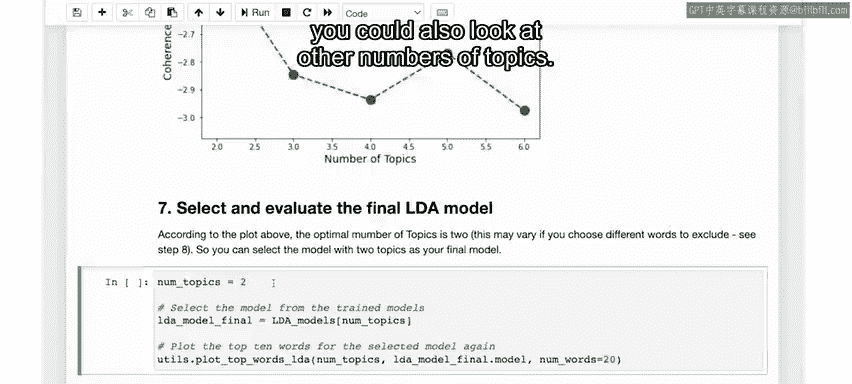

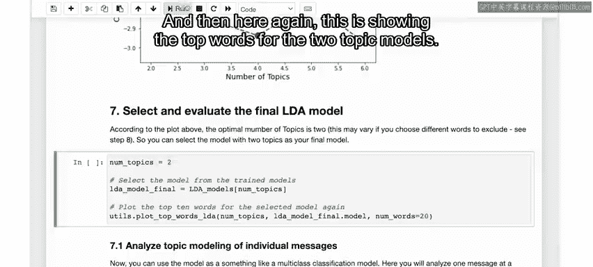

To get better a sense of how individual messages break down between topics。

 run this next cell to compare the relevance across topics of a single message。

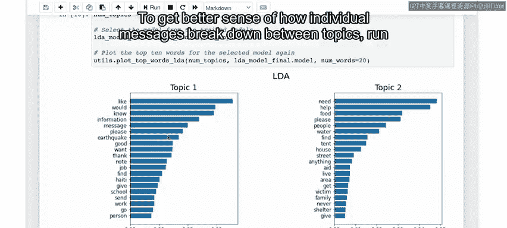

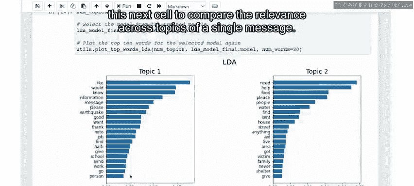

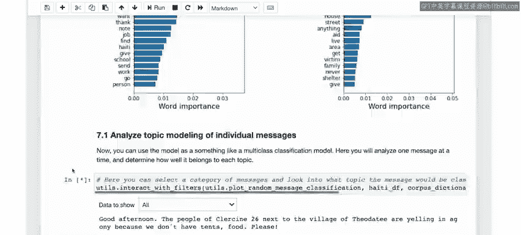

So here what you're looking at is a plot of how strongly a particular message is associated with each topic in your model。

In this case， the message is about people in a certain area who lack resources。

And it's much more closer related to topic one than to topic two。

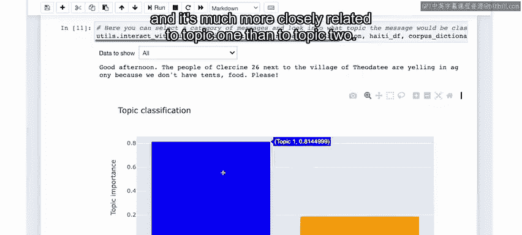

Try this for some different message types to get a sense of how they relate to the different topics。

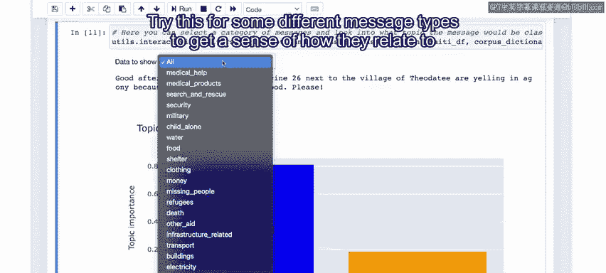

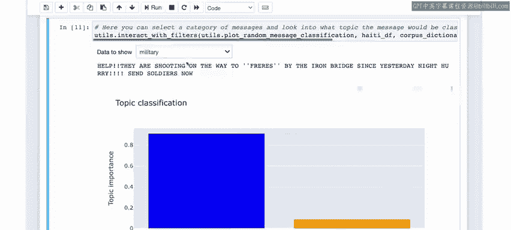

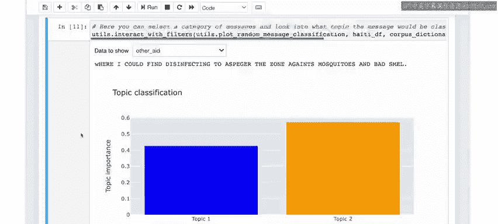

Next， you can plot how these topics change over time by running a cell here。

This plot is showing the relative importance of each of the two topics over time。

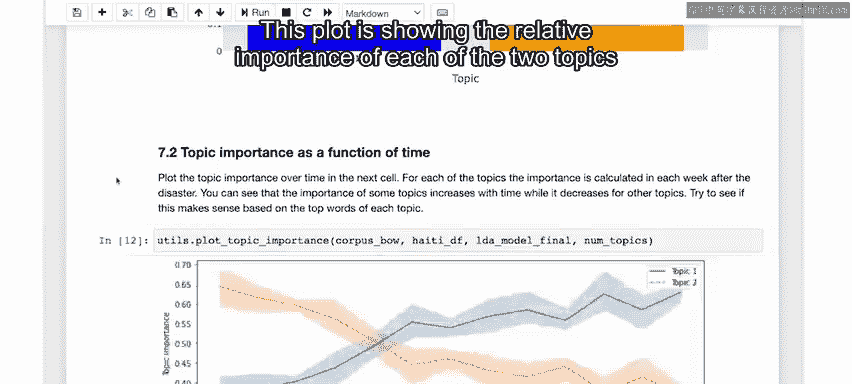

So in the X axis here， you have days after the first messages were received。And on the vertical axis。

 you have the relative importance of the two topics。

The way this is calculated is that messages are grouped together by week。You could do this per day。

 but grouping per week provides better smoothing in the statistics。

Then you're evaluating all the messages with your model to determine how much they related to topic one versus topic two。

 just like you did above， but now for the whole week of messages。For each weakerick of messages。

 the average relevance or importance of each of the two topics is plotted here。

 and the shaded error margin shows two standard deviations around that mean。

So here it looks like you have a clear signal that immediately after the disaster。

 topic two was much more relevant than topic one。Looking back up at the top words for these topics。

 this starts to make some intuitive sense as in topic two the most common words were things like needed help。

 food， water， aid and shelter， well in topic one， you have things like no information。

 job school and work。

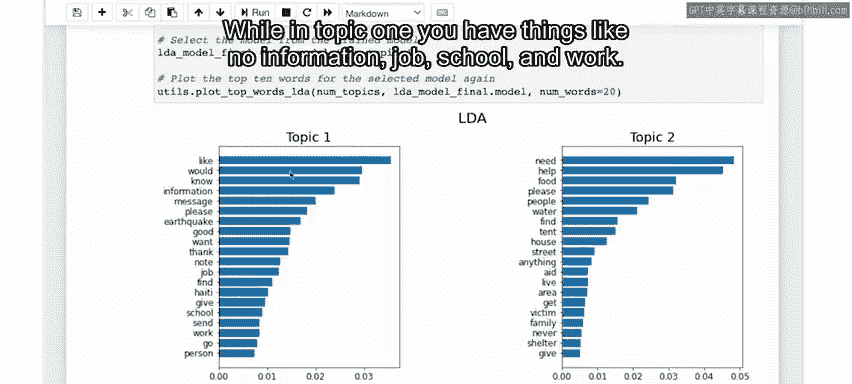

Looking back down at the plot over time， it looks like topic two became less the focus over time while topic one grows。

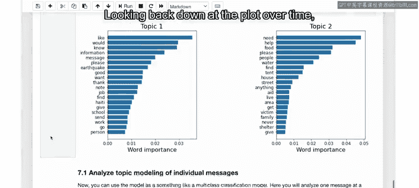

Somewhere around maybe a month after the earthquake。

 topic one actually overtakes topic two in relevance。And by three months later。

 topic1 is much more in people's mind than topics than topic 2。

What do you think might be good names or scriptures for these topics。

 so I think you could maybe classify these into something like long term needs versus urgent needs。

Or response related topics in topics two versus long term recovery topics in topic one。

This is of course just the first pass at modeling this out。

 but having this sort of basic information about how need to evolve in in the weeks and months after a disaster can be very helpful to responders and organizations working in disaster response。

And for me personally， while I'm not surprised that the information changed in this way。

 this is actually a more accurate indication of how the needs from the population has changed than than the one that I had seen before before working on the lab for this course。

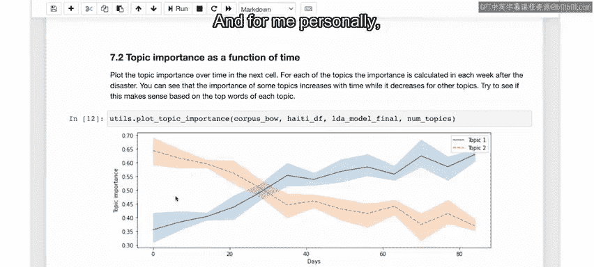

So hopefully this is also a good indication that you might be able to discover trends or even like specific topics in data that people have missed before in such a way that you can help disaster responders better understand the needs of the communities that they're trying to help。

Now， as an optional extra piece here， you might have noticed some words in the top words above that didn't seem particularly relevant。

So if you're interested in exploring further， you can use the list here。

 I've already suggested a couple of words like and would that you might consider adding to the stop words that is might consider removing。

And you can add more words here on the list， just put them in single quotes like this and separate them by a comma。

Then run this code cell to remove those words from your dictionary。After that。

You can go back up to step six here and run the code again to train a new set of models。

 When that runs， just keep running down through the notebook cell by cell and see what you find。

You might discover that by excluding certain words。

 you can discover that a different number of topics seem optimal。

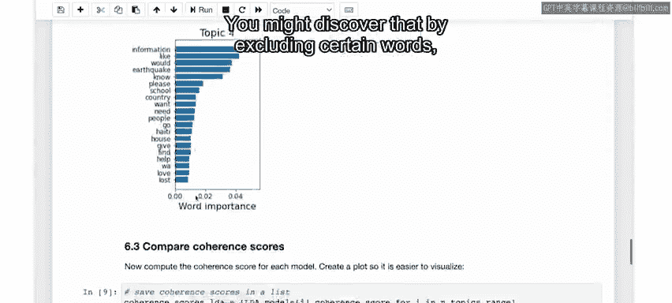

And potentially identify different kinds of trends over time。

And if you want to start again from scratch， you can start all the way back up at step 3。

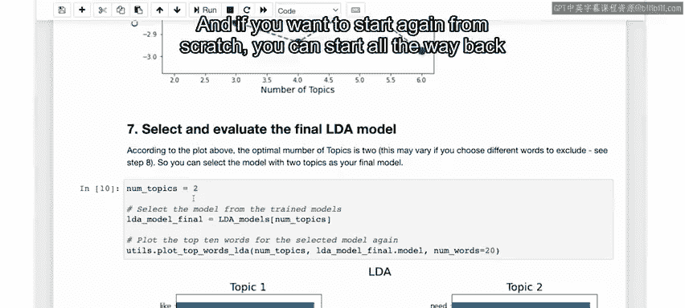

To recalculate your bag of words from the original data set。

That's it for the labs of this project here you applied LDA to model topics within your data set and with the topics that you identified you're able to classify the messages from the data as relating to things like urgent needs versus longterm recovery and you are able to see how the volume of messages regarding each of those topics relative to each other evolve over time Join me in the next video we will wrap up the design phase of this project。

