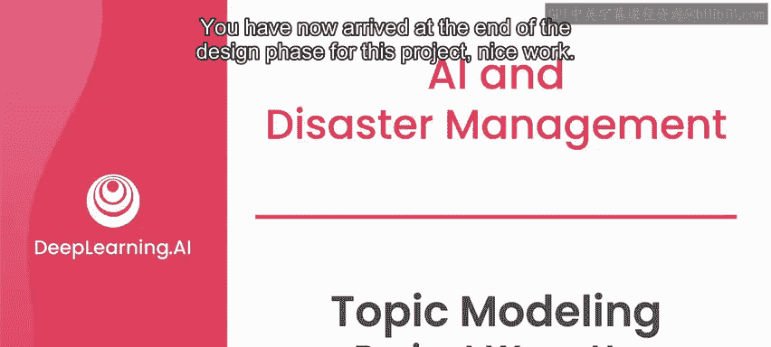
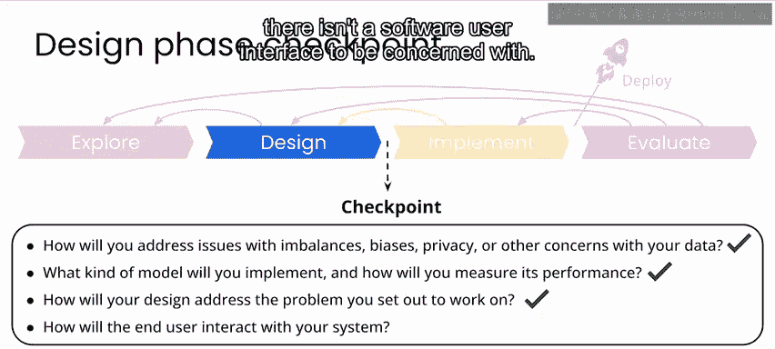
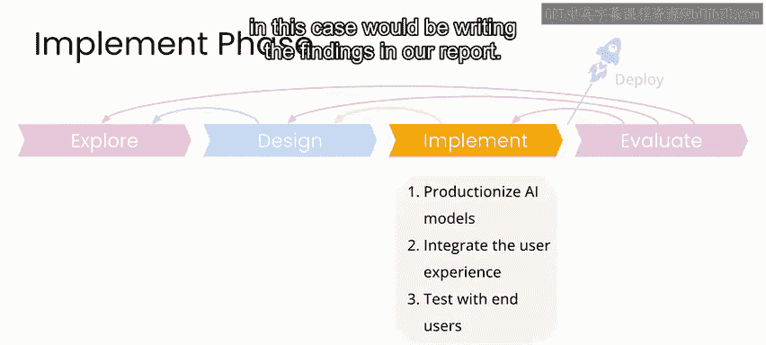
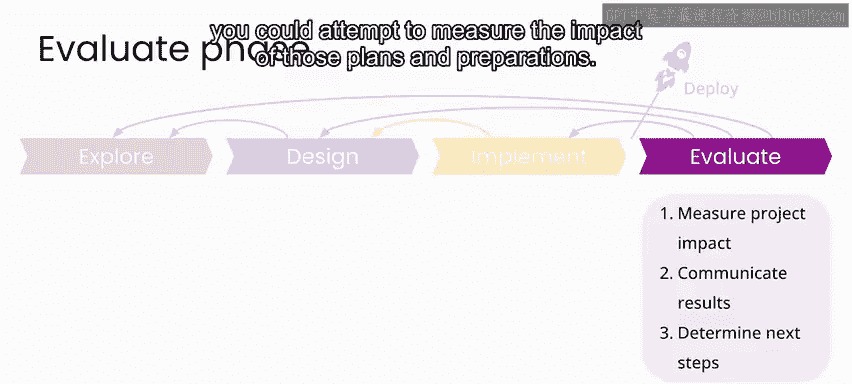

# 吴恩达《AI for Good专业课程》 AI与公共卫生、气候变化、灾难管理｜中英字幕 - P115：33_主题建模项目总结.zh_en - GPT中英字幕课程资源 - BV13u411F7xZ

You have now arrived at the end of the design phase for this project， Nice work。

As I've said before， this project is a little bit different than the other case studies that you have looked at so far in these courses in this project you're looking at doing data analysis after the response and recovery phases of a disaster in order to inform the response and recovery efforts in future disasters in this way rather than deploying your results in a software product。

 you might be presenting these findings as part of an after action report。And like I've said。

 this kind of exploratory data analysis is more common than building software products when applying AI to disaster response。

At the end of the design phase for whatever project that you're working on。

 the questions you and your team need to answer are the following how will you address issues with imbalances。

 biases， privacy or other concerns with your data， what kind of model will you implement and how will you measure its performance？

How will your design address the problem be set out to solve？

And how will the end user interact with your system？In this case。

 the data set that you're working with is highly curated。

 so all the personal identifying information has been removed and so there are no major privacy concerns in terms of bias。

 as I mentioned before， every disaster is going to have unique challenges and circumstances so while this data set may do a good job of capturing the details of the response and recovery phases after this earthquake in Haiti。

 it's also obviously going to be biased towards the particular circumstances of this one event。

The model we have implemented is an LDA topic model。

 and you've measured this performance using a coherent score。

Your goal in this project was to analyze trends in the request for aid or information through the response and recovery phases of this disaster。

 and you're able to demonstrate interesting results showing how requests for information and critical needs evolved following this disaster。

In this case your end product will be a report， so there isn't a software user interface to be concerned with。

 however， you would want to ensure that the text and figures you include in the report make your methods and findings clear。

There is no implementation phase lab for this project。

 since your implementation in this case would be writing the findings in our report。

In terms of the evaluation of your project， it's important to keep in mind that the analysis you performed here would be just one small piece of an after action report and would need to be taken in the context of the rest of the report to think about evaluating the impact。

In this case， stakeholder organizations would be most concerned with how the analysis presented in the report served impacted communities and responders in future response and recovery efforts。

At a basic level， you could look at what sorts of actions were taken as a result of your report。

 like what sort of additional planning or preparation happened as a result in the event of a future disaster。

 you could attempt to measure the impact of those plans and preparations。

And that brings us to the end of this project analyzing text messages sent following the 2010 earthquake in Haiti I hope with this project you've gotten a general sense of what the response and recovery phases look like for this disaster and how digital communications can play a critical role in these phases of the disaster management cycle I also hope that you've got a sense of the kind of needs and communications that might be sent following any kind of sudden onset disaster and as a result you have a better idea of what it means to work in disaster management。

If you'd like to take a look at the actual after action report that was published based on this data set and other aspects of response and recovery。

 you can find the report that I published in the resource section at the end of this week。

Join me in the next video where we will wrap up this week， this course and this whole specialization。

