# 吴恩达《AI for Good专业课程》 AI与公共卫生、气候变化、灾难管理｜中英字幕 - P116：34_第3周和课程总结.zh_en - GPT中英字幕课程资源 - BV13u411F7xZ

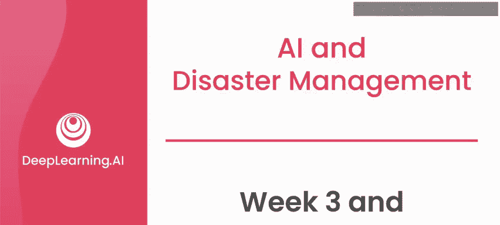

This week you have taken a detailed look at one particular disaster， the 2010 earthquake in Haiti。

 you studied the response and recovery phases for that event through an analysis of text messages sent by members of the impacted communities in the days and weeks following the disaster。

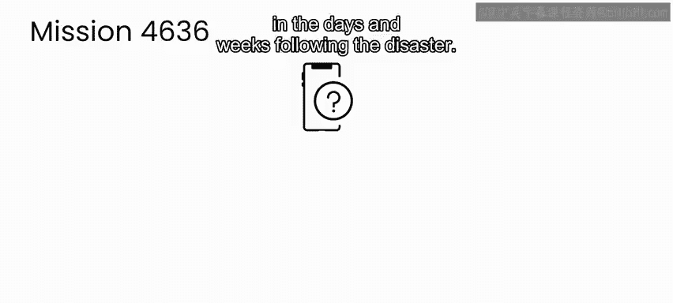

We started off this week looking at what happened immediately after the earthquake and how members of the Haitian diaspora played a critical role in the response and recovery phases by translating and geolocating text messages。

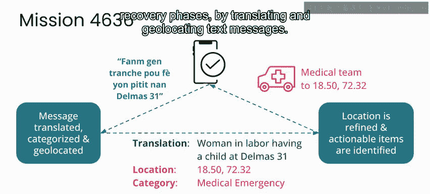

Not only did they work provide an important service immediately after the disaster。

 but it also formed the basis of translation and mapping services that will be valuable in many ways。

 including future response and recovery efforts in Haiti。

For the project this week you focus on conducting an analysis as part of an after action report aimed at helping impacted your communities and responders better prepare for future disasters in the context of the disaster management cycle that you looked at in the first week of this course you could think of this project as having touched on all four phases of the cycle the data you worked with was drawn from the response and recovery phases and the after action report would be designed to help in the mitigation and preparation for future disasters。

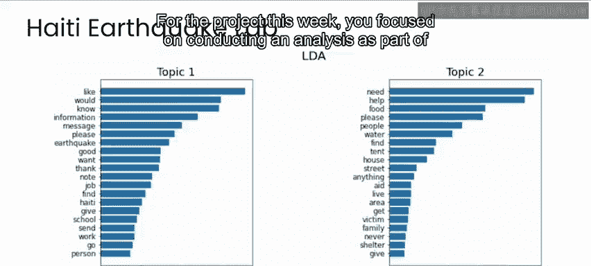

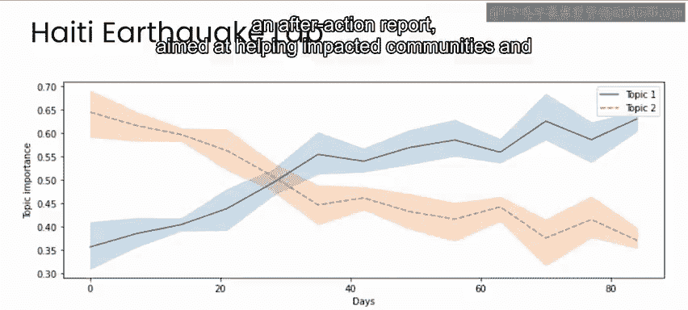

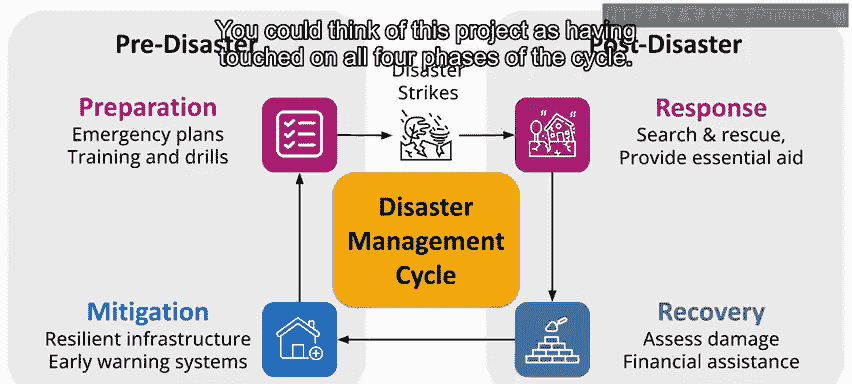

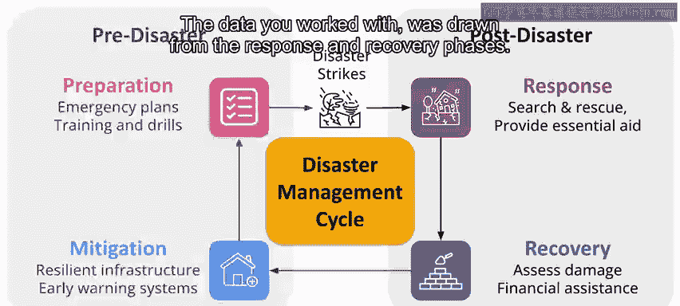

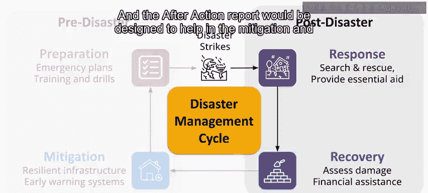

And that was the case with the actual after action report and analyses that those of us who worked in the response to the earthquake conducted。

So for example， some very large storms hit Haiti not long after the earthquake and knowing the distribution and prevalence of text messaging。

 we were able to send out one inch of people on a per cell phone tower basis about the incoming storm and to direct them to the safest structures in their local area。

 we began this course with some discussion of what exactly constitutes a disaster and the kinds of impacts a disaster can have on people。

 property， local economies and the environment。

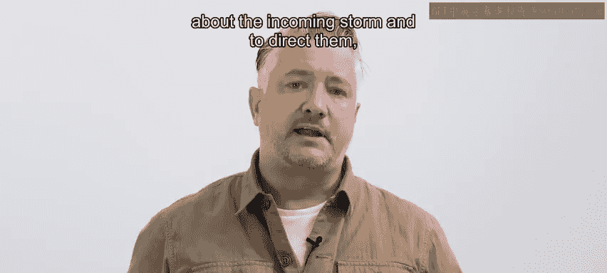

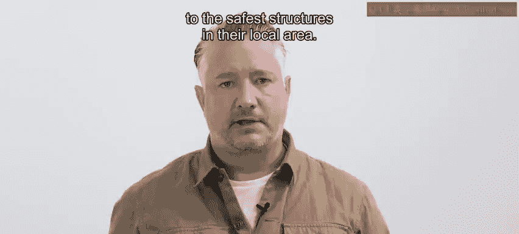

You looked at a disaster management framework that is set up as a cycle of four phases， mitigation。

 preparation， response and recovery。

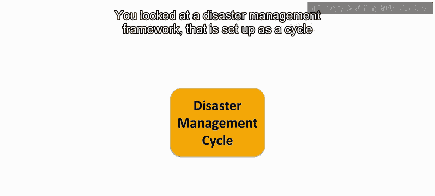

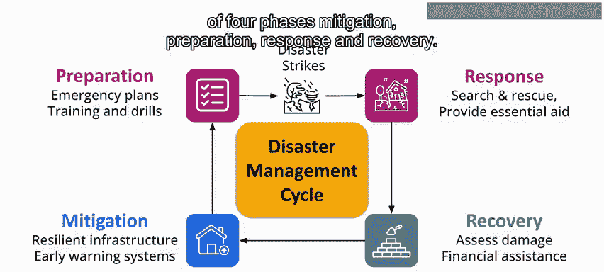

We looked at how each of these phases unfolded for the disaster that resulted from a pair of cyclins that hit Mozambique in 2019 and how AI was involved in the different phases。

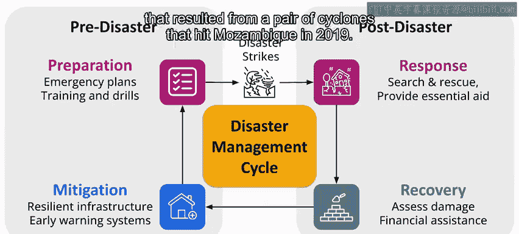

After that， I shared some guidelines for working in disaster management。

 and I think you can use these guidelines as a starting point to optimize your work for positive impact while minimizing harm。

 so here they are one more time。First， you can maximizeim your impact by working on robust general purpose technologies that help communities help themselves。

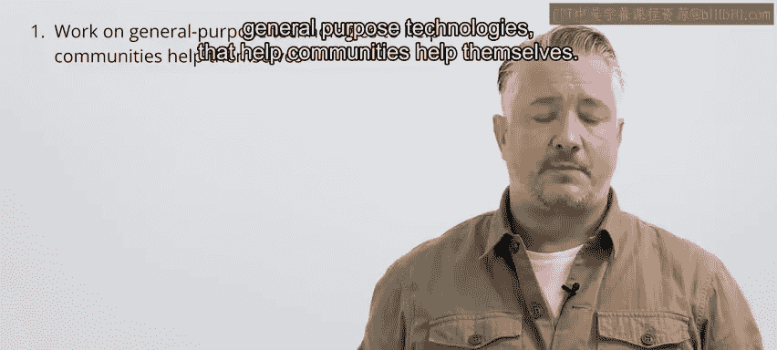

Second， work that helps to support low resource languages better with technologies like translation and search will have a positive impact in many use cases。

 including in disaster response and recovery。Third。

 default the private data practices in all your work。

 and keep in mind that aggregated data and machine learning models themselves can amplify privacy risks。

Fourth。Avoid projects that involve analysis of social media data or work that is funded by oppressive regimes。

And finally， engage with impacted communities to ensure that your project has the highest chance of success and the potential to do harm is minimized。

 in many cases the best communities to engage with the communities that you're already a member of。

If you keep these guidelines in mind you will be much more likely to succeed in any of your efforts to help reduce the impacts of disasters no matter the specific context and with that you've now completed this course on AI and disaster management as well as the specialization on AI for good so I really hope that this has been a thoughtprovoking and inspiring journey for you and what I really hope you'll take away from these courses is that by applying a framework like the one that you've used for these case studies in these courses。

 you can take a thoughtful and harm reducing approach to whatever problem you want to work on and optimize for making a positive impact and this could be in disaster response or in environmental development or in public health or in any kind of application that you're working with in the real world so I look forward to seeing what you build and I wish you well in making a positive impact。

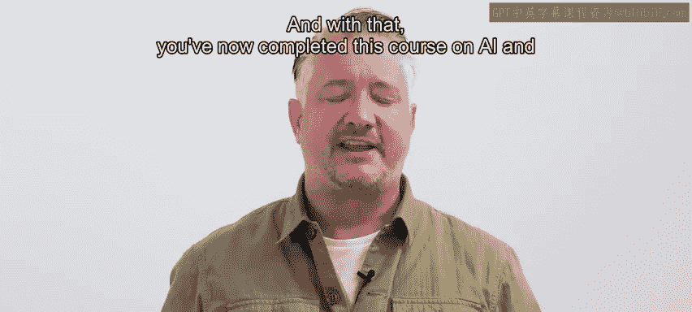

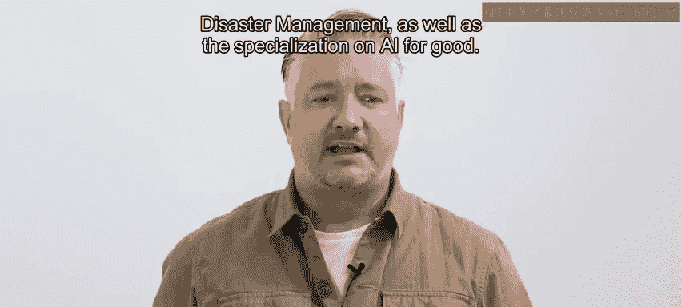

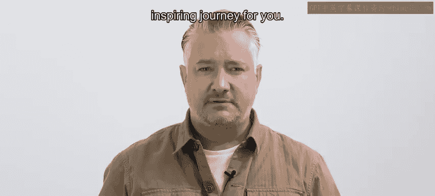

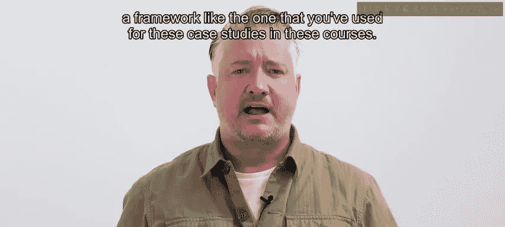

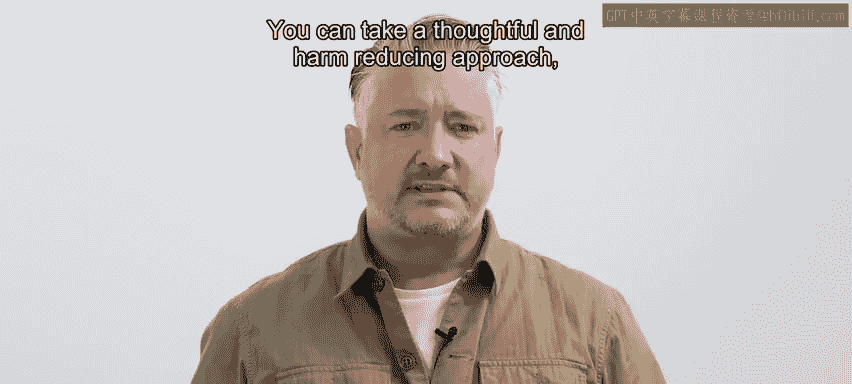

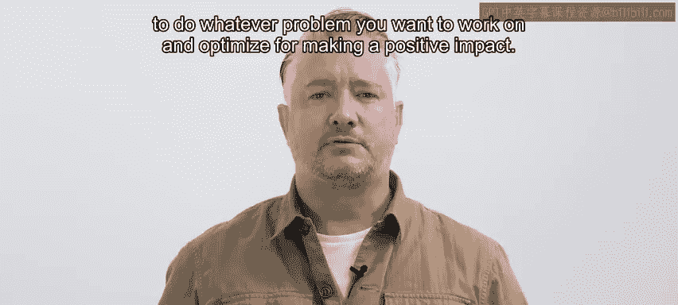

The communities that you care about。