# 吴恩达《AI for Good专业课程》 AI与公共卫生、气候变化、灾难管理｜中英字幕 - P11：10_人工智能为善框架.zh_en - GPT中英字幕课程资源 - BV13u411F7xZ

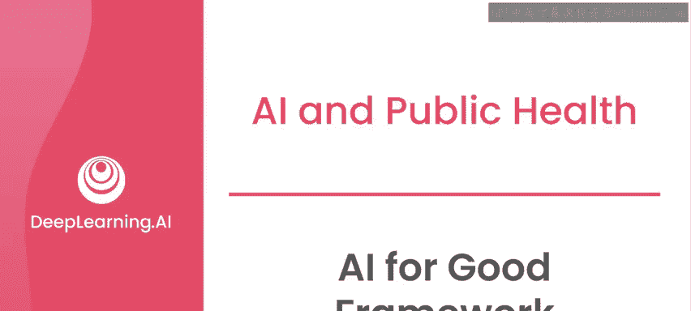

Welcome back in the first week of this course you learn a lot about how machine learning works。

 what kind of projects teams are working on out there in the AI for good space and some of the practical considerations that you need to keep in mind when taking onsite projects in the second week of the course you'll now be walking through a framework for structuring your approach to AI for good projects In fact this is a framework that you could apply to any reward world project where AI could be part of the solution by the end of this week you'll have the tools you need to dive into the case study from making air quality estimates in Bogota Columbia Now first I'll just say that there is no official or universally accepted framework for approaching AI for good projects but the framework I'll be showing you here is based on a collection of best practices or from my own experience in disaster response in public health and also from building AI drivenn products in industry as well as from a number of other stakeholders who are working on this space so hope you can serve you in the projects that you will work on here in this course and in the future in general。

AA for good projects like pretty much any project happen in a set of stages or phases for your work in these courses of broken up the project lifecycle into four phases。

 which you can think of as first and explore phase， where you're connecting with stakeholders。

 defining the problems that you want to work on， evaluating feasibility。

 and determineton in whether AI can add value as part of a solution。

Then if your exploration of the project looks promising。

 you can move into the design phase where you're prototyping your solution。

 developing your model strategy， investigating the data further。

 and thinking about how you ensure data privacy， as well as how potential users will be interacting with your system。

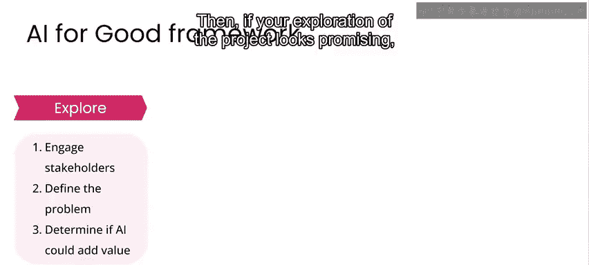

Now it's possible that within the design phase you'll realize that some of your assumptions coming out of the explore phase aren't holding up and you'll need to go back and explore further。

 have more discussions with stakeholders， it maybe iterate on your problem statement。If so。

 adding this little arrogant backwards here from design to explore to suggest that this can be an iterative process。

 and sometimes you might need to go back to a previous phase if you discover that you don't have what you need to complete work in the phase you're in。

And to be transparent， a lot of the time you'll work out that you're not able to complete a project successfully at all。

 and this is nothing to be ashamed about。 The majority of projects focused on social good that I've worked on didn't have a demonstrable impact on the communities that we were trying to help the majority of AI projects that I've worked on or technologies aided by AI weren't really able to demonstrate a very significant improvement in that product by using AI。

 So if the majority of AI projects don't work and the majority of four good projects don't work。

 you should not be surprised that when you try to combine these two very difficult areas。

The majority of ideas no how well intentioned are not going to work out and being able to recognize that you're not likely to reach a successful outcome is actually one of the most important leadership and design skills that you can develop。

For this course， we are going to talk about use cases where we do think that you'll be able to have a positive impact。

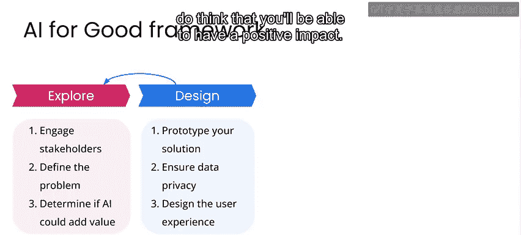

In this model， once you've settled on a design you'll move into the implement phase where you do what I'm calling productionizing your models and this really just means taking what you've been designing in some sort of testing environment and getting it ready for deployment and integration with your user interface and then you'll also test your system for performance and usability again here。

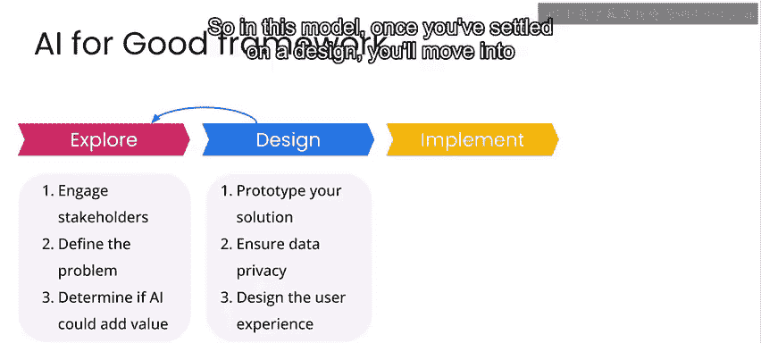

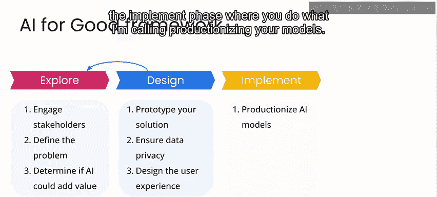

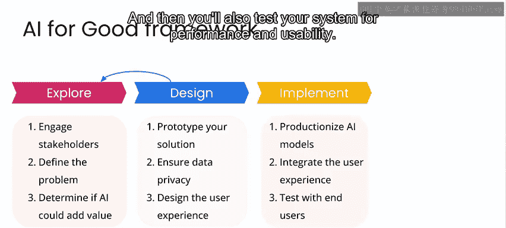

It's possible that that through your work in the implement phase。

 really some aspects of your design just aren't going to work out。

 you need to go back to the design phase and that's okay。😊，So Madam's other littlearrow here。

 go in from implement back to Design because that can be a path you take as you iterate towards your final product。

😊。

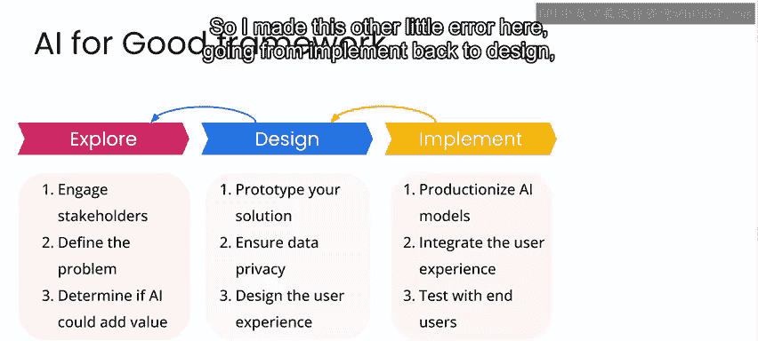

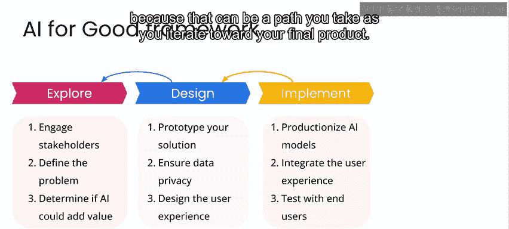

Once you've got the implementation you're happy with you're ready to deploy now of course there's a lot more deployment in terms of technical details than just pressing a button and going live。

 but for the purposes of this course I'll just draw this little rocket chip taking off here to indicate deployment and note that there are a whole other courses out there on the technical aspects of a successful machine learning product development。

 but we're not going to be talking about those details here。

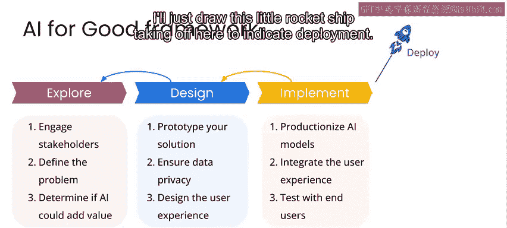

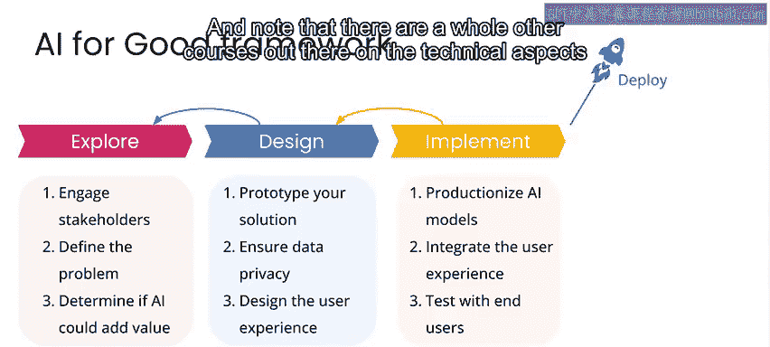

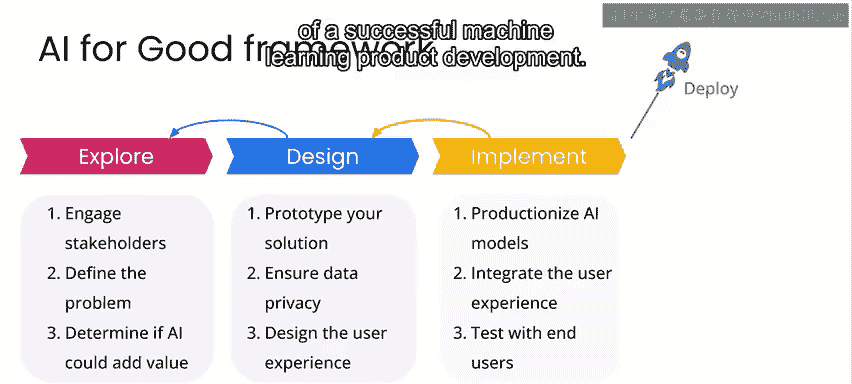

After your system is deployed， it's time to evaluate the impact。

 communicate your findings and then decide what to do next at this point a number of things might have happened。

 most commonly perhaps you'll have discovered through deploying your system that there's something you would like to tweak about the implementation so you go back to the implement phase and eventually relaunch an updated version of your product。

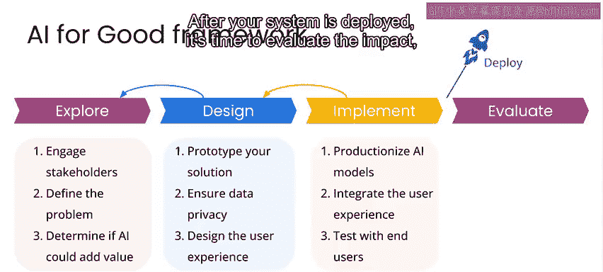

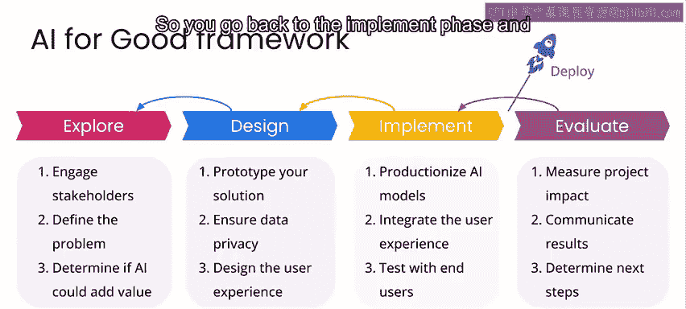

Or it's possible that you discover something about your design ultimately didn't meet your expectations you decide to return to the design phase and rethink certain components of your system before implementing a new solution。

😊，Or it's possible that you decide to explore a new aspect of the problem you're initially working on。

😊，Or go explore a new problem altogether。 All of these could be very common outcomes。

 and I can say from experience that when you're working on a real project。

 things can seem a lot more chaotic than this relatively simple diagram might seem to indicate。

 But what can also say is that you keep this framework in mind at every stage of the project。

 then you'll be much more likely to arrive at successful outcome。

 or at the very least realize while you will get off track and then be able to get up and get back on track as effectively as possible。

 I'd like to mention as a side note that if you are familiar with software development practices。

 this might seem like a waterfall development paradigm。

 but knowing one where you add in terms of evaluating your project impact could equally apply to agile development paradigms with more frequent iterations。

😊，In the next few videos， I'll walk you through an example of a project moving through all four phases of this framework so you can see how things might progress for one particular scenario。

😊。