# 吴恩达《AI for Good专业课程》 AI与公共卫生、气候变化、灾难管理｜中英字幕 - P12：11_尼日利亚母婴健康.zh_en - GPT中英字幕课程资源 - BV13u411F7xZ

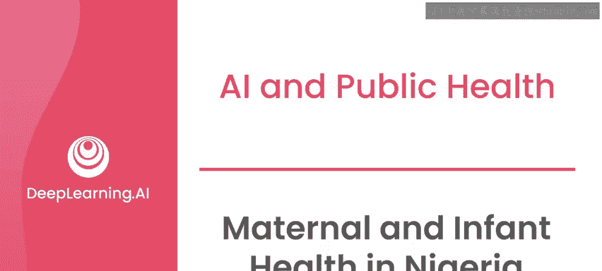

What I'd like to do now is step through each of the phases of the AI for Good project framework that we presented in the last video now we'll look at each of these phases in detail in the context of a project that I worked on some years ago now in collaboration with the United Nations Children's Fund。

 otherwise known as UNICEF。This project was focused on maternal and infant health in Nigeria。

 and I hope that by walking through each of the phases of this project。

 you'll get a clear idea of what you need to keep in mind at each phase of any project that you're developing。

First a little bit of the backt behind this project in the first decade of the 21st century you went through a really major transition in communications。

 so in the year 2000， only about 10 to 20% of people globally had access to cell phones but by 2010 this had risen to more than 70% of the world's population in fact a series of UN reports published around that time highlighted the fact that now more people had access to a cell phone than had access to basic sanitation like toilets or run in water and in fact this is a state that we still find ourselves in today more than a decade later。

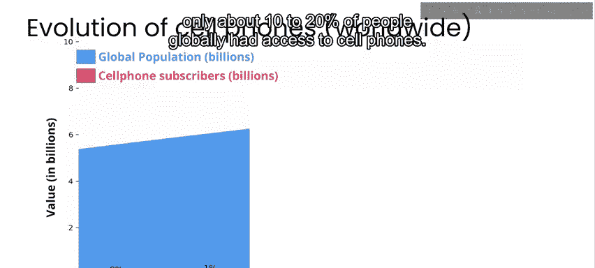

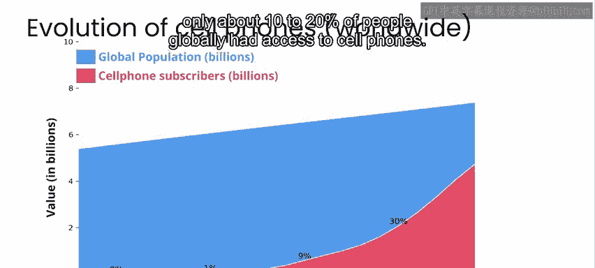

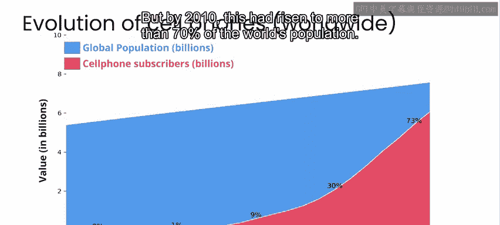

It was in that context in 2008 and 2009 that I was working with a clinic in Malawi in this clinic there was just one physician and a handful of staff serving a population of nearly 100。

000 people and again this is a situation that hasn't changed much a lot of the clinics in this area still have that same ratio about  one physician to 100。

000 people so a lot of these same communication problems that we encountered for the first time then are still very big problems in providing health to people today。

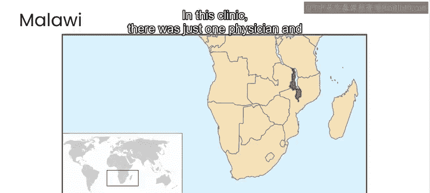

So in this case in Maawi， the main way that the residents of that area communicated with the staff at the clinic was via cell phone text message with such a large population。

 the clinic was inundated with the volume of messages that was very quickly becoming impossible for them to address manually so my work with that clinic was to help set up a system using some basic AI technologies to automatically classify incoming messages and route them accordingly so if you're interested in more details in that study we've included a paper that I published with Chris Manden at Stanford in 2010 which was also part of my eventral PhD dissertation and you'll find that in the resource section at the end of this week's materials so with this rapid expansion of access to cell phones around the world。

 the challenge of dealing with large voluntary text messages was also an emerging global phenomenon and organizations from industry and government to healthcare and emergency response how to learn how to quickly deal with this new challenge in 2010 was asked to help out after the earthquake in Haiti in the immediate aftermath of。

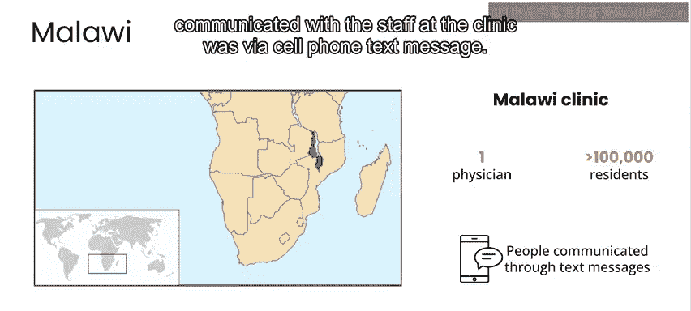

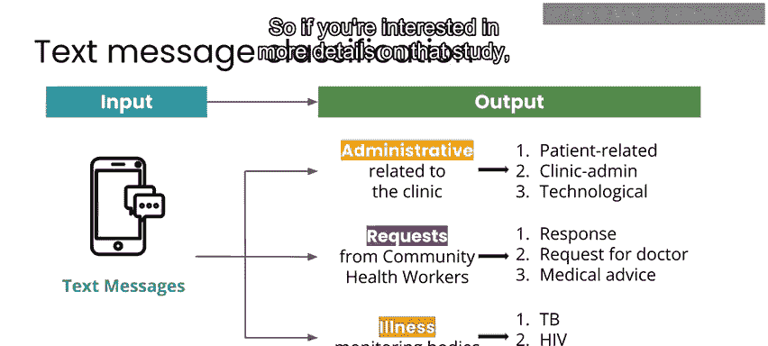

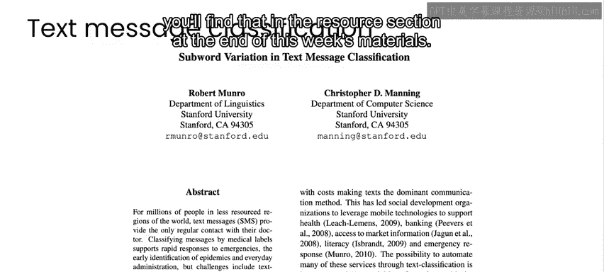

Ethhundds of thousands of people died and much of the infrastructure was damaged or destroyed。

 but most cell phone towers were still intact， and so people communicating via text message and reaching out for assistance and information。

The vast majority of these text messages were in Haitian Krill。

 a language most of the international responders did not speak。

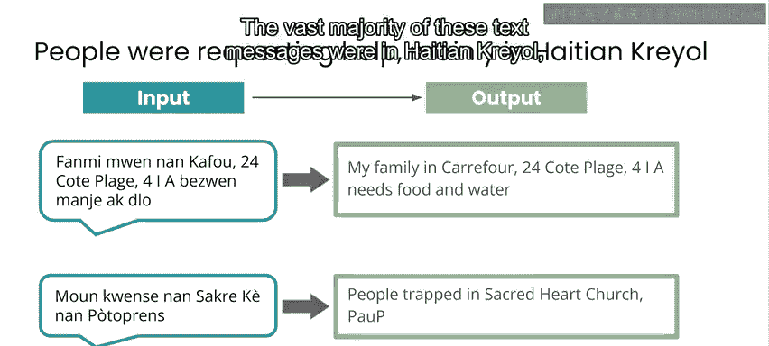

And at that time， there was no application to automatically translate between Haian Creole and English。

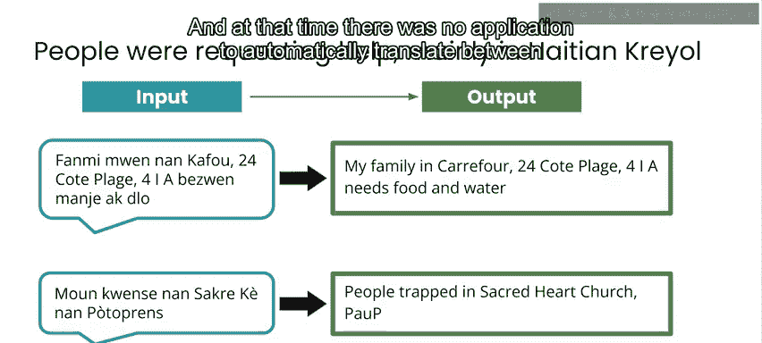

So as part of the response， I hope to organize thousands of volunteers from among the Haitian diaspora worldwide who could quickly translate incoming emergency messages between Haitian Creole and English。

And with those manual translations， along with categories and geolocations。

 we were able to help the predominantly English speaking international response community respond to those messages that were most critical。

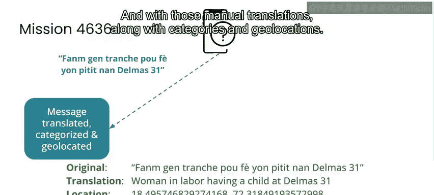

In addition to working with this crowdsourceul translation effort for emergency information。

 we're able to take the Haitian Creole and English messages and give them to machine translation services。

 so shortly following the earthquake， Microsoft and then Google published machine translation systems between Haitian Creole and English which could then be used by speakers of both languages to communicate in ways where the information was less critical than emergency response。

Through both of these experiences in Malawi and then in Haiti as well as other public health and disaster response efforts that I was involved in at that time。

 I became familiar with the problem of processing large volumes of communications in multiple languages in fact this became the focus of my eventual PhD。

 how can we adapt AI systems to help with disaster response in public health in languages which typically had not been the focus of natural language processing in the past。

So it was in the context of this disaster response and public health work that I found at Idibonon in 2012。

 which was a company dedicated to building various natural language processing technologies that could be deployed in as many languages as possible at Idibonon。

 we built production systems for large cell phone companies like Samsung and other big industry players in areas like finance and game in。

 and this allowed them to adapt their classification information extraction systems to any language。

In 2011， UNICF launched a system called You Report。

 which is a social messaging tool and data collection system that allows members of the community to send text messages to directly report on various issues affecting their community。

 from safety and securitycur to disease outbreaks to infrastructure concerns and more。

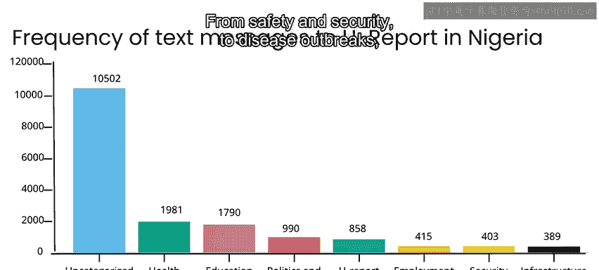

The U report system was faced with the same challenges experienced by multinational companies and that they needed to monitor。

 translate， classify， and route very large volumes of text messages in multiple languages。

 but they didn't have the resources or they know how to build and deploy such a system。

UNCF reached out to us at Edibonin in 2015 to help them with work on an application of the year report tool for a clinic serving mothers and their newborn babies in Nigeria This looked like a project where we could make a significant impact by bringing production tested technologies that we'd already developed for industry applications to a project for community health and development so those of us at Edibonon volunteered our services free of charge to help UNICEF develop systems specifically for their work in Nigeria。

Please join me in the next video to look at how we got started in the explore phases of this project。

