# 吴恩达《AI for Good专业课程》 AI与公共卫生、气候变化、灾难管理｜中英字幕 - P13：12_探索阶段问题定义与利益相关者.zh_en - GPT中英字幕课程资源 - BV13u411F7xZ

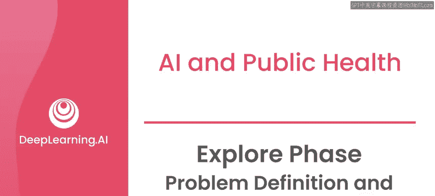

In this video， we'll dive into the explore phase for this project looking at how we can help healthcare providers in Nigeria with their efforts to monitor and support the health of mothers and their newborn babies。

The group of people using UNICEF's Uport system in Nigeria had joined an ambitious global project called 1000 Day Project。

 this project which still exists， is focused on providing nutrition and healthcare to all mothers and their children from day one of pregnancy through to two years of age for the child。

The main use of the U report system in the 1000 days effort in Nigeria was as a tool for sending out and collecting responses to surveys that were designed to track the health of mothers and their children。

The system was functioning as intended， but they quickly started receiving very large volumes of unstructured text messages in addition to the survey responses。

 these messages were in multiple different languages and regarding all sorts of different concerns within the community。

 some related to the surveys， some not related。Similar to experience at the clinic。

 I worked with Malawi， the volume of messages quickly exceeded the capacity of the healthcare workers to respond in real time。

 although they recognized the need for addressing many of these communications as quickly as possible。

 When our team at Edibonnd join the effort， our goal was to help the staff at the clinic implement a method for categorizing and prioritizing messages that were coming in through the Euro report system。

 As I mentioned previously， the first step to take in any project that you want to work on is to connect with the stakeholders。

 In this case， the primary stakeholders included UNICEF representatives。

 the healthcare workers at the clinic and people within the community served by the Euro report project。

 in particular the mothers and their children。

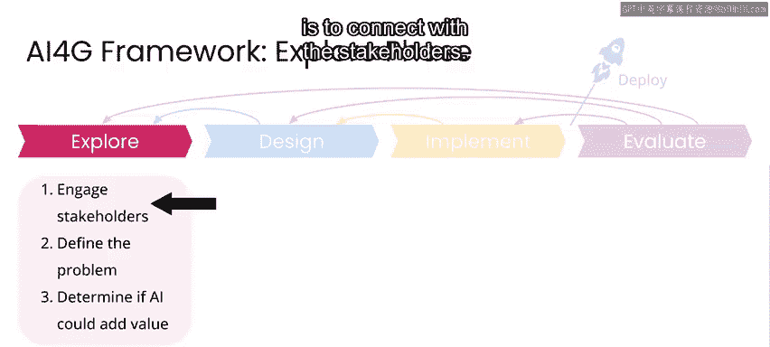

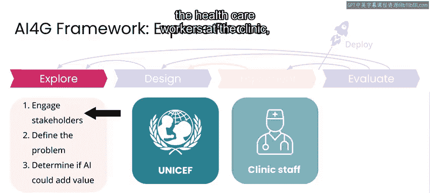

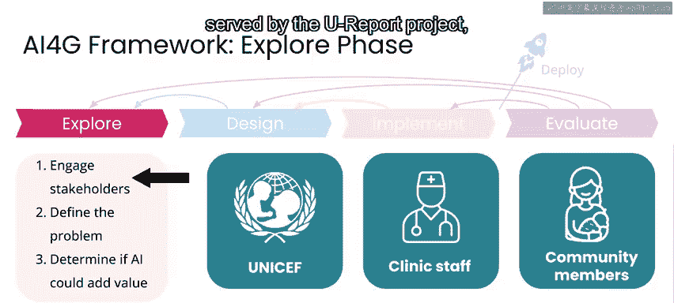

We work with UNICF to better understand the overall objectives of their program。

 and in turn we gave them realistic expectations about the limits that AI might be able to help in their particular case。

We also spent some time talking directly to the staff at the clinic who would be the people using the technology that we would be building to better understand the challenges that they faced in trying to communicate with the Mothers in the thousand days program。

 especially across the very large number of languages that they had to support。

 which in many cases only had one speaker among the healthcare workers。

Once you've connected with stakeholders， it's important to pull together the stakeholder needs and goals for your project into a clear and concise problem statement。

 Your problem statement should define the problem you' are hoping to address。

 including in reference to key stakeholders and some sense of what success would look like。

 but without necessarily getting into the details of particular technologies that you might deploy。

 This is an important step because you can get off track very easily in the rest of your project development if you're not clear about the problem that you're hoping to address and who is involved。

 and you focus too much instead on the technology that you are trying to build。

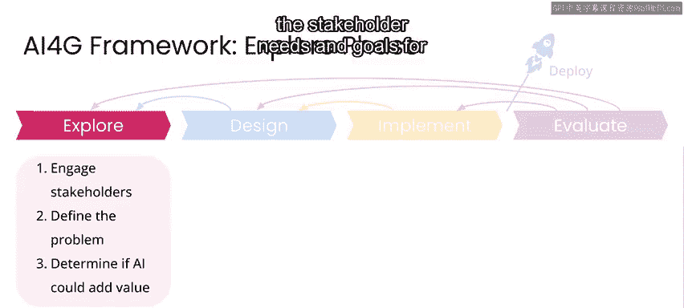

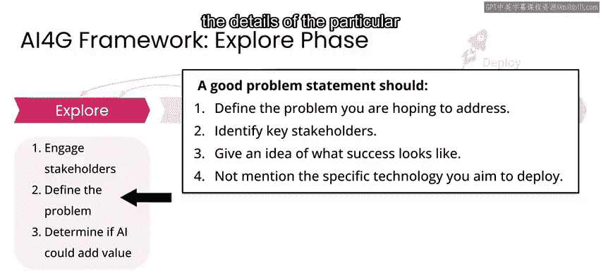

It's important to be very specific and transparent when defining the problem that you are trying to address。

For example， in this case we might have been tempted to describe the problem maybe a little bit vague as something like it's hard to process large amounts of text messages in different languages。

 so while this is true， it's not clear who we are trying to address this problem for。

 so you could also take a step in the right direction by modifying this problem statement to something a little bit more accurate like healthcare providers need to communicate directly with mothers in the community to monitor their health and the health of their babies and they are faced with a challenge of processing large volumes of text messages in multiple languages。

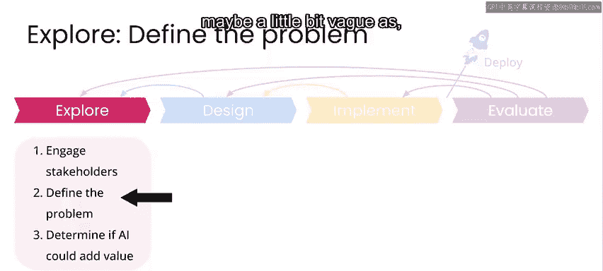

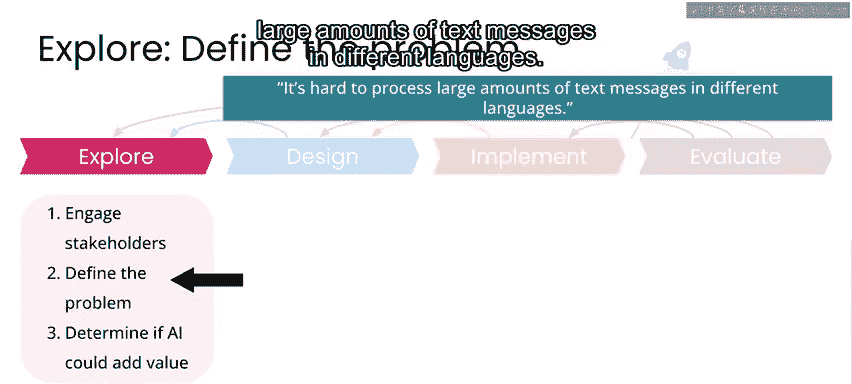

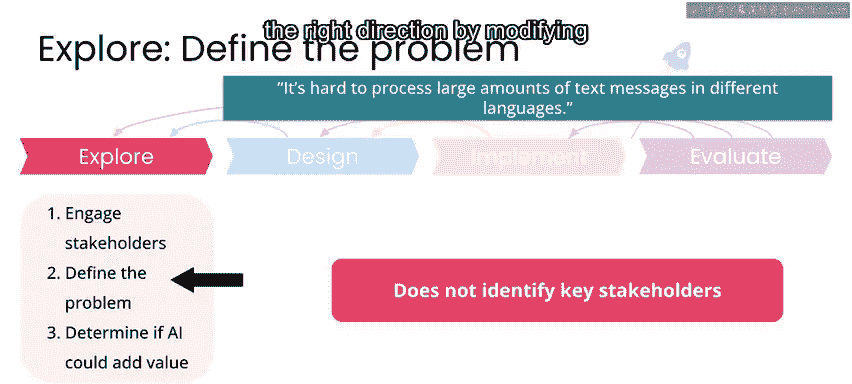

So this is a little better now because it is clear who some of the stakeholders are。

 but it's not entirely clear what a good outcome would look like if these healthcare providers are able to do their work successfully。

So a better problem definition could be something like。

Healthcare providers need to communicate directly with mothers in the community。

 via surveys to monitor their health and the health of their babies。To do this。

 they need to be able to quickly process a large volume of incoming text messages in multiple languages。

 including survey responses and other unrelated messages from the community。

So now this is a much clearer problem statement and a clearer problem statement like this allows you to see what a successful outcome would look like for your project and will help you and your team stay focused on building a solution that addresses this problem。

And this is a process that I've also used in industry and in some cases。

 working on a one- page problem statement has been a threemon process where I've been on。

 I think about version 70 70 when we finally launched so when I was a product manager for Amazon comprehend or Amazon's first NLP service on Amazon web services we took。

 I think four months and had about 50 versions of a one-p problem statement before we even decided to start building the problem and thinking about what specific technologies we want so certainly when you were working on something in a critical use case like for healthcare。

 you want to make sure that you were very clear about the problem you were working on and what are realistic goals that you could achieve while minimizing harm。

So to recap a good problem statement should be clear， concise and specific。

 identify key stakeholders， give a sense of what success looks like。

 and not necessarily reference any particular technology that you aim to deploy。😊。

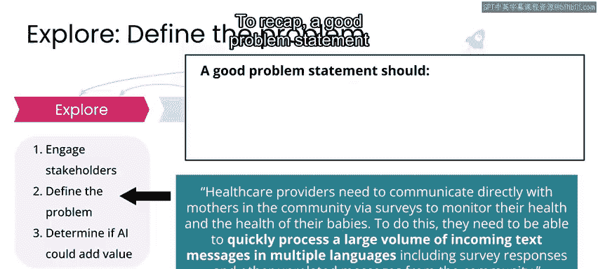

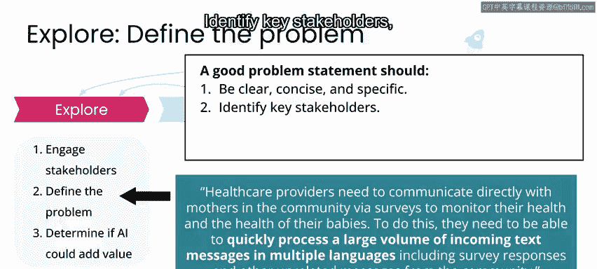

At this stage in our project in Nigeria， we had completed the first two steps in the explore phase by engaging with stakeholders and defining the problem that we wanted to address。

 so please join me in the next video when we'll look into whether AI could even add value in this particular scenario。

