# 吴恩达《AI for Good专业课程》 AI与公共卫生、气候变化、灾难管理｜中英字幕 - P14：13_探索阶段人工智能是否能增加价值.zh_en - GPT中英字幕课程资源 - BV13u411F7xZ

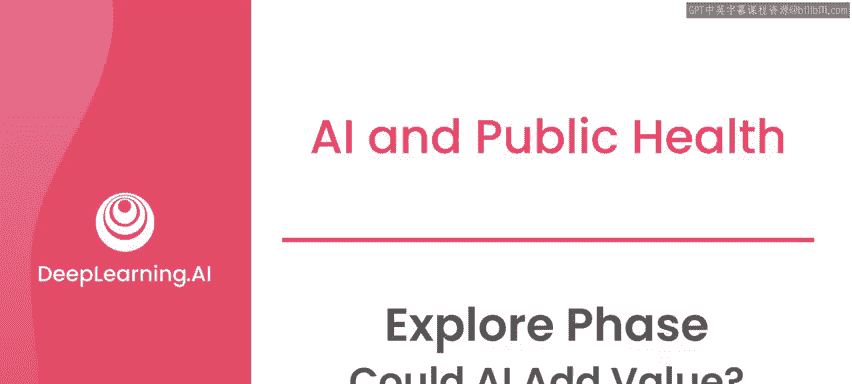

The final step in the explore phase is to determine whether AI can even add value in addressing the problem that you work on so in reality you will be thinking about this all along as you learn more about the problem that you're trying to work on as you speak to more stakeholders you would have also been thinking about whether the effort。

 time and expertise needed to implement an AI solution seems worth it for this particular use case it might happen and it often does that after talking to stakeholders you realize that a simpler solution will be sufficient for the problem certainly given that the amount of resources that you would otherwise put into a more complicated AI system。

For the case we've been talking about， which is working with healthcare staff in Nigeria to process text messages。

 we looked at all these factors， took them into account and worked with the stakeholders and determined that we should explore AI as a potential solution ultimately。

 however， the question of whether AI could add value or not to any particular solution would depend on the kind of data you have access to and the problem that you were trying to address。

InThe first week of this course you saw that for a supervised machine learning problem you need to have a data。

 we have many examples of the input A and output B such that you can train machine learning model to learn a mapping from A to B the examples of these inputs A and outputs B that you looked at were things like images and outputs so an image might be any kind of image taken on the street and the output label would be something like cyclist or not cyclist or perhaps the input could be an audio record in and the output could be a label like healthy or not healthy and this is similar for any kind of supervised machine learning problem that you might want to work on for a particular case looking at at maternal and infant health the De you had to work with was a database of text messages that had been manually categorized by the clinic staff in the past In this sense we have the messages received by the clinic as an input A and the categories associated with those messages as the output B and those categories were things like。

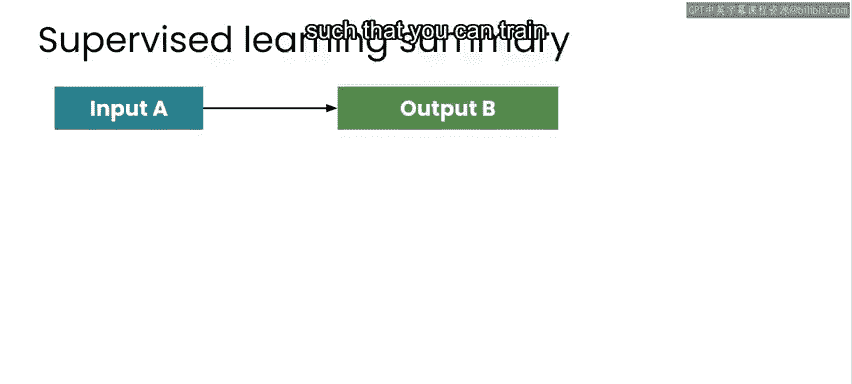

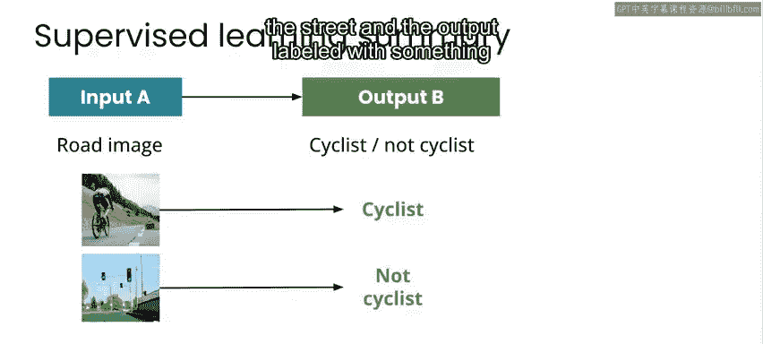

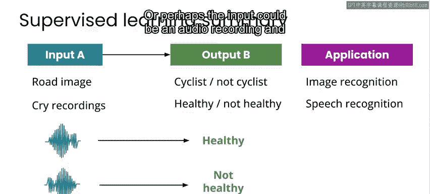

The language and messages were written in the particular topic of the message。

 how time critical it might have been in whether or not it was the response to a specific survey that had gone out before as a training data set for developing an AI model the data available for this use case appeared a little bit limited in terms of the total amount of volume especially for some languages but we concluded that with the help of the clinic staff we could expand the training data with newly categorized examples then with these input text messages output put categories in hand。

 it looked like there's enough data to begin design in an AI application that could automatically categorize and prioritize incoming text messages such that it could improve efficiency of the healthcare workers without impacting their accuracy in your consideration whether AI could add value for a particular project that your working on it's important to think about the do no harm principle and consider any negative impacts that your work might have it may not always be obvious。

 especially the。

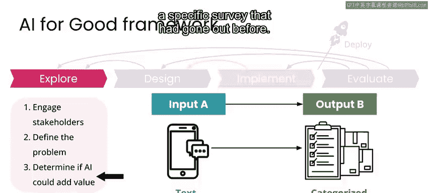

How your work could end up doing harm， but if you're considering the potential negative outcomes at every phase of your project development and working with your stakeholders on those。

 then you'll be more likely to avoid those negative outcomes。In the case of our project in Nigeria。

 there were a number of ways where there was the potential to do harm I'll go through some of the major ones here so first the messages contain personal identifying information and information about people's health conditions both of which are sensitive information and personal information which need to be kept private and stored securely in addition。

 there is always a possibility with an AI assisted system that a person could overly trust the AI output and therefore make an incorrect decision wrongly trust in the AI and in this particular case this could potentially result in an AI incorrect categorization of a message resulting in incorrect or delayed medical advice for a mother or a child in this particular case we also had some more specific instances where harm could have occurred in particular related to one。

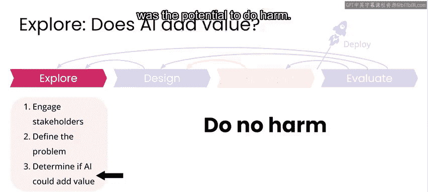

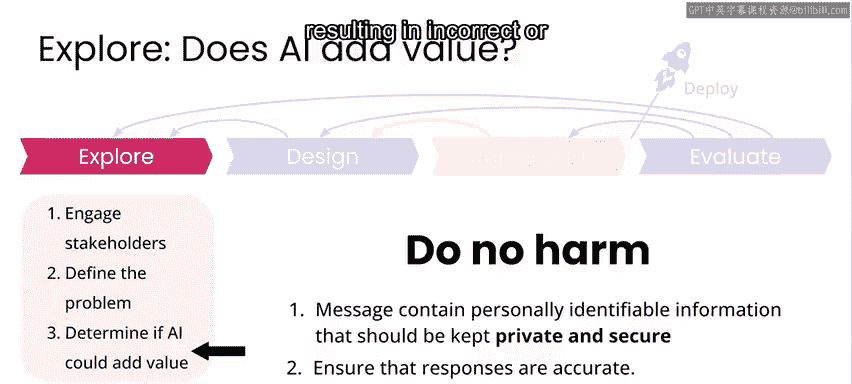

lananguages that we'll support in which was closely associated with an ethnicity that was particularly persecuted and that risk and this will be true for any problem that you're working on there'll be some very general problems that you'll encounter regularly like privacy and security there'll be general problems like the tradeoff between human and AI decision making and there'll be some very specific ones to your particular situation and as an outsider coming in you are not going to know all of these in advance so this is one of the reasons why we continue to work with stakeholders so in this case there have to be members of this particular language community who are able to let us understand the full extent of the harm we could not have fully understood this without communicating with that specific stakeholder at the end of each phase in the framework there are plenty of questions you should be asking yourself and your team to ensure that you have what you need to move on to the next phase。

At the end of the explore phase， you need to be able to answer these following questions What is the specific problem you are addressing Who are the stakeholders do you have access to or can you require the necessary data。

 could AI add value， where and how， if so， and how does the do no harm principle come into play here。

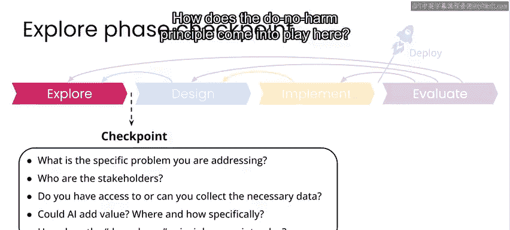

In the public health example that we've been working on。

 the specific problem was healthcare providers need to communicate directly with mothers in the community via surveys to monitor their health and the health of their babies to do this they need to be able to quickly process a large volume of incoming text messages in multiple languages。

 including survey responses and other related text messages from the community。

The stakeholders include UNICEF representatives， healthcare workers at the clinic who are sending out the surveys。

 mothers and their children， as well as others in the communities who have been supported by the U report system。

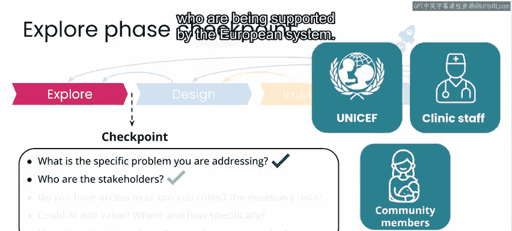

The data that we had access to included text messages that had been sent to the clinic as well as the categories or keywords assigned to them。

 and we determined we could expand on this label data set by getting help from the clinic staff to further annotate more incoming text messages。

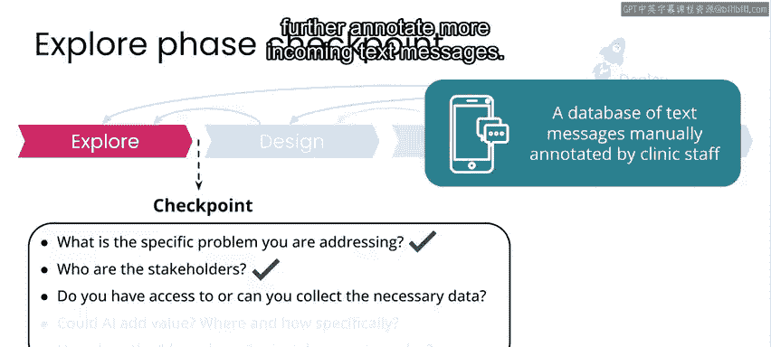

Given the database of label text messages that we intended to create。

 we determined that AI could potentially add value if we could develop a system to automatically categorize and prioritize incoming messages。

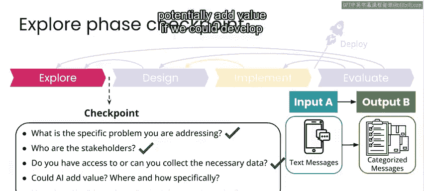

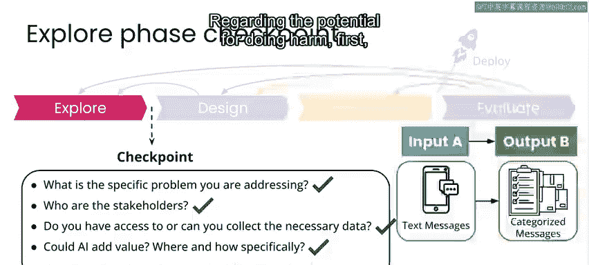

Regarding the potential for doing harm first， the messages contain personal identifiable information and information about people's health conditions which need to be kept private and secure in addition。

 the system we aimed at design would provide responses to questions from AI and if a person was to trust an AI where it was wrong。

 this could lead to lesser experience and potentially incorrect healthcare information for a mother plus we had a number of examples of harms that were specific to this particular use case in these particular populations。

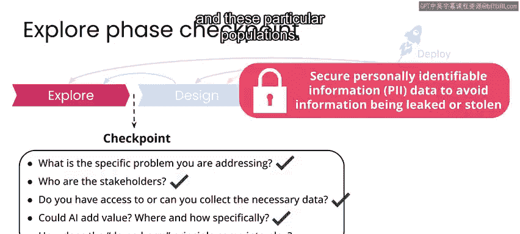

If you find yourself exploring a project in the future and the answers to some of the questions remain unclear。

 it's best to spend more time in the explore phase。

 you can spend more time researching the problem and talking to stakeholders and to collectively。

 you agree that you're in a position to move forward。

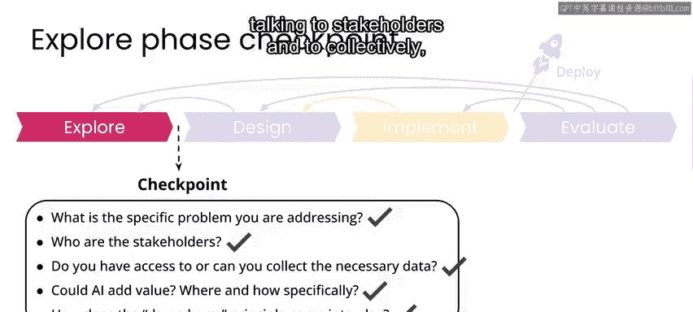

In this case we're ready to move on to the design phase of the project and to give an idea of what this looked like in reality。

 I think we spent in the order of three or six months in the Exp phase just trying to work out whether or not it was viable for us to move forward and worth the resources to see whether AI could provide a solution here。

 and I think this could be a very typical timeline， maybe even longer。

So please join me in the next video to look at how we designed our system for automatic categorization and prioritization of these messages for healthcare workers。

