# 吴恩达《AI for Good专业课程》 AI与公共卫生、气候变化、灾难管理｜中英字幕 - P15：14_设计阶段.zh_en - GPT中英字幕课程资源 - BV13u411F7xZ

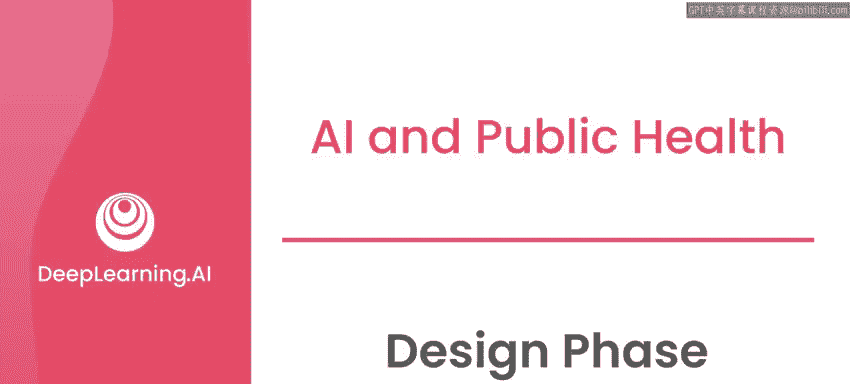

With the successful exploration of your project， you've identified and communicated with the stakeholders。

 you've got the information that you needed to clearly define the problem they aim to work on。

 and you've determined that AI can most likely add value in this particular scenario。

 so now you're ready to design your solution。In the design phase。

 the steps you'll take first to prototype your solution which involves looking more closely at your data and testing out some models at the same time you'll also be thinking about how you're going to address data privacy and data security issues as I mentioned in the first week of this course whenever you're dealing with data that includes information about people or property you have to be very deliberate about how you're going to handle that data at all stages of your project in order to ensure that remains secure and private and you should not use any personal data without the explicit permission for your specific use case So whatever project you're working on whether it's in healthcare for at riskk populations or an app for a wealthier population you should be defaulting to private data practices in all of these cases you should be ensuring both the privacy。

 the security and the dignity of the people whose data you're doing Finally you'll design the user experience for your project and this can be very different things for different projects。

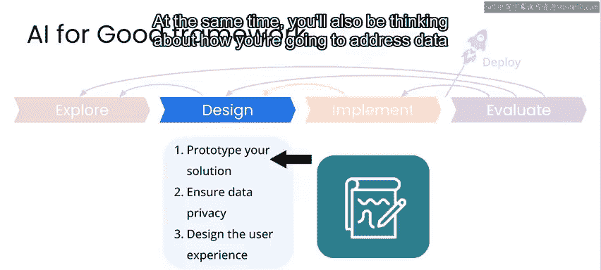

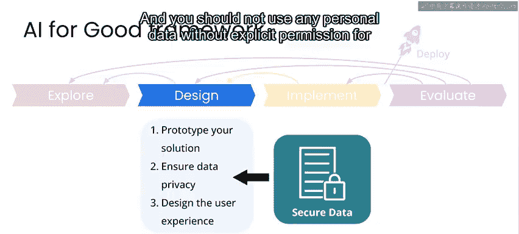

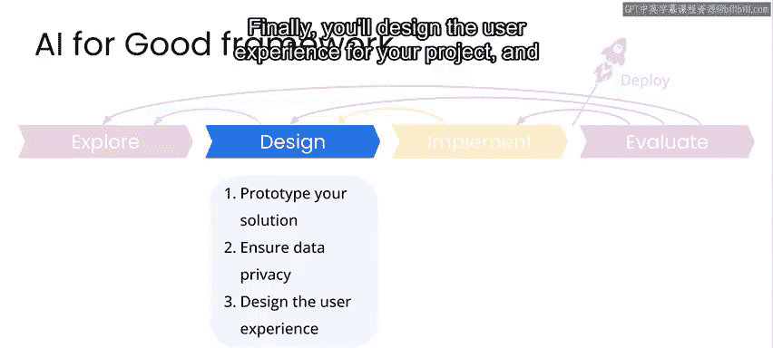

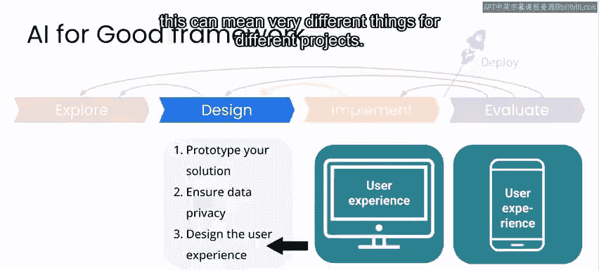

So let's walk through each of these steps of the design phase for the maternalternal Infant health project that we started with in the Exp phase。

In the previous phase， we explore the data and determine that look like an AI solution might be able to add value in this project Now in the design phase。

 we dug in more deeply into the data to verify ways in which our data might need to be cleaned or prepared for this particular case the data we had contained text messages and keywords or categories that staff had assigned to those messages At this stage we set out to determine what the minimum number of labels or categories should be in our training data and then consider which categories would be hard to process automatically which might be easier In this case。

 identifying the language of a message was relatively easier。

 in fact language identification is among the easier natural language processing tasks more broadly。

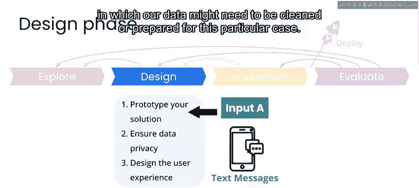

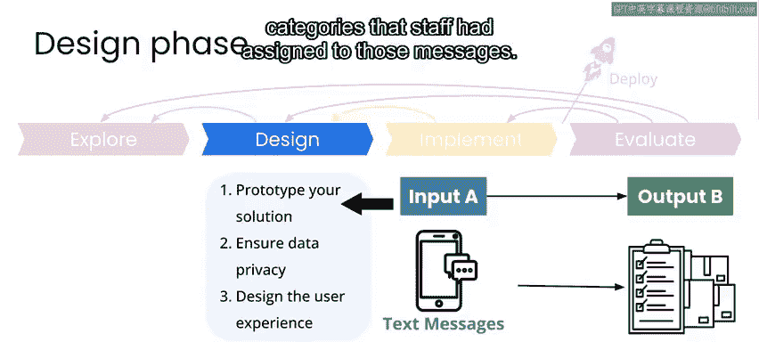

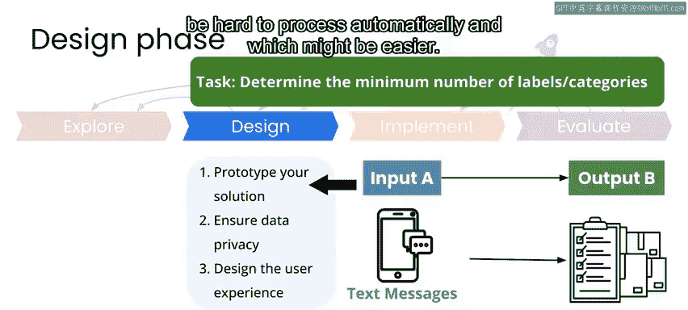

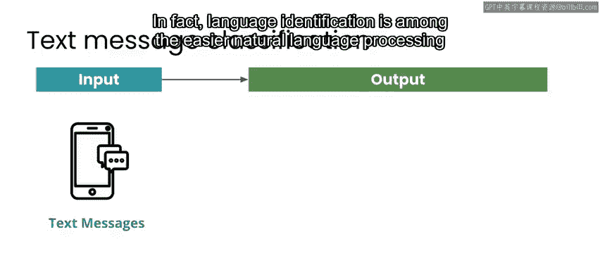

On the other hand， categorizing the content of the message could be very hard， for example。

 trying to classify whether it was related to maternal health or some other problem。

 even that simple binary decision was not particularly accurate and the accuracy varied across the languages mostly related to how much data we had in a given language once we had investigate the data in more detail。

 we designed a model and annotation strategy where we would have the clinic staff annotate more of the incoming messages in particular in particular topics and some languages where we had less data initially。

 so this would enable us to use those additional annotations as new training data so that we could update our models and automate more of the processing much more quickly。

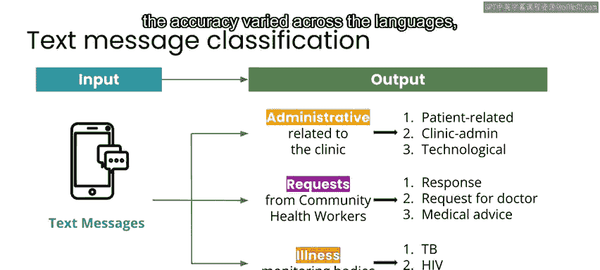

As part of this effort， we investigated what kind of performance tradeoffs there might have been。

 for example， between a state of the art machine learning model or a much simpler model。

 so with a state of the art model obviously the predictions would tend to be more accurate but it could take longer for those predictions to occur on the incoming messages and in particular it could take much longer for a model to retrain on additional data and so in this case we found that somewhere in the middles but tending towards a simpler model was the right solution for us because it was more reliable。

 we understand the edge cases that might occur more deeply it was more interpretable and in terms of user experience。

 that model could retrain in the order of minutes compared to a state of the art model that might take hours or days so this meant that the people working in the clinic could experience in near real time the feedback that will give in and how that improved the automation of their。

Task？And what we found was very much in line with what we'd found in industry in Idibonon as well。

 a very large number， although not all of our customers would actually prefer a model that could be updated with new data quickly over a model that was absolutely state of the art and this is because in many werew worldld situations。

 a few extra human data labels is more important than hours and hours of extra training for a more highly converged model。

 and so while that wasn't the case in all cases in industry， some cases in state of the art。

 we were not surprised to find that a simpler but more well-known and reliable model was the right choice for this particular use case in healthcare。

Here we really set out to confirm that AI could indeed provide value as part of the solution so the baseline for a performance test in our AI was the purely manual solution that already existed and in particular twoy performance indices so in terms of volume of response and response time so how many messages could be responded to in a given period of time by a healthcare worker and how much time passed between a message coming in and the message being responded to and then we also ensured that the accuracy of responses remain constant we weren't looking to make people in the clinic more accurate in this case or that can be a goal in this case by having multiple people in the clinic look at the same messages and evaluating them we were able to determine that with very light suggestions and filtering AI we did not have a lower overall quality and response while we were trying to move up the processing。

And bring down the processing response time as much as possible。

Now that we designed a system where we saw that AI could likely provide an improved experience。

 we're able to move into the implementation phase。For data privacy in this case。

 the data set contains personal information from individuals。

 including particularly sensitive information about healthcare。

 so we were careful to ensure that our data storage and handling in was secure enough of the task this meant for example。

 that the messages were never exposed to people who couldn't already see them as part of their regular work and so we at Idibon didn't have access intentionally in any way see or download the data and this is another good example I think of where what we learned in industry helped us a lot in this particular healthcare use case for a lot of our industry customers we also couldn't see the data that they were working on for sensitivity reasons and in many cases regulatory reasons and so having already built this sort of protections and tested them and had them validated by third parties we could then be more confident that we were doing our best to protect the security and privacy of the healthcare community。

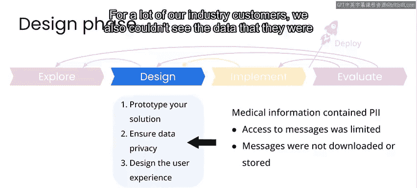

As we added this new step of also putting them through an AI system in addition to their existing manual processing system。

As for the user experience， in this case， the end users were the healthcare workers in the clinic。

 and so we aim to make their work more efficient with an automatic message categorization tool。

 and so in successful implementation of this project。

 those healthcare providers would see a benefit in terms of having to do less work to process incoming text messages while providing better service to their patients in reduced response times and in turn helping the community with more messages being processed。

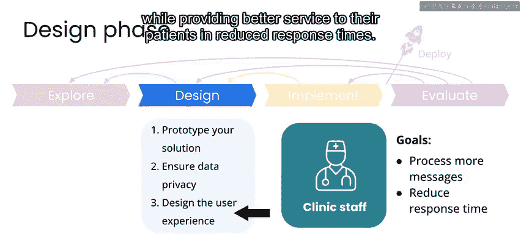

Once you've completed the design phase， there is another set of questions you should answer with your team before moving on to the next phase of development first regarding the data。

 how will you address the issues of imbalances， biases， privacy or other concerns with your data？

Secondly， what kind of model will you implement and how will you measure its performance then how will your design successfully address the problem that you defined in your explore phase and finally。

 how will end users interact with your system that it's possible that in addressing these questions after you work in the design phase。

 you'll recognize that you've run into issues like unanticipated challenges with the data or how you might build a model using that data to address the particular problem that you defined or in designing the user experience。

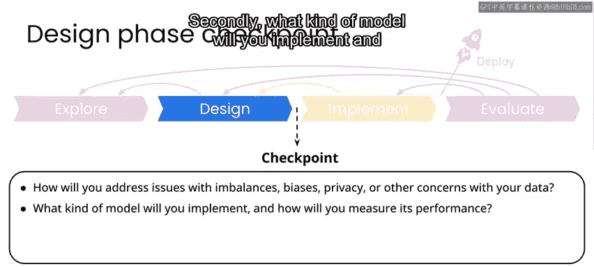

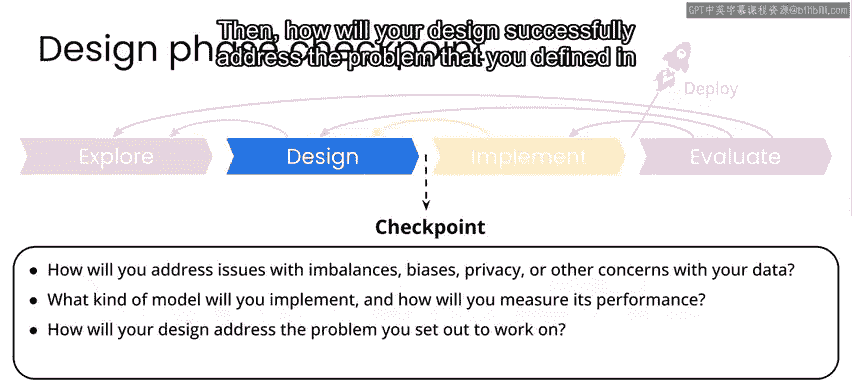

In this case， you may discover that you need to return to the exploreer phase and get more information from stakeholders。

 investigate other data resources， or even reexamine the problem that you're trying to address。

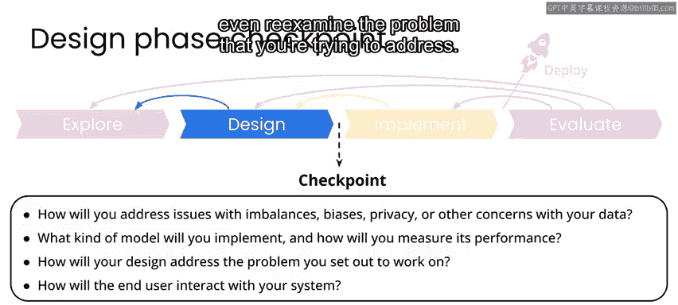

For this case study， data considerations involve securely storing handling personal information and so for this weuse systems we were already designed for industry clients such that us at EB or anyone knew at the clinic or UNICF who didn't already have access had no way to access this data or to inadvertently download or share it with somebody else。

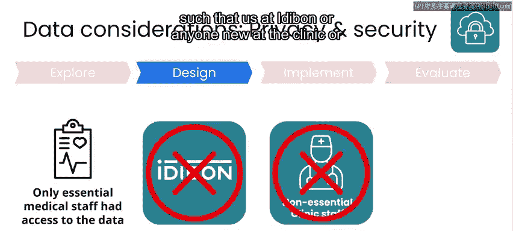

We designed a model that was a version of what we' already deployed for industry clients so again this has take in knowledge that we had developed and refined in large-scale industry situations and be fortunate enough to apply them for free into this healthcare situation and so for this application we also adopted the strategy of having the existing clinic staff perform additional annotation of incoming text messages to build up a database that would allow the model to become more robust in categorizing the variation of languages and categories that we cared about this system would address the problem that we were working on by allowing healthcare providers at the clinic to process a larger volume of text messages and provide faster response time to their patients then users of the system to suffer at the clinic would receive automatic updates on the categorization of prioritization of new messages they would review the same categories and priorities for accuracy and manually reassign categories or priorities to aid further improvement of the model。

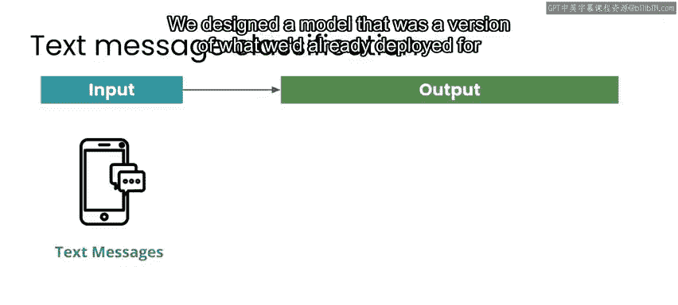

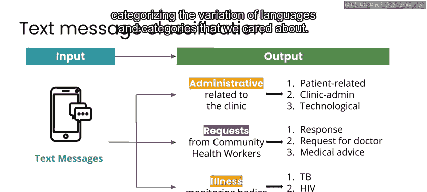

Now of course， I'm glossing over a lot of the details here for this particular use case we spent many months working on the design phase and there have been cases where I've spent years in the design phase of systems ultimately went that much more sophisticated which needed to be built very slowly and deliberately and carefully to ensure that we went violateol in the dunoham principle so in your own project you might spend any amount of time really verifying some of your design decisions with respect to the AI model that you choose and the end user experience。

So once you do have what you think is a well designed solution。

 then you're ready to move on to the implementation phase。

 so please join me in the next video to look at how we moved from design into implementation for this use case。

