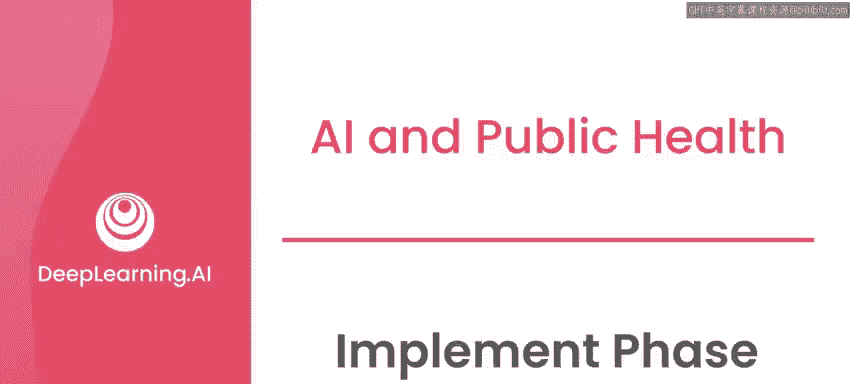
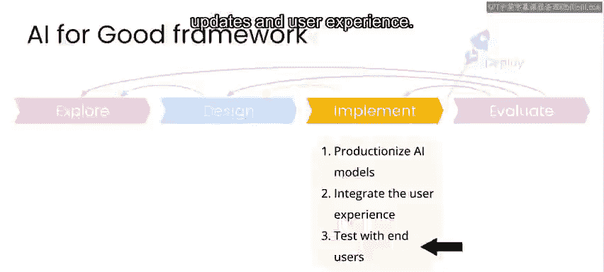
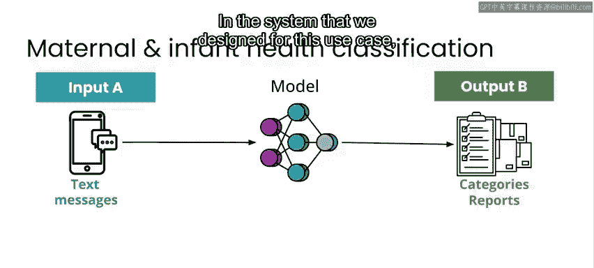
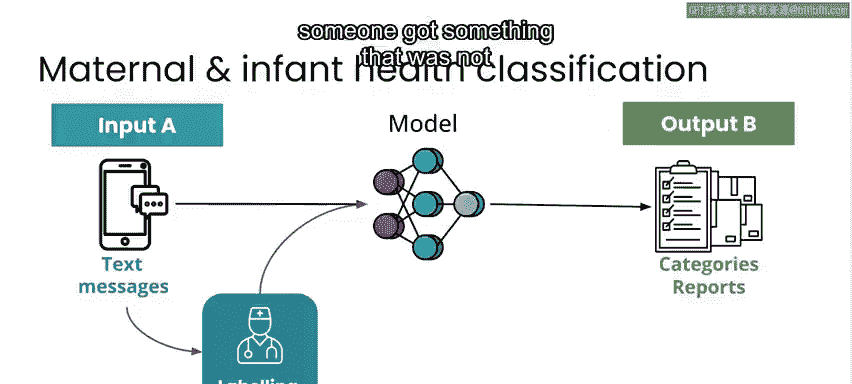
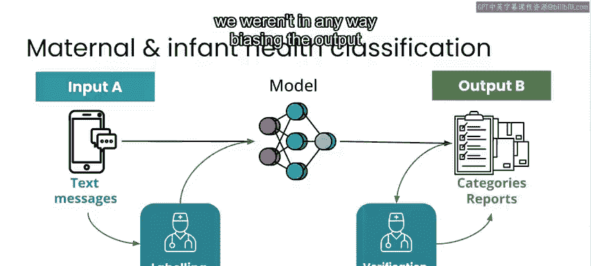
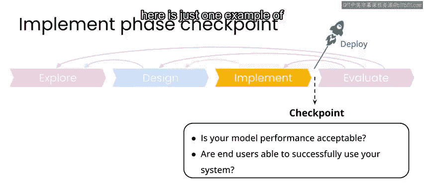

# 吴恩达《AI for Good专业课程》 AI与公共卫生、气候变化、灾难管理｜中英字幕 - P16：15_实施阶段.zh_en - GPT中英字幕课程资源 - BV13u411F7xZ

Once you've looked at your data and designed your model strategy and your annotation strategy。

 figured out how you' going to do a data privacy and security and plan your user experience。

 then you're ready to begin implementing your system in this phase。

 you'll get ready for production by running any final training and testing of your model and moving it into a scalable production environment we will be concerned with monitoring your model performance and understanding potential failure modes among other things here I'm just calling this production as your model which really just means making the model that you developed in a sort of testing and environment in the design phase more available and reliable and robust as part of your production system and available for your end user application。

And then as you're ready to put your model into the production environment and iterate and integrate your model there。

 you'll be at a stage where're able to do end to end testing。

 so look at everything in your system from one end to another in terms of data throughput。

 model monitoring and reliability， systems updates and user experience。

For the project that I've been describing about maternal health in Nigeria the model we used was a very simple single layer model that we'd originally developed at anybon for industry applications retrain for the specific use case and the languages metadata instruction unstructured data that we had access to as part of your report in the system that we designed for this use case one of the requirements was that the annotation how to be done by the staff in the clinic This was for a couple of reasons。

 one was that they had the expertise they'd already been working with these messages and a third part it might not be so accurate and just as importantly it was for privacy reasons。

 we didn't want to employ additional people who would be able to see the personal health information of the people being supported by your report simply for the purpose of updating in a machine learning model。

Conscious of the time it would take these healthcare workers。

 the way this work was that for a very small number of tasks like language detection。

 they were performed in a very almost automated way by the model because they were highly accurate with the backoff where someone got something that was not in fact in language they spoke they could quickly manually reroute that in other cases。

 humans were reviewing model predictions but with a focus on predictions where the model was uncertain so we would raise more particular use cases where a model could not make an accurate prediction not say what the model predictions might be and ensure that the manual annotation still took place there so that we weren't in any way bias in the output by having too many incorrect model predictions。

For any project that you're working in to complete the implementation phase you need to be able to answer yes to two simple questions is your model performance acceptable and are the end users able to successfully use your system it's possible you realize that there are problems with your model performance or usability of the system during the implementation phase and you will need to return to the design phase and work out those problems In our case at this stage now after months of work we have developed our models integrated them with user experience and tested the whole system with the staff at the clinic as end users。

The model performance was acceptable and we could show we were continuously improving the model performance and in turn continually improving the overall volume and response speed of the clinic staff even though they still had to manually review and categorize some portion of new incoming messages and so with that we're ready to go live and deploy the system。

😊，In reality， the project I'm talking about here is just one example of the many possible designs and implementation phases that you might have for any project that utilizes AI。

 your particular project is likely to involve a whole lot of technical challenges related things like system uptime although low latency predictions or retraining time and a lot of other factors about I guess practical real worldl AI problems that typically aren't part of more theoretical or academic focused AI courses or the kind of labs that you're probably used to。

And so we won't be addressing these kinds of problems here in detail but I do want to highlight that they exist and if you're interested in being part of a group of people that deploys real AI systems then I do strongly recommend that you also get an understanding and an experience of the kinds of problems you face in deploying any kind of technology at scale the important thing for you to focus on in this program is the big picture about going from the problem definition that you identified in the exploration phase to the evaluation of the project on through the final phase you should at the end still'll be able to evaluate your project in terms of the problem definition that you initially set out to do and so this is the evaluation of your results and the user experience of the people who are using and getting a benefit from the system that you've created so please show me the next video where we'll wrap up this lesson with。

Evaluate phase of this project。