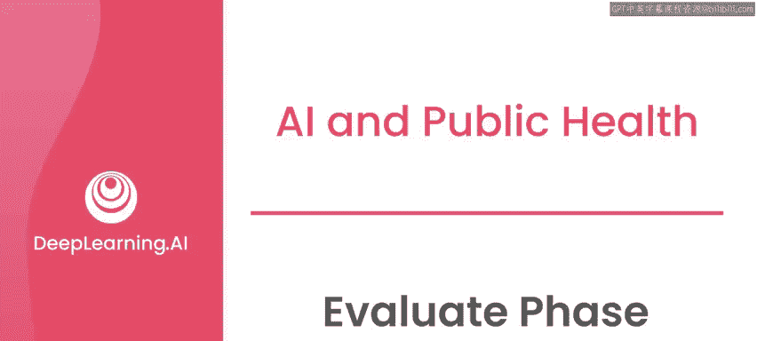
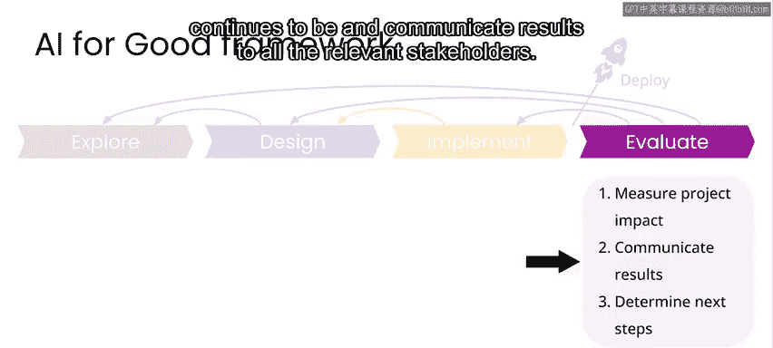
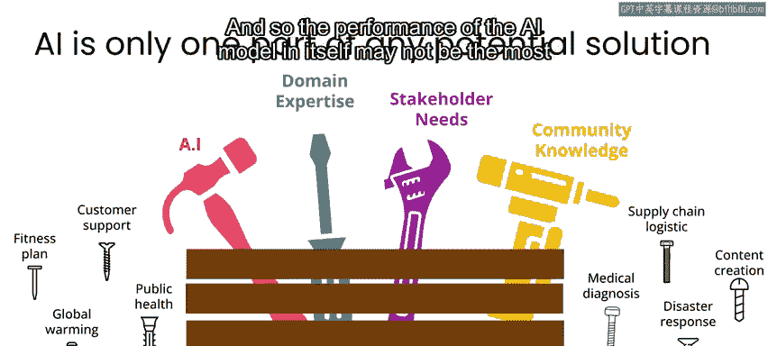
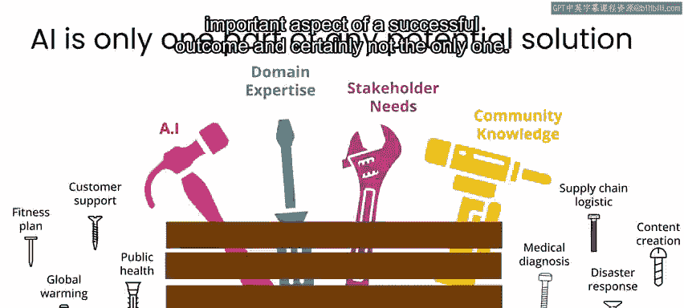
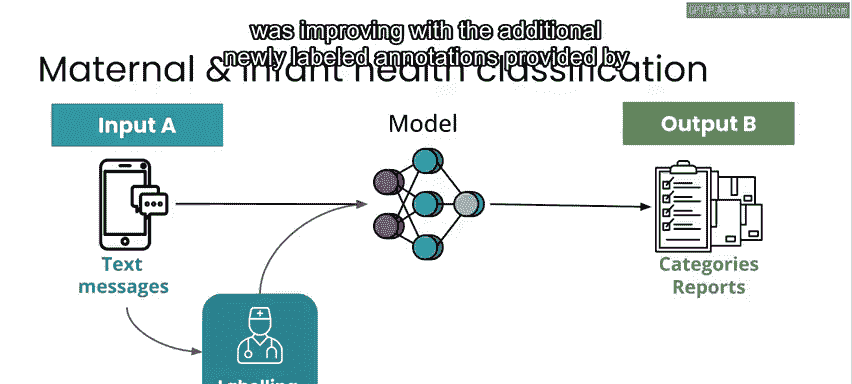
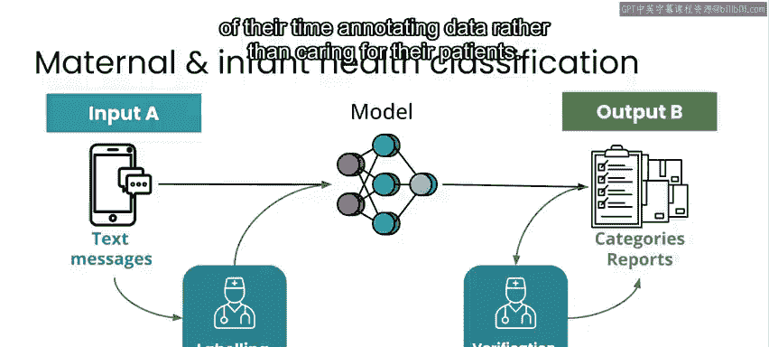
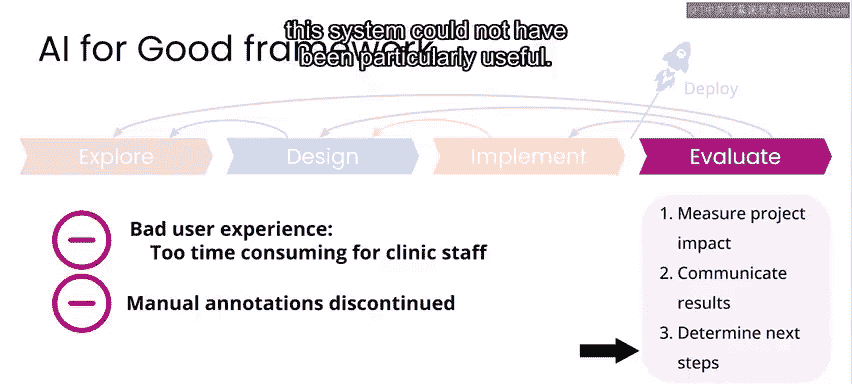
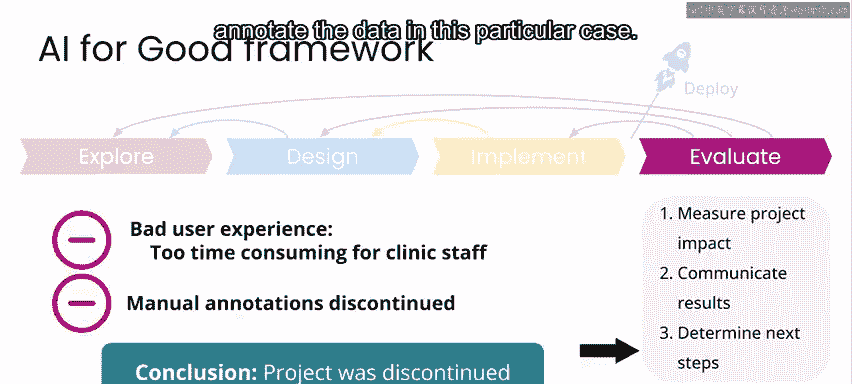
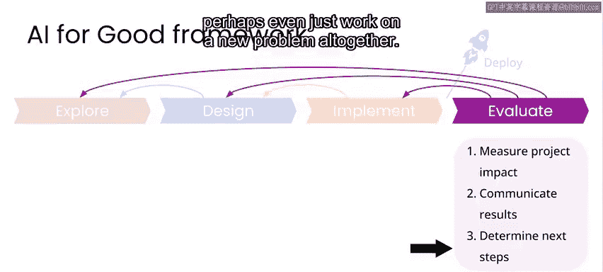

# 吴恩达《AI for Good专业课程》 AI与公共卫生、气候变化、灾难管理｜中英字幕 - P17：16_评估阶段.zh_en - GPT中英字幕课程资源 - BV13u411F7xZ

After you have deployed your system you'll move into the evaluation phase of your project in this phase you'll attempt to measure how successful your project was or continues to be and communicate results to all the relevant stakeholders。

Measuring the impact of your project can be tricky。

 but if you've been following this framework then other way back in the explore phase。

 you should have defined what success looks like， at least qualitatively by a detailed and specific problem statement in the case of this project that I've been walking through a problem statement was healthcare providers need to communicate directly with mothers in the community via surveys to monitor their health and the health of their children to do this the need to be able to quickly process a large volume of incoming text messages in multiple languages including survey responses and other unrelated messages from the community。

Like I've said before， for any AI project the technical component of the AI is just part of the solution。

 it's one component of a much larger and potentially complicated technology or product。

 and so the performance of the AI model in itself， may not be the most important aspect of a successful outcome and certainly not the only one。

In our case， we found that our model actually did perform well and was improving with additional newly labeled annotations provided by the clinic staff。

 such that the staff were able to be more efficient in their work in the sense that they were processing more patient communications with a lower typical response time。

However， as the project proceeded， the staff at the clinic ultimately found it to be a bad user experience for them。

 where they felt like theyll now spending more of their time annotating data rather than caring for their patients。

Even as the system improved in automatic categorization of the messages。

 the clinic staff still continued to spend the same amount of time reviewing edge cases and model errors or low confidence predictions。

 and they weren't able to directly experience some of the automated tasks like the automatic rerouting of messages based on language and as a result。

 they did not have much visibility into how the model was improving or how their overall individual productivity was improving on average。

 even though it didn't feel like it for them in their manual day- to- day task。

And so this sort of system where humans are involved in manual label and editing data is not uncommon in AI applications。

 I would say maybe even the majority of AI systems that I have worked on systems where we have been mindful about continually getting human labels in order to update the models and most of those have been with experts in this case。

 experts like the people in the clinic， so this particular architecture was not altogether uncommon。

 and yet it was a type of human computer interaction which was not successful in this particular case。

And so this is why we have emphasized that。Ensuring a good user experience for annotators。

 whether they are outsourced annotators or expert annotators is as important and as complicated as designing the pure machine learning parts of any AI solution。

So to give some specific examples of how it's complicated to provide a good user experience。

 so some of the ways that people have tried to address a better user experience for Q an AI collaboration where annotators might become frustrated or fatigued by their work involve things like gamification of the system so for example having an annotator watch a tally of how their improvements might be increasing the model performance and therefore increasing the overall accuracy however。

 a lot of the approaches like this which sound good initially tend not to actually work so well so there's a lot of evidence that if you try to gamify a system that becomes a sort of fatigue in itself and the only people who have a better experience in their work going forward are the people at the the very top of whatever kind of leaderboard or gamification scoring system so it's very hard to think about what is the right way that you need to create an interface we can combine。

Human and machine intelligence。And so in our case， while it appeared that some of the issues outlined in our problem statement had been addressed successfully through the system we implemented。

 it ultimately turned out to be a poor user experience for some of the key stakeholders their healthcare providers themselves without many annotation in place this system could not have been particularly useful and so ultimately we discontinu the project because alternative it would have been to us for even more time and effort from staff at the clinic when it was a bad user experience for them or we could have looked to external parties to annotate data。

 but we weren't prepared to make a sacrifice on privacy in order to have more people annotate the data in this particular case。

And obviously we're disappointed that our project was ultimately not successful， not for us。

 but for the community that we were trying to support。However。

 we did learn valuable lessons along the way， so for example。

 we learned how these kinds of systems could improve efficiency in certain applications in healthcare。

 but we highlighted the fact that there are important user experience challenges that need to be addressed before this kind of system could be rolled out more broadly。

😊，So in the eight years since we've done this， there have actually been a few other attempts to integrate AI to semi-aumate people managing healthcare through the year report system there was another attempt by people I respect greatly in translators without borders。

 which is it's an open source solution you can look at and they ran into some of the same problems where they couldn't adequately communicate the improvement they were making to the healthcare workers and just recently eight years after out failed attempt I'm finally seeing some early research papers from some natural language processing in researchers who are partnering with UNICF and U report today where they seem to have solved the problem if there had been a good user experience。

ButI think that not even these researchers would yet declare that this has finally been a problem solved so ultimately I think that this is a really good use case for anyone thinking about AI for good projects you can do everything right and still at the end of the day you ultimately don't have a successful impact like I've said before the majority of social good projects fail the majority of AI projects fail and there is no magic in coning them it makes things harder and hopefully this is also a really good example for you of why the do no harm principle is so important if we had compromised on that principle say for privacy then at the end of the day all we did was compromise people's privacy for no longter benefit if we had a solution were at the start maybe the annotators were actually less accurate then we compromise in both the annotators's work。

 the clinicianianss work and and the patients' health for a more positive later out。

That never happened so you need to keep in mind that even with good planning and very strong signals that you have a solution that is working right into the end。

 you can't compromise on the the health and safety of anyone who is relying on the system that you're building。

I'd like to share some other examples of areas where it seems obvious that AI can help in areas like healthcare and public health。

 but when we try to build systems， it's not clear that we're able to roll these systems out without causing harm or that will have ultimately a positive impact on the stakeholders so I think there's a really good example in COVID-19 preceding COVID-19 there was a fair amount of research showing that。

AI could be useful in identifying certain diseases in CT scans and in Xrays and other kinds of medical imaging so during the COVD-19 pandemic it was natural that some research groups started looking at diagnosing viamedical imaging checked Sray CT scans etc to diag COVID-19 a number of these groups published papers and declared success for their projects based on results that suggested it was possible to provide accurate diagnoses of COVID based on the images of the chest。

However， relatively cheap and effective nasal swab tests for COVID have been。

 for the most part widely available since early the pandemic。

 and so there's little if any practical need for dising COVID with much more expensive and time consuming chest imaging also it was never clear that the kinds of testing done offline on a small number of X-rays and CTs would scale and remain accurate when you took this out into the world and had a much bigger diversity of X-ray machines and populations and patient positions in those images。

 and so while the people build in these systems for COVID-19 image detection where well meaning none of these ultimately made a difference in COVID diagnoses。

So I realized that I first introduced a project that failed which you've probably never seen before in any AI course that you've taken。

 but I think it's an important lesson here， any AI project that you embark on is more likely to fail than succeed and so there is a positive flip side to this。

 if you are focused on AI for good， you might as well aim for something where the benefits are incredibly high because in the times where you are successful。

 the greatest number of people can be positively impacted so like I said while our case with maternal health didn't work。

 it has later informed now what look like some more successful systems for being able to help with maternal health fire messaging this is similar for some other cases of mine in the past so I worked in largescale detection of disease outbreaks in route 2011。

We iterated in a lot of these technologies for a long time at that time we weren't able to get ahead of the outbreak but the same company I worked with was one of the first people who then identified COVID-19 so this was again eight years later from when we first tried something and it didn't work out we didn't harm people at that time that were aware of we highlighted a lot of ways that people could be harmed with surveillance like pandemic monitoring and this informed what later became a very important early detection of COVID which helped inform policy at a global scale much later。

Please stay positive and realistic when it comes if thinking about AI for good projects。

 the payoff is likely to take longer than you might expect to begin with。

 but that's true of most AI projects and so when you're aiming for something bigger then the payoff of the financial delivery is much bigger too。

Well when it comes to determining the next steps for your own projects。

 it may be that in evaluating your results， you realize that you want to go back to the implement phase and tweak your model or improve the user experience。

 or you might have discovered that there are problems you design and you'll head back to the design phase to work on a new version of your system。

Or it's possible that you'll find that you can't provide a meaningful impact and so you'll return all the way to the explore phase and investigate other details or perspectives of the problem that you initially set out to work on。

 or perhaps even just work on a new problem altogether。

In the case of the project that were highlighted here。

 working on providing better support for maternal health in Nigeria。

 the next steps we looked at were things like how we want to improve the user experience that the clinic staff could see the benefits of the system more directly and so we evaluated potential tradeoffs between asking about the clinic staff in terms of time and commitment of the project and determine that while there might be a path of that approach the risk of creating even worse user experience or worse response or response times for patients was a distinct possibility and so we didn't continue with this however a decade later。

 the your report system has been deployed in dozens of countries worldwide and has made real improvements through building on the learnings from projects like ours and other since then and now it does start to include various AI tools that it looks like might be starting to support both the people working in the clinic and in turn of the communities that they support。

こ的。And that wraps up this lesson on the AI for a Good project framework where we walk through the four steps of exploring。

 design and implementing and then evaluating your project you'll be applying this framework to the case studies presented in these courses and with each new case study。

 you'll get new perspectives on the nuance and the challenges from a wide range of AI for good projects I'd like to wrap up this week of materials with another project spotlight this time from Iva Gmniishka who is the founder and CEO of humans in the loop。

 a company focused on empowering crisis impacted communities to do important work in AI projects around the world Iva will highlight the things you need to keep in mind whenever youre involving collaborators from crisis impacted communities in your work。

