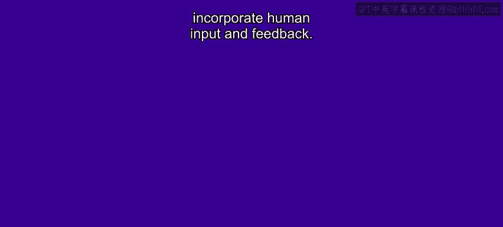
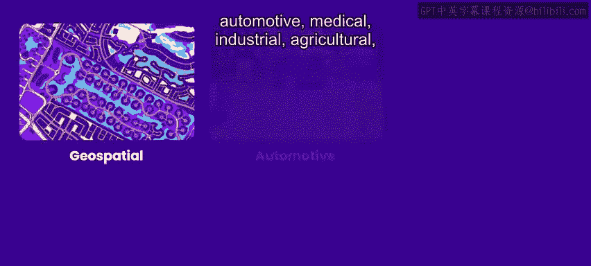
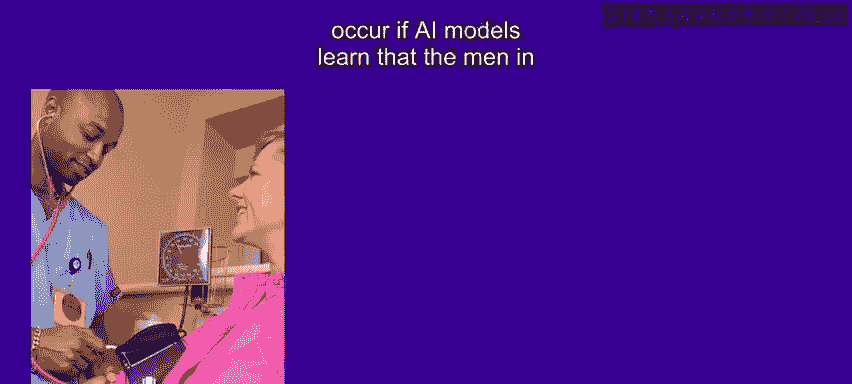
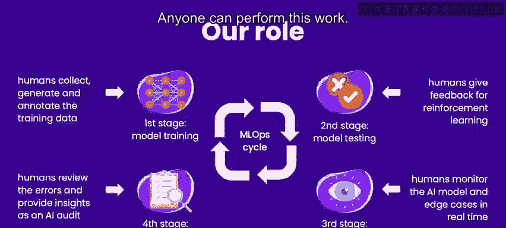
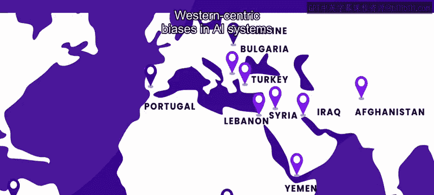
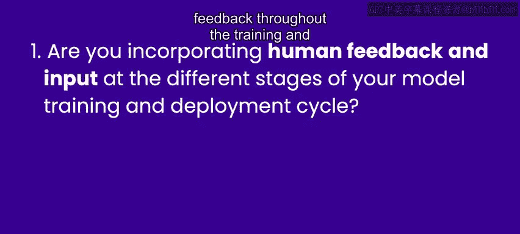

# 吴恩达《AI for Good专业课程》 AI与公共卫生、气候变化、灾难管理｜中英字幕 - P18：17_Iva Gumnishka建立一个道德的供应链.zh_en - GPT中英字幕课程资源 - BV13u411F7xZ

Hi， I'm Eva and I'm the founder and CEO of the Social Enterprise Humans in the loop。

We're an ethical provider of data and human input for AI systems， and we help companies。

 academic institutions and governments to source and collect data for their AI systems and to incorporate human input and feedback。

We work on various projects related to AI for geospatial， automotive， medical， industrial。

 agricultural and retail use cases。

A few applications of our dataset sets include labeled trash dataset sets for detecting trash and recyclable materials on marine shores。

 thousands of labeled surgical frames to train AI powered robotic surgeries and detecting damage on vehicles for automating claim processing journeys for insurance companies。

In addition to collecting and annotating data sets。

 our human operators have been involved in real time verification and approval。In all these projects。

 our involvement has been necessary in order to translate the human understanding and interpretation of the data to the A system。

Otherwise， how would a computer vision model know that the surgeon is performing what is called suction or the damage on the car should be classified as a scratch？

Human input and human feedback are essential in order to train trustworthy AI systems。

And ethics and diversity are key factors which should be considered throughout the process。Otherwise。

 models may learn， for example， to only recognize white hands performing surgery or only be capable of analyzing damages on vehicles that are typical in the United States。

 which may end up harming many end users。Other potential biases may occur if AI models learn that the men in scrubs should be classified as a doctor。

 while a woman in scrubs should be classified as a nurse。

 or if the model's accuracy is much higher for detecting skin cancer on one colored skin versus another。

So what does the process look like and when do we come in？

Throughout the AI training and deployment cycle， known as the machine learning Op cycle or MLOs cycle。

 there is a constant need for human involvement。For example， in the early stages。

 when you are training your model， you need to collect and label the training data。 Afterwards。

 when you are testing it， you may need human feedback in order to reinforce the desirable behavior。

When the system is in deployment， humans may be involved in order to monitor and handle alerts in real time。

 and then after deployment， you may need to review the model's outputs and audit its performance。

And these are all areas in which humans from around the globe can be involved to contribute with their understanding of the data and the moral decisions。

A lot of work is quite manual， but it also requires human operators to develop an expertise in the subject area and to exercise judgment。

Anyone can perform this work just by virtue of being human。

 you are already qualified to label and interpret data for AI。

 and your unique point of view is valuable in order to make AI systems more diverse。

In this we saw a great opportunity to generate jobs for vulnerable groups， more specifically。

 we're focusing on people who are affected and displaced due to armed conflicts around the world。

Toate， we have provided employment to more than 1000 individuals across the Middle East Europe and Africa。

 Their involvement is helping to eliminate Western ecentric biases in AI systems and to incorporate different points of view。

 For example， when collecting and labeling images of food。

 our workers can bring a wide variety of understandings of what bread looks like or what different dishes are called。

In addition， we guarantee that they are remunerated in a dignified way for their important work。

 and in this way， we guarantee that AI systems are created without the exploitation of human labor known as quickwork。

Through our social enterprise， we're making an impact both on the lives of vulnerable groups by connecting them to online remote jobs and on AI systems by ensuring that they have access to diverse and ethically sourced data and human input。

When you start working on your own AI projects for good， remember to consider the following。One。

 are you incorporating human input and feedback throughout the training and employment cycle of your AI models？

Two， are you using a diverse group of humans to provide that input？And three。

 are you making sure that they are compensated in a dignified way for their work？

By following these three rules， you will make sure to create an ethical supply chain for your air models Good luck。

