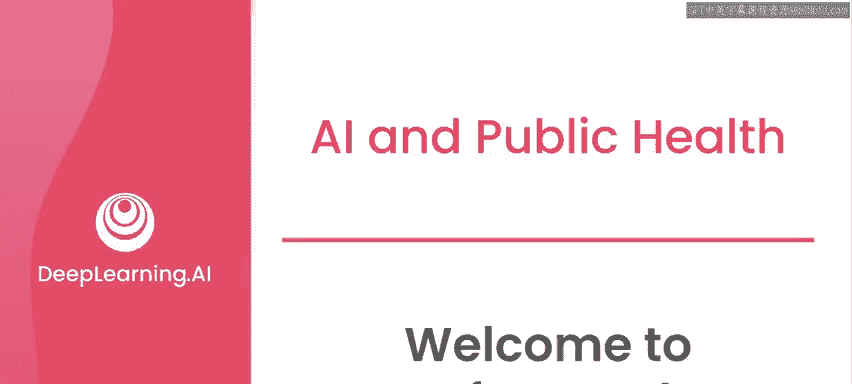
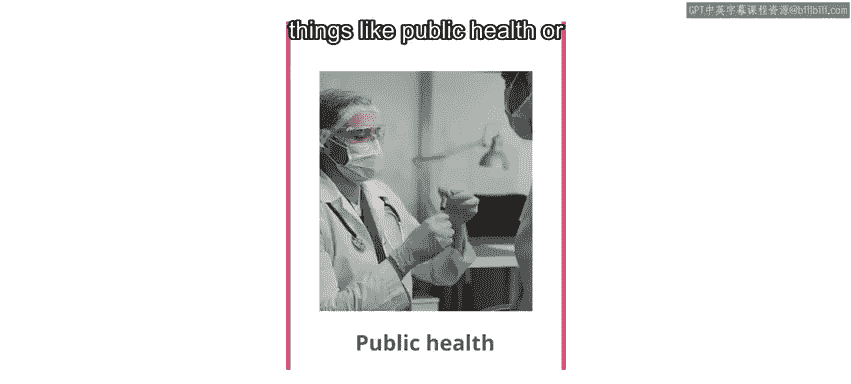
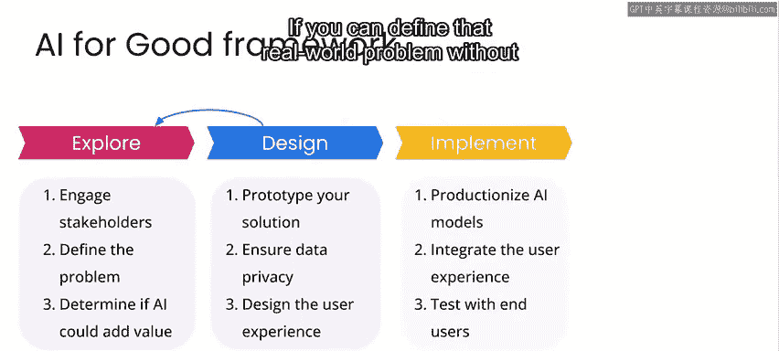
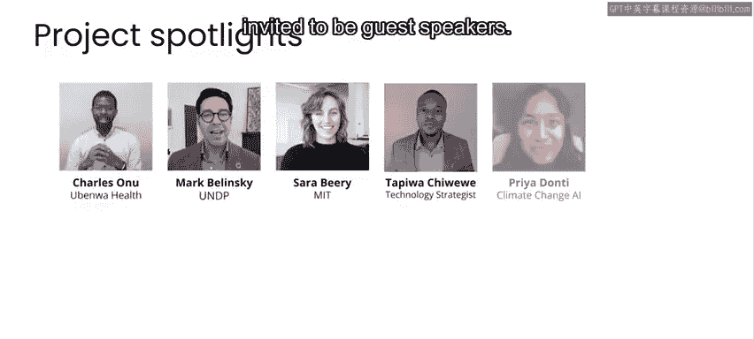

# 吴恩达《AI for Good专业课程》 AI与公共卫生、气候变化、灾难管理｜中英字幕 - P1：0_欢迎来到人工智能为善.zh_en - GPT中英字幕课程资源 - BV13u411F7xZ

Welcome to AI for Good if you're interested in how AI and machine learning can be part of the solution for real world challenges。

 things like public health or climate change or disaster management。

 this specialization will give you a sense。

When it comes to addressing complex real world problems。

 the potential solutions are often very complex as well。

 it might involve many different stakeholders， it may involve logistical constraints。

 sometimes data privacy issues and other things like that so we've designed these causes to give you hands-on experience working with AI applications。

 so you can see how the AI technology piece fits into the broader context of addressing some big challenges in the world。

I'm delighted to introduce your instructor for this specialization， Robert Monarch。

 who is an expert in building machine learning systems and how to fit them into human workflows。

 he has founded his own AI startups and Roberts also built AI products at the biggest tech companies including Google。

 Amazon， Microsoft， Apple， and Robert's worked for over 20 years in applying AI to addressing critical problems in the areas of disaster management and public hub around the world。

He holds a PhD from Stanford University and is the author of Human In loopop Machine Learning。

It's a pleasure to have you teach this specialization Robert All right thanks Andrew I'm really excited to be here I look forward to sharing a lot of the experience that I've had both in industry and as a disaster responder to help you think about the ways that AI can or maybe in some cases should not be used to help with areas like public health climate change and disaster response So you conscious yourself a disaster responder and you're an AI machine learning person Do share how you wound up blending those two things together in your career Yeah yeah happy to so I work in machine learning and in disaster response separately for almost a decade immediately before I moved here to Silicon Valley to get my PhD I was working in post-conflict development for the United Nations in Sierra Leone and in Liberia and I was working on electrical systems there so I was working in postconflict environmental development installing solar power systems at schools and clinics supporting refugee camps。

😊，And then following my time there， I came here to Silicon Valley to Stanford where we first met to start my PhD many。

 many years ago and some things had really stuck with me from my time as a disaster responder where in a relatively short amount of time in the early 2000s。

 most of the world started getting access to a cell phone but even the AI that we took for granted back then like search engines and speech recognition didn't work in the majority of the world's languages and so I thought well this is an interesting problem that is being faced not just in disaster response but in public health and in industry worldwide the world is coming online。

 but in order to access and interact with people a lot of the supporting in AI wasn't there and for a lot of these languages it still isn't today almost 20 years later so it was when I was at Stanford that I continued initially to work as a disaster responder。

In parallel we studied natural language processing and then eventually saw that there were some areas where AI and disaster response overlapped and was able to combine them Yeah。

 and so I think with the rise of cell phones and data。

 you know the data became available to do a lot of things。

 both in corporate product business settings and in solving these societal challenges and sometimes when there's a disaster。

 even when cell phones are around， a neural network may or may not be the solution to what's happening out there in the world。

Yeah that's right and certainly there are good times and bad times to roll out new technology often following a disaster is the worst time to roll out something untested。

 so I think there is a synergy here in that a lot of what we can use to help people follow in a disaster is best built in preparation for disasters maybe in preparation with industry partners who can help us road test and ensure technology works well so that we can understand its behavior when we deploy it to help some of the most at risk people worldwide so one of the things are' most excited in specialization is that in the context of public health and climate change and disaster response it will step through how to fit in machine learning AI in the context of a bigger project and I think these tools these techniques are useful for these grand societal challenges but also for building a product in a company。

And so I've seen in many contexts where a machine learning engineer will say。

 oh I do well on the test set， which is fantastic well you do well in a test congratulations。

 but sometimes that bridging that gap from doing well on the test set to you modeling some part of climate change or solving some concrete business application that can be a big gap and as a machine learning engineer。

 I think it's part of my job to help bridge that gap and I think the specialization will go through a lot of how to think about that Yeah I think that's a good way to think of it。

 you can have a good machine learning model but that doesn't necessarily mean that just because it improves in accuracy that the downstream use case will also be improved and in fact in this course transparently I start with a case in public health where we had deployed a system helping maternal health we could see the offline accuracy go up but the end users who were healthcare professionals didn't feel that benefit and ultimately we sunset of that project。

And so to your point， I think a lot of what we learn from industry about making machine learning important to help people in human tasks is a lot of what we see when we're focusing on public health and disaster response and other projects which are more specifically focused on near termm good。

So just for clarity， this is one of the least technical。

 maybe the least technical core that deep learninging AI has offered so far。

 and you don't need to have significant coding knowledge or even any meaningful AI knowledge in order to get through the specialization successfully。

 but if you do know about machine learning algorithms。

 that's great you see how learning algorithms fit into bigger projects and when you run through some of the code samples which we fully provide so you don't need to write code or provide code that you can run even if you've never coded before。

 you will see how machine learning pieces can fit into solving these very important societal problems。

Yeah so like we'll say throughout out here， you often don't want to be innovativeted on machine learning in the most critical situations so not going so deep on the technical side here is aligned with practice and I'm particularly excited that a lot of my colleagues from the disaster response industry might be able to take this course so people who work in disaster response and public health run most of the data and spreadsheets and I think a lot of these notebooks the right next step for someone that's been working with spreadsheets to think about how they can do a little bit more sophisticated exploratory data analysis and start evaluating machine learning models in a coding environment In fact I liked how in approaching a brand new problem you lay out the systematic framework that often starts of you know visualizing the data kind of E or exploratory data analysis and then that could feed into a thoughtful assessment so should even use machine learning for this sometimes machine learning is fantastic and sometimes is not quite right。

😊，So then you know building out model running the project but put that into systematic framework for approaching complex problems Yeah and I love the framework that we're presenting here which is similar to the frameworks I've using industry as well so you're thinking about whats the real world problem you're trying to solve and you can define that we're problem without mentioning machine learning so much the better and then you're looking at the data and get an intuition well Ken machine learning help before you start sitting down and implementing the model and another way to know results and one the thing I'm very s about is I do see many people know starting to learn machine learning or AI and thinking will it be cool if I could apply this to problems like climate change or public health so one of the things I'm really excited about is that we have a number of people that we're invited to be guest speakers and these are people working in different areas like public health and monitoring for wildfires where they're using AI as part of their solution and these are。

People who have spent their entire careers working together in social good and AI applications。

 so I'm very excited to be able to feature them in spotlights throughout this course。😊。

And so of that， I think many of us have felt this desire to take AI and go out and let's make the world a better place。

 let's use AI for good I'm excited to have you in this specialization and as you go through it。

 I hope that you learn how to build AI projects， that process that Robert and I were talking about how to evaluate and make an AI project successful and hopefully perhaps after taking the specialization you be inspired to go use these algorithms to actually go tackle。

 make a dent， make a difference in some of these most important societal problems facing us today so that let's jump into the specialization。

 please go on to the next video。