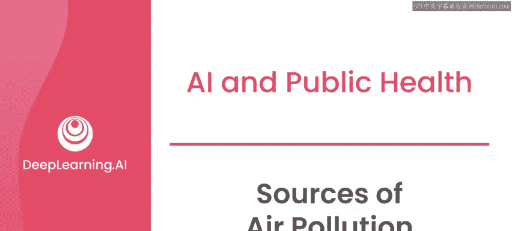
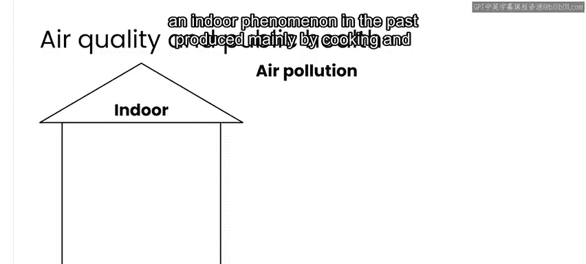
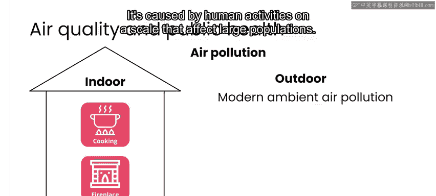
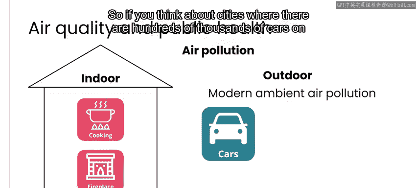
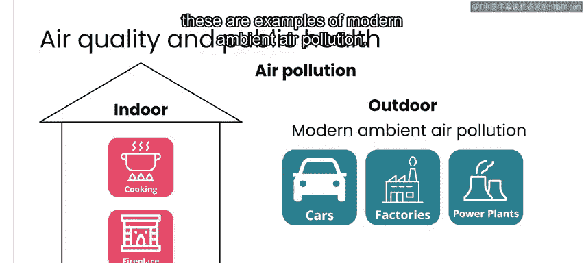
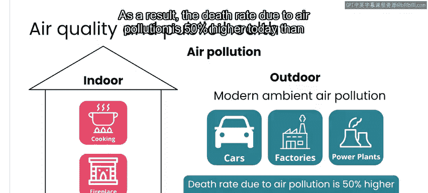
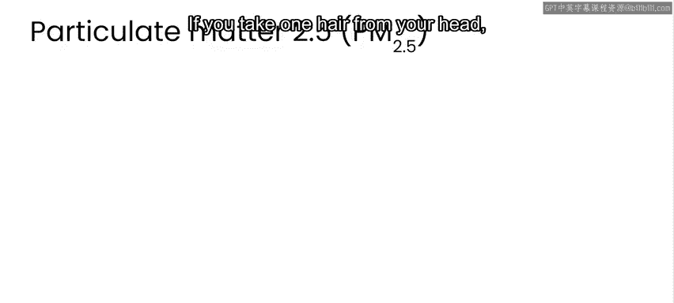
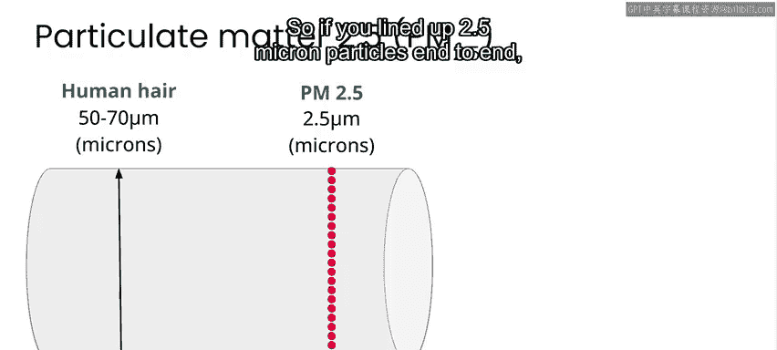
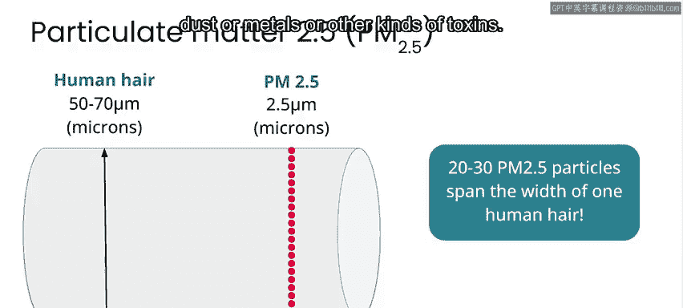

# 吴恩达《AI for Good专业课程》 AI与公共卫生、气候变化、灾难管理｜中英字幕 - P20：19_空气污染的来源.zh_en - GPT中英字幕课程资源 - BV13u411F7xZ

As you heard in the previous video， pollution is a major public health issue and millions of people die each year due to prolonged exposure to polluted air。

 In fact， the number of premature deaths from air pollution each year is similar to the annual number of deaths from COVD 19 at the peak of the pandemic。

Air pollution can come from many different sources and indeed there are both man-made and natural sources of air pollution。

 so if you're in California like me， you might experience air pollution from wildfires or in other parts of the world you might experience dust storms or active volcanoes however most air pollution。

 particularly long-ter persistent air pollution comes from human activity and the primary source among human activities is burning fossil fuels。

In this video， we'll take a look at what air pollution is and the dangers it poses to public health。

If you've ever seen smoke pouring out of a chimney at a factory an oil refinery or smell the exhaust from vehicles on the road or from a fire that you're passing。

 then you have firsthand experience with air pollution， many of us experience on a daily basis。

Health issues related to air pollution are not a new problem。

 and in fact have been around for thousands of years。

The biggest difference recently is that air pollution was primarily an endorph phenomenon in the past。

 produced mainly by cooking and heating with fire inside the home In fact。

 air pollution is still a significant problem where people cook or heat their homes with open fires and poor ventilation。

The encouraging news for this longstanding form of air pollution is that it's on the decline as better technology and better information reach more people about how to cook and heat their homes。

However， according to an article published in the Lanceer in 2022。

 what is known as modern ambient air pollution is on the rise。

 Mo ambient air pollution is outdoor air pollution it's caused by human activities on a scale that affect large populations so if you think about cities where there are hundreds of thousands of cars on the road as well as factories and power plants all emitting smoke into the air。

 these are examples of modern ambient air pollution while some cities and countries have been able to reduce air pollution regionally with policies and better technologies on a global scale the pollution continues to grow as our demand for goods and fuel and power grows and more people live in urbanized communities。

As a result， the death rate due to air pollution is 50% higher today than it was just 20 years ago。

The most common air pollutants are caused by human activities and these include what's called particulate matter。

 which just means really tiny bits of stuff， often only a few microns in size。

 as well as other things like ozone， lead and oxides of nitrogen。

 sulfur and carbon among of these pollutants， the most common and the one that causes the most deaths globally is particulate matter。

 specifically particulate matter that's less than 2。5 microns in diameter or PM2。5 for short。

If you're not familiar with microns as a unit of measurement， here's a way to visualize it。😊。

If you take one hair from your head， then a typical human hair is around 50 to 70 microns in diameter。

So if you lined up 2。5 micron particles and to end it would take 20 to 30 of them to span just one human hair so these things are incredibly small。

 It's so small in fact that when you inhale them they can get into the deepest parts of your lungs and even pass through your lungs into your bloodstream and that's what makes them so dangerous when you breathe them in。

 they go deep into your body and often stay there， these fine particles can be made up of ash or dust or metals or other kinds of toxins。

When you breathe in excessive amounts of PM2。5 over long periods of time。

 it can cause problems in your lungs and cardiovascular system， leading to chronic lung problems。

 ri lung cancer and cardiovascular diseases。So while it's important to keep in mind that air pollution includes many different types of pollutants for the rest of this course will be primarily focused on PM2。

5， given its role as the most common pollutant impact in public health。

 and fortunately for this use' case as a pollutant that tends to be among the more easier to detect with current technologies。

Air pollution caused by human activity is on the rise while we know how dangerous it is and where it comes from。

 we are not even close to building the policies and practices needed to slow down this problem。

 one of the most important steps towards informing these policies is to deploy networks of sensors this allows us to measure what pollution exists today and it allows us to inform citizens about the very real and immediate risks that they face。

In the lab this week you'll be working with air quality sensor data and so that's where we're going next。

 join me in the next video for a look at measuring air quality。

