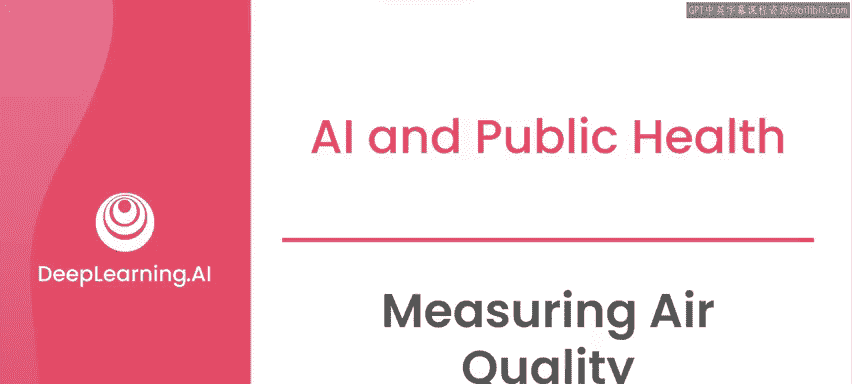
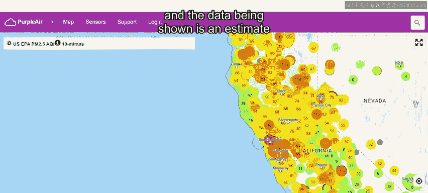
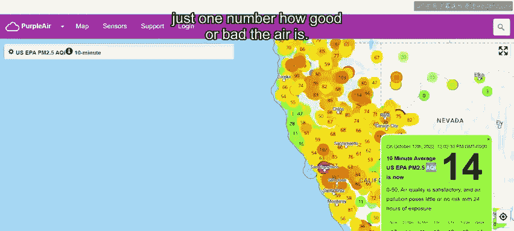
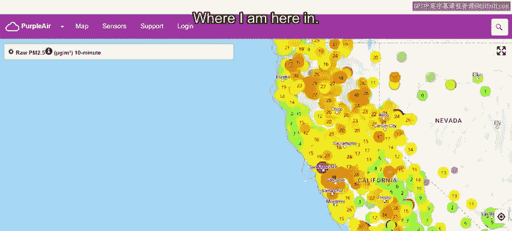
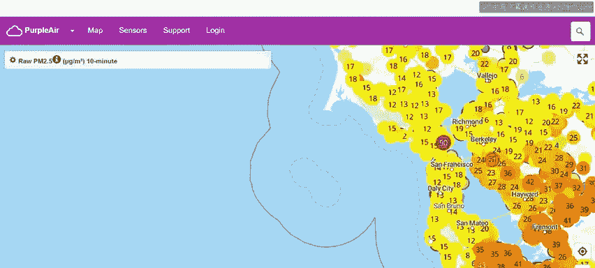
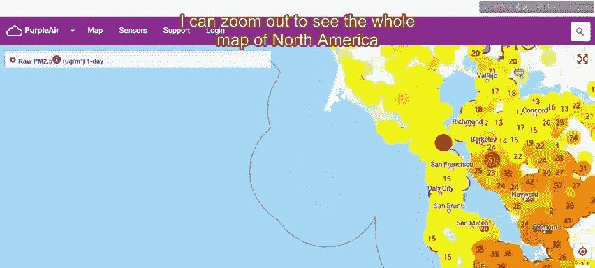

# 吴恩达《AI for Good专业课程》 AI与公共卫生、气候变化、灾难管理｜中英字幕 - P21：20_空气质量测量.zh_en - GPT中英字幕课程资源 - BV13u411F7xZ

In many locations around the world， public and private individuals and institutions are measuring pollutant levels in order to have a more quantitative understanding of the air quality the goal of these measurements is both longter and short term so in the short term this will help inform the public about when pollutants are rising to dangerous levels in their specific area or provide insights into what are the right times of day or days of the week to more safely go outside in the longterm monitoring and pollution helps us to quantify the magnitude of the problem to identify which way things are trending in different areas and to inform policies and practices that will eventually help reduce the amount of pollutants in the air。

There are various websites and apps that now publish realtime air quality data。

 and if there' a senses near where you are， it's possible that you can see right now just how good or bad the air quality is outside。

One such site is purple air， where you can navigate around on a map of the world and zoom in to see the sensor data for thousands of locations worldwide。

 In this case， the sensors generating these measurements are small and relatively inexpensive sensors that only measure particulate matter。

 temperature， pressure and humidity。 These are sensors that have been purchased by individuals who want to know what the air quality is of their location and then all the data for all the sensors is shared so that anyone else in the world can also see the measurements。

Here I'm looking at California in the Western United States and the data being shown is an estimate of the so called air quality Inex or AQI。

This is a combined index that attempts to say with just one number how good or bad the error is。

An AQI below 50 is considered good， while an AQI over 150 is considered unhealthy such that you should avoid outdoor activities altogether if you can or wear a mask。

These are real time measurements and so you can quickly get a sense of how much pollution is in the air in a particular location at any given time。

Related to Alco， I can also select row PM2。5 to directly see the PM2。5 levels。

Now the data being shown are a measurement of PM2。5 in units of microgram per meter cubed。In the US。

 the Environmental Protection Agency has established that healthy levels of PM2。5 exposure。

 less than 12 micrograms per me cubed on average over the long term。

And so that means that the amount of PM2。5 in the air you breathe may be higher or lower on some days or in some locations compared to others。

Over a long period of time， like say， a year， you'd like the average to be lower than 12 on this scale。

What you can quickly see on this map is that while many locations are showing good air quality in some areas。

 the PMm2。5 levels are quite high。Where I am here in San Francisco。

 it looks like the current levels aren't great right now。

In this map， you can click on a data point to see more information about past measurements at that location and including averages of different periods of time。

You can also see a historical record of measurements at that location。

 and up here I can switch to a longer aver in period like one day average。

 and in this case I get a longer historical times span looking back over the past year or so。

You can also download the data for any of these sensors if you'd like to do your own analysis of pollution levels over time。

 I can zoom out to see the whole map of North America。

Or of the entire world and that there are sensors in many locations around the globe if you're curious。

 you can have a look and see if there are senses near where you live that could give you an idea of the air quality in your area。

Just note that unlike our examples in Bogaar， these sensors have not necessarily been installed by people with any expertise or at strategic locations。

 a large number of these sensors might have been installed near chimneys or other places which could produce erroneously high or otherwise error prone signals。

Up next， we'll be heading to Bogota Columbia， where the city has deployed a network of air pollution sensors and your job will be working directly with that data to build air quality mapping products similar to what we're just looking at for the purple air site so join me in the next video and we'll take a closer look at air quality in Bogota。

