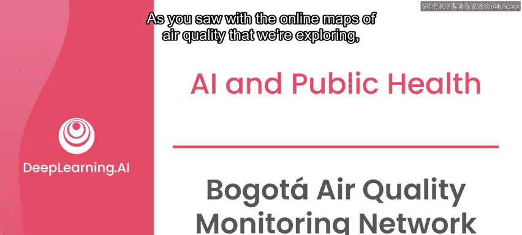
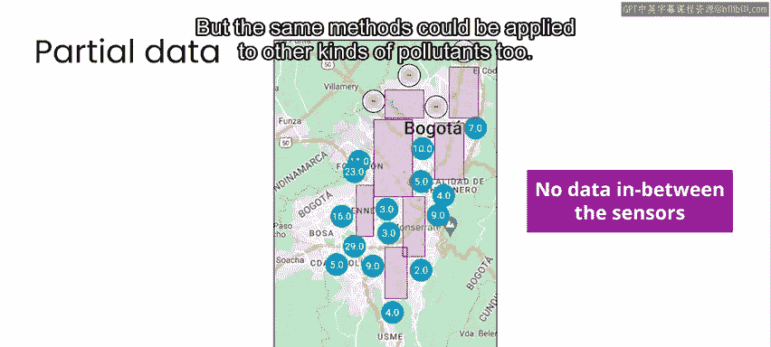
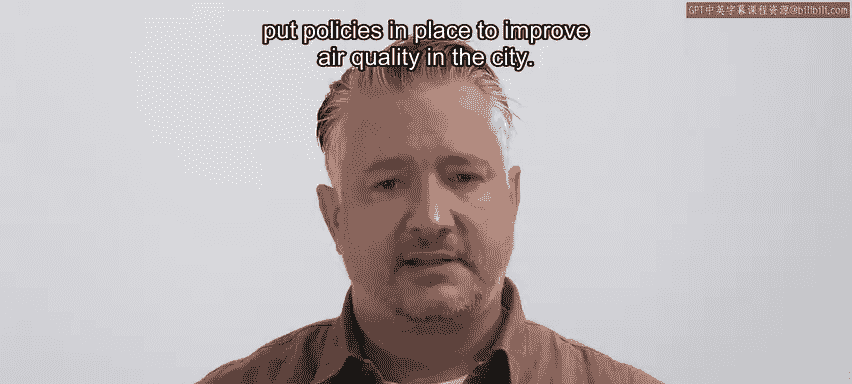

# 吴恩达《AI for Good专业课程》 AI与公共卫生、气候变化、灾难管理｜中英字幕 - P22：21_波哥大空气质量监测网络RMCAB.zh_en - GPT中英字幕课程资源 - BV13u411F7xZ

As you saw with the online maps of air quality that we're exploring。

 having real-time measurements of pollution as well as historical data in a particular area。

 it can be really useful when it comes to knowing whether air is safe to breathe as well as what the trends in pollution looks like over time for the rest of this course。

 you'll be working through a project to measure air quality in Bogata。

 so I'd like to imagine that the city of Bogaar has hired you and your team to help them improve their existing air quality mapping application that provides estimates of air quality of the season of Bogaar and informs policies from proven air quality over time。

And like I said before， while using Buuggaar as an example in this case study。

 you could use the techniques you see here to build air quality mapping applications for your own city or anywhere else that you have access to air quality sensor data。

Bgota is the capital of Columbiaia near the northern tip of South America。

 and with a population of over 8 million is one of the largest cities in South America。

 somewhat similar in size to New York City or Benaluru。Just like in any big city。

 there are cars and trucks on the roads as well as extensive industry and power plants to serve the needs of the population。

All of this leads to air pollution and variable air quality throughout the city。Studing in 1997。

 the local government of Bogoar has been developing a network of sensors throughout the city that now record regular measurements of particulate matter。

 ozone， oxides of sulfur， nitrogen and carbon， as well as atmospheric conditions at 20 locations throughout the city。

😊，These are not small inexpensive sensors like in the purple Air network that you saw in the last video。

 rather they are scientific grade sensors where the entire suite of equipment is about the size of a large delivery truck and unlike the purple Air network the set of 20 sensors are put in very strategic locations so I think this is interested to consider if you want to take the approaches here and apply it to something like the purple Air network maybe in your neighborhood these 20 sensors are much more reliable than the more inexpensive sensors that a lot of people use on the purple Air network and are being deployed in much more strategic locations with the purple Air network the sensors are going to be much more concentrated in specific residential areas。

And they might not be deployed correctly， so for example。

 I often get alerts of air quality near my house because someone has deployed a purple air sensor inside their kitchen and so you learn while this is one of the biggest forms of air pollution there's pollution from cooking that is not the intention of the purple air network。

 so if you do think about taking the kinds of models and approaches that you're learning about here in Bogoar to other kinds of sensor data。

 you need to take into account how the distribution of the network and how they might be deployed could impact the success of your particular system。

😊，The city's long term goal is to manage and reduce the levels of air pollution throughout the city in accordance with specific UN sustainable development goals。

😊，Specifically， these are to substantially reduce the number of deaths and illnesses from hazardous chemicals in the air。

 water and soil， as well as to reduce the adverse per capita environmental impact of cities。

 including paying special attention to air quality。With these goals in mind by 2030。

 the city of Bagoatar aims to have 70% of the city within the recommended healthy limits for air quality。

 so by WHO， up from just 25% of the city as measured in 2015。In the short term。

 the city aims to provide its citizens with real time measurements of air pollutants。

 as well as forecasts for air quality over the next 48 hours。They publish the data on their website。

 we can search through or download the data， and this is where you come in。

Now let's take a closer look at air quality measurements recorded by a Sson network that's been deployed throughout Bogota。

The city has developed a map and application already and it looks like this here you can see the location of each of the sensor stations throughout the city and if you click on a particular station here。

 you can see a photograph of that station as well as some of the historical data on previous recordings from the past week。

You can also see an overlay or an interpulation map that provides an estimate of air quality in between the stations。

In the labs that follow， you'll be putting together a similar application and focusing on two particular additions to the existing system。

 both related to estimating measurements。The first addition is that from time to time the sensors unexpectedly go down。

 This means that there are times when there are no measurements available for a certain sensor when one of the stations on this map shows this under maintenance icon。

 then that means that the sensor for PM2。5 in this case is offline。

So you'll be working on a feature that can make estimates of 2。5 at a given station。

 even when that sensor is temporarily offline。The second feature that you'll work on is an improved interpulation map。

 there are 20 census stations throughout the city and you would like to do a better idea providing estimates of air pollution in between the censs。

 not just at the census themselves。In this case， we'll be looking specifically at PM2。5。

 given its outsized impact on the health of populations。

 but the same methods could be applied to other kinds of pollutants too。

So in short， your goal is to be able to provide a product that allows citizens of our guitar to see improved real time estimates of PM2。

5 concentrations。At all hours of the day and at all locations of the city。

 and so youll create a mapping product built on your estimates that provides。😊，PM 2。5 readings。

 even if a particular sensor goes down and to make more accurate andplateulated estimates of air quality in between the sensors Before we get started though。

 I would like to introduce you to some of the actual stakeholders for this project。

Together all the relevant details about the work being done with regard to air quality in Bogota。

 we went to the primary stakeholders， that is we visited the office of the Seetariat of the Environment for the City of Boggota。

And these are the people who run the air qualityuality Cens network and put policies in place to improve air quality in the city。

So please check out the next video to learn more about their efforts to measure and improve air quality in Bogota。

 and then we'll jump into the explore phase for this project。

