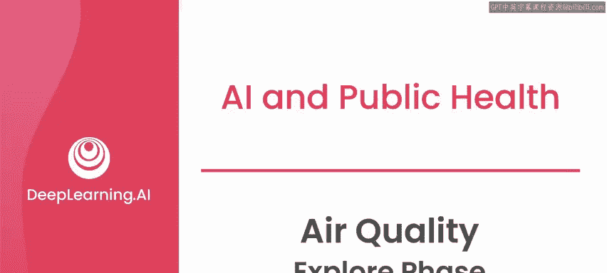
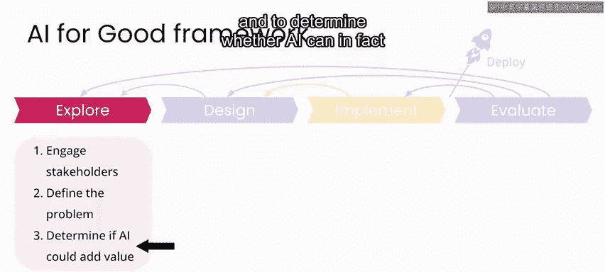
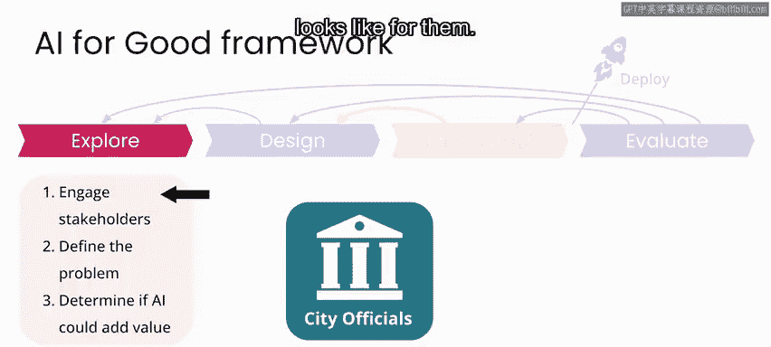
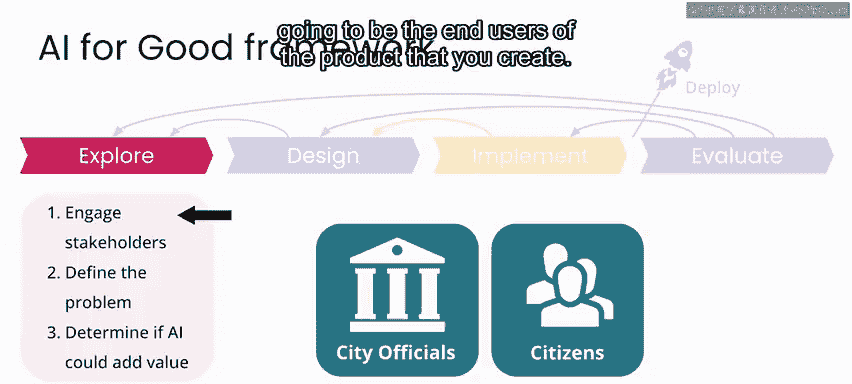
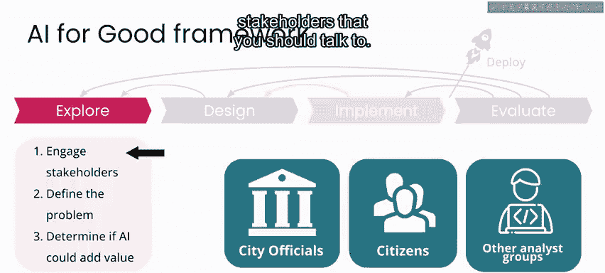
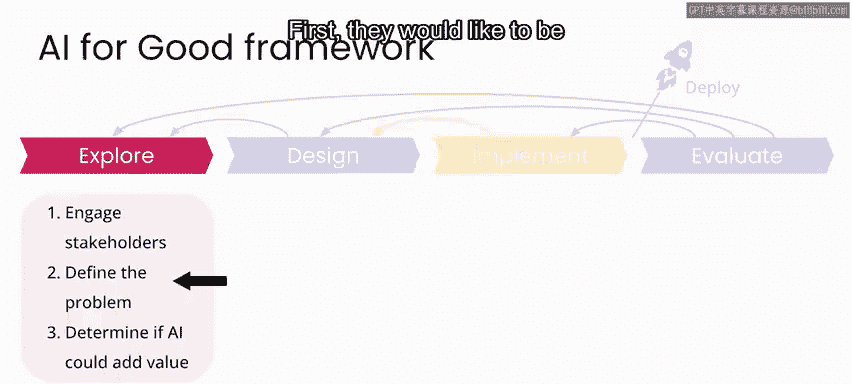
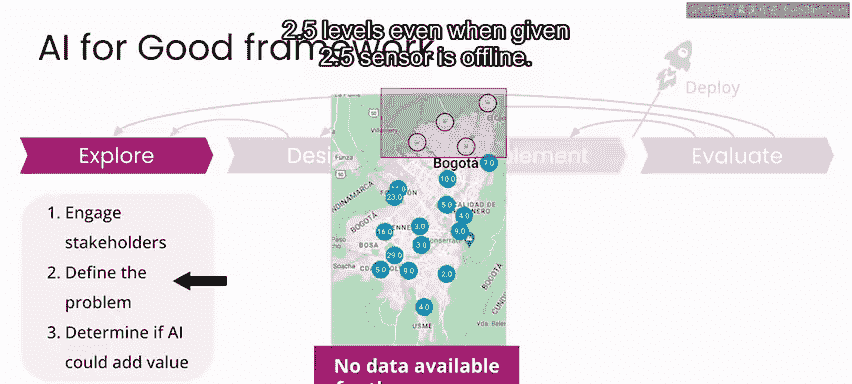
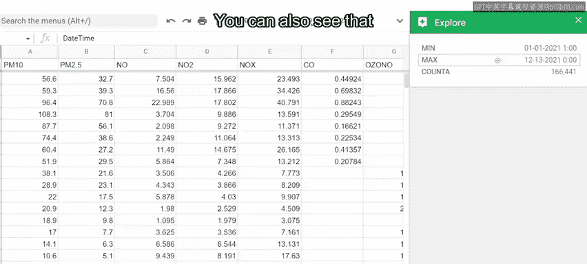

# 吴恩达《AI for Good专业课程》 AI与公共卫生、气候变化、灾难管理｜中英字幕 - P24：23_空气质量探索阶段.zh_en - GPT中英字幕课程资源 - BV13u411F7xZ

In the last video you got a rough sense of the problem that needs to be addressed and what a successful outcome might look like you're now ready to jump into the explore phase of the Bogoar air quality project。

In this explore phase of the project， your goal is to engage with the stakeholders to make sure that you understand their needs。

 to clearly identify the problem you're going to work on and to determine whether AI can in fact provide value as part of a potential solution。

For the step of engaging stakeholders。In this scenario。

 you would need to spend some time with representatives from the city to make sure you understand clearly what a successful outcome looks like。

For them， and you'll probably also want to spend time with the citizens who are going to be the end users of the product that you create。

It would also be a good idea to talk with people who have implemented similar solutions elsewhere to better understand the best practices and things to avoid。

As you engage with different groups of stakeholders in the Explor phase。

 you will also learn about additional stakeholders that you should talk to。

When it comes to your problem statement， as I mentioned in the previous video。

 there are two key features that the city would like to incorporate into their air quality mapping application。

First， they would like to be able to provide estimates of 2。5 levels even when a given 2。

5 sensor is offline， and second， they would like to improve the estimates for areas in between sensors。

In this case， your problem definition could be something like public health professionals working with the city of Bogoar need to be able to provide realtime estimates of air quality throughout the city so that citizens can be aware of any health risks due to pro air quality and plan their outdoor activities accordingly。

So notice with this problem statement， you're not describing the technology at all。

 you're not describing the technology but instead are focused on the individuals involved and the problems that they need to address。

With this framing of the problem， it makes it clear who some of the stakeholders are。

 what a successful outcome will look like and also what you're not trying to do。

 we are not trying to or able to completely solve air quality in Colombia。

 we are improving sensor measurements in a very small part of Columbialombia。

 namely the areas around these sensors in Bogota， which in turn can help us move policy and practice in the right direction for air quality。

Finally， you need to determine whether AI can even add value as part of this project if you're not an AI expert yourself as this might involve talking with some people who have worked in practical AI settings in the past to get an idea whether AI has been used for similar projects and the potential risks and consideration this step will also involve establishing what kind of data is available and necessary for a successful project。

In this case， the data that has been made available to you looks like this。

What you'll notice here is that you have several columns of data， and in this case。

 each of these columns correspond to a particular pollutant， so you can see here that you have PM10。

 which is a larger particulate matter， PMm 2。5， which were focused on here。

 as well as other pollutants like oxides of nitrogen and carbon monoxide。

You also have an identifier for which station each measurement comes from and the time and date the measurement was made。

So you can see here from the time in date column， there's this historical data， it comes from 2021。

So here for the date and time column， you see that the first date is January 1s， 2021。

 and the last date is December of the same year， so it's about one year of data。

You can also see that a new data point is recorded hourly。

 so youll have hourly data span in about one year。

Ultimately， with this project， you would like people go to do a system that can ingest and make predictions in real time。

 but having an historical data set like this allows you to consider various implementations of the solution and test it out before working with current data。

If you look at the details of some of the other columns。

 you can see that the number of valid data points or the count shown here is different for each column。

 and this should be your first indicator of the extent of missing data in the data set。

You can also scroll down through the data and start to see some of the places where the data is missing。

Right here， for example， you can see that the PM2。5 sensor data looks like it was offline。

But you can see that we saw measurements for some of the other pollutants at that station。

 and this is important because this will turn out to be features that we can build our models on to create better estimates for what that 2。

5 data should look like。So now you've got a bit of a sense of what the data looks like and this is one of the first things you should do in almost any project。

 have a look at the data whether you're an AI professional or a disaster response professional a lot of the things we look at first spreadsheets of data to get an understanding of the distribution of missing data of potential outliers of the diversity in the data of how much we can and can't interpret So while looking at spreadsheets its the right first move when we want to start building in more scalable systems on top of that data we then move into code environment so here we'll be working with the same data using Python in a Jupyter notebook environment if you never use Python or Jupyter don't worry I'll walk you through how to navigate the lab environment in the next video。

