# 吴恩达《AI for Good专业课程》 AI与公共卫生、气候变化、灾难管理｜中英字幕 - P26：25_空气质量探索和可视化缺失数据.zh_en - GPT中英字幕课程资源 - BV13u411F7xZ

In this video I'll walk you through the first part of the Data exploration notebook for the Bogerer Air Qity Project。

 here you'll be looking at some summary statistics and visuals about the data to get a better a sense of the characteristics of the data set itself。

 plus any challenges that you might face in running analyses over the set。Okay。

 so here we are inside the notebook。First off， here at the top of the notebook is a link to the website hosted by the city of Bogota。

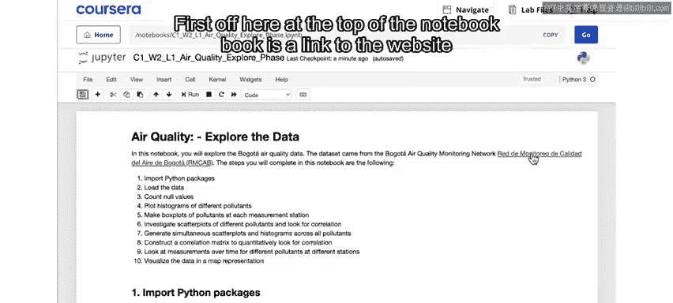

And you can also use this website in English。And here you can see some more details about the air quality Mon network in Boggota。

 the ROMCAB。And this is where the data comes from that you'll be working on in these labs。

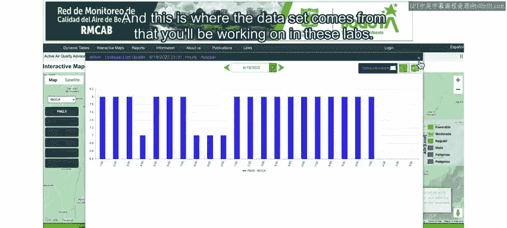

You can explore this site to see what their mapping application looks like today and get some sense of how they're using this data。

 you can also download any of the data if you like by going to reports up here and then station report。

Oh。Jumping back into the notebook。

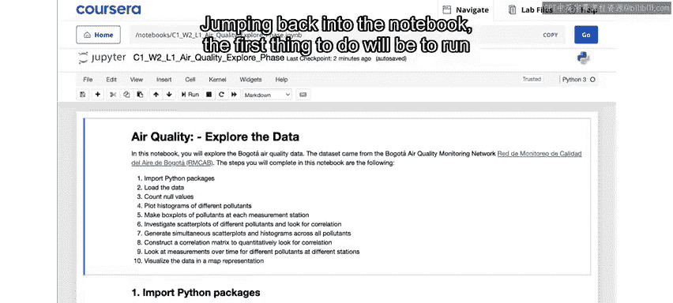

The first thing to do will be to run this cell to import all the necessary packages。

 just like we saw at the start of the previous notebook。And by importing this one called UTs here。

 I'm importing all the functionality that is defined in this file called Us。

pyI that's in the same folder as your notebook。

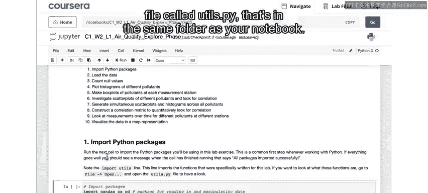

You can see what's in the Us。by file by clicking on the Jupyter icon up here and opening the file。

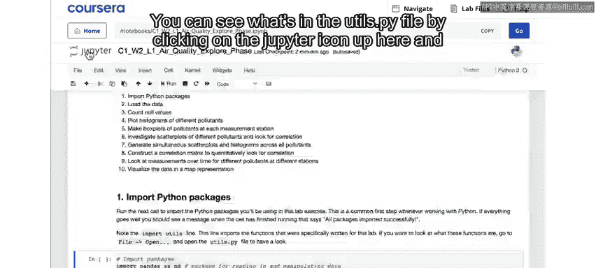

The way we've set up these labs is that for each notebook we've defined various functions here in the Us file that you will use。

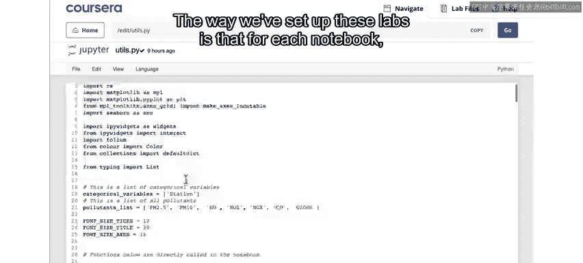

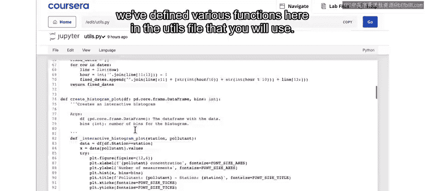

And if you're already a Python programmer， you might find some of this stuff useful in your own projects。

 both the visualization tools， as well as the modeling functions， so please have a look。

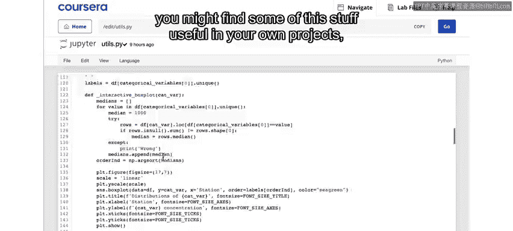

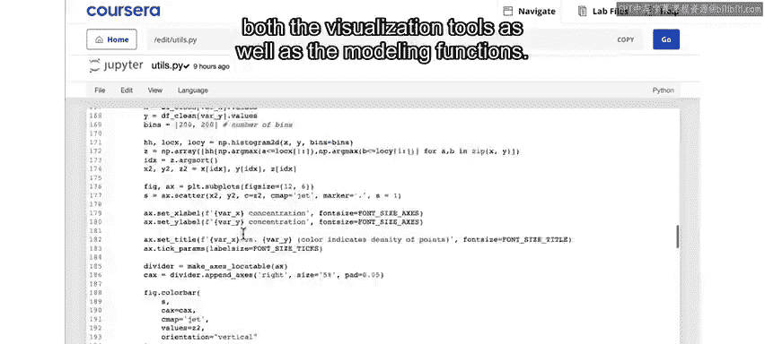

Heing back to the notebook here。

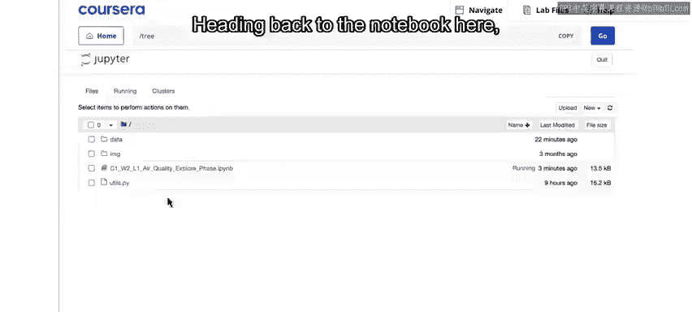

We'll just run this first cell to import the packages。

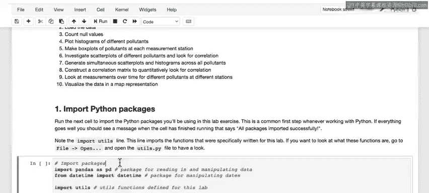

Then I'm going to read in the data set with this cell。

 and what I'm doing is reading it into a variable called role underscore the score dataator。

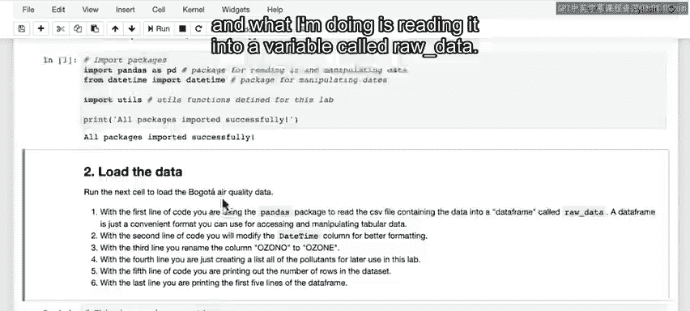

What I'm also doing here is printing out how many rows are contained in the data set。

As well as the contents of the first five rows of data。

To spot check that everything was read ins successfullycessfully。

And you can see that this is the same data set that you were looking at in a spreadsheet previously。

 where you have various pollutants in different columns。

 as well as a station identifier and a times stampamp listing the date and time。

And in the following so， this command prints out how many data points are missing from each column。

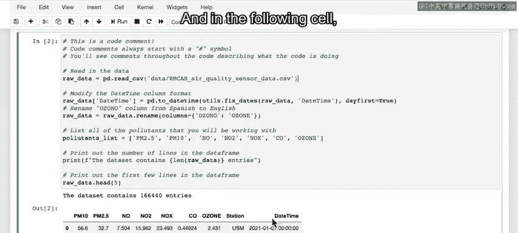

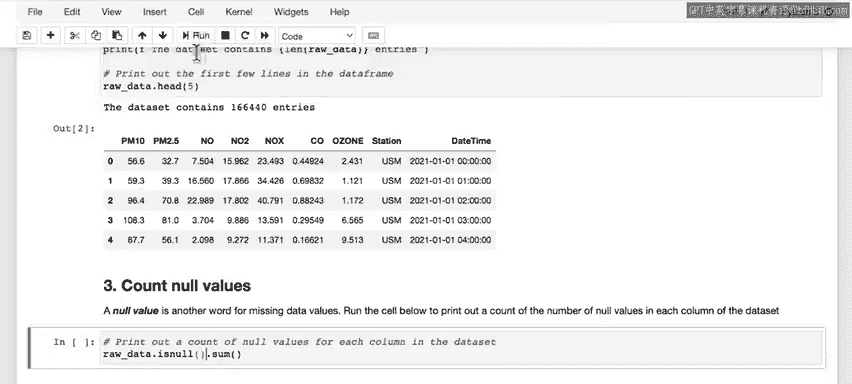

And so each of these numbers will give you a sense of how much missing data there is in each column。

So you should be able to see that with 15 to 30，000 missing values per column in a data set of roughly 160。

000 rows， you're missing between 10 and 20% of the data across various columns。

 so this will be a significant issue in your analysis。

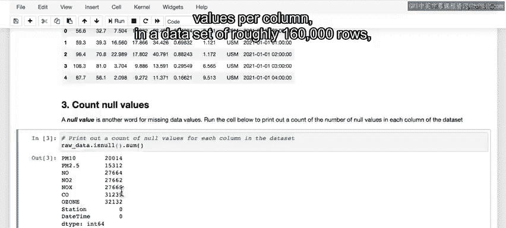

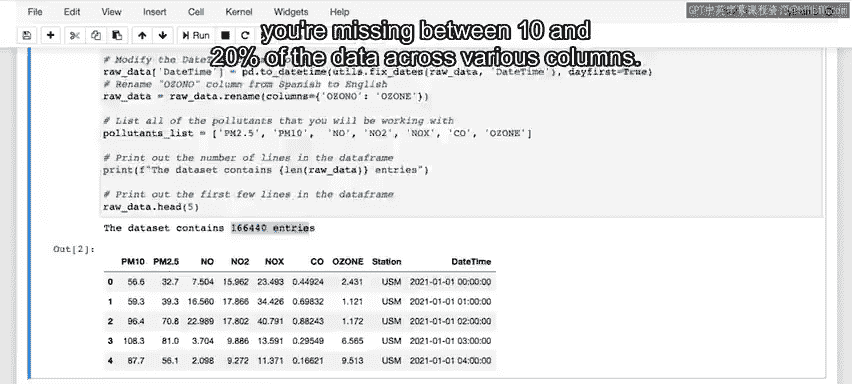

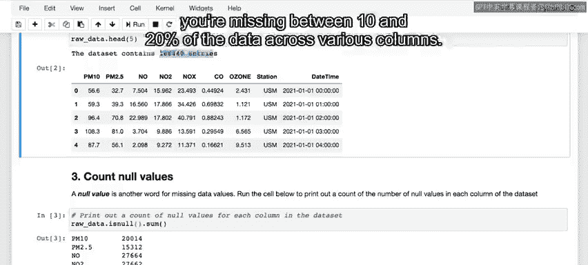

And recall， this means that。It is likely that between 10 and 20% of the time。

 various sensors tended not to be able to produce a reading for one of the pollutants that they were trying to detect。

Replacing missing values with an estimate will be one of the challenges that you'll tackle in the next notebook。

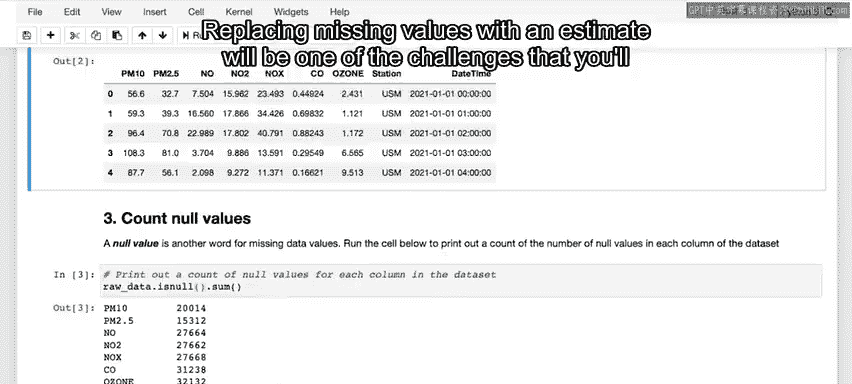

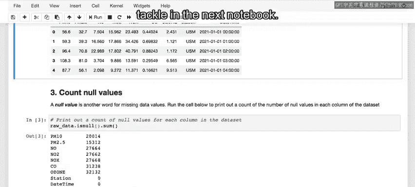

When you run this next cell， you'll see the distribution of PM2。

5 values for a particular station plotted here in a histogram。

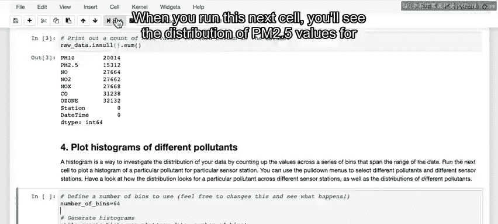

Viewing the data like this can give you a sense of the distribution of values for example。

 I can see here that the PM2。5 at the USM station covers as a range of around0 to probably around 70 there with a peak at what's that about5 so we have a very uneven distribution which is skewing towards the lower value and this is obviously a good thing we want a lower value of PM2。

5 most of the time。

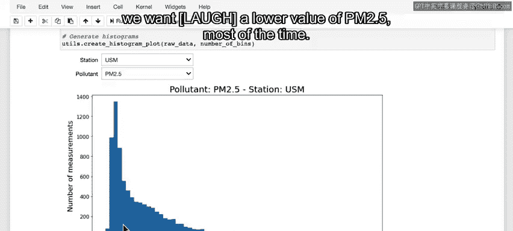

You can use these selectors here to choose a different station or a different pollutant and investigate the distribution of each pollutant at each station。

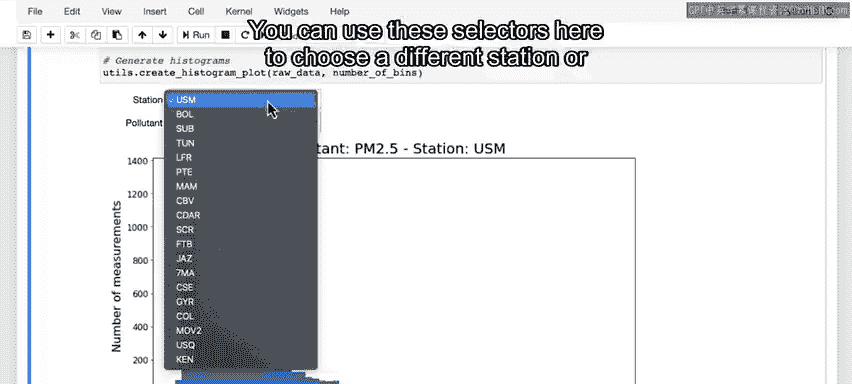

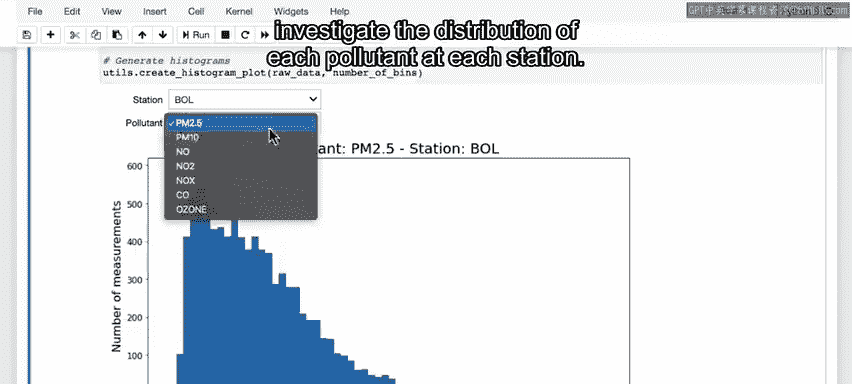

It's important to get a sense of what the distribution of the data looks like across different features。

 in this case， different pollutants and different sensor stations。In this way。

 you are able to familiarize yourself with the characteristics of your dataset as you consider whether AI might add value to the project that you're working on。

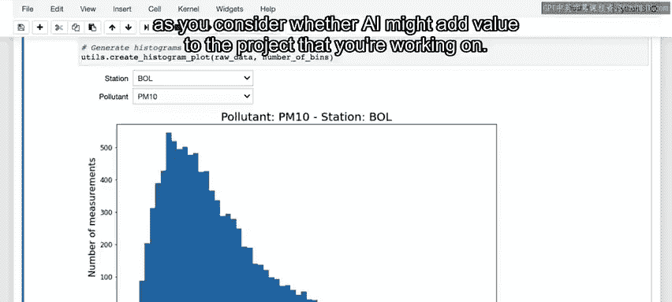

When you run this next cell， you generate another type of graph known as a box plot for a particular pollutant。

 PM2。5 in this case。

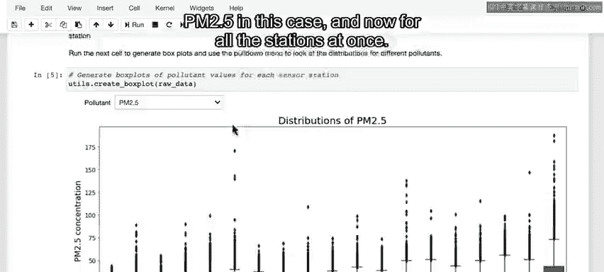

And now for all the sessionss at once。So you'll have the station name on the X axis along the bottom here。

And the PM2。5 values and ranges on the Y axis here。

The way that these box plots work is that the horizontal line in the middle of each box shows the median for the distribution。

 and the extent of the shaded box shows the range that captures 50% of the data around the median。

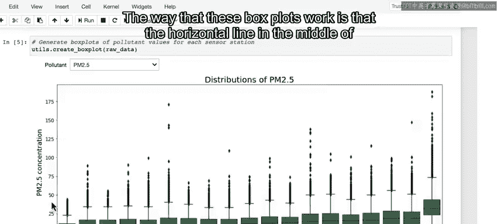

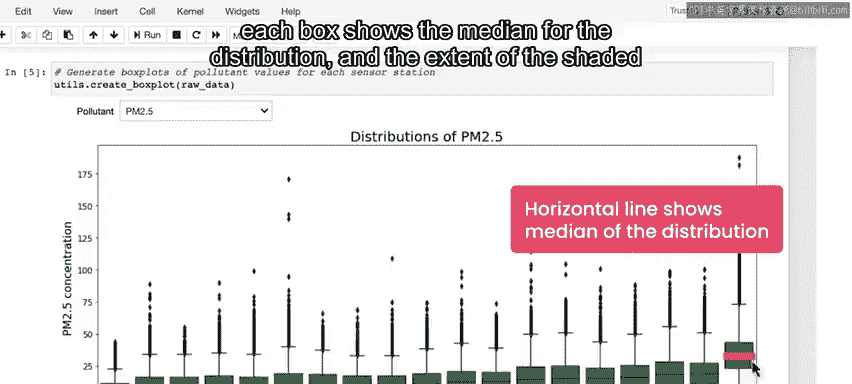

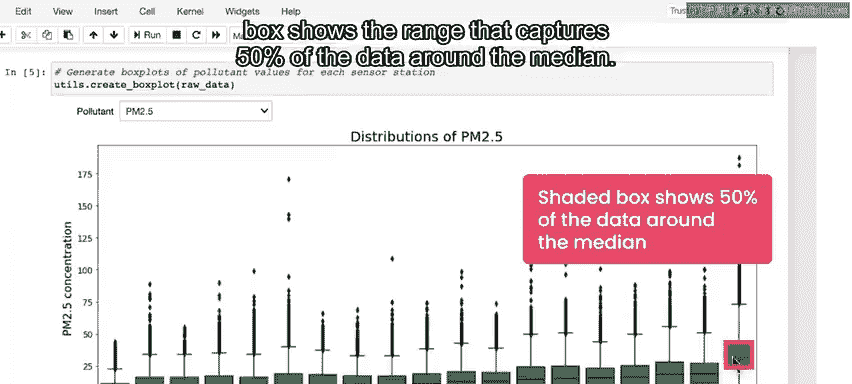

Individual data points are also flooded here along the vertical axis。

This plot is essentially showing the same information that you're looking at in the histograms。

 but now in a slightly different way。 if you imagine you're looking。

Down from on top of the histograms， then you can see the range of values covered along with vertical access and get a different perspective of what the distributions look like。

 including the full range of the data in any outliers。So when I look at the data here。

 there are a couple of things that give me pause all around the data being very sparse at the higher values。

 so this is good for the city of Bogoatar and the citizens there， the cases where PM2。

5 is above 50 is pretty rare and above 100 and very rare and so。

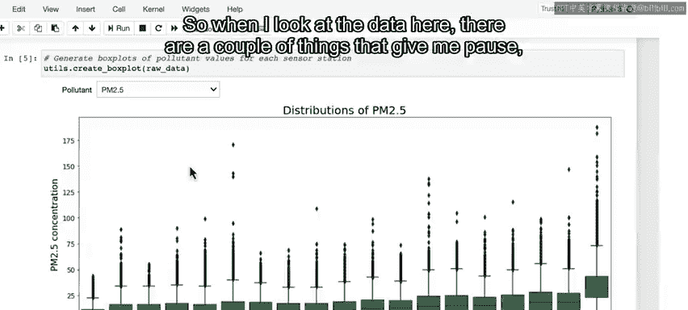

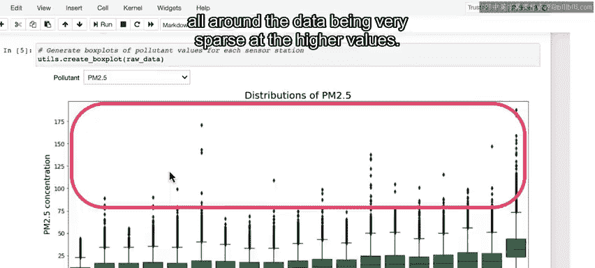

While that's good for air quality， what it does mean is that we don't have that many data points to train on at the points where the air pollution is the worst。

 and so that tells me that I don't expect my machine learning model to be as accurate in predicting missing values or predicting the values in between stations when the pollution is potentially at its most dangerous。

 and as we'll come back to you later in the lab we'll talk about how inaccurate predictions when the pollution is bad。

 whether that's a false positive or a false negative。

 could potentially be more harmful for a real worldld application。

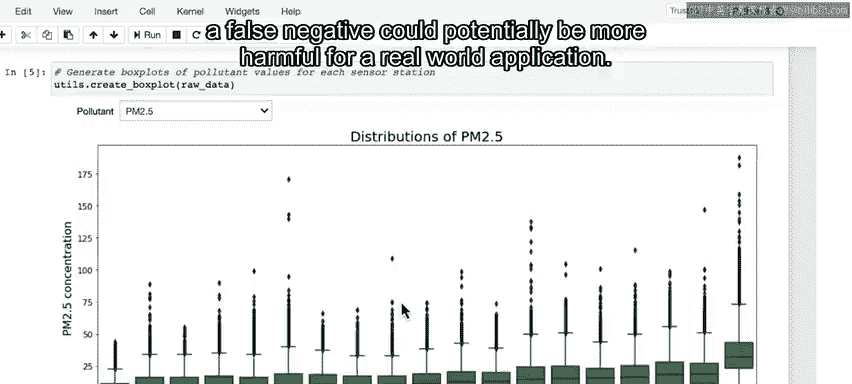

The next cell in the notebook allows you to create scatter plots for any two pollutants and compare the distributions to one another。

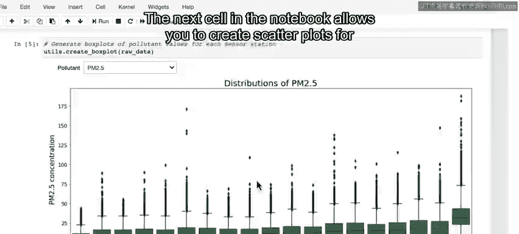

Now you can see that you have one pollutant along X axis and another along the Y axis。

And each point shows the value of each of those two pollutants for a sensor measurement made at that particular time and station。

First， we can look at PM2。5 plotted against PM 10， and not surprisingly。

 there is a strong positive correlation between the two。

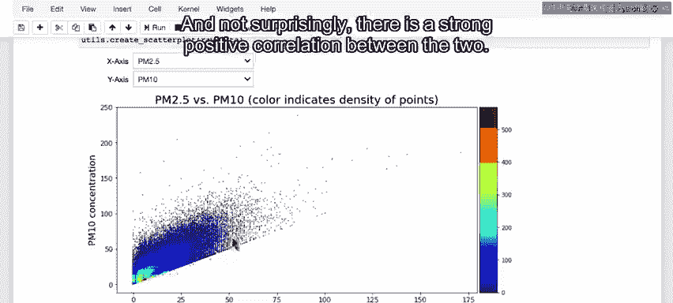

I recommend that。You click around and have a look at different pollutants across different stations and see which of those correlate。

 get an newtuition for how strongly they might correlate。

 and also whether sum might be a negative rather than a positive correlation。

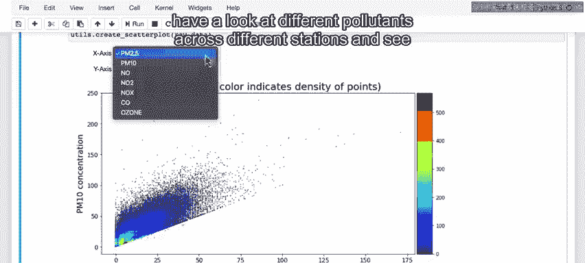

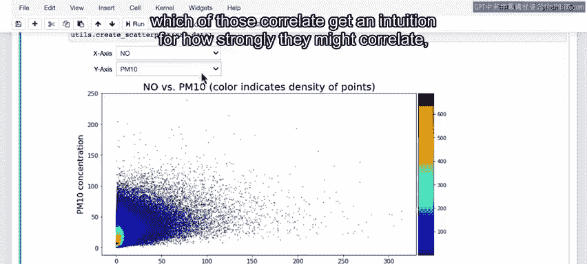

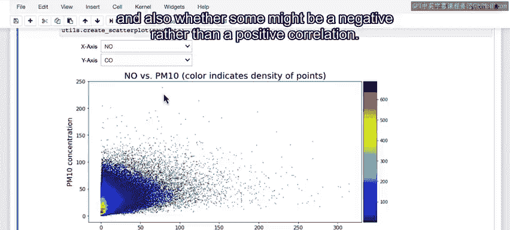

Looking at individual scatter plots and histograms and other visuals like these is a really common step in what's called exploratory data analysis。

 so this is where you're trying to get a sense of what the characteristics of a data set is。

So please join me the next video to continue your exploratory data analysis and we'll wrap up this lab on exploring E data。

