# 吴恩达《AI for Good专业课程》 AI与公共卫生、气候变化、灾难管理｜中英字幕 - P27：26_空气质量探索相关性.zh_en - GPT中英字幕课程资源 - BV13u411F7xZ

In the last video you got started with exploratory data analysis for the Bogaar Air qualityity Project in this video I'll walk you through the rest of that exercise where you'll be looking at more summary statistics and visualizations of the data to get a better sense of the characteristics of the data set and to confirm that it looks sufficient for the goals of your project。

First off， if you're just opening up the lab now， you'll need to start at the top and run all the cells up to this point before you continue。

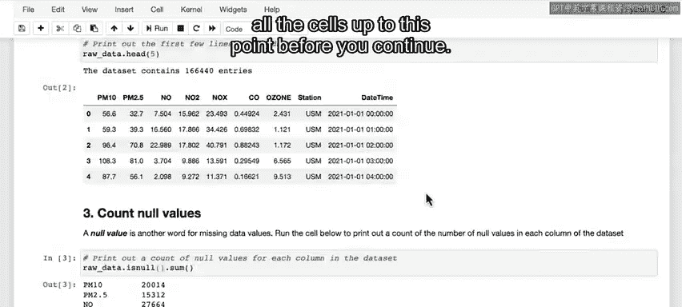

Or if you've been following along and already run the cells above， you can start right here。

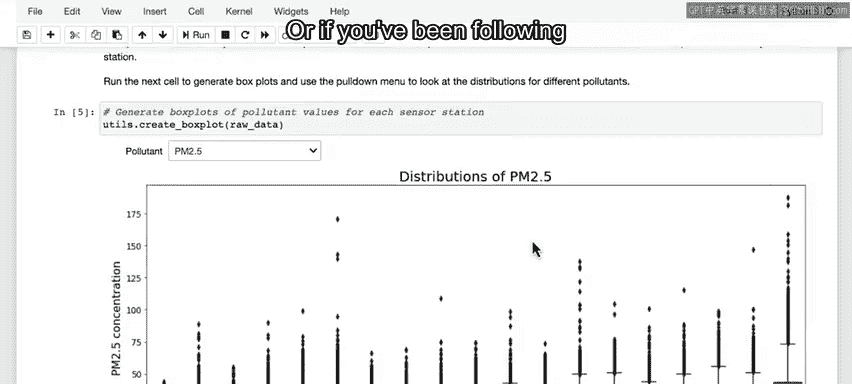

Looking at individual scatter plots and histograms like you have done in the first part of the lab is a great way to get a sense of what the characteristics of your data set are。

Sometimes it helps to be able to look at multiple visualizations at once。

And when you run this next cell， you'll get scatter plots across all the possible combinations of one pollutant to another。

As well as histograms showing the distribution of each individual pollutant。

So what you have here is a grid of different plots。

Where each pollutant in your data set is listed along the horizontal and vertical axis of the grid in each grid cell。

 you are looking at a scatter plot of the pollutant listed on the horizontal axis for that cell against the pollutant listed on the vertical axis。

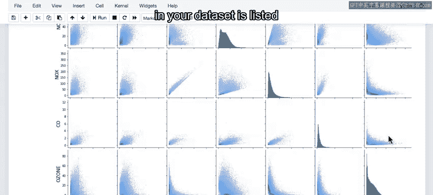

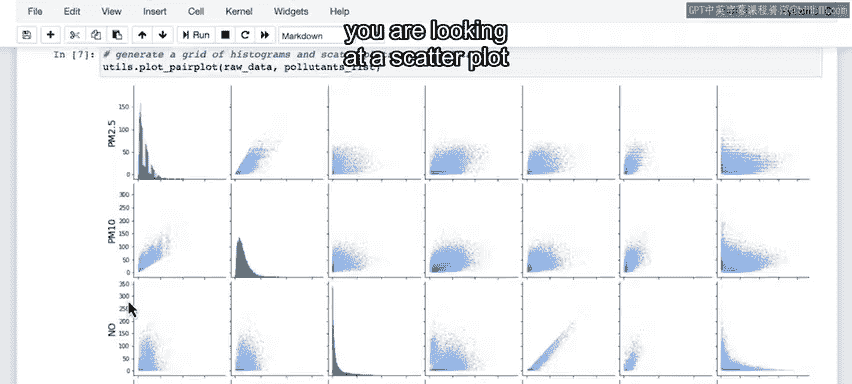

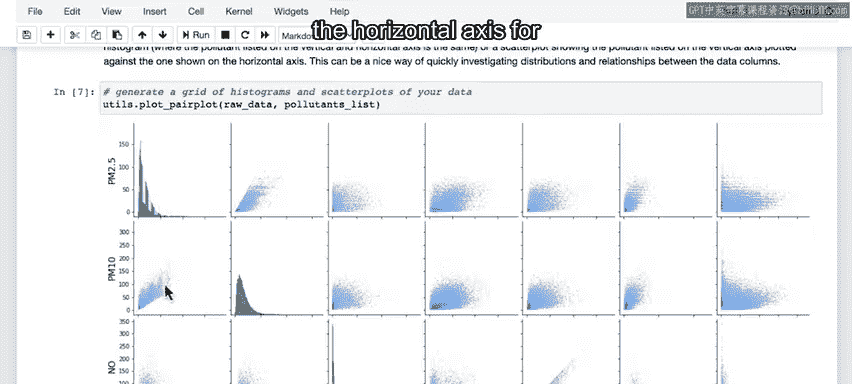

And then along the diagonal here。You just have the histogram of each individual pollutant。

 since in this cell， the variable listed on the vertical and horizontal axes are the same。

So a scatter plot wouldn't be that interesting to look at。In some sense。

 this grid of plots is redundant because you've got the same information plotted in the upper right here as you do reflected in the lower left。

 just with the horizontal and vertical axes switched。

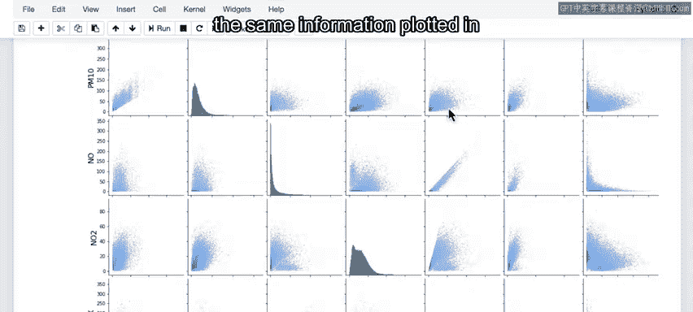

From this collection of plots， you can quickly see a summary of the relationships and distributions that you were exploring above。

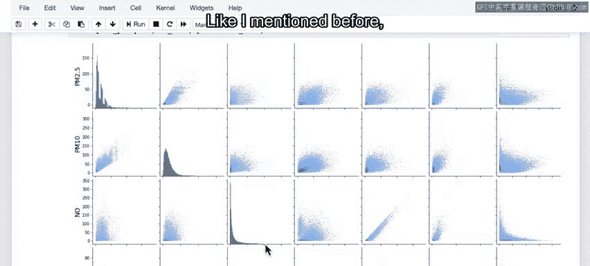

Like I mentioned before， one of the interesting things to investigate when you're looking at these scatter plots is whether there is any obvious correlation between different variables in your data set。

If youll consider an applying AI to a particular problem。

 then correlations between variables can mean that you might be able to use one or more of them to predict the value of another and so。

 for example， you can see that there might be some correlation between PM2。5 and PM 10 here。

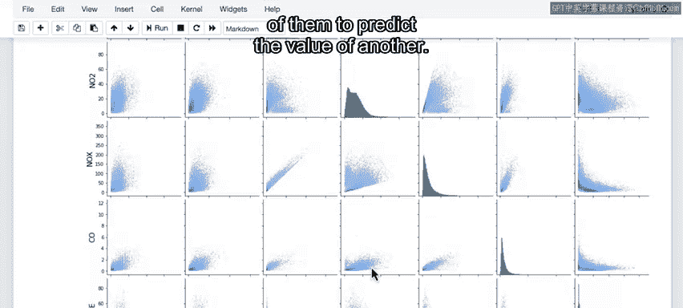

Or maybe between N2 and CO。

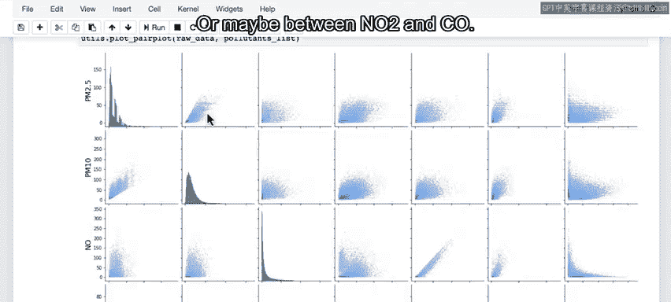

One way to look at a more quantitative representation of correlations between variables is to generate what's known as a correlation matrix。

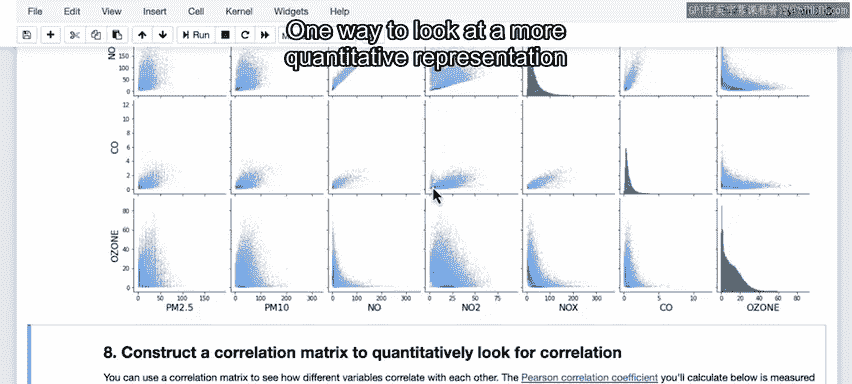

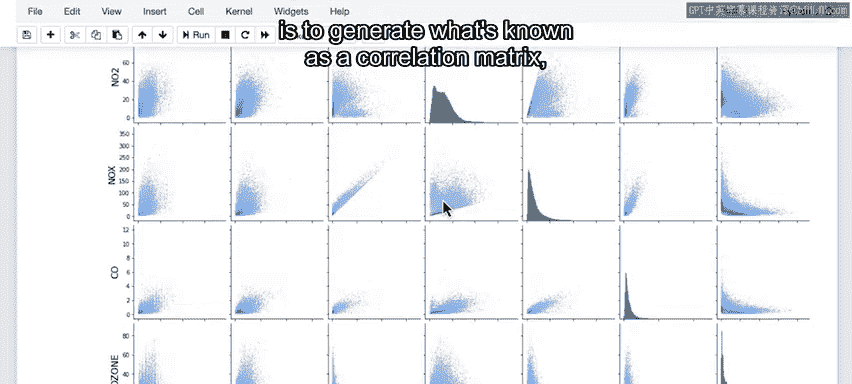

Which is what you can do by running this next cell here。

Now you are looking at a grid that shows the same comparison that you are looking at up here with the scatterphys and histograms where each pollutant is listed along the vertical and horizontal dimensions of the grid。

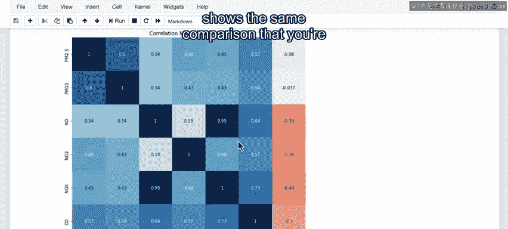

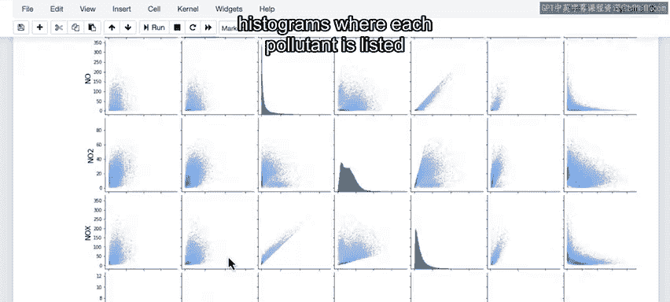

The numerical value in each grid cell now shows the Pearson correlation coefficient between the two pollutants in the vertical and horizontal dimensions for that cell。

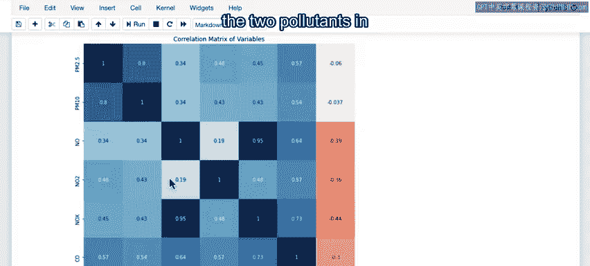

Correlation near zero means there is no relationship between the two variables and correlations near one or negative one indicate a strong positive or negative correlation respectively。

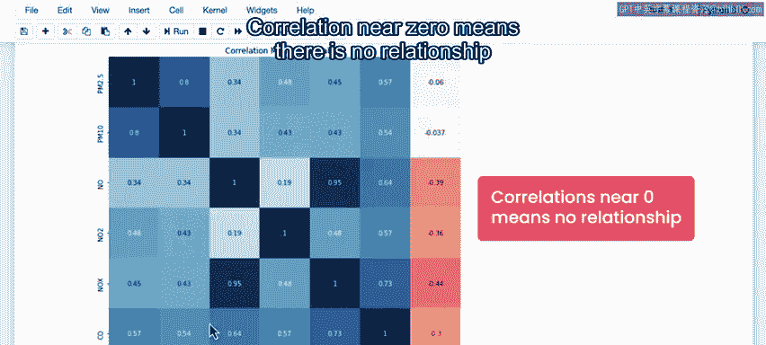

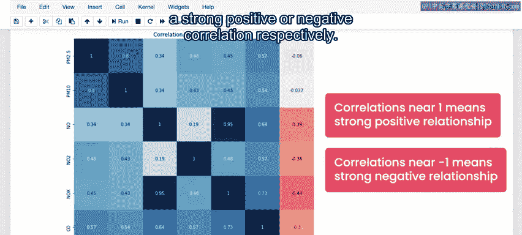

So along the diagonal here， the correlation values of1 just mean that every variable is perfectly correlated with itself。

 but in the other cells， you can see where the strongest。Positive and negative correlations are。

In some sense， this grid of values is also redundant because you have the mirror image along the diagonal。

But what you can do now with this result is to take a closer look at which pollutants are correlated with each other。

 like， for example， you can see a significant positive correlation between NO2 and CO。

You can also see that particulate matter of different sizes are strongly correlated。

 so perhaps unsurprisingly， PM 2。5， the smaller particles are positively correlated with PM 10。

 the slightly larger particles。

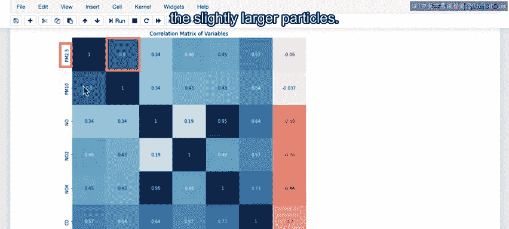

When you run this next cell， you'll see sensor measurements over time for a particular pollutant at a particular station。

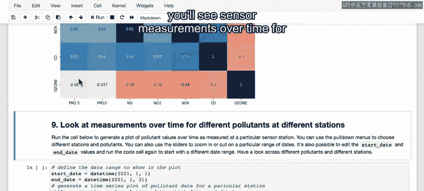

You can use these pull down menus here to select different stations and pollutants。

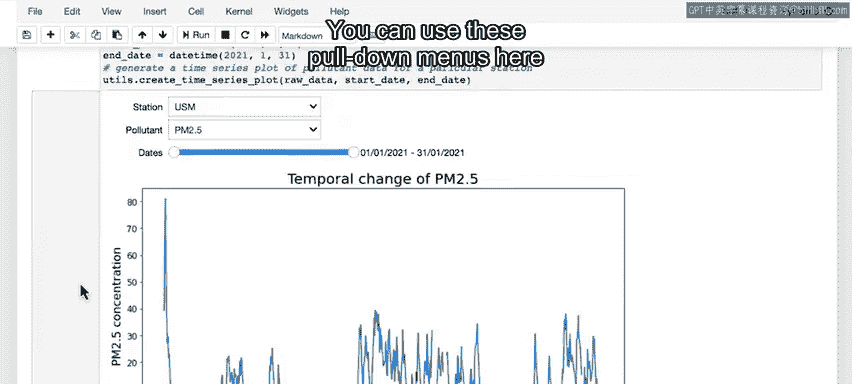

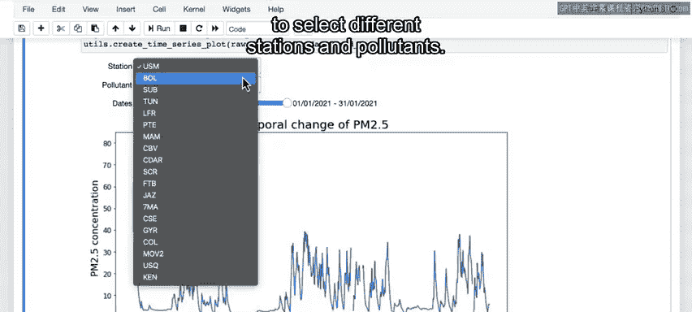

With this slider， you can adjust the start and end date of the plot and you can zoom in on a particular date range to investigate in detail。

Right now， this is showing data for the month of January 2021。

 but you can change the start date and end date variables up here to other dates in 2021 and run the code again to see a different range of dates in the initial plot。

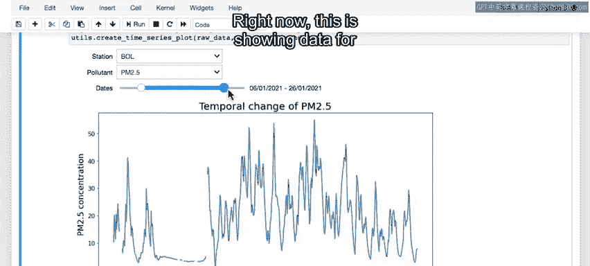

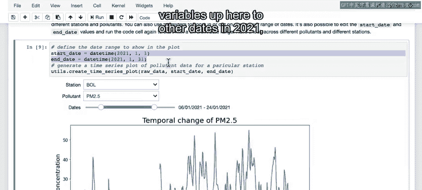

What you see in some areas of the plots are gaps。And that's where there is missing data for a particular sensor。

In the next notebook you'll be working on a method to replace missing values with an estimate。

 and for that effort it's important to understand what the missing data looks like in terms of how often and how long any given sensory is offline for。

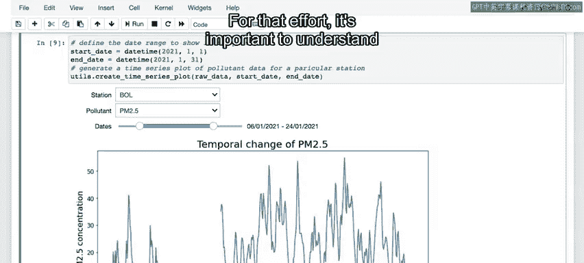

With this plot， you can get a better sense of the temporal characteristics of the missing data。

And finally， it's always fun to look at maps， and this is a great way to visualize more of the information in your data。

😊。

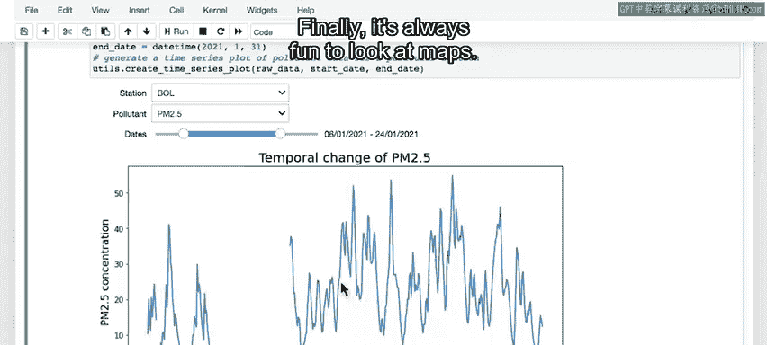

So with this last cell， you're adding the latitude and longitude of the sensor stations to your dangerous's head and then generating a map with an overlay of the sensor station positions。

In this map representation， you can see the locations of each sensor marked by a circle and the colorss of these circles right now indicate the long term average value of PM2。

5 for each station。Green color like this indicates long term average is below the 12 micrograms per meter cubed recommended by the EPA in the US。

If you click on a sensor location， you can see a plot of the average values as a function of time of day。

And so， for example， you can see here at this station at noon， the average PMm2。

5 value was about 12 micrograms per meter cubed， and it was higher on average around 25 or so at 7 o'clock in the morning。

This green De line shows the recommended level of PMm2。5。

And this blue dash line shows the long term average at this station。So at this station。

 the long term average is a bit above the recommended level。

Each of the individual data points here shows the average at this station for a particular time of day。

Averd over the whole year。The blue shaded region here shows plus or minus1 standard deviation around these average values。

So you can think of the shaded regions as capturing the typical range of the majority of sensor measurements at this station throughout the day。

If you change the parameter， hour of day， up here to day of the week and run the code again。

Then you can click on a station to see the average by day of week。

 as well as a desk line to show the long term average。Throughout this exploration of the data。

 your goal here is to get a sense of the characteristics of the data set that you'll be working with and to think about if and how AI might add value to this project。

InIn this case， given the correlations between some of the different pollutants。

 as well as the apparent dependency of PM2。5 levels on things like station location。

 time of day and day of the week， it looks like AI might be suited to the problem of estimated the missing values in the data。

Also， given that the sensors are distributed throughout the city。

 it should be possible to use the data to make estimates of pollution levels between those sensors。

When you're ready you can take the quiz that comes next about what you found in the data and feel free to take this as an open notebook quiz the most important thing is not memorizing what the outputs were。

 but rather that you feel comfortable with the characteristics of your data before moving on to the design phase and look like I've said before in this course this is important for any kind of project that you're working with。

 make sure you're familiar with the data， understand what's missing， what might be wrong。

 what's an outlier and then those intuitions are going to help you design and think about the right model in a much more efficient and effective way。

