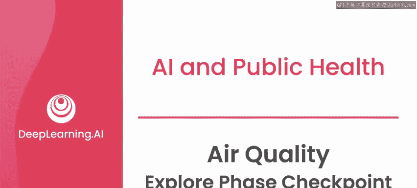
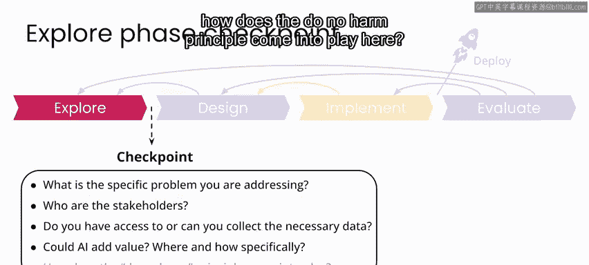
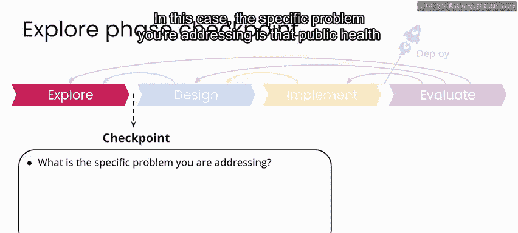
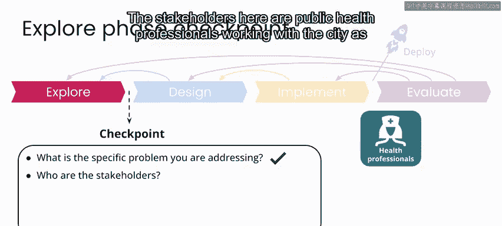
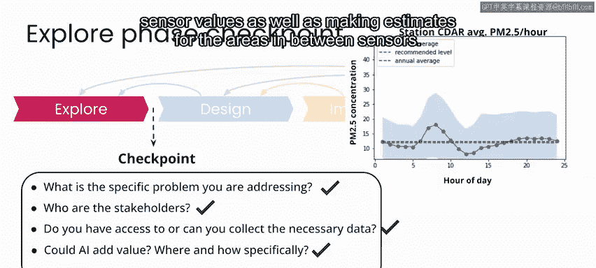
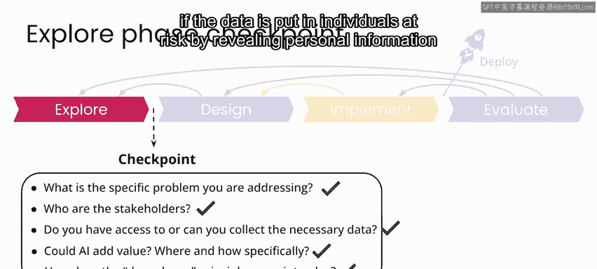

# 吴恩达《AI for Good专业课程》 AI与公共卫生、气候变化、灾难管理｜中英字幕 - P28：27_空气质量探索阶段检查点.zh_en - GPT中英字幕课程资源 - BV13u411F7xZ

In this week's materials you've been introduced to a framework for working through AI for Good projects。

 so you started out by walking through a case study focused on when I was working in maternal and infant healthcare in Nigeria we saw how the project moved through each of the phases in detail and the considerations at each step of development and in particular considerations of do no harm at each step in development。

In this lesson， you'll be exploring a scenario where the city of Bagoar has you and your team to help them take the next steps towards addressing longer term goals of improving air quality in that city。

Just like we discussed in the example case of public health in Nigeria。

 at the end of the explore phase， it's time to check in and see if you have what you need to move to the next phase in your project for air quality。

At this point you've met with stakeholders and we assume。

 including public health professionals representing the city as well as citizens to better understand the problem that you're hoping to address you wrote down specific problem statement and explored the data in an effort to establish whether AI could in fact add value to this project。

So now that you're at the end of the Explorer phase。

 the questions you and your team should be able to answer are what is the specific problem that you're addressing。

 who are the stakeholders， do you have access to or can you acquire the necessary data。

 could AI add value， where and how specifically， and how does the dono harm principle come into play here？

In this case， the specific problem you're addressing is that public health professionals working with the city of Boggoar need to be able to provide real-time estimates of air quality throughout the city so that citizens can be aware of any health risks due to poor air quality and can plan their outdoor activities accordingly。

The stakeholders here are public health professionals working with the city as well as the citizens of Agatar and the people maintaining the cs。

You have access to a rich data set of historical sensor measurements that you can use to develop your solution。

 and it looks like AI could be well suited to both the problem of estimating misins values。

 as well as making estimates for the areas in between sensors。

In terms of the Do no harm principle in this particular scenario the data is relatively low risk because you'll be working that data that comes from scientific instruments and is intended to be public so there are no obvious concerns that you need to consider regarding data privacy or if the data is put in individuals at risk by revealing personal information about them however you do need to keep in mind that the application itself is intended to inform the public about health risks and that given advice about behaviors related to poor equality so your could have a direct impact on public health and that'll be something that you will need to continue to reflect on as you develop your models and design the end user experience so with all this in mind you're ready to move into the design phase this is where you'll start experimentaling the models and decide how you want your final application to work so I'll see you next week as we go through the materials to kick off the design phase。

