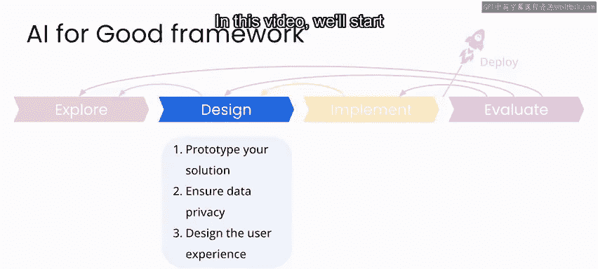
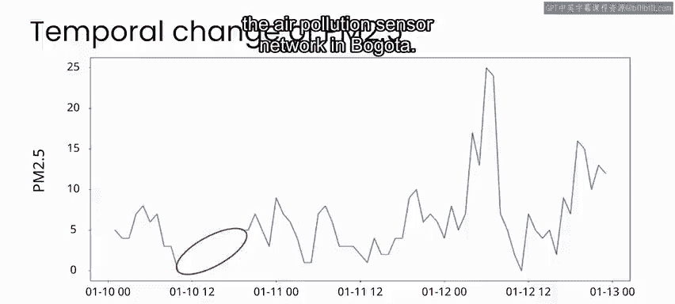
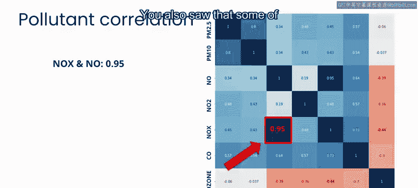
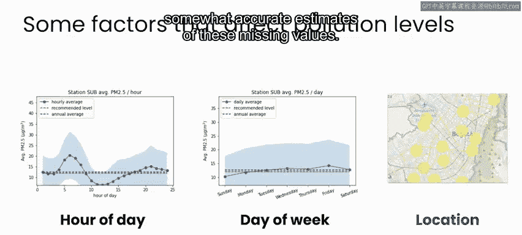
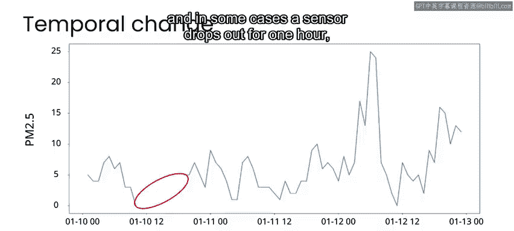
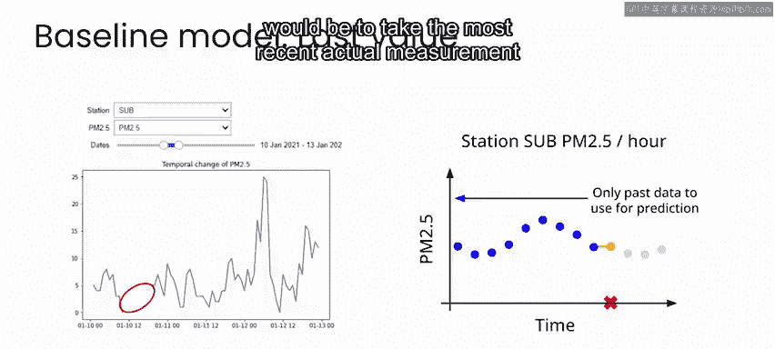
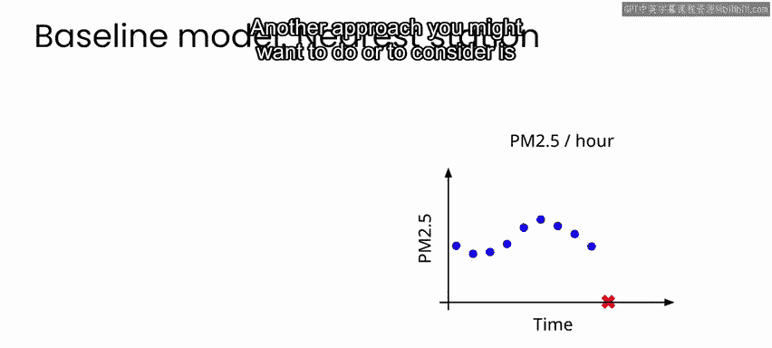
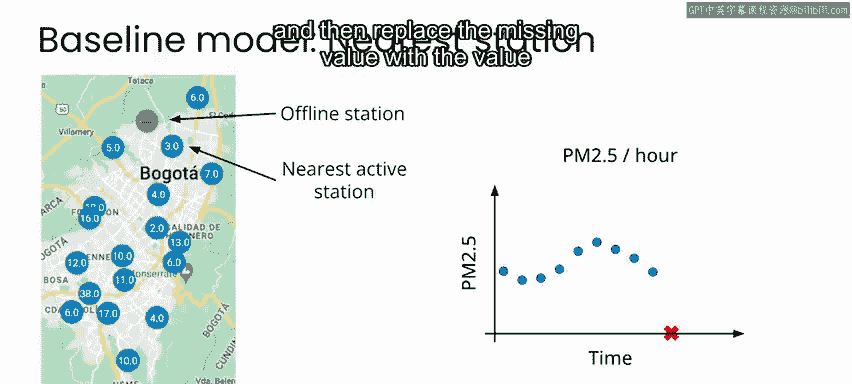

# 吴恩达《AI for Good专业课程》 AI与公共卫生、气候变化、灾难管理｜中英字幕 - P29：28_空气质量设计和实施阶段.zh_en - GPT中英字幕课程资源 - BV13u411F7xZ

Welcome to week three here you'll be designing and implementing your air quality mapping product in this first lesson you'll be working through the design phase and the steps you'll focus on will be prototypetyping your data and modeling strategies。

 addressing any data privacy and security issues and designing the end user experience for your project。

In this video， we'll start looking at the data and model strategy。

In the explore phase of this project， you saw that missing data is a significant issue for the air Poll Sense network in Bogota。

 you saw that in many cases where there are missing values for one pollutant。

 there are still valid records for other pollutants。

You also saw that some of the different pollutant levels appear to be correlated。

 and the pollutant levels seem to depend on the time of day， day of week and census station location。

 and this got you thinking that there might be a role to play for AI in using the rest of the data to make somewhat accurate estimates of these missing values。

At this stage， however， rather than taking a sort of AI first approach。

 it's always a good idea to spend some time experimenting with the simplest possible solution that you can imagine to establish a baseline for how well you can do without implementing anything too complicated in the case of missing data。

 you saw that the sensor measurements are recorded hourly and in some cases a sensor drops out for one hour and is then back online just one hour later。

In this case the scenario looks something like this here a sensor is making hourly measurements that go up and down throughout the day and then you have a single missing value then the sensor comes back online and you have valid measurements again so think about what's the simplest way where you could make an estimate of that missing value so there is a catch here if we're making realtime estimates you obviously don't have that future data point in mind so you can't just use the average of the two points either side of the missing point in order to interpolate for this specific use case。

In this case， then perhaps the simplest way that we can think of to estimate the missing value would be to take the most recent actual measurement for that sensor and just use that as the estimate Another approach you might want to do what to consider is to look for the nearest sensor that has an actual measurement the nearest sensor that is online and then replace the missing value with the value recorded at that nearest sensor station both of these approaches have their pros and cons。

 so in one case you're using a past measurement at the same location and in the other case you're using a current measurement at a nearby location in either case both could be reasonable approaches certainly their reasonable approaches to think about in terms of the baseline against which you could measure your machine learning based approach so please show me in the next video to see how these baselines look in practice in the lab。

