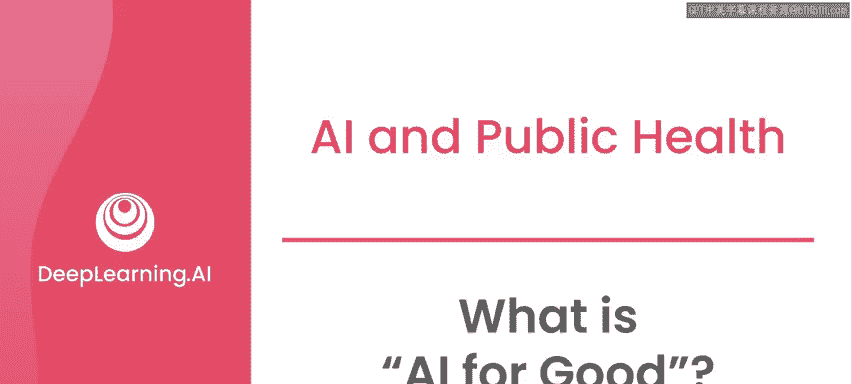
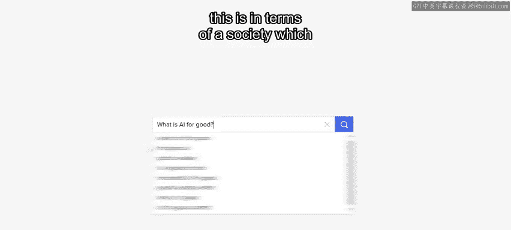
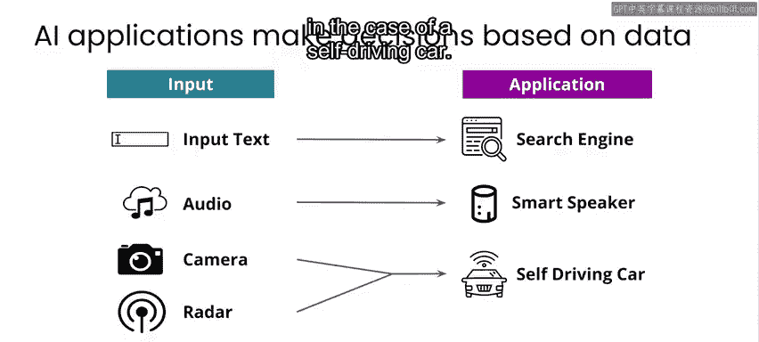
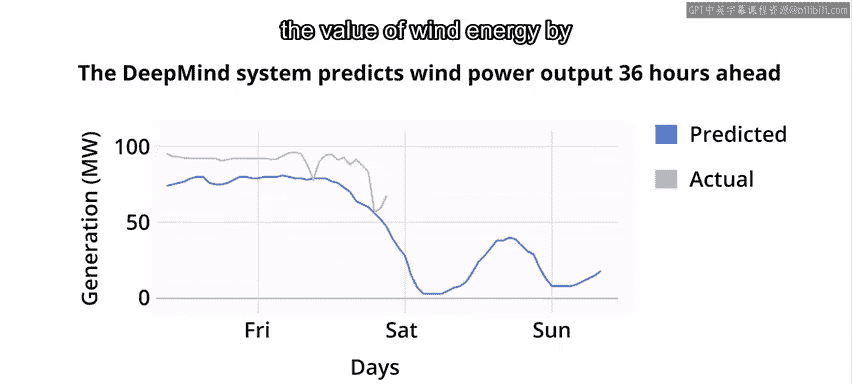
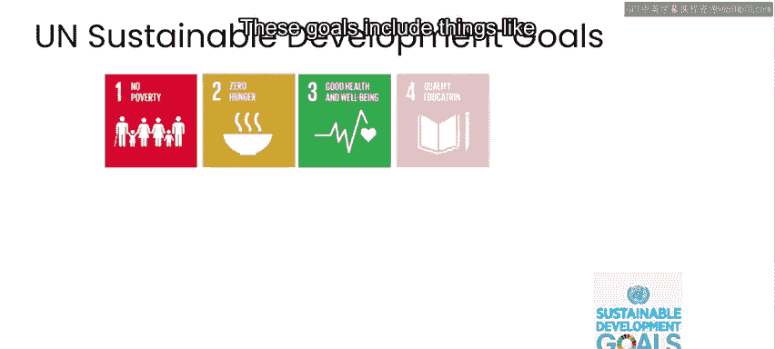
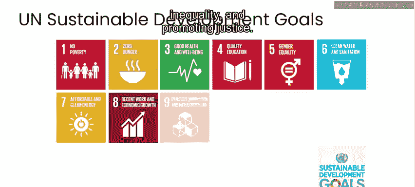

# 吴恩达《AI for Good专业课程》 AI与公共卫生、气候变化、灾难管理｜中英字幕 - P2：1_什么是人工智能为善.zh_en - GPT中英字幕课程资源 - BV13u411F7xZ

This specialization is called AI for Good and I can imagine you might already be wondering well how exactly do we differentiate AI for good from AI for anything else and the truth is there is no actual field of AI for good for as long as we have been thinking about how we can help people with their healthcare or help them respond to and be prepared for natural and man-made disasters people have been thinking about what technologies can we use to help with these goals and for centuries this has included statistics and for decades this is include more modern forms of data analysis and machine learning so when we say AI for good we're really just talking about the application of AI which could be for any use case but in this particular case is deliberately focused on addressing some of the biggest problems that we're seeing for our environment and for humanity today。

In my own work， I've been particularly interested in projects that can help provide better support for low resource languages and by low resource we typically mean languages that don't get the kind of support when it comes to applications like machine translation apps or search engines。

 which youll see work very well for English and other widely spoken languages。

 but not so much for languages which tend to have fewer speakers。

When we think about AI in terms of for good in today's society。

 this is in terms of a society which relies on AI for an increasingly large number of applications。

 so for example， you are using AI when you have a program that is providing you research results。

 you're using a different kind of AI when you're speaking to a smart device and you're using a third kind of AI when you're using a mapping application to get to one point from another in this case the algorithm would be taken into account historical data about travel times from one place to another and you know on road closures as well as real-time traffic information in order to suggest the best route many new vehicles are now equipped with AI that can make driving safer and with automatic detection of when you're driving out of the lane or at risk of collision。

What all these applications have in common is that they're using an algorithm to make decisions or inferences based on data and that data could be input text。

 like in the case of a search engine or audio data。

 like in the case of a smart speaker or multiple data sources like cameras。

 radar and other sensors in the case of a self-driving car。

AI has also been used for things that can be considered more controversial。

 like automatic face recognition or trying to predict whether a particular person is likely to default on a loan or commit a crime It's not always to differentiate between AI for doing something for good and AI for doing something bad so for example。

 following natural disasters I've seen AI being used to monitor populations purportedly to provide assistance when it's really been used to identify dissidents。

When it comes to AI for good， I can say that there's no official definition of what constitutes AI for good and reasonable people will even disagree about how it should be defined。

 but throughout these courses we will be focused on applications of AI that are most likely to support progress in areas like environment。

 health， justice and a humanitarian action and as we look at these projects we'll also be thinking about ways to minimize any harm that might come despite good intentions。

 we'll highlight projects that aim to prevent， mitigate or resolve problems that adversely affect human life or the environment。

For example， in the Amazon rainforest， illegal mining is forcing the displacement of local communities。

 causing deforestation and impacting animal habitats these illegal mines have often avoided detection due to their remote location but now it's more possible to use AI computer vision techniques with satellite imagery to identify legal mining operations and notify local authorities and hope you can immediately see while that is a very positive step there is a very negative step here as well in that many of these societies which are choosing to live remotely can now be monitored in and of themselves as another example。

 consider wind power， which is a renewable energy source with a much lower carbon footprint than fossil fuels One of the problems is that it's difficult to predict when and how strong the wind will blow as well as how each turbine in a wind farm will respond to the change in wind and other conditions this makes it difficult to plan for the amount of wind power that will be available at any given time and consequently makes it harder to effectively replace fossil fuels with wind。

To address this challenge it's possible to apply AI using weather forecasts and historical wind turbine data to more accurately predict the energy that will be available from wind power one or two days in advance and Timma at Google's DeepM have shown that they were able to increase the value wind energy by about 20% using these kinds of methods and you'll actually get a chance to try your hand at predicting wind power in the second course of this specialization。

Throughout these three courses， you'll be looking at a variety of different case studies like the ones we've already mentioned and applying a framework to think through the required components of designing and developing a solution towards a particular problem and how AI may or may not add value as part of that solution。

😊，There are many urgent problems facing humanity today and various groups around the world are working hard to address these problems。

 we'll only be looking at a handful of case studies in these courses。

 but if you're interested in thinking more about what kinds of problems there are to work on。

 then one really good place to look is the United Nations Sutainable development goalsal。😊。

These goals include things like reducing poverty and hunger， fighting climate change。

 reducing inequality， and promoting justice The United Nations launched these goals in 2015 as a common framework for discussing objectives for the next 15 years。

 and to be clear the UN goals are not without their own controversy and not everyone agrees with them 100% but they are often useful as a common framework for discussion of goals among different parties working towards a better future with this in mind。

 you can see that the problems you might try to address cover a wide range of topics and considerations everything from climate change to something like microfinance。

Throughout these courses， I'll be emphasizing that you have to be cautious in considering the impact that AI could have even with the best of intentions。

 it is often possible to do more harm than good， and I'll suggest that you adopt a principle similar to the one used by many medical doctors around the world。

 namely the principle of do no harm in academic AI a project is normally evaluated in terms of a net improvement to some problem or scenario but do no harm more strictly means that everyone impacted by the project is left better off or at least unharmed so you should ask yourself could this project negatively impact even a minority of people involved in the project who would not otherwise be harmed and so will be revisiting the do no harm principle throughout these courses。

