# 吴恩达《AI for Good专业课程》 AI与公共卫生、气候变化、灾难管理｜中英字幕 - P30：29_空气质量建立基准.zh_en - GPT中英字幕课程资源 - BV13u411F7xZ

In the previous video， we looked at the idea of estimating missing sensoror values using two different methods。

 one taking the most recent measurement from that sensor and the other using the current measurement from the closest sensor Now I'm going to walk through the lab section where you'll test out these methods and establish a baseline for how well you can do without implementing any complicated AIbased solution the reason for establishing a simple baseline like this is that for one if the simple solution turns out to be good enough to meet your goals。

 you might want to stop there because by choosing a simple route。

 you might get to your solution faster maybe at a lower cost and it might be easier to interpret the results beyond that。

 however， if you move on to implement a more complex model。

 then you will need to be able to quantify the relative performance improvements of your model relative to a simple baseline such as this。

So step it into the lab here and again to follow along you can open up the lab in another browser tab and work alongside this video as a reminder you can click on the Jupyter icon up here to see what else is in this folder and first of all you can see this data folder which includes a data sheet data sheets are an important way of telling us why the data set was collected who annotated or created the data set and what exactly is the data that's contained here。

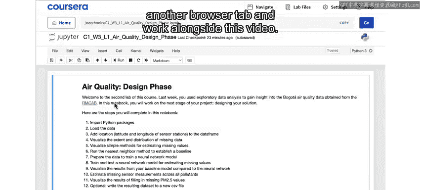

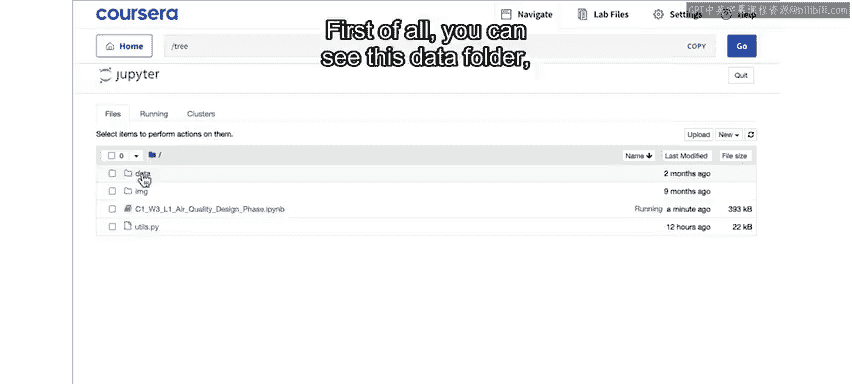

And you'll see this across all the data sets that we're using here in these courses。

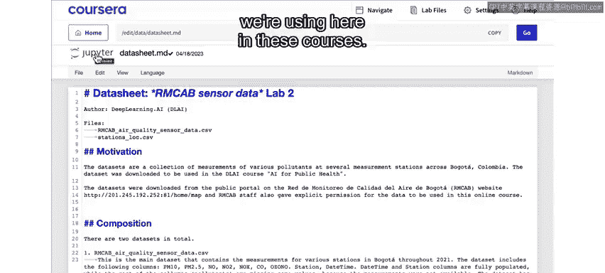

If you're a Python programmer and you're interested in looking at some of the code that's operating behind the scenes in this lab。

 you can have a look at this ULs file here， but in general。

 you don't need to worry about the code in this ULs file for the purposes of completing this lab。

 it's functionality that we've deliberately put into this file to keep the clutter out of your notebook。

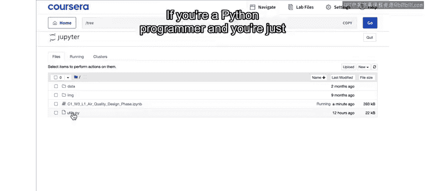

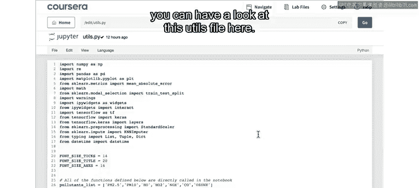

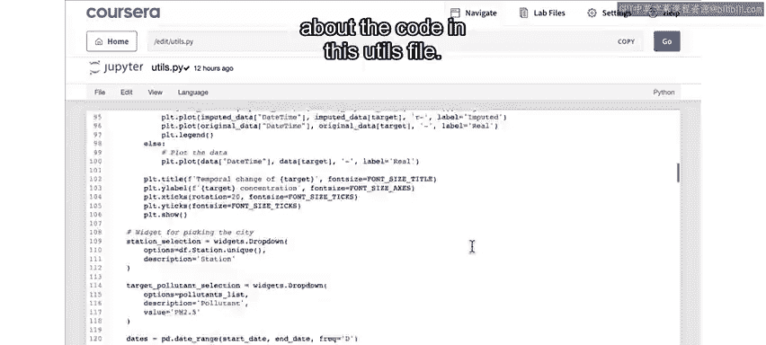

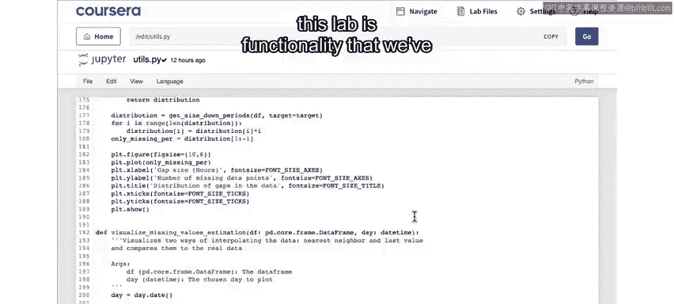

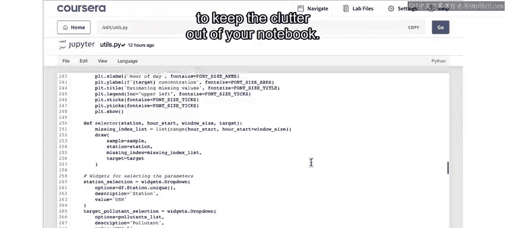

Clicking back into your notebook， the first thing to do is to start at the top and run the first code cell。

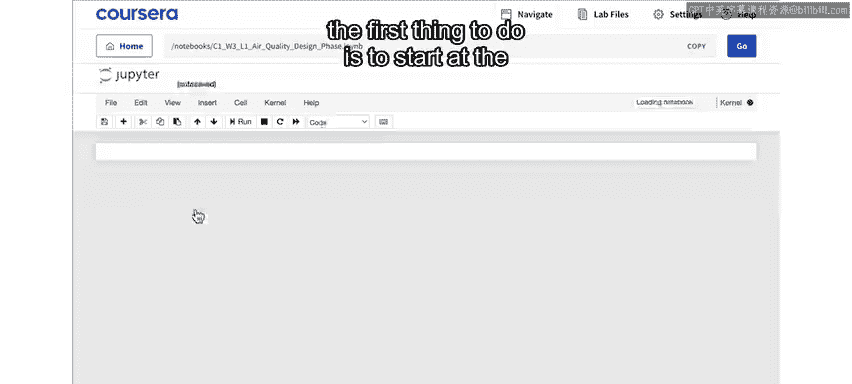

In this case， again， the first cell is just importing various packages that you'll need for this lab。

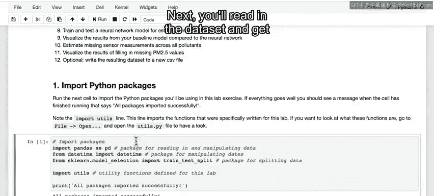

Next， you'll read in the data set and get ready to start looking at different solutions for missing values。

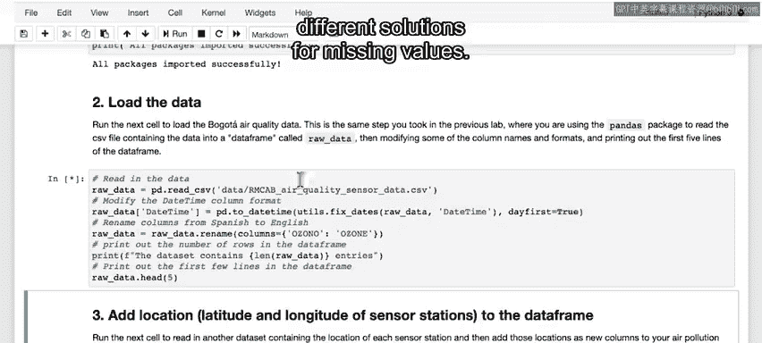

And here again， you're printing out the first five lines of the data set to verify that everything looks like it was read in OK。

 which should be the case like this。

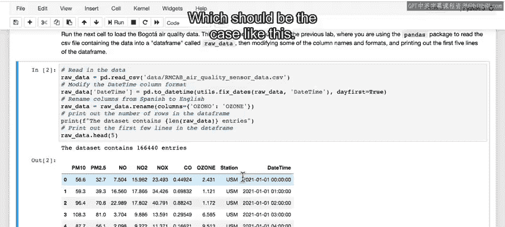

The next step is to read in another data set containing the location， intellatitude。

 and longitude of each of the sensor stations。And then here we're just changing some of the columns from Spanish to English to make it easier to interpret it in this English lab。

You'll then add this information to your existing data set in order to be able to establish the distance between census stations。

For the nearest neighbor method。The next two cells are set up to give you a reminder of how the missing in value problem looked like for the data set when you looked at this in the last lab。

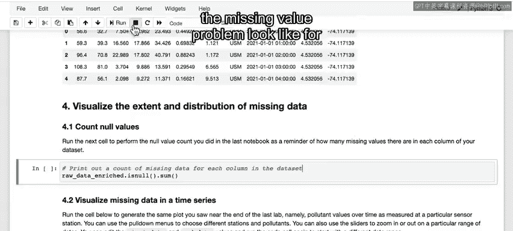

So first， here you're printing out the number of missing values in each column。

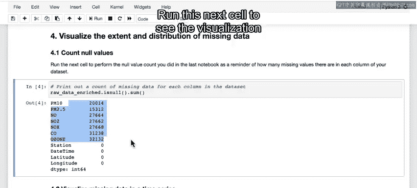

Run this next cell to see the visualization of missing data that you looked at in the previous lab。

Here again， you can choose different station names and pollutants and then use the sliders to look at different date ranges。

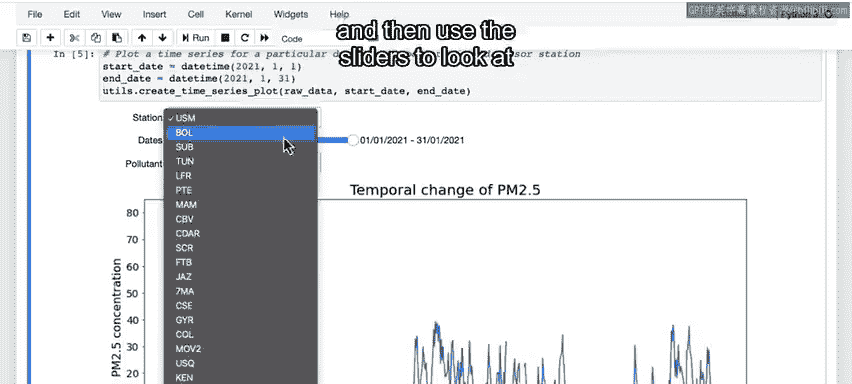

And or this should be familiar to you from the previous lab。

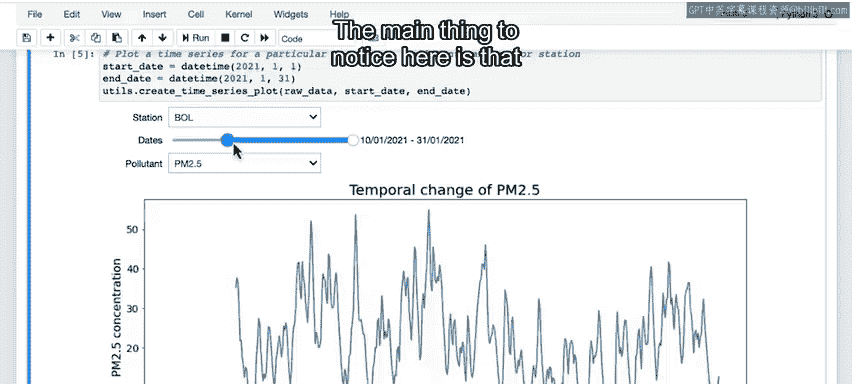

The main thing to notice here is that in some cases you have small gaps of just an hour or two。

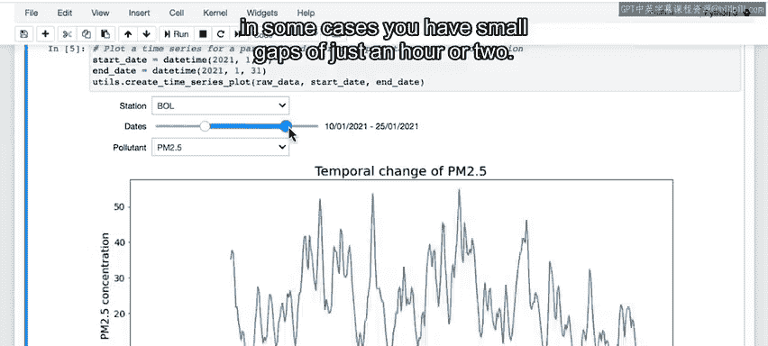

But importantly， in other cases， you have much larger gaps。

 span several hours or even days and weeks in some cases。At this point。

 it's important to get a sense of just how much of the missing data is due to small gaps versus big gaps。

 because that will be important for how you model this problem。

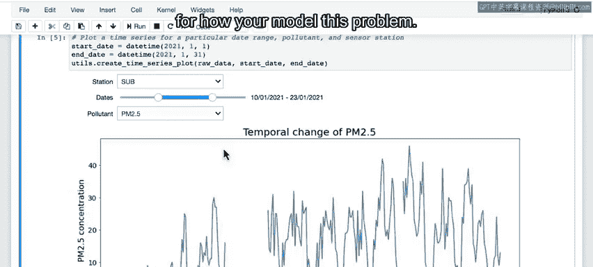

When you run this Excel cell here， you're accounting how many data points are associated with gaps of different sizes。

 specifically for the PM2。5 data。

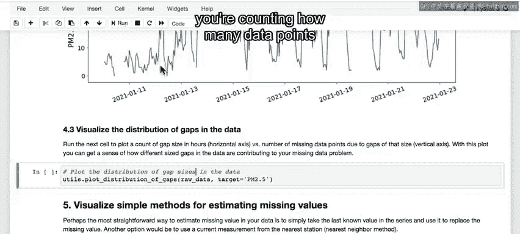

The graph here is showing you the gap size in hours on the X axis at the bottom and the number of missing data points associated with gaps of that size on the Y axis。

So this plot might be a little confusing at first， so let's take some time on it。

 The way to read this is that this peak on the left here is for gaps that are just one hour long。

Or in other words， gaps that are responsible for just a single missing data point each。

What you can see is that there are around 700 such gaps in the data。As you move to the right。

 you can see that the largest gap size is around 3。

600 hours or about five months that a particular sensor went down。

When you look at how many individual hourly data point gaps of that size this is responsible for。

 you can see that's also about 3，600。So what this means is that this peak is showing you that there is just one single gap of about 3。

600 hours or five months in the data。And similarly。

 you have some single gaps of several hundred hours in size as well as numerous gaps in the zero to 200 hour range。

 the main takeaway from this figure should be that while the majority of individual gaps are small。

 the majority of missing data actually comes from larger gaps of tens or hundreds of hour in size and as I'm sure you can imagine now。

 it is going to be a lot harder to provide reasonable estimates， the longer the gaps are going to be。

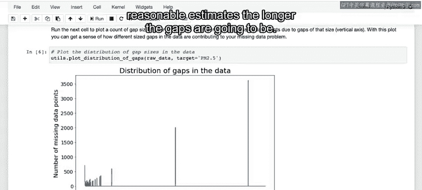

The next step I would like to do is to start visualizing what a solution might look like when you run this next cell。

 you are simulating the center dropping out for one hour。

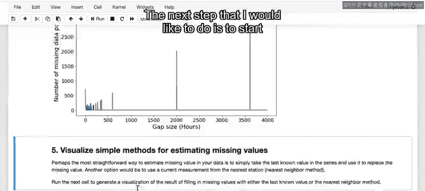

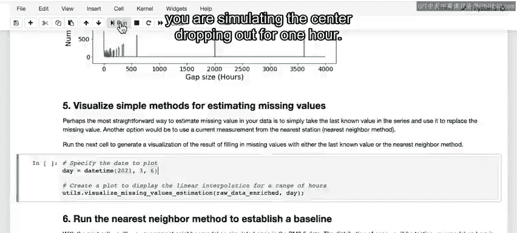

Here is the actual data shown in red。

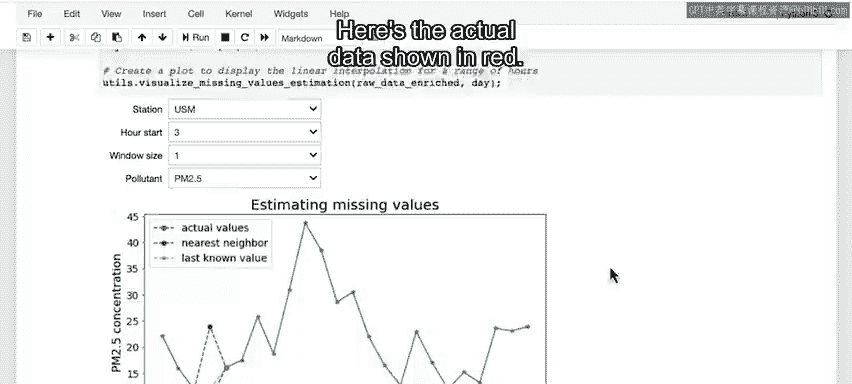

And now you are visualizing how it would look like to replace that point with the most recent measurement shown in yellow。

 just why it's just a flat line here we're repeating the most recent measurement。For another method。

 you could replace it with the value from the nearest census station。

 and that's what's shown in green here。 So at this particular hour。

 the closest working station actually has a fairly high PM2。5 reading。

You can change our start variable using this pull out menu to see this comparison from different hours in this example data。

You can see that in some cases。The most recent value looks closer to the real value。

But in other cases， it's the nearest neighbor method that is doing better。

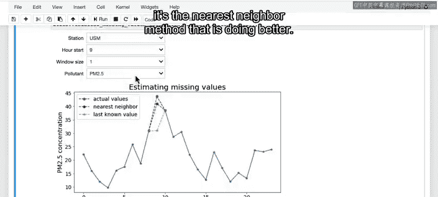

You can also change the window size here to simulate a scenario where there is more than one hour gap。

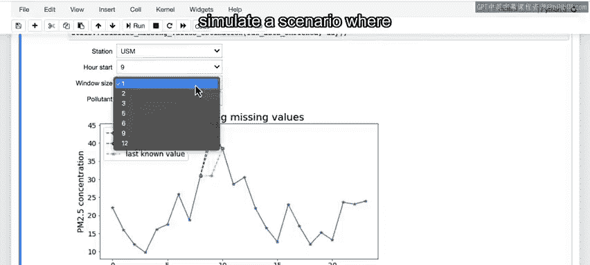

What you'll notice is that no matter the window size。

 the most recent value method simply records that value flat from before the sensor went offline。

 while the nearest neighbor method will have a different value at each hour based on what was recorded at the nearest functioning neighbor station。

And you can also change the dates to look at different example data。

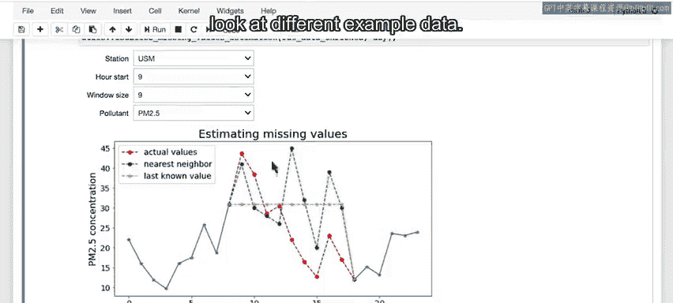

Have a look at some different dates and window sizes， and you can see that as the window gets larger。

 which of these methods do you think will tend to perform better？

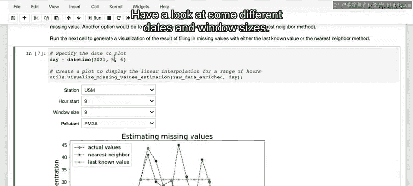

As you saw above， there are many times when a sensor goes offline for tens or hundreds of hours。

 and in these cases， your estimate of just using the most recent data will get worse。

 the larger that gap is。So you can see that the methods seem to not work very well for this scenario。

The nearest neighbor method provides variable results。

 but it doesn't necessarily degraded with larger gap sizes， and so at this point。

 you will abandon the method of using the last recorded measurement and further test the nearest neighbor method as your baseline。

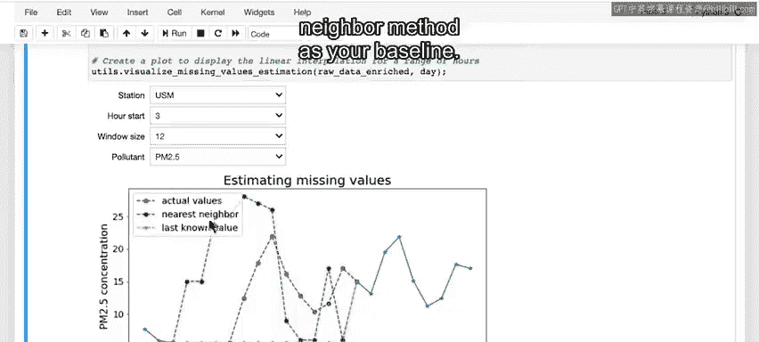

The next thing to do is to test out how well this works on the distribution of real gaps in the data。

Run this next cell to run a simulation where you randomly select locations in the data and then use your nearest neighbor method to estimate the sensor measurements at that time for that station。

And this will take a couple of minutes to run， so just be patient or take a short break when you see this little star here in the upper left of the code cell that means it's still running。

You will do this exercise for simulated gaps across the range of sizes you identified in the actual data from just one to hundreds of hours in size。

In principle， this method shouldn't be affected by the size of the gap as you're simply replacing missing values with the nearest recorded measurement from another station。

 but we simulate the gaps in the actual data for consistency here。To measure how well you did。

 you'll calculate the mean absolute error， which is just the average of the difference between your estimates and the true sensor of measurements。

 and that's what gets printed out here once a simulation has run。

Mean absolute error or MAE is a common and intuitive way of measuring the accuracy of your predictions。

 and the reason I say this is intuitive is that with mean absolute error。

 your error measurements are in the units of the thing that you're trying to estimate。

 which in this case is PM2。5 levels in units of micrograms per me acute。With that being said。

 it's not the only possible choice of error metric and you might choose a different metric like mean squared error。

 for example， for different applications。Or percent error compared to the actual measurement。

Here we'll proceed with mean absolute error as a simple way of intuitively comparing the results of different models。

When you run this simulation， you'll find that you get a mean absolute error of around eight。

 which means that on average， you're off by8 in your estimates in units of sensor measurements。

Which for PM2。5， as we said before， are micrograms per cube。So here。

 the result is telling you that on average， your nearest name of method returns a value that is of by 8 micrograms per minute cubed from the true measurement。

This error estimate can now serve as your baseline for how well you can do without implementing any more complicated AI algorithm。

And I think this is a good time to remember that the maximum recommended value for a PM2。

5 is 12 micrograms per meter cubed， so with an average error of eight。

 we are working with a margin of error that could very easily be above or below that recommended level。

This error estimate can now serve as your baseline for how well you can do without implementing anything more complicated with AI。

 so try playing around with this yourself to get a sense of how this is working and then head over to the next video where we'll start looking atest missing values using a neural network。

