# 吴恩达《AI for Good专业课程》 AI与公共卫生、气候变化、灾难管理｜中英字幕 - P31：30_空气质量训练和测试神经网络.zh_en - GPT中英字幕课程资源 - BV13u411F7xZ

In the last exercise you saw how coming up with a very simple scheme for estimated missing values based on sensor measurements from nearby sensor allowed you to establish a baseline for this task。

 you saw that in some cases this method actually works pretty well but in other cases it doesn't work so well and overall it allowed you to make estimates of missing values with the mean absolute error of about8 micrograms。

per meter cubed for PM2。5 and that just means that if you're missing a sensor measurement for PM2。

5 and you use the nearest neighbor method to fill in that missed value。

 then on average you'll be off by plus or minus 8 in your estimate compared to the true value where that sense is still there。

Now it's time to explore whether you can improve on that baseline using machine learning。

 What you also found out in our exploration phase of the data is that there are some patternss that emerge。

 For example， we're looking at how pollutant levels change depending on the time of day or the day of the week。

 as well as how pollutant levels change relative to one another。

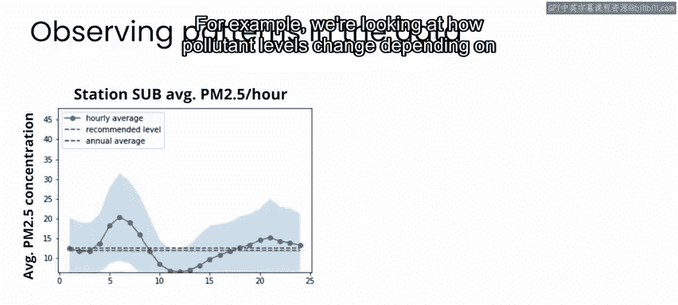

You saw that just by exploring the data you can observe these patterns for yourself as well as measure them by calculating correlation coefficients and so this is a good early indication that there may be a role for AI to play here in learning from these patterns in the data in particular we are looking at correlations across a fairly large number of features where a simple rule-based or simple linear model might not be able to capture how predictive these different senses are and the ways they may relate to each other。

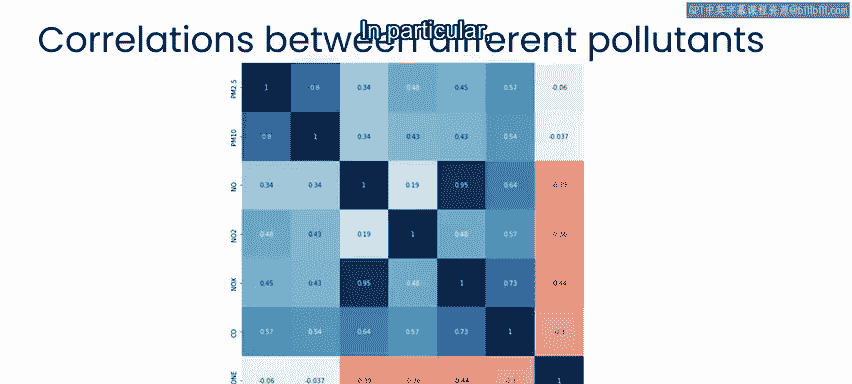

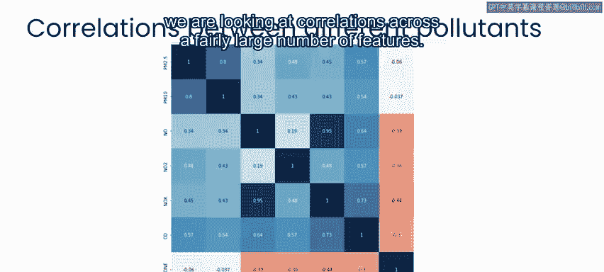

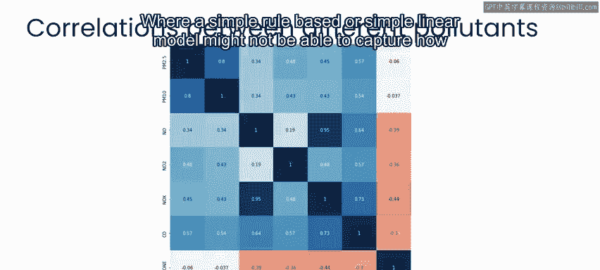

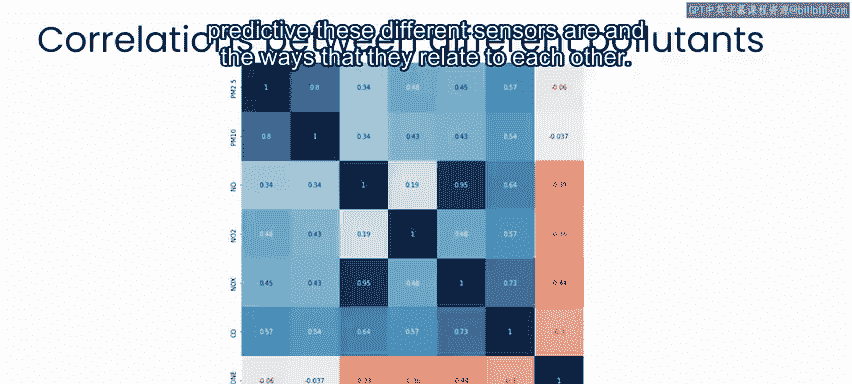

What we're going to try next is using a neural network algorithm to learn patterns from the data and to see if you can make better estimates of the missing sensor values So a neural network is an algorithm that's really relatively simple at its call it takes inputs and it predicts outputs if you're already familiar with neural networks I'm not going to explain anything more than you know here today if you're not familiar with neural networks then the main takeaway is that you have inputs you getin outputs and an artificial neural network can learn correlations in the data which might be a little hard to capture with rule-based systems or a simple linear relationship for example when we're trying to predict missingian values the values in the neighboring sensors might be more or less useful depending on the time of day or the time of the week or the particular type of particle matter or pollutant being detected and so there's just a lot of what we would call dimensions to this data。

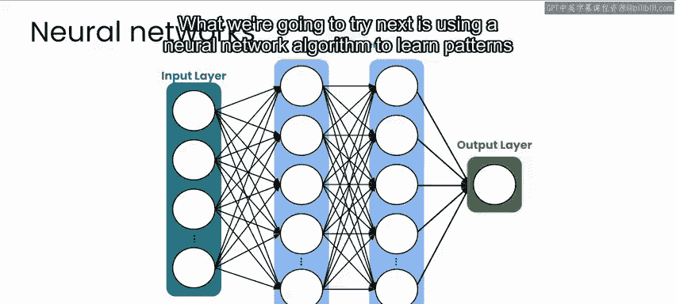

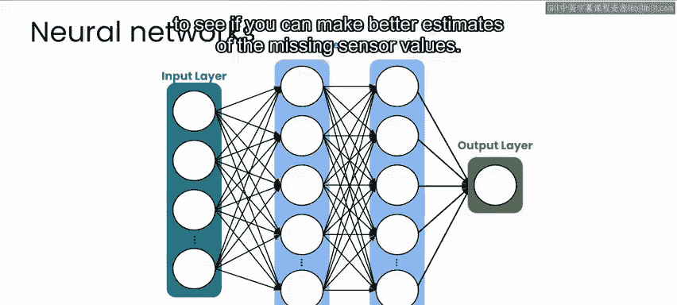

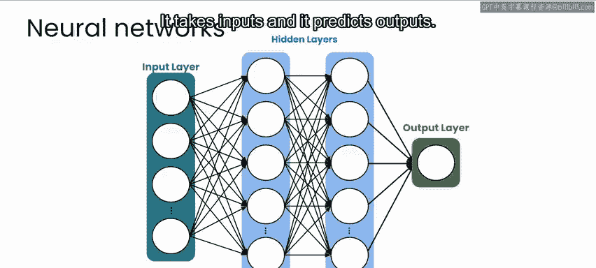

which is difficult for humans to visualize， but it's fairly simple for an artificial neural network to converge in and find the right combinations of weights to apply to each of these signals to get the best possible prediction based on the historical data。

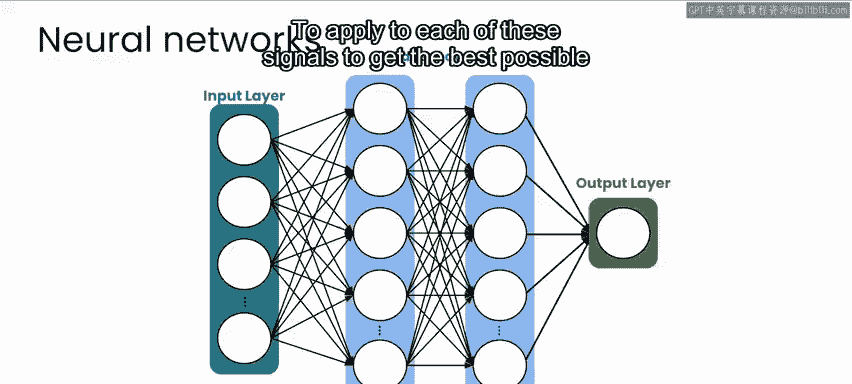

Really an artificial neural network is a computation machine where these neurons just take in a collection of inputs like the sensor data we've already been looking at。

 run a simple computation and then generate an output in this case estimates of the missing values from a sensor and so then if you have multiple layers of neurons in the network the output is not immediately predicting another sensor prediction that is going to another layer of neurons and each layer generates its own output and so the reason we have multiple layers is that they are able to find combinations of signals which go beyond a linear combination so for example you might find that PM10 is a good predictor for PM2。

5 only at certain times a day or days in the week and a neural network using these hidden layers is able to discover these kind of more nuance correlations that can be a little bit complicated。

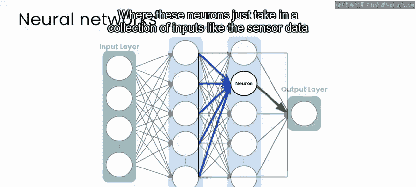

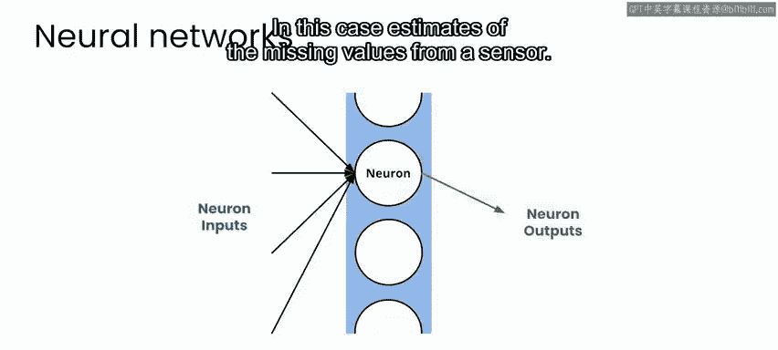

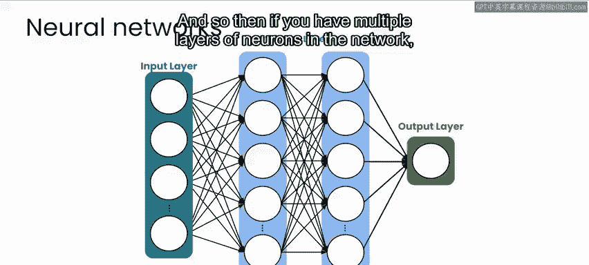

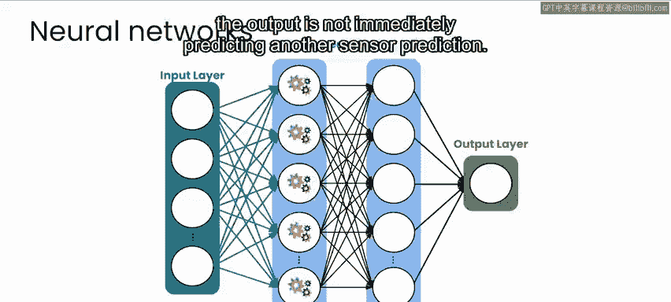

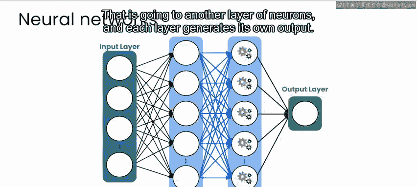

To find in purely manual analysis or in the implementation of a purely rule based system。

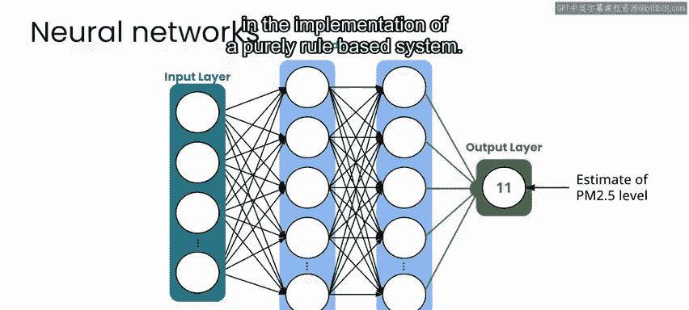

So on the left side here， you're going to feed in all the information you have for each set of measurements。

 namely time of day， day of the week， which sensor station you're considering and the values for all the other pollutants。

 and then you're going to ask the network to output a prediction for PM2。5。

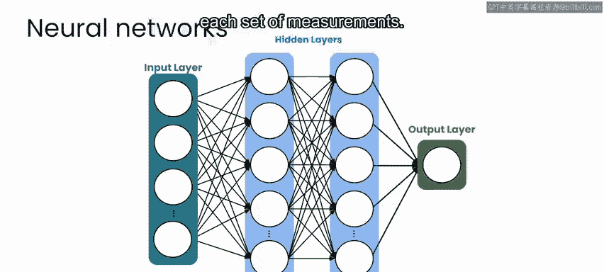

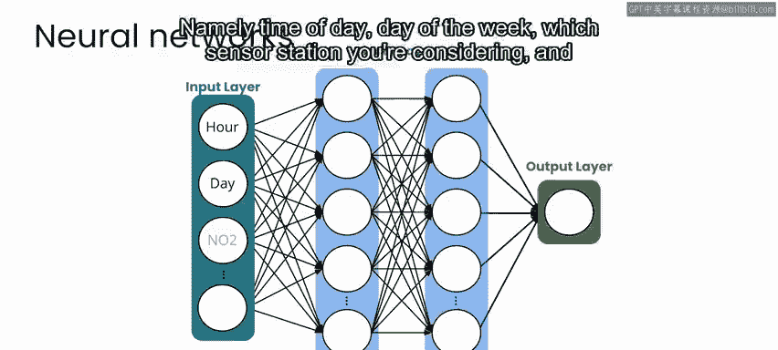

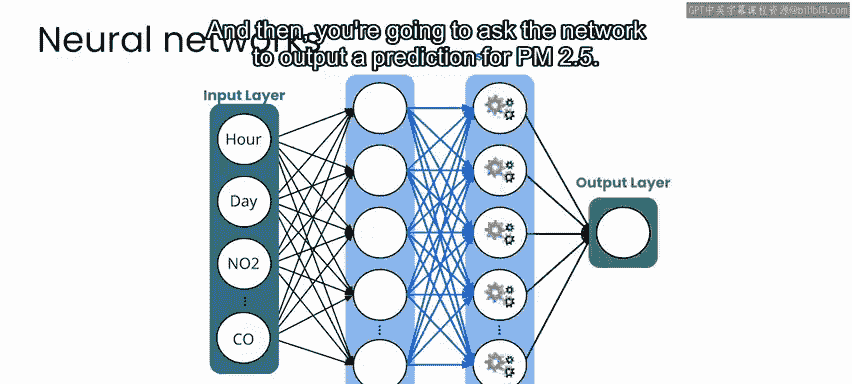

By convention we just initialize these neural networks randomly and so to begin with your network will not be good at making these predictions at all。

 but you'll train the network on examples， we think you know what the right answer is and as the network sees each new example it incrementally updates or learns to make better estimates from that data。

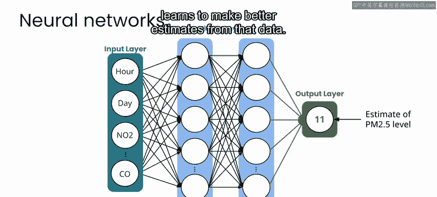

And so it's important to keep in mind that with your baseline method。

You' are only considering one piece of information in your estimates。

 namely the nearest sensor station measurement。But now， in the case of your neural network。

 you're considering much more information， including station location， time of day， day of the week。

 as well as all the other pollutant values。So let's jump into the lab and see how that works。

If you already have the lab open and you've run the cells at the top。

 looking at the nearest neighbor method as a baseline， then you can start right here。

 if you're just opening the lab now， then you should stop by running all the cells up until this point。

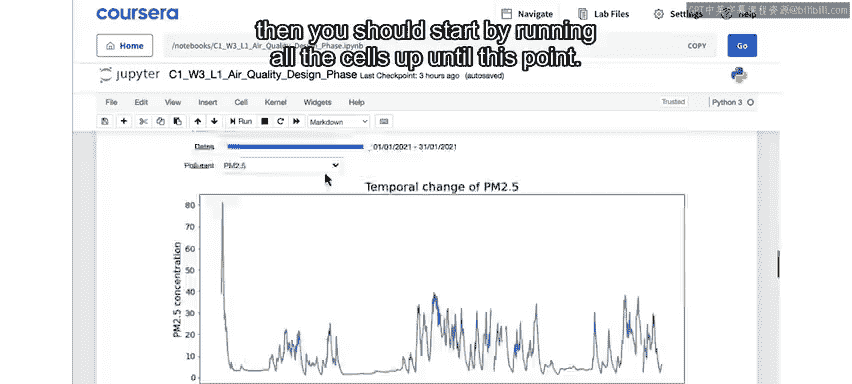

Before getting started， you'll run this next cell to pass the values in the date time column and create new columns to represent the month。

 day of week， and hour for each measurement。Here you'll also create so called one hot arrays that you can use to indicate to your neural network。

 which station a particular measurement comes from。

' shownhow you all this so that you can have a sense of exactly what the inputs are for your neural network。

 but you don't need to worry about the details here just know that preparing the data like this allows you to feed in all these features like day and time and station location in the right format。

With this code， you're also dropping all rows from the data set that contain missing values。

The reason for doing this is that you need to train your neural network on examples where you know the right answer。

 so for now we're moving or missing values for the purposes of training and testing。

The last line here is printing out a little success message to confirm that you have indeed removed all the missing values。

When you run this Excel cell， you'll split your data into a training set and a testing set。

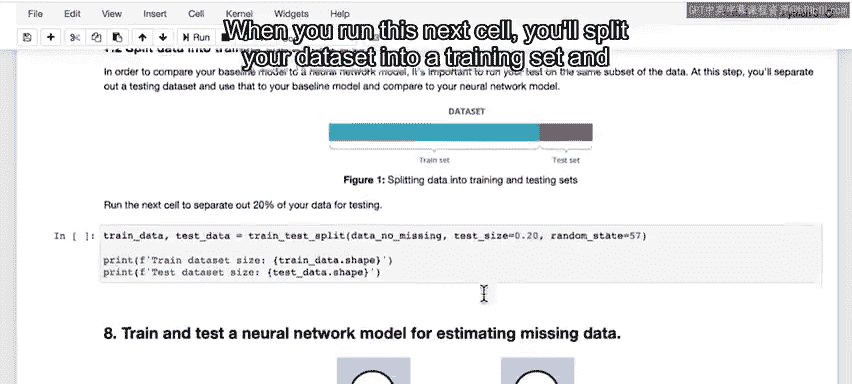

Keep in mind that in many projects you would typically split your data to also include what's called a validation set。

 which you can use to tune your model parameters and then test on data that was never seen during training or training time。

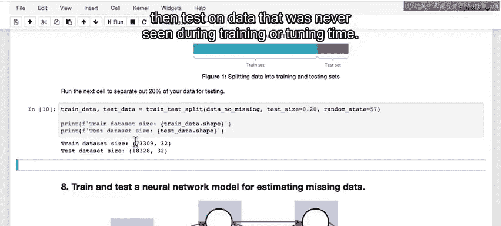

In this case， however， you'll just run training once without tu in any model parameters。

 and so you'll separate 80% of the data to train with and hold out 20% for testing。

And here you can see the sizes of the trainingient intestine sets。

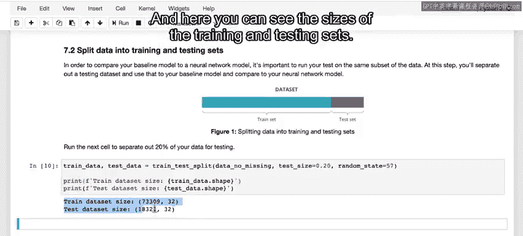

With this Excel cell， you will train on neural network model on the training data and then evaluate its performance on the test data。

Train your neural network is an iterative process and what you can see as this cell runs is that with each iteration or epoch as it's called here。

 you're seeing an estimate of something called the loss and all you really to know about loss is that as it gets lower that means your network is getting better at making predictions。

So with each it here， you can see your network learning。

You can also see an estimate of mean absolute error or MAE printed here for each epoch。

 but since this is the error measured on the training data itself。

 it's not yet representative of the model performance at the end and you'll calculate MAE for the test set that you separated out earlier。

I mentioned before that there are different errormetric that you can use depending on how you want to optimize your model。

It's worth mentioning here that behind the scenes as this neural network is training。

 it's actually optimd for mean squared error and this can be a more robust metric when it comes to outlis in the data SA and it has some mathematical properties that make it easier for the neural network to converge on the right solution。

 but that's not particularly important for this lab。😊，When the network is finished running。

 you'll test how well it does by having to make predictions on the test data set that you created before。

You can run this next cell to print out the comparison between your baseline model and your neural network You can see here that for this test set。

 your main absolute error is significantly lower about half what it was for your baseline。

When you run the N cell here， you can visualize how your new neural network model compares with different scenarios against your baseline nearest neighbor model。

Here again， you're first simulating what it looks like for a sensor to drop out for just one hour。

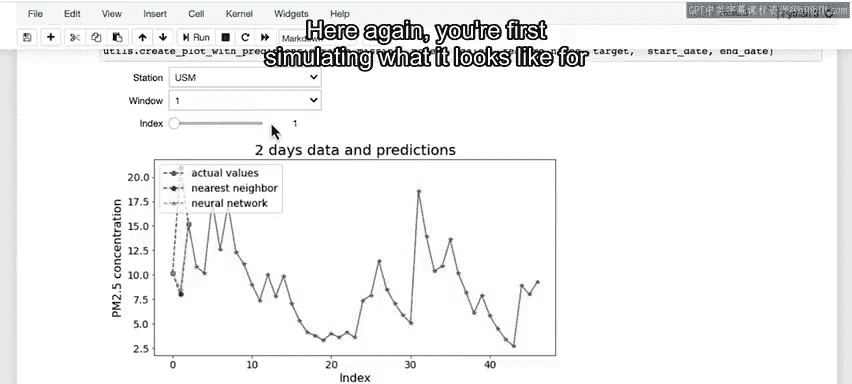

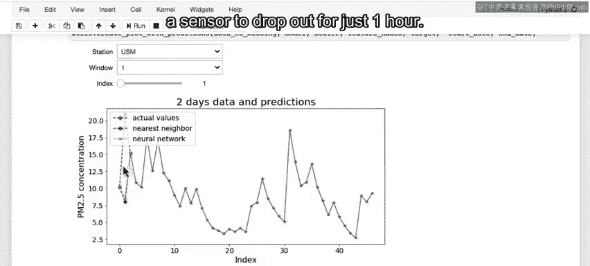

You can use these pull down menus to choose the station that you want to look at and the window size in hours。

 meaning how long of a center dropout you want to simulateimilate。

And then you can use the slider here to change the index to move the window around in time。

So here again， you have the actual measurements in red， the nearest neighbor model in green。

 and the neural network is in yellow。In some cases。

 it might look like the neural network is doing worse than the nearest neighbor's method。

But the way to interpret the mean absolute error of4 for the neural network compared to8 for the nearest neighbor method is that on average。

 the neural network estimates are four units away from the real values on this scale。

 and the nearest neighbor method is eight units away。

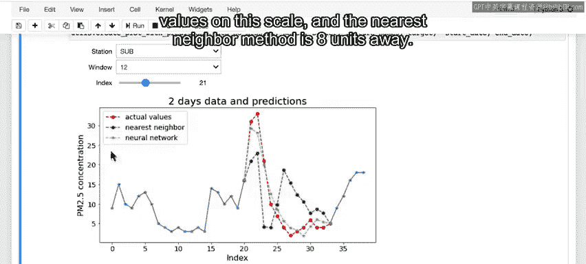

Right now， this is showing a specific date range， but you can also change the dates to other values to look at different ranges now that you've verified the performance of your model。

 the next step will be to prototype out the rest of your solution。

 including a method for making estimates of PM2。5 in between the sensors。

 and a little more work on the user interface。

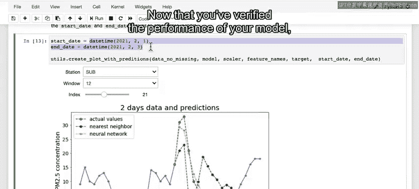

For that， you'll now use your model to fill in all the actual gaps in the data set so you can have the continuous data to work with in your prototype。

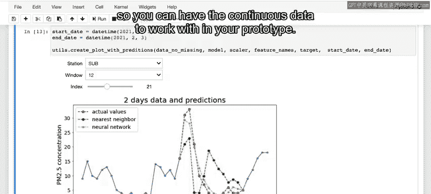

It's important to note that your neural network model requires input values for all other pollutants。

 as well as date， time and station ID。So the next step is going to be first estimated missing values for all the non PM2。

5 pollutants using a simple linear interpulation scheme。

Then run your neural network to estimate missing PM 2。5 values。 Of course， as you're doing this。

 you're creating a situation where some of your PM2。5 values。

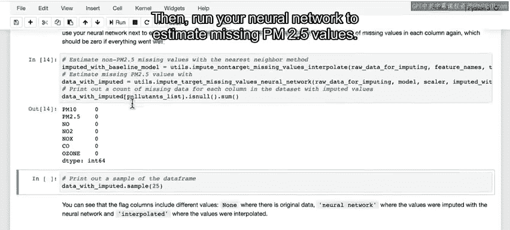

arere estimated using values for the other pollutants that were themselves estimates and the errors in those estimates could be propagating through。

 but the point here is just to fill in the gaps so that you can continue prototyping in the next lab。

In a real world scenario， you might choose to train multiple different neural network models to handle situations where other pollutant values are missing and perhaps even add neighboring sensationitation measurements into the input features for your neural network。

But here we're just going to keep it simple So with this next cell。

 you're first using a linear typeulation method to estimate all the missing non PMm2。5 values。

 Then you're estimated in PM2。5 using your neural network。

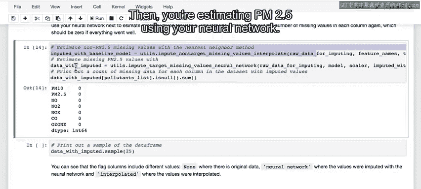

And as a final spot check， printing out the number of missing values remain。

 which should be zero for all pollutants if everything went according to plan。

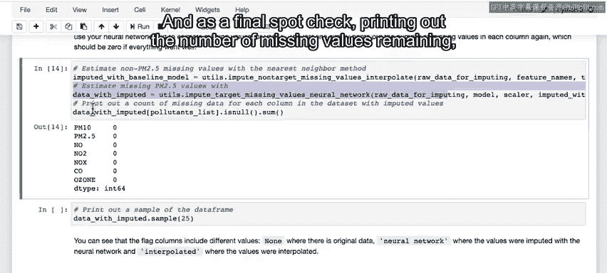

When you run this next cell， you'll print out a random sample of 25 lines of the data frame to look at the results again to S check that we have sensible output。

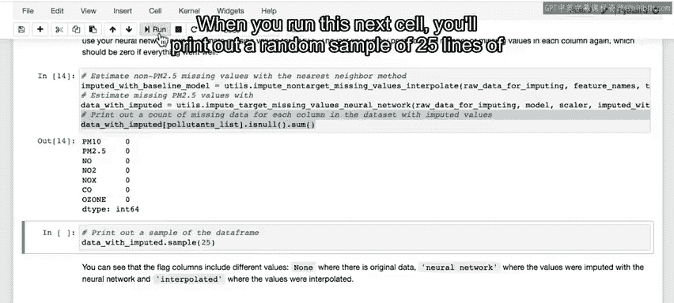

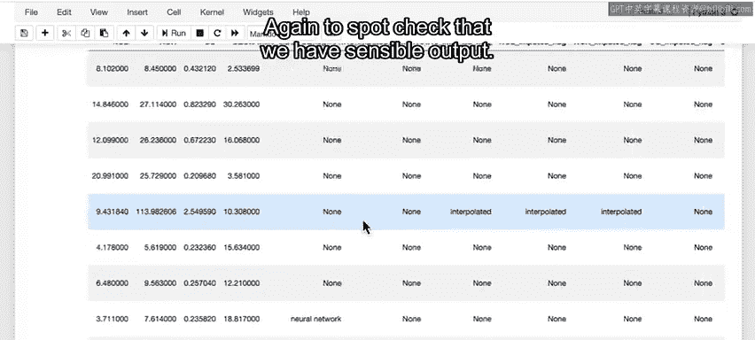

And so what you've also done with these previous steps is add some extra columns to your data set。

These imputed flag columns to indicate which values in the current data set are estimates and which ones are the real original sensor measurements So here for PM2。

5 this flag says neural old network for values that were estimated used neural neural network model。

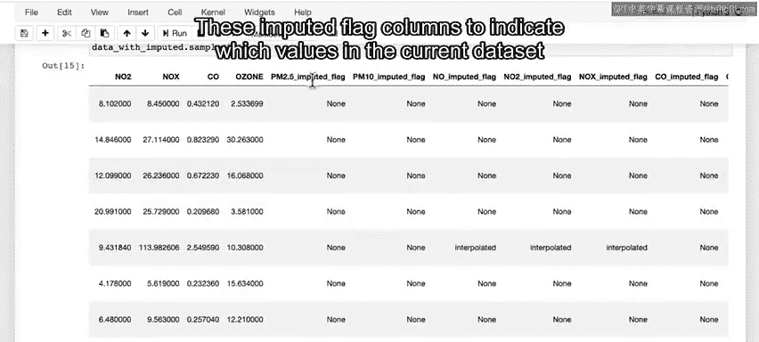

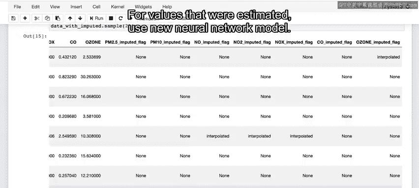

And for the other pollutant， the flag says， interpolated。

With those were filled in with a linear model。And everywhere that the flag says none。

 those are the original sensor of measurements。The purpose of adding these flags is that so later when you're displaying pollutant levels on a map。

 you can indicate which ones are direct measurements versus estimates and then if you're going to do a further processing or modeling using the data here。

 you'd be able to keep track of measurements versus estimates as well with the following cell you can visualize the results。

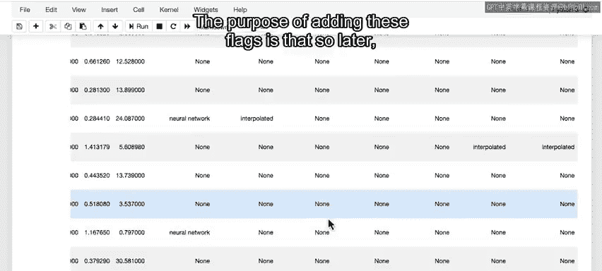

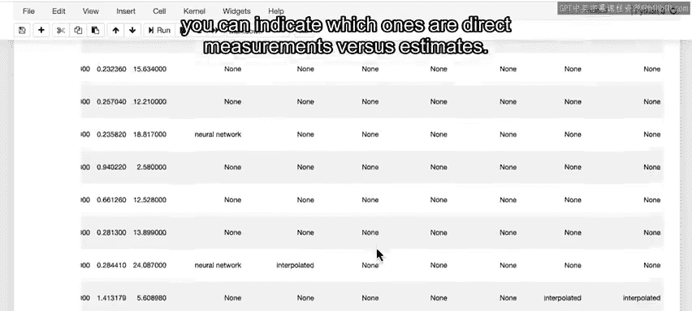

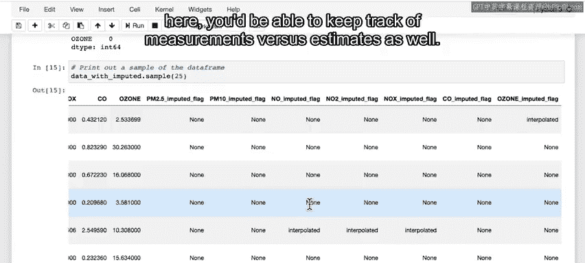

Now， again， you can use the selector here to choose a particular station and then use the slider to zoom in on a date range。

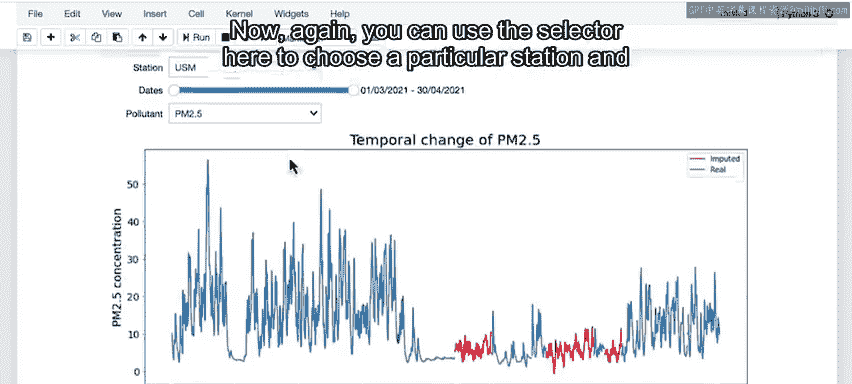

The values shown in red are the estimates you made with your model。

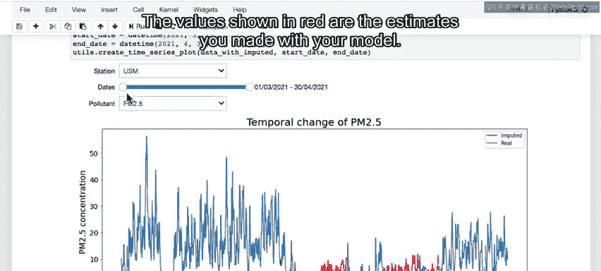

And finally， this last cell is just here to show you how you could write your results to a new CSV file。

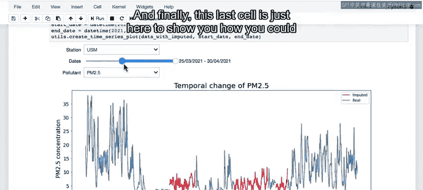

In this case， the new file will be provided to you in the next lab。

 but if you'd like to uncover this line， you can run it to save the day of yourself。

Now that you have designed a method for estimating missing values。

 it's time to design a method for estimating pollutant levels between the sensor stations。

 and that's what we'll look at in the next video。